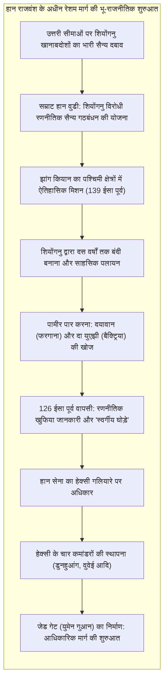
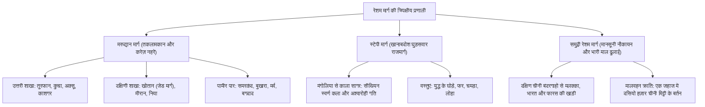

1877 में, प्रख्यात जर्मन भूगोलवेत्ता फर्डिनेंड वॉन रिचथोफेन ने अपने ऐतिहासिक ग्रंथ *China* में चीन, मध्य एशिया और भूमध्यसागरीय विश्व को जोड़ने वाले प्राचीन व्यापार मार्गों के लिए <strong>"सिल्क रोड" या "रेशम मार्ग" (Seidenstraße)</strong> शब्द गढ़ा। स्वेन हेडिन, सर ऑरेल स्टीन और पॉल पेलियट के अन्वेषणों ने इस नाम को वैश्विक ख्याति दिलाई। हालांकि, आधुनिक इतिहास और पुरातत्व ने यह सिद्ध कर दिया है कि रेशम मार्ग कोई अकेला राजमार्ग नहीं था, बल्कि यह रेगिस्तानी पगडंडियों, बर्फीले दर्रों, विशाल घास के मैदानों और समुद्री मार्गों का एक <strong>अत्यधिक गतिशील, बहु-केंद्रीकृत और जटिल नेटवर्क</strong> था।

यह महाद्वीपीय प्रणाली मुख्य रूप से तीन प्रमुख गलियारों पर आधारित थी:
1. <strong>मरुद्यान मार्ग (रेगिस्तानी रेशम मार्ग)</strong>: तकलामकान रेगिस्तान और पामीर के पहाड़ों के किनारे स्थित, जो भूमिगत जल नहर प्रणाली (*करेज़*) के चमत्कारी इंजीनियरिंग बल पर टिका था।
2. <strong>स्टेपी मार्ग (घास के मैदानों का मार्ग)</strong>: मंचूरिया से लेकर हंगरी तक फैले उत्तरी यूरेशियाई घास के मैदानों में सीथियन, हूण, तुर्क और मंगोल घुड़सवारों की अद्वितीय गतिशीलता द्वारा संचालित।
3. <strong>समुद्री रेशम मार्ग (चीनी मिट्टी और मसालों का मार्ग)</strong>: हिंद महासागर और दक्षिण चीन सागर की मानसूनी पवनों द्वारा संचालित, जिसने ग्वांगझू और क्वानझोउ को मलक्का जलडमरूमध्य, भारत, फारस की खाड़ी और लाल सागर से जोड़ा।



---

## 1. भू-राजनीतिक उत्पत्ति: झांग कियान का अभियान और हान रणनीति

रेशम मार्ग की शुरुआत किसी साधारण व्यापारिक जिज्ञासा से नहीं, बल्कि पश्चिमी हान राजवंश की राष्ट्रीय सुरक्षा और <strong>शियोंगनु</strong> खानाबदोशों के विरुद्ध रणनीतिक अस्तित्व की आवश्यकता से हुई थी।

139 ईसा पूर्व में, सम्राट हान वुडी ने अधिकारी <strong>झांग कियान</strong> को लगभग सौ लोगों के दल के साथ <strong>दा युएझी</strong> कबीले से सैन्य गठबंधन करने भेजा, जिन्हें शियोंगनु ने मध्य एशिया की ओर खदेड़ दिया था। मार्ग में शियोंगनु द्वारा पकड़े जाने के बाद झांग कियान ने दस वर्ष बंदी के रूप में बिताए, लेकिन अपने शाही क्रेडेंशियल्स को कभी नहीं छोड़ा। भागने के बाद, उन्होंने पामीर के बर्फीले शिखरों को पार कर फरगाना (<strong>दयावान</strong>) और बैक्ट्रिया का दौरा किया। यद्यपि युएझी ने युद्ध से इनकार कर दिया, 126 ईसा पूर्व में झांग कियान द्वारा चांगआन लाई गई विस्तृत भौगोलिक रिपोर्ट ने चीनी साम्राज्य के विश्व दृष्टिकोण को हमेशा के लिए बदल दिया।

सम्राट वुडी फरगाना के असाधारण <strong>"स्वर्गीय घोड़ों" (汗血馬)</strong> से अत्यंत प्रभावित हुए, जो शियोंगनु अश्वारोहियों का सामना करने के लिए अपरिहार्य थे। हान साम्राज्य ने <strong>हेक्सी गलियारे</strong> पर कब्जा कर लिया, <strong>डुनहुआंग</strong> सहित चार सैन्य चौकियां स्थापित कीं और प्रसिद्ध <strong>जेड गेट (युमेन गुआन)</strong> का निर्माण कर रेशम मार्ग को आधिकारिक रूप से चालू किया।

---

## 2. तीन प्रमुख गलियारों की स्थानिक गतिशीलता



### 2.1 मरुद्यान मार्ग और करेज़ जल इंजीनियरिंग

तकलामकान के भीषण मरुस्थल को पार करने के लिए कारवां मरुद्यानी नगरों पर निर्भर थे। इन शहरों का जीवन <strong>करेज़ (भूमिगत नहर प्रणाली)</strong> पर टिका था, जो पहाड़ों से पिघली बर्फ के पानी को वाष्पीकरण से बचाते हुए भूमिगत रूप से खेतों और शहरों तक पहुंचाती थी। काशगर के बाद, 4,000 मीटर ऊंचे पामीर को पार कर कारवां सोग्डिया के समृद्ध शहरों <strong>समरकंद</strong> और <strong>बुखारा</strong> पहुंचे, और वहां से फारस व भूमध्य सागर की ओर बढ़े।

### 2.2 स्टेपी मार्ग और घुड़सवारों की गति

यूरेशियाई घास के मैदानों में जहां ऊंटों का कारवां दिन में 25-30 किमी चलता था, वहीं खानाबदोश घुड़सवार 80-120 किमी प्रतिदिन की गति से चलते थे। प्रथम सहस्राब्दी ईसा पूर्व में <strong>सीथियन</strong> लोगों ने गतिशील पशु शैली में स्वर्ण कला विकसित की थी। यह मार्ग घोड़ों और फर के बदले चीनी रेशम और चाय के आदान-प्रदान का प्रमुख माध्यम बना।

### 2.3 समुद्री रेशम मार्ग

समुद्री मार्ग हिंद महासागर के मौसमी <strong>मानसून</strong> पर निर्भर था। जलरोधी डिब्बों वाले चीनी जंक और नारियल के रेशों से सिले अरब ढो जहाजों ने भारी माल ढुलाई की। 1998 में इंडोनेशिया में मिले 9वीं सदी के <strong>बेलितुंग मलबे</strong> से 60,000 से अधिक तांग कालीन चीनी मिट्टी के बर्तन प्राप्त हुए, जो इस समुद्री व्यापार के विशाल पैमाने को प्रमाणित करते हैं।

---

## 3. सोग्डियाई व्यापारी: प्राचीन साख और वित्त के अग्रदूत

रेशम मार्ग के सच्चे संचालक ज़ेरवश़ान घाटी (वर्तमान उज़्बेकिस्तान) के ईरानी भाषी <strong>सोग्डियाई</strong> लोग थे।

उन्होंने समरकंद से लेकर चांगआन तक अपने व्यापारिक उपनिवेश स्थापित किए। उनके कारवां का नेतृत्व <strong>सार्थवाह (Sārtavāha)</strong> करता था। तांग राजवंश ने उन्हें स्वायत्तता देते हुए उनके प्रमुख को <strong>साबाओ (薩寶)</strong> का आधिकारिक सरकारी पद दिया। 1907 में खोजी गई <strong>सोग्डियाई प्राचीन चिट्ठियां</strong> (लगभग 313 ईस्वी) साख पत्र (क्रेडिट लेटर्स), चक्रवृद्धि ब्याज ऋण और रेशम के थानों को अंतरराष्ट्रीय मुद्रा के रूप में उपयोग करने के प्रमाण देती हैं। चांगआन में सोग्डियाई शराबखाने, नृत्य (*हुक्सुआनवु*) और वस्त्र फैशन का केंद्र बन गए थे।

---

## 4. तकनीकी हस्तांतरण और भौतिक संकरण

```mermaid
flowchart LR
    subgraph पूर्व_से_पश्चिम ["पूर्व से पश्चिम की ओर प्रसार"]
        direction TB
        E1["कागज निर्माण: तलास का युद्ध (751) -> समरकंद -> बगदाद -> यूरोप"]
        E2["रेशमकीट पालन: खोतान की राजकुमारी और जस्टिनियन के भिक्षु"]
        E3["मुद्रण, बारूद और चुंबकीय कंपास"]
    end
    
    subgraph पश्चिम_से_पूर्व ["पश्चिम से पूर्व की ओर सामग्री"]
        direction TB
        W1["फूंक कर बना कांच: रोमन और सासानियन कटोरे -> शोसोइन (जापान)"]
        W2["कोबाल्ट नीला: फारस -> जिंगदेझेन नीली और सफेद चीनी मिट्टी"]
        W3["फसलें: अंगूर, अल्फाल्फा, अनार, तिल"]
    end
```

### 4.1 तलास का युद्ध (751 ई.) और कागज की वैश्विक क्रांति

जुलाई 751 ईस्वी में <strong>तलास नदी</strong> के तट पर तांग सेना और अब्बासी खिलाफत की सेनाओं के बीच भीषण युद्ध हुआ। इसमें बंदी बनाए गए चीनी कागज़ निर्माताओं को समरकंद ले जाया गया, जहां विश्व प्रसिद्ध <strong>समरकंद पेपर</strong> का जन्म हुआ। यह तकनीक 793 ईस्वी में बगदाद पहुंची और <strong>बैतुल हिक्मा (ज्ञान का घर)</strong> और इस्लामी स्वर्ण युग की आधारशिला बनी, जिसने आगे चलकर यूरोप में प्रिंटिंग क्रांति का मार्ग प्रशस्त किया।

### 4.2 नीली और सफेद चीनी मिट्टी: एक अद्भुत संगम

14वीं शताब्दी में मंगोल युआन राजवंश के दौरान जिंगदेझेन में <strong>नीली और सफेद चीनी मिट्टी (Qinghua)</strong> का अभूतपूर्व विकास हुआ। इसमें चीन की 1,300 डिग्री सेल्सियस पर पकी शुद्ध काओलिन मिट्टी और ईरान की काशान खदानों से आयातित शुद्ध कोबाल्ट रंग (<strong>मुहम्मडन ब्लू / हुईहुई किंग</strong>) का मिलन हुआ। यह हाइब्रिड बर्तन ओटोमन और सफाविद साम्राज्यों में अत्यधिक लोकप्रिय हुए।

---

## 5. आध्यात्मिक संगम और गांधार ग्रीको-बौद्ध कला

रेशम मार्ग विचारों और आस्थाओं का महान मिलन स्थल था:
- <strong>गांधार कला</strong>: सिकंदर महान के अभियानों के बाद, हेलेनिस्टिक मूर्तिकला का महायान बौद्ध धर्म से ऐतिहासिक मिलन हुआ। बुद्ध को पहली बार ग्रीक देवता <strong>अपोलो</strong> की मुखाकृति और रोमन टोगा जैसी सिलवटों वाले वस्त्रों में मानवरूपी रूप दिया गया। संरक्षक वज्रपाणि का स्वरूप सीधे ग्रीक नायक <strong>हेराक्लीज़</strong> से लिया गया था।
- <strong>ह्वेन त्सांग की ऐतिहासिक तीर्थयात्रा</strong>: विद्वान भिक्षु ह्वेन त्सांग ने भारत में 16 वर्षों (629-645 ई.) तक भ्रमण किया, नालंदा विश्वविद्यालय में अध्ययन किया और अपनी कालजयी पुस्तक *सी-यू-की* लिखी।
- <strong>चांगआन में धार्मिक सह-अस्तित्व</strong>: राजधानी चांगआन में बौद्ध धर्म के साथ-साथ नेस्टोरियन ईसाई धर्म (781 ई. का शिलालेख), मानी धर्म और जोरास्ट्रियन धर्म शांतिपूर्वक फले-फूले।

---

## 6. पैक्स मंगोलिका और याम डाक व्यवस्था

13वीं शताब्दी में चंगेज खान के साम्राज्य ने यूरेशिया को <strong>पैक्स मंगोलिका</strong> के अंतर्गत एकीकृत किया।

इसकी रीढ़ <strong>याम (Örtöö / Zhanchi)</strong> डाक व्यवस्था थी, जहां हर 40 किमी पर ताज़ा घोड़े और चौकियां उपलब्ध थीं। शाही <strong>पाइज़ा</strong> पदक धारण करने वाले संदेशवाहक 24 घंटों में 200 किमी तक की यात्रा करते थे। मार्को पोलो और इब्न बतूता जैसे यात्रियों ने सुरक्षित महाद्वीपीय यात्राएं कीं, जबकि कागजी मुद्रा (<strong>जियाओचाओ</strong>) ने व्यापार को गति दी।

किंतु इसी तीव्र नेटवर्क ने 1346-1353 में <strong>ब्लैक डेथ (प्लेग)</strong> के जीवाणुओं को भी तेजी से फैलाया, जिसने यूरेशिया की एक तिहाई आबादी को लील लिया।

---

## 7. समुद्री युग का उदय और स्थलीय मार्ग का अवसान

1498 में वास्को डी गामा द्वारा केप ऑफ गुड होप के समुद्री मार्ग की खोज के साथ महासागरीय व्यापार का वर्चस्व स्थापित हुआ। एक समुद्री जहाज हजारों ऊंटों के बराबर माल अत्यंत कम लागत और बिना चुंगी दिए ले जा सकता था।

साथ ही, छोटे हिमयुग के कारण नदियां सूख गईं और लोलान व निया जैसे मरुद्यानी नगर रेत के नीचे दब गए। इस प्रकार प्राचीन स्थलीय रेशम मार्ग धीरे-धीरे क्षेत्रीय बाजारों तक सिमट गया।

---

## 8. निष्कर्ष: 21वीं सदी के लिए शाश्वत सीख

रेशम मार्ग का सबसे गहरा संदेश यह है कि: <strong>सभ्यताएं अलगाव में नहीं, बल्कि अन्य संस्कृतियों के साथ खुले संवाद, सह-अस्तित्व और रचनात्मक मिश्रण के माध्यम से ही समृद्ध होती हैं।</strong>

आज, <strong>चाइना रेलवे एक्सप्रेस</strong> मालगाड़ियां, महाद्वीपीय गैस पाइपलाइनें और फाइबर-ऑप्टिक केबल नेटवर्क प्राचीन रेशम मार्ग के भूगोल को पुनः जीवित कर रहे हैं। रेशम मार्ग की स्मृतियां हमें सीमाओं से परे जाकर एक साझा और सामंजस्यपूर्ण वैश्विक भविष्य के निर्माण की प्रेरणा देती हैं।