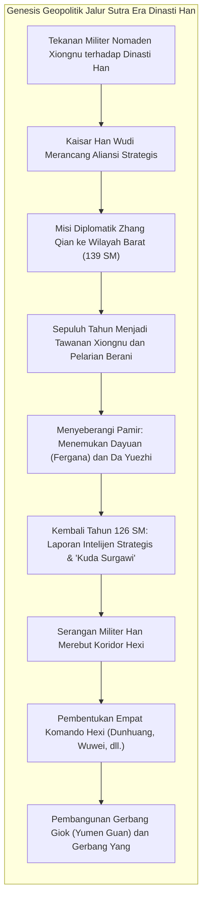
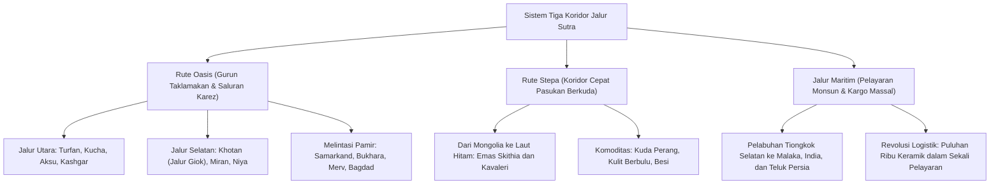
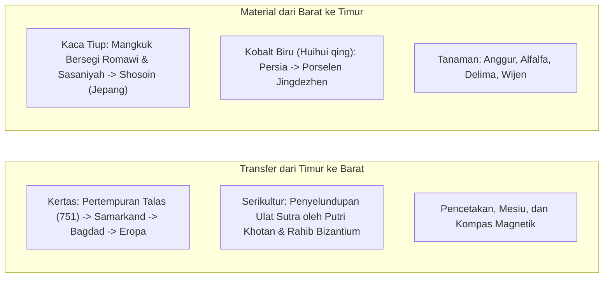

Pada tahun 1877, ahli geografi terkemuka Jerman Ferdinand von Richthofen menciptakan istilah abadi <strong>"Jalur Sutra" (Seidenstraße)</strong> dalam karya monumentalnya *China*. Dipopulerkan di seluruh dunia melalui ekspedisi Sven Hedin, Sir Aurel Stein, dan Paul Pelliot, konsep ini membangkitkan romantisme sejarah yang luar biasa. Namun, historiografi dan arkeologi modern membuktikan bahwa Jalur Sutra bukanlah satu jalan raya tunggal yang statis, melainkan sebuah <strong>jaringan kontinental terpadu, dinamis, dan multisentris</strong> yang merajut jalur gurun, celah pegunungan es, padang stepa tak bertepi, dan rute pelayaran samudra.

Jaringan trans-Eurasia ini ditopang oleh tiga arteri utama:
1. <strong>Rute Oasis (Jalur Gurun)</strong>: Mengitari Gurun Taklamakan dan dataran tinggi Pamir, menghubungkan negara-kota oasis berkat sistem irigasi bawah tanah cerdas (*karez*).
2. <strong>Rute Stepa</strong>: Membentang melintasi padang rumput Eurasia utara dari Manchuria hingga lembah sungai Don dan dataran Hungaria, digerakkan oleh mobilitas pasukan berkuda nomaden (Skithia, Xiongnu, Turk, dan Mongol).
3. <strong>Jalur Sutra Maritim (Rute Keramik dan Rempah-rempah)</strong>: Dituntun oleh hembusan angin monsun Samudra Hindia dan Laut Cina Selatan, menghubungkan pelabuhan Guangzhou dan Quanzhou dengan Selat Malaka, pesisir India, Teluk Persia, dan Laut Merah untuk pengangkutan kargo massal.

---

## 1. Asal-Usul Geopolitik: Misi Zhang Qian dan Strategi Han

Terbukanya Jalur Sutra bermula bukan dari rasa ingin tahu perdagangan semata, melainkan dari urgensi keamanan nasional Dinasti Han Barat dalam menghadapi konfederasi nomaden <strong>Xiongnu</strong>.

Pada abad ke-2 SM, konfederasi Xiongnu mendominasi padang rumput utara dan menekan Dinasti Han untuk membayar upeti tahunan sutra, biji-bijian, dan putri kekaisaran. Untuk mematahkan belenggu ini, Kaisar Han Wudi pada 139 SM mengutus perwira <strong>Zhang Qian</strong> bersama seratus anggota delegasi untuk menjalin persekutuan militer dengan bangsa nomaden <strong>Da Yuezhi</strong> yang telah diusir ke Asia Tengah oleh Xiongnu.

Ditangkap dan ditahan selama lebih dari satu dekade oleh Xiongnu, Zhang Qian tidak pernah melepaskan tongkat kredensial kekaisarannya. Setelah berhasil meloloskan diri, ia melintasi puncak-puncak es Pamir, menjelajahi lembah Fergana (<strong>Dayuan</strong>) dan Baktria. Kendati aliansi perang ditolak karena Da Yuezhi telah hidup damai di lembah Amu Darya, laporan geografis dan politik yang dibawa pulang Zhang Qian ke Chang'an pada 126 SM mengubah cakrawala pandang bangsa Tionghoa untuk selamanya.

Kaisar Wudi sangat terpikat oleh keberadaan <strong>"Kuda Surgawi" (汗血馬)</strong> dari Fergana yang memiliki stamina luar biasa, sangat dibutuhkan untuk membangun kavaleri tangguh guna menandingi pemanah berkuda Xiongnu. Pasukan Han kemudian merebut <strong>Koridor Hexi</strong>, mendirikan empat pos militer utama termasuk <strong>Dunhuang</strong>, dan membangun benteng perbatasan <strong>Gerbang Giok (Yumen Guan)</strong>, meresmikan jalur karavan lintas benua.

---

## 2. Dinamika Tiga Koridor Utama Jalur Sutra

### 2.1 Rute Oasis dan Keajaiban Hidrolik Karez

Di sekitar Gurun Taklamakan yang mematikan, karavan bergantung pada kota-kota oasis yang dialiri oleh jaringan <strong>karez (qanat)</strong>: terowongan air bawah tanah yang menyalurkan lelehan gletser gunung melintasi puluhan kilometer tanpa menguap di bawah terik gurun. Melewati Kashgar dan mendaki dataran tinggi Pamir setinggi 4.000 meter, para pedagang tiba di pusat perdagangan Sogdiana di <strong>Samarkand</strong> dan <strong>Bukhara</strong>, lalu meneruskan perjalanan ke Persia dan Mediterania.

### 2.2 Rute Stepa: Jalur Cepat Kavaleri

Di padang rumput Eurasia utara, jika karavan unta hanya mampu menempuh 25–30 km per hari, prajurit berkuda nomaden dengan kuda pengganti mampu melaju 80–120 km setiap hari. Sejak milenium pertama SM, bangsa <strong>Skithia</strong> telah memadukan seni emas bergaya binatang dinamis. Jalur stepa menjadi jalan raya ekspres pertukaran kuda dan bulu binatang dengan sutra dan teh dari Tiongkok.

### 2.3 Jalur Sutra Maritim: Logistik Skala Besar

Pelayaran laut digerakkan oleh pergantian <strong>angin monsun</strong>. Jung Tiongkok dengan kompartemen kedap air dan dhow Arab yang dijahit dengan serat kelapa membawa muatan raksasa: kapal karam <strong>Belitung</strong> (abad ke-9) yang ditemukan di perairan Indonesia membawa lebih dari 60.000 keping keramik Dinasti Tang menuju Teluk Persia.

---

## 3. Pedagang Sogdiana: Pelopor Lembaga Kredit Kuno

Penggerak utama perniagaan darat Jalur Sutra adalah bangsa <strong>Sogdiana</strong>, penutur bahasa Iranik dari lembah Zeravshan (Uzbekistan saat ini).

Mereka mendirikan koloni perdagangan di sepanjang rute hingga Chang'an dan Luoyang. Karavan mereka dipimpin oleh seorang <strong>sārtavāha</strong>. Dinasti Tang mengakui otonomi mereka dengan mengangkat pemimpin komunitas menjadi pejabat resmi <strong>Sabao (薩寶)</strong> yang juga mengawasi kuil api Zoroaster. <strong>Surat-surat Kuno Sogdiana</strong> (sekitar 313 M) membuktikan penggunaan surat kredit, pinjaman berbunga majemuk, dan penggunaan gulungan sutra sebagai standar mata uang internasional. Di Chang'an, gaya hidup Sogdiana ("budaya Hu") sangat digemari: kedai anggur, busana berkuda, dan tarian berputar cepat (*Huxuanwu*).

---

## 4. Transfer Teknologi dan Hibriditas Material

### 4.1 Pertempuran Talas (751 M) dan Revolusi Kertas Dunia

Pada Juli 751 M, di tepi Sungai <strong>Talas</strong>, tentara Dinasti Tang bertempur melawan pasukan Kekhalifahan Abbasiyah. Pengkhianatan tentara bayaran Karluk menyebabkan kekalahan telak pasukan Tang.

Pengrajin kertas Tionghoa yang ditawan dibawa ke Samarkand, melahirkan <strong>kertas Samarkand</strong> yang tersohor halus dan kuat. Pabrik kertas didirikan di Bagdad pada 793 M, menopang berdirinya <strong>Baitul Hikmah (House of Wisdom)</strong> dan Zaman Keemasan Islam. Teknologi ini menyebar ke Spanyol (Xàtiva, 1150) dan Italia (Fabriano, 1268), menjadi fondasi mesin cetak Gutenberg dan pencerahan ilmiah di Eropa.

### 4.2 Porselen Biru-Putih: Simbiosis Tiongkok-Persia

Pada abad ke-14 di bawah Dinasti Yuan, terciptalah <strong>porselen biru-putih (Qinghua)</strong> di Jingdezhen: tanah liat kaolin murni yang dibakar pada suhu 1.300 °C berpadu dengan pigmen kobalt alami bermutu tinggi dari Kashan (Persia), yang dikenal sebagai <strong>biru Mohammedan (Huihui qing)</strong>. Porselen mewah ini diekspor secara besar-besaran ke istana Ottoman dan Safawiyah, lalu memicu demam *chinoiserie* di Eropa.

---

## 5. Pertemuan Spiritual dan Seni Buddha-Yunani Gandhara

Jalur Sutra merupakan laboratorium teologis lintas benua:
- <strong>Seni Gandhara</strong>: Mengikuti ekspedisi Aleksander Agung, tradisi pemahatan Yunani bertemu dengan ajaran Buddha Mahayana. Sang Buddha dipahat untuk pertama kalinya dalam wujud manusia rupawan berwajah dewa <strong>Apollo</strong> dengan jubah toga Romawi. Pelindung Vajrapani diilhami langsung oleh pahlawan mitologi <strong>Herakles</strong>.
- <strong>Perjalanan Suci Xuanzang</strong>: Biksu agung Xuanzang mengembara selama 16 tahun ke India (629–645 M), menimba ilmu di Universitas Nalanda, dan menulis catatan berharga *Da Tang Xiyu Ji*.
- <strong>Pluralisme Agama di Chang'an</strong>: Agama Buddha hidup berdampingan secara harmonis dengan Kristen Nestorian (Prasasti Nestorian 781 M), Manikeisme, dan Zoroastrianisme.

---

## 6. Pax Mongolica dan Jaringan Pos Yam

Pada abad ke-13, Kekaisaran Mongol menyatukan daratan Eurasia di bawah <strong>Pax Mongolica</strong>.

Jantung komunikasinya adalah sistem pos kilat <strong>Yam (Örtöö / Zhanchi)</strong>: setiap 40 km tersedia kuda segar dan pos istirahat. Utusan yang membawa lempeng paspor kekaisaran (<strong>Paiza</strong>) memacu kuda siang dan malam melintasi hingga 200 km dalam 24 jam. Penjelajah seperti Marco Polo dan Ibn Battuta dapat bepergian dengan aman melintasi benua, ditopang oleh peredaran uang kertas (<strong>Jiaochao</strong>).

Namun, keterhubungan kilat ini juga memicu bencana biologis: bakteri *Yersinia pestis* (<strong>Maut Hitam 1346–1353</strong>) menyebar dengan cepat, menewaskan sepertiga populasi Eurasia dan meruntuhkan tatanan kekaisaran.

---

## 7. Zaman Penjelajahan Samudra dan Senja Jalur Darat

Penemuan rute laut mengelilingi Tanjung Harapan oleh Vasco da Gama pada 1498 merevolusi perdagangan. Satu kapal layar besar mampu membawa kargo ribuan unta dengan biaya sangat murah dan bebas dari pungutan liar di darat.

Di saat bersamaan, Zaman Es Kecil mengeringkan sungai-sungai oasis, menenggelamkan kota-kota seperti Loulan dan Niya di bawah bukit pasir gurun. Jalur Sutra darat pun meredup menjadi sekadar rute pasar lokal.

---

## 8. Kesimpulan: Warisan untuk Abad ke-21

Pelajaran abadi dari Jalur Sutra menegaskan bahwa: <strong>kemajuan peradaban manusia tidak lahir dari isolasi tertutup, melainkan dari dialog, keterbukaan, dan sintesis kreatif dengan Yang Lain.</strong>

Kini, kereta barang <strong>China Railway Express</strong>, jaringan pipa gas lintas benua, dan kabel serat optik merevitalisasi koridor bersejarah ini. Mengenang Jalur Sutra adalah menggali kembali kearifan untuk merajut jembatan kerja sama di tengah dunia yang terus berubah.