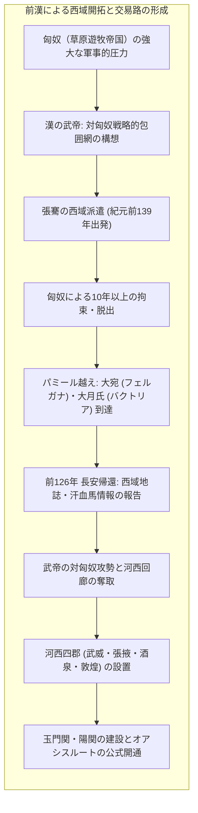
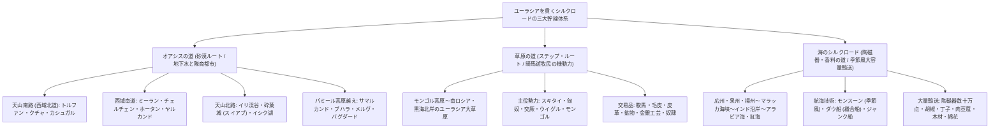
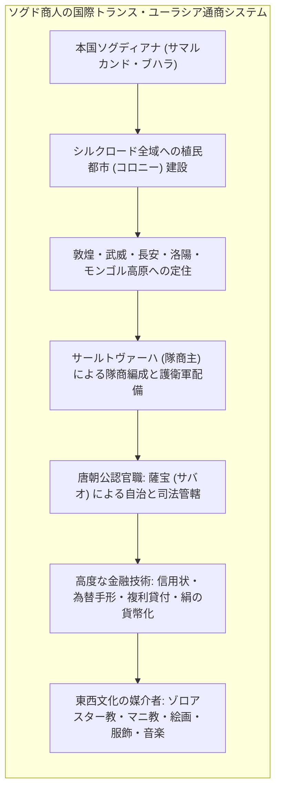
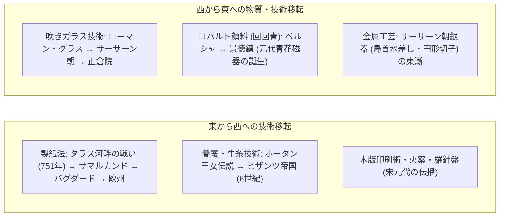
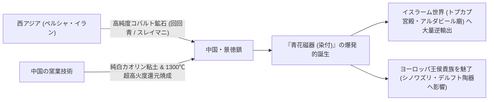
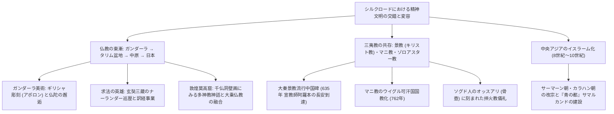
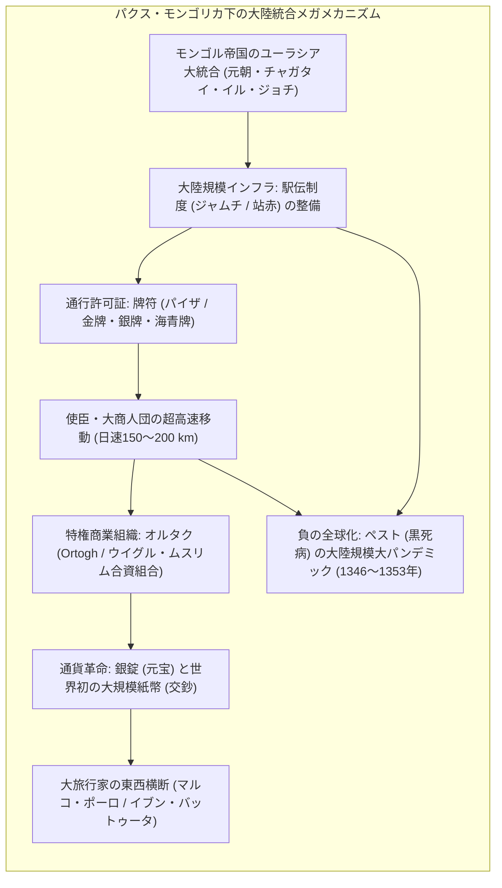
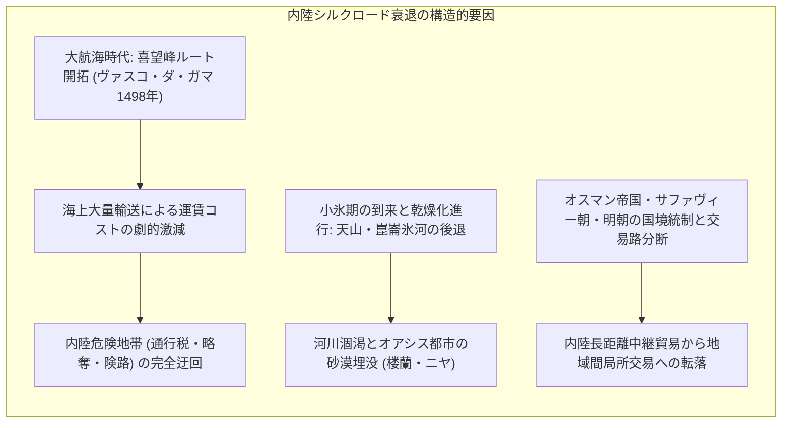
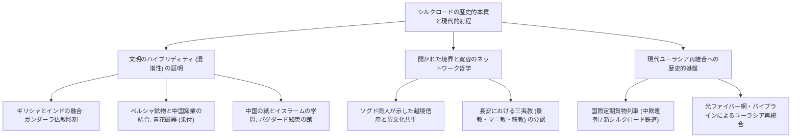

1877年、ドイツの偉大な地理学者フェルディナント・フォン・リヒトホーフェン（Ferdinand von Richthofen）はその主著『中国（China）』第1巻において、漢代以来、中央アジアを横断して中国と地中海世界を結んだ古代の通商路を指して「<strong>絹の道（Seidenstraße / Silk Road）</strong>」という詩的かつ学術的な呼称を初めて提唱しました。その後、彼の弟子であるスウェーデンの探検家スヴェン・ヘディン（Sven Hedin）の著作や、英国の考古学者マーク・オーレル・スタイン（Sir Marc Aurel Stein）、フランスのポール・ペリオ（Paul Pelliot）らによる砂漠探検と古文書発掘によって、この名称は世界中の人々の冒険心とロマンをかき立てる普遍的なシンボルとなりました。

しかし、現代の歴史学、考古学、経済人類学が明らかにしたシルクロードの実態は、単一の平坦な一本の道などでは決してありませんでした。それは、ユーラシア大陸の険しい地形と極限気候を縫うように張り巡らされた、極めて複雑かつ多層的な「結節点（ノード）と経路（リンク）の動的ネットワーク」でした。

シルクロードは主として三つの巨大な動脈系によって構成されていました：
1. <strong>オアシスの道（砂漠ルート）</strong>: タクラマカン砂漠やパミール高原の周縁に点在するオアシス都市国家群をラクダの隊商（キャラバン）が結んだ、最も古典的かつ文化密度の高いルート。
2. <strong>草原の道（ステップ・ルート）</strong>: ユーラシア北方の広大な草原地帯を舞台に、スキタイ、匈奴、突厥、モンゴルといった騎馬遊牧民の圧倒的な軍事機動力と家畜・毛皮・鉄器の流通によって駆動された高速幹線。
3. <strong>海のシルクロード（陶磁器の道・香料の道）</strong>: モンスーン（季節風）の周期的交代を巧みに利用し、南シナ海からマラッカ海峡、インド洋、アラビア海、紅海、ペルシャ湾を結んで大量の陶磁器や香辛料、織物を運んだ大容量海上通商路。

この三つの幹線網を通じて行き交ったのは、豪奢な中国産生糸、ローマの吹きガラス器、ペルシャの精緻な銀製器物といった一握りの特権階級向けの奢侈品だけではありませんでした。人類の知的生産とコミュニケーションのあり方を根本から覆した「製紙法」「印刷術」「羅針盤」「火薬」という四大発明、養蚕・製糸技術、高火度施釉陶磁器の焼成技術といった物質テクノロジーが東西へ双方向に伝播しました。

さらには、ガンダーラにおいてギリシャ彫刻と出会い人面仏像を生み出した仏教の東漸、唐の都・長安を彩った景教（ネストリウス派キリスト教）やマニ教、ゾロアスター教の浸透、そして中央アジアから中国西部を席巻したイスラーム化の波など、人類の精神世界を規定する諸宗教と思想が、この巨大な動脈を通じて越境と混淆（ハイブリディティ）を繰り返しました。

本稿では、紀元前2世紀の前漢・張騫による西域開拓から、ソグド商人による国境を越えた商業・金融ネットワーク、物質技術と美術図像の双方向的変容、玄奘三蔵の求法行と東西宗教交渉、そして13〜14世紀のモンゴル帝国による「パクス・モンゴリカ」下の地球的一体化に至るまで、東西文明交渉の壮大なる全容を学術的知見に基づいて体系的に解剖します。

---

## 1. シルクロードの起源：前漢の地政学的野心と張騫の西域使節行

シルクロードが歴史の公的舞台に確固たる姿を現した契機は、ロマンチックな商業的動機などではなく、古代帝国の国家安全保障を巡る過酷な地政学的対立でした。

### 1.1 匈奴の脅威と「大月氏」軍事同盟計画

紀元前3世紀末、中国北方の草原地帯には冒頓単于（ぼくとつぜんう）率いる騎馬遊牧国家<strong>匈奴（きょうど）</strong>が勃興し、強大な軍事力をもって漢の北辺を圧迫していました。漢の初代皇帝・高祖劉邦自らが白登山の戦い（前200年）で匈奴軍に包囲されて敗北し、以後、漢は毎年大量の絹織物、穀物、酒、そして皇女を単于に貢納して屈辱的な平和を買い続ける「和親政策」を余儀なくされていました。

紀元前141年に即位した第7代皇帝・武帝は、この屈辱的な外交関係を打破し、匈奴を軍事的に撃破することを決意しました。その際、かつて河西地方に居住していた遊牧民族<strong>大月氏（たいげつし）</strong>が匈奴に敗れ、老上単于によって王の頭蓋骨を盃に加工されるという怨恨を抱いて西へと逃亡したという情報を得た武帝は、大月氏と軍事同盟を結んで匈奴を東西から挟撃する壮大な戦略を構想しました。

紀元前139年、武帝の命を受けた下級官吏<strong>張騫（ちょうけん）</strong>は、匈奴出身の案内人・堂邑父（甘父）ら約100名の使節団を率いて長安を出発しました。しかし、長安を出て間もなく使節団は匈奴の哨戒部隊に捕らえられ、張騫は単于の宮廷に連行されました。張騫は匈奴の地で妻を与えられ、子供をもうけ、10年以上の歳月を虜囚として過ごすことになります。しかし彼は漢の使節としての信標（節）を決して手放さず、匈奴の監視が緩んだ隙を突いて脱出に成功しました。

### 1.2 パミール高原の踏破と大宛・大月氏の発見

張騫一行は西へと逃亡を続け、タクラマカン砂漠の北縁を抜け、標高4,000メートルを超える天山山脈・パミール高原の峻険な峠を越えて、フェルガナ盆地に栄えていた<strong>大宛（だいえん）</strong>に到達しました。大宛王は以前から漢の豊かな富と文化を聞き及んでおり、張騫を歓迎して康居（こうきょ）を経て、アムダリア川上流域（トランスオクシアナ／古代バクトリア）に定住していた大月氏の王庭へと送り届けました。

当時の大月氏は、肥沃なトランスオクシアナの農耕地帯を支配下に収め、外敵の脅威も少ない豊かな土地で平和を享受していました。大月氏の女王は、遠く離れた漢と同盟を結んで今さら強大な匈奴へ復讐戦を挑むことに全く関心を示しませんでした。張騫は大月氏の地に1年以上滞在して同盟締結を説得しましたが、交渉は失敗に終わりました。

紀元前128年頃、張騫は帰国の途に就き、今度は匈奴の勢力圏を避けてタクラマカン砂漠の南縁（崑崙山脈の北麓）を通るルートを選びましたが、再びチベット系羌族の領域で匈奴に捕縛されました。1年余りの拘禁の後、単于の死去に伴う匈奴内部の内紛に乗じて脱出し、紀元前126年、出発から13年ぶりに長安へと帰還しました。100余名いた使節団のうち、生還したのは張騫と堂邑父のわずか2名のみでした。

### 1.3 汗血馬の伝説と河西回廊の軍事制圧

軍事同盟の締結という本来の目的は達成できなかったものの、張騫が長安にもたらした情報は、中国人の世界観を根底から覆す決定的な価値を持っていました。張騫は、大宛、康居、大月氏、大夏（バクトリア）、安息（パルティア）、条支（セレウコス朝系シリア）、身毒（インド）など、これまで漢が知らなかった広大な西域諸国の地理、軍事力、特産品、政治情勢を武帝に詳細に報告しました。

中でも武帝の心を激しく捉えたのが、大宛で産出する<strong>「汗血馬（かんけつば）」</strong>の存在でした。この馬は「血のような汗を流し、1日に千里を走る」と伝えられ、背骨が太く俊敏で持久力に富んでいました。当時の漢軍が保有していたモンゴル系の短足馬では、機動性に優れた匈奴の遊牧騎兵に到底太刀打ちできませんでした。匈奴を圧倒できる強力な重装・高速騎兵軍団を編成するために、汗血馬の獲得は漢帝国の至上命題となったのです。

武帝は大将軍の衛青や霍去病を派遣して対匈奴大攻勢を展開し、紀元前121年、甘粛省に位置する<strong>河西回廊（かせいかいろう）</strong>から匈奴勢力を完全に駆逐しました。漢はこの回廊地帯に<strong>河西四郡（武威、張掖、酒泉、敦煌）</strong>を設置し、長城を西へと延伸して、西の最前線に<strong>玉門関（ぎょくもんかん）</strong>と<strong>陽関（ようかん）</strong>という二大関所を築きました。

その後、大宛が汗血馬の漢への供出を拒否し漢の使者を殺害すると、武帝は李広利将軍率いる数万の遠征軍を二度にわたって数千キロ彼方のフェルガナへと派遣しました（大宛遠征、前104年〜前101年）。激戦の末に大宛を降伏させた漢軍は、数十頭の極上汗血馬と3,000頭余りの優良馬を獲得して凱旋しました。こうして中国本土から中央アジアへと直結する安全な軍事・通商回廊が切り拓かれ、オアシスの道が正式に稼働を開始したのです。

---

## 2. シルクロードの三大幹線と地理空間動態

ユーラシア大陸の巨大な地理空間と多様な気候帯によって規定されたシルクロードの通商網は、大きく三つの主要幹線系に分類されます。これらは孤立して存在していたのではなく、網目状の支線（フィーダー・ルート）によって有機的に連結され、環境変化や戦乱に応じて柔軟に交通量をシフトさせるダイナミックな冗長性を備えていました。

### 2.1 オアシスの道（砂漠ルート）：死の砂漠を取り巻く隊商都市網

「オアシスの道」は、ゴビ砂漠およびタクラマカン砂漠（ウイグル語で「入ったら二度と出られない」を意味する）の苛酷な乾燥地帯を貫いて形成されました。長安（または洛陽）を出発した隊商は、河西回廊の終着点である敦煌に至り、ここから天山山脈と崑崙山脈に挟まれたタクラマカン砂漠の南北縁を巡る主要ルートへと分岐しました。

1. <strong>西域北道（天山南路）</strong>: 敦煌の北西、玉門関を出て白龍堆の険悪な塩湿地を抜け、ハミ（伊吾）、トルファン（高昌）、カラシャール（焉耆）、クチャ（亀茲）、アクス（姑墨）を経てカシュガル（喀什）に至る北回りルート。天山山脈の雪解け水を集める河川沿いにオアシス都市が連なり、水資源が比較的豊富なため最も繁栄しました。
2. <strong>西域南道</strong>: 敦煌の南西、陽関を出て、ミーラン、チャルクリク、チェルチェン（且末）、ニヤ（尼雅）、ホータン（和田）、ヤルカンド（莎車）を経てカシュガルに合流する南回りルート。崑崙山脈からの氷河融水によって潤された都市群が並び、古来よりホータンの極上軟玉（ヒスイ / 和田玉）の産地として名高く、「玉の道（Jade Road）」の起源ともなりました。
3. <strong>天山北路</strong>: 天山山脈の北側、ジュンガル盆地の南縁を通るルート。トルファンからウルムチを抜け、イリ川渓谷、イシク・クル湖畔、砕葉城（スイアブ）、タシュケントへと延び、草原の遊牧民世界とオアシスの農耕商業都市を直接媒介する役割を果たしました。

これらのオアシス都市を支えた土木工学の結晶が、<strong>「カレーズ（地下灌漑水路）」</strong>です。山麓の扇状地に深い立坑（縦穴）を数十メートル間隔で掘り、地下で横穴を連結して伏流水を集めることで、灼熱の砂漠地候下でも蒸発を防ぎながら数十キロメートル先まで清冽な水を導きました。この高度な灌漑システムによってブドウ、綿花、メロン、コムギなどの豊かな農業生産が維持され、隊商の補給基地としての機能を全うできたのです。

タクラマカン砂漠を脱出した隊商は、カシュガルで再編制され、標高4,000メートルを超え「世界の屋根」と呼ばれるパミール高原（葱嶺）の過酷な峠越えに挑みました。高山病や極寒の吹雪、雪崩の危険を乗り越えてトランスオクシアナに降り立つと、そこにはソグド人の母都<strong>サマルカンド</strong>や<strong>ブハラ</strong>が待ち構えていました。さらにアムダリア川・シルダリア川を越え、メルヴ（現トルクメニスタン）、レイ（現テヘラン近郊）、ニシャプール、バグダードを経てシリアのダマスカス、パルミラ、アンティオキア、そして地中海を渡ってローマやビザンティウム（コンスタンティノープル）へと至る長大な道程でした。

### 2.2 草原の道（ステップ・ルート）：遊牧騎馬民が駆けた超高速回廊

タクラマカン砂漠のオアシス群よりもさらに北、モンゴル高原からアルタイ山脈、カザフステップ、南ロシア草原、ウクライナ、そして黒海北岸・ハンガリー平原（プスタ）へと続く東西数千キロメートルにおよぶ平坦な大草原地帯を貫いていたのが「草原の道（ステップ・ルート）」です。

このルートの歴史はオアシスの道よりもはるかに古く、紀元前1000年紀初頭から活動していた最古の騎馬遊牧民<strong>スキタイ（Scythians）</strong>に遡ります。スキタイは青銅器・鉄器の高度な冶金術と、動物闘争文様（獅子、鷲、鹿、グリフィンが絡み合うダイナミックな意匠）を施した豪奢な黄金装身具を生み出しました。この「スキタイ＝シベリア様式」の美術工芸は、黒海沿岸から内蒙古、さらには中国北部のオルドス地方（オルドス青銅器）にまで伝播し、草原を介した強固な文化連帯が存在したことを物語っています。

草原の道の特徴は、何よりもその<strong>圧倒的な移動速度と軍事機動力</strong>にありました。オアシスルートのラクダ隊商が1日に25〜30キロメートル程度しか進めないのに対し、替え馬を何頭も連れた遊牧騎兵は1日に80〜100キロメートル以上を軽快に走破できました。匈奴、突厥（チュルク）、ウイグル、そしてモンゴルといった大遊牧帝国は、この草原の道を軍事幹線として利用するとともに、草原特産の良馬（軍馬）、毛皮（テン、キツネ、クロテン）、皮革、鉱物資源、捕虜（奴隷）を南の農耕帝国（中国やイラン）へと輸出し、引き換えに膨大な絹織物、穀物、茶、金属工芸品を獲得しました。

草原の道はしばしば軍事侵略の導火線ともなりましたが、強大な遊牧国家がステップ全体を単一の覇権下で統合した時代には、関税障壁や治安上の脅威が排除され、東西ユーラシアを最も短時間で横断できるハイウェイとして機能しました。

### 2.3 海のシルクロード（陶磁器の道・香料の道）：季節風を捉えた大容量海上輸送

シルクロードは内陸の乾燥地帯やステップだけを巡っていたわけではありません。中国東南沿岸から東南アジア、インド洋、アラビア海、ペルシャ湾、紅海を結ぶ長大な海上通商路は「海のシルクロード」、あるいは積載された主要貨物にちなんで「陶磁器の道（Porcelain Road）」「香料の道（Spice Route）」と呼ばれました。

海上ルートを可能にした物理的基礎は、インド洋と南シナ海に吹く規則的な<strong>モンスーン（季節風）</strong>でした：
- <strong>北東モンスーン（冬期：11月〜3月）</strong>: アジア大陸から海洋に向かって冷たく乾燥した風が吹き出し、中国や東南アジアからインド洋、西アジア方面への航海を後押しする。
- <strong>南西モンスーン（夏期：5月〜9月）</strong>: 海洋から大陸に向かって高温多湿の風が吹き込み、西アジアやインドからマラッカ海峡を抜けて東アジアへ帰還する船団を運ぶ。

海を渡った船乗りたちは、二つの異なる造船技術を駆使しました。アラビア海やペルシャ湾では、ヤシの繊維で船底の板をつなぎ合わせた柔軟で耐衝撃性に優れた<strong>ダウ船（Dhow / 縫合船）</strong>が活躍し、中国沿岸や南シナ海では、内部を強固な隔壁で区切って水密性を高めた大型の多層甲板木造船<strong>ジャンク船（Junk）</strong>が用いられました。

海のシルクロードの決定的な優位性は、<strong>輸送容量の桁違いの大きさ</strong>にありました。一頭のラクダが運べる荷物の重量は約200〜250キログラム程度であり、数百頭の大隊商を組織しても数十トンの貨物が限界でした。これに対し、宋代から元代にかけて建造された大型ジャンク船は排水量数百トンに達し、一隻で数万点から数十万点に及ぶ陶磁器、数百トンの香辛料や木材を一度に運搬することが可能でした。

1998年にインドネシアのベリトゥン島沖で発見された9世紀初頭（唐代）の沈没船「ベリトゥン沈没船（Belitung Shipwreck）」からは、約6万点におよぶ唐代の長沙窯陶磁器、越州窯青磁、白磁、さらにはペルシャ風の文様が施された金銀器が一括して引き揚げられ、唐とアッバース朝を結ぶ海のシルクロードがすでに9世紀において巨大な規模で稼働していた動かぬ証拠となりました。

広州、泉州（ザイトン）、揚州、明州（寧波）といった中国の主要港には「市舶司（しはくし）」と呼ばれる税関・貿易管理機関が設置され、数千人におよぶアラブ人やペルシャ人商人（波斯胡）が居住する外国人居留区（蕃坊）が形成されました。海の道は、内陸ルートが戦乱で途絶した際にも途切れることなく東西文明を結合し続けたのです。

---

## 3. ソグド商人の商業ネットワークと古代信用金融システム

シルクロードの歴史を実質的に動かしていた真の主人公は誰だったのでしょうか。漢や唐の皇帝でも、ローマの将軍でもなく、中央アジアのゼラフシャン川流域（現ウズベキスタンおよびタジキスタン）を本拠地としたイラン系農耕通商民族<strong>「ソグド人（Sogdians）」</strong>でした。

### 3.1 隊商組織（サールトヴァーハ）と薩宝（サバオ）制度

ソグド人は「男児が生まれると口に蜜を含ませ、掌に膠（にかわ）を塗る。口が甘く言葉巧みになり、掌にお金が吸い付いて離れないようにするためである」と『新唐書』に記されるほど、生まれながらの商才を誇る民族として恐れられ、賞賛されました。彼らはサマルカンドやブハラから遠く離れたシルクロードの要所要所に独自の自治植民都市（コロニー）を建設し、長安、洛陽、敦煌、楼蘭、さらにはモンゴル高原の遊牧民宮廷に至るまで、稠密な商業ネットワークを張り巡らせました。

彼らの隊商組織は<strong>「サールトヴァーハ（Sārtavāha / 隊商首領）」</strong>と呼ばれる富裕な大商人によって統率されました。サールトヴァーハは数百頭から千頭に及ぶラクダやラバ、武装した護衛兵、通訳、事務官、獣医、宗教指導者を率いて数千キロメートルの荒野を横断しました。

唐帝国は、国内に流入するソグド人コミュニティの自治を認め、彼らの首領を<strong>「薩宝（サバオ / Sogdian: s'rtp'w）」</strong>という公的な官職に任命しました。薩宝はソグド人の戸籍管理、徴税、裁判権を行使するとともに、彼らの民族宗教である<strong>祆教（けんきょう / ゾロアスター教）</strong>の神殿（祆祠）を維持・管理する祭司長の権能も兼ね備えていました。近年、西安や太原で相次いで発掘された安備墓、史君墓、虞弘墓、康業墓などのソグド人有力者の墓からは、漢風の石棺床にペルシャ風の有翼神獣、ブドウ酒造りの宴、拝火教の儀式が精緻に彫り込まれたレリーフが出土し、彼らが自らのアイデンティティを誇り高く維持しながら唐の支配エリート層へ深く同化していた実態が明らかになっています。

### 3.2 ソグド古書簡（Ancient Letters）が明かす金融信用経済

20世紀初頭、オーレル・スタインが敦煌の西約90キロメートルにある玉門関の烽燧（のろし台）跡で発見した<strong>「ソグド古書簡（Sogdian Ancient Letters）」</strong>（313〜314年頃の書簡群）は、古代シルクロードの商取引実態を解明する上で第一級の史料となりました。

この書簡には、武威や敦煌、金城に滞在していたソグド商人が、本国サマルカンドの出資者や家族に宛てて送った生々しい商業報告が記されていました。そこには、生糸、麻布、銀、胡椒、ジャコウ（麝香）などの市況価格の変動、相場の予測、送金指示、さらには取引相手の破産や借金の焦げ付きに関する悲痛な訴えが含まれていました。

驚くべきことに、当時のソグド商人たちはすでに以下のような高度な金融信用技術を確立していました：
1. <strong>信用状と為替手形（Drafts & Credit Letters）</strong>: 莫大な現物貨幣（銅銭や銀貨）を長距離輸送する略奪リスクを避けるため、現地の拠点に資金を預け入れ、受取証書（手形）を目的地の支店で提示して換金するシステム。
2. <strong>複利計算と商業ローン</strong>: 資金を隊商主に貸し付け、航海・隊商の成功後に高率の利息（年利数十パーセント）とともに元利均等で回収する投資スキーム。
3. <strong>絹（生糸・絹織物）の国際基軸通貨化</strong>: 銅銭や銀貨の重量と地域的な通用制限を補うため、均質で軽量、高価値かつ耐久性のある「絹の反物（疋）」を国際決済の標準通貨として利用した。唐朝も官僚への給与や対外支払いに絹布を公認通貨として充当しました。

### 3.3 唐代長安の国際性と西域文化（胡風）の熱狂

ソグド人がもたらした富と物産は、8世紀の唐の都・長安（人口100万人を擁した世界最大の国際メトロポリス）の都市文化を劇的に塗り替えました。長安の西市（国際市場）には、ペルシャ人、ソグド人、インド人、アラブ人がひしめき、西域の流行風俗である<strong>「胡風（こふう）」</strong>が都の貴族や庶民を熱狂させました。

- <strong>胡姫（こき）の酒肆</strong>: 西市や平康坊などの酒場では、碧い眼と金髪を持つソグドやペルシャの女性（胡姫）が異国情緒あふれる美貌で客を迎え、ペルシャ産のブドウ酒（葡萄酒）を銀杯に注いで供しました。大詩人・李白は「胡姫酒肆に侍り、春風客を招く」と詩に詠み、多くの文人墨客がそのエキゾチックな魅力に酔いしれました。
- <strong>胡服と胡帽</strong>: ゆったりとした漢民族の伝統的衣装（袍）に代わり、袖が細く動きやすい西域風の「胡服」、革ベルト（蹀躞帯）、ブーツ、革帽子が男女を問わず流行しました。女性が馬に乗り、顔を隠すベール（羃䍡）を脱ぎ捨てて街を疾駆する開放的な風潮が定着しました。
- <strong>胡旋舞と胡楽</strong>: 西域伝来のアップテンポなリズムに合わせて小さな絨毯の上を旋風のように高速回転する「胡旋舞（こせんぶ）」が大流行し、玄宗皇帝の寵妃・楊貴妃や安禄山もこの踊りを得意としました。音楽においても、クチャ（亀茲）伝来の四弦琵琶、箜篌（ハープ）、羯鼓（かっこ）が唐の宮廷音楽（燕楽）を席巻しました。
- <strong>胡食</strong>: クミンやゴマ（胡麻）を効かせて窯で焼き上げたナン風の平焼きパン「胡餅（こへい）」が朝食の定番となり、長安の街頭で広く販売されました。

唐代の墓から大量に出土する<strong>「唐三彩（とうさんさい）」</strong>の陶俑には、高い鼻と彫りの深い顔立ちをし、大きな荷物を積んだラクダの手綱を引くソグド商人や、馬上で胡楽を奏でる楽団の姿が生々しく造形されており、東西文明が長安という巨大な坩堝の中で完璧に融解していた事実を今に伝えています。

---

## 4. 物質文明と技術移転のハイウェイ：世界を刷新した四大技術と美術の越境

シルクロードが人類史に果たした最大の功績は、単なる奢侈品の交換にとどまらず、人類社会の生産力、知的インフラ、軍事構造を根底から変革した「技術の東西双方向移転」を成し遂げた点にあります。

### 4.1 タラス河畔の戦い（751年）と製紙法のイスラーム・ヨーロッパ伝播

人類の知識伝達の歴史において、中国の後漢時代（105年頃）に宦官・蔡倫が改良した<strong>製紙法（蔡侯紙）</strong>ほど深遠なインパクトを与えた技術革新は他にありません。植物繊維を水の中で叩き解き、漉き枠を用いて平らに乾燥させる紙は、それまで西アジアやヨーロッパで使われていた羊皮紙（パーチメント）やパピルス、中国の竹簡・木簡に比べて、圧倒的に軽量で安価、保存性に優れ、大量生産が可能でした。

この製紙技術が西方世界へ流出する決定的な契機となったのが、西暦751年、現カザフスタンとキルギスの国境付近で勃発した<strong>「タラス河畔の戦い（Battle of Talas）」</strong>でした。

安西都護府の節度使であった高句麗出身の唐将・<strong>高仙芝（こうせんし）</strong>率いる唐軍約3万と、ジーヤード・イブン・サーリフ率いる新興のアッバース朝イスラーム帝国軍が激突しました。戦いの最中、唐軍に味方していた遊牧民カルルク族が突如裏切って唐軍の背後を突いたため、唐軍は壊滅的な惨敗を喫しました。

この戦いでアッバース朝軍の捕虜となった唐兵の中に、紙漉き職人（造紙工）が含まれていました。捕虜たちはソグディアナの中心都市<strong>サマルカンド</strong>へと連行され、そこで製紙工場が設立されました。サマルカンドは豊富な水資源と高品質の亜麻、水車動力に恵まれており、極めて強靭で滑らかな<strong>「サマルカンド・ペーパー（ウズベク語：Kogazi Samarkand）」</strong>が誕生しました。

製紙法は瞬く間にアッバース朝の首都バグダード（793年）、ダマスカス、カイロ（10世紀）、モロッコのフェズ（11世紀）へと伝播し、さらに地中海を越えてイスラーム支配下のスペイン（アンダルシア地方のシャティバ、1150年）やシチリア島を経由してキリスト教ヨーロッパ（イタリアのファブリアーノ、1268年）へと広がりました。

紙の普及は、アッバース朝の首都バグダードにおける翻訳事業機関<strong>「知恵の館（バイト・アル＝ヒクマ / House of Wisdom）」</strong>を支え、古代ギリシャの哲学、天文学、医学、数学のアラビア語訳と発展、すなわち「イスラーム黄金時代」の知性的開花をもたらしました。そして数世紀後、この紙の供給基盤が存在したからこそ、グーテンベルクの活版印刷術の実用化と宗教改革、科学革命が可能となったのです。

### 4.2 養蚕・製糸技術の西方流出：絹の独占崩壊

中国歴代王朝は、数千年にわたり国家の最高軍事機密として養蚕（カイコの飼育）および製糸技術の国外持ち出しを死刑をもって厳禁し、絹の供給を世界市場で完全に独占していました。西方ローマ世界において絹は「セル（Ser / 中国人）」が樹木の葉から採集する綿毛のような物質だと信じられ、同重量の純金と等価で取引される超高額商品でした。初代皇帝アウグストゥスや後のセネカは、ローマの富が絹の購入によって東方へ大量流出していると嘆いたほどです。

この絹の秘密は、二つの劇的なエピソードを通じて西へと流出しました：

1. <strong>ホータン王女の密輸伝説</strong>: 7世紀の玄奘三蔵が『大唐西域記』に記した伝説によれば、タクラマカン南道のオアシス国家・ホータン（和田）の国王は、中国の皇女を妻に迎える際、極秘裏に「貴国から養蚕の種を持ってきてくだされば、未来永劫美しい絹の衣を身にまとうことができます」と密使を送りました。王女は国境警備兵が皇族の頭髪や被り物まで捜索しないことを見越し、高く結い上げた髪飾り（帽子）の中にカイコの卵とクワ（桑）の種子を隠して国境関所を突破しました。20世紀初頭、オーレル・スタインがダンダン・ウィリクの遺跡から発掘した木版彩画には、冠を指差す侍女と高貴な王女の姿が描かれており、この伝説の史実性を裏付けています。
2. <strong>ビザンツ帝国への蚕卵伝播</strong>: 6世紀中葉、プロコピオスの『戦史』によれば、ビザンツ皇帝ユスティニアヌス1世（在位527–565）の時代、インドから布教を終えて帰還した二人のネストリウス派修道士が、カイコの正体が昆虫であることを見抜いていました。修道士たちは皇帝の命を受け、再び東方（中央アジアまたは中国）へ潜入し、中空の竹杖の中にカイコの卵を隠してコンスタンティノープルへと持ち帰ることに成功しました。

こうして東ローマ帝国は宮廷直営の養蚕・製糸工場を設立し、ギリシャやシリアで生糸の自給自足を開始しました。中国による数千年の絹独占はここに終焉を迎え、地中海世界においても豪奢なビザンツ絹織物文化が開花することになったのです。

### 4.3 コバルト顔料と景徳鎮：青花磁器（染付）のハイブリッド誕生

東西の物質・技術交流が生み出した最も美しいハイブリッドの成果が、元代（14世紀）の中国で完成した<strong>「青花磁器（せいかじき / 染付）」</strong>です。

青花磁器とは、成形した素地にコバルト顔料で下絵を描き、その上に透明釉を掛けて1,300℃以上の超高温で還元焼成することで、白磁の胎土の上に鮮やかな藍青色の文様を浮かび上がらせる高度な陶芸技法です。

この名品は、単独の文明の力だけでは決して完成し得ませんでした：
- <strong>中国側の要素</strong>: 江西省・景徳鎮が誇る純白で緻密な磁土（カオリン / 高嶺土）と、薪を大量消費して1,300℃の高温を均一に保つ龍窯の窯業技術。
- <strong>西アジア側の要素</strong>: イランのカーシャーン近郊などで産出する、鉄分が極めて少なくマンガンを含まない高純度のコバルト鉱石。中国ではこれを「回回青（かいかいせい）」あるいは「スレイマニ（Suleimani）」と呼びました。

モンゴル帝国によるユーラシア統合（パクス・モンゴリカ）のもと、イスラーム商人はペルシャの鉱山から採掘した高価なコバルト顔料を中国の景徳鎮へと運び、イスラーム宮廷で好まれる幾何学文様やアラベスク（唐草文）の特注デザインを発注しました。中国の陶工たちはこの顔料を見事に使いこなし、ペルシャの意匠と中国の龍・鳳凰・蓮花文様を融合させた息を呑むような大皿や壺を焼き上げました。

完成した青花磁器は、海のシルクロードを通じてペルシャ湾や紅海へと大量に逆輸出され、イスタンブールのオスマン宮廷（トプカプ宮殿）やイランのサファヴィー朝宮廷（アルダビール廟）の至宝として珍重されました。さらに16世紀以降はポルトガルやオランダの東インド会社によってヨーロッパへ運ばれ、各国の王侯貴族を熱狂させる「シノワズリ（中国趣味）」の源流となったのです。

### 4.4 西方文物の東漸：ローマン・グラスと正倉院宝物

西から東への物質流通の究極の終着駅となったのが、ユーラシア大陸の東端に位置する日本列島、奈良の<strong>正倉院（しょうそういん）</strong>です。

8世紀中葉、聖武天皇の四十九日に際して光明皇后が東大寺盧舎那仏（大仏）に献納した遺愛品群を中心とする正倉院宝物には、シルクロードを数万キロメートル旅して日本へと到達した奇跡の国際文物が今も無傷で保存されています：

- <strong>白瑠璃碗（はくるりのわん）</strong>: 鉛を多く含むソーダ石灰ガラス製で、器の表面に円形のカット（切子面）が蜂の巣状に幾何学的に彫り込まれた無色透明のガラス碗。近年の蛍光X線分析および考古学的調査により、6世紀頃の<strong>サーサーン朝ペルシャ（現イラン北部ギラーン地方）</strong>の王立工房で製作された逸品であることが決定づけられました。遠くペルシャからラクダの背に揺られてパミールを越え、唐の長安を経て、荒波を越える遣唐使船によって平城京へと運ばれたこの碗は、東西文明の奇跡的な連結を雄弁に物語っています。
- <strong>漆胡瓶（しっこへい）</strong>: 水差しの注ぎ口が鳥の嘴（くちばし）の形状をし、細く湾曲した取っ手が付いた特徴的な水差し。原型はサーサーン朝ペルシャやソグディアナで愛用された銀製水差し（エウクラテス型）ですが、正倉院のものは日本の工芸家が伝統的な「木心漆工」と「平螺鈿（ひがらでん）」の技法を用い、漆塗りの素地に銀板の透かし彫り（草花や鹿文様）を象嵌して模倣・再創造した東西融合の傑作です。
- <strong>螺鈿紫檀五絃琵琶（らでんしたんのごげんびわ）</strong>: 古代インドを起源とする直頸の五弦琵琶で、現存する世界唯一の作例。楽器の背面および棹には、インド洋産の夜光貝（ヤコウガイ）やタイマイの甲羅（玳瑁）、琥珀を用い、熱帯のヤシの木の下でラクダに跨がり撥を鳴らして演奏する西域人（胡人）の姿が極彩色の螺鈿細工で見事に描き出されています。

---

## 5. 精神文明の変容：宗教の越境と図像学のハイブリッド化

シルクロードは、物質やテクノロジーの輸送路であっただけでなく、人間の魂と宇宙観を規定する「諸宗教が越境し、対話し、変容した信仰の実験室」でした。とりわけ、インドで生まれた仏教が中央アジアと中国を経て極東へと広がる「仏教東漸（ぶっきょうとうぜん）」の過程において、シルクロードは教義の翻訳と美術図像の劇的な混淆（ハイブリディティ）をもたらしました。

### 5.1 ガンダーラ美術：ヘレニズムと仏教の奇跡的邂逅

初期仏教（紀元前5世紀〜紀元前1世紀頃）のインドにおいては、釈迦（仏陀）は神を超越した存在であり、有限な人間の肉体として具現化すること（偶像崇拝）は固く禁忌とされていました。ストゥーパ（仏塔）を巡るレリーフにおいて、仏陀の存在は<strong>「足跡（仏足石）」「法輪」「菩提樹」「空の台座」「傘蓋」</strong>といった象徴的なシンボルによってのみ暗示されていました（「無仏像時代」）。

この宗教的タブーを打ち破り、人類史上初めて「人間の姿をした仏像」を生み出したのが、紀元後1世紀から2世紀にかけて現在のパキスタン北西部からアフガニスタン東部に栄えた<strong>ガンダーラ（Gandhāra）</strong>地方でした。

ガンダーラは、紀元前4世紀にマケドニアのアレクサンドロス大王が東征して以来、ギリシャ系の植民都市（グレコ・バクトリア王国）が成立し、ギリシャ彫刻の伝統とヘレニズム文化が深く根付いていた土地でした。1世紀に遊牧民族クシャーナ族が興したクシャーナ朝（カニシカ王の時代に最盛期）の庇護のもと、大乗仏教の慈悲思想と古代ギリシャの大理石彫刻技術が劇的に結合しました：

- <strong>仏陀のギリシャ的風貌</strong>: ガンダーラで彫られた最初期の仏像は、ギリシャ神話の太陽神<strong>アポロン</strong>を彷彿とさせる端正で彫りの深いヨーロッパ的な顔立ち、波打つ長髪を頭頂で束ねた肉髻（アポロンのクロービロス髪型）、そして古代ローマのトーガのように両肩を深く覆い、重厚で写実的な襞（ひだ）を描く法衣（通肩衣）をまとっていました。
- <strong>ヘラクレスから執金剛神への変容</strong>: 仏陀の守護神として傍らに立つ<strong>執金剛神（ヴァジュラパーニ / 後の金剛力士・仁王）</strong>は、ギリシャ神話最大の英雄<strong>ヘラクレス（Herakles）</strong>がモデルでした。手にはヘラクレスの棍棒が金剛杵（ヴァジュラ）へと置き換えられ、筋骨隆々の肉体美を誇るヘレニズム彫刻のスタイルが、そのまま仏教美術の守護神像へと直輸入されたのです。

この「グレコ・仏教美術（Greco-Buddhist Art）」の様式は、タクラマカン砂漠のホータンやクチャのキジル石窟を経て中国本土へと伝わり、雲岡石窟、龍門石窟、そして日本の飛鳥・奈良時代の仏教彫刻（法隆寺百済観音や東大寺日光・月光菩薩像）へと受け継がれていきました。日本の寺院の山門に立つ仁王像の源流を遡ると、遠く古代ギリシャのヘラクレスに行き着くという事実は、シルクロードが紡いだ文明混淆の深遠さを最も鮮烈に物語っています。

### 5.2 玄奘三蔵のインド求法の旅と『大唐西域記』

仏教東漸の歴史において、知性の巨人として不滅の足跡を刻んだのが、唐代初期の高僧<strong>玄奘（げんじょう / 三蔵法師, 602–664）</strong>でした。

当時、中国に伝来していた漢訳仏典は断片的であり、鳩摩羅什（クマーラジーヴァ）らの旧訳と諸学派の教義の間には深刻な矛盾や疑問が渦巻いていました。唯識（ゆいしき）教学の真理を極めるため、原典であるサンスクリット語の経典を求めて仏教の本場インドへ赴くことを志した玄奘は、折しも唐朝が突厥との軍事緊張から国境を封鎖していたため、出国許可（過所）を得られず、貞観3年（629年）、国禁を犯して夜陰に乗じ長安を密出国しました。

玄奘の旅は、飢えと渇き、追っ手の追及、盗賊の襲撃、極寒の氷河越えが連続する極限の苦難でした。タクラマカン砂漠を西進した玄奘は、トルファン（高昌国）の篤信の王・<strong>麹文泰（きくぶんたい）</strong>の熱烈な帰依を受けました。高昌王は玄奘を引き止めようと軟禁しましたが、玄奘が数日間の断食をもって意志の固さを示すと、王は涙を流して弟子の礼をとり、金銀、絹布、馬匹、従者、そして沿道24カ国の君主への紹介状を与えて旅を強力に支援しました。

玄奘は天山山脈の凌山（ベーデル峠）の雪氷を越えて砕葉城（スイアブ）に至り、西突厥の統葉護可汗（トン・ヤブグ・カガン）と会見して手厚い護衛を得ました。サマルカンド、バルフ、バーミヤン（大仏を参拝）、ガンダーラを経て、ついに憧れの地インドへと足を踏み入れました。

玄奘は全インドを巡歴し、仏教の最高学府であった<strong>ナーランダー寺院</strong>に入学しました。そこで百歳を超えた大碩学・<strong>戒賢（シーラバドラ）</strong>に師事して『瑜伽師地論』をはじめとする唯識教学の奥義を極め、インド全土の高僧や学者との論戦において無敗の栄誉を勝ち取りました。

貞観19年（645年）、16年間の旅を終えた玄奘は、サンスクリット原典の経典657部、多数の仏像や仏舎利を携えて長安へと帰還しました。密出国者であった玄奘を、太宗（李世民）は朱雀門前の大通りで百官と数十万の市民を挙げて国賓として熱狂的に出迎えました。

太宗の要請により、玄奘は大慈恩寺に建設された大雁塔において国家プロジェクトとしての大規模な訳経事業を開始し、死の直前まで『大般若経』600巻をはじめとする膨大な経典をサンスクリットから極めて正確な漢文へと翻訳（「新訳」）しました。さらに、旅の記録としてまとめた『<strong>大唐西域記（だいとうさいいきき）</strong>』（全12巻）は、自ら見聞した西域・中央アジア・インドの110カ国、伝聞による28カ国の地理、気候、産物、政治、習俗、仏跡の伝承を客観的かつ詳細に記録した不朽の名著となりました。19世紀から20世紀にかけて、カニンガムがインドのナーランダーやサルナートを発掘し、スタインやヘディンが砂漠に眠る古代オアシス都市を発見できたのは、すべて玄奘の『大唐西域記』の正確無比な記述を羅針盤としたからでした。

### 5.3 三夷教の共存：景教・マニ教・ゾロアスター教

唐代のシルクロードは仏教のみの道ではありませんでした。唐の都・長安やオアシス都市には、西アジア・中東起源の三つの異宗教が共存し、<strong>「唐代三夷教（とうだいさんいきょう）」</strong>と総称されました。

1. <strong>景教（けいきょう / キリスト教ネストリウス派）</strong>: 431年のエフェソス公会議において異端と宣告されたネストリウス派は、サーサーン朝ペルシャへ逃れて勢力を拡大し、シルクロードを経て東進しました。貞観9年（635年）、シリア人宣教師・<strong>阿羅本（オルペン）</strong>が率いる使節団が長安に到達しました。太宗は宰相・房玄齢を派遣して西郊で迎賓させ、宮中の蔵書楼で聖書を翻訳させると、その教義の正統性と平和性を認めて長安の義寧坊に寺院（大秦寺）の建立を勅許しました。建中2年（781年）に長安に建立された<strong>『大秦景教流行中国碑』</strong>には、漢字とシリア文字のバイリンガルで教義の要約、歴代唐朝皇帝の篤い保護、歴代主教の名が克明に刻まれており、東西キリスト教交流の至宝とされています。
2. <strong>マニ教（明教）</strong>: 3世紀にサーサーン朝ペルシャの預言者マニが創始したマニ教は、ゾロアスター教の「光と闇」「善と悪」の峻厳な二元論に、キリスト教の救済観と仏教の輪廻転生を高度に習合させた世界宗教でした。ソグド商人の手によって中央アジアへ広がり、宝応元年（762年）、唐の安史の乱鎮圧を支援した北方遊牧国家<strong>ウイグル可汗国</strong>の牟羽可汗（ボグ・カガン）がマニ教に改宗して国教に指定しました。タリム盆地のトルファン（高昌故城）からは、色鮮やかな装飾写本や、白衣をまとったマニ教僧侶を描いた見事な壁画が多数出土しています。
3. <strong>祆教（けんきょう / ゾロアスター教・拝火教）</strong>: 古代ペルシャの国教であった善悪二元論の宗教。光と炎を最高神アフラ・マズダーの象徴として崇拝するため「拝火教」と呼ばれました。ソグド人の民族宗教としてシルクロード全域に祆祠（火の神殿）が築かれ、遺体を鳥獣に葬らせた後に骨を納める陶製・石製の<strong>納骨器（オッスアリ / Ossuary）</strong>がサマルカンドやトルファン周辺から多数出土しています。

### 5.4 中央アジアのイスラーム化と「青の都」の誕生

751年のタラス河畔の戦い以降、アッバース朝の版図拡大とともに中央アジア（トランスオクシアナ）のイスラーム化が徐々に進行しました。875年に成立したイラン系イスラーム王朝<strong>サーマーン朝</strong>のもとで、ブハラやサマルカンドはイスラーム神学、法学、哲学、医学の学問的拠点へと発展し、医学典範を著したイブン・シーナー（アヴィセンナ）や数学者アル＝ホライズミら碩学を輩出しました。

10世紀中葉には、天山山脈北東の遊牧民チュルク系<strong>カラハン朝</strong>のサトゥク・ボグラ・ハンがイスラームに改宗し、部族民20万天幕（テント）が一斉に改宗したことで、中央アジアのチュルク系諸民族のイスラーム化が決定的となりました。1006年、カラハン朝は仏教王国であったホータンを征服・イスラーム化し、タリム盆地における千年におよぶ仏教の歴史に幕を下ろしました。

その後、14世紀末にサマルカンドを首都として帝国を築いたティムールは、遠征先からペルシャやインドの建築家、モザイク職人を集め、コバルトブルーとスカイブルーの釉薬タイルで覆われた壮麗なモスクやマドラサを次々と建設しました。こうしてサマルカンドは「青の都」「イスラーム世界の真珠」と称される息を呑む景観を獲得し、シルクロードの都市景観は仏教寺院の時代からイスラーム建築の時代へと劇的な変貌を遂げたのです。

---

## 6. パクス・モンゴリカ：世界システムの一体化と駅伝制（ジャムチ）

13世紀初頭、バイカル湖畔から突如勃興したチンギス・カンとその一族は、ユーラシア大陸の全乾燥地帯・森林地帯・農耕地帯を電光石火の騎馬戦術によって征服し、中国から中央アジア、中東、ロシア、東欧に至る史上最大の領域を支配する<strong>モンゴル帝国（大モンゴル国）</strong>を現出させました。

モンゴル帝国によるユーラシアの一括支配によって、国境や関税障壁が撤廃され、東西の交通路がかつてない安全性と一体性を獲得した時代を、歴史学では<strong>「パクス・モンゴリカ（Pax Mongolica / モンゴルの平和）」</strong>と呼びます。

### 6.1 駅伝制度（ジャムチ / 站赤）と牌符（パイザ）の超高速通信網

パクス・モンゴリカの物理的骨格を支えたのが、全帝国領土に張り巡らされた国家駅伝制度<strong>「ジャムチ（Jamči / 中国名：站赤）」</strong>でした。

ジャムチは、幹線道路沿いにおよそ1日行程（25〜30マイル / 約40キロメートル）ごとに駅舎（站）を配置し、各駅には数百頭の軍馬、ラクダ、ラバ、豊富な糧食、そして屈強な駅卒が常時配備されていました。大ハーンの特使や急使は、駅に着くやいなや休息することなく新鮮な駿馬へと乗り換え、昼夜を分かたず疾走しました。急使は落馬を防ぐために腹と頭に革バンドを固く巻き付け、鈴を鳴らしながら疾走し、次の駅ではその鈴の音を聞いてあらかじめ馬を準備して待機していました。

このシステムにより、急使は<strong>1日に150〜200キロメートル以上</strong>を走破することが可能となり、数千キロ彼方のカラコルム（モンゴル高原の首都）や大都（北京）と、ペルシャのタブリーズや南ロシアのサライとの間で、わずか数週間で公文書や軍事命令が往復しました。近代の電信網が登場する以前において、これほど広大かつ高速な通信インフラは地球上に存在しませんでした。

この超高速ネットワークを利用する特権階級に下賜された身分証明書兼通行手形が<strong>「牌符（パイザ / Paiza）」</strong>でした。金、銀、青銅、または木製で作られ、ウイグル文字やパスパ文字で「天の力によりて、皇帝の名は聖なるかな。これに従わざる者は殺され死すべし」という峻厳な皇帝の勅命が刻まれていました。牌符を胸に下げた使臣や特権商人に対しては、帝国領内のあらゆる駅舎で無償の宿舎、食糧、替え馬、護衛が最優先で提供されました。

### 6.2 オルタク（特権商業組合）と金融資本主義の萌芽

モンゴル王侯貴族は、広大な領土から徴収した莫大な銀をただ退蔵するのではなく、中央アジア出身のウイグル人やムスリム商人と手を組み、彼らに元手（銀）を貸し付けて商業投資を行わせました。この商業パートナーシップ組織を<strong>「オルタク（Ortogh / 斡脱）」</strong>と呼びます。

オルタク商人は皇帝や諸王の資金を元手に、長距離隊商貿易、鉱山開発、徴税請負などを大規模に展開し、得られた莫大な利潤を出資者であるモンゴル貴族と分配しました。彼らは隊商の武装護衛や保険制度を整備し、シルクロード全域を単一の金融市場として機能させました。

さらに元朝は、国際決済用の高額通貨として<strong>「元宝（銀錠 / 銀の延べ棒）」</strong>を流通させるとともに、世界で初めて全国規模で法定紙幣<strong>「交鈔（こうしょう / 中統元宝交鈔・至元通行宝鈔）」</strong>を強制通用させました。紙幣の裏付けとして銀の兌換準備金を中央銀行に確保し、銅銭の鋳造コストや重い金属貨幣の輸送負担を排除したこの金融システムは、マルコ・ポーロに「皇帝は錬金術師のごとく桑の樹皮から無尽蔵の富を生み出している」と驚愕をもって記録されました。

### 6.3 東西を行き交う大旅行家たち

パクス・モンゴリカの治安維持と駅伝制度の整備によって、かつては生きて帰ることが不可能とされたユーラシア横断の旅が、民間人にも現実的なものとなりました。

- <strong>マルコ・ポーロ（Marco Polo, 1254–1324）</strong>: ヴェネツィアの商人。父ニッコロ、叔父マッフェオとともに1271年にヴェネツィアを出発し、小アジア、アルメニア、ペルシャ、パミール高原、タクラマカン砂漠（ホータン、敦煌）を経て、1275年に元のクビライ・ハーンの宮廷（上都・大都）に到達しました。マルコはクビライに重用されて官吏として17年間帝国各地に勤務し、帰国後はルスティケッロ・ダ・ピーザによって『世界の記述（東方見聞録）』として口述筆記されました。黄金の島「ジパング」や中国の繁栄に関する記述は、後のコロンブスらの大航海時代を直接刺激する着火剤となりました。
- <strong>イブン・バットゥータ（Ibn Battuta, 1304–1368/69）</strong>: モロッコのタンジール出身の大旅行家。1325年にメッカ巡礼に出発して以来、北アフリカ、エジプト、中東、東アフリカ沿岸、黒海、ジョチ・ウルス、中央アジア、インド（デリー・スルタン朝で法官官職に就く）、モルディブ、東南アジア、元代中国（泉州・杭州・大都）に至るまで、約30年間で陸海12万キロメートルを踏破しました。『三大陸周遊記（リフラ）』には、イスラーム世界の連帯と、モンゴル支配下の中国における治安の良さ、陶磁器産業の壮大さが活写されています。
- <strong>カトリック修道士の使節行</strong>: ローマ教皇インノケンティウス4世の命を受けたプラノ・カルピニ（1245年派遣）や、フランス王ルイ9世の命を受けたウィリアム・ルブルック（1253年派遣）がカラコルムのモンゴル宮廷へ到達。さらにヨハネス・モンテコルヴィノは1294年に大都へ入り、カトリック初の大司教となって教会を建設し、大都市民に洗礼を授けました。

### 6.4 負のグローバリゼーション：黒死病（ペスト）の全球的大惨禍

しかし、ユーラシア全土を前例のない速度で結びつけたジャムチと商業網は、同時に人類史上最悪の生物学的災厄を大陸規模で拡散させる致命的な導火線ともなりました。

1340年代、中央アジアの乾燥地帯や雲南地方の齧歯類（マーモットやネズミ）を宿主としていた高病原性の<strong>ペスト菌（*Yersinia pestis*）</strong>が、駅伝制度の馬やラクダ、穀物袋に潜むノミを媒介として急速に街道沿いに拡散しました。

1346年、黒海北岸のクリミア半島にあるジェノヴァ共和国の植民都市<strong>カッファ（現フェオドシヤ）</strong>を包囲していたジョチ・ウルスの軍隊内でペストが大流行しました。モンゴル軍は投石機を用いてペストで病死した兵士の遺体を城壁内へと投げ込み（記録に残る最古の生物兵器使用）、城内は壊滅状態に陥りました。カッファから脱出したジェノヴァのガレー船がシチリアのメッシーナやジェノヴァ、マルセイユへと逃げ帰ったことで、疫病は瞬く間にヨーロッパ全土へと上陸しました。

1347年から1351年にかけて猛威を振るった<strong>「黒死病（Black Death）」</strong>は、皮膚が黒変して高熱を発し数日で死に至る恐るべき劇症を示し、当時のヨーロッパ全人口の約3分の1から半分に相当する<strong>2,500万〜5,000万人</strong>の命を奪い去りました。中国本土や中東でも数千万人が死亡したと推定されています。

黒死病の大パンデミックは、農村人口の激減による封建領主制の崩壊（農奴の地位向上）、カトリック教会の権威失墜、そして交易路の封鎖をもたらしました。パクス・モンゴリカが築き上げた超大陸規模の交通網は、この病魔の猛威によって深刻な打撃を受け、モンゴル帝国の解体とともにシルクロードの一体性は急速に崩壊へと向かいました。

---

## 7. 大航海時代の到来とシルクロードの黄昏

15世紀後半から16世紀にかけて、千数百年にわたりユーラシアの動脈であり続けた内陸オアシスと草原のシルクロードは、不可逆的な衰退の歴史的プロセスへと突入しました。この「シルクロードの黄昏」をもたらした要因は、技術的・経済的要因と環境生態学的要因の複合的な相互作用でした。

### 7.1 海上輸送コストの革命的低下と大航海時代

シルクロード衰退の最大の決定打となったのは、西欧諸国による<strong>「大航海時代（Age of Discovery）」</strong>の幕開けでした。

1498年、ポルトガルの航海者<strong>ヴァスコ・ダ・ガマ</strong>がアフリカ南端の喜望峰を回ってインド西海岸のカリカットへ到達し、ヨーロッパとアジアを直結する新航路が開拓されました。以後、ポルトガル、スペイン、オランダ、イギリスの武装商船（キャラベル船、ナウ船、ガレオン船）が世界の海を支配する時代が到来しました。

海上ルートへの決定的なシフトをもたらしたのは、<strong>圧倒的な輸送コストの格差</strong>でした：
- <strong>積載量と人件費の比較</strong>: 1隻の大型帆船は数百トンから1,000トン以上の貨物をわずか数十名の乗組員で運搬できました。これを陸上輸送で代替しようとすれば、数千頭のラクダと数百頭の護衛兵・馬匹、そして数カ月に及ぶ膨大な飼料・糧食を準備しなければなりませんでした。
- <strong>関税と安全リスクの回避</strong>: 内陸オアシスルートを通過する隊商は、通過する数十のオアシス小国や領主、遊牧部族ごとに高額の通行税（関税）や賄賂を要求され、常に略奪の危険に晒されていました。海上輸送は、ひとたび公海原に出てしまえば途中の関税を一切支払う必要がなく、安全かつ予測可能なスケジュールで大量物資を輸送できました。

香辛料、茶、陶磁器、生糸といった主要交易品はすべて大型船の船倉に積み込まれ、インド洋から大西洋を経てリスボン、アムステルダム、ロンドンへと直接運ばれるようになりました。陸のシルクロードは、国際的な長距離基幹航路としての経済的合理性を完全に喪失したのです。

### 7.2 気候変動とオアシス環境の砂漠化

経済的要因と並行して内陸ルートに致命傷を与えたのが、ユーラシア大陸中央部で進行した<strong>環境変動と砂漠化</strong>でした。

中世温暖期の終焉に伴い、14世紀から19世紀にかけて地球規模で「小氷期（Little Ice Age）」が到来しました。中央アジアの山岳地帯では気候の寒冷・乾燥化が進み、天山山脈や崑崙山脈の氷河の融水量が劇的に減少しました。オアシス都市を潤していたタリム川水系やゼラフシャン川水系の末端河川が次々と涸渇し、豊かな緑を誇っていたオアシスが流砂に呑まれていきました。

かつて楼蘭（クロライナ）、ニヤ、ミーラン、ダンダン・ウィリクといった繁栄を極めた仏教都市国家群は、水脈の喪失とともに住民が放棄を余儀なくされ、数メートルの黄砂の下へと完全に埋没していきました。近代の探検家たちが発掘した時、それらの都市は千年前の寺院や住居、文書がそのまま乾燥ミイラのように保存された「砂漠のポンペイ」と化していたのです。

さらに、中央ユーラシアにおいて強大な遊牧帝国が解体し、各地域が明・清朝、オスマン帝国、サファヴィー朝イラン、中央アジアのウズベク三ハン国（ブハラ、ヒヴァ、コーカンド）によって国境管理が厳格化されたことも、国境を越えた自由な隊商通商を解体させる決定打となりました。シルクロードは、地域間の局所的な羊や塩の小規模交易路へとその規模を縮小させていきました。

---

## 8. 結論：シルクロードが現代世界に遺した文明的遺産

19世紀末から20世紀初頭にかけて、ヘディンやスタイン、ペリオ、ル・コック、大谷光瑞ら探検隊によって砂漠の砂の下から掘り起こされたシルクロードの遺宝は、近代の歴史観を根底から揺さぶりました。かつて文明は古代エジプト、メソポタミア、ギリシャ、インド、中国という孤立した中心地から一方向的に放射されたと考えられていた単線的発展史観に対し、シルクロードの実態は<strong>「文明とは網状の相互作用、ハイブリッドな混淆（こんこう）、そして他者との越境的対話によってこそ創造される」</strong>という深遠な真理を実証したのです。

### 8.1 境界を越える力と文明のハイブリディティ

シルクロードが現代の私たちに提示する最も強力な教訓は、「純粋な孤立した文明など存在しない」という事実です：

- ガンダーラの彫刻家たちは、ギリシャの神アポロンの美意識を用いて、インドの釈迦の悟りと慈悲を可視化しました。
- 景徳鎮の陶工たちは、イスラーム商人が運んできたペルシャの青い顔料を用い、中国の白磁の上に世界を魅了する青花磁器を焼き上げました。
- バグダードの学者たちは、中国の技術である紙の上に古代ギリシャのアリストテレスやエウクレイデスをアラビア語に翻訳し、それを後にラテン語へと再翻訳することでヨーロッパのルネサンスの礎を築きました。

人類の知性と文化が飛躍的なイノベーションを達成したのは、常に境界線が交差し、異なる価値体系が出会った「結節点（クロスロード）」においてでした。他者を排除し、自らの純粋性を誇示しようとする排外的なナショナリズムや「文明の衝突」論がいかに歴史の真実に反する狭隘な幻想であるかを、シルクロードの歴史は雄弁に証明しています。

### 8.2 現代に蘇るシルクロード：ユーラシアの地政学的再統合

隊商のラクダの鈴の音が途絶えてから数百年が経過した21世紀の現代、ユーラシア大陸は再び一つの巨大な連結空間として再編されつつあります。

中国の重慶や義烏（イーウー）を出発し、カザフスタン、ロシア、ベラルーシ、ポーランドを抜けてドイツのデュイスブルクやスペインのマドリードまでをわずか十数日で結ぶ国際定期貨物列車<strong>「中欧班列（China Railway Express）」</strong>は、まさに現代の「鉄のステップ・ルート」に他なりません。カスピ海や中央アジアを縦横に貫く天然ガス・石油パイプライン、超高圧送電網、海底および地中光ファイバー網は、かつてオアシスの道や海の道が果たした役割を、デジタル情報とエネルギーのハイウェイとして蘇らせています。

広域経済圏構想「一帯一路（Belt and Road Initiative）」や欧州連合の「グローバル・ゲートウェイ」など、ユーラシアを巡る現代の大国間地政学の角逐も、その根底にはシルクロードが数千年かけて刻み込んだ地理空間的記憶が横たわっています。

かつて過酷な砂漠と険しい雪山を越えて見知らぬ他者と出会い、言葉を交わし、手を取り合って交易と文化の橋を架けたソグドの商人たちや玄奘三蔵のような先人たちの足跡は、分断と不信に揺れる21世紀の国際社会において、境界を越えて共生するための最も豊かな知恵の源泉として、今なお輝きを失っていません。

---

## 参考文献・推薦図書

1. リヒトホーフェン, F. 『支那（China）』 (1877)
2. ヘディン, S. 『さまよえる湖』 (岩波文庫)
3. スタイン, M. A. 『インナーモスト・アジア』 (Innermost Asia, 1928)
4. 玄奘著, 水谷真成訳 『大唐西域記』 (全3巻, 平凡社東洋文庫)
5. マルコ・ポーロ著, 愛宕松男訳 『東方見聞録』 (平凡社東洋文庫)
6. イブン・バットゥータ著, 前嶋信次訳 『大旅行記』 (全8巻, 平凡社東洋文庫)
7. 森安孝夫 『シルクロードと世界史』 (講談社現代新書, 2007)
8. 白鳥庫吉 『西域史研究』 (岩波書店)
9. 荒川正晴 『ユーラシアの交通・交易と唐帝国』 (名古屋大学出版会, 2010)
10. フランク・ホイットフィールド 『シルクロード：光と影の道』 (Thames & Hudson, 2004)
11. ピーター・フランコパン 『シルクロード：知られざる世界史』 (河出書房新社, 2016)