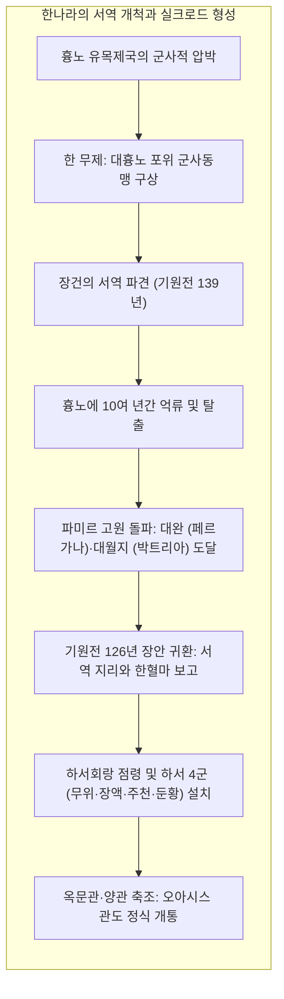
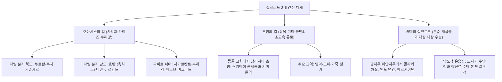
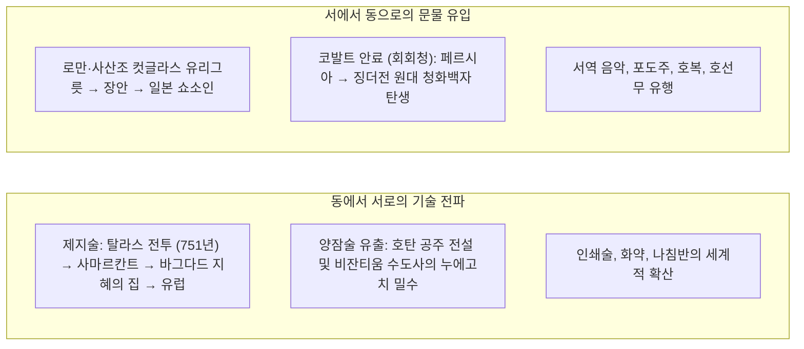

1877년 독일의 저명한 지리학자 페르디난트 폰 리히트호펜(Ferdinand von Richthofen)은 그의 역작 『중국(China)』에서 기원전 한나라 이래 중국과 중앙아시아, 지중해 세계를 연결했던 광대한 내륙 교역로를 가리켜 <strong>"비단의 길(Seidenstraße / Silk Road)"</strong>이라 명명했습니다. 이후 스벤 헤딘, 오렐 스타인, 폴 펠리오 등의 사막 탐험과 문서 발굴을 통해 이 명칭은 전 세계인의 모험심과 낭만을 자극하는 상징이 되었습니다.

그러나 현대 역사학과 고고학이 밝혀낸 실크로드의 실체는 결코 평탄한 단일 고속도로가 아니었습니다. 그것은 유라시아 대륙의 험준한 산맥, 극도의 건조 사막, 끝없는 초원, 그리고 계절풍 바다를 유기적으로 연결한 <strong>다층적이고 역동적인 결절점(노드)과 통로(링크)의 복합 네트워크</strong>였습니다.

실크로드는 크게 3대 간선 축으로 구성되었습니다:
1. <strong>오아시스의 길(사막 루트)</strong>: 타클라마칸 사막과 파미르 고원의 극한 환경을 끼고 발달한 오아시스 도시국가들을 낙타 카라반이 연결한 문화 밀집 교역로.
2. <strong>초원의 길(스텝 루트)</strong>: 몽골 고원에서 중앙아시아, 남러시아 초원, 흑해 북안에 이르는 광활한 대평원을 무대로 스키타이, 흉노, 돌궐, 몽골 기마유목민의 기동력과 군마·모피·철기 유통이 이끈 고속 간선.
3. <strong>바다의 실크로드(도자기·향신료의 길)</strong>: 인도양과 남중국해의 주기적 몬순(계절풍)을 활용하여 광저우·취안저우에서 말라카 해협, 인도양, 홍해, 페르시아만을 연결하여 도자기와 향신료를 대량 수송한 해양 간선.

이 통로를 통해 오간 것은 중국산 생사나 로마의 유리그릇, 사산조 페르시아의 은식기 같은 소수 귀족을 위한 사치품에 그치지 않았습니다. 인류의 지식 혁명을 촉발한 <strong>제지술, 활판 인쇄술, 나침반, 화약</strong>의 4대 발명과 양잠 기술, 고온 시유 도자기 기술이 동서로 전파되었습니다. 아울러 그리스 조각과 불교가 만나 인간 형상의 불상을 탄생시킨 <strong>간다라 미술</strong>, 현장 삼장의 인도 구법 여행, 경교(네스토리우스파 기독교)·마니교·조로아스터교의 공존, 그리고 13~14세기 <strong>팍스 몽골리카(Pax Mongolica)</strong> 하의 대륙 통합에 이르기까지 인류 문명의 위대한 도약이 실크로드라는 교차로에서 완성되었습니다.

---

## 1. 지정학적 기원: 장건의 서역 개척과 한 무제의 세계 전략

실크로드의 개막은 상업적 호기심이 아닌, 고대 제국의 국가 안보를 둘러싼 치열한 지정학적 생존 투쟁에서 비롯되었습니다.

기원전 2세기 초 묵돌 선우가 이끄는 흉노 제국은 강력한 기마 군단으로 한나라 북변을 압박했습니다. 한 고조 유방의 백등산 포위 패배 이래, 한나라는 매년 막대한 비단과 곡물, 황실 공주를 조공하는 굴욕적인 화친 정책을 감수해야 했습니다. 기원전 141년 즉위한 한 무제는 이 굴종을 끊기 위해, 흉노에게 패해 서쪽으로 쫓겨난 <strong>대월지(大月氏)</strong>와 군사동맹을 맺고 흉노를 협공하는 전략을 수립했습니다.

기원전 139년 장건은 100여 명의 사절단을 이끌고 출발했으나 곧 흉노에 체포되어 10년 넘게 억류되었습니다. 하지만 사신의 신표를 버리지 않은 장건은 감시가 소홀해진 틈을 타 탈출하여 파미르 고원을 넘어 페르가나(대완)와 박트리아(대월지)에 도달했습니다. 대월지는 이미 풍요로운 아무다리아 유역에 정착하여 복수전에 관심이 없었기에 군사동맹은 무산되었으나, 장건이 13년 만에 장안으로 가져온 서역의 상세한 지리·정치·물산 정보는 중국인의 세계관을 송두리째 뒤바꾸었습니다.

특히 무제를 사로잡은 것은 대완의 <strong>"한혈마(汗血馬, 피 같은 땀을 흘리며 하루에 천 리를 달리는 명마)"</strong>였습니다. 흉노 기병을 압도할 강력한 기병 군단을 육성하고자 했던 무제는 군사를 일으켜 하서회랑을 탈환하고 <strong>하서 4군(무위, 장액, 주천, 둔황)</strong>을 설치했으며, 옥문관과 양관을 세워 서역으로 향하는 관문을 굳건히 확립했습니다.

---

## 2. 3대 간선망의 공간 동역학

### 2.1 오아시스의 길과 카레즈 지하 수로망

타클라마칸 사막의 주변부를 지나는 오아시스로는 천산남로와 서역남도로 나뉩니다. 이 건조 사막 도시들의 생명줄은 지하 수로 공학의 걸작인 <strong>카레즈(Qanat)</strong>였습니다. 산록의 복류수를 증발 없이 지하로 수십 킬로미터 연결하여 포도, 목화, 밀을 재배하고 카라반에 생명수를 공급했습니다.

카슈가르를 지난 대상들은 해발 4,000미터가 넘는 파미르 고원의 설산을 넘어 소그드인의 본거지인 <strong>사마르칸트</strong>와 <strong>부하라</strong>에 도달했으며, 이란 고원과 메소포타미아를 거쳐 로마와 콘스탄티노플로 향했습니다.

### 2.2 초원의 길과 유목 기동성

유라시아 북방 초원 지대를 가로지르는 스텝 루트는 기원전 1000년경 스키타이 이래 작동한 가장 오래된 간선이었습니다. 낙타 대상이 하루 25~30km를 이동하는 데 비해, 교체용 말을 대동한 유목 기병은 하루 80~120km를 주파할 수 있었습니다. 흉노, 돌궐, 위구르, 몽골은 이 고속 통로를 통해 군마와 모피를 남쪽 농경 제국의 비단 및 곡물과 대규모로 교환했습니다.

### 2.3 바다의 실크로드와 계절풍 대량 수송

인도양의 주기적 <strong>몬순(계절풍)</strong>을 포착한 해상 실크로드는 육상 루트와 비교할 수 없는 운송 용량을 자랑했습니다. 낙타 한 마리가 200~250kg을 운반할 때, 송·원대의 대형 정크선은 한 척에 수만 점의 도자기와 수백 톤의 후추, 목재를 실어 날랐습니다. 1998년 인도네시아 벨리퉁 해역에서 인양된 9세기 당대 침몰선에서는 6만 점 이상의 도자기와 페르시아풍 금은기가 출토되어 해상 실크로드의 거대한 규모를 완벽히 입증했습니다.

---

## 3. 실크로드의 지배자: 소그드 상인의 금융 신용 네트워크

실크로드 내륙 교역의 진정한 주인공은 제자라프샨강 유역(현 우즈베키스탄·타지키스탄) 출신의 이란계 통상 민족 <strong>소그드인(Sogdians)</strong>이었습니다.

소그드인은 사마르칸트를 거점으로 둔황, 무위, 장안, 몽골 고원에 이르기까지 촘촘한 상업 식민도시(디아스포라)를 건설했습니다. 이들의 대상 조직은 카라반 수령인 <strong>사르타바하(Sārtavāha)</strong>에 의해 통솔되었으며, 당나라는 이들의 자치권을 인정하여 <strong>사보(薩寶)</strong>라는 공식 관직을 제수했습니다.

1907년 스타인이 둔황 서쪽 봉수대 유적에서 발견한 <strong>"소그드 고문서(Ancient Letters)"</strong>(313~314년경)는 이들이 이미 현대적 신용장(Draft), 복리 계산 상업 대출, 그리고 비단(생사)을 기축통화로 사용하는 고도화된 금융 기법을 완벽히 구축하고 있었음을 보여줍니다.

---

## 4. 물질문명과 기술 이전의 고속도로

### 4.1 탈라스 전투(751년)와 제지술의 세계사적 전파

751년 카자흐스탄과 키르기스스탄 국경의 <strong>탈라스 강변</strong>에서 고선지 장군이 이끄는 당군과 신흥 아바스 왕조 이슬람군이 충돌했습니다. 카를루크 용병의 배신으로 당군이 대패하면서 포로로 잡힌 한인 제지공들이 사마르칸트로 압송되었습니다.

사마르칸트의 풍부한 설산 수자원과 아마 섬유를 결합하여 질기고 매끄러운 <strong>"사마르칸트 페이퍼"</strong>가 탄생했습니다. 이 기술은 바그다드(793년), 카이로, 스페인 샤티바(1150년), 이탈리아 파브리아노(1268년)로 번져나갔습니다. 저렴하고 질 좋은 종이의 보급은 아바스 왕조 <strong>"지혜의 집(Bayt al-Hikma)"</strong>의 학문 번영과 이슬람 황금기를 이끌었으며, 훗날 구텐베르크의 인쇄 혁명과 유럽 과학 혁명의 물질적 기반이 되었습니다.

### 4.2 코발트와 징더전: 청화백자의 탄생

14세기 원나라 시대에 완성된 <strong>청화백자(染付)</strong>는 동서 문명 결합의 최고 걸작입니다. 징더전의 순백 카올린 점토와 1,300℃ 환원염 소성 기술에, 이란 카샨 광산에서 채굴된 저망간·고철분의 최고급 천연 코발트 안료인 <strong>"회회청(Sulaymani)"</strong>이 결합했습니다. 이 찬란한 푸른빛의 자기는 이슬람 궁정과 유럽 왕실을 매료시키며 세계적인 히트 상품이 되었습니다.

---

## 5. 종교의 횡단과 간다라 그리스 불교 미술

실크로드는 영혼의 구원을 향한 종교들이 국경을 넘어 대화하고 융합한 무대였습니다.

초기 인도 불교는 부처를 인간의 모습으로 표현하는 것을 금기시하여 족적, 법륜, 보리수 등 상징물로만 묘사했습니다(무불상 시대). 이 금기를 깨뜨린 것이 기원전 4세기 알렉산드로스 대왕의 동방 원정으로 헬레니즘 문화가 정착한 <strong>간다라(Gandhāra)</strong> 지방이었습니다.

간다라 조각가들은 그리스 태양신 <strong>아폴론</strong>의 수려한 이목구비와 곱슬머리(육계), 고대 로마 토가 풍의 주름진 법의를 차용한 <strong>그리스풍 불상</strong>을 최초로 창조했습니다. 또한 부처의 수호신인 금강역사(집금강신)는 사자 가죽을 두르고 곤봉을 쥔 그리스 영웅 <strong>헤라클레스</strong>에서 유래했습니다. 이 불교 미술 양식은 둔황, 윈강 석굴을 거쳐 한반도와 일본의 사찰 인왕상으로 이어졌습니다.

아울러 현장 법사의 16년간의 인도 구법 여행과 『대당서역기』 저술, 당나라 장안에 세워진 『대진경교유행중국비』(네스토리우스파 기독교), 위구르 제국의 마니교 국교화 등 다양한 정신 유산이 실크로드를 수놓았습니다.

---

## 6. 팍스 몽골리카와 역참제(얌)의 대통합

13세기 칭기즈 칸이 세운 몽골 제국은 유라시아 대륙의 관세 장벽과 국경을 철폐하며 <strong>"팍스 몽골리카(Pax Mongolica)"</strong>를 열었습니다.

제국의 대동맥은 약 40km마다 설치된 <strong>역참제(얌 / Jamči)</strong>였습니다. 황제의 칙령이 새겨진 <strong>패부(파이자 / Paiza)</strong>를 지닌 급사는 하루 150~200km를 질주하여 대도(베이징)에서 페르시아나 볼가강 유역까지 수주일 만에 공문을 전달했습니다.

마르코 폴로와 이븐 바투타 같은 대여행가들이 안전하게 대륙을 횡단했으며, 은정(원보)과 세계 최초의 법정 지폐인 <strong>교초(交鈔)</strong>가 유통되었습니다. 그러나 이 초고속 통로는 1340년대 중앙아시아 건조지대 림프절 페스트균(*Yersinia pestis*)을 급속히 전파하여 유럽 인구의 3분의 1을 몰살시킨 <strong>흑사병(Black Death)</strong> 대유행의 비극적 통로가 되기도 했습니다.

---

## 7. 대항해시대와 실크로드의 황혼

15세기 말 바스코 다 가마가 희망봉 항로를 개척하면서 해상 대량 수송의 시대가 열렸습니다. 1척의 대형 범선이 낙타 수천 마리분의 화물을 안전하고 저렴하게 운반할 수 있게 되면서 험준하고 통행세가 과중한 내륙 대상로는 경제적 타당성을 상실했습니다.

소빙기의 도래로 인한 중앙아시아의 한랭·건조화로 누란, 니야 등 오아시스 도시들이 모래 속에 매몰되고, 오스만 제국과 명청의 국경 통제가 강화되면서 육상 실크로드는 지역적 소규모 교역로로 쇠퇴했습니다.

---

## 8. 결론: 실크로드가 남긴 현대적 교훈

실크로드가 인류에게 남긴 불멸의 교훈은 <strong>"문명이란 고립된 섬이 아니라, 타자와의 부단한 교역, 대화, 그리고 이질적 요소의 혼효(하이브리디티)를 통해서만 찬란히 개화한다"</strong>는 진리입니다.

오늘날 유라시아 대륙을 가로지르는 국제 화물열차인 <strong>중구반열(China Railway Express)</strong>, 초고압 송전망, 대륙간 광케이블은 과거 실크로드의 지리적 기억 위에 재건되고 있습니다. 실크로드의 역사를 되새기는 것은 분열과 갈등의 21세기에 경계를 넘어 공존과 번영을 이루기 위한 가장 깊이 있는 지혜의 원천입니다.