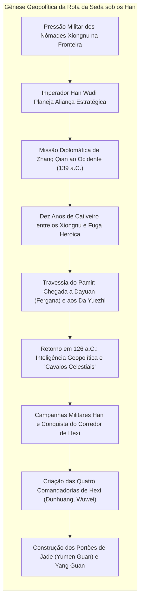
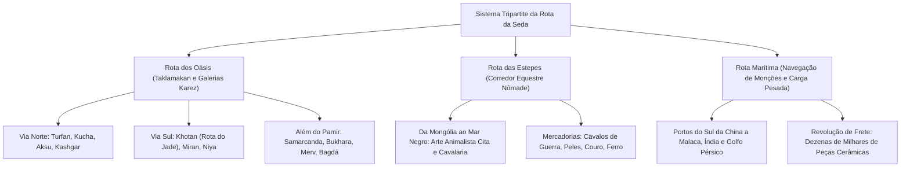
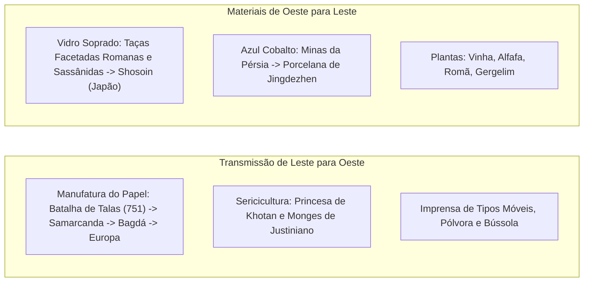

Em 1877, o eminente geógrafo alemão Ferdinand von Richthofen cunhou a expressão <strong>"Rota da Seda" (Seidenstraße)</strong> em sua obra seminal *China*. Popularizado mundialmente pelas expedições de Sven Hedin, Sir Aurel Stein e Paul Pelliot, o conceito evocou uma aura de aventura inigualável. Todavia, a historiografia e a arqueologia contemporâneas demonstraram que a Rota da Seda nunca consistiu numa via única e linear, mas sim numa <strong>rede continental dinâmica, multicêntrica e complexa</strong> que entrelaçava trilhas desérticas, desfiladeiros glaciais, estepes infinitas e vias marítimas.

Esta malha intercontinental operava através de três eixos primordiais:
1. <strong>A Rota dos Oásis (Rota do Deserto)</strong>: Contornando o implacável deserto de Taklamakan e a cordilheira do Pamir, ligando cidades-estados fortificadas sustentadas pela genial engenharia hidráulica dos canais subterrâneos (*karez*).
2. <strong>A Rota das Estepes</strong>: Cruzando as pastagens setentrionais da Eurásia desde a Manchúria até a bacia da Panônia na Hungria, impulsionada pela extraordinária mobilidade dos povos cavaleiros nômades (citas, xiongnu, turcos e mongóis).
3. <strong>A Rota Marítima da Seda (Rota das Especiarias e da Porcelana)</strong>: Articulada pelos ciclos semestrais das monções do Oceano Índico, conectando Guangzhou e Quanzhou ao estreito de Malaca, litoral indiano, Golfo Pérsico e Mar Vermelho para o transporte massivo de mercadorias.

---

## 1. Gênese Geopolítica: A Missão de Zhang Qian e a Estratégia Han

A inauguração oficial da Rota da Seda não derivou de mera curiosidade mercantil, mas de imperativos vitais de sobrevivência geopolítica da dinastia Han Ocidental.

No século II a.C., a confederação pastoral dos <strong>Xiongnu</strong> dominava a estepe setentrional e impunha humilhantes tributos anuais de seda, grãos e princesas imperiais à corte chinesa. Para quebrar essa dependência servil, o imperador Han Wudi enviou em 139 a.C. o oficial <strong>Zhang Qian</strong> com cem homens em busca de aliança com os <strong>Da Yuezhi</strong>, que haviam sido expulsos para a Ásia Central pelos xiongnu.

Capturado e mantido refém por dez anos, Zhang Qian jamais perdeu suas insígnias imperiais de embaixador. Conseguindo fugir, cruzou o gélido Pamir, alcançou a fértil bacia de Fergana (<strong>Dayuan</strong>) e a Báctria. Embora os Yuezhi não desejassem retornar ao combate, as informações geográficas, etnográficas e militares que Zhang Qian levou a Chang'an em 126 a.C. revolucionaram a cosmovisão da corte imperial.

O imperador ficou extasiado com os magníficos <strong>"Cavalos Celestiais" (汗血馬)</strong> de Fergana, essenciais para estruturar uma cavalaria pesada veloz contra os xiongnu. O exército Han expulsou os nômades do <strong>Corredor de Hexi</strong>, erigiu as quatro comandadorias (notadamente Dunhuang) e construiu o célebre <strong>Portão de Jade (Yumen Guan)</strong>, abrindo os canais oficiais do comércio euroasiático.

---

## 2. A Dinâmica Espacial dos Três Grandes Corredores

### 2.1 A Rota dos Oásis e a Engenharia dos Karez

Para margear o temível deserto de Taklamakan, as caravanas apoiavam-se em oásis supridos por galerias subterrâneas de água (*karez* ou *qanat*), que captavam o degelo das geleiras sem perdas por evaporação. Superando Kashgar e a barreira do Pamir a 4.000 metros de altitude, as rotas desciam aos ricos empórios de <strong>Samarcanda</strong> e <strong>Bukhara</strong>, prosseguindo através da Pérsia até o Mediterrâneo.

### 2.2 A Rota das Estepes e o Poderio Nômade

Nas estepes setentrionais, enquanto camelos cobriam 25 a 30 km diários no deserto, guerreiros a cavalo com montarias reservas avançavam de 80 a 120 km ao dia. Desde o primeiro milênio a.C., os <strong>citas</strong> produziram sofisticadas joias de ouro no Estilo Animalista. As confederações pastoris utilizavam essa rodovia expressa para trocar couros e cavalos por sedas e chá chineses.

### 2.3 A Rota Marítima da Seda

O comércio oceânico operava em sintonia com os <strong>monções periódicas</strong>. Juncos com anteparas estanques e dhows árabes costurados transportavam cargas massivas: o naufrágio do <strong>Belitung</strong> (século IX), recuperado na Indonésia em 1998, continha mais de 60.000 peças de cerâmica Tang com destino ao Oriente Médio.

---

## 3. Os Mercadores Sogdianos e o Capitalismo de Crédito Antigo

Os verdadeiros motores do comércio continental foram os <strong>sogdianos</strong>, povo iraniano do vale do Zeravshan (atual Uzbequistão).

Eles implantaram colônias comerciais em todos os entroncamentos. As caravanas eram lideradas pelo <strong>sārtavāha</strong>. A dinastia Tang institucionalizou sua autonomia criando o cargo de <strong>Sabao (薩寶)</strong>. As <strong>Cartas Antigas Sogdianas</strong> (c. 313 d.C.) revelam o uso pioneiro de cartas de crédito, empréstimos com juros compostos e o emprego de fardos de seda como padrão monetário internacional. Em Chang'an, a "cultura Hu" sogdiana influenciou vinhos, modas femininas, danças acrobáticas (*Huxuanwu*) e artes musicais.

---

## 4. Transferências Tecnológicas e Hibridismo Material

### 4.1 A Batalha de Talas (751 d.C.) e a Revolução Global do Papel

Em 751 d.C., às margens do rio <strong>Talas</strong>, as forças da dinastia Tang enfrentaram o califado abássida. A deserção dos mercenários qarluqs selou a derrota chinesa.

Entre os prisioneiros estavam artífices papeleiros, levados para Samarcanda. Nasceu ali o afamado <strong>papel de Samarcanda</strong>, transmitido a Bagdá em 793, onde alicerçou a <strong>Casa da Sabedoria (Bayt al-Hikma)</strong> e a Idade de Ouro Islâmica. Chegando à Espanha (Xàtiva, 1150) e à Itália (Fabriano, 1268), forneceu a base material indispensável para a imprensa de Gutenberg e o Renascimento.

### 4.2 Porcelana Azul e Branca: Síntese Sino-Persa

No século XIV, sob a dinastia Yuan, a <strong>porcelana azul e branca (Qinghua)</strong> atingiu apogeu em Jingdezhen: argila pura de caulim cozida a 1.300 °C somada ao pigmento natural de cobalto importado de Kashan (Irã), o <strong>azul maometano (Huihui qing)</strong>. Essa cerâmica híbrida foi exportada aos palácios otomano e safávida, fascinando depois a Europa.

---

## 5. Sincretismo Religioso e a Arte Greco-Budista de Gandhara

A Rota da Seda foi um imenso cadinho teológico:
- <strong>Arte de Gandhara</strong>: Após as conquistas de Alexandre, o Grande, os escultores helenísticos plasmaram o Buda pela primeira vez em fisionomia humana com traços do deus grego <strong>Apolo</strong>, trajando a toga romana. O guardião Vajrapani derivou diretamente de <strong>Héracles</strong>.
- <strong>Peregrinação de Xuanzang</strong>: Entre 629 e 645 d.C., o monge Xuanzang viajou dezesseis anos à Índia, estudou na Universidade de Nalanda e escreveu o clássico *Da Tang Xiyu Ji*.
- <strong>Convivência Confessional</strong>: Em Chang'an floresceram simultaneamente o budismo, o cristianismo nestoriano (Estepa de 781), o maniqueísmo e o zoroastrismo.

---

## 6. Pax Mongolica e a Rede Postal Yam

No século XIII, o império mundial fundado por Gêngis Khan unificou a Eurásia sob a <strong>Pax Mongolica</strong>.

Sua infraestrutura de comunicação era o sistema de correios <strong>Yam (Örtöö / Zhanchi)</strong>: a cada 40 km havia cavalos de remonta e rações. Emissários munidos de tabuletas imperiais (<strong>Paiza</strong>) cavalgavam noite e dia percorrendo até 200 km em 24 horas. Viajantes como Marco Polo e Ibn Battuta cruzaram o continente com inédita segurança, enquanto o papel-moeda (<strong>Jiaochao</strong>) garantia o comércio.

No entanto, essa rodovia veloz precipitou a difusão da bactéria *Yersinia pestis* (a <strong>Peste Negra</strong> de 1346–1353), aniquilando um terço da população euroasiática e acelerando o declínio do império.

---

## 7. A Era dos Descobrimentos e o Ocaso da Rota Terrestre

Com a viagem de Vasco da Gama em 1498 contornando o Cabo da Boa Esperança, o transporte marítimo suplantou as caravanas terrestres. Uma nau transportava a carga de milhares de camelos sem pagar pedágios locais nem temer assaltos.

Paralelamente, o resfriamento climático da Pequena Idade do Gelo secou cursos fluviais, engolindo cidades como Loulan e Niya nas areias. A Rota da Seda continental retraiu-se a pequenas trocas comarcais.

---

## 8. Conclusão: Lições para o Século XXI

A grande lição da Rota da Seda perdura indelével: <strong>civilizações florescem não no isolamento hermético, mas na abertura, no diálogo e na síntese criativa com o Outro.</strong>

No século XXI, as composições ferroviárias do <strong>China Railway Express</strong>, os gasodutos transcontinentais e as redes de fibra ótica revitalizam as antigas rotas euroasiáticas. Lembrar a Rota da Seda é buscar no passado a inspiração para ultrapassar fronteiras e construir uma cooperação global perene.