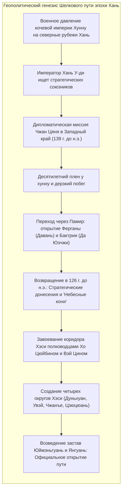
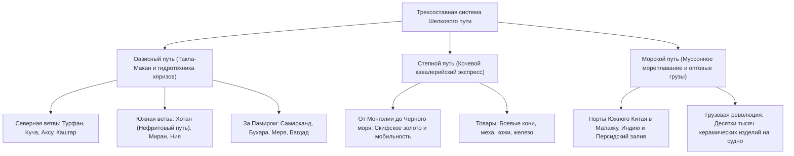
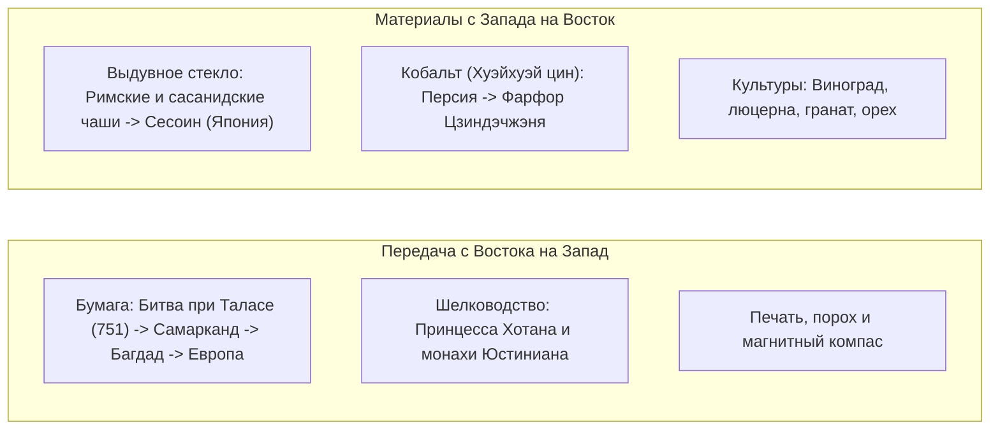

В 1877 году выдающийся немецкий географ Фердинанд фон Рихтгофен в своем монументальном труде *China* впервые ввел в научный оборот термин <strong>"Шелковый путь" (Seidenstraße)</strong> для обозначения древних торговых трактов, соединявших Китай через Центральную Азию с бассейном Средиземноморья. Популяризированное исследованиями Свена Гедина, Ауреля Стейна и Поля Пеллио, это понятие стало символом диалога культур. Однако современная историография доказала, что Шелковый путь никогда не был одиночной дорогой: это была <strong>сложнейшая полицентрическая сеть караванных троп, горных перевалов, степных трактов и морских путей</strong>.

Континентальная коммуникационная система опиралась на три фундаментальных коридора:
1. <strong>Оазисный путь (Пустынный маршрут)</strong>: Огибал безжизненную пустыню Такла-Макан вдоль отрогов Тянь-Шаня и Куньлуня, связывая города-государства благодаря подземным гидротехническим галереям (*кяризам*).
2. <strong>Степной путь</strong>: Простирался через бескрайние травянистые равнины от Маньчжурии до Причерноморья и венгерской пушты, питаемый непревзойденной кавалерийской мобильностью кочевых империй (скифов, хунну, тюрков и монголов).
3. <strong>Морской шелковый путь (Керамический и пряный путь)</strong>: Направляемый циклическими муссонами Индийского океана, связывал порты Гуанчжоу и Цюаньчжоу с Малаккским проливом, Индией, Персидским заливом и Красным морем.

---

## 1. Геополитический генезис: Миссия Чжан Цяня

Открытие Шелкового пути диктовалось не романтической торговлей, а вопросами национальной безопасности империи Западная Хань в противостоянии с кочевой конфедерацией <strong>хунну</strong>.

В 139 г. до н.э. император У-ди направил офицера <strong>Чжан Цяня</strong> с миссией заключить военный альянс с кочевниками <strong>юэчжи</strong>, изгнанными хунну на запад. Попав в плен, Чжан Цянь провел у хунну более десяти лет, но сохранил посольский бунчук. Совершив побег, он преодолел ледники Памира, исследовал Ферганскую долину (<strong>Давань</strong>) и Бактрию. Хотя союз не состоялся, привезенные им в 126 г. до н.э. географические сведения перевернули представления китайцев о мире.

Особое восхищение императора вызвали <strong>"небесные кони" (汗血馬)</strong> Ферганы, обладавшие невероятной выносливостью. Чтобы заполучить этих скакунов для кавалерии, Хань отвоевала <strong>коридор Хэси</strong>, основала округ <strong>Дуньхуан</strong> и воздвигла заставу <strong>Юймэньгуань (Нефритовые ворота)</strong>, заложив основу континентальной транзитной системы.

---

## 2. Пространственная динамика трех главных магистралей

### 2.1 Оазисный путь и система кяризов

Оазисы вокруг пустыни Такла-Макан выживали благодаря уникальной гидротехнике <strong>кяризов</strong> — подземных водоводов, отводивших талые ледниковые воды на десятки километров без потерь от испарения. Миновав Кашгар и 4000-метровый Памирский узел, караваны спускались в согдийские центры <strong>Самарканд</strong> и <strong>Бухару</strong>, откуда двигались через Иран к Средиземноморью.

### 2.2 Степной путь: Кавалерийский экспресс

Если верблюжий караван в пустыне проходил 25–30 км в день, то степные всадники со сменными лошадьми преодолевали 80–120 км в сутки. Еще в I тыс. до н.э. <strong>скифы</strong> выработали динамичный «звериный стиль» в золоте. Кочевые владыки использовали эту трассу для обмена коней и пушнины на шелк и чай.

### 2.3 Морской шелковый путь

Морская навигация следовала смене <strong>муссонов</strong>. Арабские сшивные дау и китайские многомачтовые джонки с водонепроницаемыми отсеками перевозили колоссальные грузы: на затонувшем в IX веке судне <strong>Белитунг</strong>, найденном в Индонезии, обнаружено более 60 000 изделий танской керамики, отправленных в Персидский залив.

---

## 3. Согдийские купцы: Создатели древнего финансового кредита

Главными операторами караванной коммерции были <strong>согдийцы</strong> — ираноязычный торговый народ из долины Зеравшана (Узбекистан).

Они основывали торговые фактории по всей трассе от Самарканда до Чанъаня. Караваны возглавлял <strong>сартаваха</strong>. Танский двор признал их самоуправление, учредив официальный чин <strong>сабао (薩寶)</strong>. <strong>Древние согдийские письма</strong> (ок. 313 г. н.э.) подтверждают использование векселей, займов под сложные проценты и применение рулонов шелка в качестве международной резервной валюты. В Чанъане царила мода на «варварскую» культуру: согдийские вина, танцы вихря (*хусюаньу*) и лютни.

---

## 4. Трансфер технологий и материальный синтез

### 4.1 Битва при Таласе (751 г.) и мировая бумажная революция

В июле 751 года на реке <strong>Талас</strong> столкнулись войска империи Тан и Аббасидского халифата. Предательство карлукских наемников привело к поражению танской армии.

Среди китайских пленников оказались мастера-бумагоделы, доставленные в Самарканд. Знаменитая <strong>самаркандская бумага</strong> покорила мусульманский мир: в 793 г. фабрика открылась в Багдаде, став материальной основой <strong>«Дома мудрости» (Байт аль-Хикма)</strong> и золотого века исламской науки. Через Испанию (Хатива, 1150) и Италию (Фабриано, 1268) бумага пришла в Европу, подготовив почву для Гутенберга.

### 4.2 Сине-белый фарфор: Китайско-персидский шедевр

В XIV веке в Цзиндэчжэне родился шедевр эпохи Юань — <strong>сине-белый фарфор (Цинхуа)</strong>: каолиновая глина, обожженная при 1300 °C, соединилась с персидским кобальтовым пигментом из Кашана (<strong>мусульманская синь / Хуэйхуэй цин</strong>). Этот фарфор украсил дворцы османских султанов и сефевидских шахов, породив европейскую моду на шинуазри.

---

## 5. Религиозный синкретизм и греко-буддийское искусство

Шелковый путь служил грандиозной духовной лабораторией:
- <strong>Искусство Гандхары</strong>: После походов Александра Македонского эллинистические мастера впервые воплотили образ Будды в облике бога <strong>Аполлона</strong> в римской тоге. Защитник Ваджрапани восходит к образу <strong>Геракла</strong>.
- <strong>Паломничество Сюаньцзана</strong>: В 629–645 гг. монах Сюаньцзан совершил путешествие в Индию, обучался в Наланде и оставил бессмертные *«Записки о западных странах» (Да Тан Сиюй цзи)*.
- <strong>Многоверие Чанъаня</strong>: В танской столице мирно сосуществовали буддизм, несторианское христианство (стела 781 г.), манихейство и зороастризм.

---

## 6. Pax Mongolica и почтовая система Ям

В XIII веке империя Чингисхана объединила Евразию, установив эпоху <strong>Pax Mongolica</strong>.

Основой инфраструктуры стала сеть станций <strong>Ям (Өртөө / Чжаньчи)</strong>: через каждые 40 км содержались свежие лошади. Гонцы с верительными пайцзами (<strong>пайцза</strong>) преодолевали до 200 км в сутки. Путешественники Марко Поло и Ибн Баттута свободно пересекали континент, а в обиходе появились бумажные деньги (<strong>цзяочао</strong>).

Однако этот скоростной путь стал и каналом распространения чумной палочки (*Yersinia pestis*): <strong>Черная смерть (1346–1353)</strong> унесла треть населения Евразии и ускорила распад монгольских улусов.

---

## 7. Эпоха великих открытий и угасание караванных путей

Открытие Васко да Гамой морского пути вокруг Африки в 1498 году сделало океанские перевозки дешевле караванных в десятки раз.

Похолодание Малого ледникового периода высушило реки, погребя оазисы Лоулань и Ния под песками. Сухопутный Шелковый путь распался на локальные региональные базары.

---

## 8. Заключение: Уроки для XXI века

Главный урок Шелкового пути непреложен: <strong>цивилизации расцветают не в изоляции, а в диалоге, открытости и взаимообогащении.</strong>

Сегодня грузовые поезда <strong>China Railway Express</strong>, трансконтинентальные трубопроводы и оптоволоконные кабели возрождают евразийскую связанность. Наследие Шелкового пути напоминает, что истинная сила человечества — в способности строить мосты через любые преграды.