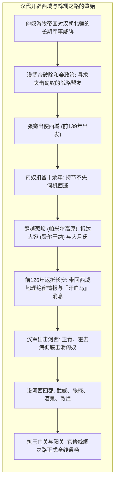
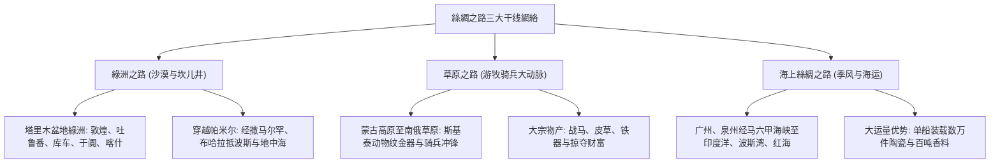
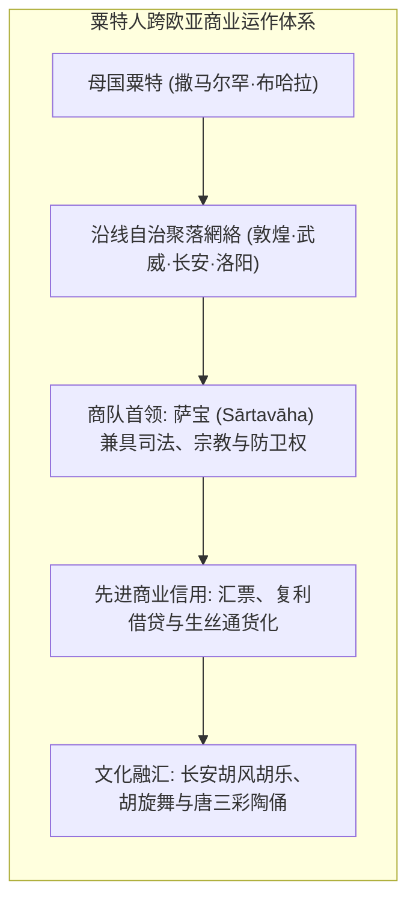
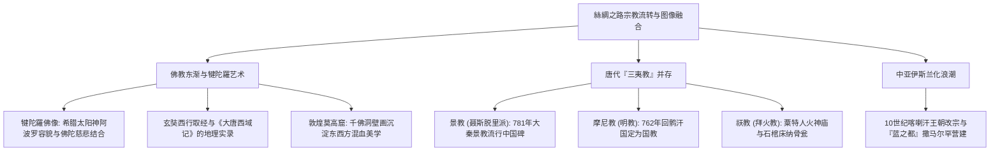
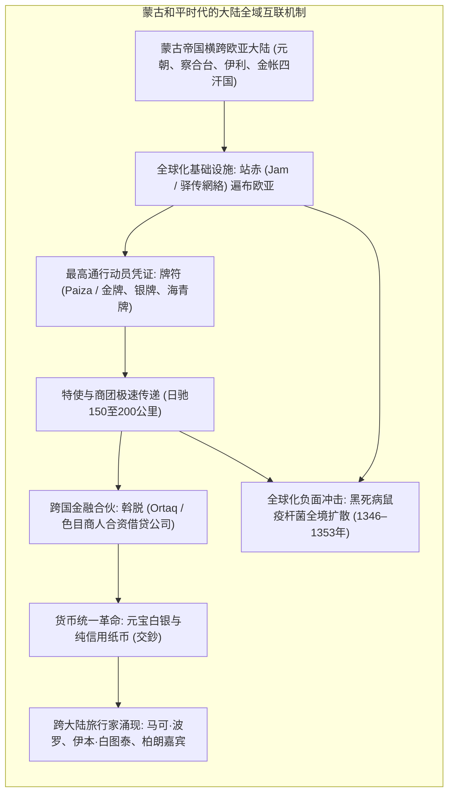

1877年，德国著名地理学家费迪南·冯·李希霍芬（Ferdinand von Richthofen）在其巨著《中国》中，首次将古代中国经由中亚通往印度及地中海世界的陆上商路命名为“<strong>絲綢之路（Seidenstraße / Silk Road）</strong>”。这一富有诗意与探险色彩的名称，经由斯文·赫定、斯坦因、伯希和等探险家的实地考察与文献发掘，迅速风靡全球。然而，现代历史学、考古学与经济史研究表明，真实的絲綢之路绝非一条笔直平坦的单一直线，而是一个跨越欧亚大陆险阻地貌、高度动态且多维交织的庞大網絡系统。

絲綢之路主要由三大干线构成：
1. <strong>綠洲之路（沙漠路线）</strong>：环绕塔克拉玛干沙漠与帕米尔高原，依托干旱盆地边缘融雪綠洲城邦与坎儿井地下水利体系，由骆驼商队维持的文化密集型商道。
2. <strong>草原之路（草原快道）</strong>：横贯欧亚大陆北方广袤温带草原，自大兴安岭经哈萨克丘陵、南俄草原直至多瑙河下游，依托斯基泰、匈奴、突厥、蒙古等游牧骑兵强大机动性与良马、皮毛、金属贸易驱动的高速通道。
3. <strong>海上絲綢之路（陶瓷之路·香料之路）</strong>：依托印度洋与南海周期性季风，连接广州、泉州、扬州至马六甲海峡、印度洋沿岸、红海及波斯湾，以缝合木帆船（单桅三角帆船）与水密隔舱大型福船实现超大宗货物低成本海运的海上动脉。

穿梭于这些动脉之上的，远不止供王公贵族消费的中国生丝、罗马吹制玻璃、萨珊波斯金银器，更涵盖彻底重塑人类知识生产与生产力基础的四大发明（造紙術、印刷术、指南针、火药）、养蚕缫丝技术、高火度施釉瓷器工艺；更催生了希腊神话与佛教交融的犍陀羅造像艺术、玄奘西行取经的大规模译经、景教（聂斯脱里派）与摩尼教的东渐，以及中亚伊斯兰化与“蒙古和平（Pax Mongolica）”下的欧亚大陆一体化。

---

## 1. 地緣战略起源：張騫凿空西域与汉帝国的西进

絲綢之路登上历史舞台的序幕，并非源于浪漫的商旅好奇，而是西汉王朝生死攸关的国家安全抉择与高烈度地緣博弈。

公元前3世纪末，北方大漠崛起了强大的匈奴帝国。自白登之围后，汉初七十年间不得不实行屈辱的“和亲政策”，每年赠送大量丝绸、絮绢、粮食与烈酒以换取暂时的边境和平。漢武帝即位后，决心彻底瓦解匈奴的地緣压迫。在得知原居河西走廊的游牧部族大月氏被匈奴击败、老王头颅被单于制成饮器后，漢武帝构想了联合大月氏夹击匈奴的大战略。

公元前139年，張騫率百余人使团自长安启程。出塞未几即遭匈奴捕获，羁押长达十年之久。但他始终坚守使节，在严密监视松懈后潜逃出境，翻越冰雪覆盖的葱岭（帕米尔高原），深入费尔干纳盆地的大宛国，并最终到达阿姆河上游的大月氏王庭。

此时的大月氏已在肥沃的阿姆河流域安居乐业，无意重返漠北与强敌厮杀。虽然军事结盟未果，但張騫历尽十三年艰险带回的长达数万言的西域地貌、城邑、物产及政情报告（涵盖大宛、康居、大夏、安息、条支、身毒），彻底颠覆了华夏帝国的天下观，史称<strong>“張騫凿空”</strong>。

尤令漢武帝神驰心往的，是大宛国出产的<strong>“汗血宝马”</strong>。这种中亚良马骨骼坚实、奔跑耐力与冲击力极强，是组建抗衡匈奴轻骑兵军团的战略核心资源。漢武帝随即派遣霍去病等名将夺取河西走廊，设立<strong>河西四郡（武威、张掖、酒泉、敦煌）</strong>，并向西延伸长城烽燧，修建<strong>玉门关</strong>与<strong>阳关</strong>。其后汉军两次远征大宛，确立了中原王朝对塔里木盆地綠洲城邦的主导权，正式搭建起连通欧亚的官方驿传与通商網絡。

---

## 2. 三大干线交织的網絡空间动力学

欧亚大陆地质地貌的复杂断裂，塑造了各具特色的三大丝路通道系统。

### 2.1 綠洲之路与坎儿井工程奇迹

綠洲之路穿行于塔克拉玛干沙漠南北两端：
- <strong>西域北道（天山南路）</strong>：出玉门关，经白龙堆盐碱雅丹，沿天山南麓綠洲（吐鲁番高昌、库车龟兹、阿克苏）抵喀什噶尔（喀什）。
- <strong>西域南道</strong>：出阳关，沿昆仑山北麓雪山融水冲积扇（米兰、且末、尼雅、和田于阗、莎车）西行抵喀什。和田盛产羊脂白玉，早在丝绸开通千年前便已形成“玉石之路”。
- <strong>天山北路</strong>：沿天山北坡准噶尔盆地南缘，经伊犁河流域、碎叶城（托克马克）贯通中亚大草原。

綠洲农业与驻屯的命脉依赖于伟大的<strong>坎儿井地下暗渠系统</strong>。在冲积扇高处开凿坚井，地下掘水平暗渠引流深层地下水，既隔绝了地表炽热干燥导致的剧烈蒸发，又实现了长距离自流灌溉，保障了吐鲁番与哈密盆地葡萄、哈密瓜、棉花、小麦的丰产及过往商驼的补给。

商队自喀什集结后，必须挑战平均海拔逾4000米、终年积雪崩塌的“万山之祖”帕米尔高原，继而俯冲至索格底亚那的核心腹地——<strong>撒马尔罕</strong>与<strong>布哈拉</strong>，再经木鹿（梅尔夫）、雷伊（德黑兰）、巴格达直奔地中海港口安条克、亚历山大港或君士坦丁堡。

### 2.2 草原之路的超高速机动性

欧亚草原带从外兴安岭横贯哈萨克斯坦、乌克兰至黑海北岸，地势平坦无阻。草原之路的主体是移动的游牧帝国。早在公元前一千纪，斯基泰人便创造了以猛禽、野兽搏斗为特征的<strong>斯基泰动物纹黄金艺术</strong>。

草原之路最鲜明的特征是<strong>高超的行进速度</strong>。沙漠骆驼商队每日仅能跋涉25至30公里，而携带多匹备用换乘马匹的草原骑兵每日可疾行80至120公里。游牧政权凭借强大的机动优势，以军马、毛皮、皮革、奴隶向中原王朝换取生丝、茶叶、布匹与粮食，成为沟通欧亚东西方两端的另一条高速枢纽。

### 2.3 海上絲綢之路与季风水运革命

相比陆路负重的严苛局限，海上絲綢之路展现了无可比拟的运量红利。

利用印度洋与南海周期性交替的<strong>季风（Monsoon）</strong>——冬季东北季风驱动帆船自华南南下印度洋，夏季西南季风护送海舶扬帆北返。阿拉伯与波斯的缝合木船（单桅三角帆船，Dhow）与中国装备有水密隔舱、平衡舵与多道主桅的巨型沙船、福船交相辉映。

1998年印尼勿里洞岛海域发掘的9世纪<strong>“黑石号（Belitung Shipwreck）”</strong>沉船中，出土了逾6.7万件唐代长沙窑釉下彩瓷、邢窑白瓷、越窑青瓷及阿拉伯定制金银盘，直接证实了晚唐时期海上大宗贸易的惊人规模与全球化分工成熟度。

---

## 3. 欧亚商业網絡的经络：粟特商人的金融与信用革命

若说古代帝国划定了疆界，那么纵横于絲綢之路两端真正的运营巨擎，则是源自中亚泽拉夫尚河流域（今乌兹别克斯坦、塔吉克斯坦）的印欧语系伊朗语支民族——<strong>粟特人（Sogdians）</strong>。

《新唐书》载粟特风俗：“生儿以蜜啖其口，置胶于其掌，欲其口常甘，掌如胶使钱财粘著。”粟特人自幼接受严谨的算术与经商训练，以撒马尔罕为原点，在丝路沿线的敦煌、武威、长安、洛阳乃至漠北突厥突厥牙帐，建立了星罗棋布的聚落社区。

### 3.1 萨宝官制与商队自治

粟特远程商队由被称为<strong>“萨宝（Sārtavāha / 梵语意为商队领袖）”</strong>的大商人统率。萨宝掌管数百峰骆驼组成的驼队、武装护卫佣兵、译官与宗教祭司。

唐朝中央政府承认粟特聚落的自治权，册封聚落首领为“萨宝府萨宝”，列入国家正规品阶官制，掌管外侨户籍、词讼审理，并负责维护祆教（琐罗亚斯德教）火神庙。近年来在西安、太原出土的安备、史君、虞弘、康业等粟特高官墓葬，汉式石棺床上浮雕着浓烈波斯风情的双翼神兽、葡萄酿酒作坊与拜火教祭司图案，生动彰显了其跨文化精英的显赫地位。

### 3.2 粟特古信札揭示的高阶金融工具

1907年斯坦因在敦煌西北烽燧遗址发现的<strong>“粟特古信札（Sogdian Ancient Letters）”</strong>（约公元313–314年），为今人呈现了极度发达的商业金融机制：
1. <strong>信用状与远期汇票</strong>：避免商旅携带沉重贵金属招徕沙盗劫掠，商人在出发地存放资金，凭防伪凭证在异地代理行提兑。
2. <strong>复利商贷与合资风险共担</strong>：投资者共同注资成立商队企业，商队抵埠结算后按约定比例提取丰厚分红与高达30%至50%的借贷利息。
3. <strong>生丝充当全域法定储备货币</strong>：轻便、匀质、高价且防潮的中国生丝（匹），被广泛作为跨国结算与物价衡量的通货基准。

### 3.3 盛唐长安的“胡风”狂潮

在粟特商人的推波助澜下，盛唐长安成为万邦来朝的国际大都会。西市酒肆之内，碧眼金发的高加索胡姬当垆荐酒，李白等文豪醉赋诗篇；贵族士庶竞相身着紧身窄袖皮靴的“胡服”；杨贵妃与安禄山皆精擅在圆毯上飞旋如疾风的“胡旋舞”；琵琶、箜篌、羯鼓风靡宫廷，芝麻胡饼香溢市井。胡风所及，正是丝路文明高度交融的鲜活写照。

---

## 4. 物质文明与技术转移的欧亚回廊

絲綢之路最永恒的物质贡献，在于促成了打破垄断、重塑全球工业与智力结构的双向技术大迁徙。

### 4.1 怛罗斯之战（751年）与造紙術西传

东汉蔡伦改进的植物纤维<strong>造紙術</strong>，是人类信息载体史上的飞跃。公元751年，唐安西节度使高仙芝率军与新兴的阿拔斯王朝军队在哈萨克斯坦境内的<strong>怛罗斯（Talas）</strong>爆发殊死决战。战役中葛逻禄雇佣军阵前倒戈，唐军溃败。

被俘的汉军官兵中包含了造纸工匠。战俘被押解至撒马尔罕后建起了中亚第一座造纸工坊，利用当地充沛的雪山水源与优质亚麻纤维，制造出光洁坚韧、防蛀耐久的<strong>“撒马尔罕纸（Samarkand Paper）”</strong>。

造紙術以惊人的速度席卷伊斯兰世界：
- 793年进入巴格达，支撑起阿拔斯王朝<strong>“智慧宫（Bayt al-Hikma）”</strong>的希腊古籍大翻译运动与伊斯兰学术黄金时代。
- 10世纪扩散至开罗与大马士革；12世纪经摩洛哥传入西班牙哈蒂瓦（1150年）与意大利法布里亚诺（1268年）。
廉价平民化纸张的普及，彻底淘汰了昂贵的羊皮纸与易碎的莎草纸，为欧洲古腾堡活字印刷术、宗教改革与现代科学革命筑牢了物质基石。

### 4.2 蚕桑技术的秘密解密与拜占庭丝织工业

千百年间，中原王朝严禁将蚕种与缫丝技术输出境外，违者处死。这一绝对垄断终被打破：
1. <strong>于阗公主藏蚕传奇</strong>：玄奘《大唐西域记》记载，于阗王求娶中原公主，并秘密修书请其携蚕种西行。公主将蚕卵与桑树种子密藏于高耸华贵的凤冠头饰之中，边防官吏不敢亵渎皇族，蚕桑遂植根塔里木南道。斯坦因在丹丹乌里克遗址发掘出的8世纪木版彩画，生动印证了这一历史传奇。
2. <strong>查士丁尼时代的竹杖密运</strong>：公元552年前后，两名长期居留东方的聂斯脱里派僧侣探知了蚕虫变态的奥秘，他们用镂空的竹制手杖藏匿蚕卵，成功潜返君士坦丁堡献给拜占庭皇帝查士丁尼一世。东罗马宫廷设立皇家丝织工场，地中海丝绸自此摆脱了对波斯二道贩运的绝对应激依赖。

### 4.3 钴蓝与景德镇：青花瓷的跨文明共振

14世纪元代成熟的<strong>青花瓷（Blue and White Porcelain）</strong>，是跨文明合作的不朽登峰之作：
- <strong>中国要素</strong>：景德镇高岭土制胎、1300℃超高温还原焰龙窑烧结技术与透亮的长石质透明釉。
- <strong>波斯要素</strong>：源自伊朗卡尚地区的低锰、高铁优质天然钴矿颜料——中土称为<strong>“回回青（蘇麻離青 / Suleimani）”</strong>。

在蒙古大帝国的通畅疆域内，穆斯林商人自西亚运抵大量蘇麻離青原矿，并订造适合伊斯兰共餐习俗的大盘巨碗与阿拉伯缠枝纹样。景德镇瓷匠以妙笔将中国龙凤、折枝花卉与波斯细密画意蕴完美熔铸。青花大器经由海路源源不断逆向行销奥斯曼帝国托普卡帕宫与波斯萨非王朝阿德比尔寺，进而引爆欧洲近代对“中国风（Chinoiserie）”的持久狂热。

### 4.4 正倉院：丝路极东终点的时光胶囊

日本奈良东大寺的<strong>正倉院</strong>，完好保存着8世纪盛唐由遣唐使带回的一万余件绝世珍宝：
- <strong>白瑠璃碗</strong>：经X射线荧光无损检测，确系6世纪<strong>萨珊波斯帝国</strong>皇家作坊吹制并打磨出蜂窝状凹圆切面的铅钠钙玻璃器，穿越万里沙海与鲸波，依然莹澈如新。
- <strong>螺钿紫檀五弦琵琶</strong>：全球硕果仅存的印度古式直颈五弦琵琶，选用南洋红紫檀木，琴面以南海夜光贝、玳瑁、琥珀嵌拼出胡人骑驼抚琴图，堪称丝路艺术汇聚的活化石。

---

## 5. 精神信仰的流转与图像谱系的混血

絲綢之路不仅是物质的管道，更是跨越地理阻隔的宇宙观剧场与精神交响乐章。

### 5.1 犍陀羅艺术：希腊神话与佛陀法相的邂逅

在原始早期佛教中，佛陀被视为超脱世俗形骸的寂灭觉者，造像崇拜被视为亵渎。早期艺术仅以<strong>佛足迹、法轮、菩提树、金刚宝座或空椅</strong>暗示其存在（无佛像时代）。

公元1至2世纪，在今巴基斯坦西北部与阿富汗接壤的<strong>犍陀羅（Gandhāra）</strong>地区，这一禁忌被彻底打破。自亚历山大大帝东征留存下来的希腊化城邦传统，与贵霜帝国信奉的大乘佛教发生聚变：
- 雕刻家借用希腊太阳神<strong>阿波罗</strong>俊朗典雅的五官、深目高鼻、波状卷曲的长发螺髻（Krobylos），以及古罗马托加长袍厚重写实的衣褶，雕塑出人类历史上最初的具象佛陀金容。
- 佛陀随侍护法<strong>密迹金刚（执金刚神）</strong>，其原型直接脱胎于古希腊力量之神<strong>赫拉克勒斯（Herakles）</strong>，手握木棒演化为金刚杵。这一造像沿丝路东传，最终蜕变为东亚寺庙山门巍然矗立的哼哈二将与仁王力士。

### 5.2 玄奘求法与《大唐西域记》的地理罗盘

唐高僧<strong>玄奘（602–664）</strong>为解决当时旧译佛经的抵牾，于贞观三年（629年）冒禁孤身西出玉门。他涉流沙、渡雪山，在吐鲁番获高昌王麴文泰倾国资助，过碎叶城会见西突厥统叶护可汗，历经艰险抵达印度佛教最高学府<strong>那烂陀寺</strong>，师从百岁戒贤法师深研唯识学，在全印论辩大会上名震五印。

贞观十九年（645年）玄奘携657部梵文原本满载归国，主持翻译《大般若经》等佛典达1335卷。其奉旨撰写的<strong>《大唐西域记》</strong>共十二卷，详实记载了亲历110国、传闻28国的疆域山川、城郭气候、风土名物与历史遗迹，成为19至20世纪西方考古学家解密古代中亚印度的必读指南。

### 5.3 景教、摩尼教与祆教的三教汇聚

盛唐时期的长安展现了令人惊叹的包容度：
- <strong>景教（聂斯脱里派基督教）</strong>：被以弗所公会议定为异端后东移波斯。635年叙利亚传教士阿罗本抵长安，太宗降诏赞其教义“济物利人，宜行天下”，批准建寺传道。781年立于长安的<strong>《大秦景教流行中国碑》</strong>，以汉文与古叙利亚文并书，成为东西教会史之无上瑰宝。
- <strong>摩尼教（明教）</strong>：波斯先知摩尼创立的光明与黑暗二元论宗教。762年回鹘牟羽可汗助唐平定安史之乱后，在洛阳皈依摩尼教并将其立为回鹘汗国国教，吐鲁番故城出土了极具波斯细密画风格的白袍摩尼僧壁画与精装写本。
- <strong>祆教（拜火教）</strong>：琐罗亚斯德教随粟特移民广泛传播，商民崇火祭神，葬俗使用绘刻天国审判与圣火仪轨的陶质、石质<strong>纳骨瓮（Ossuary）</strong>。

---

## 6. 蒙古和平与大陆驿传体系的一体化

13世纪成吉思汗及其黄金家族的大征服，将东亚中原、西伯利亚森林、中亚綠洲草原、高加索、波斯弯直至东欧大平原，统合于大蒙古国治下，缔造了史称<strong>“蒙古和平（Pax Mongolica）”</strong>的全球化雏形。

### 6.1 站赤（Jam）制度与牌符（Paiza）網絡

蒙古帝国的血脉经络，是由数万座驿站连缀而成的<strong>站赤（Jamči）系统</strong>。每隔40公里（一日马程）设置一站，备有充沛粮秣、兵卫与数百匹良马。使者携带御赐<strong>牌符（Paiza）</strong>——上刻八思巴文或回鹘文“天眷命，皇帝圣旨，所行无阻”的金属敕牌。

急使身着紧束护腰胸带，摇铃飞驰，换马不换人，<strong>昼夜奔驰可达150至200公里</strong>。由大都（北京）至伏尔加河萨莱或波斯大不里士的数千里军政文书，数周内即可送达。这是近代电气电报问世前人类所能维系的最快洲际通信网。

### 6.2 斡脱商人与“交鈔”纸币试验

蒙古宗王将征伐掠夺的巨额白银委托给色目（畏兀儿、穆斯林）商人运营，组成商业合伙信托组织<strong>“斡脱（Ortaq）”</strong>。斡脱商人垄断了横贯亚欧的高利贷、远程珠宝与生丝贸易，形成了跨四大汗国的资本共同体。

元朝更推行了人类历史上首次完全由中央政权信用担保、以银为本位的纯法定纸币——<strong>中统元宝交鈔与至元通行宝钞</strong>。全国废止铜钱流转，凡交易皆用交鈔，令深入元大都的马可·波罗惊叹蒙古大汗掌握了点石成金的造币巫术。

### 6.3 欧亚漫游者与全球视野的奠基

在站赤保护伞下，跨大陆和平旅行成为现实：
- <strong>马可·波罗（Marco Polo）</strong>：威尼斯商人，经小亚细亚、帕米尔、塔克拉玛干抵大都，侍奉忽必烈十七载，其《寰宇记》（马可·波罗游记）引燃了西方哥伦布探索东方的雄心。
- <strong>伊本·白图泰（Ibn Battuta）</strong>：摩洛哥学者，三十年间游历12万公里，横跨北非、东欧、金帐汗国、中亚、印度与元朝中国（泉州、广州），在其《异境奇观》中盛赞中国道路之安全与瓷器之壮美。
- <strong>天主教方济各会修士</strong>：柏朗嘉宾（1245年）与鲁布鲁克（1253年）出使哈拉和林；孟高维诺于1294年抵达大都设立首任天主教北京总教区。

### 6.4 全球化的阴霾：黑死病（鼠疫）大流行

然而，极端高效的超大陆交通枢纽亦成为致命病原体飞速蔓延的温床。1340年代，源自中亚旱獭与啮齿动物宿主的<strong>鼠疫杆菌（*Yersinia pestis*）</strong>，通过军马粮草包裹与黑鼠蚤寄宿，沿驿站网迅猛西进。

1346年金帐汗国包围克里米亚半岛的热那亚要塞<strong>卡法（Caffa）</strong>时，将鼠疫尸体抛入城内引发早期生物战。逃难的热那亚帆船将黑死病引入西西里与欧洲全境。1347至1351年间，黑死病摧毁了欧洲三分之一至一半的人口（约2500万至5000万人），亦重创伊斯兰世界与中原农耕经济。瘟疫导致城镇封闭、商路阻断，蒙古四大汗国相继解体分裂，陆上絲綢之路的大一统格局走向崩溃。

---

## 7. 大航海时代与陆上丝路的落幕

15世纪中叶以降，延绵千年的内陆綠洲与草原丝路不可逆转地步入了历史的黄昏。促成这一巨变的是地緣、经济与自然生态的三重合力。

### 7.1 海运经济学的大颠覆与好望角航线

1498年葡萄牙航海家<strong>达·伽马</strong>绕过非洲好望角直通印度卡利卡特，大航海时代浩荡开幕。欧洲武装大帆船（盖伦帆船、卡拉维尔帆船）直达香料群岛与中国东南海岸。

海运展现了碾压陆路的<strong>绝对成本优势</strong>：
- 一艘500吨级商船仅需几十名水手，即可承载相当于两千峰骆驼的庞大货重，彻底免去了沿途数十个沙漠城邦与游牧部族课征的重税与买路钱。
- 远洋通商航期稳定，货损率低，生丝、瓷器、茶叶与香料全数改由海路运往里斯本、阿姆斯特丹与伦敦。

### 7.2 气候干旱化与失落的沙漠古城

自然环境的恶化同样致命。进入“小冰期”（14至19世纪），中亚气候转趋寒冷干燥，天山与昆仑山脉冰川退缩，塔里木河等下游径流相继断流。曾经水草丰美、佛塔林立的<strong>楼兰、尼雅、米兰、丹丹乌里克</strong>等著名城邦，因水源断绝被迫彻底弃城，迅速被漫天风沙所吞没，沦为万籁俱寂的遗迹。

加之明清两代退守嘉峪关实行海禁、波斯萨非王朝与奥斯曼帝国对峙阻隔，内陆通道退化为局限性的地方羊皮、茶叶与马匹集市，全球大动脉的光芒就此暗淡。

---

## 8. 文明遗产与当代欧亚大陆的再连接

跨越两千载的絲綢之路留下的最深刻启示在于：<strong>文明从来不是与世隔绝的单子，而是在开放、碰撞、包容与混血中方能获得永续创造力的生命有机体</strong>。

无论是犍陀羅佛像上希腊阿波罗与佛陀神性的合璧，还是波斯蘇麻離青与景德镇瓷土交融的青花瓷；无论是中国造紙術点亮阿拔斯王朝智慧宫的理性之火，还是粟特人跨越万里的信用網絡，人类每一次重大的文明飞跃，皆诞生在异质文化相互启发的交汇点上。

今日，在古老丝路沉睡的戈壁草原上，<strong>“中欧班列（China Railway Express）”</strong>风驰电掣地串联起重庆、义乌与杜伊斯堡、马德里；超高压输电走廊、跨里海油气管道与陆基光缆重构起现代化的数字欧亚。重温絲綢之路的历史回响，正是为了在这撕裂与不确定性交织的世界中，寻找跨越疆界、对话合作、共建人类命运共同体的永恒智慧之光。