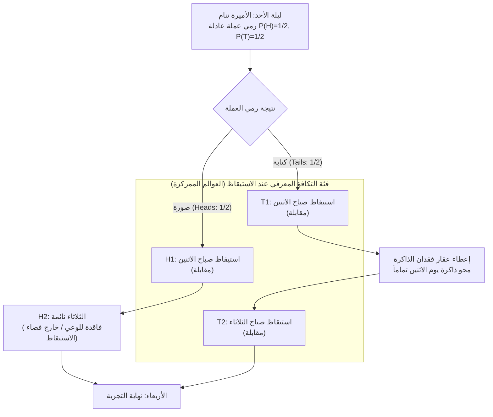
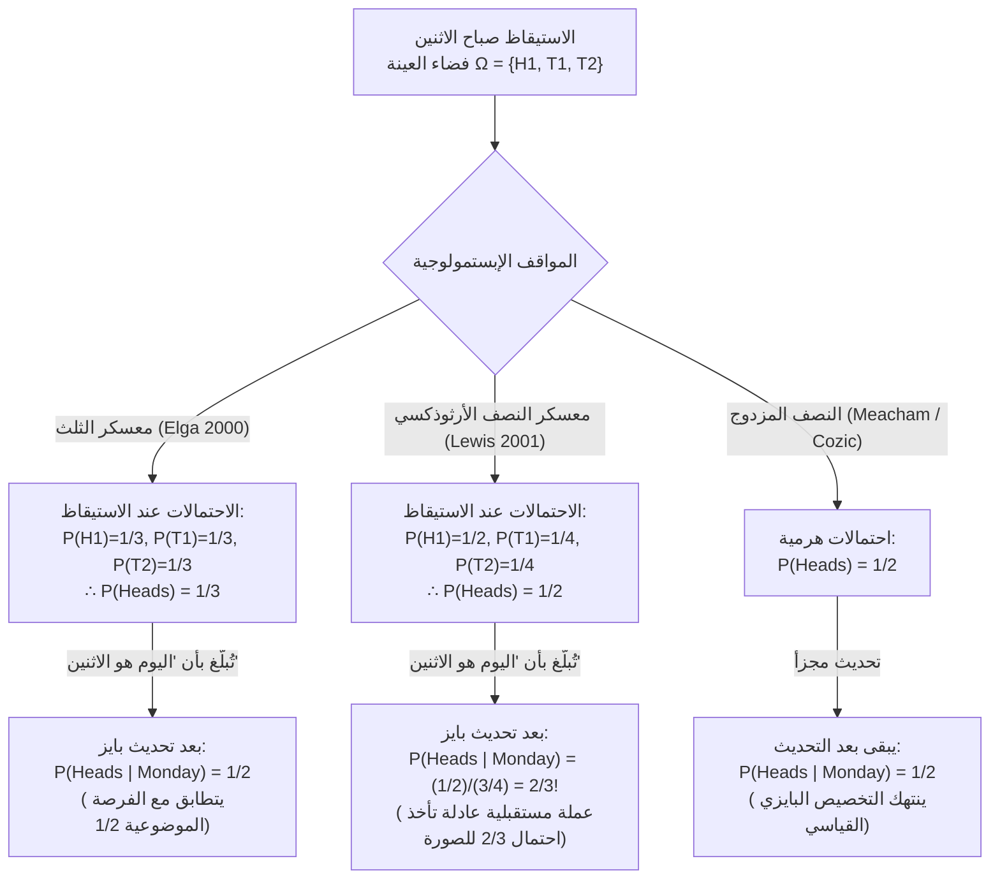

## 1. مقدمة: الصدع الإبستمولوجي في لحظة الاستيقاظ

في ليلة الأحد، تنام <strong>الأميرة النائمة (Sleeping Beauty)</strong> — وهي وكيلة بايزية مثالية تتمتع باتساق منطقي كامل — كخاضعة لتجربة فكرية محكمة. قبل أن تنام، يشرح لها الباحثون كل تفاصيل البروتوكول التجريبي، وهي تعلم بيقين تام ($100\%$) أن القواعد ستُنفذ دون أي انحراف.

تعود أصول هذه التجربة إلى الفيلسوف <strong>أرنولد زوبوف (Arnold Zuboff, 1990)</strong> في ورقته *"One Self: The Logic of Experience"*، وأطلق عليها روبرت ستالناكر اسم «معضلة الأميرة النائمة»، ثم فجّرها <strong>آدم إلغا (Adam Elga, 2000)</strong> في ورقته الشهيرة بمجلة *Analysis* بعنوان *"Self-locating belief and the Sleeping Beauty problem"*.

### 1.1 التوصيف الدقيق للبروتوكول التجريبي

1. <strong>ليلة الأحد (المرحلة القبلية)</strong>: تنام الأميرة النائمة. يرمي الباحثون عملة معدنية عادلة تماماً بحيث يكون الاحتمال الموضوعي لظهور الصورة $P(\text{Heads}) = 1/2$ واحتمال ظهور الكتابة $P(\text{Tails}) = 1/2$.
2. <strong>إذا ظهرت «الصورة» ($H$)</strong>:
   - يوقظ الباحثون الأميرة في <strong>صباح الاثنين</strong> ويجرون معها مقابلة قصيرة.
   - ثم يعيدونها إلى النوم؛ وتظل فاقدة للوعي طوال يوم الثلاثاء ولا تستيقظ إلا يوم الأربعاء عند انتهاء التجربة (<strong>إجمالي الاستيقاظ: مرة واحدة</strong>).
3. <strong>إذا ظهرت «الكتابة» ($T$)</strong>:
   - يوقظ الباحثون الأميرة في <strong>صباح الاثنين</strong> ويجرون معها المقابلة.
   - بعد ذلك مباشرة، يعطونها <strong>عقاراً مسبباً لفقدان الذاكرة (Amnesia-inducing drug)</strong> يمحو تماماً كل ذكرى لاستيقاظ يوم الاثنين، ثم يعيدونها إلى النوم.
   - في <strong>صباح الثلاثاء</strong>، يوقظونها للمرة الثانية في نفس الغرفة وتحت نفس الظروف تماماً (<strong>إجمالي الاستيقاظ: مرتان</strong>).
4. <strong>عدم القابلية للتمييز الذاتي</strong>:
   - لا توجد ساعات أو تقاويم أو قرائن خارجية. وبسبب عقار فقدان الذاكرة، فإن تجربة الاستيقاظ صباح الاثنين وتجربة الاستيقاظ صباح الثلاثاء <strong>غير قابلتين للتمييز ذاتياً وظاهراتياً</strong> بالنسبة للأميرة.

عندما تستيقظ الأميرة صباح الاثنين، يطرح عليها الباحث سؤالاً واحداً:

> <strong>«ما هي درجة اعتقادك الذاتية (Credence / الاحتمال الذاتي) $P(\text{Heads})$ الآن بأن العملة قد استقرت على الصورة؟»</strong>

على الفور، ينقسم الحدس العقلاني إلى معسكرين متعارضين:

- <strong>معسكر النصف (Halvers: $P(\text{Heads}) = 1/2$ — ديفيد لويس، باس فان فراسن)</strong>:
  «في ليلة الأحد، كانت الأميرة تعلم بيقين $100\%$ أنها ستستيقظ مرة واحدة على الأقل في هذه الحالة الظاهراتية بالذات. وبالتالي فإن الاستيقاظ صباح الاثنين <strong>لا يقدم أي دليل موضوعي جديد</strong> حول نتيجة العملة. وبغياب أي دليل غير متوقع، يجب على الوكيل البايزي العقلاني الحفاظ على احتماله القبلي ليوم الأحد: <strong>$P(\text{Heads}) = 1/2$</strong>.»
- <strong>معسكر الثلث (Thirders: $P(\text{Heads}) = 1/3$ — آدم إلغا، كريستوفر هيتشكوك)</strong>:
  «عند الاستيقاظ، هناك ثلاث حالات زمانية-مكانية متنافية ولا يمكن التمييز بينها قد تكون الأميرة فيها الآن: $(\text{صورة}, \text{الاثنين})$، $(\text{كتابة}, \text{الاثنين})$، و$(\text{كتابة}, \text{الثلاثاء})$. ولأن الكتابة تولد ضعف عدد مرات الاستيقاظ مقارنة بالصورة، فإن وجودها مستيقظة يرجح كفة الكتابة بنسبة $2:1$. وفي حال تكرار التجربة $1000$ مرة، سيحدث حوالي $500$ استيقاظ في حالة الصورة و$1000$ استيقاظ في حالة الكتابة ($500$ الاثنين $+$ $500$ الثلاثاء)، أي أن $500 / 1500 = 1/3$ بالضبط من مجموع مرات الاستيقاظ تكون العملة فيها صورة. إذن <strong>$P(\text{Heads}) = 1/3$</strong>.»

---

## 2. أنطولوجيا الاعتقاد: العوالم الممكنة غير الممركزة (*De Dicto*) مقابل الممركزة (*De Se*)

تعمل نظرية الاحتمالات الكلاسيكية لكولموغوروف على <strong>العوالم الممكنة غير الممركزة</strong> $w \in W$ — أي الأوصاف الموضوعية للكون من «منظور اللا-مكان» (*de dicto*). غير أن <strong>جون بيري (John Perry, 1979)</strong> و<strong>ديفيد لويس (David Lewis, 1979)</strong> أثبتا أن المعرفة الموضوعية بصيغة الغائب لا يمكنها أبداً استنفاد <strong>المعتقدات الذاتية الموضعية (*de se* / الإشارية)</strong> («من أنا؟»، «أي يوم هو *اليوم*؟»).

صاغ لويس هذه المعتقدات رياضياً عبر <strong>العوالم الممكنة الممركزة (Centered Possible Worlds)</strong> $\langle w, i, t \rangle \in \mathcal{W}_c$، المكونة من عالم موضوعي $w$، ووكيل $i$، ولحظة زمنية $t$. عند الاستيقاظ، تستبعد الأميرة فوراً الحالة غير الواعية $H_2 = (\text{صورة}, \text{الثلاثاء})$، مما يحصر فضاء العينة المعرفي في ثلاثة عوالم ممركزة:

$$\Omega_{\text{wake}} = \{ H_1, \, T_1, \, T_2 \}$$

---

## 3. البرهان الرياضي لمعسكر الثلث ($P(\text{Heads}) = 1/3$): آدم إلغا (2000)

أثبت آدم إلغا (2000) أن $P(\text{Heads}) = 1/3$ لتجربة واحدة دون الاعتماد على التكرار الإحصائي، وذلك في ثلاث خطوات:

### 3.1 الخطوة 1: مبدأ اللا-مبالاة المقيد بين $T_1$ و$T_2$ ($P(T_1) = P(T_2)$)

بافتراض أن العملة استقرت على <strong>الكتابة</strong> ($T = T_1 \cup T_2$)، فإن كلاً من استيقاظ الاثنين $T_1$ واستيقاظ الثلاثاء $T_2$ يحدثان فعلياً داخل *نفس* العالم الموضوعي $w_T$، وبنفس الأدلة الذاتية تماماً. وبموجب <strong>مبدأ اللا-مبالاة المقيد</strong>، يجب أن يحصل المركزان على نفس الاحتمال الشرطي:

$$P(T_1 \mid T_1 \cup T_2) = P(T_2 \mid T_1 \cup T_2) = \frac{1}{2} \implies \frac{P(T_1)}{P(T_1) + P(T_2)} = \frac{P(T_2)}{P(T_1) + P(T_2)} \implies P(T_1) = P(T_2) \quad \cdots (1)$$

### 3.2 الخطوة 2: التخصيص الشرطي على «اليوم هو الاثنين» وثبات الإزاحة الزمنية ($P(H_1) = P(T_1)$)

لنفترض أنه بعد استيقاظ الأميرة، أخبرها الباحث: <strong>«اليوم هو الاثنين»</strong> ($M = H_1 \cup T_1$). بما أن استيقاظ صباح الاثنين يحدث باحتمال $1$ بغض النظر عن نتيجة العملة، <strong>فإن البروتوكول التجريبي لا يتغير إطلاقاً إذا تم رمي العملة العادلة في ليلة الاثنين (بعد انتهاء مقابلة صباح الاثنين)!</strong>

وإذا كانت العملة ستُرمى ليلة الاثنين، فعندما تعلم الأميرة صباح الاثنين أن «اليوم هو الاثنين»، فإن رمي العملة هو حدث مستقبلي فرصته الموضوعية $1/2$. وبموجب <strong>المبدأ الرئيسي (Principal Principle)</strong> للويس، يجب أن يكون احتمالها الشرطي للصورة علماً بأن اليوم هو الاثنين مساوياً لـ $1/2$:

$$P(\text{Heads} \mid \text{Monday}) = P(H_1 \mid H_1 \cup T_1) = \frac{1}{2} \implies \frac{P(H_1)}{P(H_1) + P(T_1)} = \frac{1}{2} \implies P(H_1) = P(T_1) \quad \cdots (2)$$

### 3.3 الخطوة 3: التركيب الجبري ($P(\text{Heads}) = 1/3$)

بجمع المعادلة (1) $P(T_1) = P(T_2)$ والمعادلة (2) $P(H_1) = P(T_1)$ مع شرط المعايرة $P(H_1) + P(T_1) + P(T_2) = 1$:

$$P(H_1) = P(T_1) = P(T_2) = \frac{1}{3} \implies P(\text{Heads}) = P(H_1) = \frac{1}{3}, \quad P(\text{Tails}) = P(T_1) + P(T_2) = \frac{2}{3} \qquad \blacksquare$$

---

## 4. الهجوم المضاد لمعسكر النصف ($P(\text{Heads}) = 1/2$): ديفيد لويس (2001) ومبدأ الانعكاس

في رده الشهير *"Sleeping Beauty: reply to Elga"* (2001)، دافع <strong>ديفيد لويس</strong> عن $P(\text{Heads}) = 1/2$.

### 4.1 غياب الدليل الموضوعي الجديد ومبدأ الانعكاس لفان فراسن

وفقاً لـ <strong>مبدأ الانعكاس (Reflection Principle)</strong> لـ <strong>باس فان فراسن (1984)</strong>، بما أن الأميرة لم تتلق أي دليل موضوعي (*de dicto*) غير متوقع عند استيقاظها، يجب أن يظل احتمالها $1/2$. يقبل لويس $P(T_1) = P(T_2)$، لكنه يقسم كتلة احتمال الكتابة $1/2$ بالتساوي بين الاثنين والثلاثاء:

$$P_{\text{Lewis}}(H_1) = \frac{1}{2}, \qquad P_{\text{Lewis}}(T_1) = \frac{1}{4}, \qquad P_{\text{Lewis}}(T_2) = \frac{1}{4}$$

### 4.2 النتيجة الصادمة لدى لويس: القفز إلى $2/3$ عند معرفة أن «اليوم هو الاثنين»!

في نظام لويس، عندما يخبر الباحث الأميرة <strong>«اليوم هو الاثنين»</strong> ($M = H_1 \cup T_1$)، فإن قاعدة بايز تعطي:

$$P_{\text{Lewis}}(\text{Heads} \mid \text{Monday}) = \frac{P_{\text{Lewis}}(H_1)}{P_{\text{Lewis}}(H_1) + P_{\text{Lewis}}(T_1)} = \frac{1/2}{1/2 + 1/4} = \frac{2}{3} \> !$$

حتى لو لم تُرمَ العملة العادلة إلا في ليلة الاثنين، فإن أميرة لويس في صباح الاثنين يجب أن تعتقد أن العملة التي ستُرمى الليلة ستستقر على الصورة باحتمال <strong>$2/3$</strong>! ولتجنب ثلث إلغا ($1/3$) وثلثي لويس ($2/3$) معاً، يتخلى أنصار <strong>النصف المزدوج (Double-Halvers: Cozic 2011, Meacham 2008)</strong> عن التخصيص البايزي القياسي لصالح تحديث مجزأ.

---

## 5. حجة الكتاب الهولندي الزماني (Hitchcock 2004) ونظرية القرار

أثبت <strong>كريستوفر هيتشكوك (2004)</strong> أن من يتبنى موقف النصف ($1/2$) يقع ضحية <strong>كتاب هولندي زماني (Diachronic Dutch Book)</strong> يضمن خسارة مالية حتمية:

1. <strong>المرحلة 1 (ليلة الأحد، $P_{\text{Sun}}(H) = 1/2$)</strong>: يعرض المراهن رهاناً لصالح الكتابة: $-\$30$ إذا ظهرت الصورة ($H$)، و$+\$30$ إذا ظهرت الكتابة ($T$).
2. <strong>المرحلة 2 (عند كل استيقاظ، $P_{\text{Wake}}(H) = 1/2$)</strong>: في *كل* استيقاظ، يعرض المراهن رهاناً بنسبة 1 إلى 1 لصالح الصورة: $+\$20$ إذا ظهرت الصورة ($H$)، و$-\$20$ إذا ظهرت الكتابة ($T$). وبسبب فقدان الذاكرة، إذا ظهرت الكتابة يتم توقيع الرهان <strong>مرتين</strong> (الاثنين والثلاثاء)، بينما في حالة الصورة يُوقّع <strong>مرة واحدة فقط</strong>!

الحصيلة المالية الصافية يوم الأربعاء:
- <strong>إذا ظهرت الصورة (استيقاظ واحد)</strong>: $-\$30 + \$20 = \mathbf{-\$10\text{ (خسارة مضمونة!)}}$
- <strong>إذا ظهرت الكتابة (استيقاظان)</strong>: $+\$30 - \$20 - \$20 = \mathbf{-\$10\text{ (خسارة مضمونة!)}}$

وحده الاحتمال $S(1-p) = 2Sp \implies \mathbf{p = 1/3}$ يمنح حصانة كاملة ضد الكتاب الهولندي. ويدافع أنصار النصف (Bradley & Leitgeb 2006) عن أنفسهم عبر <strong>نظرية القرار الدليلي (EDT)</strong>، قائلين إن الارتباط بين قراري الاثنين والثلاثاء يفصل بين حصة الرهان ($1/3$) والاعتقاد المعرفي ($1/2$).

---

## 6. «الأميرة النائمة المتطرفة» لنيك بوستروم وعلم الكونيات الأنثروبي (SSA مقابل SIA)

أوضح <strong>نيك بوستروم (2002, 2007)</strong> أن هذه المعضلة تمثل النموذج الرياضي <strong>لتأثيرات الانتقاء الرصدي</strong> في علم الكونيات. في <strong>الأميرة النائمة المتطرفة</strong>، حيث تؤدي الكتابة إلى <strong>مليون استيقاظ ($N = 1,000,000$)</strong>، يستنتج معسكر الثلث عند الاستيقاظ أن $P(\text{Tails}) = \frac{1,000,000}{1,000,001} \approx 99.9999\%$، بينما يتمسك معسكر النصف بـ $50\%$. وهذا يقابل المسلمتين الأساسيتين للاستدلال الأنثروبي:

1. <strong>افتراض أخذ العينات الذاتي (Self-Sampling Assumption: SSA — مبدأ النصف)</strong>: اعتبار الذات عينة عشوائية من جميع الراصدين في فئة المرجع. لكن SSA يؤدي مباشرة إلى <strong>حجة يوم القيامة (Doomsday Argument)</strong>: معرفة أن ترتيب ميلادك هو حوالي المليار الستين (المكافئ لـ «اليوم هو الاثنين») يضاعف احتمال الانقراض الوشيك للبشرية بـ $1000$ مرة!
2. <strong>افتراض الدلالة الذاتية (Self-Indication Assumption: SIA — مبدأ الثلث)</strong>: مجرد وجودك يرجح الفرضيات بالتناسب الطردي مع عدد الراصدين $N(H_i)$ ($P(H_i \mid E) \propto P(H_i) N(H_i)$). يلغي SIA حجة يوم القيامة، لكنه يولد <strong>مفارقة الفيلسوف المتعجرف (Presumptuous Philosopher Paradox)</strong>، حيث يمكن الجزم بصحة النظرية الكونية ذات العدد الأكبر من الراصدين من على الكرسي دون أي رصد فلكي. كما تحكم هذه البنية <strong>تفسير العوالم المتعددة لإيفريت في ميكانيكا الكم</strong> و<strong>حجة المحاكاة (Bostrom 2003)</strong>.

---

## 7. مصفوفة المقارنة الشاملة للمواقف الثلاثة

| المعيار | معسكر الثلث (Elga 2000) | معسكر النصف الأرثوذكسي (Lewis 2001) | النصف المزدوج (Cozic / Meacham) |
| :--- | :--- | :--- | :--- |
| <strong>التوزيع الممركز عند الاستيقاظ</strong> | $P(H_1)=\frac{1}{3}, P(T_1)=\frac{1}{3}, P(T_2)=\frac{1}{3}$ | $P(H_1)=\frac{1}{2}, P(T_1)=\frac{1}{4}, P(T_2)=\frac{1}{4}$ | مستويان: العوالم $1/2$، والمراكز منفصلة |
| <strong>$P(\text{Heads})$ عند الاستيقاظ</strong> | <strong>$\mathbf{1/3}$</strong> | <strong>$\mathbf{1/2}$</strong> | <strong>$\mathbf{1/2}$</strong> |
| <strong>$P(\text{Heads}\mid\text{الاثنين})$</strong> | <strong>$\mathbf{1/2}$</strong> (متسق مع الفرصة الموضوعية) | <strong>$\mathbf{2/3}$</strong> (عملة مستقبلية عادلة تأخذ 2/3 للصورة!) | <strong>$\mathbf{1/2}$</strong> (يتخلى عن قاعدة بايز القياسية) |
| <strong>الحالة المتطرفة ($N=10^6$ استيقاظ)</strong> | $P(\text{Heads}) = \frac{1}{1,000,001} \approx 0.0001\%$ | $P(\text{Heads}) = 1/2 = 50\%$ | $P(\text{Heads}) = 1/2 = 50\%$ |
| <strong>مبدأ الانعكاس (فان فراسن)</strong> | منتهك (بسبب فقدان الذاكرة) | <strong>محفوظ بصرامة</strong> | <strong>محفوظ بصرامة</strong> |
| <strong>الكتاب الهولندي الزماني</strong> | <strong>محصن بالكامل</strong> | <strong>عرضة للخسارة تحت CDT</strong> (محصن تحت EDT) | عرضة للخسارة دون فصل حصص الرهان |
| <strong>المبدأ الأنثروبي وعلم الكونيات</strong> | <strong>SIA</strong> (يبطل يوم القيامة، ويخلق <strong>الفيلسوف المتعجرف</strong>) | <strong>SSA</strong> (يتجنب الفيلسوف المتعجرف، ويخلق <strong>يوم القيامة</strong>) | SSA مجزأ |

---

## المراجع (References)

- Zuboff, A. (1990). "One Self: The Logic of Experience." *Inquiry*, 33(1), 39–68.
- Elga, A. (2000). "Self-locating belief and the Sleeping Beauty problem." *Analysis*, 60(2), 143–147.
- Lewis, D. (2001). "Sleeping Beauty: reply to Elga." *Analysis*, 61(3), 171–176.
- Hitchcock, C. (2004). "Beauty and the bets." *Synthese*, 139(3), 405–420.
- Bostrom, N. (2002). *Anthropic Bias: Observation Selection Effects in Science and Philosophy*. Routledge.
- Bostrom, N. (2007). "Sleeping Beauty and Colditz." *Synthese*, 157(1), 59–78.
