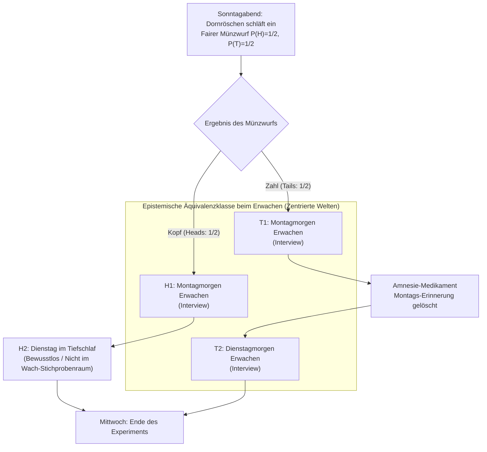
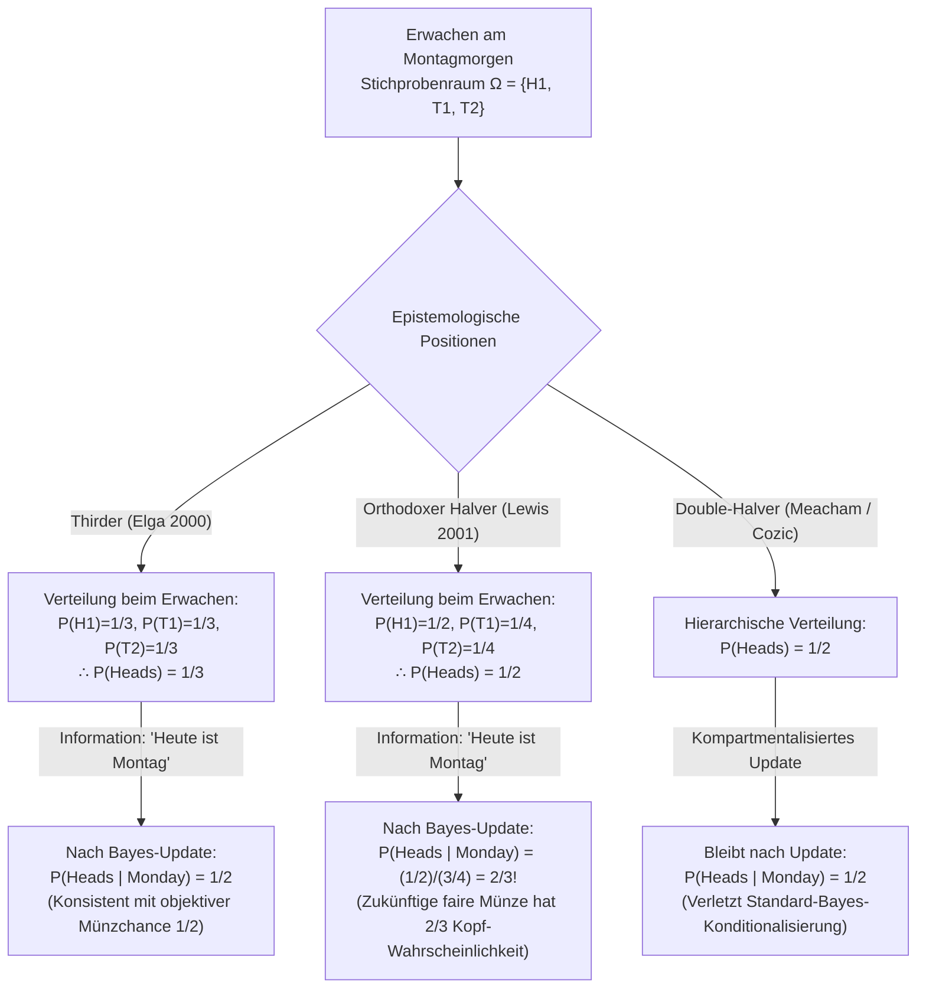

## 1. Einleitung: Der erkenntnistheoretische Riss im Moment des Erwachens

Am Sonntagabend wird <strong>Dornröschen (Sleeping Beauty)</strong> – eine epistemisch ideale bayesianische Agentin mit vollkommener logischer Konsistenz – im Rahmen eines Gedankenexperiments in den Schlaf versetzt. Vor dem Einschlafen wird sie von den Forschern über jedes Detail des Versuchsprotokolls informiert, und sie weiß mit absoluter Sicherheit, dass das Protokoll exakt eingehalten wird.

Das ursprünglich von <strong>Arnold Zuboff (1990)</strong> in *"One Self: The Logic of Experience"* entworfene, von Robert Stalnaker benannte und durch <strong>Adam Elgas</strong> bahnbrechenden *Analysis*-Aufsatz *"Self-locating belief and the Sleeping Beauty problem"* (2000) berühmt gewordene Experiment verläuft nach folgenden Regeln:

### 1.1 Exakte Spezifikation des Versuchsprotokolls

1. <strong>Sonntagabend (A-priori-Phase)</strong>: Dornröschen schläft ein. Die Forscher werfen eine perfekt faire Münze mit den objektiven Wahrscheinlichkeiten $P(\text{Kopf / Heads}) = 1/2$ und $P(\text{Zahl / Tails}) = 1/2$.
2. <strong>Falls die Münze „Kopf“ ($H$) zeigt</strong>:
   - Die Forscher wecken Dornröschen am <strong>Montagmorgen</strong> auf und führen ein kurzes Interview durch.
   - Danach wird sie wieder in den Schlaf versetzt, schläft den gesamten Dienstag über bewusstlos durch und wird erst am Mittwoch nach Ende des Experiments geweckt (<strong>insgesamt 1 Erwachen</strong>).
3. <strong>Falls die Münze „Zahl“ ($T$) zeigt</strong>:
   - Die Forscher wecken Dornröschen am <strong>Montagmorgen</strong> auf und befragen sie.
   - Unmittelbar danach verabreichen sie ihr ein perfektes <strong>Amnesie-Medikament</strong>, das jede Erinnerung an das Erwachen am Montag restlos auslöscht, und versetzen sie wieder in den Schlaf.
   - Am <strong>Dienstagmorgen</strong> wecken sie Dornröschen ein zweites Mal unter völlig identischen Raum- und Lichtbedingungen auf und führen dasselbe Interview durch (<strong>insgesamt 2 Erwachen</strong>).
4. <strong>Subjektive Ununterscheidbarkeit</strong>:
   - Es gibt keinerlei Uhren, Kalender oder äußere Hinweise. Durch die medikamentöse Amnesie sind das Erwachen am Montagmorgen und das Erwachen am Dienstagmorgen aus Dornröschens Erste-Person-Perspektive <strong>vollkommen ununterscheidbar</strong>.

Als Dornröschen am Montagmorgen erwacht, stellen ihr die Forscher eine einzige Frage:

> <strong>„Wie hoch sollte in diesem Moment Ihre subjektive Glaubenswahrscheinlichkeit (Credence) $P(\text{Heads})$ dafür sein, dass die Münze auf Kopf gelandet ist?“</strong>

Sofort spaltet sich die analytische Erkenntnistheorie in zwei unversöhnliche Lager:

- <strong>Die „Halvers“ ($P(\text{Heads}) = 1/2$ – David Lewis, Bas van Fraassen, Darren Bradley)</strong>:
  „Bereits am Sonntagabend wusste Dornröschen mit $100\%$-iger Sicherheit, dass sie mindestens einmal in genau diesem phänomenalen Zustand aufwachen würde. Das Erwachen liefert <strong>keinerlei neue objektive Evidenz</strong> über den Ausgang des Münzwurfs. Da eine rationale Bayesianerin ihre Überzeugung bezüglich einer objektiven Aussage ohne unerwartete Evidenz nicht ändern darf, muss ihre Wahrscheinlichkeit bei <strong>$P(\text{Heads}) = 1/2$</strong> bleiben.“
- <strong>Die „Thirders“ ($P(\text{Heads}) = 1/3$ – Adam Elga, Christopher Hitchcock, Cian Dorr)</strong>:
  „Wenn Dornröschen erwacht, gibt es drei sich gegenseitig ausschließende, subjektiv ununterscheidbare raumzeitliche Situationen, in denen sie sich befinden kann: $(\text{Kopf}, \text{Montag})$, $(\text{Zahl}, \text{Montag})$ und $(\text{Zahl}, \text{Dienstag})$. Da bei Zahl doppelt so viele Aufwach-Episoden stattfinden wie bei Kopf, ist es doppelt so wahrscheinlich, während eines Zahl-Durchlaufs aufzuwachen. Bei $1.000$ Wiederholungen des Experiments gibt es rund $500$ Kopf-Erwachen und $1.000$ Zahl-Erwachen ($500$ am Montag $+$ $500$ am Dienstag), sodass genau $500 / 1.500 = 1/3$ aller Aufwach-Momente auf Kopf entfallen. Folglich gilt <strong>$P(\text{Heads}) = 1/3$</strong>.“

---

## 2. Ontologie der Überzeugungen: Unzentrierte (*De Dicto*) vs. Zentrierte (*De Se*) Mögliche Welten

Die klassische Wahrscheinlichkeitstheorie nach Kolmogorow operiert auf <strong>unzentrierten möglichen Welten</strong> $w \in W$ – objektiven Weltbeschreibungen aus dem „Blick von Nirgendwo“ (*de dicto*). Doch wie <strong>John Perry (1979)</strong> (*„The Problem of the Essential Indexical“*) und <strong>David Lewis (1979)</strong> (*„Attitudes De Dicto and De Se“*) bewiesen haben, lässt sich <strong>selbstlokalisierendes (*de se* / indexikalisches) Wissen</strong> („Wer bin ich?“, „Welcher Tag ist *heute*?“) niemals auf rein objektive Weltfakten reduzieren.

Lewis formalisierte dies durch <strong>zentrierte mögliche Welten (Centered Possible Worlds)</strong> $\langle w, i, t \rangle \in \mathcal{W}_c$, bestehend aus einer objektiven Welt $w$, einem Agenten $i$ und einem Zeitpunkt $t$. Im Dornröschen-Experiment gibt es vier relevante zentrierte Welten:
1. $H_1 = \langle w_H, \text{Beauty}, \text{Montag} \rangle$: Kopf und heute ist Montag (<strong>Wach</strong>).
2. $H_2 = \langle w_H, \text{Beauty}, \text{Dienstag} \rangle$: Kopf und heute ist Dienstag (<strong>Schlafend / Bewusstlos</strong>).
3. $T_1 = \langle w_T, \text{Beauty}, \text{Montag} \rangle$: Zahl und heute ist Montag (<strong>Wach</strong>).
4. $T_2 = \langle w_T, \text{Beauty}, \text{Dienstag} \rangle$: Zahl und heute ist Dienstag (<strong>Wach</strong>).

Da Dornröschen beim Erwachen mit Gewissheit weiß, dass sie wach ist, entfällt $H_2$. Ihr epistemischer Stichprobenraum beim Erwachen lautet exakt:

$$\Omega_{\text{wake}} = \{ H_1, \, T_1, \, T_2 \}$$

---

## 3. Der mathematische Beweis der „Thirders“ ($P(\text{Heads}) = 1/3$): Adam Elga (2000)

Adam Elga (2000) leitete $P(\text{Heads}) = 1/3$ streng für einen einzelnen Durchlauf des Experiments in drei Schritten her:

### 3.1 Schritt 1: Eingeschränktes Indifferenzprinzip zwischen $T_1$ und $T_2$ ($P(T_1) = P(T_2)$)

Angenommen, Dornröschen setzt voraus, dass die Münze auf <strong>Zahl</strong> gelandet ist ($T = T_1 \cup T_2$). Innerhalb derselben objektiven Zahl-Welt $w_T$ treten sowohl $T_1$ als auch $T_2$ tatsächlich ein, und ihre subjektive Evidenz ist in beiden Zentren vollkommen identisch. Nach Elgas <strong>eingeschränktem Indifferenzprinzip</strong> müssen zwei ununterscheidbare Zentren innerhalb *derselben* objektiven Welt gleiche bedingte Wahrscheinlichkeit erhalten:

$$P(T_1 \mid T_1 \cup T_2) = P(T_2 \mid T_1 \cup T_2) = \frac{1}{2} \implies \frac{P(T_1)}{P(T_1) + P(T_2)} = \frac{P(T_2)}{P(T_1) + P(T_2)} \implies P(T_1) = P(T_2) \quad \cdots (1)$$

### 3.2 Schritt 2: Konditionalisierung auf „Heute ist Montag“ und zeitliche Verschiebungsinvarianz ($P(H_1) = P(T_1)$)

Angenommen, der Versuchsleiter teilt Dornröschen nach dem Aufwachen mit: <strong>„Heute ist Montag“</strong> ($M = H_1 \cup T_1$). Da Dornröschen am Montagmorgen unabhängig vom Münzwurf mit Wahrscheinlichkeit $1$ geweckt wird, ändert sich am Protokoll absolut nichts, wenn die faire Münze erst <strong>am Montagabend (nach dem Montags-Interview)</strong> geworfen wird!

Wenn die Münze aber erst am Montagabend geworfen wird, weiß Dornröschen am Montagmorgen (nachdem sie erfahren hat, dass heute Montag ist), dass ein fairer Münzwurf mit objektiver Chance $1/2$ noch in der Zukunft liegt. Nach David Lewis' <strong>Principal Principle</strong> muss ihre bedingte Wahrscheinlichkeit für Kopf gegeben „Heute ist Montag“ zwingend $1/2$ betragen:

$$P(\text{Heads} \mid \text{Monday}) = P(H_1 \mid H_1 \cup T_1) = \frac{1}{2} \implies \frac{P(H_1)}{P(H_1) + P(T_1)} = \frac{1}{2} \implies P(H_1) = P(T_1) \quad \cdots (2)$$

### 3.3 Schritt 3: Algebraische Synthese zu $P(\text{Heads}) = 1/3$

Aus Gleichung (1) $P(T_1) = P(T_2)$, Gleichung (2) $P(H_1) = P(T_1)$ und der Normierung $P(H_1) + P(T_1) + P(T_2) = 1$ folgt unmittelbar:

$$P(H_1) = P(T_1) = P(T_2) = \frac{1}{3} \implies P(\text{Heads}) = P(H_1) = \frac{1}{3}, \quad P(\text{Tails}) = P(T_1) + P(T_2) = \frac{2}{3} \qquad \blacksquare$$

---

## 4. Der Gegenangriff der „Halvers“ ($P(\text{Heads}) = 1/2$): David Lewis (2001) und das Reflexionsprinzip

In seiner Replik *"Sleeping Beauty: reply to Elga"* (2001) verteidigte <strong>David Lewis</strong> die Position $P(\text{Heads}) = 1/2$.

### 4.1 Keine neue objektive Evidenz und van Fraassens Reflexionsprinzip

Nach <strong>Bas van Fraassens (1984) Reflexionsprinzip (Reflection Principle)</strong> darf eine rationale Agentin ihre Wahrscheinlichkeit für eine unzentrierte Aussage $H$ nicht ändern, wenn das Eintreten des neuen epistemischen Zustands mit Sicherheit vorhergesehen wurde und keine neue *de dicto*-Evidenz liefert. Lewis akzeptiert $P(T_1) = P(T_2)$, teilt aber die Zahl-Wahrscheinlichkeit von $1/2$ auf beide Tage auf:

$$P_{\text{Lewis}}(H_1) = \frac{1}{2}, \qquad P_{\text{Lewis}}(T_1) = \frac{1}{4}, \qquad P_{\text{Lewis}}(T_2) = \frac{1}{4}$$

### 4.2 Die schockierende Konsequenz bei Lewis: Der Sprung auf $2/3$ am Montag!

Was passiert in Lewis' System, wenn der Forscher Dornröschen sagt: <strong>„Heute ist Montag“</strong> ($M = H_1 \cup T_1$)? Nach dem Satz von Bayes gilt:

$$P_{\text{Lewis}}(\text{Heads} \mid \text{Monday}) = \frac{P_{\text{Lewis}}(H_1)}{P_{\text{Lewis}}(H_1) + P_{\text{Lewis}}(T_1)} = \frac{1/2}{1/2 + 1/4} = \frac{2}{3} \> !$$

Sobald Lewis' Dornröschen erfährt, dass heute Montagmorgen ist, springt ihre Wahrscheinlichkeit dafür, dass eine faire Münze (selbst wenn sie erst heute Abend geworfen wird!) auf Kopf landet, von $1/2$ auf <strong>$2/3$</strong>! Lewis verteidigte dies damit, dass „Heute ist Montag“ indexikalische Evidenz sei, die Kopf im Verhältnis $1 : 1/2 = 2:1$ stützt. <strong>Double-Halvers (Meacham 2008, Cozic 2011)</strong> versuchen sowohl $P(\text{Heads}) = 1/2$ als auch $P(\text{Heads} \mid \text{Monday}) = 1/2$ zu retten, müssen dafür aber die klassische bayesianische Konditionalisierung zugunsten einer kompartmentalisierten Aktualisierung aufgeben.

---

## 5. Diachrones Dutch-Book-Argument (Hitchcock 2004) und Entscheidungstheorie

<strong>Christopher Hitchcock (2004)</strong> bewies in *"Beauty and the bets"*, dass eine Halver-Dornröschen durch ein <strong>diachrones Dutch Book</strong> (eine Folge subjektiv fairer Wetten mit garantiertem Gesamtverlust) ausgebeutet werden kann:

1. <strong>Stufe 1 (Sonntagabend, $P_{\text{Sun}}(H) = 1/2$)</strong>: Der Buchmacher bietet eine faire Wette auf Zahl an: $-\$30$ bei Kopf ($H$), $+\$30$ bei Zahl ($T$).
2. <strong>Stufe 2 (Bei jedem Erwachen, $P_{\text{Wake}}(H) = 1/2$)</strong>: Bei *jedem* Erwachen bietet der Buchmacher eine 1:1-Wette auf Kopf an: $+\$20$ bei Kopf ($H$), $-\$20$ bei Zahl ($T$). Wegen der Amnesie unterschreibt die Halver-Agentin diese Wette bei Kopf <strong>einmal</strong> (Montag), bei Zahl jedoch <strong>zweimal</strong> (Montag und Dienstag)!

Gesamtbilanz am Mittwoch:
- <strong>Falls Kopf (1 Erwachen)</strong>: $-\$30 + \$20 = \mathbf{-\$10\text{ (Garantierter Verlust!)}}$
- <strong>Falls Zahl (2 Erwachen)</strong>: $+\$30 - \$20 - \$20 = \mathbf{-\$10\text{ (Garantierter Verlust!)}}$

Nur der Thirder-Wettquotient $S(1-p) = 2Sp \implies \mathbf{p = 1/3}$ macht Dornröschen immun gegen das Dutch Book. Halvers (Bradley & Leitgeb 2006) verteidigen sich mithilfe der <strong>Evidentiellen Entscheidungstheorie (EDT)</strong>: Da die Annahme der Wette am Montag evidentiell mit der Annahme derselben Wette am Dienstag korreliert ist, muss selbst ein Halver mit Glaubensgrad $1/2$ beim Wetten Quoten von $1/3$ verlangen.

---

## 6. Nick Bostroms „Extremes Dornröschen“ und Anthropische Kosmologie (SSA vs. SIA)

<strong>Nick Bostrom (2002, 2007)</strong> zeigte, dass das Dornröschen-Problem das Grundmodell für <strong>Beobachtungsselektionseffekte</strong> in der Kosmologie ist. Im <strong>Extremen Dornröschen-Experiment</strong>, bei dem Dornröschen im Fall von Zahl <strong>1 Million Mal ($N = 1.000.000$)</strong> geweckt wird, gelangt der Thirder beim Erwachen zu $P(\text{Tails}) = \frac{1.000.000}{1.000.001} \approx 99,9999\%$, während der Halver bei $50\%$ bleibt. Dies entspricht den zwei Hauptsätzen der anthropischen Erkenntnistheorie:

1. <strong>Self-Sampling Assumption (SSA – Halver-Prinzip)</strong>: Betrachte dich als zufällige Stichprobe aus allen Beobachtern deiner Referenzklasse. SSA vermeidet eine Bevorzugung riesiger Universen, führt aber direkt zum <strong>Doomsday-Argument (Weltuntergangsargument)</strong>: Die Erkenntnis, als ca. 60-milliardster Mensch geboren zu sein (analog zu „Heute ist Montag“), erhöht die Wahrscheinlichkeit eines baldigen Aussterbens der Menschheit um das Tausendfache!
2. <strong>Self-Indication Assumption (SIA – Thirder-Prinzip)</strong>: Die bloße eigene Existenz begünstigt Hypothesen proportional zur Anzahl der Beobachter $N(H_i)$ ($P(H_i \mid E) \propto P(H_i) N(H_i)$). SIA neutralisiert das Doomsday-Argument exakt, erzeugt aber das <strong>Paradoxon des anmaßenden Philosophen (Presumptuous Philosopher Paradox)</strong>, wonach man vom Lehnstuhl aus ohne Teleskope beweisen könnte, dass das Universum unendlich viele Beobachter enthalten muss. Dieselbe Mathematik bestimmt die Wahrscheinlichkeitsgewichte in der <strong>Everett'schen Viele-Welten-Interpretation der Quantenmechanik</strong> und in Bostroms <strong>Simulationshypothese (2003)</strong>.

---

## 7. Vergleichsmatrix der drei Positionen

| Kriterium | Thirder (Elga 2000) | Orthodoxer Halver (Lewis 2001) | Double-Halver (Meacham / Cozic) |
| :--- | :--- | :--- | :--- |
| <strong>Zentrierte Wahrscheinlichkeiten</strong> | $P(H_1)=\frac{1}{3}, P(T_1)=\frac{1}{3}, P(T_2)=\frac{1}{3}$ | $P(H_1)=\frac{1}{2}, P(T_1)=\frac{1}{4}, P(T_2)=\frac{1}{4}$ | Zweistufig: Welten $1/2$, Zentren separat |
| <strong>$P(\text{Heads})$ beim Erwachen</strong> | <strong>$\mathbf{1/3}$</strong> | <strong>$\mathbf{1/2}$</strong> | <strong>$\mathbf{1/2}$</strong> |
| <strong>$P(\text{Heads}\mid\text{Montag})$</strong> | <strong>$\mathbf{1/2}$</strong> (Konsistent mit Principal Principle) | <strong>$\mathbf{2/3}$</strong> (Zukünftige faire Münze zu 2/3 Kopf!) | <strong>$\mathbf{1/2}$</strong> (Verletzt Standard-Bayes-Regel) |
| <strong>Extremes Dornröschen ($N=10^6$)</strong> | $P(\text{Heads}) = \frac{1}{1.000.001} \approx 0,0001\%$ | $P(\text{Heads}) = 1/2 = 50\%$ | $P(\text{Heads}) = 1/2 = 50\%$ |
| <strong>Reflexionsprinzip (van Fraassen)</strong> | Verletzt (wegen Amnesie) | <strong>Strikt erfüllt</strong> | <strong>Strikt erfüllt</strong> |
| <strong>Diachrones Dutch Book (Hitchcock)</strong> | <strong>Vollkommen immun</strong> | <strong>Bankrott unter CDT</strong> (Immun nur unter EDT) | Anfällig ohne Trennung von Wettquote & Credence |
| <strong>Anthropisches Prinzip & Kosmologie</strong> | <strong>SIA</strong> (Löst Doomsday-Argument, erzeugt <strong>Presumptuous Philosopher</strong>) | <strong>SSA</strong> (Vermeidet Presumptuous Philosopher, erzeugt <strong>Doomsday-Argument</strong>) | Kompartmentalisierte SSA |

---

## Literatur (References)

- Zuboff, A. (1990). "One Self: The Logic of Experience." *Inquiry*, 33(1), 39–68.
- Elga, A. (2000). "Self-locating belief and the Sleeping Beauty problem." *Analysis*, 60(2), 143–147.
- Lewis, D. (2001). "Sleeping Beauty: reply to Elga." *Analysis*, 61(3), 171–176.
- Hitchcock, C. (2004). "Beauty and the bets." *Synthese*, 139(3), 405–420.
- Bostrom, N. (2002). *Anthropic Bias: Observation Selection Effects in Science and Philosophy*. Routledge.
- Bostrom, N. (2007). "Sleeping Beauty and Colditz." *Synthese*, 157(1), 59–78.
