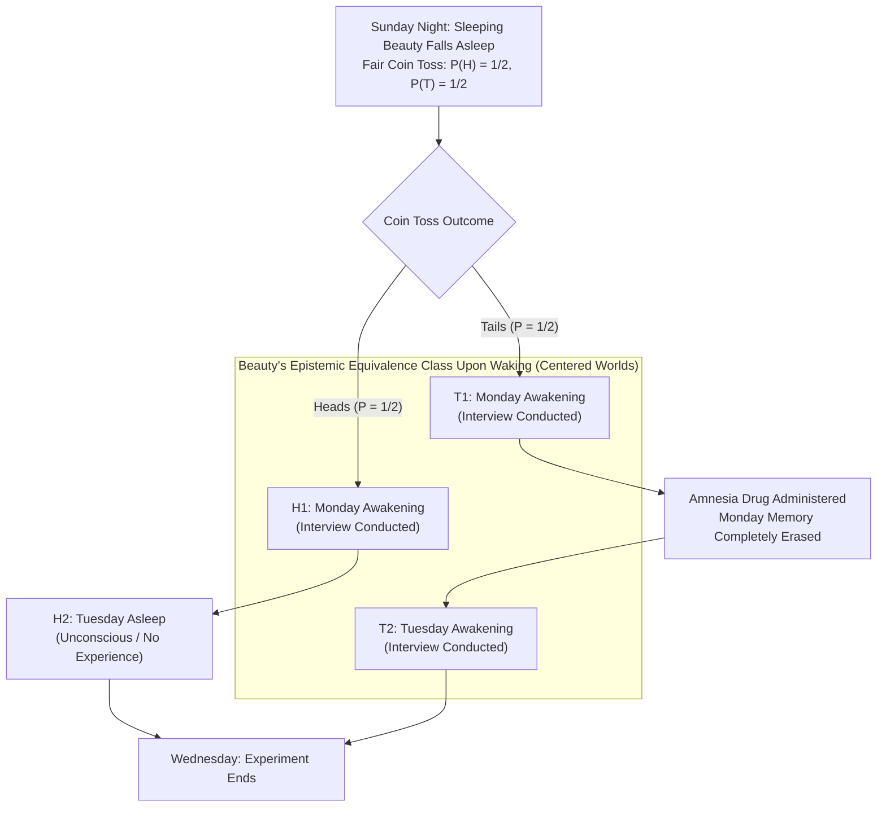

## 1. Introduction: The Epistemological Fracture at the Moment of Awakening

On Sunday night, <strong>Sleeping Beauty</strong>—an epistemically ideal Bayesian agent endowed with flawless logical omniscience and probabilistic coherence—is put to sleep as the subject of a carefully controlled thought experiment. Before falling asleep, the researchers brief her on every detail of the experimental protocol, and she knows with absolute certainty that the rules will be followed without deviation.

The experimental protocol is deceptively elementary. Yet the interplay of <strong>pharmacological amnesia</strong> and <strong>temporal indexicality</strong> embedded within it has fractured contemporary analytic philosophy, formal epistemology, Bayesian probability theory, decision theory, and physical cosmology into two fiercely opposed camps.

### 1.1 Exact Specification of the Experimental Protocol

1. <strong>Sunday Night (Prior Stage)</strong>: Sleeping Beauty is put to sleep. Researchers toss a perfectly fair coin whose objective physical chance of landing Heads is $P(\text{Heads}) = 1/2$ and Tails is $P(\text{Tails}) = 1/2$.
2. <strong>If the Coin Lands Heads ($H$)</strong>:
   - The researchers wake Beauty on <strong>Monday morning</strong> and conduct a brief interview.
   - They then put her back to sleep. She remains completely unconscious throughout Tuesday, and wakes up on Wednesday when the experiment ends (<strong>1 awakening total</strong>).
3. <strong>If the Coin Lands Tails ($T$)</strong>:
   - The researchers wake Beauty on <strong>Monday morning</strong> and conduct a brief interview.
   - Immediately afterward, they administer a perfect <strong>amnesia-inducing drug</strong> that completely erases every memory trace of Monday's awakening and put her back to sleep.
   - On <strong>Tuesday morning</strong>, they wake her a second time in the exact same room under identical lighting, physiological, and environmental conditions (<strong>2 awakenings total</strong>), before putting her to sleep until Wednesday.
4. <strong>Subjective Indistinguishability</strong>:
   - All external temporal cues (clocks, calendars, windows) are removed.
   - Because of the amnesia drug, Beauty's first-person phenomenal experience on Monday morning and her first-person phenomenal experience on Tuesday morning are <strong>subjectively and epistemically indistinguishable</strong>.

Now, Monday morning arrives. The researchers wake Sleeping Beauty and ask her a single question:

> <strong>"What should your credence (subjective degree of belief) $P(\text{Heads})$ be right now that the coin landed Heads?"</strong>

Originally conceived in the 1980s by philosopher <strong>Arnold Zuboff</strong> and published in his 1990 paper *"One Self: The Logic of Experience"* (in a version involving a million awakenings), the puzzle was christened the "Sleeping Beauty problem" by Robert Stalnaker and catapulted to the center of modern epistemology by <strong>Adam Elga's</strong> landmark 2000 *Analysis* paper, *"Self-locating belief and the Sleeping Beauty problem."*

Almost immediately, rational intuition bifurcates into two irreconcilable camps:

- <strong>The Halver Intuition ($P(\text{Heads}) = 1/2$ — David Lewis, Bas van Fraassen, Darren Bradley)</strong>:
  "On Sunday night, Beauty knew with $100\%$ certainty that whether the coin landed Heads or Tails, she would wake up at least once in this exact phenomenal state. Waking up on Monday morning provides <strong>zero new objective evidence</strong> about how the coin landed. Because a rational Bayesian agent must not alter her credence in an objective proposition when she receives no unexpected evidence, she must retain her Sunday prior: <strong>$P(\text{Heads}) = 1/2$</strong>."
- <strong>The Thirder Intuition ($P(\text{Heads}) = 1/3$ — Adam Elga, Christopher Hitchcock, Cian Dorr)</strong>:
  "When Beauty wakes up, there are three mutually exclusive and equally plausible spatiotemporal predicaments she could be experiencing right now: $(\text{Heads}, \text{Monday})$, $(\text{Tails}, \text{Monday})$, and $(\text{Tails}, \text{Tuesday})$. Because Tails generates *twice as many awakenings* as Heads, finding herself awake is twice as likely to occur inside a Tails run as inside a Heads run. Equivalently, if the experiment is repeated $1,000$ times, roughly $500$ runs land Heads ($500$ Monday awakenings) and $500$ runs land Tails ($500$ Monday awakenings $+$ $500$ Tuesday awakenings $= 1,000$ Tails awakenings). Out of $1,500$ total awakenings, exactly $500 / 1,500 = 1/3$ are Heads awakenings. Therefore, her credence must be <strong>$P(\text{Heads}) = 1/3$</strong>."

Why does such an elementary setup resist consensus among the world's leading logicians, probabilists, and physicists? The root cause lies in a foundational blind spot of classical Kolmogorov probability theory and textbook Bayesian conditionalization. Classical probability is formulated over <strong>uncentered (*de dicto*) propositions</strong>—timeless, perspective-free descriptions of how the objective world is. It was never designed to handle <strong>self-locating (*de se* / indexical) beliefs</strong>—beliefs about *who I am* and *what time it is now*—especially when the agent undergoes cognitive memory loss and temporal branching across multiple indistinguishable observer-moments.

In this article, we rigorously formalize the semantics of centered possible worlds, reconstruct the exact mathematical proofs of both Adam Elga's Thirder camp and David Lewis's Halver camp (including Lewis's startling $2/3$ probability update upon learning "Today is Monday"), analyze Christopher Hitchcock's diachronic Dutch Book betting theorem alongside the clash between Evidential and Causal Decision Theory, and explore Nick Bostrom's Extreme Sleeping Beauty ($1,000,000$ awakenings) as the mathematical Rosetta Stone for the <strong>Anthropic Principle</strong> (the Self-Sampling Assumption vs. the Self-Indication Assumption) in modern cosmology, Everettian quantum mechanics, and the Simulation Argument.

---

## 2. The Ontology of Belief: Uncentered (*De Dicto*) vs. Centered (*De Se*) Possible Worlds

Before reconstructing the formal proofs of Elga and Lewis, we must establish the mathematical structure of the probability space on which Beauty's credences are defined.

### 2.1 The "View from Nowhere" and the Essential Indexical

In standard possible-worlds semantics (Carnap, Kripke, Stalnaker) and classical Bayesian epistemology, a proposition is modeled as a subset $E \subseteq W$ of <strong>uncentered possible worlds</strong>. An uncentered possible world $w \in W$ is a complete, God's-eye specification of the entire four-dimensional spacetime manifold from beginning to end—what Thomas Nagel called the *"View from Nowhere"* and Spinoza termed *"sub specie aeternitatis."* Beliefs directed at uncentered propositions (such as *"The coin landed Heads on Sunday night"* or *"Electrons have negative charge"*) are called <strong>*de dicto* beliefs</strong>.

However, in two seminal papers published in 1979—<strong>John Perry's</strong> *"The Problem of the Essential Indexical"* and <strong>David Lewis's</strong> *"Attitudes De Dicto and De Se"*—philosophers proved that no amount of objective, third-person (*de dicto*) knowledge can ever exhaust what an agent knows and believes. There exists an irreducible category of <strong>indexical or self-locating (*de se*) belief</strong>: knowledge of where *I* am located in space, time, and world-history *right now*.

Consider Perry's famous supermarket example: a shopper notices a trail of sugar on the floor leaking from a torn sack in someone's cart. Wishing to alert the messy shopper, he follows the sugar trail around and around the aisles, noticing the trail growing thicker, until he finally realizes: <strong>"*I* am the shopper making the mess!"</strong> At that instant, he stops and fixes his torn sack. What did he learn? Even if he already had a complete third-person map and security-camera feed of the supermarket showing that "Shopper #42 is spilling sugar at $t = 14:05$," that objective proposition cannot explain why he stops pushing his cart unless he forms the self-locating (*de se*) belief: *"I am Shopper #42, and now is $14:05$."*

Similarly, an omniscient prisoner who has memorized the entire history of the universe (every uncentered fact in $w$) but is locked in a windowless cell without a clock knows every objective truth about the world while remaining completely ignorant of the self-locating proposition: <strong><em>"What day is it today?"</em></strong>

### 2.2 Formalizing Centered Possible Worlds

To represent *de se* attitudes mathematically, David Lewis (1979) replaced uncentered worlds $w \in W$ with <strong>centered possible worlds</strong>. A centered possible world is an ordered triple $\langle w, i, t \rangle \in \mathcal{W}_c$ consisting of an objective world $w \in W$ marked with a spatiotemporal "center" designating an agent $i$ and a temporal stage (time-slice) $t$ within $w$:

$$\mathcal{W}_c = \{ \langle w, i, t \rangle \mid w \in W, \, i \in \text{Agents}(w), \, t \in \text{Times}(w) \}$$

An agent's complete epistemic sample space $\Omega$ is a subset of $\mathcal{W}_c$:

- <strong>Uncentered Proposition (*De Dicto*)</strong>: A subset $A \subseteq \mathcal{W}_c$ whose truth value depends solely on the objective world coordinate $w$ and is invariant across centers: $\langle w, i, t \rangle \in A \iff \langle w, i', t' \rangle \in A$. In the Sleeping Beauty problem, <strong>"The coin landed Heads" ($H$)</strong> and <strong>"The coin landed Tails" ($T$)</strong> are uncentered propositions.
- <strong>Centered Proposition (*De Se* / Indexical)</strong>: A subset $C \subseteq \mathcal{W}_c$ whose truth value varies across different temporal or personal centers within the *very same* objective world $w$. For example, <strong>"Today is Monday" ($M$)</strong> is true at the Monday center $\langle w, \text{Beauty}, \text{Mon} \rangle$ and false at the Tuesday center $\langle w, \text{Beauty}, \text{Tue} \rangle$ of the exact same world $w$.

In the Sleeping Beauty experiment, there are only <strong>two objective uncentered worlds</strong>: the Heads world $w_H$ and the Tails world $w_T$. Crossing these two objective worlds with the two relevant days (Monday and Tuesday) yields <strong>four centered possible worlds</strong>:

1. $H_1 = \langle w_H, \text{Beauty}, \text{Monday} \rangle$: The coin landed Heads, and today is Monday (<strong>Awake</strong>).
2. $H_2 = \langle w_H, \text{Beauty}, \text{Tuesday} \rangle$: The coin landed Heads, and today is Tuesday (<strong>Asleep / Unconscious</strong>).
3. $T_1 = \langle w_T, \text{Beauty}, \text{Monday} \rangle$: The coin landed Tails, and today is Monday (<strong>Awake</strong>).
4. $T_2 = \langle w_T, \text{Beauty}, \text{Tuesday} \rangle$: The coin landed Tails, and today is Tuesday (<strong>Awake</strong>).

When Sleeping Beauty wakes up and reflects on her predicament, she knows with Cartesian certainty the self-locating proposition *"I am currently awake and undergoing an interview."* This immediately eliminates $H_2$ (where she is unconscious). Consequently, her epistemic sample space upon waking consists of the <strong>three centered possible worlds</strong>:

$$\Omega_{\text{wake}} = \{ H_1, \, T_1, \, T_2 \}$$

The entire controversy between Thirders and Halvers boils down to how a rational Bayesian agent must distribute probability mass across $\Omega_{\text{wake}} = \{ H_1, T_1, T_2 \}$ as she moves from Sunday night into Monday morning.

---

## 3. The Thirder Proof ($P(\text{Heads}) = 1/3$): Adam Elga's (2000) Mathematical Reconstruction

In his 2000 *Analysis* paper, <strong>Adam Elga</strong> proved that $P(\text{Heads}) = 1/3$ without appealing to long-run frequentist repetitions. Instead, he derived the result strictly for a single run of the experiment from two foundational symmetry and independence constraints on Beauty's centered credences $P(H_1)$, $P(T_1)$, and $P(T_2)$. Let us reconstruct Elga's proof step by step.

### 3.1 Step 1: The Restricted Principle of Indifference Between $T_1$ and $T_2$ ($P(T_1) = P(T_2)$)

Suppose that upon waking, Beauty conditionalizes on the hypothesis that the coin landed <strong>Tails</strong>—that is, she restricts her credence distribution to the event $T = T_1 \cup T_2$.

Within the single objective Tails world $w_T$, <strong>both</strong> the Monday awakening $T_1$ and the Tuesday awakening $T_2$ actually occur in reality. Furthermore, because of the amnesia-inducing drug and identical room conditions, Beauty's internal mental state, memories, and sensory evidence at $T_1$ are qualitatively identical to her mental state, memories, and sensory evidence at $T_2$.

While the classical Laplacean Principle of Indifference is notoriously paradoxical when applied across distinct objective worlds (e.g., Bertrand's paradox), Elga invokes a vastly weaker and virtually unassailable <strong>Restricted Principle of Indifference</strong>:

> <strong>Restricted Principle of Indifference (Elga 2000)</strong>: If two centered worlds $\langle w, i, t_1 \rangle$ and $\langle w, i, t_2 \rangle$ belong to the <strong>exact same objective world $w$</strong> (so both episodes actually occur in that world) and the agent possesses <strong>identical subjective evidence and phenomenal experience</strong> in both centers, then the agent must assign equal conditional credence to being at $t_1$ versus $t_2$.

Indeed, given that the coin landed Tails, there is zero physical, epistemic, or evidential asymmetry favoring Monday over Tuesday. Therefore, Beauty's conditional credences given $T = T_1 \cup T_2$ must satisfy:

$$P(T_1 \mid T_1 \cup T_2) = P(T_2 \mid T_1 \cup T_2) = \frac{1}{2}$$

Expanding the definition of conditional probability $P(A \mid B) = \frac{P(A \cap B)}{P(B)}$ and noting that $T_1, T_2 \subseteq T_1 \cup T_2$, we multiply both sides by $P(T_1 \cup T_2) = P(T_1) + P(T_2)$ to obtain Equation (1):

$$\frac{P(T_1)}{P(T_1) + P(T_2)} = \frac{P(T_2)}{P(T_1) + P(T_2)} \implies P(T_1) = P(T_2) \quad \cdots \text{(Equation 1)}$$

*(Note: Every Halver, including David Lewis, accepts Step 1 and Equation 1 without reservation.)*

### 3.2 Step 2: Conditionalizing on "Today is Monday" and Temporal Shift Invariance ($P(H_1) = P(T_1)$)

Now suppose that after Beauty wakes up, the experimenter walks in, shows her a verified newspaper, and tells her: <strong><em>"Today is Monday."</em></strong>

Upon receiving this new centered evidence $M = H_1 \cup T_1$, Beauty rules out the Tuesday awakening $T_2$ and updates her credences by conditionalizing on $H_1 \cup T_1$. What should her conditional credence $P(\text{Heads} \mid \text{Monday}) = P(H_1 \mid H_1 \cup T_1)$ be?

Here Elga introduces a devastatingly clever causal-invariance argument. Look closely at the experimental protocol:
- Whether the coin lands Heads or Tails, Beauty is woken on Monday morning with <strong>probability $1$</strong>.
- The outcome of the coin toss only makes a causal difference to what happens <strong>on Monday night</strong> (whether the amnesia drug is administered) and <strong>on Tuesday morning</strong> (whether she is woken a second time).

Consequently, <strong>it makes zero difference to the experimental protocol whether the fair coin is tossed on Sunday night before Beauty goes to sleep, or on Monday night *after* Monday's interview has already been completed!</strong>

Suppose the coin is tossed on <strong>Monday night</strong>. When Beauty wakes up on Monday morning and is told *"Today is Monday morning,"* she knows with $100\%$ certainty that <strong>the fair coin has not even been tossed yet</strong>—it will be tossed tonight, and its objective physical chance of landing Heads tonight is $Ch_{\text{Mon}}(\text{Heads}) = 1/2$. By <strong>David Lewis's (1980) Principal Principle</strong>—which states that an agent's credence in an event whose objective physical chance is known to be $x$, conditional on any admissible evidence lacking supernatural foreknowledge of the future, must equal $x$—Beauty's credence on Monday morning that tonight's fair coin toss will land Heads MUST be $1/2$.

And because shifting the coin toss from Sunday night to Monday night is completely isomorphic with respect to Beauty's evidence on Monday morning, her conditional credence given "Today is Monday" must equal $1/2$ in both cases:

$$P(\text{Heads} \mid \text{Monday}) = P(H_1 \mid H_1 \cup T_1) = \frac{1}{2}$$

Expanding the conditional probability definition across the disjoint events $H_1$ and $T_1$:

$$\frac{P(H_1)}{P(H_1) + P(T_1)} = \frac{1}{2} \implies 2 P(H_1) = P(H_1) + P(T_1) \implies P(H_1) = P(T_1) \quad \cdots \text{(Equation 2)}$$

### 3.3 Step 3: Algebraic Synthesis and Conclusion

Combining Equation (1) ($P(T_1) = P(T_2)$) and Equation (2) ($P(H_1) = P(T_1)$) yields equal probability across all three centered worlds:

$$P(H_1) = P(T_1) = P(T_2)$$

Since $\Omega_{\text{wake}} = \{H_1, T_1, T_2\}$ partitions Beauty's waking epistemic space, the probabilities must sum to unity:

$$P(H_1) + P(T_1) + P(T_2) = 1 \implies 3 P(H_1) = 1 \implies P(H_1) = P(T_1) = P(T_2) = \frac{1}{3}$$

Because $H_1$ is the unique waking state in which the coin landed Heads, Beauty's credence upon waking is rigorously determined:

$$P(\text{Heads}) = P(H_1) = \frac{1}{3}, \qquad P(\text{Tails}) = P(T_1) + P(T_2) = \frac{2}{3} \qquad \blacksquare$$

---

## 4. The Halver Counter-Attack ($P(\text{Heads}) = 1/2$): David Lewis (2001) and the Reflection Principle

One year after Elga's paper appeared, <strong>David Lewis (2001)</strong> published his famous rebuttal, *"Sleeping Beauty: reply to Elga"* (*Analysis* 61). As the philosopher who invented both centered possible worlds (1979) and the Principal Principle (1980), Lewis argued that Elga had misapplied the Principal Principle in Step 2, and that a rational Sleeping Beauty must maintain <strong>$P(\text{Heads}) = 1/2$</strong> upon waking.

### 4.1 Zero Unexpected Objective Evidence and Van Fraassen's Reflection Principle

Lewis's foundational premise is a pillar of Bayesian epistemology: <strong>only new, relevant evidence can justify changing one's credence in an objective (*de dicto*) proposition.</strong>

On Sunday night, Beauty knows the coin is fair, so $P_{\text{Sunday}}(\text{Heads}) = 1/2$. She also knows on Sunday night, with probability $1$, that she will wake up in this exact room with no memory of any prior awakening. When she opens her eyes on Monday morning, nothing she observes is unexpected; no uncentered possibility ($w_H$ or $w_T$) has been eliminated.

This intuition is formalized by <strong>Bas van Fraassen's (1984) Reflection Principle</strong>: if an epistemically rational agent knows on Sunday night ($t_0$) that at a future waking moment ($t_1$) her credence in an uncentered proposition $H$ will be $x$—without having suffered irrationality, coercion, or false evidence—then her Sunday night credence conditional on reaching $t_1$ must already equal $x$:

$$P_{t_0}\bigl(H \;\big|\; P_{t_1}(H) = x\bigr) = x$$

If Thirders were right that Beauty's credence upon waking is necessarily $P_{t_1}(\text{Heads}) = 1/3$, and Beauty knows this with certainty on Sunday night, then by Reflection her Sunday night credence would already have to be $P_{\text{Sunday}}(\text{Heads}) = 1/3$—an absurdity for a fair coin! Therefore, Halvers conclude, her credence upon waking on Monday morning must remain unchanged from Sunday night:

$$P_{\text{Wake}}(\text{Heads}) = P_{\text{Sunday}}(\text{Heads}) = \frac{1}{2}$$

### 4.2 Lewis's Probability Distribution: $P(H_1) = 1/2, \, P(T_1) = 1/4, \, P(T_2) = 1/4$

How does Lewis distribute probability mass across the three centered worlds $\Omega_{\text{wake}} = \{H_1, T_1, T_2\}$?
Lewis fully accepts Elga's <strong>Step 1</strong>: conditional on Tails, Monday ($T_1$) and Tuesday ($T_2$) are equally likely ($P(T_1 \mid T) = P(T_2 \mid T) = 1/2$).
However, because Lewis fixes the uncentered probability of Tails at $P(T_1 \cup T_2) = 1/2$ and Heads at $P(H_1) = 1/2$, the $1/2$ probability mass of the Tails world is divided equally between its two waking centers $T_1$ and $T_2$:

$$P_{\text{Lewis}}(H_1) = \frac{1}{2}, \qquad P_{\text{Lewis}}(T_1) = \frac{1}{4}, \qquad P_{\text{Lewis}}(T_2) = \frac{1}{4}$$

Notice the structural difference between the two architectures:
- <strong>Elga (Bottom-Up / Center-Uniform)</strong>: Assigns equal prior weight ($1/3$) to every indistinguishable waking center, causing objective worlds with more waking centers ($w_T$) to accumulate proportionally larger total probability ($2/3$).
- <strong>Lewis (Top-Down / World-Uniform)</strong>: Fixes the objective probability of each uncentered world first ($1/2$ for $w_H$, $1/2$ for $w_T$), and then divides each world's fixed probability mass equally among the waking centers inside that world ($1/2 \div 2 = 1/4$ each for $T_1$ and $T_2$).

### 4.3 The Shocking Consequence: Lewis's $2/3$ Update Upon Learning "Today is Monday"

Because Lewis rejects Elga's Step 2, what happens in Lewis's system when the researcher enters the room and tells Sleeping Beauty: <strong><em>"Today is Monday"</em></strong> (conditioning on $M = H_1 \cup T_1$)?

Applying standard Bayesian conditionalization to Lewis's probability distribution $P_{\text{Lewis}}(H_1) = 1/2$ and $P_{\text{Lewis}}(T_1) = 1/4$ yields a stunning result:

$$P_{\text{Lewis}}(\text{Heads} \mid \text{Monday}) = \frac{P_{\text{Lewis}}(H_1)}{P_{\text{Lewis}}(H_1) + P_{\text{Lewis}}(T_1)} = \frac{1/2}{1/2 + 1/4} = \frac{1/2}{3/4} = \frac{2}{3} \> !$$

Read that equation carefully: According to David Lewis, when Beauty wakes up on Monday morning, she believes the coin landed Heads with probability $1/2$. Then the experimenter tells her *"Today is Monday morning"*—and Beauty immediately updates her credence that the coin landed Heads from <strong>$1/2$ to $2/3$</strong>!

Even more strikingly, if the fair coin is scheduled to be tossed on <strong>Monday night</strong> (after Monday's interview), Lewis's Beauty—sitting in her chair on Monday morning knowing that today is Monday morning and that a fair coin will be tossed tonight—must believe with credence <strong>$2/3$</strong> that tonight's fair coin toss will land Heads!

Why did Lewis accept this seemingly retro-causal or inadmissible update from $1/2$ to $2/3$?
Lewis argued that when Beauty learns *"Today is Monday,"* she is not learning an ordinary objective fact; she is acquiring <strong>self-locating (*de se*) evidence</strong> about which temporal center she occupies within her reference class. In a Heads world ($w_H$), $100\%$ of her waking centers occur on Monday ($P(\text{Monday} \mid \text{Heads}) = 1$). In a Tails world ($w_T$), only $50\%$ of her waking centers occur on Monday ($P(\text{Monday} \mid \text{Tails}) = 1/2$). Therefore, discovering that her current awakening is located on Monday rather than Tuesday provides a Bayesian likelihood ratio of $2:1$ in favor of Heads:

$$\frac{P_{\text{Lewis}}(\text{Monday} \mid \text{Heads})}{P_{\text{Lewis}}(\text{Monday} \mid \text{Tails})} = \frac{1}{1/2} = 2 \implies \text{Posterior Odds } \frac{P(H \mid M)}{P(T \mid M)} = \frac{1}{1} \times 2 = \frac{2}{1} \implies P(H \mid M) = \frac{2}{3}$$

For Thirders, this $2/3$ prediction about a future fair coin toss is a *reductio ad absurdum* of the Halver position; for orthodox Halvers following Lewis, it is an unavoidable mathematical theorem of centered conditionalization.

### 4.4 The "Double-Halver" Escape Attempt (Meacham, Cozic, Jenkins, Titlebaum)

Seeking to escape both Elga's $1/3$ upon waking *and* Lewis's $2/3$ upon learning "Today is Monday," a third group of philosophers—the <strong>Double-Halvers</strong> (e.g., C. S. Jenkins 2005, Christopher Meacham 2008, Mikaël Cozic 2011, Joel Pust 2012)—proposed that Beauty should maintain <strong>$P(\text{Heads}) = 1/2$ upon waking</strong> AND <strong>$P(\text{Heads} \mid \text{Monday}) = 1/2$ after being told today is Monday</strong>.

As we proved in Section 3, no probability measure on $\{H_1, T_1, T_2\}$ obeying standard Bayesian conditionalization and $P(T_1) = P(T_2)$ can satisfy both $P(H_1) = 1/2$ and $P(H_1 \mid H_1 \cup T_1) = 1/2$ simultaneously. Consequently, Double-Halvers must <strong>abandon standard Bayesian conditionalization</strong> for centered worlds, replacing it with <strong>Compartmentalized Conditionalization</strong>: when an agent learns purely indexical (*de se*) information ("Today is Monday"), she holds her uncentered world credences $P(w_H) = 1/2, P(w_T) = 1/2$ rigid and renormalizes her centered credences *exclusively within each objective world separately* ($P(T_1)$ shifts from $1/4$ to $1/2$ while $P(H_1)$ stays $1/2$). However, critics point out that compartmentalized conditionalization makes it impossible for self-locating observations to ever confirm or disconfirm objective scientific hypotheses!

---

## 5. Diachronic Dutch Book Arguments and Decision Theory: Hitchcock (2004) vs. Bradley & Leitgeb (2006)

In Bayesian philosophy of science, credences are operationalized through <strong>betting quotients</strong>. Following Frank Ramsey (1926), Bruno de Finetti (1937), and Paul Teller (1973), an epistemic update rule is coherent if and only if an agent following it cannot be exploited by a <strong>diachronic Dutch Book</strong>—a sequence of bets offered at different times, each of which the agent judges to be fair (expected value $\ge 0$) according to her credence at the moment the bet is offered, but which together guarantee a <strong>strict net financial loss in every possible world</strong>.

In 2004, philosopher of science <strong>Christopher Hitchcock</strong> published *"Beauty and the bets"* (*Synthese* 139), proving that any Halver who uses her credence $P(\text{Heads}) = 1/2$ to guide her betting upon waking is vulnerable to a devastating diachronic Dutch Book.

### 5.1 Mathematical Construction of Hitchcock's Diachronic Dutch Book Against the Halver

The crucial structural feature of the Sleeping Beauty protocol is <strong>multiplicity asymmetry under amnesia</strong>: if a bookie enters the room at *every* awakening and offers Beauty the exact same bet, Beauty's amnesia ensures that if she accepts the bet on Monday, she will also accept the identical bet on Tuesday whenever Tails occurs. Thus:
- In a <strong>Heads</strong> world ($w_H$), the waking bet is executed <strong>once</strong> (Monday).
- In a <strong>Tails</strong> world ($w_T$), the waking bet is executed <strong>twice</strong> (Monday and Tuesday).

Suppose Sleeping Beauty is a <strong>Halver</strong>: on Sunday night her credence is $P_{\text{Sun}}(H) = 1/2$, and whenever she wakes up her credence is $P_{\text{Wake}}(H) = 1/2$. A clever bookie proposes a two-stage sequence of bets:

1. <strong>Stage 1 (Sunday Night Bet $B_{\text{Sun}}$)</strong>:
   - On Sunday night, Beauty's credence is $P_{\text{Sun}}(H) = 1/2$.
   - The bookie offers Beauty a bet <strong>against Heads (for Tails)</strong> at even $1:1$ odds:
     - If <strong>Heads ($H$)</strong>: Beauty pays <strong>$\$30$</strong> ($-\$30$).
     - If <strong>Tails ($T$)</strong>: Beauty receives <strong>$\$30$</strong> ($+\$30$).
   - Because $\mathbb{E}_{\text{Sun}}[B_{\text{Sun}}] = \frac{1}{2}(-30) + \frac{1}{2}(+30) = \$0$, Beauty judges this bet completely fair and signs the Sunday contract.

2. <strong>Stage 2 (Every Awakening Bet $B_{\text{Wake}}$)</strong>:
   - Every time Beauty wakes up, the bookie enters the room and offers her a bet <strong>for Heads (against Tails)</strong> at even $1:1$ odds:
     - If <strong>Heads ($H$)</strong>: Beauty receives <strong>$\$20$</strong> ($+\$20$).
     - If <strong>Tails ($T$)</strong>: Beauty pays <strong>$\$20$</strong> ($-\$20$).
   - Because Beauty is a Halver ($P_{\text{Wake}}(H) = 1/2$), she calculates the expected value of this bet upon waking as $\mathbb{E}_{\text{Wake}}[B_{\text{Wake}}] = \frac{1}{2}(+20) + \frac{1}{2}(-20) = \$0$. Judging it completely fair, she signs the contract on Monday morning.
   - If the coin landed Tails, her memory of signing Monday's contract is wiped on Monday night. When she wakes up on Tuesday morning in the exact same epistemic state, she again judges the bet fair and signs a second $\$20$ contract!

Now let us audit Beauty's bank account on Wednesday when the experiment concludes:

- <strong>Case 1: The Coin Landed Heads ($w_H$ — 1 Awakening on Monday)</strong>
  - Sunday Bet $B_{\text{Sun}}$ payoff: <strong>$-\$30$</strong>
  - Monday Waking Bet $B_{\text{Wake}}$ payoff ($1 \times +\$20$): <strong>$+\$20$</strong>
  - Tuesday Waking Bet: *(None—Beauty was asleep)*
  - <strong>Net Total Payoff in Heads World</strong>: $-\$30 + \$20 = \mathbf{-\$10\text{ (Guaranteed Loss!)}}$

- <strong>Case 2: The Coin Landed Tails ($w_T$ — 2 Awakenings, Monday & Tuesday)</strong>
  - Sunday Bet $B_{\text{Sun}}$ payoff: <strong>$+\$30$</strong>
  - Monday Waking Bet $B_{\text{Wake}}$ payoff: <strong>$-\$20$</strong>
  - Tuesday Waking Bet $B_{\text{Wake}}$ payoff: <strong>$-\$20$</strong>
  - <strong>Net Total Payoff in Tails World</strong>: $+\$30 - \$20 - \$20 = \mathbf{-\$10\text{ (Guaranteed Loss!)}}$

Whether the coin lands Heads or Tails, the Halver loses $\$10$ with $100\%$ certainty!

### 5.2 Proof That $p = 1/3$ Is the Unique Dutch-Book-Immune Waking Credence

More generally, suppose Beauty's waking credence is $P_{\text{Wake}}(H) = p$. A bet of stake $S$ on Heads deemed fair at credence $p$ costs $Sp$ and pays $S$ if Heads occurs, yielding net payoff $+S(1-p)$ if $H$ and $-Sp$ if $T$ per awakening.
Across the entire experiment, the cumulative payoff $\Delta W$ from the waking bets is:
- If <strong>Heads</strong> (1 awakening): $\Delta W(H) = 1 \cdot S(1 - p) = S(1 - p)$
- If <strong>Tails</strong> (2 awakenings): $\Delta W(T) = 2 \cdot (-Sp) = -2Sp$

To prevent a bookie from combining these waking bets with an offsetting fair Sunday bet (where $P_{\text{Sun}}(H) = 1/2$), the Sunday expected value of the waking bet package must vanish:

$$\mathbb{E}_{\text{Sun}}[\Delta W] = \frac{1}{2} S(1 - p) + \frac{1}{2} (-2Sp) = 0 \implies 1 - p - 2p = 0 \implies 3p = 1 \implies p = \frac{1}{3} \> !$$

Thus, <strong>$p = 1/3$ is the unique waking betting quotient that renders Sleeping Beauty immune to diachronic Dutch Books.</strong>

### 5.3 How Halvers Defend Themselves: Evidential vs. Causal Decision Theory (EDT vs. CDT)

Does Hitchcock's Dutch Book refute the Halver position once and for all? In a profound series of papers, <strong>Frank Arntzenius (2002)</strong>, <strong>Darren Bradley & Hannes Leitgeb (2006)</strong> (*"When Betting Odds and Credences Come Apart"*), and <strong>Rachael Briggs (2010)</strong> uncovered a deep connection between the Sleeping Beauty problem and the clash between <strong>Evidential Decision Theory (EDT)</strong> and <strong>Causal Decision Theory (CDT)</strong>.

Halvers argue that in self-locating problems involving amnesia or agent duplication, <strong>betting odds and epistemic credences come apart</strong>:

1. <strong>The Evidential Decision Theory (EDT) Halver Defense</strong>:
   - When Beauty wakes up on Monday and deliberates whether to accept the waking bet $B_{\text{Wake}}$, she knows that if the coin is Tails ($w_T$), her Tuesday temporal counterpart is in an identical epistemic state and will reach the exact same decision.
   - Therefore, conditional on her accepting $B_{\text{Wake}}$ *now*, she has perfect evidential correlation that $B_{\text{Wake}}$ is accepted <strong>once if Heads</strong> (net $+g$) and <strong>twice if Tails</strong> (net $-2\ell$).
   - Even if her epistemic credence is $P_{\text{Wake}}(\text{Heads}) = 1/2$ (Halver), an EDT agent calculates the expected utility of the act of accepting the bet by weighting the *total world-outcomes correlated with her act*:
     $$EU_{\text{EDT}}(\text{Accept}) = \frac{1}{2}(+g) + \frac{1}{2}(-2\ell) = 0 \implies \frac{\ell}{g + \ell} = \frac{1}{3}$$
   - Amazingly, an <strong>EDT Halver</strong> holds credence $P(\text{Heads}) = 1/2$, yet refuses to bet at $1:1$ odds and <strong>bets as if her credence were $1/3$</strong>, thereby completely escaping Hitchcock's Dutch Book!

2. <strong>The Causal Decision Theory (CDT) Vulnerability</strong>:
   - By contrast, a <strong>CDT</strong> agent evaluates an action solely by its *causal consequences* from the present moment forward. Because Monday's memory is erased on Monday night, Beauty's decision to accept or reject the bet on Monday has <strong>zero causal influence</strong> on whether she accepts or rejects the bet on Tuesday.
   - Treating Tuesday's bet as a causally independent background payoff, a CDT agent's betting quotient strictly equals her credence $p$. Consequently, a <strong>CDT Halver</strong> truly accepts $1:1$ odds upon waking and is bankrupted by Hitchcock's bookie, whereas a <strong>CDT Thirder</strong> ($p = 1/3$) is completely protected.

---

## 6. Nick Bostrom's Extreme Sleeping Beauty and Anthropic Cosmology (SSA vs. SIA)

While philosophers debated betting quotients, Oxford philosopher <strong>Nick Bostrom</strong> demonstrated in his landmark monograph *Anthropic Bias: Observation Selection Effects in Science and Philosophy* (2002) and his 2007 *Synthese* paper *"Sleeping Beauty and Colditz"* that the Sleeping Beauty problem is not merely an isolated puzzle about amnesia—it is the laboratory prototype for <strong>observation selection effects and the Anthropic Principle in modern cosmology</strong>.

### 6.1 Extreme Sleeping Beauty: $1,000,000$ Awakenings on Tails

To expose the sheer magnitude of the divergence between Halvers and Thirders, Bostrom introduced the <strong>Extreme Sleeping Beauty</strong> thought experiment:

Suppose the protocol is identical, except that if the fair coin lands <strong>Tails</strong>, the researchers wake Beauty, interview her, and administer the amnesia drug every single day for <strong>one million days ($N = 1,000,000$ awakenings)</strong>, whereas if the coin lands <strong>Heads</strong>, she is woken <strong>only once</strong> (on Day 1).

When Beauty wakes up, what should her credence $P(\text{Heads})$ be?

- <strong>The Generalized Thirder ($1/(N+1)$) Verdict</strong>:
  There is $1$ waking center in the Heads world ($H_1$) and $1,000,000$ indistinguishable waking centers in the Tails world ($T_1, \dots, T_{1,000,000}$). By Elga's proof, all $1,000,001$ centers are equiprobable:
  $$P_{\text{Thirder}}(\text{Heads}) = \frac{1}{1,000,001} \approx 0.0000999\%, \qquad P_{\text{Thirder}}(\text{Tails}) = \frac{1,000,000}{1,000,001} \approx 99.9999\%$$
  Merely by opening her eyes and finding herself awake, Beauty becomes <strong>$99.9999\%$ certain that the fair coin landed Tails!</strong>
- <strong>The Halver Verdict</strong>:
  Even with a million awakenings on Tails, Beauty knew with $100\%$ certainty on Sunday night that she would wake up at least once. Therefore, waking up provides zero new objective evidence, and her credence remains <strong>$P_{\text{Halver}}(\text{Heads}) = 1/2$ ($50\%$)</strong>!

### 6.2 The Two Foundational Axioms of Anthropic Reasoning: SSA vs. SIA

In cosmology, physicists frequently evaluate competing theories ($H_1, H_2, \dots$) that predict vastly different numbers of observers ($N(H_1), N(H_2), \dots$) in the universe or multiverse. Bostrom proved that the Halver and Thirder positions map directly onto the two foundational principles of anthropic probability:

#### 1. The Self-Sampling Assumption (SSA — The Halver Principle)
> <strong>Self-Sampling Assumption (Bostrom 2002)</strong>: *"One should reason as if one were a random sample from the set of all observers (or observer-moments) in one's reference class."*

Under SSA, the mere fact that you exist as an observer does <strong>not</strong> favor cosmological hypotheses that predict more observers, as long as each hypothesis predicts at least one observer ($P(\text{Observers exist} \mid H_i) = 1$). Instead, each hypothesis $H_i$ retains its prior probability $P(H_i)$, and that probability mass is divided equally among the $N(H_i)$ observers within that world: each specific observer-moment has conditional probability $1/N(H_i)$. This is mathematically identical to Lewis's Halver rule ($P(w_T) = 1/2$, split into $1/4$ and $1/4$).

#### 2. The Self-Indication Assumption (SIA — The Thirder Principle)
> <strong>Self-Indication Assumption (Bostrom 2002)</strong>: *"Given the fact that you exist, you should (other things being equal) favor hypotheses according to which many observers exist over hypotheses on which few observers exist, in direct proportion to the number of observers $N(H_i)$."*

Mathematically, under SIA, waking up or existing as an observer updates the prior probability $P(H_i)$ of any hypothesis $H_i$ directly in proportion to the number of observers (or waking observer-moments) $N(H_i)$ it generates:

$$P_{\text{SIA}}(H_i \mid \text{I exist}) = \frac{P(H_i) \cdot N(H_i)}{\sum_{j} P(H_j) \cdot N(H_j)}$$

Applying SIA to Sleeping Beauty (where $N(\text{Heads}) = 1$ and $N(\text{Tails}) = 2$ with priors $1/2$) immediately yields $P(\text{Heads}) = \frac{(1/2)(1)}{(1/2)(1) + (1/2)(2)} = 1/3$!

### 6.3 Cosmic Paradoxes: The Doomsday Argument vs. The Presumptuous Philosopher

When scaled from Sleeping Beauty's bedroom to the cosmos as a whole, both SSA (Halver logic) and SIA (Thirder logic) generate astonishing philosophical paradoxes:

1. <strong>Why SSA (Halver Logic) Generates the Doomsday Argument (Carter, Leslie, Gott)</strong>:
   - Consider two hypotheses about the future of humanity:
     - <strong>Doomsday Soon ($S$)</strong>: Humanity goes extinct within a century; total humans ever born $= 100\text{ billion}$ ($10^{11}$).
     - <strong>Long Future ($L$)</strong>: Humanity colonizes the galaxy; total humans ever born $= 100\text{ trillion}$ ($10^{14}$).
   - Suppose your prior is $P(S) = P(L) = 1/2$ (like a fair coin toss). Now you look up demographic records and learn your <strong>birth rank</strong>: you are roughly the <strong>$60\text{ billionth}$ human ever born</strong> ($n = 6 \times 10^{10}$).
   - Notice the exact isomorphism with Sleeping Beauty: learning *"I am human #60 billion (born in the first 100 billion)"* is mathematically identical to Beauty learning <strong><em>"Today is Monday (the first awakening)!"</em></strong>
   - Under <strong>SSA (Halver logic)</strong>, your probability of being #60 billion given $S$ is $\frac{1}{10^{11}}$, whereas given $L$ it is diluted to $\frac{1}{10^{14}}$. By Bayes' rule (just like Lewis's $1/2 \to 2/3$ jump on Monday!), learning your birth rank forces you to update the probability of <strong>imminent human extinction ($S$) from $50\%$ to $99.9\%$ ($1000:1$ odds)</strong>!

2. <strong>Why SIA (Thirder Logic) Neutralizes Doomsday—But Creates the "Presumptuous Philosopher" Paradox</strong>:
   - Under <strong>SIA (Thirder logic)</strong>, before checking your birth rank, the sheer fact that you exist boosts the Long Future hypothesis $L$ by a factor of $\frac{N(L)}{N(S)} = \frac{10^{14}}{10^{11}} = 1000$ (just as waking up boosts Tails by $2:1$). Then, learning that your birth rank is #60 billion multiplies $L$ by $\frac{1}{1000}$, exactly canceling out back to $50:50$ ($1000 \times \frac{1}{1000} = 1$, just as Beauty's credence returns from $1/3$ to $1/2$ upon learning "Today is Monday")!
   - <strong>However, SIA pays a catastrophic price</strong>: Bostrom's <strong>Presumptuous Philosopher Paradox</strong>. Suppose physicists are undecided ($50:50$) between two fundamental cosmological theories: Theory $A$ (a finite universe containing $10^{20}$ observers) and Theory $B$ (a vast inflationary universe containing $10^{1,000,000}$ observers). Under SIA, a philosopher sitting in an armchair—without conducting a single physical experiment—declares: *"Because Theory $B$ creates $10^{999,980}$ times more observers than Theory $A$, my mere existence proves that Theory $B$ is true with probability $1 - 10^{-999,980}$!"*

### 6.4 Everettian Quantum Mechanics and the Simulation Argument

Beyond cosmology, the Sleeping Beauty problem lies at the heart of two other frontier domains:
- <strong>Everettian Many-Worlds Quantum Mechanics</strong>: When a quantum measurement of a state $\alpha | \uparrow \rangle + \beta | \downarrow \rangle$ causes the universe (and the observer) to branch into two decoherent worlds—one seeing spin-up and one seeing spin-down—the observer after branching (before opening her eyes to read the detector) is in the exact epistemic predicament of Sleeping Beauty on Monday/Tuesday. As Peter J. Lewis (2007), David Wallace (2012), and Sean Carroll (2014) have analyzed, whether branching per se shifts credences (Thirder/SIA) or leaves Born-rule weights invariant (Halver/SSA) is crucial to making sense of quantum probability in a deterministic multiverse.
- <strong>The Simulation Argument (Bostrom 2003)</strong>: If posthuman civilizations run millions of ancestor simulations ($N \gg 1$) for every $1$ original biological civilization, then an observer asking *"Am I in base reality (Heads: 1 awakening) or in a simulation (Tails: $N$ awakenings)?"* is literally playing Extreme Sleeping Beauty.

---

## 7. Comprehensive Comparison Matrix: Thirders vs. Halvers vs. Double-Halvers

The table below synthesizes the exact mathematical, decision-theoretic, and cosmological properties of the competing solutions to the Sleeping Beauty problem.

| Dimension / Criterion | Thirder Position (Elga 2000) | Orthodox Halver Position (Lewis 2001) | Double-Halver Position (Meacham / Cozic) |
| :--- | :--- | :--- | :--- |
| <strong>Leading Proponents</strong> | Adam Elga (2000), C. Hitchcock (2004), Cian Dorr (2002), Nick Bostrom (SIA context) | David Lewis (2001), Frank Arntzenius (2002), Bradley & Leitgeb (2006) | C. S. Jenkins (2005), C. Meacham (2008), Mikaël Cozic (2011), Joel Pust (2012) |
| <strong>Centered Credences Upon Waking</strong> | $P(H_1) = \frac{1}{3}, \; P(T_1) = \frac{1}{3}, \; P(T_2) = \frac{1}{3}$ | $P(H_1) = \frac{1}{2}, \; P(T_1) = \frac{1}{4}, \; P(T_2) = \frac{1}{4}$ | Two-tier: $P(w_H) = \frac{1}{2}, \; P(w_T) = \frac{1}{2}$ with internal center weights |
| <strong>Credence $P(\text{Heads})$ Upon Waking</strong> | <strong>$\mathbf{1/3}$</strong> | <strong>$\mathbf{1/2}$</strong> | <strong>$\mathbf{1/2}$</strong> |
| <strong>Credence $P(\text{Heads} \mid \text{Monday})$ After Learning "Today is Monday"</strong> | <strong>$\mathbf{1/2}$</strong> *(Matches objective chance $1/2$ of a fair coin tossed Monday night)* | <strong>$\mathbf{2/3}$</strong> *(Assigns $2/3$ probability to a future fair coin landing Heads!)* | <strong>$\mathbf{1/2}$</strong> *(Preserves $1/2$ intuition via non-standard update)* |
| <strong>Extreme Sleeping Beauty ($N = 10^6$ Tails Awakenings)</strong> | $P(\text{Heads}) = \frac{1}{1,000,001} \approx 0.0001\%$ | $P(\text{Heads}) = \frac{1}{2} = 50\%$ | $P(\text{Heads}) = \frac{1}{2} = 50\%$ |
| <strong>Van Fraassen's Reflection Principle</strong> | <strong>Violated</strong> *(Justified by non-monotonic memory erasure / amnesia)* | <strong>Strictly Preserved</strong> *(No unexpected objective evidence gained upon waking)* | <strong>Strictly Preserved</strong> *(Uncentered credences remain invariant)* |
| <strong>Standard Bayesian Conditionalization on Centered Worlds</strong> | <strong>Strictly Preserved</strong> *($1/3 \to 1/2$ follows Bayes' rule)* | <strong>Strictly Preserved</strong> *($1/2 \to 2/3$ follows Bayes' rule)* | <strong>Abandoned</strong> *(Replaced by Compartmentalized Conditionalization)* |
| <strong>Hitchcock's (2004) Diachronic Dutch Book</strong> | <strong>Completely Immune</strong> *(2:1 odds offset 2x betting multiplicity in Tails)* | <strong>Vulnerable under CDT</strong>; <strong>Immune under EDT</strong> *(where betting quotient $= 1/3 \neq$ credence $1/2$)* | Vulnerable unless betting quotients are decoupled from credences |
| <strong>Corresponding Anthropic Principle</strong> | <strong>Self-Indication Assumption (SIA)</strong> $P(H_i \mid E) \propto P(H_i) N(H_i)$ | <strong>Self-Sampling Assumption (SSA)</strong> Uniform sampling within each world | Compartmentalized / Rigid-World SSA |
| <strong>Cosmological Consequences</strong> | Refutes the <strong>Doomsday Argument</strong>, but succumbs to the <strong>Presumptuous Philosopher Paradox</strong> | Avoids the Presumptuous Philosopher, but succumbs to the <strong>Doomsday Argument</strong> | Insulates objective theories from all indexical observation selection effects |

---

## 8. Conclusion: How Sleeping Beauty Transformed Formal Epistemology

When Sleeping Beauty opens her eyes on Monday morning and asks whether the probability of Heads is $1/2$ or $1/3$, she is not confronting a mere verbal ambiguity or a trick of elementary arithmetic. Rather, the Sleeping Beauty problem exposes a profound <strong>inconsistent triad</strong> at the foundations of rationality:

1. <strong>The No-New-Objective-Evidence Principle (Reflection / Halver Core)</strong>: An agent who receives no unexpected *de dicto* evidence about the objective world should not alter her credence in an uncentered proposition ($P(\text{Heads}) = 1/2$).
2. <strong>Future Chance Independence (Principal Principle / Thirder Step 2)</strong>: Conditional on knowing that today is Monday morning, an agent's credence that a fair coin tossed on Monday night will land Heads must equal its objective physical chance ($P(\text{Heads} \mid \text{Monday}) = 1/2$).
3. <strong>Standard Centered Bayesian Conditionalization + Intra-World Indifference</strong>: Credences over centered worlds $\{H_1, T_1, T_2\}$ obey standard Kolmogorov probability, $P(T_1) = P(T_2)$, and update via standard Bayesian conditionalization $P(A \mid B) = P(A \cap B)/P(B)$.

It is a mathematical theorem that <strong>no probability assignment can satisfy all three principles simultaneously</strong>:
- <strong>Thirders (Elga)</strong> keep Principles (2) and (3) and reject Principle (1), obtaining $P(\text{Heads}) = 1/3 \to 1/2$.
- <strong>Orthodox Halvers (Lewis)</strong> keep Principles (1) and (3) and reject Principle (2), obtaining $P(\text{Heads}) = 1/2 \to 2/3$.
- <strong>Double-Halvers (Meacham/Cozic)</strong> keep Principles (1) and (2) and reject Principle (3), obtaining $P(\text{Heads}) = 1/2 \to 1/2$ at the cost of abandoning standard Bayesian conditionalization.

When Andrey Kolmogorov axiomatized probability theory in 1933, the observer stood safely outside the sample space $\Omega$. By placing the observer *inside* the sample space and subjecting her to temporal branching and memory erasure, Zuboff, Elga, Lewis, Hitchcock, and Bostrom forced probability theory to confront the first-person perspective. Whether we are weighing cosmological models of an inflationary multiverse, interpreting Born probabilities in Everettian quantum mechanics, or designing rational AI agents whose digital states can be cloned, reset, and run in parallel, Sleeping Beauty's Monday-morning question remains the ultimate touchstone of self-locating rationality.

---

## References

- Zuboff, A. (1990). "One Self: The Logic of Experience." *Inquiry: An Interdisciplinary Journal of Philosophy*, 33(1), 39–68.
- Elga, A. (2000). "Self-locating belief and the Sleeping Beauty problem." *Analysis*, 60(2), 143–147.
- Lewis, D. (1979). "Attitudes De Dicto and De Se." *The Philosophical Review*, 88(4), 513–543.
- Lewis, D. (1980). "A Subjectivist's Guide to Objective Chance." In R. C. Jeffrey (Ed.), *Studies in Inductive Logic and Probability*, Vol. II (pp. 263–293). University of California Press.
- Lewis, D. (2001). "Sleeping Beauty: reply to Elga." *Analysis*, 61(3), 171–176.
- Perry, J. (1979). "The Problem of the Essential Indexical." *Noûs*, 13(1), 3–21.
- van Fraassen, B. C. (1984). "Belief and the Will." *The Journal of Philosophy*, 81(5), 235–256.
- Arntzenius, F. (2002). "Reflections on Sleeping Beauty." *Analysis*, 62(1), 53–62.
- Hitchcock, C. (2004). "Beauty and the bets." *Synthese*, 139(3), 405–420.
- Bradley, D., & Leitgeb, H. (2006). "When Betting Odds and Credences Come Apart: More Worries for Dutch Book Arguments." *Analysis*, 66(2), 119–127.
- Bostrom, N. (2002). *Anthropic Bias: Observation Selection Effects in Science and Philosophy*. Routledge.
- Bostrom, N. (2007). "Sleeping Beauty and Colditz: A Hybrid Solution to the Sleeping Beauty Problem." *Synthese*, 157(1), 59–78.
- Titlebaum, M. G. (2008). "The Relevance of Self-Locating Beliefs." *The Philosophical Review*, 117(4), 555–606.
- Meacham, C. J. (2008). "Sleeping Beauty and the Dynamics of De Se Beliefs." *Philosophical Studies*, 138(2), 245–269.
- Cozic, M. (2011). "Imaging and Sleeping Beauty: A case for double-halfers." *International Journal of Approximate Reasoning*, 52(2), 137–143.
- Winkler, P. (2017). "The Sleeping Beauty Controversy." *The American Mathematical Monthly*, 124(7), 579–587.
