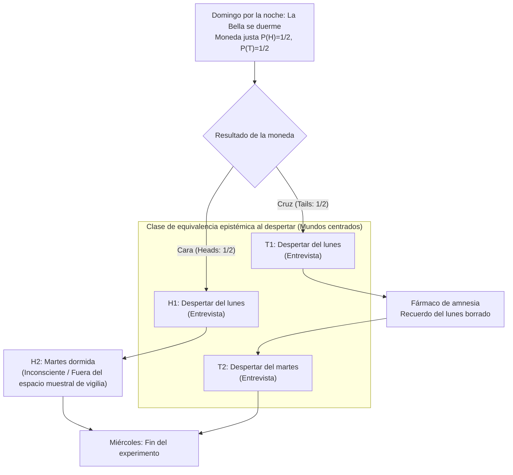
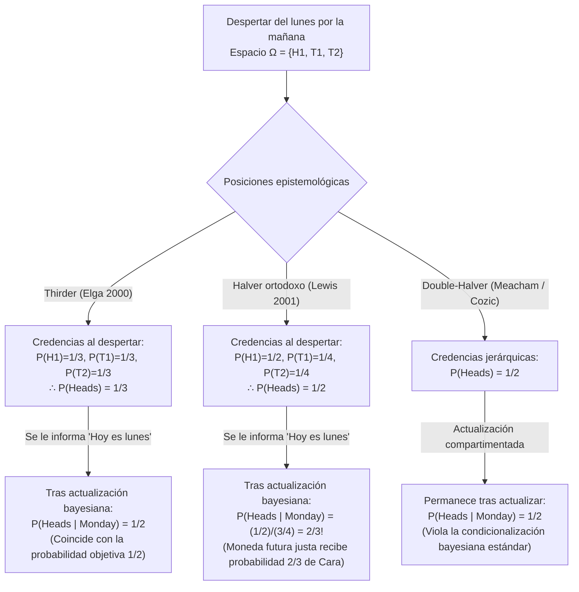

## 1. Introducción: La fractura epistemológica en el instante del despertar

El domingo por la noche, <strong>la Bella Durmiente (Sleeping Beauty)</strong> —una agente bayesiana idealmente racional dotada de perfecta coherencia lógica— es dormida como sujeto de un experimento mental. Antes de dormir, los investigadores le explican cada detalle del protocolo experimental, cuyas reglas ella conoce con absoluta certeza.

Concebido originalmente por el filósofo <strong>Arnold Zuboff (1990)</strong> en *"One Self: The Logic of Experience"*, bautizado por Robert Stalnaker y catapultado al centro de la epistemología formal por el célebre artículo de <strong>Adam Elga (2000)</strong> en *Analysis* (*"Self-locating belief and the Sleeping Beauty problem"*), el protocolo consta de las siguientes reglas:

### 1.1 Especificación exacta del protocolo experimental

1. <strong>Domingo por la noche (Etapa previa)</strong>: La Bella es dormida. Los investigadores lanzan una moneda perfectamente justa con probabilidad objetiva $P(\text{Cara / Heads}) = 1/2$ y $P(\text{Cruz / Tails}) = 1/2$.
2. <strong>Si la moneda cae en «Cara» ($H$)</strong>:
   - Los investigadores despiertan a la Bella el <strong>lunes por la mañana</strong> y la entrevistan brevemente.
   - Luego vuelven a dormirla; permanece completamente inconsciente todo el martes y despierta el miércoles al finalizar el experimento (<strong>1 despertar en total</strong>).
3. <strong>Si la moneda cae en «Cruz» ($T$)</strong>:
   - Los investigadores despiertan a la Bella el <strong>lunes por la mañana</strong> y la entrevistan.
   - Inmediatamente después le administran un <strong>fármaco inductor de amnesia</strong> perfecto que borra todo recuerdo del despertar del lunes y vuelven a dormirla.
   - El <strong>martes por la mañana</strong>, la despiertan por segunda vez en condiciones ambientales e internas exactamente idénticas (<strong>2 despertares en total</strong>).
4. <strong>Indistinguibilidad subjetiva</strong>:
   - No hay relojes, calendarios ni pistas externas. Debido al fármaco amnésico, el despertar del lunes y el despertar del martes son <strong>subjetiva y fenomenológicamente indistinguibles</strong>.

Cuando la Bella despierta el lunes por la mañana, el investigador le formula una sola pregunta:

> <strong>«¿Cuál debería ser ahora mismo tu credencia (grado subjetivo de creencia) $P(\text{Heads})$ de que la moneda haya caído en Cara?»</strong>

De inmediato, la intuición racional se fractura en dos bandos irreconciliables:

- <strong>El bando «Halver» ($P(\text{Heads}) = 1/2$ — David Lewis, Bas van Fraassen, Darren Bradley)</strong>:
  «El domingo por la noche, la Bella ya sabía con un $100\%$ de certeza que despertaría al menos una vez en este mismo estado fenomenológico. Despertar el lunes no aporta <strong>ninguna evidencia objetiva nueva</strong> sobre el resultado de la moneda. Sin evidencia inesperada, un agente bayesiano racional debe mantener su probabilidad previa del domingo: <strong>$P(\text{Heads}) = 1/2$</strong>.»
- <strong>El bando «Thirder» ($P(\text{Heads}) = 1/3$ — Adam Elga, Christopher Hitchcock, Cian Dorr)</strong>:
  «Al despertar, existen tres situaciones espaciotemporales mutuamente excluyentes e indistinguibles en las que podría encontrarse: $(\text{Cara}, \text{Lunes})$, $(\text{Cruz}, \text{Lunes})$ y $(\text{Cruz}, \text{Martes})$. Como Cruz genera el doble de despertares que Cara, encontrarse despierta es el doble de probable en una ejecución de Cruz. En $1.000$ repeticiones del experimento, ocurren unos $500$ despertares con Cara y $1.000$ despertares con Cruz ($500$ el lunes $+$ $500$ el martes), por lo que exactamente $500 / 1.500 = 1/3$ de los despertares corresponden a Cara. Por tanto, <strong>$P(\text{Heads}) = 1/3$</strong>.»

---

## 2. Ontología de las creencias: Mundos posibles no centrados (*De Dicto*) vs. centrados (*De Se*)

La probabilidad clásica de Kolmogórov opera sobre <strong>mundos posibles no centrados</strong> $w \in W$ —descripciones objetivas del universo desde una «perspectiva desde ningún lugar» (*de dicto*)—. Sin embargo, como demostraron <strong>John Perry (1979)</strong> (*«The Problem of the Essential Indexical»*) y <strong>David Lewis (1979)</strong> (*«Attitudes De Dicto and De Se»*), ningún conjunto de hechos objetivos en tercera persona puede agotar las <strong>creencias autolocalizadoras (*de se* / indexicales)</strong> («¿Quién soy yo?», «¿Qué día es *hoy*?»).

Lewis formalizó estas actitudes mediante <strong>mundos posibles centrados (Centered Possible Worlds)</strong> $\langle w, i, t \rangle \in \mathcal{W}_c$, compuestos por un mundo objetivo $w$, un agente $i$ y una etapa temporal $t$. Al despertar, la Bella descarta con certeza cartesiana el estado inconsciente $H_2 = (\text{Cara}, \text{Martes})$, reduciendo su espacio muestral epistémico a tres mundos centrados:

$$\Omega_{\text{wake}} = \{ H_1, \, T_1, \, T_2 \}$$

---

## 3. La demostración matemática de los «Thirders» ($P(\text{Heads}) = 1/3$): Adam Elga (2000)

Adam Elga (2000) demostró que $P(\text{Heads}) = 1/3$ en un único ensayo del experimento mediante tres pasos:

### 3.1 Paso 1: Principio de indiferencia restringido entre $T_1$ y $T_2$ ($P(T_1) = P(T_2)$)

Condicionando sobre la hipótesis de que la moneda cayó en <strong>Cruz</strong> ($T = T_1 \cup T_2$), tanto el despertar del lunes $T_1$ como el del martes $T_2$ ocurren realmente dentro del *mismo* mundo objetivo $w_T$, con experiencias subjetivas y evidencias idénticas. Por el <strong>principio de indiferencia restringido</strong>, ambos centros deben recibir igual credencia condicional:

$$P(T_1 \mid T_1 \cup T_2) = P(T_2 \mid T_1 \cup T_2) = \frac{1}{2} \implies \frac{P(T_1)}{P(T_1) + P(T_2)} = \frac{P(T_2)}{P(T_1) + P(T_2)} \implies P(T_1) = P(T_2) \quad \cdots (1)$$

### 3.2 Paso 2: Condicionalización sobre «Hoy es lunes» e invariancia temporal ($P(H_1) = P(T_1)$)

Supongamos que tras despertar, el experimentador le dice a la Bella: <strong>«Hoy es lunes»</strong> ($M = H_1 \cup T_1$). Dado que el despertar del lunes ocurre con probabilidad $1$ independientemente de la moneda, <strong>¡el protocolo es completamente invariante si la moneda justa se lanza el lunes por la noche (después de la entrevista del lunes)!</strong>

Si la moneda se lanza el lunes por la noche, cuando la Bella sabe el lunes por la mañana que «hoy es lunes», el lanzamiento es un evento futuro con probabilidad física objetiva $1/2$. Por el <strong>Principio Principal (Principal Principle)</strong> de Lewis, su credencia condicional en Cara dado que hoy es lunes debe ser $1/2$:

$$P(\text{Heads} \mid \text{Monday}) = P(H_1 \mid H_1 \cup T_1) = \frac{1}{2} \implies \frac{P(H_1)}{P(H_1) + P(T_1)} = \frac{1}{2} \implies P(H_1) = P(T_1) \quad \cdots (2)$$

### 3.3 Paso 3: Síntesis algebraica ($P(\text{Heads}) = 1/3$)

Combinando (1) $P(T_1) = P(T_2)$, (2) $P(H_1) = P(T_1)$ y la normalización $P(H_1) + P(T_1) + P(T_2) = 1$:

$$P(H_1) = P(T_1) = P(T_2) = \frac{1}{3} \implies P(\text{Heads}) = P(H_1) = \frac{1}{3}, \quad P(\text{Tails}) = P(T_1) + P(T_2) = \frac{2}{3} \qquad \blacksquare$$

---

## 4. El contraataque de los «Halvers» ($P(\text{Heads}) = 1/2$): David Lewis (2001) y el principio de reflexión

En su respuesta *"Sleeping Beauty: reply to Elga"* (2001), <strong>David Lewis</strong> defendió $P(\text{Heads}) = 1/2$.

### 4.1 Ausencia de nueva evidencia objetiva y el principio de reflexión de van Fraassen

Por el <strong>principio de reflexión (Reflection Principle)</strong> de <strong>Bas van Fraassen (1984)</strong>, al no recibir ninguna evidencia objetiva (*de dicto*) inesperada al despertar, la credencia debe permanecer en $1/2$. Lewis acepta $P(T_1) = P(T_2)$, pero divide la masa de probabilidad $1/2$ de Cruz entre lunes y martes:

$$P_{\text{Lewis}}(H_1) = \frac{1}{2}, \qquad P_{\text{Lewis}}(T_1) = \frac{1}{4}, \qquad P_{\text{Lewis}}(T_2) = \frac{1}{4}$$

### 4.2 La impactante consecuencia en Lewis: ¡El salto a $2/3$ al saber que «Hoy es lunes»!

En el sistema de Lewis, cuando el investigador le dice a la Bella <strong>«Hoy es lunes»</strong> ($M = H_1 \cup T_1$), la regla de Bayes arroja:

$$P_{\text{Lewis}}(\text{Heads} \mid \text{Monday}) = \frac{P_{\text{Lewis}}(H_1)}{P_{\text{Lewis}}(H_1) + P_{\text{Lewis}}(T_1)} = \frac{1/2}{1/2 + 1/4} = \frac{2}{3} \> !$$

¡Incluso si la moneda justa no se lanza hasta el lunes por la noche, la Bella de Lewis debe creer el lunes por la mañana que la moneda caerá en Cara con probabilidad <strong>$2/3$</strong>! Para evitar tanto el $1/3$ de Elga como el $2/3$ de Lewis, los <strong>Double-Halvers (Cozic 2011, Meacham 2008)</strong> abandonan la condicionalización bayesiana estándar en favor de una actualización compartimentada.

---

## 5. El argumento del libro holandés diacrónico (Hitchcock 2004) y la teoría de la decisión

<strong>Christopher Hitchcock (2004)</strong> demostró que un Halver cae víctima de un <strong>libro holandés diacrónico (Diachronic Dutch Book)</strong> que garantiza una pérdida financiera segura:

1. <strong>Etapa 1 (Domingo por la noche, $P_{\text{Sun}}(H) = 1/2$)</strong>: El corredor de apuestas ofrece una apuesta a favor de Cruz: $-\$30$ si sale Cara ($H$), $+\$30$ si sale Cruz ($T$).
2. <strong>Etapa 2 (En cada despertar, $P_{\text{Wake}}(H) = 1/2$)</strong>: En *cada* despertar, el corredor ofrece una apuesta 1 a 1 a favor de Cara: $+\$20$ si sale Cara ($H$), $-\$20$ si sale Cruz ($T$). Debido a la amnesia, si sale Cruz la apuesta se firma <strong>dos veces</strong> (lunes y martes), mientras que si sale Cara se firma <strong>solo una vez</strong>.

Balance neto el miércoles:
- <strong>Si sale Cara (1 despertar)</strong>: $-\$30 + \$20 = \mathbf{-\$10\text{ (¡Pérdida garantizada!)}}$
- <strong>Si sale Cruz (2 despertares)</strong>: $+\$30 - \$20 - \$20 = \mathbf{-\$10\text{ (¡Pérdida garantizada!)}}$

Solo la credencia $S(1-p) = 2Sp \implies \mathbf{p = 1/3}$ es inmune al libro holandés. Los Halvers (Bradley & Leitgeb 2006) se defienden mediante la <strong>Teoría de la Decisión Evidencial (EDT)</strong>, argumentando que la correlación entre las decisiones del lunes y del martes separa la cuota de apuesta ($1/3$) de la credencia epistémica ($1/2$).

---

## 6. La «Bella Durmiente Extrema» de Nick Bostrom y la cosmología antrópica (SSA vs. SIA)

<strong>Nick Bostrom (2002, 2007)</strong> demostró que este problema modela los <strong>efectos de selección observacional</strong> en cosmología. En la <strong>Bella Durmiente Extrema</strong>, donde Cruz provoca <strong>1 millón de despertares ($N = 1.000.000$)</strong>, el Thirder concluye al despertar que $P(\text{Tails}) = \frac{1.000.000}{1.000.001} \approx 99,9999\%$, mientras que el Halver mantiene el $50\%$. Esto corresponde a los dos axiomas del razonamiento antrópico:

1. <strong>Supuesto de Automuestreo (Self-Sampling Assumption: SSA — Principio Halver)</strong>: Razonar como si uno fuera una muestra aleatoria de todos los observadores en su clase de referencia. Sin embargo, la SSA implica directamente el <strong>Argumento del Juicio Final (Doomsday Argument)</strong>: descubrir que naciste como el humano número 60.000 millones (análogo a «Hoy es lunes») multiplica por $1.000$ la probabilidad de extinción inminente de la humanidad.
2. <strong>Supuesto de Autoindicación (Self-Indication Assumption: SIA — Principio Thirder)</strong>: El mero hecho de existir favorece las hipótesis proporcionalmente al número de observadores $N(H_i)$ ($P(H_i \mid E) \propto P(H_i) N(H_i)$). La SIA anula el Argumento del Juicio Final, pero genera la <strong>Paradoja del Filósofo Presuntuoso (Presumptuous Philosopher Paradox)</strong>, según la cual se podría refutar cualquier teoría cosmológica finita desde un sillón sin hacer experimentos. Esta misma estructura rige la <strong>interpretación de los muchos mundos de Everett en mecánica cuántica</strong> y el <strong>Argumento de la Simulación (Bostrom 2003)</strong>.

---

## 7. Matriz comparativa de las tres posiciones

| Criterio | Thirder (Elga 2000) | Halver ortodoxo (Lewis 2001) | Double-Halver (Cozic / Meacham) |
| :--- | :--- | :--- | :--- |
| <strong>Credencias centradas al despertar</strong> | $P(H_1)=\frac{1}{3}, P(T_1)=\frac{1}{3}, P(T_2)=\frac{1}{3}$ | $P(H_1)=\frac{1}{2}, P(T_1)=\frac{1}{4}, P(T_2)=\frac{1}{4}$ | Dos niveles: mundos $1/2$, centros separados |
| <strong>$P(\text{Heads})$ al despertar</strong> | <strong>$\mathbf{1/3}$</strong> | <strong>$\mathbf{1/2}$</strong> | <strong>$\mathbf{1/2}$</strong> |
| <strong>$P(\text{Heads}\mid\text{Lunes})$</strong> | <strong>$\mathbf{1/2}$</strong> (Coherente con probabilidad objetiva) | <strong>$\mathbf{2/3}$</strong> (¡Moneda futura justa tiene 2/3 de Cara!) | <strong>$\mathbf{1/2}$</strong> (Abandona la regla de Bayes estándar) |
| <strong>Caso extremo ($N=10^6$ despertares)</strong> | $P(\text{Heads}) = \frac{1}{1.000.001} \approx 0,0001\%$ | $P(\text{Heads}) = 1/2 = 50\%$ | $P(\text{Heads}) = 1/2 = 50\%$ |
| <strong>Principio de reflexión (van Fraassen)</strong> | Violado (por amnesia no monótona) | <strong>Estrictamente preservado</strong> | <strong>Estrictamente preservado</strong> |
| <strong>Libro holandés diacrónico</strong> | <strong>Totalmente inmune</strong> | <strong>Vulnerable bajo CDT</strong> (inmune bajo EDT) | Vulnerable sin separar cuotas de credencias |
| <strong>Principio antrópico y cosmología</strong> | <strong>SIA</strong> (Refuta Doomsday, crea el <strong>Filósofo Presuntuoso</strong>) | <strong>SSA</strong> (Evita el Filósofo Presuntuoso, crea <strong>Doomsday</strong>) | SSA compartimentada |

---

## Referencias

- Zuboff, A. (1990). "One Self: The Logic of Experience." *Inquiry*, 33(1), 39–68.
- Elga, A. (2000). "Self-locating belief and the Sleeping Beauty problem." *Analysis*, 60(2), 143–147.
- Lewis, D. (2001). "Sleeping Beauty: reply to Elga." *Analysis*, 61(3), 171–176.
- Hitchcock, C. (2004). "Beauty and the bets." *Synthese*, 139(3), 405–420.
- Bostrom, N. (2002). *Anthropic Bias: Observation Selection Effects in Science and Philosophy*. Routledge.
- Bostrom, N. (2007). "Sleeping Beauty and Colditz." *Synthese*, 157(1), 59–78.
