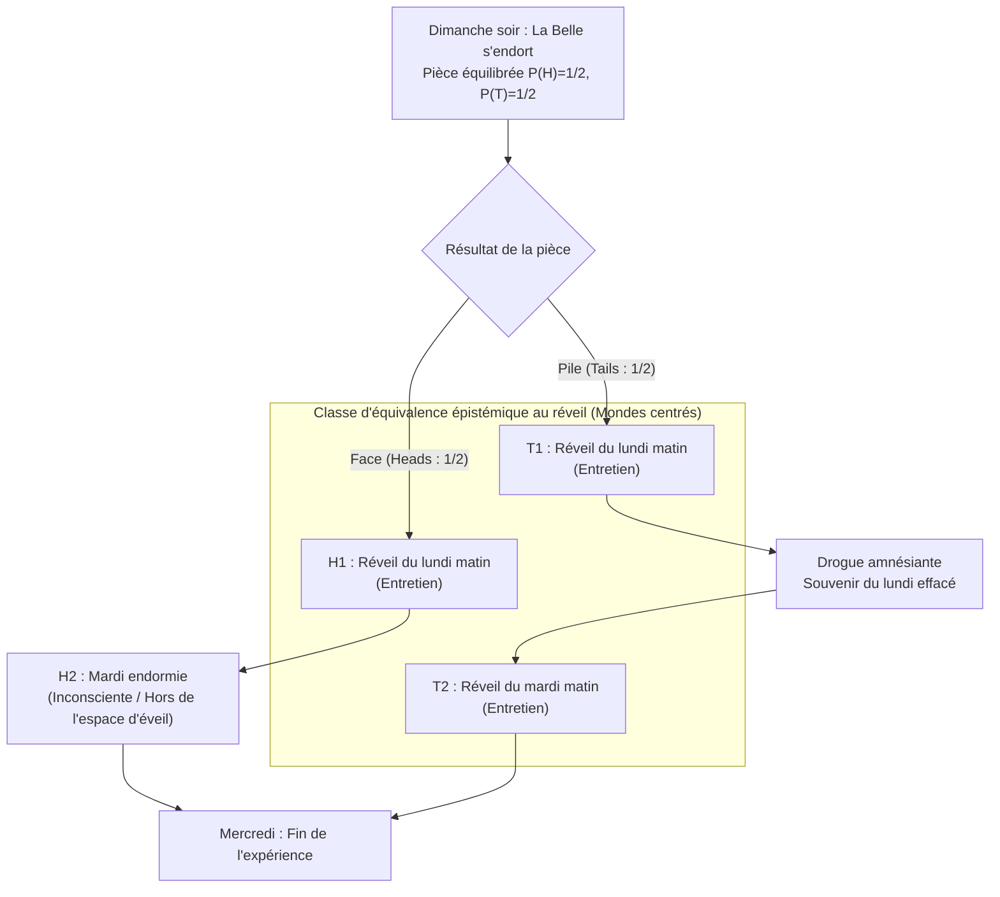
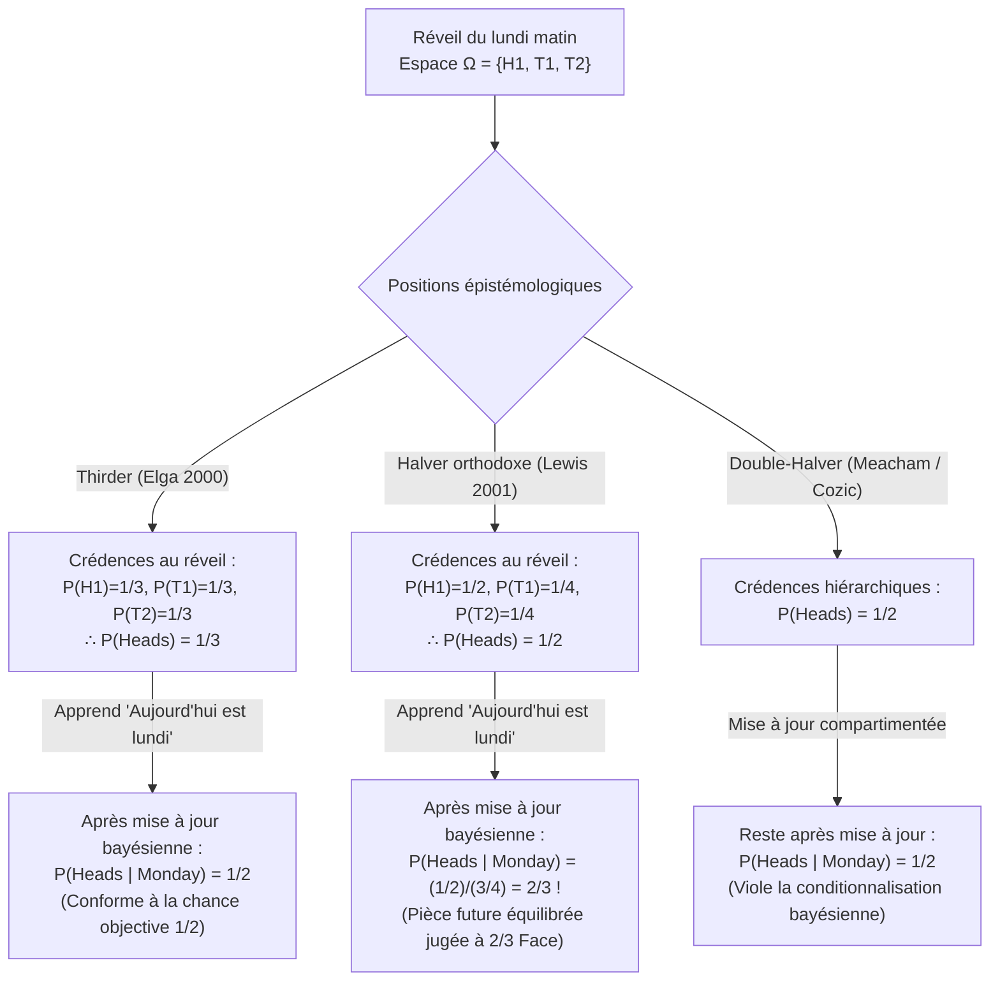

## 1. Introduction : La fracture épistémologique à l'instant du réveil

Le dimanche soir, <strong>la Belle au bois dormant (Sleeping Beauty)</strong> — une agente bayésienne idéalement rationnelle dotée d'une cohérence logique parfaite — est endormie dans le cadre d'une expérience de pensée. Avant de s'endormir, les chercheurs lui expliquent l'intégralité du protocole expérimental, dont elle connaît les règles avec une certitude absolue.

Imaginé à l'origine par le philosophe <strong>Arnold Zuboff (1990)</strong> dans *"One Self: The Logic of Experience"*, baptisé par Robert Stalnaker et propulsé au cœur de l'épistémologie formelle par l'article fondateur d'<strong>Adam Elga (2000)</strong> dans *Analysis* (*"Self-locating belief and the Sleeping Beauty problem"*), le protocole obéit aux règles suivantes :

### 1.1 Spécification exacte du protocole expérimental

1. <strong>Dimanche soir (Étape a priori)</strong> : La Belle est endormie. Les chercheurs lancent une pièce parfaitement équilibrée dont la chance objective est $P(\text{Face / Heads}) = 1/2$ et $P(\text{Pile / Tails}) = 1/2$.
2. <strong>Si la pièce tombe sur « Face » ($H$)</strong> :
   - Les chercheurs réveillent la Belle le <strong>lundi matin</strong> et mènent un bref entretien.
   - Ils la rendorment ensuite ; elle reste totalement inconsciente tout le mardi et n'est réveillée que le mercredi à la fin de l'expérience (<strong>1 seul réveil au total</strong>).
3. <strong>Si la pièce tombe sur « Pile » ($T$)</strong> :
   - Les chercheurs réveillent la Belle le <strong>lundi matin</strong> et mènent l'entretien.
   - Immédiatement après, ils lui administrent une <strong>drogue amnésiante</strong> parfaite qui efface totalement tout souvenir du réveil du lundi, puis la rendorment.
   - Le <strong>mardi matin</strong>, ils la réveillent une seconde fois dans des conditions exactement identiques (<strong>2 réveils au total</strong>).
4. <strong>Indiscernabilité subjective</strong> :
   - Aucune horloge, calendrier ou indice extérieur n'est disponible. En raison de l'amnésie, le réveil du lundi matin et le réveil du mardi matin sont <strong>subjectivement et phénoménologiquement indiscernables</strong>.

Lorsqu'elle est réveillée le lundi matin, le chercheur lui pose une seule question :

> <strong>« Quelle doit être maintenant votre crédence (degré de croyance subjectif) $P(\text{Heads})$ que la pièce soit tombée sur Face ? »</strong>

Immédiatement, l'intuition rationnelle se divise en deux camps irréconciliables :

- <strong>Le camp des « Halvers » ($P(\text{Heads}) = 1/2$ — David Lewis, Bas van Fraassen, Darren Bradley)</strong> :
  « Dès le dimanche soir, la Belle savait avec une certitude de $100\%$ qu'elle se réveillerait au moins une fois dans cet état exact. Le fait de se réveiller n'apporte <strong>aucune nouvelle information objective</strong> sur le monde. Sans nouvelle preuve inattendue, un agent bayésien rationnel doit conserver sa probabilité a priori du dimanche : <strong>$P(\text{Heads}) = 1/2$</strong>. »
- <strong>Le camp des « Thirders » ($P(\text{Heads}) = 1/3$ — Adam Elga, Christopher Hitchcock, Cian Dorr)</strong> :
  « Au réveil, il existe trois situations spatio-temporelles mutuellement exclusives et indiscernables dans lesquelles la Belle peut se trouver : $(\text{Face}, \text{Lundi})$, $(\text{Pile}, \text{Lundi})$ et $(\text{Pile}, \text{Mardi})$. Puisque Pile produit deux fois plus de réveils que Face, le fait de se trouver éveillée favorise Pile dans un rapport de $2$ contre $1$. Sur $1\,000$ répétitions de l'expérience, il y a environ $500$ réveils Face et $1\,000$ réveils Pile ($500$ lundi $+$ $500$ mardi), soit exactement $500 / 1\,500 = 1/3$ de réveils Face. Sa crédence doit donc être <strong>$P(\text{Heads}) = 1/3$</strong>. »

---

## 2. Ontologie des croyances : Mondes possibles non centrés (*De Dicto*) vs centrés (*De Se*)

La théorie classique des probabilités de Kolmogorov opère sur des <strong>mondes possibles non centrés</strong> $w \in W$ — des descriptions objectives du cosmos « depuis nulle part » (*de dicto*). Or, comme l'ont démontré <strong>John Perry (1979)</strong> (*« The Problem of the Essential Indexical »*) et <strong>David Lewis (1979)</strong> (*« Attitudes De Dicto and De Se »*), aucune connaissance objective à la troisième personne ne peut épuiser les <strong>croyances auto-localisatrices (*de se* / indexicales)</strong> (« Qui suis-je ? », « Quel jour sommes-nous *aujourd'hui* ? »).

Lewis a formalisé ces croyances par des <strong>mondes possibles centrés (Centered Possible Worlds)</strong> $\langle w, i, t \rangle \in \mathcal{W}_c$, combinant un monde objectif $w$, un agent $i$ et un instant $t$. Dans notre expérience, la Belle éveillée élimine immédiatement l'état inconscient $H_2 = (\text{Face}, \text{Mardi})$, ce qui réduit son espace d'échantillonnage épistémique à trois mondes centrés :

$$\Omega_{\text{wake}} = \{ H_1, \, T_1, \, T_2 \}$$

---

## 3. La preuve mathématique des « Thirders » ($P(\text{Heads}) = 1/3$) : Adam Elga (2000)

Adam Elga (2000) démontre que $P(\text{Heads}) = 1/3$ pour une seule exécution de l'expérience en trois étapes rigoureuses :

### 3.1 Étape 1 : Principe d'indifférence restreint entre $T_1$ et $T_2$ ($P(T_1) = P(T_2)$)

Conditionnellement à l'hypothèse que la pièce est tombée sur <strong>Pile</strong> ($T = T_1 \cup T_2$), les deux réveils $T_1$ (lundi) et $T_2$ (mardi) se produisent réellement dans le *même* monde objectif $w_T$, avec des états phénoménologiques et des preuves subjectives strictement identiques. Par le <strong>principe d'indifférence restreint</strong>, la Belle doit leur attribuer une probabilité égale :

$$P(T_1 \mid T_1 \cup T_2) = P(T_2 \mid T_1 \cup T_2) = \frac{1}{2} \implies \frac{P(T_1)}{P(T_1) + P(T_2)} = \frac{P(T_2)}{P(T_1) + P(T_2)} \implies P(T_1) = P(T_2) \quad \cdots (1)$$

### 3.2 Étape 2 : Conditionnalisation sur « Aujourd'hui est lundi » et invariance temporelle ($P(H_1) = P(T_1)$)

Supposons qu'après son réveil, l'expérimentateur dise à la Belle : <strong>« Aujourd'hui, nous sommes lundi »</strong> ($M = H_1 \cup T_1$). Puisque le réveil du lundi matin a lieu avec une probabilité $1$ quel que soit le résultat de la pièce, <strong>le protocole expérimental est strictement invariant si la pièce équilibrée n'est lancée que le lundi soir (après l'entretien du lundi) !</strong>

Or, si la pièce est lancée le lundi soir, apprendre le lundi matin que « nous sommes lundi » signifie que le lancer d'une pièce équilibrée est un événement futur dont la chance objective est $1/2$. En vertu du <strong>Principe Principal (Principal Principle)</strong> de Lewis, la crédence conditionnelle de Face sachant qu'on est lundi doit être égale à $1/2$ :

$$P(\text{Heads} \mid \text{Monday}) = P(H_1 \mid H_1 \cup T_1) = \frac{1}{2} \implies \frac{P(H_1)}{P(H_1) + P(T_1)} = \frac{1}{2} \implies P(H_1) = P(T_1) \quad \cdots (2)$$

### 3.3 Étape 3 : Synthèse algébrique ($P(\text{Heads}) = 1/3$)

En combinant (1) $P(T_1) = P(T_2)$, (2) $P(H_1) = P(T_1)$ et la normalisation $P(H_1) + P(T_1) + P(T_2) = 1$, on obtient :

$$P(H_1) = P(T_1) = P(T_2) = \frac{1}{3} \implies P(\text{Heads}) = P(H_1) = \frac{1}{3}, \quad P(\text{Tails}) = P(T_1) + P(T_2) = \frac{2}{3} \qquad \blacksquare$$

---

## 4. La contre-attaque des « Halvers » ($P(\text{Heads}) = 1/2$) : David Lewis (2001) et le principe de réflexion

Dans sa réponse *"Sleeping Beauty: reply to Elga"* (2001), <strong>David Lewis</strong> soutient que $P(\text{Heads}) = 1/2$.

### 4.1 Absence de nouvelle preuve objective et principe de réflexion de van Fraassen

Selon le <strong>principe de réflexion (Reflection Principle)</strong> de <strong>Bas van Fraassen (1984)</strong>, en l'absence d'information objective (*de dicto*) inattendue, la crédence au réveil doit rester identique à la crédence a priori du dimanche soir ($1/2$). Lewis accepte $P(T_1) = P(T_2)$, mais divise la masse de probabilité $1/2$ du monde Pile entre lundi et mardi :

$$P_{\text{Lewis}}(H_1) = \frac{1}{2}, \qquad P_{\text{Lewis}}(T_1) = \frac{1}{4}, \qquad P_{\text{Lewis}}(T_2) = \frac{1}{4}$$

### 4.2 La conséquence stupéfiante chez Lewis : Le bond à $2/3$ en apprenant qu'on est lundi !

Dans le système de Lewis, lorsque le chercheur annonce à la Belle <strong>« Aujourd'hui, nous sommes lundi »</strong> ($M = H_1 \cup T_1$), la règle de Bayes donne :

$$P_{\text{Lewis}}(\text{Heads} \mid \text{Monday}) = \frac{P_{\text{Lewis}}(H_1)}{P_{\text{Lewis}}(H_1) + P_{\text{Lewis}}(T_1)} = \frac{1/2}{1/2 + 1/4} = \frac{2}{3} \> !$$

Même si la pièce n'est lancée que le lundi soir, la Belle de Lewis — apprenant le lundi matin qu'on est lundi — doit croire avec une probabilité de <strong>$2/3$</strong> que la pièce équilibrée lancée ce soir tombera sur Face ! Pour éviter à la fois le $1/3$ d'Elga et le $2/3$ de Lewis, les <strong>Double-Halvers (Cozic 2011, Meacham 2008)</strong> abandonnent la conditionnalisation bayésienne standard au profit d'une conditionnalisation compartimentée.

---

## 5. L'argument du livre hollandais diachronique (Hitchcock 2004) et la théorie de la décision

<strong>Christopher Hitchcock (2004)</strong> a démontré qu'un Halver est vulnérable à un <strong>livre hollandais diachronique (Diachronic Dutch Book)</strong> garantissant une perte certaine :

1. <strong>Étape 1 (Dimanche soir, $P_{\text{Sun}}(H) = 1/2$)</strong> : Le bookmaker propose un pari sur Pile : $-\$30$ si Face ($H$), $+\$30$ si Pile ($T$).
2. <strong>Étape 2 (À chaque réveil, $P_{\text{Wake}}(H) = 1/2$)</strong> : À *chaque* réveil, le bookmaker propose un pari à 1 contre 1 sur Face : $+\$20$ si Face ($H$), $-\$20$ si Pile ($T$). À cause de l'amnésie, le pari est déclenché <strong>une fois</strong> si Face, mais <strong>deux fois</strong> (lundi et mardi) si Pile !

Bilan financier le mercredi :
- <strong>Si Face (1 réveil)</strong> : $-\$30 + \$20 = \mathbf{-\$10\text{ (Perte garantie !)}}$
- <strong>Si Pile (2 réveils)</strong> : $+\$30 - \$20 - \$20 = \mathbf{-\$10\text{ (Perte garantie !)}}$

Seule la crédence $S(1-p) = 2Sp \implies \mathbf{p = 1/3}$ protège contre le livre hollandais. Les Halvers (Bradley & Leitgeb 2006) se défendent via la <strong>Théorie de la décision évidentielle (EDT)</strong> : puisque l'acte d'accepter le pari le lundi est corrélé à son acceptation le mardi en cas de Pile, le quotient de pari ($1/3$) diverge de la crédence épistémique ($1/2$).

---

## 6. La « Belle au bois dormant extrême » de Nick Bostrom et la cosmologie anthropique (SSA vs SIA)

<strong>Nick Bostrom (2002, 2007)</strong> a montré que ce problème gouverne les <strong>effets de sélection d'observation</strong> en cosmologie. Dans la <strong>Belle au bois dormant extrême</strong>, où Pile déclenche <strong>1 million de réveils ($N = 1\,000\,000$)</strong>, le Thirder conclut au réveil que $P(\text{Tails}) = \frac{1\,000\,000}{1\,000\,001} \approx 99,9999\%$, tandis que le Halver maintient $50\%$. Cette opposition correspond aux deux axiomes du raisonnement anthropique :

1. <strong>Self-Sampling Assumption (SSA — Principe Halver)</strong> : Se considérer comme un échantillon aléatoire parmi les observateurs de sa classe de référence. Mais la SSA engendre directement l'<strong>Argument de l'Apocalypse (Doomsday Argument)</strong> : apprendre que notre rang de naissance est d'environ 60 milliards (analogue à « Aujourd'hui est lundi ») multiplie par $1\,000$ la probabilité d'une extinction imminente de l'humanité !
2. <strong>Self-Indication Assumption (SIA — Principe Thirder)</strong> : Le simple fait d'exister favorise les hypothèses proportionnellement au nombre d'observateurs $N(H_i)$ ($P(H_i \mid E) \propto P(H_i) N(H_i)$). La SIA réfute l'Argument de l'Apocalypse, mais engendre le <strong>Paradoxe du philosophe présomptueux (Presumptuous Philosopher Paradox)</strong>, qui prétend trancher entre des théories physiques depuis son fauteuil sans la moindre observation empirique. Ce même formalisme s'applique à l'<strong>interprétation d'Everett des mondes multiples en mécanique quantique</strong> et à l'<strong>Argument de la Simulation (Bostrom 2003)</strong>.

---

## 7. Tableau comparatif des trois positions

| Critère | Thirder (Elga 2000) | Halver orthodoxe (Lewis 2001) | Double-Halver (Cozic / Meacham) |
| :--- | :--- | :--- | :--- |
| <strong>Distribution centrée au réveil</strong> | $P(H_1)=\frac{1}{3}, P(T_1)=\frac{1}{3}, P(T_2)=\frac{1}{3}$ | $P(H_1)=\frac{1}{2}, P(T_1)=\frac{1}{4}, P(T_2)=\frac{1}{4}$ | Deux niveaux : mondes $1/2$, centres séparés |
| <strong>$P(\text{Heads})$ au réveil</strong> | <strong>$\mathbf{1/3}$</strong> | <strong>$\mathbf{1/2}$</strong> | <strong>$\mathbf{1/2}$</strong> |
| <strong>$P(\text{Heads}\mid\text{Lundi})$</strong> | <strong>$\mathbf{1/2}$</strong> (Cohérent avec la chance objective) | <strong>$\mathbf{2/3}$</strong> (Pièce future jugée à 2/3 Face !) | <strong>$\mathbf{1/2}$</strong> (Abandonne la règle de Bayes standard) |
| <strong>Cas extrême ($N=10^6$ réveils)</strong> | $P(\text{Heads}) = \frac{1}{1\,000\,001} \approx 0,0001\%$ | $P(\text{Heads}) = 1/2 = 50\%$ | $P(\text{Heads}) = 1/2 = 50\%$ |
| <strong>Principe de réflexion (van Fraassen)</strong> | Violé (en raison de l'amnésie) | <strong>Strictement respecté</strong> | <strong>Strictement respecté</strong> |
| <strong>Livre hollandais diachronique</strong> | <strong>Totalement immunisé</strong> | <strong>Vulnérable sous CDT</strong> (immunisé sous EDT) | Vulnérable sans découplage des cotes |
| <strong>Principe anthropique & Cosmologie</strong> | <strong>SIA</strong> (Annule Doomsday, crée le <strong>Philosophe présomptueux</strong>) | <strong>SSA</strong> (Évite le Philosophe présomptueux, crée <strong>Doomsday</strong>) | SSA compartimentée |

---

## Références

- Zuboff, A. (1990). "One Self: The Logic of Experience." *Inquiry*, 33(1), 39–68.
- Elga, A. (2000). "Self-locating belief and the Sleeping Beauty problem." *Analysis*, 60(2), 143–147.
- Lewis, D. (2001). "Sleeping Beauty: reply to Elga." *Analysis*, 61(3), 171–176.
- Hitchcock, C. (2004). "Beauty and the bets." *Synthese*, 139(3), 405–420.
- Bostrom, N. (2002). *Anthropic Bias: Observation Selection Effects in Science and Philosophy*. Routledge.
- Bostrom, N. (2007). "Sleeping Beauty and Colditz." *Synthese*, 157(1), 59–78.
