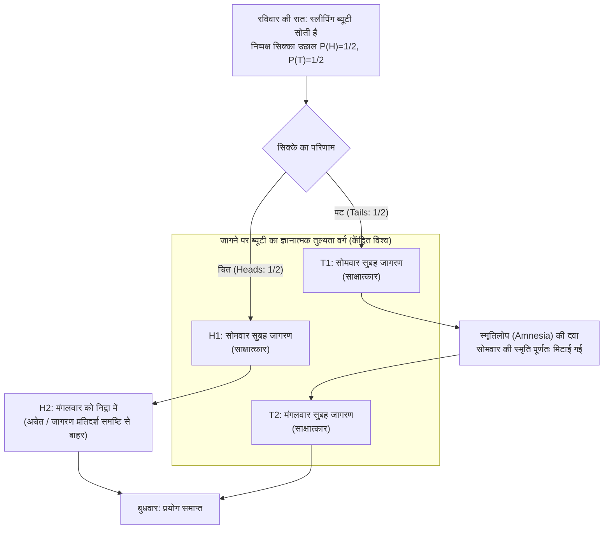
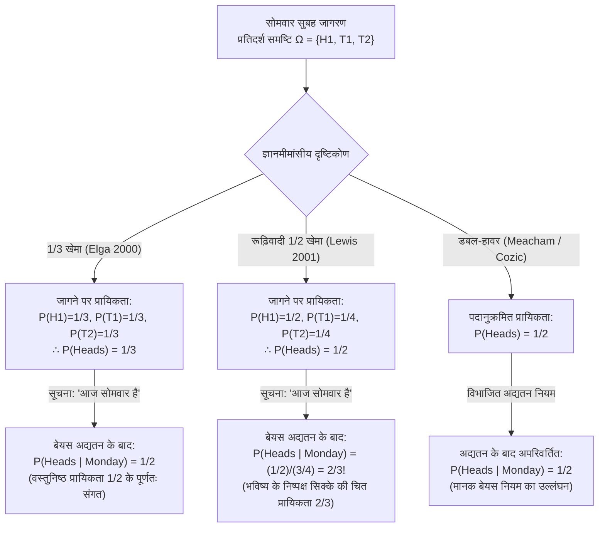

## 1. प्रस्तावना: जागने के क्षण में उत्पन्न ज्ञानमीमांसीय दरार

रविवार की रात, <strong>स्लीपिंग ब्यूटी (Sleeping Beauty)</strong> — जो पूर्ण तार्किक संगति और बेयसियन तर्क क्षमता से युक्त एक आदर्श ज्ञानात्मक कर्ता (epistemically ideal Bayesian agent) है — को एक विचार प्रयोग (thought experiment) के तहत सुलाया जाता है। सोने से पहले, शोधकर्ता उसे प्रयोग के संपूर्ण प्रोटोकॉल की पूरी जानकारी देते हैं, और वह $100\%$ निश्चितता के साथ जानती है कि नियमों का अक्षरशः पालन किया जाएगा।

मूल रूप से दार्शनिक <strong>अर्नोल्ड ज़ुबॉफ़ (Arnold Zuboff, 1990)</strong> द्वारा *"One Self: The Logic of Experience"* में कल्पित, रॉबर्ट स्टालनेकर द्वारा नामित, और <strong>एडम एल्गा (Adam Elga, 2000)</strong> के प्रसिद्ध *Analysis* शोधपत्र *"Self-locating belief and the Sleeping Beauty problem"* द्वारा आधुनिक दर्शन के केंद्र में स्थापित इस प्रयोग के नियम निम्नलिखित हैं:

### 1.1 प्रायोगिक प्रोटोकॉल की सटीक परिभाषा

1. <strong>रविवार की रात (पूर्व चरण)</strong>: स्लीपिंग ब्यूटी को सुला दिया जाता है। शोधकर्ता एक पूर्णतः निष्पक्ष सिक्का उछालते हैं जिसके चित आने की वस्तुनिष्ठ प्रायिकता $P(\text{चित / Heads}) = 1/2$ और पट आने की प्रायिकता $P(\text{पट / Tails}) = 1/2$ है।
2. <strong>यदि सिक्का «चित (Heads: $H$)» आता है</strong>:
   - शोधकर्ता <strong>सोमवार सुबह</strong> ब्यूटी को जगाते हैं और एक संक्षिप्त साक्षात्कार लेते हैं।
   - इसके बाद वे उसे फिर से सुला देते हैं; वह पूरे मंगलवार अचेत अवस्था में सोती रहती है और बुधवार को प्रयोग समाप्त होने पर ही जागती है (<strong>कुल जागरण: 1 बार</strong>)।
3. <strong>यदि सिक्का «पट (Tails: $T$)» आता है</strong>:
   - शोधकर्ता <strong>सोमवार सुबह</strong> ब्यूटी को जगाते हैं और साक्षात्कार लेते हैं।
   - तुरंत बाद, वे उसे <strong>स्मृतिलोप (Amnesia) उत्पन्न करने वाली दवा</strong> देते हैं जो सोमवार के जागरण की संपूर्ण स्मृति को मिटा देती है, और उसे फिर से सुला देते हैं।
   - <strong>मंगलवार सुबह</strong>, वे उसे बिल्कुल समान कमरे और परिस्थितियों में दूसरी बार जगाते हैं और साक्षात्कार लेते हैं (<strong>कुल जागरण: 2 बार</strong>)।
4. <strong>व्यक्तिपरक अविभेद्यता (Subjective Indistinguishability)</strong>:
   - कमरे में कोई घड़ी, कैलेंडर या बाहरी संकेत नहीं है। स्मृतिलोप की दवा के कारण सोमवार सुबह का जागरण और मंगलवार सुबह का जागरण ब्यूटी के प्रथम-पुरुष अनुभव में <strong>पूरी तरह से अविभेद्य</strong> हैं।

जब सोमवार सुबह ब्यूटी को जगाया जाता है, तो शोधकर्ता उससे केवल एक प्रश्न पूछता है:

> <strong>«इस समय आपके अनुसार इस बात की व्यक्तिपरक प्रायिकता (विश्वास की मात्रा / Credence) $P(\text{Heads})$ क्या होनी चाहिए कि सिक्का चित (Heads) गिरा था?»</strong>

तुरंत ही, तार्किक अंतर्ज्ञान दो परस्पर विरोधी खेमों में विभाजित हो जाता है:

- <strong>1/2 खेमा (Halvers: $P(\text{Heads}) = 1/2$ — डेविड लुईस, बास वैन फ्रासेन)</strong>:
  «रविवार की रात को ही ब्यूटी $100\%$ निश्चितता के साथ जानती थी कि वह कम से कम एक बार इसी अवस्था में जागेगी। इसलिए सोमवार सुबह जागने से सिक्के के परिणाम के बारे में <strong>कोई नया वस्तुनिष्ठ प्रमाण (No new objective evidence)</strong> नहीं मिलता। बिना किसी नए अप्रत्याशित प्रमाण के, एक तार्किक बेयसियन कर्ता को अपनी रविवार की पूर्व प्रायिकता बनाए रखनी चाहिए: <strong>$P(\text{Heads}) = 1/2$</strong>।»
- <strong>1/3 खेमा (Thirders: $P(\text{Heads}) = 1/3$ — एडम एल्गा, क्रिस्टोफर हिचकॉक)</strong>:
  «जागने पर तीन परस्पर अपवर्जी और अविभेद्य देश-काल स्थितियाँ संभव हैं: $(\text{चित}, \text{सोमवार})$, $(\text{पट}, \text{सोमवार})$, और $(\text{पट}, \text{मंगलवार})$। चूँकि पट आने पर चित की तुलना में दोगुने जागरण होते हैं, इसलिए स्वयं को जागा हुआ पाना पट के पक्ष में $2:1$ का अनुपात रखता है। यदि प्रयोग को $1,000$ बार दोहराया जाए, तो लगभग $500$ बार चित-जागरण और $1,000$ बार पट-जागरण ($500$ सोमवार $+$ $500$ मंगलवार) होंगे, अर्थात कुल $1,500$ जागरणों में से ठीक $500 / 1,500 = 1/3$ चित होंगे। अतः <strong>$P(\text{Heads}) = 1/3$</strong>।»

---

## 2. विश्वास की सत्तामीमांसा: अकेंद्रित (*De Dicto*) बनाम केंद्रित (*De Se*) संभावित विश्व

कोल्मोगोरोव का शास्त्रीय प्रायिकता सिद्धांत <strong>अकेंद्रित संभावित विश्वों (Uncentered Possible Worlds)</strong> $w \in W$ पर कार्य करता है — जो ब्रह्मांड का एक वस्तुनिष्ठ विवरण (*de dicto*) है। किंतु <strong>जॉन पेरी (John Perry, 1979)</strong> और <strong>डेविड लुईस (David Lewis, 1979)</strong> ने सिद्ध किया कि संपूर्ण वस्तुनिष्ठ ज्ञान भी <strong>स्व-स्थानन विश्वासों (Self-locating / *de se* beliefs)</strong> («मैं कौन हूँ?», «*आज* कौन सा दिन है?») को प्रतिस्थापित नहीं कर सकता।

लुईस ने इसे <strong>केंद्रित संभावित विश्व (Centered Possible Worlds)</strong> $\langle w, i, t \rangle \in \mathcal{W}_c$ के रूप में सूत्रबद्ध किया, जहाँ $w$ वस्तुनिष्ठ विश्व है, $i$ कर्ता है और $t$ समय-खंड है। जागने पर ब्यूटी अचेत अवस्था $H_2 = (\text{चित}, \text{मंगलवार})$ को तुरंत हटा देती है, जिससे उसकी ज्ञानात्मक प्रतिदर्श समष्टि तीन केंद्रित विश्वों तक सीमित हो जाती है:

$$\Omega_{\text{wake}} = \{ H_1, \, T_1, \, T_2 \}$$

---

## 3. «1/3 खेमे (Thirder)» का सटीक गणितीय प्रमाण: एडम एल्गा (2000)

एडम एल्गा (2000) ने एकल प्रयोग के लिए तीन चरणों में $P(\text{Heads}) = 1/3$ सिद्ध किया:

### 3.1 चरण 1: $T_1$ और $T_2$ के बीच प्रतिबंधित उदासीनता सिद्धांत ($P(T_1) = P(T_2)$)

यह मानते हुए कि सिक्का <strong>पट</strong> गिरा है ($T = T_1 \cup T_2$), सोमवार का जागरण $T_1$ और मंगलवार का जागरण $T_2$ दोनों *एक ही* वस्तुनिष्ठ विश्व $w_T$ में वास्तव में घटित होते हैं और दोनों में ब्यूटी के व्यक्तिपरक प्रमाण पूर्णतः समान हैं। <strong>प्रतिबंधित उदासीनता सिद्धांत (Restricted Principle of Indifference)</strong> के अनुसार:

$$P(T_1 \mid T_1 \cup T_2) = P(T_2 \mid T_1 \cup T_2) = \frac{1}{2} \implies \frac{P(T_1)}{P(T_1) + P(T_2)} = \frac{P(T_2)}{P(T_1) + P(T_2)} \implies P(T_1) = P(T_2) \quad \cdots (1)$$

### 3.2 चरण 2: «आज सोमवार है» पर सप्रतिबंधीकरण और समय-स्थानांतरण निश्चरता ($P(H_1) = P(T_1)$)

मान लीजिए कि जागने के बाद प्रयोगकर्ता ब्यूटी को बताता है: <strong>«आज सोमवार है»</strong> ($M = H_1 \cup T_1$)। चूँकि सोमवार सुबह का जागरण सिक्के के परिणाम से स्वतंत्र रूप से प्रायिकता $1$ के साथ होता है, <strong>यदि निष्पक्ष सिक्का रविवार की रात के बजाय सोमवार की रात (सोमवार के साक्षात्कार के बाद) उछाला जाए, तब भी प्रायोगिक प्रोटोकॉल बिल्कुल अपरिवर्तित रहता है!</strong>

यदि सिक्का सोमवार की रात को उछाला जाता है, तो सोमवार सुबह यह जानने पर कि «आज सोमवार है», सिक्के की उछाल भविष्य की एक घटना है जिसकी वस्तुनिष्ठ प्रायिकता $1/2$ है। लुईस के <strong>मुख्य सिद्धांत (Principal Principle)</strong> के अनुसार:

$$P(\text{Heads} \mid \text{Monday}) = P(H_1 \mid H_1 \cup T_1) = \frac{1}{2} \implies \frac{P(H_1)}{P(H_1) + P(T_1)} = \frac{1}{2} \implies P(H_1) = P(T_1) \quad \cdots (2)$$

### 3.3 चरण 3: बीजगणितीय संश्लेषण ($P(\text{Heads}) = 1/3$)

समीकरण (1) $P(T_1) = P(T_2)$, समीकरण (2) $P(H_1) = P(T_1)$, और $P(H_1) + P(T_1) + P(T_2) = 1$ को मिलाने पर:

$$P(H_1) = P(T_1) = P(T_2) = \frac{1}{3} \implies P(\text{Heads}) = P(H_1) = \frac{1}{3}, \quad P(\text{Tails}) = P(T_1) + P(T_2) = \frac{2}{3} \qquad \blacksquare$$

---

## 4. «1/2 खेमे (Halver)» का पलटवार: डेविड लुईस (2001) और परावर्तन सिद्धांत

अपने उत्तर *"Sleeping Beauty: reply to Elga"* (2001) में <strong>डेविड लुईस</strong> ने $P(\text{Heads}) = 1/2$ का बचाव किया।

### 4.1 नए वस्तुनिष्ठ प्रमाण का अभाव और वैन फ्रासेन का परावर्तन सिद्धांत

<strong>बास वैन फ्रासेन (1984)</strong> के <strong>परावर्तन सिद्धांत (Reflection Principle)</strong> के अनुसार, जागने पर कोई नया अप्रत्याशित वस्तुनिष्ठ प्रमाण न मिलने के कारण विश्वास $1/2$ पर स्थिर रहना चाहिए। लुईस $P(T_1) = P(T_2)$ को स्वीकार करते हैं, किंतु पट की $1/2$ प्रायिकता को सोमवार और मंगलवार के बीच बराबर बाँट देते हैं:

$$P_{\text{Lewis}}(H_1) = \frac{1}{2}, \qquad P_{\text{Lewis}}(T_1) = \frac{1}{4}, \qquad P_{\text{Lewis}}(T_2) = \frac{1}{4}$$

### 4.2 लुईस का चौंकाने वाला निष्कर्ष: «आज सोमवार है» सुनते ही प्रायिकता $2/3$ हो जाती है!

लुईस की प्रणाली में, जब शोधकर्ता ब्यूटी से कहता है <strong>«आज सोमवार है»</strong> ($M = H_1 \cup T_1$), तो बेयस प्रमेय के अनुसार:

$$P_{\text{Lewis}}(\text{Heads} \mid \text{Monday}) = \frac{P_{\text{Lewis}}(H_1)}{P_{\text{Lewis}}(H_1) + P_{\text{Lewis}}(T_1)} = \frac{1/2}{1/2 + 1/4} = \frac{2}{3} \> !$$

भले ही निष्पक्ष सिक्का सोमवार की रात को उछाला जाना हो, लुईस की ब्यूटी को सोमवार सुबह यह मानना होगा कि आज रात उछाले जाने वाले निष्पक्ष सिक्के के चित आने की प्रायिकता <strong>$2/3$</strong> है! एल्गा के $1/3$ और लुईस के $2/3$ दोनों से बचने के लिए <strong>डबल-हावर (Double-Halvers: Cozic 2011, Meacham 2008)</strong> मानक बेयसियन सप्रतिबंधीकरण को त्याग देते हैं।

---

## 5. कालानुक्रमिक डच बुक तर्क (Hitchcock 2004) और निर्णय सिद्धांत

<strong>क्रिस्टोफर हिचकॉक (2004)</strong> ने सिद्ध किया कि 1/2 खेमे की ब्यूटी <strong>कालानुक्रमिक डच बुक (Diachronic Dutch Book)</strong> का शिकार होकर निश्चित रूप से धन गँवाती है:

1. <strong>चरण 1 (रविवार की रात, $P_{\text{Sun}}(H) = 1/2$)</strong>: बुकी पट के पक्ष में शर्त लगाता है: चित ($H$) आने पर $-\$30$, पट ($T$) आने पर $+\$30$।
2. <strong>चरण 2 (प्रत्येक जागरण पर, $P_{\text{Wake}}(H) = 1/2$)</strong>: प्रत्येक जागरण पर बुकी चित के पक्ष में 1:1 की शर्त देता है: चित ($H$) पर $+\$20$, पट ($T$) पर $-\$20$। स्मृतिलोप के कारण पट आने पर यह शर्त <strong>दो बार</strong> (सोमवार और मंगलवार) लगती है, जबकि चित आने पर <strong>केवल एक बार</strong>!

बुधवार को कुल शुद्ध परिणाम:
- <strong>यदि चित (1 जागरण)</strong>: $-\$30 + \$20 = \mathbf{-\$10\text{ (निश्चित हानि!)}}$
- <strong>यदि पट (2 जागरण)</strong>: $+\$30 - \$20 - \$20 = \mathbf{-\$10\text{ (निश्चित हानि!)}}$

केवल $S(1-p) = 2Sp \implies \mathbf{p = 1/3}$ ही डच बुक से पूर्ण सुरक्षा देता है। 1/2 खेमा (Bradley & Leitgeb 2006) <strong>साक्ष्य निर्णय सिद्धांत (EDT)</strong> का सहारा लेकर तर्क देता है कि सोमवार और मंगलवार के निर्णयों के सहसंबंध के कारण शर्त अनुपात ($1/3$) और ज्ञानात्मक विश्वास ($1/2$) अलग हो जाते हैं।

---

## 6. निक बोस्ट्रोम की «एक्सट्रीम स्लीपिंग ब्यूटी» और एंथ्रोपिक ब्रह्मांड विज्ञान (SSA बनाम SIA)

<strong>निक बोस्ट्रोम (2002, 2007)</strong> ने दिखाया कि यह समस्या ब्रह्मांड विज्ञान में <strong>प्रेक्षण चयन प्रभावों (Observation Selection Effects)</strong> का सटीक गणितीय मॉडल है। <strong>एक्सट्रीम स्लीपिंग ब्यूटी</strong> में, जहाँ पट आने पर ब्यूटी को <strong>10 लाख बार ($N = 1,000,000$)</strong> जगाया जाता है, 1/3 खेमे के अनुसार जागने पर पट की प्रायिकता $\frac{1,000,000}{1,000,001} \approx 99.9999\%$ हो जाती है, जबकि 1/2 खेमा $50\%$ पर अडिग रहता है। यह एंथ्रोपिक तर्क के दो मूल सिद्धांतों से मेल खाता है:

1. <strong>स्व-प्रतिचयन अभिधारणा (Self-Sampling Assumption: SSA — 1/2 सिद्धांत)</strong>: स्वयं को अपने संदर्भ वर्ग के सभी प्रेक्षकों में से एक यादृच्छिक नमूना मानना। किंतु SSA सीधे <strong>प्रलय तर्क (Doomsday Argument)</strong> को जन्म देता है: यह जानना कि हमारा जन्म क्रम लगभग 60 अरबवाँ है («आज सोमवार है» के समतुल्य), मानवता के शीघ्र विलुप्त होने की प्रायिकता को $1,000$ गुना बढ़ा देता है!
2. <strong>स्व-संकेतन अभिधारणा (Self-Indication Assumption: SIA — 1/3 सिद्धांत)</strong>: हमारे अस्तित्व मात्र से उन परिकल्पनाओं की प्रायिकता प्रेक्षकों की संख्या $N(H_i)$ के अनुपात में बढ़ जाती है ($P(H_i \mid E) \propto P(H_i) N(H_i)$)। SIA प्रलय तर्क को निरस्त कर देता है, परंतु <strong>दंभी दार्शनिक विरोधाभास (Presumptuous Philosopher Paradox)</strong> उत्पन्न करता है, जिसके तहत बिना किसी भौतिक प्रयोग के आरामकुर्सी पर बैठे-बैठे विशाल ब्रह्मांड सिद्धांत को $99.9999\%$ सत्य घोषित किया जा सकता है। यही गणित <strong>एवरेट के बहु-विश्व क्वांटम यांत्रिकी (Many-Worlds Quantum Mechanics)</strong> और <strong>सिमुलेशन परिकल्पना (Bostrom 2003)</strong> पर भी लागू होता है।

---

## 7. तीनों प्रमुख दृष्टिकोणों की तुलनात्मक तालिका

| मानदंड | 1/3 खेमा (Thirder: Elga 2000) | रूढ़िवादी 1/2 खेमा (Halver: Lewis 2001) | डबल-हावर (Double-Halver) |
| :--- | :--- | :--- | :--- |
| <strong>जागने पर केंद्रित प्रायिकता वितरण</strong> | $P(H_1)=\frac{1}{3}, P(T_1)=\frac{1}{3}, P(T_2)=\frac{1}{3}$ | $P(H_1)=\frac{1}{2}, P(T_1)=\frac{1}{4}, P(T_2)=\frac{1}{4}$ | द्वि-स्तरीय: विश्व $1/2$, केंद्र पृथक |
| <strong>जागने पर चित प्रायिकता $P(\text{Heads})$</strong> | <strong>$\mathbf{1/3}$</strong> | <strong>$\mathbf{1/2}$</strong> | <strong>$\mathbf{1/2}$</strong> |
| <strong>'आज सोमवार है' जानने के बाद $P(\text{Heads}\mid\text{Mon})$</strong> | <strong>$\mathbf{1/2}$</strong> (वस्तुनिष्ठ प्रायिकता के संगत) | <strong>$\mathbf{2/3}$</strong> (भविष्य के सिक्के की चित प्रायिकता 2/3!) | <strong>$\mathbf{1/2}$</strong> (मानक बेयस नियम का त्याग) |
| <strong>एक्सट्रीम केस ($N=10^6$ जागरण)</strong> | $P(\text{Heads}) = \frac{1}{1,000,001} \approx 0.0001\%$ | $P(\text{Heads}) = 1/2 = 50\%$ | $P(\text{Heads}) = 1/2 = 50\%$ |
| <strong>परावर्तन सिद्धांत (van Fraassen)</strong> | उल्लंघन (स्मृतिलोप के कारण) | <strong>कड़ाई से पालन</strong> | <strong>कड़ाई से पालन</strong> |
| <strong>कालानुक्रमिक डच बुक (Hitchcock)</strong> | <strong>पूर्णतः सुरक्षित</strong> | <strong>CDT के तहत निश्चित हानि</strong> (EDT में बचाव) | शर्त अनुपात अलग किए बिना असुरक्षित |
| <strong>एंथ्रोपिक सिद्धांत और ब्रह्मांड विज्ञान</strong> | <strong>SIA</strong> (प्रलय तर्क का खंडन, <strong>दंभी दार्शनिक विरोधाभास</strong> उत्पन्न) | <strong>SSA</strong> (दंभी दार्शनिक से बचाव, <strong>प्रलय तर्क</strong> उत्पन्न) | विभाजित SSA |

---

## संदर्भ (References)

- Zuboff, A. (1990). "One Self: The Logic of Experience." *Inquiry*, 33(1), 39–68.
- Elga, A. (2000). "Self-locating belief and the Sleeping Beauty problem." *Analysis*, 60(2), 143–147.
- Lewis, D. (2001). "Sleeping Beauty: reply to Elga." *Analysis*, 61(3), 171–176.
- Hitchcock, C. (2004). "Beauty and the bets." *Synthese*, 139(3), 405–420.
- Bostrom, N. (2002). *Anthropic Bias: Observation Selection Effects in Science and Philosophy*. Routledge.
- Bostrom, N. (2007). "Sleeping Beauty and Colditz." *Synthese*, 157(1), 59–78.
