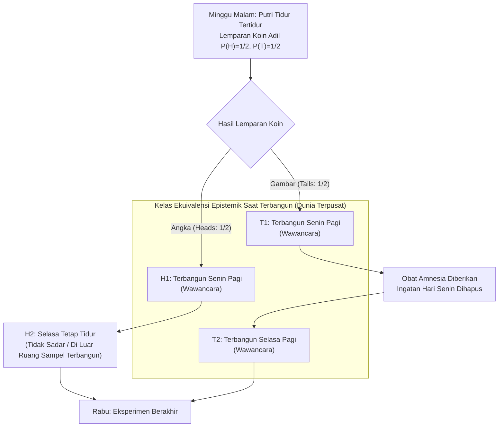
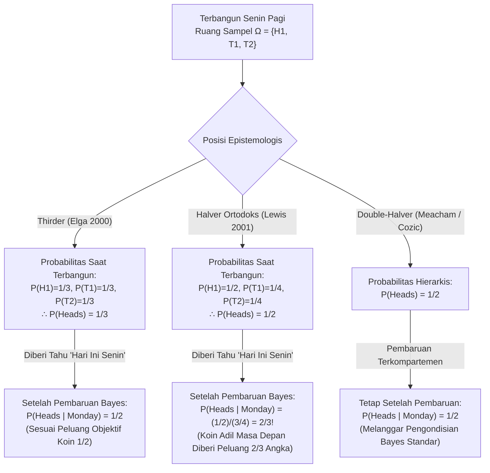

## 1. Pendahuluan: Retakan Epistemologis pada Saat Terbangun

Pada hari Minggu malam, <strong>Putri Tidur (Sleeping Beauty)</strong> — seorang agen Bayesian yang rasional sempurna dengan konsistensi logis tanpa cela — ditidurkan sebagai subjek eksperimen pikiran. Sebelum tidur, para peneliti menjelaskan setiap detail protokol eksperimen kepadanya, dan ia tahu dengan kepastian mutlak bahwa aturan tersebut akan dijalankan tanpa penyimpangan.

Awalnya digagas oleh filsuf <strong>Arnold Zuboff (1990)</strong> dalam *"One Self: The Logic of Experience"*, diberi nama oleh Robert Stalnaker, dan dibawa ke pusat epistemologi formal oleh makalah terkenal <strong>Adam Elga (2000)</strong> di jurnal *Analysis* (*"Self-locating belief and the Sleeping Beauty problem"*), protokol eksperimen ini memiliki aturan sebagai berikut:

### 1.1 Spesifikasi Eksak Protokol Eksperimen

1. <strong>Minggu Malam (Tahap Prior)</strong>: Putri Tidur ditidurkan. Para peneliti melempar koin yang sepenuhnya adil dengan peluang objektif $P(\text{Angka / Heads}) = 1/2$ dan $P(\text{Gambar / Tails}) = 1/2$.
2. <strong>Jika Koin Mendarat pada «Angka» ($H$)</strong>:
   - Para peneliti membangunkan Putri Tidur pada <strong>Senin pagi</strong> dan melakukan wawancara singkat.
   - Mereka kemudian menidurkannya kembali; ia tetap tidak sadar sepanjang hari Selasa dan baru dibangunkan pada hari Rabu saat eksperimen berakhir (<strong>total 1 kali terbangun</strong>).
3. <strong>Jika Koin Mendarat pada «Gambar» ($T$)</strong>:
   - Para peneliti membangunkan Putri Tidur pada <strong>Senin pagi</strong> dan mewawancarainya.
   - Segera setelah itu, mereka memberikan <strong>obat pemicu amnesia</strong> sempurna yang menghapus seluruh ingatan tentang terbangunnya di hari Senin, lalu menidurkannya kembali.
   - Pada <strong>Selasa pagi</strong>, mereka membangunkannya untuk kedua kalinya dalam kondisi ruangan dan pencahayaan yang sama persis (<strong>total 2 kali terbangun</strong>).
4. <strong>Ketidakmampuan Dibedakan Secara Subjektif (Subjective Indistinguishability)</strong>:
   - Tidak ada jam, kalender, atau petunjuk eksternal. Karena obat amnesia, pengalaman terbangun pada Senin pagi dan Selasa pagi <strong>sama sekali tidak dapat dibedakan secara subjektif maupun fenomenologis</strong>.

Ketika Putri Tidur dibangunkan pada Senin pagi, peneliti mengajukan satu pertanyaan kepadanya:

> <strong>«Berapa seharusnya tingkat keyakinan subjektif (credence) Anda $P(\text{Heads})$ saat ini bahwa koin tersebut mendarat pada Angka?»</strong>

Seketika, intuisi rasional terbelah menjadi dua kubu yang saling bertentangan:

- <strong>Kubu «Halver» ($P(\text{Heads}) = 1/2$ — David Lewis, Bas van Fraassen, Darren Bradley)</strong>:
  «Pada Minggu malam, Putri Tidur sudah tahu dengan kepastian $100\%$ bahwa ia akan terbangun setidaknya satu kali dalam kondisi fenomenologis ini. Terbangun pada Senin pagi <strong>tidak memberikan bukti objektif baru</strong> tentang hasil lemparan koin. Tanpa bukti tak terduga, agen Bayesian yang rasional harus mempertahankan probabilitas prior hari Minggu: <strong>$P(\text{Heads}) = 1/2$</strong>.»
- <strong>Kubu «Thirder» ($P(\text{Heads}) = 1/3$ — Adam Elga, Christopher Hitchcock, Cian Dorr)</strong>:
  «Saat terbangun, ada tiga situasi ruang-waktu yang saling eksklusif dan tak terbedakan: $(\text{Angka}, \text{Senin})$, $(\text{Gambar}, \text{Senin})$, dan $(\text{Gambar}, \text{Selasa})$. Karena Gambar menghasilkan dua kali lipat jumlah terbangun dibanding Angka, mendapati diri terbangun dua kali lebih mungkin terjadi dalam dunia Gambar. Dalam $1.000$ pengulangan eksperimen, terdapat sekitar $500$ terbangun Angka dan $1.000$ terbangun Gambar ($500$ Senin $+$ $500$ Selasa), sehingga tepat $500 / 1.500 = 1/3$ dari seluruh momen terbangun adalah Angka. Oleh karena itu, <strong>$P(\text{Heads}) = 1/3$</strong>.»

---

## 2. Ontologi Keyakinan: Dunia Mungkin Tak Terpusat (*De Dicto*) vs. Terpusat (*De Se*)

Teori probabilitas klasik Kolmogorov bekerja pada <strong>dunia mungkin tak terpusat (uncentered possible worlds)</strong> $w \in W$ — deskripsi objektif alam semesta dari «pandangan dari ketiadaan» (*de dicto*). Namun, sebagaimana dibuktikan oleh <strong>John Perry (1979)</strong> (*«The Problem of the Essential Indexical»*) dan <strong>David Lewis (1979)</strong> (*«Attitudes De Dicto and De Se»*), pengetahuan objektif orang ketiga sebanyak apa pun tidak dapat menggantikan <strong>keyakinan penempatan-diri (*de se* / indeksikal)</strong> («Siapa saya?», «Hari apa *sekarang*?»).

Lewis memformalkan hal ini melalui <strong>dunia mungkin terpusat (Centered Possible Worlds)</strong> $\langle w, i, t \rangle \in \mathcal{W}_c$, yang terdiri dari dunia objektif $w$, agen $i$, dan tahapan waktu $t$. Saat terbangun, Putri Tidur mengeliminasi kondisi tak sadar $H_2 = (\text{Angka}, \text{Selasa})$, sehingga ruang sampel epistemiknya menyempit menjadi tiga dunia terpusat:

$$\Omega_{\text{wake}} = \{ H_1, \, T_1, \, T_2 \}$$

---

## 3. Bukti Matematis Kubu «Thirder» ($P(\text{Heads}) = 1/3$): Adam Elga (2000)

Adam Elga (2000) membuktikan $P(\text{Heads}) = 1/3$ untuk satu kali pelaksanaan eksperimen melalui tiga langkah ketat:

### 3.1 Langkah 1: Prinsip Ketidakpedulian Terbatas antara $T_1$ dan $T_2$ ($P(T_1) = P(T_2)$)

Dengan mengondisikan bahwa koin mendarat pada <strong>Gambar</strong> ($T = T_1 \cup T_2$), baik terbangunnya hari Senin $T_1$ maupun hari Selasa $T_2$ benar-benar terjadi di dalam dunia objektif yang *sama* $w_T$, dengan bukti subjektif yang identik. Berdasarkan <strong>Prinsip Ketidakpedulian Terbatas (Restricted Principle of Indifference)</strong>, kedua pusat harus memiliki probabilitas bersyarat yang sama:

$$P(T_1 \mid T_1 \cup T_2) = P(T_2 \mid T_1 \cup T_2) = \frac{1}{2} \implies \frac{P(T_1)}{P(T_1) + P(T_2)} = \frac{P(T_2)}{P(T_1) + P(T_2)} \implies P(T_1) = P(T_2) \quad \cdots (1)$$

### 3.2 Langkah 2: Pengondisian pada «Hari Ini Senin» dan Invariansi Geseran Waktu ($P(H_1) = P(T_1)$)

Misalkan setelah terbangun, peneliti memberi tahu Putri Tidur: <strong>«Hari ini adalah hari Senin»</strong> ($M = H_1 \cup T_1$). Karena terbangun pada Senin pagi terjadi dengan probabilitas $1$ terlepas dari hasil koin, <strong>protokol eksperimen sama sekali tidak berubah jika koin adil tersebut baru dilempar pada Senin malam (setelah wawancara hari Senin selesai)!</strong>

Jika koin dilempar pada Senin malam, maka saat Putri Tidur mengetahui pada Senin pagi bahwa «hari ini Senin», lemparan koin adalah peristiwa masa depan dengan peluang objektif $1/2$. Berdasarkan <strong>Prinsip Utama (Principal Principle)</strong> Lewis, keyakinan bersyaratnya bahwa koin mendarat Angka jika diketahui hari ini Senin haruslah $1/2$:

$$P(\text{Heads} \mid \text{Monday}) = P(H_1 \mid H_1 \cup T_1) = \frac{1}{2} \implies \frac{P(H_1)}{P(H_1) + P(T_1)} = \frac{1}{2} \implies P(H_1) = P(T_1) \quad \cdots (2)$$

### 3.3 Langkah 3: Sintesis Aljabar ($P(\text{Heads}) = 1/3$)

Menggabungkan persamaan (1) $P(T_1) = P(T_2)$, persamaan (2) $P(H_1) = P(T_1)$, dan normalisasi $P(H_1) + P(T_1) + P(T_2) = 1$:

$$P(H_1) = P(T_1) = P(T_2) = \frac{1}{3} \implies P(\text{Heads}) = P(H_1) = \frac{1}{3}, \quad P(\text{Tails}) = P(T_1) + P(T_2) = \frac{2}{3} \qquad \blacksquare$$

---

## 4. Serangan Balik Kubu «Halver» ($P(\text{Heads}) = 1/2$): David Lewis (2001) dan Prinsip Refleksi

Dalam makalah *"Sleeping Beauty: reply to Elga"* (2001), <strong>David Lewis</strong> mempertahankan $P(\text{Heads}) = 1/2$.

### 4.1 Ketiadaan Bukti Objektif Baru dan Prinsip Refleksi van Fraassen

Menurut <strong>Prinsip Refleksi (Reflection Principle)</strong> <strong>Bas van Fraassen (1984)</strong>, karena tidak ada bukti objektif (*de dicto*) baru yang tak terduga saat terbangun, tingkat keyakinan harus tetap $1/2$. Lewis menerima $P(T_1) = P(T_2)$, tetapi membagi massa probabilitas $1/2$ milik Gambar secara merata antara Senin dan Selasa:

$$P_{\text{Lewis}}(H_1) = \frac{1}{2}, \qquad P_{\text{Lewis}}(T_1) = \frac{1}{4}, \qquad P_{\text{Lewis}}(T_2) = \frac{1}{4}$$

### 4.2 Konsekuensi Mengejutkan Lewis: Lonjakan ke $2/3$ Saat Diberi Tahu «Hari Ini Senin»!

Dalam sistem Lewis, ketika peneliti memberi tahu Putri Tidur <strong>«Hari ini adalah hari Senin»</strong> ($M = H_1 \cup T_1$), aturan Bayes menghasilkan:

$$P_{\text{Lewis}}(\text{Heads} \mid \text{Monday}) = \frac{P_{\text{Lewis}}(H_1)}{P_{\text{Lewis}}(H_1) + P_{\text{Lewis}}(T_1)} = \frac{1/2}{1/2 + 1/4} = \frac{2}{3} \> !$$

Bahkan jika koin adil baru akan dilempar pada Senin malam, Putri Tidur versi Lewis harus percaya pada Senin pagi bahwa koin tersebut akan mendarat Angka dengan probabilitas <strong>$2/3$</strong>! Untuk menghindari $1/3$ Elga sekaligus $2/3$ Lewis, kubu <strong>Double-Halver (Cozic 2011, Meacham 2008)</strong> meninggalkan pengondisian Bayesian standar dan menggantinya dengan pengondisian terkompartemen.

---

## 5. Argumen Dutch Book Diakronis (Hitchcock 2004) dan Teori Keputusan

<strong>Christopher Hitchcock (2004)</strong> membuktikan bahwa seorang Halver rentan terhadap <strong>Dutch Book diakronis</strong> yang menjamin kerugian finansial pasti:

1. <strong>Tahap 1 (Minggu Malam, $P_{\text{Sun}}(H) = 1/2$)</strong>: Bandar menawarkan taruhan mendukung Gambar: $-\$30$ jika Angka ($H$), $+\$30$ jika Gambar ($T$).
2. <strong>Tahap 2 (Setiap Kali Terbangun, $P_{\text{Wake}}(H) = 1/2$)</strong>: Setiap kali terbangun, bandar menawarkan taruhan 1 banding 1 mendukung Angka: $+\$20$ jika Angka ($H$), $-\$20$ jika Gambar ($T$). Karena amnesia, jika Gambar keluar, taruhan ini ditandatangani <strong>dua kali</strong> (Senin dan Selasa), sedangkan jika Angka keluar hanya <strong>satu kali</strong>!

Total saldo bersih pada hari Rabu:
- <strong>Jika Angka (1 kali terbangun)</strong>: $-\$30 + \$20 = \mathbf{-\$10\text{ (Rugi Pasti!)}}$
- <strong>Jika Gambar (2 kali terbangun)</strong>: $+\$30 - \$20 - \$20 = \mathbf{-\$10\text{ (Rugi Pasti!)}}$

Hanya tingkat keyakinan $S(1-p) = 2Sp \implies \mathbf{p = 1/3}$ yang kebal terhadap Dutch Book. Kubu Halver (Bradley & Leitgeb 2006) membela diri dengan <strong>Teori Keputusan Evidensial (EDT)</strong>, menyatakan bahwa korelasi antara keputusan Senin dan Selasa memisahkan kuosien taruhan ($1/3$) dari keyakinan epistemik ($1/2$).

---

## 6. «Putri Tidur Ekstrem» Nick Bostrom dan Kosmologi Antropik (SSA vs. SIA)

<strong>Nick Bostrom (2002, 2007)</strong> menunjukkan bahwa masalah ini memodelkan <strong>efek seleksi observasi</strong> dalam kosmologi. Dalam <strong>Putri Tidur Ekstrem</strong>, di mana Gambar memicu <strong>1 juta kali terbangun ($N = 1.000.000$)</strong>, kubu Thirder menyimpulkan saat terbangun bahwa $P(\text{Tails}) = \frac{1.000.000}{1.000.001} \approx 99,9999\%$, sedangkan Halver tetap pada $50\%$. Ini berkorespondensi dengan dua aksioma penalaran antropik:

1. <strong>Self-Sampling Assumption (SSA — Prinsip Halver)</strong>: Menganggap diri sebagai sampel acak dari seluruh pengamat dalam kelas referensinya. Namun, SSA secara langsung melahirkan <strong>Argumen Hari Kiamat (Doomsday Argument)</strong>: mengetahui urutan kelahiran kita sekitar manusia ke-60 miliar (analog dengan «Hari ini Senin») melipatgandakan probabilitas kepunahan manusia dalam waktu dekat sebesar $1.000$ kali lipat!
2. <strong>Self-Indication Assumption (SIA — Prinsip Thirder)</strong>: Fakta bahwa kita ada menguntungkan hipotesis secara proporsional terhadap jumlah pengamat $N(H_i)$ ($P(H_i \mid E) \propto P(H_i) N(H_i)$). SIA membatalkan Argumen Hari Kiamat, tetapi menciptakan <strong>Paradoks Filsuf Lancang (Presumptuous Philosopher Paradox)</strong>, di mana seseorang dapat menolak teori kosmologi terbatas dari kursi malas tanpa eksperimen fisik. Struktur yang sama mengatur bobot probabilitas dalam <strong>interpretasi banyak-dunia Everett pada mekanika kuantum</strong> dan <strong>Argumen Simulasi (Bostrom 2003)</strong>.

---

## 7. Matriks Perbandingan Tiga Posisi Utama

| Kriteria | Thirder (Elga 2000) | Halver Ortodoks (Lewis 2001) | Double-Halver (Cozic / Meacham) |
| :--- | :--- | :--- | :--- |
| <strong>Distribusi Terpusat Saat Terbangun</strong> | $P(H_1)=\frac{1}{3}, P(T_1)=\frac{1}{3}, P(T_2)=\frac{1}{3}$ | $P(H_1)=\frac{1}{2}, P(T_1)=\frac{1}{4}, P(T_2)=\frac{1}{4}$ | Dua tingkat: dunia $1/2$, pusat terpisah |
| <strong>$P(\text{Heads})$ Saat Terbangun</strong> | <strong>$\mathbf{1/3}$</strong> | <strong>$\mathbf{1/2}$</strong> | <strong>$\mathbf{1/2}$</strong> |
| <strong>$P(\text{Heads}\mid\text{Senin})$</strong> | <strong>$\mathbf{1/2}$</strong> (Konsisten dengan peluang objektif) | <strong>$\mathbf{2/3}$</strong> (Koin adil masa depan dinilai 2/3 Angka!) | <strong>$\mathbf{1/2}$</strong> (Meninggalkan aturan Bayes standar) |
| <strong>Kasus Ekstrem ($N=10^6$ terbangun)</strong> | $P(\text{Heads}) = \frac{1}{1.000.001} \approx 0,0001\%$ | $P(\text{Heads}) = 1/2 = 50\%$ | $P(\text{Heads}) = 1/2 = 50\%$ |
| <strong>Prinsip Refleksi (van Fraassen)</strong> | Dilanggar (karena amnesia) | <strong>Dipatuhi secara ketat</strong> | <strong>Dipatuhi secara ketat</strong> |
| <strong>Dutch Book Diakronis (Hitchcock)</strong> | <strong>Sepenuhnya kebal</strong> | <strong>Rentan di bawah CDT</strong> (kebal di bawah EDT) | Rentan tanpa pemisahan kuosien taruhan |
| <strong>Prinsip Antropik & Kosmologi</strong> | <strong>SIA</strong> (Menolak Doomsday, memicu <strong>Filsuf Lancang</strong>) | <strong>SSA</strong> (Menghindari Filsuf Lancang, memicu <strong>Doomsday</strong>) | SSA Terkompartemen |

---

## Referensi

- Zuboff, A. (1990). "One Self: The Logic of Experience." *Inquiry*, 33(1), 39–68.
- Elga, A. (2000). "Self-locating belief and the Sleeping Beauty problem." *Analysis*, 60(2), 143–147.
- Lewis, D. (2001). "Sleeping Beauty: reply to Elga." *Analysis*, 61(3), 171–176.
- Hitchcock, C. (2004). "Beauty and the bets." *Synthese*, 139(3), 405–420.
- Bostrom, N. (2002). *Anthropic Bias: Observation Selection Effects in Science and Philosophy*. Routledge.
- Bostrom, N. (2007). "Sleeping Beauty and Colditz." *Synthese*, 157(1), 59–78.
