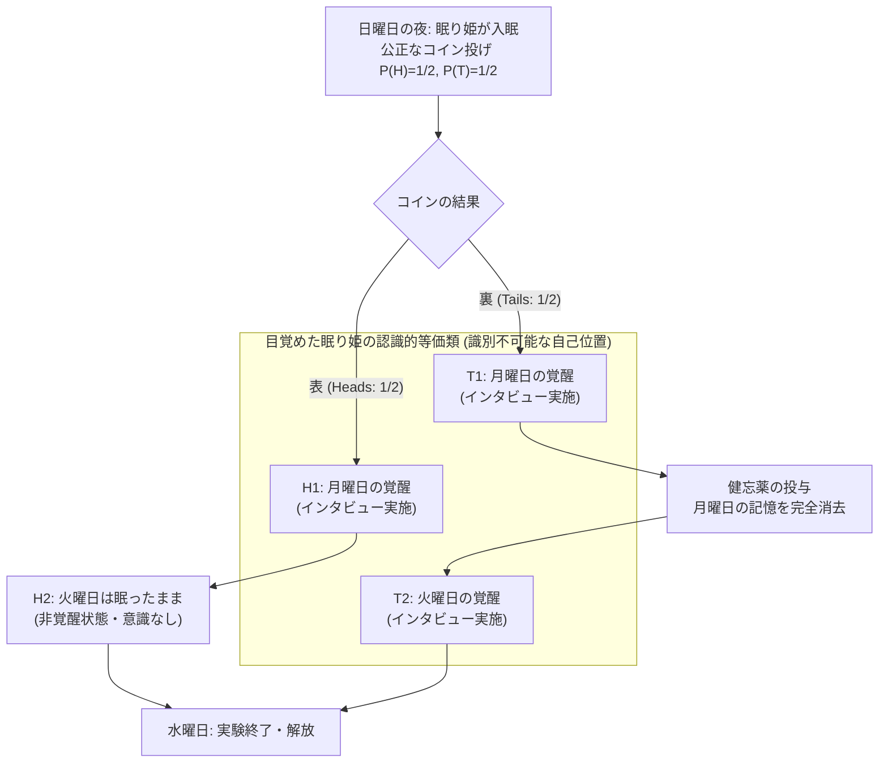
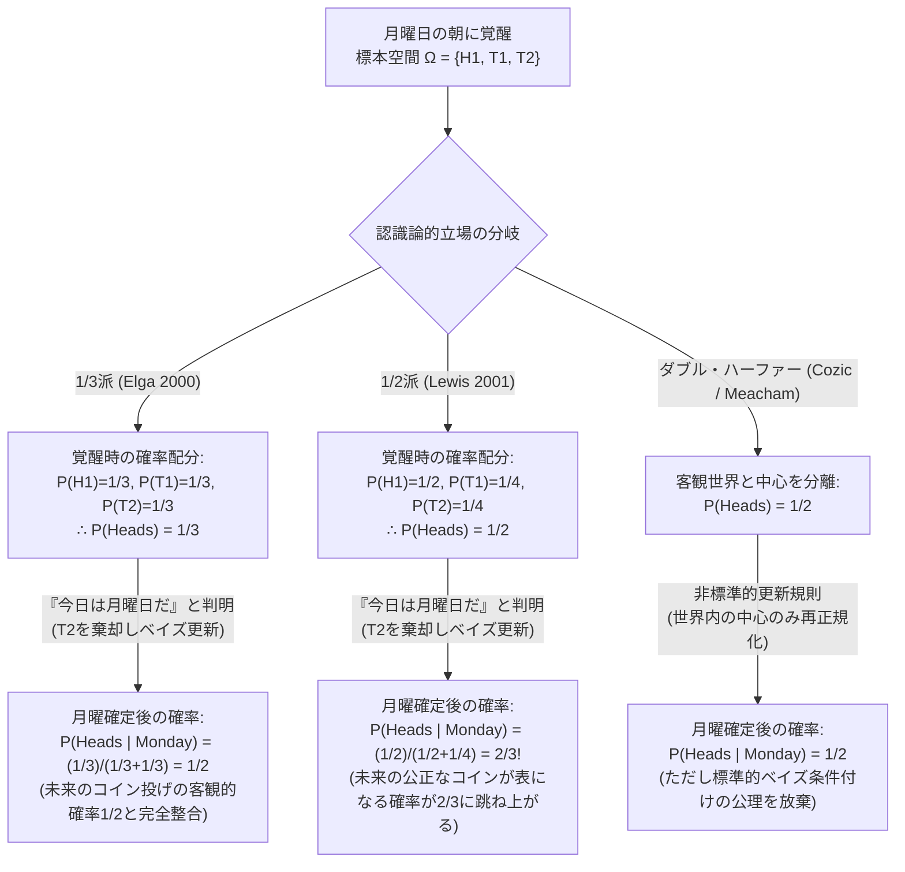

## 1. 序論：目覚めの瞬間に生じる認識論的亀裂

日曜日の夜、完璧な論理的整合性と計算能力を備えた理想的なベイズ主義者である<strong>眠り姫（Sleeping Beauty）</strong>が、ある思考実験の被験者として眠りにつく。彼女は眠りにつく前、実験者からこれから行われる実験プロトコルのすべてを完全に説明されており、その内容に一点の疑いも持っていない。

実験の手順は極めてシンプルであるが、そこに仕掛けられた「健忘（記憶消去）」と「時間的指標性（Indexicality）」の罠が、現代の分析哲学・形式認識論・ベイズ確率論・宇宙論を真っ二つに引き裂くことになる。

### 1.1 実験プロトコルの厳密な定義

1. <strong>日曜日の夜（事前段階）</strong>：眠り姫は薬によって深い眠りにつく。実験者は歪みのない公正なコイン（表が出る客観的確率 $P(\text{Heads}) = 1/2$、裏が出る客観的確率 $P(\text{Tails}) = 1/2$）を1回だけ投げる。
2. <strong>コインが「表（Heads: $H$）」だった場合</strong>：
   - 実験者は<strong>月曜日の朝</strong>に眠り姫を覚醒させ、短いインタビューを行う。
   - その後、彼女を再び眠らせ、火曜日は一切起こさず、水曜日に実験を終了して解放する（<strong>覚醒回数は合計1回</strong>）。
3. <strong>コインが「裏（Tails: $T$）」だった場合</strong>：
   - 実験者は<strong>月曜日の朝</strong>に眠り姫を覚醒させ、短いインタビューを行う。
   - その後、<strong>「月曜日に目覚めた記憶」を完全に消去する特殊な健忘薬（Amnesia-inducing drug）</strong>を投与して再び眠らせる。
   - 翌日の<strong>火曜日の朝</strong>、実験者は彼女をもう一度覚醒させ、月曜日と寸分違わぬ部屋・照明・手順でインタビューを行う（<strong>覚醒回数は合計2回</strong>）。その後、再び眠らせて水曜日に解放する。
4. <strong>主観的識別不可能性（Subjective Indistinguishability）</strong>：
   - 時計やカレンダー、窓の外の景色など、今日が月曜日なのか火曜日なのかを推測できる外部の手がかりは一切遮断されている。
   - 健忘薬の作用により、月曜日の朝の目覚めと火曜日の朝の目覚めは、眠り姫の一人称的な意識体験（現象的状態）において<strong>完全に識別不可能</strong>である。

さて、眠り姫が目覚めた。実験者が部屋に入ってきて、彼女にこう尋ねる。

> <strong>「いま目覚めているあなたにとって、コインが『表（Heads）』であったという信念の度合い（主観確率 / Credence）$P(\text{Heads})$ はいくらであるべきか？」</strong>

この問題は、もともと哲学者<strong>アーノルド・ズボフ（Arnold Zuboff）</strong>が1980年代に構想し、1990年の論文 *"One Self: The Logic of Experience"* の中で「百万人規模の覚醒」という形で論じた思考実験に端を発する。その後、ロバート・スタルネイカー（Robert Stalnaker）によって「眠り姫問題（Sleeping Beauty Problem）」と名付けられ、2000年に<strong>アダム・エルガ（Adam Elga）</strong>が分析哲学誌 *Analysis* に発表した記念碑的論文 *"Self-locating belief and the Sleeping Beauty problem"* によって、現代認識論の最重要パズルとして爆発的な論争を巻き起こした。

直観は即座に2つの陣営へと分裂する。

- <strong>1/2派（Halvers：デイヴィッド・ルイスら）の直観</strong>：「眠り姫は日曜日の夜の時点で、コインが表だろうが裏だろうが『自分は少なくとも1回は同じ状態で目覚める』ということを100%確実に知っていた。目覚めたという事実は、世界の客観的状態について何ひとつ新しい情報を与えていない。公正なコインの表裏について新しい証拠を得ていない以上、事前確率 $1/2$ をそのまま維持すべきである。よって <strong>$P(\text{Heads}) = 1/2$</strong> だ。」
- <strong>1/3派（Thirders：アダム・エルガ、クリストファー・ヒッチコックら）の直観</strong>：「眠り姫が目覚める可能性のある状況は、『表・月曜 ($H_1$)』『裏・月曜 ($T_1$)』『裏・火曜 ($T_2$)』の3通り存在する。コインが裏であれば表のときよりも2倍多く目覚めるのだから、目覚めたという事実は『いまが裏の世界の2回の目覚めのうちのどちらかである』可能性を相対的に高める。あるいは、この実験を1000回繰り返せば、約500回の『表・月曜』の目覚めと、約1000回の『裏（月曜＋火曜）』の目覚めが生じる。全1500回の目覚めのうち表である割合はちょうど3分の1である。よって <strong>$P(\text{Heads}) = 1/3$</strong> だ。」

なぜ、これほど単純明快なルール設定にもかかわらず、第一級の哲学者・数学者・物理学者の間で「$1/2$ か $1/3$ か」の合意が成立しないのか？ その理由は、古典的な確率論（コルモゴロフの公理系や標準的なベイズ更新）が、<strong>「世界がどうであるか」という客観的命題（De Dicto / 非中心化命題）</strong>のみを扱うように設計されており、<strong>「いま・ここにいる私は誰であり、いつの時点にいるのか」という自己位置づけ信念（Self-locating belief / De Se / 中心化命題）</strong>が記憶喪失を伴って変化する状況を自明には扱えないからである。

本稿では、まず自己位置づけ信念の形式意味論（中心化された可能世界）を定式化した上で、エルガによる「1/3派」の厳密な数理的証明と、ルイスによる「1/2派」の反論およびその衝撃的な帰結（月曜日だと知らされた瞬間に未来のコインの表確率が $2/3$ に跳ね上がる現象）を再構成する。さらに、クリストファー・ヒッチコックによる通時的ダッチ・ブック（必敗賭け）論証、意思決定理論（証拠的意思決定理論 vs 因果的意思決定理論）との交差、そしてニック・ボストロムによる「極端な眠り姫」と宇宙論・量子力学における人間原理（自己標本化仮定 SSA vs 自己指示仮定 SIA）への応用までを徹底的に解剖する。

---

## 2. 信念の存在論：非中心化可能世界（De Dicto）と中心化可能世界（De Se）

眠り姫問題の核心にある数理的対立を理解するためには、まず確率が割り当てられる対象（事象空間 $\Omega$ の要素）が何であるかを厳密に区別しなければならない。

### 2.1 客観的な「どこでもない場所からの視点」とその限界

標準的な可能世界意味論やベイズ確率論において、命題（Proposition）とは<strong>非中心化可能世界（Uncentered Possible Worlds）</strong>の集合 $E \subseteq W$ として定義される。非中心化可能世界 $w \in W$ とは、宇宙の始まりから終わりまでのすべての物理的・客観的事実（どの時刻にどの粒子がどこにあり、どのコインが表になり、誰がいつ目覚めたか）を、特定の視点を持たない神の視点（トマス・ネーゲルの言う *"View from Nowhere"*、あるいはスピノザの *"sub specie aeternitatis"*）から記述した完全な歴史である。このような客観的命題に対する信念は<strong>事物的信念（De Dicto belief）</strong>と呼ばれる。

しかし、1979年に<strong>ジョン・ペリー（John Perry）</strong>が名論文 *"The Problem of the Essential Indexical"* で、そして同年に<strong>デイヴィッド・ルイス（David Lewis）</strong>が *"Attitudes De Dicto and De Se"* で独立に論証したように、客観的な世界の事実をすべて知り尽くしてもなお、絶対に還元できない種類の知識が存在する。それが<strong>「私（I）」「いま（Now）」「ここ（Here）」という指標詞（Indexicals）に関わる自己位置づけ信念（Self-locating belief / De Se belief）</strong>である。

ペリーの有名な例を挙げよう。スーパーマーケットで砂糖の袋が破れ、床に砂糖の筋ができているのに気づいた男が、「誰か砂糖をこぼしている人がいるぞ、教えてあげよう」と思って砂糖の跡を追いかけて通路を何周も歩き回る。やがて彼は、自分のカートの中の砂糖袋が破れていることに気づき、<strong>「なんだ、砂糖をこぼしているのは『私』じゃないか！」</strong>と悟ってカートを止める。

この瞬間、彼が新たに獲得した知識は何だろうか？ 「時刻 $t$ に人物 $X$ のカートから砂糖が漏れている」という三人称的・客観的命題（De Dicto）は、仮に彼が自分自身の名前や客観的な伝記的事実をすべて知っていたとしても、自分がその人物 $X$ であると気づかなければ行動を変えることはできない。行動を変えさせたのは、「私がその人物である」という<strong>自己位置づけ的（De Se）な情報</strong>である。同様に、完全な百科事典と歴史年表を持つ全知の囚人が、窓のない独房に入れられて時計を奪われれば、世界のすべての客観的歴史を知っていながら<strong>「いまが何時何分であるか」</strong>だけを知らない状態に陥る。

### 2.2 中心化された可能世界（Centered Possible Worlds）の形式化

ルイス（1979）は、この自己位置づけ信念を形式化するために、単なる可能世界 $w \in W$ ではなく、世界 $w$ の中に存在する特定の主体（Agent）$i$ と特定の時間的段階（Temporal stage / Time-slice）$t$ に「中心（Center）」すなわち「いま・ここ・私」のピンを刺した順序三つ組を導入した。これを中心化された可能世界（Centered Possible World）と呼ぶ。

$$\mathcal{W}_c = \{ \langle w, i, t \rangle \mid w \in W, \, i \in \text{Agents}(w), \, t \in \text{Times}(w) \}$$

主体が抱く最も精密な信念空間（標本空間 $\Omega$）は、非中心化世界 $W$ ではなく、この中心化可能世界の集合 $\mathcal{W}_c$ の上に定義される。

- <strong>非中心化命題（Uncentered Proposition）</strong>：中心の位置 $(i, t)$ に依存せず、世界 $w$ のみによって真偽が定まる命題。すなわち $A \subseteq \mathcal{W}_c$ であって、任意の $w, i, i', t, t'$ について $\langle w, i, t \rangle \in A \iff \langle w, i', t' \rangle \in A$ を満たすもの。「コインが表である」という命題 $H$ は典型的な非中心化命題である。
- <strong>中心化命題（Centered / Indexical Proposition）</strong>：同一の客観的世界 $w$ の中であっても、時点 $t$（あるいは主体 $i$）によって真偽が変化する命題。たとえば「今日は月曜日である ($M$)」や「今日は火曜日である ($Tu$)」は、同じ世界 $w$ の中でも月曜日の中心 $\langle w, \text{Beauty}, \text{Mon} \rangle$ では真になり、火曜日の中心 $\langle w, \text{Beauty}, \text{Tue} \rangle$ では偽になる中心化命題である。

眠り姫問題において、客観的な非中心化可能世界は「コインが表の世界 $w_H$」と「コインが裏の世界 $w_T$」の<strong>2つ</strong>しか存在しない。しかし、月曜日と火曜日という2つの時点を考慮すると、中心化可能世界は以下の<strong>4つ</strong>に分割される。

1. $H_1 = \langle w_H, \text{Beauty}, \text{Monday} \rangle$：コインは表であり、いまは月曜日である（<strong>覚醒状態</strong>）。
2. $H_2 = \langle w_H, \text{Beauty}, \text{Tuesday} \rangle$：コインは表であり、いまは火曜日である（<strong>睡眠・無意識状態</strong>）。
3. $T_1 = \langle w_T, \text{Beauty}, \text{Monday} \rangle$：コインは裏であり、いまは月曜日である（<strong>覚醒状態</strong>）。
4. $T_2 = \langle w_T, \text{Beauty}, \text{Tuesday} \rangle$：コインは裏であり、いまは火曜日である（<strong>覚醒状態</strong>）。

眠り姫が目覚めた瞬間、彼女はデカルト的な確実性をもって「私はいま目覚めている（意識がある）」ことを知るため、無意識状態である $H_2$ は即座に排除される。したがって、目覚めた眠り姫が直面している認識的標本空間（彼女が「いま・ここ」として位置しうる中心化世界の集合）は、残りの<strong>3つの中心化可能世界</strong>に絞られる。

$$\Omega_{\text{wake}} = \{ H_1, \, T_1, \, T_2 \}$$

この3つの要素からなる集合 $\Omega_{\text{wake}}$ の上に、どのような確率測度 $P: \mathcal{P}(\Omega_{\text{wake}}) \to [0, 1]$ を割り当てるべきか。ここからエルガとルイスの歴史的対決が始まる。

---

## 3. 「1/3派（Thirder）」の厳密な数理的証明：アダム・エルガ（2000）

アダム・エルガは2000年の論文において、頻度主義的な直観や大数の法則に頼ることなく、純粋に一回の実験における主観的確率（ベイズ的信念度）の整合性条件から <strong>$P(\text{Heads}) = 1/3$</strong> を導出するエレガントな3段階の証明を提示した。その論理構造を数式によって完全に再現しよう。

### 3.1 ステップ1：同一世界内の中心に対する制限付き無差別原理（$P(T_1) = P(T_2)$）

まず、目覚めた眠り姫に対して、仮に「今回の実験ではコインが<strong>裏（Tails）</strong>であった」という条件（すなわち事象 $T = T_1 \cup T_2$）が与えられたと想像してみよう。

コインが裏である世界 $w_T$ においては、月曜日の覚醒 $T_1$ と火曜日の覚醒 $T_2$ の<strong>両方が確実に現実世界で生起する</strong>。しかも、健忘薬と実験環境の統制により、$T_1$ における彼女の主観的体験・記憶・証拠と、$T_2$ における彼女の主観的体験・記憶・証拠は完全に同一である。

古典的なラプラスの「無差別原理（Principle of Indifference）」は、異なる客観的可能世界の間に無造作に適用するとベルトランのパラドックスなどの矛盾を生むことが知られている。しかし、エルガがここで用いるのは、はるかに弱く堅牢な<strong>「制限付き無差別原理（Restricted Principle of Indifference）」</strong>である。すなわち、<strong>「まったく同一の客観的可能世界 $w$ に属し、かつ主体が持つ主観的証拠・現象的状態が完全に同一である2つの中心化世界 $\langle w, i, t_1 \rangle$ と $\langle w, i, t_2 \rangle$ に対しては、等しい主観確率を割り当てなければならない」</strong>という原理である。

実際、もしコインが裏だと教えられた状態で「いまが月曜日である確率 $P(T_1 \mid T)$」と「いまが火曜日である確率 $P(T_2 \mid T)$」に異なる値（たとえば $2/3$ と $1/3$）を割り当てるべき理由が存在するだろうか？ どちらの覚醒も同じ1回の実験ランの中で1回ずつ確実に起こり、両者を区別する非対称性は宇宙のどこにも存在しない。したがって、条件付き確率に関して次式が厳密に成立する（なお、このステップ1に関しては、後述する1/2派のデイヴィッド・ルイスも完全に同意している）。

$$P(T_1 \mid T_1 \cup T_2) = P(T_2 \mid T_1 \cup T_2) = \frac{1}{2}$$

条件付き確率の定義 $P(A \mid B) = \frac{P(A \cap B)}{P(B)}$ を展開すると、$T_1 \subseteq T_1 \cup T_2$ および $T_2 \subseteq T_1 \cup T_2$ であるから、分母 $P(T_1 \cup T_2)$ を払うことで直ちに次の方程式を得る。

$$\frac{P(T_1)}{P(T_1) + P(T_2)} = \frac{P(T_2)}{P(T_1) + P(T_2)} \implies P(T_1) = P(T_2) \quad \cdots \text{(式1)}$$

### 3.2 ステップ2：「今日は月曜日である」という条件付けとコイン投げの時間移動不変性（$P(H_1) = P(T_1)$）

次に、目覚めた眠り姫に対して、実験者がカレンダーを見せて<strong>「今日は月曜日ですよ（Today is Monday）」</strong>と教えたとしよう。この新しい情報 $M = H_1 \cup T_1$ を受け取った眠り姫は、候補から火曜日の覚醒 $T_2$ を棄却し、残された $\{H_1, T_1\}$ の上でベイズ更新を行う。このとき、彼女の「コインが表である」という条件付き確率 $P(H_1 \mid H_1 \cup T_1)$ はいくらになるべきか？

エルガはここで、実験プロトコルの<strong>因果的・時間的対称性</strong>に着目する鮮やかな思考実験を導入する。

実験プロトコルをよく見直してみよう。コインの結果（表か裏か）が実験の手順に違いをもたらすのは、<strong>「月曜日の夜の健忘薬投与と、火曜日の朝の2回目の覚醒を行うかどうか」</strong>という一点のみである。<strong>月曜日の朝の覚醒とインタビュー自体は、コインが表であっても裏であっても、確率 $1$ でまったく同じように実行される。</strong>

ということは、実験者がコインを投げるタイミングを「日曜日の夜」から<strong>「月曜日の夜（月曜日のインタビューが終わって眠り姫が再び眠りについた後）」</strong>に変更したとしても、実験の構造・確率分布・眠り姫の主観的体験は因果的にも情報理論的にも何ひとつ変わらない！

さて、もしコインが<strong>月曜日の夜</strong>に投げられるのであれば、眠り姫が目覚めて「今日は月曜日の朝である」と知らされた時点では、<strong>公正なコインはまだ投げられてすらいない未来の事象</strong>である。いまが月曜日の朝であると確実にわかっている状態で、「今夜投げられる歪みのない公正なコインが表になる確率はいくらか？」と問われれば、いかなる合理的な主体であっても、その主観確率は客観的チャンス（Objective chance）である $1/2$ に一致させなければならない（これは後述するルイスの「主要原理（Principal Principle）」そのものである）。

また、コインが日曜日の夜に投げられていたとしても、月曜日の朝に目覚めるという事象はコインの目と統計的・因果的に完全に独立であるから、「いまが月曜日の朝である」と知ることはコインの表裏についていかなる証拠も提供しない。したがって、いずれの解釈に立っても次式が成立しなければならない。

$$P(\text{Heads} \mid \text{Monday}) = P(H_1 \mid H_1 \cup T_1) = \frac{1}{2}$$

再び条件付き確率の定義を展開すると、$H_1 \cap (H_1 \cup T_1) = H_1$ かつ $H_1 \cap T_1 = \emptyset$ より、

$$\frac{P(H_1)}{P(H_1) + P(T_1)} = \frac{1}{2} \implies 2 P(H_1) = P(H_1) + P(T_1) \implies P(H_1) = P(T_1) \quad \cdots \text{(式2)}$$

### 3.3 ステップ3：連立方程式の結合と結論 $P(\text{Heads}) = 1/3$

以上のステップ1（式1）とステップ2（式2）を結合すると、3つの中心化可能世界 $H_1, T_1, T_2$ の事前確率（目覚めた直後の確率）はすべて等しくなる。

$$P(H_1) = P(T_1) = P(T_2)$$

目覚めた眠り姫の標本空間 $\Omega_{\text{wake}} = \{H_1, T_1, T_2\}$ は互いに排反かつ網羅的であるため、確率の全測度は $1$ でなければならない。

$$P(H_1) + P(T_1) + P(T_2) = 1$$

これに $P(T_1) = P(H_1)$ および $P(T_2) = P(H_1)$ を代入すれば、ただちに次の結論が導かれる。

$$3 P(H_1) = 1 \implies P(H_1) = P(T_1) = P(T_2) = \frac{1}{3}$$

目覚めた眠り姫にとって「コインが表である」という事象は $H \cap \Omega_{\text{wake}} = H_1$ にほかならないから、彼女が持つべき信念度は厳密に <strong>$1/3$</strong> であり、「コインが裏である」という信念度は $P(T_1) + P(T_2) = 2/3$ となる。これがアダム・エルガによる「1/3派」の完全な証明である。

---

## 4. 「1/2派（Halver）」の反撃：デイヴィッド・ルイス（2001）と反映原理

エルガの論文が発表された翌年の2001年、可能世界意味論と自己位置づけ信念（De Se）の創始者その人である<strong>デイヴィッド・ルイス（David Lewis）</strong>が、短いながらも極めて鋭利な反論論文 *"Sleeping Beauty: reply to Elga"*（*Analysis* 61巻）を発表した。ルイスは、エルガの結論は誤りであり、目覚めた眠り姫は <strong>$P(\text{Heads}) = 1/2$</strong> を堅持しなければならないと主張した。

### 4.1 新規な客観的証拠の不在とファン・フラーセンの反映原理

ルイスの議論の出発点は、ベイズ的合理性における最も基本的な原則——<strong>「予想外の新しい証拠を受け取らない限り、非中心化命題に対する信念度を変更してはならない」</strong>という原則である。

日曜日の夜、眠り姫はコインが表になる確率を $P_{\text{Sunday}}(\text{Heads}) = 1/2$ と評価していた。そして彼女は日曜日の夜の時点で、「自分が次に意識を取り戻すとき、自分は何の手がかりもない部屋で目覚める」ということを確率 $1$ で予見していた。

月曜日の朝、彼女が目覚めたとき、彼女が観察するすべての事実（「私はいま目覚めている」「部屋の壁は白い」「昨日までの記憶がない」）は、日曜日の夜に彼女が確実に予期していた通りの事態である。客観的世界 $W = \{w_H, w_T\}$ のどちらが現実であるかに関して、いかなるサプライズも新規な事物的（De Dicto）情報も発生していない。

この直観を形式化したのが、科学哲学者<strong>バス・ファン・フラーセン（Bas van Fraassen, 1984）</strong>が提唱した<strong>反映原理（Reflection Principle）</strong>である。反映原理とは、主体が将来の時点 $t_1$ において、その間に非合理的な認知的障害（泥酔や洗脳など）を被ることなく、ある命題 $A$ に対する信念度が $P_{t_1}(A) = x$ になると現在の時点 $t_0$ で確実に知っているならば、現在の時点 $t_0$ における条件付き信念度もそれに一致しなければならないという要請である。

$$P_{t_0}\bigl(A \;\big|\; P_{t_1}(A) = x\bigr) = x$$

もし1/3派の主張するように、眠り姫が目覚めた瞬間（$t_1$）に必ず $P_{t_1}(\text{Heads}) = 1/3$ へと信念を更新することが合理的であり、かつ日曜日の夜（$t_0$）の眠り姫がその更新ルールを完全に知っているならば、反映原理によって日曜日の夜の時点でもすでに $P_{\text{Sunday}}(\text{Heads}) = 1/3$ でなければならなくなる！ しかし日曜日の夜にこれから投げられる公正なコインの表確率が $1/3$ であるはずがなく、明らかに $P_{\text{Sunday}}(\text{Heads}) = 1/2$ である。したがって、対偶により、目覚めた時点での確率も $1/2$ でなければならないと1/2派は論じる。

### 4.2 ルイスによる確率配分：$P(H_1) = 1/2, \, P(T_1) = 1/4, \, P(T_2) = 1/4$

では、ルイスはエルガの3段階の証明のどこを拒絶するのか？
ルイスは、エルガの<strong>ステップ1（$P(T_1) = P(T_2)$）を完全に受け入れる</strong>。コインが裏であるという条件のもとで、月曜日の覚醒と火曜日の覚醒に差をつける理由は存在しないからである。

しかし、ルイスは最初に非中心化命題の確率 $P(\text{Heads}) = P(H_1) = 1/2$ および $P(\text{Tails}) = P(T_1 \cup T_2) = 1/2$ を固定するため、裏の確率 $1/2$ が2つの中心化世界 $T_1$ と $T_2$ に均等に二分割されることになる。すなわち、ルイスの確率空間は以下のようになる。

$$P_{\text{Lewis}}(H_1) = \frac{1}{2}, \quad P_{\text{Lewis}}(T_1) = \frac{1}{4}, \quad P_{\text{Lewis}}(T_2) = \frac{1}{4}$$

1/3派と1/2派の確率配分の違いは、次のように幾何学的に理解できる。
- <strong>1/3派（エルガ）</strong>は、3つの覚醒中心 $H_1, T_1, T_2$ のそれぞれに<strong>均等な重み（各 $1/3$）</strong>を与え、それを客観的世界ごとに合算するため、2つの覚醒を持つ裏の世界 $w_T$ の総確率が $2/3$ へと膨張する（<strong>ボトムアップ型の割り当て</strong>）。
- <strong>1/2派（ルイス）</strong>は、まず2つの客観的世界 $w_H, w_T$ に<strong>事前確率（各 $1/2$）</strong>を固定し、各世界の内部に存在する覚醒中心の数でその確率質量を割り算するため、2つの覚醒を持つ裏の世界では1回あたりの覚醒の重みが $1/4$ へと希釈される（<strong>トップダウン型の割り当て</strong>）。

### 4.3 ルイスの衝撃的帰結：「今日は月曜日だ」と聞いた瞬間に確率は $2/3$ へ跳ね上がる！

ルイスの配分 $P(H_1) = 1/2, \, P(T_1) = 1/4, \, P(T_2) = 1/4$ を採用すると、エルガのステップ2（月曜日だと教えられたときの条件付け）において、驚くべき数学的帰結が生じる。

目覚めた眠り姫に、実験者が<strong>「今日は月曜日である（$M = H_1 \cup T_1$）」</strong>と告げたとしよう。ルイスの眠り姫が標準的なベイズの定理に従って条件付き確率 $P_{\text{Lewis}}(\text{Heads} \mid \text{Monday})$ を計算すると、どうなるか？

$$P_{\text{Lewis}}(\text{Heads} \mid \text{Monday}) = \frac{P_{\text{Lewis}}(H_1)}{P_{\text{Lewis}}(H_1) + P_{\text{Lewis}}(T_1)} = \frac{1/2}{1/2 + 1/4} = \frac{1/2}{3/4} = \frac{2}{3} \> !$$

なんと、ルイス（1/2派）の眠り姫は、目覚めた直後は「コインが表である確率は $1/2$ だ」と考えているにもかかわらず、実験者から<strong>「今日は月曜日の朝だよ」と教えられた瞬間、「ならばコインが表である確率は $2/3$ だ！」と信念を引き上げなければならない</strong>のである！

なぜこれが直観的に衝撃的（エルガら1/3派に言わせれば「不条理な背理法」）なのか？
先ほどのステップ2の変形を思い出してほしい。コイン投げが<strong>月曜日の夜</strong>に行われるプロトコルであったとしよう。ルイスの眠り姫は、月曜日の朝に目覚めて「いまは月曜日の朝であり、コインは今夜投げられる」と知らされた瞬間、<strong>「今夜これから投げられる歪みのない公正なコインが、表になる確率は $2/3$（裏になる確率は $1/3$）である！」</strong>と主張することになるのだ。

これは、ルイス自身が1980年に定式化したベイズ認識論の大原則——<strong>「主要原理（Principal Principle）：ある時点における事象 $A$ の客観的チャンス（物理的確率）が $x$ であることを知っており、かつ未来の事象に関する許容されない超常的情報（Admissible evidence 以外の情報）を持っていないならば、主観確率も $x$ でなければならない」</strong>——に対する明白な違反ではないのか？

ルイス（2001）はこの批判を正面から受け止め、極めて大胆な防御を行った。ルイスによれば、目覚めた眠り姫が「今日は月曜日である」と知ることは、自身の時間的位置に関する<strong>自己位置づけ情報（Centered evidence）</strong>であり、主要原理における「許容される証拠（Admissible evidence）」の枠外にある。なぜなら、表の世界 $w_H$ では覚醒の100%（$1$回中$1$回）が月曜日に集中しているのに対し、裏の世界 $w_T$ では覚醒の50%（$2$回中$1$回）しか月曜日に割り当てられていない。したがって、「現在の自分の覚醒が月曜日であった」という自己位置づけ事実を観察したとき、尤度比（Likelihood ratio）は

$$\frac{P_{\text{Lewis}}(\text{Monday} \mid \text{Heads})}{P_{\text{Lewis}}(\text{Monday} \mid \text{Tails})} = \frac{1}{1/2} = 2$$

となり、ベイズの定理によって事後オッズが $1:1$ から $2:1$（確率 $2/3$）へと更新されるのは完全に合理的である、とルイスは居直ったのである。

### 4.4 第3の立場：「ダブル・ハーファー（Double-Halvers）」と自己位置づけ更新の修正

「目覚めたときに $1/3$ になるのも嫌だが、月曜日だと聞いたときに $2/3$ になるのはもっと受け入れがたい！」と考えた哲学者たち（ミカエル・コジック Mikaël Cozic 2011、C.S. ジェンキンス Jenkins 2005、ジョエル・プスト Pust 2012、クリストファー・ミーチャム Meacham 2008 ら）は、<strong>ダブル・ハーファー（Double-Halver）</strong>と呼ばれる第3の立場を提唱した。

ダブル・ハーファーとは、
1. 目覚めた直後の確率も <strong>$P(\text{Heads}) = 1/2$</strong> であり、
2. 「今日は月曜日である」と教えられた後の確率も <strong>$P(\text{Heads} \mid \text{Monday}) = 1/2$</strong> である、
という両方の直観を同時に維持しようとする立場である。

しかし、先ほどの数式を見れば明らかなように、単一の確率空間 $\{H_1, T_1, T_2\}$ の上で標準的なベイズ条件付け（$P(A \mid B) = P(A \cap B)/P(B)$）と $P(T_1) = P(T_2)$ を維持する限り、$P(H_1) = 1/2$ と $P(H_1 \mid H_1 \cup T_1) = 1/2$ を同時に満たすことは<strong>数学的に不可能</strong>である（$\frac{1/2}{1/2 + P(T_1)} = \frac{1}{2} \implies P(T_1) = 1/2 \implies P(T_2) = 1/2 \implies P(H_1)+P(T_1)+P(T_2) = 1.5 \neq 1$ となって確率の公理が破綻する）。

そのため、ダブル・ハーファーを数学的に成立させるためには、中心化世界に対する標準的なベイズ条件付けを放棄し、<strong>「区画化された条件付け（Compartmentalized Conditionalization）」</strong>やマイケル・タイトルバウム（Michael Titlebaum, 2008）の形式化したフレームワークのように、「自己位置づけ情報の獲得は、まず客観的命題（$w_H$ か $w_T$ か）の確率を固定したまま、各客観的世界の内部でのみ中心の確率を再正規化する」という二段階の非標準的更新規則を導入する必要がある。

---

## 5. 通時的ダッチ・ブック（Diachronic Dutch Book）と意思決定理論の交錯

認識論における信念度（Credence）が単なる言葉遊びではなく実質的な意味を持つのは、それが<strong>「不確実性下での意思決定（賭けの受容可能性）」</strong>と直結しているからである。フランク・ラムジー（Frank Ramsey）とブルーノ・デ・フィネッティ（Bruno de Finetti）以来、主観確率が満たすべき合理性の基準として用いられてきたのが<strong>ダッチ・ブック論証（Dutch Book Argument）</strong>である。

ダッチ・ブックとは、主体自身がそれぞれの時点で「公正（期待利得ゼロ以上）である」と判断して自発的に受け入れた複数の賭けの組み合わせであるにもかかわらず、<strong>世界の実際の結果がどう転んでも（すべての可能世界において）主体が確実に金銭的損失を被るような必敗の賭け構造</strong>を指す。

2004年、科学哲学者<strong>クリストファー・ヒッチコック（Christopher Hitchcock）</strong>は論文 *"Beauty and the bets"* において、1/2派（ルイス）の眠り姫は<strong>通時的ダッチ・ブック（Diachronic Dutch Book）</strong>に対して無防備であり、確実に破産させられることを数学的に証明した。

### 5.1 ヒッチコック（2004）による対1/2派ダッチ・ブックの構成

狡猾な胴元（Bookie）が実験室に入り、日曜日の夜と、眠り姫が目覚めるすべての機会において、彼女のその時々の主観確率に照らして「完全に公正（期待値 $0$）」な賭けを提案するとしよう。

ここで極めて重要な事実は、<strong>健忘薬の作用により、もし眠り姫がすべての覚醒時に同じルールで賭けを受け入れるならば、コインが表（$H$）のときは賭けが1回（月曜のみ）しか成立しないのに対し、コインが裏（$T$）のときは賭けが2回（月曜と火曜の両方）成立する</strong>という非対称性である！

いま、眠り姫が<strong>1/2派（Halver）</strong>であり、日曜日の夜にも $P_{\text{Sun}}(H) = 1/2$、目覚めたときにも常に $P_{\text{Wake}}(H) = 1/2$ の信念度を持っていると仮定する。胴元は以下の2段階の賭けを持ちかける。

1. <strong>第1段階（日曜日の夜の賭け $B_{\text{Sun}}$）</strong>：
   - 日曜日の眠り姫の信念度は $P_{\text{Sun}}(H) = 1/2$ である。
   - 胴元は彼女に<strong>「裏（Tails）に賭ける契約」</strong>を提案する。すなわち、<strong>コインが表（$H$）なら $-30$ ドル（30ドルの支払い）、コインが裏（$T$）なら $+30$ ドル（30ドルの受取）</strong>という賭けである。
   - 日曜日の眠り姫にとって、この賭けの期待値は $\frac{1}{2}(-30) + \frac{1}{2}(+30) = 0$ ドルであるため、彼女はこれを公正な賭けとして受け入れる。

2. <strong>第2段階（覚醒時の賭け $B_{\text{Wake}}$）</strong>：
   - 眠り姫が目覚めるたびに、胴元は部屋に入ってきて<strong>「表（Heads）に賭ける契約」</strong>を提案する。すなわち、<strong>コインが表（$H$）なら $+20$ ドル、コインが裏（$T$）なら $-20$ ドル</strong>という賭けである。
   - 1/2派の眠り姫は、目覚めたときの信念度も $P_{\text{Wake}}(H) = 1/2$ であるから、この賭けの期待値を $\frac{1}{2}(+20) + \frac{1}{2}(-20) = 0$ ドルと計算し、目覚めるたびに喜んでこの賭け契約書にサインする。
   - 彼女は月曜日の夜に健忘薬を投与されるため、火曜日に目覚めたときも「自分が月曜日にすでに同じ契約書にサインした」ことを覚えておらず、まったく同じ推論によって火曜日にもサインしてしまう！

さあ、水曜日に実験が終了し、すべての契約書を精算する時刻がやってきた。コインが表だった場合と裏だった場合のそれぞれについて、眠り姫の最終的な純損益を計算してみよう。

- <strong>ケースA：コインが「表（Heads）」だった場合（覚醒は月曜日の1回のみ）</strong>
  - 日曜日の契約 $B_{\text{Sun}}$ の精算：表なので <strong>$-30$ ドル</strong>。
  - 月曜日の覚醒時の契約 $B_{\text{Wake}}$ の精算（1回分）：表なので <strong>$+20$ ドル</strong>。
  - 火曜日は眠ったままであるため、契約は発生しない。
  - <strong>水曜日の最終純損益</strong>：$-30 + 20 = \mathbf{-10\text{ ドル（確実な損失！）}}$

- <strong>ケースB：コインが「裏（Tails）」だった場合（覚醒は月曜日と火曜日の合計2回！）</strong>
  - 日曜日の契約 $B_{\text{Sun}}$ の精算：裏なので <strong>$+30$ ドル</strong>。
  - 月曜日の覚醒時の契約 $B_{\text{Wake}}$ の精算（1回目）：裏なので <strong>$-20$ ドル</strong>。
  - 火曜日の覚醒時の契約 $B_{\text{Wake}}$ の精算（2回目）：裏なので <strong>$-20$ ドル</strong>。
  - <strong>水曜日の最終純損益</strong>：$+30 - 20 - 20 = \mathbf{-10\text{ ドル（確実な損失！）}}$

なんと、コインが表になろうが裏になろうが、1/2派の眠り姫は水曜日に<strong>100%確実に $10$ ドルを失う</strong>のである！

### 5.2 ダッチ・ブックを完全に回避する唯一の信念度 $p = 1/3$

では、目覚めたときの信念度 $P_{\text{Wake}}(H) = p$ がいくらであれば、眠り姫はいかなる通時的ダッチ・ブックからも完全に身を守ることができるのか？ 一般的な数式で証明しよう。

覚醒1回あたり、賭け金スケールを $S \in \mathbb{R}$ とし、信念度 $p$ のもとで公正な「表への賭け」は、
- 表（$H$）のときの利得：$+S(1 - p)$
- 裏（$T$）のときの利得：$-Sp$
となる（実際、主観的期待値は $p \cdot S(1-p) + (1-p)(-Sp) = 0$ である）。

実験全体を通じた覚醒時の賭けの合計利得 $\Delta W$ は、表のときは覚醒が1回、裏のときは覚醒が2回であるから、
- 表（$H$）のときの合計利得：$\Delta W(H) = 1 \times S(1 - p) = S(1 - p)$
- 裏（$T$）のときの合計利得：$\Delta W(T) = 2 \times (-Sp) = -2Sp$

となる。日曜日の夜の時点（$P_{\text{Sun}}(H) = 1/2$）から見て、この覚醒時の賭けパッケージ全体の客観的期待値 $\mathbb{E}_{\text{Sun}}[\Delta W]$ がゼロになっていなければ、日曜日の夜の逆向きの賭けと組み合わせることで必ずダッチ・ブックが作られてしまう。したがって、ダッチ・ブック免疫条件（No-Dutch-Book condition）は次式で与えられる。

$$\mathbb{E}_{\text{Sun}}[\Delta W] = \frac{1}{2} \Delta W(H) + \frac{1}{2} \Delta W(T) = 0 \implies S(1 - p) - 2Sp = 0$$

$S \neq 0$ で割れば、

$$1 - p = 2p \implies 3p = 1 \implies p = \frac{1}{3} \> !$$

すなわち、<strong>目覚めた眠り姫が $P(\text{Heads}) = 1/3$ を採用したときに限り</strong>、彼女は表に賭ける際に「表なら $+20$ ドル、裏なら $-10$ ドル（オッズ $2:1$）」を要求するため、表（1回覚醒）で $+20$ ドル、裏（2回覚醒）で $(-10) \times 2 = -20$ ドルとなり、日曜日の1対1のオッズと完全に均衡してダッチ・ブックが消滅するのである。

### 5.3 1/2派の反論：証拠的意思決定理論（EDT）対 因果的意思決定理論（CDT）

ヒッチコックのダッチ・ブック論証は1/3派の決定的な勝利を告げたように見えたが、これに対しても1/2派および意思決定理論の専門家（フランク・アルンツェニウス Frank Arntzenius 2002、ダレン・ブラッドリー＆ハネス・ライトゲープ Bradley & Leitgeb 2006、ブリッグス Rachael Briggs 2010 ら）から深い反論が寄せられた。

彼らの指摘の核心は、<strong>「眠り姫問題では、賭けを受け入れるという行為が、裏の世界において2回繰り返されるという相関（構造的複製）を持っているため、主観確率（Credence）と賭け率（Betting quotient）が乖離するのだ」</strong>という点にある。

ここで、前回（ニューカムのパラドックス）でも登場した<strong>因果的意思決定理論（Causal Decision Theory: CDT）</strong>と<strong>証拠的意思決定理論（Evidential Decision Theory: EDT）</strong>の対立が再び姿を現す。

1. <strong>証拠的意思決定理論（EDT）の視点</strong>：
   - 月曜日に目覚めた眠り姫が「私はいまこの賭けを受け入れる」と決定したとき、もしコインが裏（$T$）であれば、火曜日に目覚める彼女の同一のコピー（未来の自分）も同じ推論過程を経て100%確実に同じ賭けを受け入れることになる。
   - したがって、EDTに従う主体にとって、「いま私が賭けを受け入れる」という行為は、「もし裏であれば、私の口座から1回分ではなく<strong>2回分の賭け金が引き落とされる</strong>」という事実の強力な<strong>証拠（ニュース価値）</strong>となる！
   - ゆえに、たとえ彼女の純粋な認識的信念度が $P(\text{Heads}) = 1/2$（1/2派）であったとしても、裏の世界では損失が2倍に増幅されることを織り込んで期待効用を計算すれば、彼女の実際の<strong>賭け行動（Betting quotient）は $1/3$ になる</strong>のである！

2. <strong>因果的意思決定理論（CDT）の視点</strong>：
   - 一方、CDTに従う主体は、「いま（月曜日に）私が賭けを受け入れるかどうかという選択は、健忘薬によって記憶が消去される以上、火曜日の私が賭けを受け入れるかどうかに対して<strong>いかなる因果的影響力も持たない</strong>」と考える。
   - したがって、CDTの枠組みでは自分の現在の決定1回分の因果的帰結のみを評価するため、主観確率 $p$ と賭け率は一致する（そのため、CDT＋1/2派の組み合わせは実際にダッチ・ブックの餌食となる）。

このように、眠り姫問題は単なる確率計算のパズルにとどまらず、「記憶喪失やクローン複製によって自分の意思決定が複数回反復される宇宙において、信念度と合理的行動はいかにして結びつくのか」という意思決定理論の根幹を揺るがす問題へと発展した。

---

## 6. ニック・ボストロムの「極端な眠り姫」と人間原理（SSA vs SIA）

眠り姫問題が哲学の枠を超えて現代物理学・宇宙論・人工知能研究において死活的な重要性を持つに至った最大の理由は、オックスフォード大学の哲学者<strong>ニック・ボストロム（Nick Bostrom）</strong>が著書 *Anthropic Bias: Observation Selection Effects in Science and Philosophy*（2002年）および2007年の論文 *"Sleeping Beauty and Colditz"* で明らかにした通り、この問題が<strong>宇宙論における人間原理（Anthropic Principle）と観測選択効果（Observation Selection Effects）の基礎方程式そのもの</strong>だからである。

### 6.1 極端な眠り姫（Extreme Sleeping Beauty）：100万回の覚醒

1/2派と1/3派の直観の対立を極限まで先鋭化させるために、ボストロムが提示した<strong>「極端な眠り姫（Extreme Sleeping Beauty）」</strong>を考えよう。

実験プロトコルをほんの少しだけ変更する。
- コインが<strong>表（Heads）</strong>だった場合：これまで通り、月曜日の朝に<strong>1回だけ</strong>起こす。
- コインが<strong>裏（Tails）</strong>だった場合：健忘薬を使いながら、なんと<strong>100万日間（$N = 1,000,000$ 回）連続で毎朝起こし続ける</strong>！

さて、眠り姫が目覚めた。コインが表であった確率 $P(\text{Heads})$ はいくらだろうか？

- <strong>一般化された1/3派（$1/(N+1)$ 派）の結論</strong>：
  エルガの証明とまったく同じ論理により、表の覚醒中心は $H_1$ の1個、裏の覚醒中心は $T_1, T_2, \dots, T_{1,000,000}$ の100万個であり、全 $1,000,001$ 個の中心化世界が等確率となる。したがって、
  $$P(\text{Heads}) = \frac{1}{1,000,001} \approx 0.0000999\%, \quad P(\text{Tails}) = \frac{1,000,000}{1,000,001} \approx 99.9999\%$$
  すなわち、眠り姫は目覚めた瞬間、<strong>「公正なコインはほぼ確実に（99.9999%の確率で）裏だった！」</strong>と確信することになる！

- <strong>1/2派の結論</strong>：
  たとえ裏のときの覚醒回数が100万回であろうと100億回であろうと、眠り姫は日曜日の夜の時点で「自分は少なくとも1回は目覚める」ことを100%知っていたのだから、目覚めたという事実はコインの出目について何の情報ももたらさない。したがって、依然として <strong>$P(\text{Heads}) = 1/2$</strong> である！

読者はどちらの結論により強い違和感を覚えるだろうか？
100万回の実験で1/2派を貫けば、ダッチ・ブックによって1回の表と100万回の裏の非対称性から天文学的な負債を背負わされる。しかし逆に1/3派（$1/(N+1)$ 派）を貫けば、「自分が目覚めた」というただそれだけの事実から、歪みのないコインが裏を出したと99.9999%確信できることになり、これを宇宙全体の観測者数に拡張すると、次に述べる恐るべきパラドックスを引き起こすのである。

### 6.2 自己標本化仮定（SSA）と自己指示仮定（SIA）の定式化

ボストロムは、宇宙論やマルチバース理論において「私たち観測者が存在しているという事実」から宇宙の理論（仮説）の確率をどのようにベイズ更新すべきかに関して、1/2派と1/3派に正確に対応する2つの基本公理を定式化した。

#### 1. 自己標本化仮定（Self-Sampling Assumption: SSA — 1/2派に対応）
> <strong>SSAの定義</strong>：「他の条件が等しい限り、あなたは自分自身を、自分が属する参照クラス（Reference class）内のすべての観測者（あるいは観測者モーメント）の集合から<strong>無作為に抽出された1つの標本</strong>であるかのように推論すべきである。」

SSAのもとでは、ある宇宙仮説 $H_i$ が予測する観測者の総数を $N(H_i)$ としたとき、「私が存在する」という事実は、どの宇宙仮説が真であっても（少なくとも1人の観測者が存在する限り）確率 $1$ で成立するため、<strong>観測者の総数が多い宇宙仮説を有利にすることはない</strong>。その代わり、1つの宇宙の内部に存在する $N(H_i)$ 人の観測者のそれぞれに選ばれる確率は $1/N(H_i)$ に希釈される。
これはまさに、ルイスの1/2派が裏の世界の2回の覚醒に対して $1/2 \times (1/2) = 1/4$ ずつ確率を割り当て、表の確率 $P(\text{Heads}) = 1/2$ を変えなかった構造と完全に同型である。

#### 2. 自己指示仮定（Self-Indication Assumption: SIA — 1/3派に対応）
> <strong>SIAの定義</strong>：「あなたが『自分は存在している』という事実を知ったとき、他の条件が等しい限り、観測者が少数しか存在しないとする仮説よりも、<strong>観測者が多数存在する（または多数の観測者モーメントを生成する）とする仮説の方を、その観測者数 $N(H_i)$ に正比例して高く評価すべきである。</strong>」

数式で表せば、事前確率 $P(H_i)$ を持つ複数の宇宙仮説 $\{H_1, H_2, \dots\}$ に対して、「私が存在する（または私がいま目覚めている）」という証拠 $E$ による事後確率は次式で与えられる。

$$P_{\text{SIA}}(H_i \mid E) = \frac{P(H_i) \cdot N(H_i)}{\sum_{j} P(H_j) \cdot N(H_j)}$$

眠り姫問題において、参照クラスを「覚醒モーメント（Awakening observer-moments）」とすれば、表の仮説では $N(\text{Heads}) = 1$、裏の仮説では $N(\text{Tails}) = 2$、事前確率はともに $1/2$ であるから、SIAの公式に代入すると

$$P_{\text{SIA}}(\text{Heads} \mid \text{Awake}) = \frac{\frac{1}{2} \times 1}{\frac{1}{2} \times 1 + \frac{1}{2} \times 2} = \frac{1}{3}, \quad P_{\text{SIA}}(\text{Tails} \mid \text{Awake}) = \frac{\frac{1}{2} \times 2}{\frac{1}{2} \times 1 + \frac{1}{2} \times 2} = \frac{2}{3}$$

となり、エルガの1/3派の結論が寸分違わず導出される！

### 6.3 宇宙論的パラドックス：終末論法（Doomsday Argument）対 僭越な哲学者（Presumptuous Philosopher）

ところが、SSA（1/2派論理）とSIA（1/3派論理）を宇宙規模の科学推論に適用すると、それぞれが深刻なパラドックスを生み出す。

1. <strong>SSA（1/2派論理）が生む「終末論法（Doomsday Argument）」</strong>：
   - ブランドン・カーター（Brandon Carter）、ジョン・レスリー（John Leslie）、リチャード・ゴット（J. Richard Gott）らが提唱した終末論法を考えよう。
   - 人類の歴史について2つの仮説があるとする。
     - <strong>仮説 $S$（早期絶滅：Short）</strong>：人類はまもなく絶滅し、誕生する人類の総数は累計 <strong>1,000億人</strong>（$10^{11}$ 人）で終わる。
     - <strong>仮説 $L$（長期繁栄：Long）</strong>：人類は銀河系へ進出し、誕生する人類の総数は累計 <strong>100兆人</strong>（$10^{14}$ 人）に達する。
   - いま、あなたの出生順位（人類誕生から数えて何番目に生まれた人間か）を調べると、約 <strong>第600億番目</strong>（$n \approx 6 \times 10^{10}$）であった。
   - SSA（ルイスの1/2派と同じトップダウン希釈論理）を適用すると、あなたが第600億番目として抽出される条件付き確率（尤度）は、
     - 仮説 $S$ のもとでは：$P(n = 6 \times 10^{10} \mid S) = \frac{1}{10^{11}}$
     - 仮説 $L$ のもとでは：$P(n = 6 \times 10^{10} \mid L) = \frac{1}{10^{14}}$
   - なんと、あなたが「自分は100兆人の後半ではなく、最初の1,000億人の枠内（600億番目）に生まれた」と知った瞬間（これはルイスの眠り姫が「自分は火曜日ではなく月曜日にいる」と知った瞬間と数学的に完全に同一である！）、ベイズ更新によって<strong>「人類がまもなく絶滅する仮説 $S$」の事後オッズが1,000倍に跳ね上がる</strong>のである！

2. <strong>SIA（1/3派論理）が終末論法を打ち消す仕組みと、「僭越な哲学者（Presumptuous Philosopher）」のパラドックス</strong>：
   - これに対し、SIA（1/3派論理）を採用するとどうなるか？
   - SIAでは、「そもそも自分が人間として生まれた」という時点で、総人口が1,000倍多い長期繁栄仮説 $L$ の確率がまず <strong>1,000倍</strong>（$\propto N(L)/N(S) = 10^{14}/10^{11} = 1000$）にブーストされる。その後に「自分の出生順位が600億番目であった」という情報で $1/1000$ に更新されるため、$1000 \times \frac{1}{1000} = 1$ となって両者が完全に相殺され、<strong>終末論法は見事に無効化される</strong>！（これはエルガの1/3派において、覚醒時に裏が2倍になった後、「今日は月曜日だ」と聞いて $1/2$ に戻るのと数学的に完全に同一の相殺機構である）。
   - <strong>しかし、SIAには致命的な副作用がある。</strong> ボストロムが命名した<strong>「僭越な哲学者（Presumptuous Philosopher）」問題</strong>である。
   - 現代の素粒子物理学者と宇宙論学者が、宇宙の大きさに関する2つの競合する統一理論 $T_1$（有限宇宙：観測可能な銀河の数に限りがあり、全宇宙の知的生命体の数は約 $10^{20}$ 人）と $T_2$（巨大または無限に近いインフレーション宇宙：知的生命体の数が $10^{1,000,000}$ 人）の間で、実験データからは $50:50$ の事前確率を与えていたとする。
   - そこへSIAを信奉する「僭越な哲学者」が現れ、大型加速器も宇宙望遠鏡も一切使わず、安楽椅子に座ったままこう宣言する。<strong>「私がいま意識を持って存在しているという事実だけで、SIAにより理論 $T_2$ が正しい確率は $10^{999,980}$ 倍高い！ したがって実験などを行うまでもなく、99.999999...%の確率で宇宙は巨大である！」</strong>
   - 自己の存在という単一の事実から、物理学の経験的探求をすべて無意味化してしまうこの帰結は、科学哲学において到底受け入れがたいものと見なされている。

### 6.4 ボストロムのハイブリッド・モデルとエヴェレット多世界解釈・シミュレーション仮説への展開

このSSA（終末論法の罠）とSIA（僭越な哲学者の罠）の二律背反を解決するために、ボストロム（2007）は「主体（Agent）全体の抽出」と「同一主体内の観測者モーメント（Observer-moments）の抽出」を階層的に分離する<strong>ハイブリッド・モデル（Hybrid Model）</strong>、ならびに状況に応じて参照クラス（Reference Class）が主観的証拠とともに変化する<strong>強自己標本化仮定（Strong Self-Sampling Assumption: SSSA）</strong>を提唱した。

さらに、眠り姫問題の数理は現代物理学の最先端テーマとも深く結びついている。

- <strong>エヴェレットの多世界解釈（Many-Worlds Interpretation of Quantum Mechanics）</strong>：
  ピーター・ルイス（Peter J. Lewis, 2007）やデイヴィッド・ウォレス（David Wallace）、ショーン・キャロル（Sean Carroll）らが論じるように、量子測定のたびに宇宙の波動関数が分岐し、観測者自身が「スピン上向きを観測する私」と「スピン下向きを観測する私」に分裂するとき、分岐前および分岐後（ただし測定結果を見る前）の観測者が持つべき自己位置づけ確率は、眠り姫問題における1/2派と1/3派の議論そのものとなる。量子力学におけるボルンの確率規則（振幅の2乗 $|\psi|^2$ に比例する重み）を多世界解釈からいかに導出するかという問題は、分岐する複数の中心化世界の間でいかに重みを配分するかという眠り姫問題の量子版にほかならない。
- <strong>シミュレーション仮説（Simulation Argument, Bostrom 2003）</strong>：
  高度な文明がオリジナルの生身の人間1人あたり何百万もの精巧な「祖先シミュレーション（意識を持つデジタル人間）」を実行できる場合、私たちが「オリジナルの基底現実（表）」にいるのか、それとも「無数に複製されたシミュレーションの1つ（裏の100万回の覚醒）」にいるのかという確率評価は、まさに「極端な眠り姫」の構造そのものである。

---

## 7. 総合比較：3つの主要立場と人間原理の対応マトリクス

これまでの数理的・哲学的分析を統合し、眠り姫問題における「1/3派」「1/2派」「ダブル・ハーファー」の3つの立場、およびそれらの宇宙論・意思決定理論における特性を一覧表にまとめよう。

| 比較項目・評価軸 | 1/3派（Thirders） | 1/2派（Halvers） | ダブル・ハーファー（Double-Halvers） |
| :--- | :--- | :--- | :--- |
| <strong>代表的な提唱者</strong> | アダム・エルガ (Elga 2000) C. ヒッチコック (Hitchcock 2004) D. ドア (Dorr 2002) | デイヴィッド・ルイス (Lewis 2001) F. アルンツェニウス (2002) ブラッドリー＆ライトゲープ (2006) | ミカエル・コジック (Cozic 2011) C. ミーチャム (Meacham 2008) C.S. ジェンキンス (2005) |
| <strong>覚醒直後の中心化確率配分</strong> | $P(H_1) = \frac{1}{3}$ $P(T_1) = \frac{1}{3}$ $P(T_2) = \frac{1}{3}$ | $P(H_1) = \frac{1}{2}$ $P(T_1) = \frac{1}{4}$ $P(T_2) = \frac{1}{4}$ | $P(w_H) = \frac{1}{2}, \; P(w_T) = \frac{1}{2}$ （世界と中心の二階層確率） |
| <strong>覚醒直後の表の確率 $P(\text{Heads})$</strong> | <strong>$\mathbf{1/3}$</strong> | <strong>$\mathbf{1/2}$</strong> | <strong>$\mathbf{1/2}$</strong> |
| <strong>「今日は月曜日だ」と判明後の確率 $P(\text{Heads} \mid \text{Monday})$</strong> | <strong>$\mathbf{1/2}$</strong> （未来の公正なコインの客観的確率と完全整合） | <strong>$\mathbf{2/3}$</strong> （未来の公正なコインの表確率が2/3へ跳ね上がる） | <strong>$\mathbf{1/2}$</strong> （直観と整合するが非標準的更新規則が必要） |
| <strong>100万回覚醒版（Extreme SB）での表確率</strong> | $\frac{1}{1,000,001} \approx 0.0001\%$ | $\frac{1}{2} = 50\%$ | $\frac{1}{2} = 50\%$ |
| <strong>反映原理（Reflection Principle）</strong> | 棄却（記憶消去という認識的断絶があるため不成立とする） | <strong>厳守</strong>（日曜の事前確率 $1/2$ を覚醒時もそのまま維持） | <strong>厳守</strong>（非中心化命題の確率は常に不変） |
| <strong>標準的ベイズ条件付け（中心化世界上）</strong> | <strong>厳守</strong>（$1/3 \to 1/2$ の更新が標準ベイズ則に従う） | <strong>厳守</strong>（$1/2 \to 2/3$ の更新が標準ベイズ則に従う） | 修正・放棄（区画化された二段階条件付けを採用） |
| <strong>通時的ダッチ・ブック（Hitchcock 2004）</strong> | <strong>完全に免疫あり</strong>（オッズ $2:1$ が覚醒回数の非対称性を相殺） | 単純適用では<strong>必敗（破産）</strong>（EDTによる賭け率と信念の分離で防御） | 賭け率と信念度を分離しない限り脆弱 |
| <strong>対応する宇宙論の人間原理</strong> | <strong>自己指示仮定（SIA）</strong> （観測者数に比例して仮説を優遇） | <strong>自己標本化仮定（SSA）</strong> （各世界内で観測者モーメントを均等抽出） | ハイブリッド／区画化SSA |
| <strong>宇宙論における最大の強みと弱点</strong> | 強み：終末論法を完全に解消する 弱点：<strong>僭越な哲学者のパラドックス</strong>を生む | 強み：僭越な哲学者を回避できる 弱点：<strong>終末論法（Doomsday Argument）</strong>を生む | 強み：両方の直観を救う試み 弱点：自己位置情報が客観世界と無相関になる限界 |

---

## 8. 結論：自己位置づけ信念が切り拓いた認識論の地平

月曜日の朝に目覚めた眠り姫が直面する「$1/2$ か $1/3$ か」という問いは、単なる言葉の定義の違いでもなければ、初等確率論のケアレスミスによって生じた擬似問題でもない。それは、私たちが世界を認識する際の2つの根源的な要請——

1. <strong>客観的整合性の要請（1/2派の核）</strong>：「世界の客観的状態について予想外の新しい証拠を受け取っていない限り、客観的命題に対する信念を変更してはならない（反映原理・SSA）」
2. <strong>主観的・通時的整合性の要請（1/3派の核）</strong>：「主観的に識別不可能なすべての覚醒モーメントを対称に扱い、標準的なベイズ条件付けと未来のチャンス（主要原理）および反復される賭け（ダッチ・ブック免疫）との整合性を保たなければならない（中心化ベイズ主義・SIA）」

——が、「記憶の消去と意識の反復」という極限状況において<strong>数学的に両立不可能（Inconsistent Triad）</strong>となることを白日の下にさらした発見であった。

コルモゴロフが1933年に確率論の公理系を完成させたとき、そこには「確率を計算している観測者自身が、事象空間の内部で複製されたり記憶を失ったりする」という視点は含まれていなかった。ズボフ、エルガ、ルイス、ヒッチコック、そしてボストロムへと連なる眠り姫問題の探究は、確率論とベイズ認識論に<strong>「一人称の視点（中心化された可能世界）」</strong>を組み込むという歴史的なパラダイムシフトをもたらした。

今日、マルチバース宇宙論における観測選択効果の計算、量子力学の多世界解釈における確率の意味づけ、さらには自己複製する人工知能エージェントの意思決定アルゴリズムに至るまで、眠り姫が月曜日の朝に問いかけられたあのシンプルな質問は、知性が宇宙の中で自己の位置を測るための最も深い羅針盤として輝き続けているのである。

---

## 参考文献（References）

- Zuboff, A. (1990). "One Self: The Logic of Experience." *Inquiry: An Interdisciplinary Journal of Philosophy*, 33(1), 39–68.
- Elga, A. (2000). "Self-locating belief and the Sleeping Beauty problem." *Analysis*, 60(2), 143–147.
- Lewis, D. (1979). "Attitudes De Dicto and De Se." *The Philosophical Review*, 88(4), 513–543.
- Lewis, D. (2001). "Sleeping Beauty: reply to Elga." *Analysis*, 61(3), 171–176.
- Perry, J. (1979). "The Problem of the Essential Indexical." *Noûs*, 13(1), 3–21.
- Hitchcock, C. (2004). "Beauty and the bets." *Synthese*, 139(3), 405–420.
- Bostrom, N. (2002). *Anthropic Bias: Observation Selection Effects in Science and Philosophy*. Routledge.
- Bostrom, N. (2007). "Sleeping Beauty and Colditz: A Hybrid Solution to the Sleeping Beauty Problem." *Synthese*, 157(1), 59–78.
- Bradley, D., & Leitgeb, H. (2006). "When Betting Odds and Credences Come Apart: More Worries for Dutch Book Arguments." *Analysis*, 66(2), 119–127.
- Titlebaum, M. G. (2008). "The Relevance of Self-Locating Beliefs." *The Philosophical Review*, 117(4), 555–606.
- Winkler, P. (2017). "The Sleeping Beauty Controversy." *The American Mathematical Monthly*, 124(7), 579–587.
