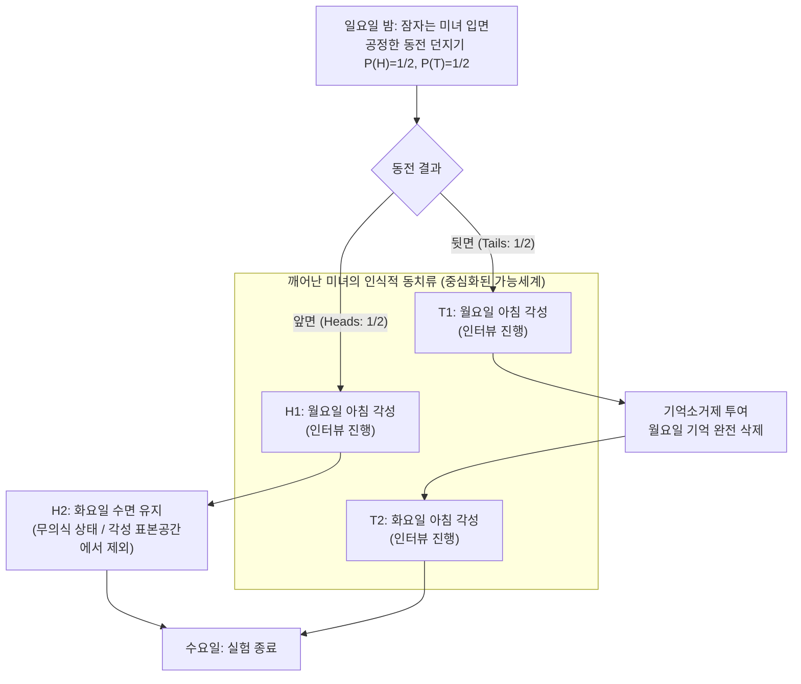
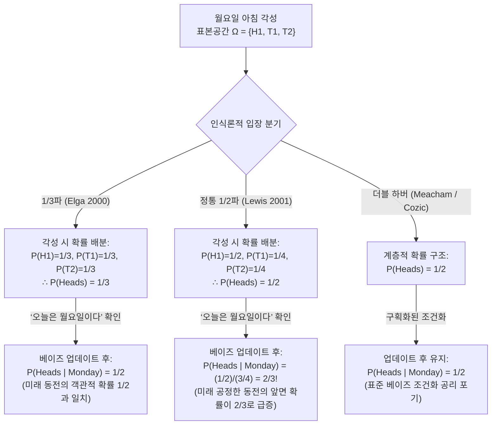

## 1. 서론: 깨어나는 순간 발생하는 인식론적 균열

일요일 밤, 완벽한 논리적 일관성과 베이즈 추론 능력을 갖춘 이상적 인식 주체인 <strong>잠자는 미녀(Sleeping Beauty)</strong>가 한 사고실험의 피험자로 잠이 든다. 그녀는 잠들기 전에 연구진으로부터 실험 프로토콜의 모든 세부 사항을 완벽하게 설명 들었으며, 그 규칙이 한 치의 오차도 없이 실행될 것임을 $100\%$ 확신하고 있다.

1990년 철학자 <strong>아놀드 주보프(Arnold Zuboff)</strong>가 *"One Self: The Logic of Experience"*에서 처음 고안하고, 로버트 스탈네이커(Robert Stalnaker)가 이름을 붙였으며, 2000년 <strong>아담 엘가(Adam Elga)</strong>가 *Analysis*에 발표한 기념비적 논문 *"Self-locating belief and the Sleeping Beauty problem"*을 통해 분석철학과 확률론의 최대 난제로 부상한 이 실험의 규칙은 다음과 같다.

### 1.1 실험 프로토콜의 엄밀한 정의

1. <strong>일요일 밤 (사전 단계)</strong>: 잠자는 미녀가 수면제를 먹고 잠든다. 연구진은 공정한 동전을 던진다 (앞면이 나올 객관적 확률 $P(\text{Heads}) = 1/2$, 뒷면이 나올 객관적 확률 $P(\text{Tails}) = 1/2$).
2. <strong>동전이 '앞면(Heads: $H$)'인 경우</strong>:
   - 연구진은 <strong>월요일 아침</strong>에 미녀를 깨워 짧은 인터뷰를 진행한다.
   - 그 후 다시 잠재우고 화요일에는 깨우지 않은 채 수요일에 실험을 종료한다 (<strong>총 1회 각성</strong>).
3. <strong>동전이 '뒷면(Tails: $T$)'인 경우</strong>:
   - 연구진은 <strong>월요일 아침</strong>에 미녀를 깨워 짧은 인터뷰를 진행한다.
   - 인터뷰 직후, <strong>월요일에 깨어났던 기억을 완전히 지우는 특수 기억소거제(Amnesia-inducing drug)</strong>를 투여하고 다시 잠재운다.
   - <strong>화요일 아침</strong>, 연구진은 월요일과 완전히 동일한 방과 조명 조건에서 그녀를 두 번째로 깨워 인터뷰를 진행한다 (<strong>총 2회 각성</strong>).
4. <strong>주관적 식별 불가능성 (Subjective Indistinguishability)</strong>:
   - 시계나 달력 등 오늘이 무슨 요일인지 알 수 있는 단서는 전혀 없다. 기억소거제 때문에 월요일 아침의 각성과 화요일 아침의 각성은 미녀의 1인칭 현상학적 경험에서 <strong>완전히 식별 불가능</strong>하다.

이제 월요일 아침이 되어 미녀가 깨어났다. 연구진이 방에 들어와 그녀에게 묻는다.

> <strong>"지금 깨어 있는 당신에게, 동전이 '앞면(Heads)'이었을 주관적 확률(신념도 / Credence) $P(\text{Heads})$는 얼마여야 하는가?"</strong>

이 단순한 질문 앞에서 현대 인식론과 확률론은 두 진영으로 양분되었다.

- <strong>1/2파 (Halvers: 데이비드 루이스 David Lewis 등)</strong>: 일요일 밤 잠들기 전부터 미녀는 동전이 앞면이든 뒷면이든 자신이 적어도 한 번은 깨어날 것임을 $100\%$ 알고 있었다. 따라서 깨어났다는 사실은 객관적 세계에 대해 <strong>아무런 새로운 정보도 제공하지 않는다</strong>. 새로운 객관적 증거가 없으므로 사전 확률을 그대로 유지해야 한다: <strong>$P(\text{Heads}) = 1/2$</strong>.
- <strong>1/3파 (Thirders: 아담 엘가 Adam Elga, 크리스토퍼 히치콕 Christopher Hitchcock 등)</strong>: 미녀가 깨어났을 때 자신이 처할 수 있는 시공간적 위치는 $(\text{앞면}, \text{월요일})$, $(\text{뒷면}, \text{월요일})$, $(\text{뒷면}, \text{화요일})$의 3가지이다. 뒷면일 때 깨어나는 횟수가 앞면일 때의 두 배이므로, 깨어났다는 사실 자체는 뒷면 세계에 있을 가능성을 높인다. 실험을 1,000번 반복하면 약 500번의 앞면 각성과 약 1,000번의 뒷면 각성(월 500 + 화 500)이 발생하여 전체 1,500번의 각성 중 앞면은 정확히 $1/3$이다. 따라서 <strong>$P(\text{Heads}) = 1/3$</strong>이어야 한다.

---

## 2. 믿음의 존재론: 비중심화 가능세계(De Dicto)와 중심화 가능세계(De Se)

고전적 콜모고로프 확률론에서 사건은 <strong>비중심화 가능세계(Uncentered Possible Worlds)</strong> $w \in W$의 부분집합으로 정의된다. 이는 시공간 바깥의 '어디도 아닌 시점(View from Nowhere)'에서 서술된 객관적 명제(<strong>사물적 믿음 / *De Dicto* belief</strong>)이다.

그러나 <strong>존 페리(John Perry, 1979)</strong>와 <strong>데이비드 루이스(David Lewis, 1979)</strong>가 증명했듯, 우주의 모든 객관적 사실을 다 아는 전지적 존재라 할지라도 <strong>"내가 누구인지"</strong>, <strong>"지금이 몇 시인지"</strong>라는 1인칭 지표적 정보(<strong>자기위치지정 믿음 / Self-locating *De Se* belief</strong>)는 객관적 명제로 환원될 수 없다.

루이스는 이를 형식화하기 위해 객관적 세계 $w$, 주체 $i$, 시간 단면 $t$의 순서쌍인 <strong>중심화된 가능세계(Centered Possible Worlds)</strong> $\langle w, i, t \rangle \in \mathcal{W}_c$를 도입했다. 잠자는 미녀 실험에서 깨어난 미녀는 무의식 상태인 $H_2 = (\text{앞면}, \text{화요일})$를 즉시 배제하므로, 그녀의 인식적 표본공간은 정확히 3개의 중심화된 가능세계로 구성된다:

$$\Omega_{\text{wake}} = \{ H_1, \, T_1, \, T_2 \}$$

---

## 3. '1/3파(Thirder)'의 엄밀한 수학적 증명: 아담 엘가 (2000)

아담 엘가(2000)는 빈도주의적 반복에 의존하지 않고, 단 한 번의 실험에서 조건부 확률의 정합성만으로 $P(\text{Heads}) = 1/3$을 증명했다.

### 3.1 1단계: 동일 세계 내 중심들에 대한 제한적 무차별 원리 ($P(T_1) = P(T_2)$)

깨어난 미녀가 동전이 <strong>뒷면</strong>이었다는 조건($T = T_1 \cup T_2$)을 가정해 보자. 동일한 객관적 세계 $w_T$ 안에서 월요일 각성 $T_1$과 화요일 각성 $T_2$는 <strong>둘 다 실제로 발생</strong>하며, 기억소거제로 인해 두 중심에서의 주관적 증거와 현상학적 경험은 완전히 동일하다. 따라서 <strong>제한적 무차별 원리(Restricted Principle of Indifference)</strong>에 의해 두 중심의 조건부 확률은 같아야 한다(이 1단계는 루이스를 포함한 1/2파도 전적으로 수용한다):

$$P(T_1 \mid T_1 \cup T_2) = P(T_2 \mid T_1 \cup T_2) = \frac{1}{2} \implies \frac{P(T_1)}{P(T_1) + P(T_2)} = \frac{P(T_2)}{P(T_1) + P(T_2)} \implies P(T_1) = P(T_2) \quad \cdots (1)$$

### 3.2 2단계: "오늘은 월요일이다"라는 조건화와 동전 던지기의 시간 이동 불변성 ($P(H_1) = P(T_1)$)

이제 깨어난 미녀에게 연구진이 <strong>"오늘은 월요일입니다"</strong>($M = H_1 \cup T_1$)라고 알려주었다고 하자. 이때 앞면일 조건부 확률 $P(H_1 \mid H_1 \cup T_1)$은 얼마인가?

엘가는 실험 프로토콜의 인과적 구조에 주목한다. 동전이 앞면이든 뒷면이든 월요일 아침의 각성은 확률 $1$로 동일하게 일어난다. 동전 결과는 오직 <strong>월요일 밤에 기억소거제를 투여할지</strong>와 <strong>화요일 아침에 다시 깨울지</strong>만 결정한다. 따라서 <strong>동전을 일요일 밤에 던지지 않고 '월요일 밤(월요일 인터뷰가 끝난 뒤)'에 던지도록 프로토콜을 바꾸어도 실험의 확률적·인과적 구조는 완전히 동일하다!</strong>

만약 동전이 월요일 밤에 던져진다면, 월요일 아침에 깨어나 "지금은 월요일 아침이다"라는 사실을 알게 된 시점에서 공정한 동전은 아직 던져지지도 않은 미래의 사건이다. 루이스의 <strong>주요 원리(Principal Principle)</strong>에 의해, 오늘 밤 던져질 공정한 동전이 앞면이 될 확률은 반드시 객관적 확률인 $1/2$이어야 한다:

$$P(\text{Heads} \mid \text{Monday}) = P(H_1 \mid H_1 \cup T_1) = \frac{1}{2} \implies \frac{P(H_1)}{P(H_1) + P(T_1)} = \frac{1}{2} \implies P(H_1) = P(T_1) \quad \cdots (2)$$

### 3.3 3단계: 연립방정식의 결합과 결론 $P(\text{Heads}) = 1/3$

식 (1) $P(T_1) = P(T_2)$과 식 (2) $P(H_1) = P(T_1)$, 그리고 정규화 조건 $P(H_1) + P(T_1) + P(T_2) = 1$을 결합하면:

$$P(H_1) = P(T_1) = P(T_2) = \frac{1}{3} \implies P(\text{Heads}) = P(H_1) = \frac{1}{3}, \quad P(\text{Tails}) = P(T_1) + P(T_2) = \frac{2}{3} \qquad \blacksquare$$

---

## 4. '1/2파(Halver)'의 반격: 데이비드 루이스(2001)와 반영 원리

2001년 <strong>데이비드 루이스(David Lewis)</strong>는 *"Sleeping Beauty: reply to Elga"*를 통해 $P(\text{Heads}) = 1/2$을 옹호했다.

### 4.1 새로운 객관적 증거의 부재와 반 프라센의 반영 원리

루이스는 미녀가 일요일 밤에 이미 자신이 깨어날 것임을 $100\%$ 알고 있었으므로, 깨어나는 순간 어떠한 새로운 객관적(*de dicto*) 증거도 얻지 못했다고 지적한다. <strong>바스 반 프라센(Bas van Fraassen, 1984)의 반영 원리(Reflection Principle)</strong>에 따르면, 미래 시점 $t_1$에 새로운 증거 없이 신념도가 $x$가 될 것임을 현재 시점 $t_0$에 안다면 현재의 신념도도 $x$여야 한다. 일요일 밤 공정한 동전의 확률이 $1/2$이므로 깨어났을 때도 $1/2$이어야 한다. 따라서 루이스는 뒷면의 확률 $1/2$을 $T_1, T_2$에 절반씩 나누어 다음과 같이 배분한다:

$$P_{\text{Lewis}}(H_1) = \frac{1}{2}, \qquad P_{\text{Lewis}}(T_1) = \frac{1}{4}, \qquad P_{\text{Lewis}}(T_2) = \frac{1}{4}$$

### 4.2 루이스 체계의 충격적 귀결: "오늘은 월요일이다"라고 듣는 순간 확률이 $2/3$로 뛴다!

루이스의 배분에서 연구진이 <strong>"오늘은 월요일이다"</strong>($M = H_1 \cup T_1$)라고 알려주면, 베이즈 정리에 의해 앞면일 확률은 다음과 같이 업데이트된다:

$$P_{\text{Lewis}}(\text{Heads} \mid \text{Monday}) = \frac{P_{\text{Lewis}}(H_1)}{P_{\text{Lewis}}(H_1) + P_{\text{Lewis}}(T_1)} = \frac{1/2}{1/2 + 1/4} = \frac{2}{3} \> !$$

즉, 동전이 월요일 밤에 던져진다 하더라도, 루이스의 미녀는 월요일 아침에 "오늘은 월요일이다"라는 말을 듣는 순간 <strong>오늘 밤 던져질 공정한 동전이 앞면이 될 확률이 $2/3$라고 믿어야 한다!</strong> 루이스는 앞면 세계에서는 각성의 $100\%$가 월요일에 일어나고 뒷면 세계에서는 $50\%$만 월요일에 일어나므로 우도비(Likelihood ratio) $2:1$에 의해 $2/3$가 되는 것이 정당하다고 주장했다. 반면 깨어났을 때도 $1/2$, 월요일임을 알았을 때도 $1/2$을 유지하려는 <strong>더블 하버(Double-Halvers: Cozic 2011, Meacham 2008)</strong> 진영은 표준적 베이즈 조건화를 포기해야만 한다.

---

## 5. 통시적 더치북(Diachronic Dutch Book) 논증과 의사결정 이론

2004년 <strong>크리스토퍼 히치콕(Christopher Hitchcock)</strong>은 1/2파 미녀가 도박사(Bookie)의 2단계 내기에 의해 반드시 파산한다는 <strong>통시적 더치북(Diachronic Dutch Book)</strong>을 증명했다.

1. <strong>1단계 (일요일 밤, $P_{\text{Sun}}(H) = 1/2$)</strong>: 도박사가 미녀에게 뒷면에 거는 공정한 내기를 제안한다 (앞면이면 $-30$달러, 뒷면이면 $+30$달러).
2. <strong>2단계 (깨어날 때마다, $P_{\text{Wake}}(H) = 1/2$)</strong>: 깨어날 때마다 도박사가 앞면에 거는 1:1 내기를 제안한다 (앞면이면 $+20$달러, 뒷면이면 $-20$달러). 1/2파 미녀는 이를 공정하다고 판단해 매번 수락한다. <strong>기억소거제 때문에 뒷면일 때 미녀는 월요일과 화요일 두 번 모두 내기를 수락한다!</strong>

수요일 실험 종료 후 정산 결과:
- <strong>앞면인 경우 (1회 각성)</strong>: 일요일 내기 $-30$달러 $+$ 월요일 내기 $+20$달러 $= \mathbf{-10\text{달러 (확정 손실!)}}$
- <strong>뒷면인 경우 (2회 각성)</strong>: 일요일 내기 $+30$달러 $+$ 월요일 내기 $-20$달러 $+$ 화요일 내기 $-20$달러 $= \mathbf{-10\text{달러 (확정 손실!)}}$

동전이 어떻게 나오든 1/2파 미녀는 $100\%$ 확률로 10달러를 잃는다! 더치북을 피하는 유일한 각성 신념도는 $S(1-p) = 2Sp \implies \mathbf{p = 1/3}$뿐이다. 이에 대해 1/2파(Bradley & Leitgeb 2006)는 <strong>증거적 의사결정 이론(EDT)</strong>을 통해, 내기 수락 행위가 화요일의 복사본과 상관되어 있으므로 신념도($1/2$)와 내기 배당률($1/3$)이 분리된다고 반박한다.

---

## 6. 닉 보스트롬의 '극단적 잠자는 미녀'와 우주론의 인류 원리 (SSA vs. SIA)

옥스퍼드 철학자 <strong>닉 보스트롬(Nick Bostrom, 2002, 2007)</strong>은 잠자는 미녀 문제가 현대 우주론의 <strong>관측 선택 효과(Observation Selection Effects)</strong>와 <strong>인류 원리(Anthropic Principle)</strong>의 핵심 방정식임을 밝혔다.

뒷면일 때 <strong>100만 번($N = 1,000,000$)</strong> 깨우는 <strong>극단적 잠자는 미녀(Extreme Sleeping Beauty)</strong>에서, 깨어난 직후 1/3파(일반화된 $1/(N+1)$파)는 동전이 뒷면일 확률을 $\frac{1,000,000}{1,000,001} \approx 99.9999\%$로 확신하는 반면, 1/2파는 여전히 $50\%$라고 주장한다. 이는 우주론의 두 공리와 정확히 대응한다:

1. <strong>자기표본추출 가정 (Self-Sampling Assumption: SSA — 1/2파 대응)</strong>: 자신을 참조 클래스 내 관측자들의 무작위 표본으로 간주한다. 그러나 SSA는 자신의 출생 순위(약 600억 번째 인류, 즉 '월요일')로부터 인류가 곧 멸망할 확률이 1,000배 높아진다는 <strong>운명의 날 논증(Doomsday Argument)</strong>을 초래한다.
2. <strong>자기지시 가정 (Self-Indication Assumption: SIA — 1/3파 대응)</strong>: 내가 존재한다는 사실 자체가 관측자 수 $N(H_i)$에 비례하여 가설의 확률을 높인다($P(H_i \mid E) \propto P(H_i) N(H_i)$). SIA는 운명의 날 논증을 완벽히 상쇄하지만, 아무런 물리 실험 없이 안락의자에 앉아 관측자 수가 가장 많은 우주론이 $99.9999\%$ 참이라고 단정하는 <strong>주제넘은 철학자 역설(Presumptuous Philosopher Paradox)</strong>을 낳는다. 또한 이 구조는 <strong>다세계 양자역학(Many-Worlds Interpretation)</strong>과 <strong>시뮬레이션 가설(Simulation Argument)</strong>의 기초를 이룬다.

---

## 7. 3대 입장과 인류 원리 종합 비교표

| 비교 기준 | 1/3파 (Thirders: Elga 2000) | 1/2파 (Halvers: Lewis 2001) | 더블 하버 (Double-Halvers) |
| :--- | :--- | :--- | :--- |
| <strong>각성 직후 중심화 확률 배분</strong> | $P(H_1)=\frac{1}{3}, P(T_1)=\frac{1}{3}, P(T_2)=\frac{1}{3}$ | $P(H_1)=\frac{1}{2}, P(T_1)=\frac{1}{4}, P(T_2)=\frac{1}{4}$ | 세계 확률 $1/2$과 중심 확률 분리 |
| <strong>각성 직후 앞면 확률 $P(\text{Heads})$</strong> | <strong>$\mathbf{1/3}$</strong> | <strong>$\mathbf{1/2}$</strong> | <strong>$\mathbf{1/2}$</strong> |
| <strong>'오늘은 월요일' 확인 후 $P(\text{Heads}\mid\text{Mon})$</strong> | <strong>$\mathbf{1/2}$</strong> (공정한 동전의 객관적 확률과 일치) | <strong>$\mathbf{2/3}$</strong> (미래 공정한 동전의 앞면 확률이 2/3로 점프) | <strong>$\mathbf{1/2}$</strong> (표준 베이즈 조건화 포기) |
| <strong>극단적 잠자는 미녀 ($N=10^6$회 각성)</strong> | $P(\text{Heads}) = \frac{1}{1,000,001} \approx 0.0001\%$ | $P(\text{Heads}) = 1/2 = 50\%$ | $P(\text{Heads}) = 1/2 = 50\%$ |
| <strong>반 프라센의 반영 원리</strong> | 기각 (기억 소거로 인한 인식적 단절) | <strong>엄격히 준수</strong> | <strong>엄격히 준수</strong> |
| <strong>히치콕의 통시적 더치북 (2004)</strong> | <strong>완벽히 면역</strong> | <strong>CDT 하에서 필패</strong> (EDT로 방어 필요) | 배당률 분리 없이는 취약 |
| <strong>대응하는 우주론적 인류 원리와 역설</strong> | <strong>자기지시 가정 (SIA)</strong> 운명의 날 논증 해소 / <strong>주제넘은 철학자 역설</strong> 발생 | <strong>자기표본추출 가정 (SSA)</strong> 주제넘은 철학자 회피 / <strong>운명의 날 논증</strong> 발생 | 구획화된 SSA |

---

## 참고문헌 (References)

- Zuboff, A. (1990). "One Self: The Logic of Experience." *Inquiry*, 33(1), 39–68.
- Elga, A. (2000). "Self-locating belief and the Sleeping Beauty problem." *Analysis*, 60(2), 143–147.
- Lewis, D. (2001). "Sleeping Beauty: reply to Elga." *Analysis*, 61(3), 171–176.
- Hitchcock, C. (2004). "Beauty and the bets." *Synthese*, 139(3), 405–420.
- Bostrom, N. (2002). *Anthropic Bias: Observation Selection Effects in Science and Philosophy*. Routledge.
- Bostrom, N. (2007). "Sleeping Beauty and Colditz." *Synthese*, 157(1), 59–78.
