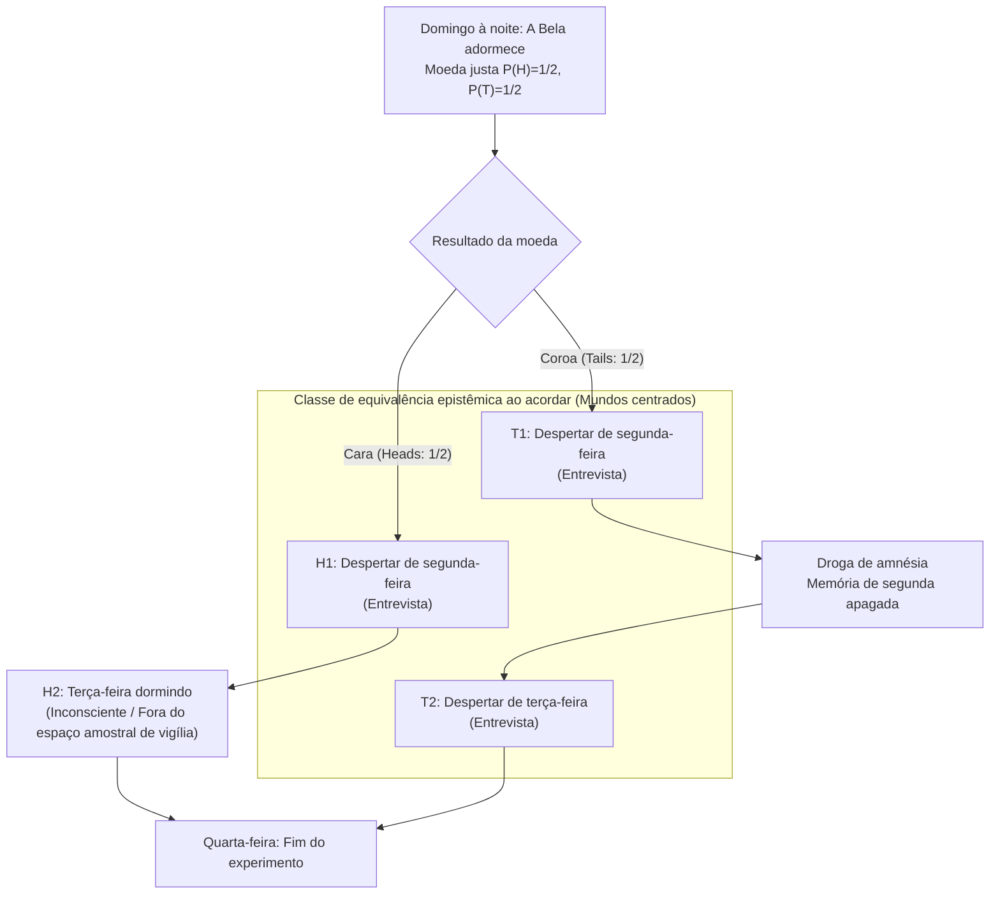
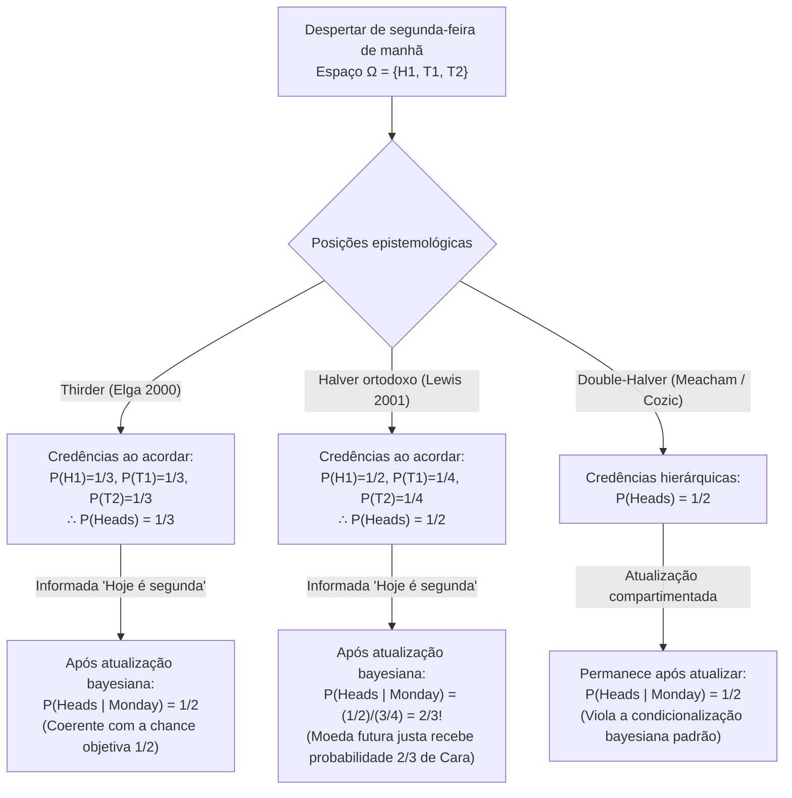

## 1. Introdução: A fratura epistemológica no instante do despertar

No domingo à noite, <strong>a Bela Adormecida (Sleeping Beauty)</strong> — uma agente bayesiana idealmente racional dotada de perfeita coerência lógica — é colocada para dormir como sujeito de um experimento mental. Antes de adormecer, os pesquisadores explicam cada detalhe do protocolo experimental, cujas regras ela conhece com absoluta certeza.

Idealizado originalmente pelo filósofo <strong>Arnold Zuboff (1990)</strong> em *"One Self: The Logic of Experience"*, batizado por Robert Stalnaker e alçado ao centro da epistemologia formal pelo artigo seminal de <strong>Adam Elga (2000)</strong> na revista *Analysis* (*"Self-locating belief and the Sleeping Beauty problem"*), o protocolo segue regras rigorosas:

### 1.1 Especificação exata do protocolo experimental

1. <strong>Domingo à noite (Etapa prévia)</strong>: A Bela é colocada para dormir. Os pesquisadores lançam uma moeda perfeitamente honesta com probabilidade objetiva $P(\text{Cara / Heads}) = 1/2$ e $P(\text{Coroa / Tails}) = 1/2$.
2. <strong>Se a moeda cair em «Cara» ($H$)</strong>:
   - Os pesquisadores acordam a Bela na <strong>segunda-feira de manhã</strong> e realizam uma breve entrevista.
   - Em seguida, colocam-na novamente para dormir; ela permanece totalmente inconsciente durante toda a terça-feira e só acorda na quarta-feira, quando o experimento termina (<strong>1 despertar no total</strong>).
3. <strong>Se a moeda cair em «Coroa» ($T$)</strong>:
   - Os pesquisadores acordam a Bela na <strong>segunda-feira de manhã</strong> e a entrevistam.
   - Imediatamente depois, administram uma <strong>droga indutora de amnésia</strong> perfeita que apaga completamente qualquer memória do despertar de segunda-feira, colocando-a para dormir.
   - Na <strong>terça-feira de manhã</strong>, acordam-na pela segunda vez sob condições ambientais e internas exatamente idênticas (<strong>2 despertares no total</strong>).
4. <strong>Indistinguibilidade subjetiva</strong>:
   - Não há relógios, calendários ou pistas externas. Devido à droga amnésica, o despertar de segunda-feira e o despertar de terça-feira são <strong>subjetiva e fenomenologicamente indistinguíveis</strong>.

Quando a Bela acorda na segunda-feira de manhã, o pesquisador faz-lhe uma única pergunta:

> <strong>«Qual deve ser agora a sua credência (grau subjetivo de crença) $P(\text{Heads})$ de que a moeda tenha caído em Cara?»</strong>

Imediatamente, a intuição racional divide-se em dois campos irreconciliáveis:

- <strong>O campo «Halver» ($P(\text{Heads}) = 1/2$ — David Lewis, Bas van Fraassen, Darren Bradley)</strong>:
  «No domingo à noite, a Bela já sabia com $100\%$ de certeza que acordaria pelo menos uma vez exatamente neste estado fenomenológico. Acordar na segunda-feira não fornece <strong>nenhuma nova evidência objetiva</strong> sobre o lançamento da moeda. Sem evidência inesperada, um agente bayesiano racional deve manter sua probabilidade prévia de domingo: <strong>$P(\text{Heads}) = 1/2$</strong>.»
- <strong>O campo «Thirder» ($P(\text{Heads}) = 1/3$ — Adam Elga, Christopher Hitchcock, Cian Dorr)</strong>:
  «Ao acordar, existem três situações espaço-temporais mutuamente exclusivas e indistinguíveis nas quais ela pode estar: $(\text{Cara}, \text{Segunda})$, $(\text{Coroa}, \text{Segunda})$ e $(\text{Coroa}, \text{Terça})$. Como Coroa gera o dobro de despertares que Cara, encontrar-se acordada é duas vezes mais provável em uma rodada de Coroa. Em $1.000$ repetições do experimento, ocorrem cerca de $500$ despertares em Cara e $1.000$ despertares em Coroa ($500$ na segunda $+$ $500$ na terça), de modo que exatamente $500 / 1.500 = 1/3$ dos despertares correspondem a Cara. Portanto, <strong>$P(\text{Heads}) = 1/3$</strong>.»

---

## 2. Ontologia das crenças: Mundos possíveis não centrados (*De Dicto*) vs. centrados (*De Se*)

A probabilidade clássica de Kolmogorov opera sobre <strong>mundos possíveis não centrados</strong> $w \in W$ — descrições objetivas do universo a partir de uma «visão de lugar nenhum» (*de dicto*). Contudo, como demonstraram <strong>John Perry (1979)</strong> (*«The Problem of the Essential Indexical»*) e <strong>David Lewis (1979)</strong> (*«Attitudes De Dicto and De Se»*), nenhum conjunto de fatos objetivos em terceira pessoa pode esgotar as <strong>crenças autolocalizadoras (*de se* / indexicais)</strong> («Quem sou eu?», «Que dia é *hoje*?»).

Lewis formalizou essas atitudes mediante <strong>mundos possíveis centrados (Centered Possible Worlds)</strong> $\langle w, i, t \rangle \in \mathcal{W}_c$, compostos por um mundo objetivo $w$, um agente $i$ e um estágio temporal $t$. Ao acordar, a Bela descarta com certeza cartesiana o estado inconsciente $H_2 = (\text{Cara}, \text{Terça})$, reduzindo seu espaço amostral epistêmico a três mundos centrados:

$$\Omega_{\text{wake}} = \{ H_1, \, T_1, \, T_2 \}$$

---

## 3. A demonstração matemática dos «Thirders» ($P(\text{Heads}) = 1/3$): Adam Elga (2000)

Adam Elga (2000) provou que $P(\text{Heads}) = 1/3$ em uma única execução do experimento através de três passos:

### 3.1 Passo 1: Princípio de indiferença restrito entre $T_1$ e $T_2$ ($P(T_1) = P(T_2)$)

Condicionando sobre a hipótese de que a moeda caiu em <strong>Coroa</strong> ($T = T_1 \cup T_2$), tanto o despertar de segunda-feira $T_1$ quanto o de terça-feira $T_2$ ocorrem realmente dentro do *mesmo* mundo objetivo $w_T$, com experiências subjetivas e evidências idênticas. Pelo <strong>princípio de indiferença restrito</strong>, ambos os centros devem receber igual credência condicional:

$$P(T_1 \mid T_1 \cup T_2) = P(T_2 \mid T_1 \cup T_2) = \frac{1}{2} \implies \frac{P(T_1)}{P(T_1) + P(T_2)} = \frac{P(T_2)}{P(T_1) + P(T_2)} \implies P(T_1) = P(T_2) \quad \cdots (1)$$

### 3.2 Passo 2: Condicionalização sobre «Hoje é segunda-feira» e invariância temporal ($P(H_1) = P(T_1)$)

Suponhamos que após acordar, o experimentador diga à Bela: <strong>«Hoje é segunda-feira»</strong> ($M = H_1 \cup T_1$). Dado que o despertar de segunda-feira ocorre com probabilidade $1$ independentemente da moeda, <strong>o protocolo é totalmente invariante se a moeda justa for lançada na segunda-feira à noite (após a entrevista de segunda-feira)!</strong>

Se a moeda for lançada na segunda-feira à noite, quando a Bela sabe na segunda-feira de manhã que «hoje é segunda-feira», o lançamento é um evento futuro com chance física objetiva $1/2$. Pelo <strong>Princípio Principal (Principal Principle)</strong> de Lewis, sua credência condicional em Cara dado que hoje é segunda-feira deve ser $1/2$:

$$P(\text{Heads} \mid \text{Monday}) = P(H_1 \mid H_1 \cup T_1) = \frac{1}{2} \implies \frac{P(H_1)}{P(H_1) + P(T_1)} = \frac{1}{2} \implies P(H_1) = P(T_1) \quad \cdots (2)$$

### 3.3 Passo 3: Síntese algébrica ($P(\text{Heads}) = 1/3$)

Combinando (1) $P(T_1) = P(T_2)$, (2) $P(H_1) = P(T_1)$ e a normalização $P(H_1) + P(T_1) + P(T_2) = 1$:

$$P(H_1) = P(T_1) = P(T_2) = \frac{1}{3} \implies P(\text{Heads}) = P(H_1) = \frac{1}{3}, \quad P(\text{Tails}) = P(T_1) + P(T_2) = \frac{2}{3} \qquad \blacksquare$$

---

## 4. O contra-ataque dos «Halvers» ($P(\text{Heads}) = 1/2$): David Lewis (2001) e o princípio de reflexão

Em sua resposta *"Sleeping Beauty: reply to Elga"* (2001), <strong>David Lewis</strong> defendeu $P(\text{Heads}) = 1/2$.

### 4.1 Ausência de nova evidência objetiva e o princípio de reflexão de van Fraassen

Pelo <strong>princípio de reflexão (Reflection Principle)</strong> de <strong>Bas van Fraassen (1984)</strong>, não havendo nenhuma evidência objetiva (*de dicto*) inesperada ao acordar, a credência deve permanecer em $1/2$. Lewis aceita $P(T_1) = P(T_2)$, mas divide a massa de probabilidade $1/2$ de Coroa entre segunda e terça:

$$P_{\text{Lewis}}(H_1) = \frac{1}{2}, \qquad P_{\text{Lewis}}(T_1) = \frac{1}{4}, \qquad P_{\text{Lewis}}(T_2) = \frac{1}{4}$$

### 4.2 A consequência chocante em Lewis: O salto para $2/3$ ao saber que «Hoje é segunda-feira»!

No sistema de Lewis, quando o pesquisador diz à Bela <strong>«Hoje é segunda-feira»</strong> ($M = H_1 \cup T_1$), a regra de Bayes produz:

$$P_{\text{Lewis}}(\text{Heads} \mid \text{Monday}) = \frac{P_{\text{Lewis}}(H_1)}{P_{\text{Lewis}}(H_1) + P_{\text{Lewis}}(T_1)} = \frac{1/2}{1/2 + 1/4} = \frac{2}{3} \> !$$

Mesmo que a moeda justa só seja lançada na segunda-feira à noite, a Bela de Lewis deve acreditar na segunda-feira de manhã que a moeda cairá em Cara com probabilidade <strong>$2/3$</strong>! Para evitar tanto o $1/3$ de Elga quanto o $2/3$ de Lewis, os <strong>Double-Halvers (Cozic 2011, Meacham 2008)</strong> abandonam a condicionalização bayesiana padrão em favor de uma atualização compartimentada.

---

## 5. O argumento do livro holandês diacrônico (Hitchcock 2004) e a teoria da decisão

<strong>Christopher Hitchcock (2004)</strong> provou que um Halver é vítima de um <strong>livro holandês diacrônico (Diachronic Dutch Book)</strong> que garante perda financeira certa:

1. <strong>Etapa 1 (Domingo à noite, $P_{\text{Sun}}(H) = 1/2$)</strong>: O apostador oferece uma aposta a favor de Coroa: $-\$30$ se der Cara ($H$), $+\$30$ se der Coroa ($T$).
2. <strong>Etapa 2 (Em cada despertar, $P_{\text{Wake}}(H) = 1/2$)</strong>: Em *cada* despertar, o apostador oferece uma aposta 1 para 1 a favor de Cara: $+\$20$ se der Cara ($H$), $-\$20$ se der Coroa ($T$). Devido à amnésia, se der Coroa a aposta é assinada <strong>duas vezes</strong> (segunda e terça), enquanto se der Cara é assinada <strong>apenas uma vez</strong>.

Saldo líquido na quarta-feira:
- <strong>Se der Cara (1 despertar)</strong>: $-\$30 + \$20 = \mathbf{-\$10\text{ (Perda garantida!)}}$
- <strong>Se der Coroa (2 despertares)</strong>: $+\$30 - \$20 - \$20 = \mathbf{-\$10\text{ (Perda garantida!)}}$

Apenas a credência $S(1-p) = 2Sp \implies \mathbf{p = 1/3}$ é imune ao livro holandês. Os Halvers (Bradley & Leitgeb 2006) defendem-se através da <strong>Teoria da Decisão Evidencial (EDT)</strong>, argumentando que a correlação entre as decisões de segunda e terça separa a cotação de aposta ($1/3$) da credência epistêmica ($1/2$).

---

## 6. A «Bela Adormecida Extrema» de Nick Bostrom e a cosmologia antrópica (SSA vs. SIA)

<strong>Nick Bostrom (2002, 2007)</strong> demonstrou que este problema modela os <strong>efeitos de seleção observacional</strong> na cosmologia. Na <strong>Bela Adormecida Extrema</strong>, onde Coroa provoca <strong>1 milhão de despertares ($N = 1.000.000$)</strong>, o Thirder conclui ao acordar que $P(\text{Tails}) = \frac{1.000.000}{1.000.001} \approx 99,9999\%$, enquanto o Halver mantém $50\%$. Isso corresponde aos dois axiomas do raciocínio antrópico:

1. <strong>Suposição de Autoamostragem (Self-Sampling Assumption: SSA — Princípio Halver)</strong>: Raciocinar como se fosse uma amostra aleatória de todos os observadores em sua classe de referência. Porém, a SSA implica diretamente o <strong>Argumento do Juízo Final (Doomsday Argument)</strong>: descobrir que você nasceu como o humano número 60 bilhões (análogo a «Hoje é segunda-feira») multiplica por $1.000$ a probabilidade de extinção iminente da humanidade.
2. <strong>Suposição de Autoindicação (Self-Indication Assumption: SIA — Princípio Thirder)</strong>: O mero fato de existir favorece hipóteses proporcionalmente ao número de observadores $N(H_i)$ ($P(H_i \mid E) \propto P(H_i) N(H_i)$). A SIA anula o Argumento do Juízo Final, mas gera o <strong>Paradoxo do Filósofo Presunçoso (Presumptuous Philosopher Paradox)</strong>, segundo o qual seria possível refutar qualquer teoria cosmológica finita sentado numa poltrona sem fazer experimentos. Essa mesma estrutura rege a <strong>interpretação de muitos mundos de Everett na mecânica quântica</strong> e o <strong>Argumento da Simulação (Bostrom 2003)</strong>.

---

## 7. Matriz comparativa das três posições

| Critério | Thirder (Elga 2000) | Halver ortodoxo (Lewis 2001) | Double-Halver (Cozic / Meacham) |
| :--- | :--- | :--- | :--- |
| <strong>Credências centradas ao acordar</strong> | $P(H_1)=\frac{1}{3}, P(T_1)=\frac{1}{3}, P(T_2)=\frac{1}{3}$ | $P(H_1)=\frac{1}{2}, P(T_1)=\frac{1}{4}, P(T_2)=\frac{1}{4}$ | Dois níveis: mundos $1/2$, centros separados |
| <strong>$P(\text{Heads})$ ao acordar</strong> | <strong>$\mathbf{1/3}$</strong> | <strong>$\mathbf{1/2}$</strong> | <strong>$\mathbf{1/2}$</strong> |
| <strong>$P(\text{Heads}\mid\text{Segunda})$</strong> | <strong>$\mathbf{1/2}$</strong> (Coerente com chance objetiva) | <strong>$\mathbf{2/3}$</strong> (Moeda futura justa tem 2/3 de Cara!) | <strong>$\mathbf{1/2}$</strong> (Abandona a regra de Bayes padrão) |
| <strong>Caso extremo ($N=10^6$ despertares)</strong> | $P(\text{Heads}) = \frac{1}{1.000.001} \approx 0,0001\%$ | $P(\text{Heads}) = 1/2 = 50\%$ | $P(\text{Heads}) = 1/2 = 50\%$ |
| <strong>Princípio de reflexão (van Fraassen)</strong> | Violado (por amnésia) | <strong>Estritamente preservado</strong> | <strong>Estritamente preservado</strong> |
| <strong>Livro holandês diacrônico</strong> | <strong>Totalmente imune</strong> | <strong>Vulnerável sob CDT</strong> (imune sob EDT) | Vulnerável sem separar cotações de credências |
| <strong>Princípio antrópico e cosmologia</strong> | <strong>SIA</strong> (Refuta Doomsday, cria o <strong>Filósofo Presunçoso</strong>) | <strong>SSA</strong> (Evita o Filósofo Presunçoso, cria <strong>Doomsday</strong>) | SSA compartimentada |

---

## Referências

- Zuboff, A. (1990). "One Self: The Logic of Experience." *Inquiry*, 33(1), 39–68.
- Elga, A. (2000). "Self-locating belief and the Sleeping Beauty problem." *Analysis*, 60(2), 143–147.
- Lewis, D. (2001). "Sleeping Beauty: reply to Elga." *Analysis*, 61(3), 171–176.
- Hitchcock, C. (2004). "Beauty and the bets." *Synthese*, 139(3), 405–420.
- Bostrom, N. (2002). *Anthropic Bias: Observation Selection Effects in Science and Philosophy*. Routledge.
- Bostrom, N. (2007). "Sleeping Beauty and Colditz." *Synthese*, 157(1), 59–78.
