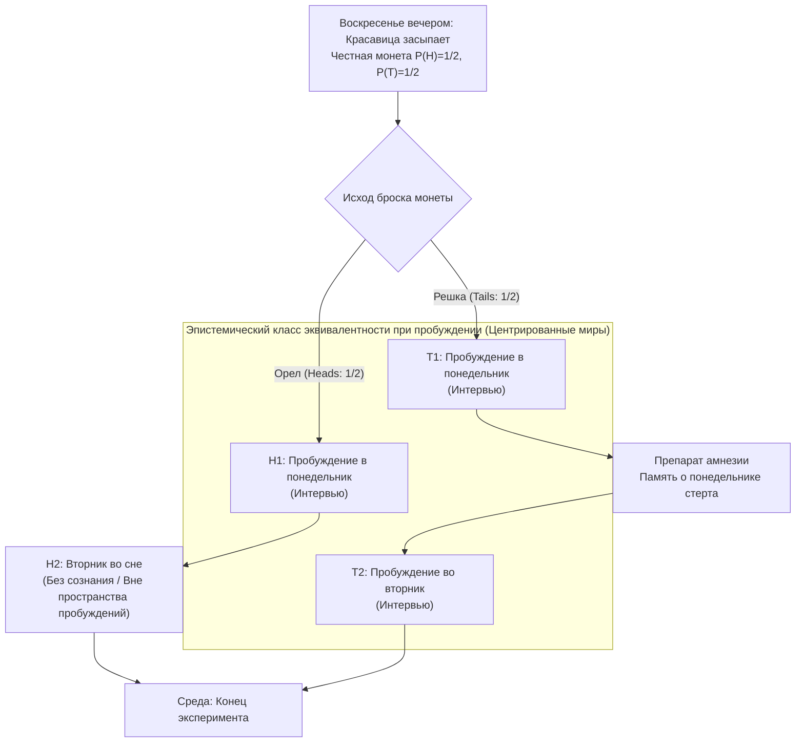
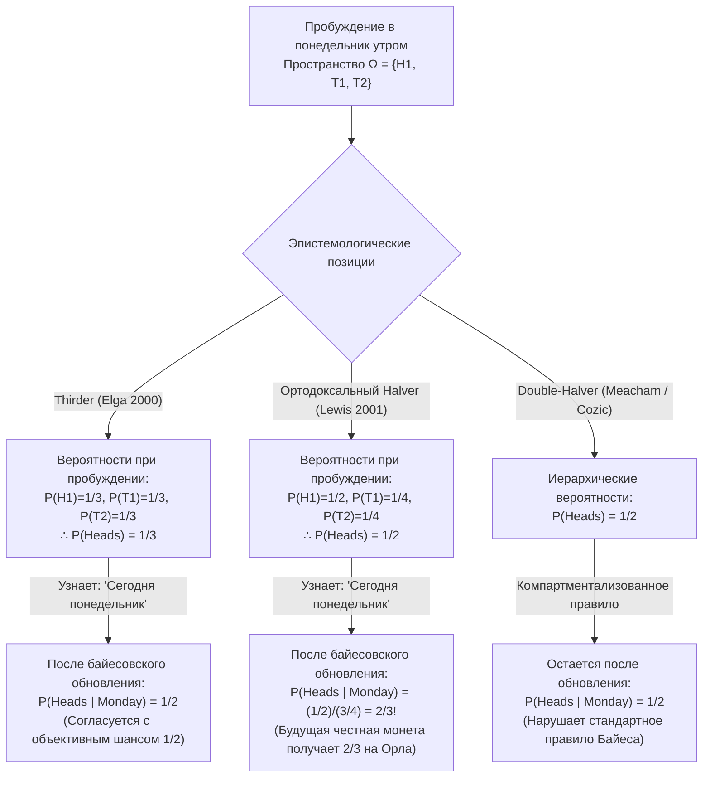

## 1. Введение: Эпистемологический разлом в момент пробуждения

В воскресенье вечером <strong>Спящая красавица (Sleeping Beauty)</strong> — идеально рациональный байесовский агент с безупречной логической непротиворечивостью — погружается в сон в рамках мысленного эксперимента. Перед сном исследователи подробно объясняют ей весь протокол эксперимента, в точном соблюдении которого она уверена на $100\%$.

Этот мысленный эксперимент, впервые предложенный философом <strong>Арнольдом Зубоффом (Arnold Zuboff, 1990)</strong> в статье *"One Self: The Logic of Experience"*, получивший свое имя от Роберта Сталнакера и ставший знаменитым благодаря классической работе <strong>Адама Элги (Adam Elga, 2000)</strong> в журнале *Analysis* (*"Self-locating belief and the Sleeping Beauty problem"*), подчиняется следующим правилам:

### 1.1 Точное описание экспериментального протокола

1. <strong>Воскресный вечер (априорный этап)</strong>: Красавицу усыпляют. Исследователи подбрасывают идеально симметричную монету с объективными шансами $P(\text{Орел / Heads}) = 1/2$ и $P(\text{Решка / Tails}) = 1/2$.
2. <strong>Если выпадает «Орел» ($H$)</strong>:
   - Исследователи будят Красавицу в <strong>понедельник утром</strong> и проводят короткое интервью.
   - Затем ее снова погружают в сон; весь вторник она спит без сознания и просыпается только в среду по окончании эксперимента (<strong>всего 1 пробуждение</strong>).
3. <strong>Если выпадает «Решка» ($T$)</strong>:
   - Исследователи будят Красавицу в <strong>понедельник утром</strong> и проводят интервью.
   - Сразу после этого ей вводят идеальный <strong>препарат, вызывающий амнезию</strong>, который полностью стирает все воспоминания о пробуждении в понедельник, и снова усыпляют.
   - Во <strong>вторник утром</strong> ее будят во второй раз в абсолютно идентичных условиях (<strong>всего 2 пробуждения</strong>).
4. <strong>Субъективная неразличимость</strong>:
   - В комнате нет ни часов, ни календарей. Из-за амнезии пробуждение в понедельник утром и пробуждение во вторник утром <strong>субъективно и феноменологически неразличимы</strong>.

Когда в понедельник утром Красавица просыпается, исследователь задает ей один вопрос:

> <strong>«Какова должна быть сейчас ваша субъективная вероятность (степень уверенности / credence) $P(\text{Heads})$ того, что монета упала Орлом?»</strong>

Рациональная интуиция мгновенно раскалывается на два непримиримых лагеря:

- <strong>Лагерь «Половинщиков» (Halvers, $P(\text{Heads}) = 1/2$ — Дэвид Льюис, Бас ван Фраассен)</strong>:
  «Еще в воскресенье вечером Красавица со $100\%$-ной уверенностью знала, что она проснется хотя бы один раз именно в таком феноменальном состоянии. Пробуждение не несет <strong>никакой новой объективной информации</strong> о мире. Без новых неожиданных свидетельств рациональный байесовский агент обязан сохранить свою воскресную априорную вероятность: <strong>$P(\text{Heads}) = 1/2$</strong>.»
- <strong>Лагерь «Третичников» (Thirders, $P(\text{Heads}) = 1/3$ — Адам Элга, Кристофер Хичкок)</strong>:
  «При пробуждении существуют три взаимоисключающих и неразличимых пространственно-временных положения: $(\text{Орел}, \text{Понедельник})$, $(\text{Решка}, \text{Понедельник})$ и $(\text{Решка}, \text{Вторник})$. Поскольку Решка порождает вдвое больше пробуждений, чем Орел, сам факт пробуждения свидетельствует в пользу Решки в отношении $2:1$. При $1\,000$ повторений эксперимента произойдет около $500$ пробуждений при Орле и $1\,000$ пробуждений при Решке ($500$ в понедельник $+$ $500$ во вторник), то есть ровно $500 / 1\,500 = 1/3$ всех пробуждений приходятся на Орла. Следовательно, <strong>$P(\text{Heads}) = 1/3$</strong>.»

---

## 2. Онтология убеждений: Нецентрированные (*De Dicto*) и центрированные (*De Se*) возможные миры

Классическая аксиоматика Колмогорова строится на <strong>нецентрированных возможных мирах</strong> $w \in W$ — объективных описаниях Вселенной «с точки зрения ниоткуда» (*de dicto*). Однако, как доказали <strong>Джон Перри (John Perry, 1979)</strong> (*«The Problem of the Essential Indexical»*) и <strong>Дэвид Льюис (David Lewis, 1979)</strong> (*«Attitudes De Dicto and De Se»*), никакое полное объективное знание о мире от третьего лица не способно заменить <strong>самолокализационные (*de se* / индексикальные) убеждения</strong> («Кто я?», «Какой *сегодня* день?»).

Льюис формализовал их через <strong>центрированные возможные миры (Centered Possible Worlds)</strong> $\langle w, i, t \rangle \in \mathcal{W}_c$, состоящие из объективного мира $w$, агента $i$ и момента времени $t$. Проснувшись, Красавица с картезианской достоверностью исключает бессознательное состояние $H_2 = (\text{Орел}, \text{Вторник})$, оставляя в пространстве элементарных исходов ровно три центрированных мира:

$$\Omega_{\text{wake}} = \{ H_1, \, T_1, \, T_2 \}$$

---

## 3. Математическое доказательство «Третичников» ($P(\text{Heads}) = 1/3$): Адам Элга (2000)

Адам Элга (2000) вывел $P(\text{Heads}) = 1/3$ для однократного проведения эксперимента в три строгих шага:

### 3.1 Шаг 1: Ограниченный принцип безразличия между $T_1$ и $T_2$ ($P(T_1) = P(T_2)$)

При условии, что выпала <strong>Решка</strong> ($T = T_1 \cup T_2$), оба пробуждения — $T_1$ (понедельник) и $T_2$ (вторник) — реально происходят в *одном и том же* объективном мире $w_T$, а субъективный опыт и свидетельства Красавицы в них абсолютно идентичны. По <strong>ограниченному принципу безразличия</strong>, оба центра имеют равную условную вероятность:

$$P(T_1 \mid T_1 \cup T_2) = P(T_2 \mid T_1 \cup T_2) = \frac{1}{2} \implies \frac{P(T_1)}{P(T_1) + P(T_2)} = \frac{P(T_2)}{P(T_1) + P(T_2)} \implies P(T_1) = P(T_2) \quad \cdots (1)$$

### 3.2 Шаг 2: Условие «Сегодня понедельник» и инвариантность во времени ($P(H_1) = P(T_1)$)

Допустим, после пробуждения экспериментатор сообщает Красавице: <strong>«Сегодня понедельник»</strong> ($M = H_1 \cup T_1$). Поскольку пробуждение в понедельник утром происходит с вероятностью $1$ независимо от исхода броска, <strong>протокол эксперимента совершенно не изменится, если честную монету подбросят только в понедельник вечером (после утреннего интервью)!</strong>

Но если монету подбрасывают в понедельник вечером, то утром в понедельник бросок честной монеты — это будущее событие с объективным шансом $1/2$. Согласно <strong>Главному принципу (Principal Principle)</strong> Льюиса, условная вероятность Орла при условии, что сегодня понедельник, обязана равняться $1/2$:

$$P(\text{Heads} \mid \text{Monday}) = P(H_1 \mid H_1 \cup T_1) = \frac{1}{2} \implies \frac{P(H_1)}{P(H_1) + P(T_1)} = \frac{1}{2} \implies P(H_1) = P(T_1) \quad \cdots (2)$$

### 3.3 Шаг 3: Алгебраический синтез ($P(\text{Heads}) = 1/3$)

Объединяя (1) $P(T_1) = P(T_2)$, (2) $P(H_1) = P(T_1)$ и условие нормировки $P(H_1) + P(T_1) + P(T_2) = 1$, получаем:

$$P(H_1) = P(T_1) = P(T_2) = \frac{1}{3} \implies P(\text{Heads}) = P(H_1) = \frac{1}{3}, \quad P(\text{Tails}) = P(T_1) + P(T_2) = \frac{2}{3} \qquad \blacksquare$$

---

## 4. Контратака «Половинщиков» ($P(\text{Heads}) = 1/2$): Дэвид Льюис (2001) и принцип рефлексии

В ответной статье *"Sleeping Beauty: reply to Elga"* (2001) <strong>Дэвид Льюис</strong> выступил в защиту $P(\text{Heads}) = 1/2$.

### 4.1 Отсутствие новых объективных свидетельств и принцип рефлексии ван Фраассена

Согласно <strong>принципу рефлексии (Reflection Principle)</strong> <strong>Баса ван Фраассена (1984)</strong>, не получив никаких неожиданных объективных (*de dicto*) свидетельств при пробуждении, агент должен сохранить воскресную вероятность $1/2$. Льюис принимает $P(T_1) = P(T_2)$, но делит вероятность Решки $1/2$ поровну между понедельником и вторником:

$$P_{\text{Lewis}}(H_1) = \frac{1}{2}, \qquad P_{\text{Lewis}}(T_1) = \frac{1}{4}, \qquad P_{\text{Lewis}}(T_2) = \frac{1}{4}$$

### 4.2 Шокирующее следствие Льюиса: Скачок вероятности до $2/3$ при известии «Сегодня понедельник»!

Когда исследователь говорит Красавице Льюиса <strong>«Сегодня понедельник»</strong> ($M = H_1 \cup T_1$), формула Байеса дает:

$$P_{\text{Lewis}}(\text{Heads} \mid \text{Monday}) = \frac{P_{\text{Lewis}}(H_1)}{P_{\text{Lewis}}(H_1) + P_{\text{Lewis}}(T_1)} = \frac{1/2}{1/2 + 1/4} = \frac{2}{3} \> !$$

Даже если честную монету подбросят только в понедельник вечером, Красавица Льюиса в понедельник утром должна считать, что сегодня вечером монета упадет Орлом с вероятностью <strong>$2/3$</strong>! Чтобы избежать и $1/3$ Элги, и $2/3$ Льюиса, сторонники позиции <strong>Double-Halver (Cozic 2011, Meacham 2008)</strong> вынуждены отказаться от стандартной байесовской условной вероятности в пользу компартментализованного обновления.

---

## 5. Диахронический голландский бук (Hitchcock 2004) и теория принятия решений

<strong>Кристофер Хичкок (2004)</strong> доказал, что «Половинщик» неизбежно разоряется с помощью <strong>диахронического голландского бука (Diachronic Dutch Book)</strong>:

1. <strong>Этап 1 (Воскресенье вечером, $P_{\text{Sun}}(H) = 1/2$)</strong>: Букмекер предлагает пари на Решку: $-\$30$ при Орле ($H$), $+\$30$ при Решке ($T$).
2. <strong>Этап 2 (При каждом пробуждении, $P_{\text{Wake}}(H) = 1/2$)</strong>: При *каждом* пробуждении букмекер предлагает пари 1 к 1 на Орла: $+\$20$ при Орле ($H$), $-\$20$ при Решке ($T$). Из-за амнезии при Решке пари заключается <strong>дважды</strong> (в понедельник и во вторник), а при Орле — <strong>только один раз</strong>!

Итоговый баланс в среду:
- <strong>Если Орел (1 пробуждение)</strong>: $-\$30 + \$20 = \mathbf{-\$10\text{ (Гарантированный убыток!)}}$
- <strong>Если Решка (2 пробуждения)</strong>: $+\$30 - \$20 - \$20 = \mathbf{-\$10\text{ (Гарантированный убыток!)}}$

Только вероятность $S(1-p) = 2Sp \implies \mathbf{p = 1/3}$ защищает от голландского бука. «Половинщики» (Bradley & Leitgeb 2006) защищаются с помощью <strong>эвиденциальной теории решений (EDT)</strong>, указывая, что корреляция между ставками в понедельник и вторник разделяет коэффициент ставок ($1/3$) и эпистемическую вероятность ($1/2$).

---

## 6. «Экстремальная Спящая красавица» Ника Бострома и антропная космология (SSA против SIA)

<strong>Ник Бостром (2002, 2007)</strong> показал, что эта задача описывает <strong>эффекты селекции наблюдений</strong> в космологии. В <strong>Экстремальной Спящей красавице</strong>, где Решка вызывает <strong>1 миллион пробуждений ($N = 1\,000\,000$)</strong>, «Третичник» оценивает вероятность Решки в $\frac{1\,000\,000}{1\,000\,001} \approx 99,9999\%$, тогда как «Половинщик» сохраняет $50\%$. Это соответствует двум аксиомам антропного принципа:

1. <strong>Предположение о самовыборке (Self-Sampling Assumption: SSA — принцип Halver)</strong>: Считать себя случайной выборкой из всех наблюдателей своего референтного класса. Однако SSA напрямую порождает <strong>Аргумент Судного дня (Doomsday Argument)</strong>: узнав свой порядковый номер рождения (около 60 миллиардов, аналог «Сегодня понедельник»), мы увеличиваем вероятность скорого вымирания человечества в $1\,000$ раз!
2. <strong>Предположение о самоиндикации (Self-Indication Assumption: SIA — принцип Thirder)</strong>: Сам факт нашего существования увеличивает вероятность гипотез пропорционально числу наблюдателей $N(H_i)$ ($P(H_i \mid E) \propto P(H_i) N(H_i)$). SIA нейтрализует Аргумент Судного дня, но порождает <strong>Парадокс самонадеянного философа (Presumptuous Philosopher Paradox)</strong>, позволяющий отвергать конечные космологические теории не вставая с кресла. Та же математика лежит в основе <strong>многомировой интерпретации квантовой механики Эверетта</strong> и <strong>Гипотезы симуляции (Bostrom 2003)</strong>.

---

## 7. Сравнительная таблица трех позиций

| Критерий | Thirder (Elga 2000) | Ортодоксальный Halver (Lewis 2001) | Double-Halver (Cozic / Meacham) |
| :--- | :--- | :--- | :--- |
| <strong>Центрированные вероятности</strong> | $P(H_1)=\frac{1}{3}, P(T_1)=\frac{1}{3}, P(T_2)=\frac{1}{3}$ | $P(H_1)=\frac{1}{2}, P(T_1)=\frac{1}{4}, P(T_2)=\frac{1}{4}$ | Двухуровневая: миры $1/2$, центры отдельно |
| <strong>$P(\text{Heads})$ при пробуждении</strong> | <strong>$\mathbf{1/3}$</strong> | <strong>$\mathbf{1/2}$</strong> | <strong>$\mathbf{1/2}$</strong> |
| <strong>$P(\text{Heads}\mid\text{Понедельник})$</strong> | <strong>$\mathbf{1/2}$</strong> (Согласуется с объективным шансом) | <strong>$\mathbf{2/3}$</strong> (Будущая честная монета 2/3 на Орла!) | <strong>$\mathbf{1/2}$</strong> (Отказ от стандартной формулы Байеса) |
| <strong>Экстремальный случай ($N=10^6$)</strong> | $P(\text{Heads}) = \frac{1}{1\,000\,001} \approx 0,0001\%$ | $P(\text{Heads}) = 1/2 = 50\%$ | $P(\text{Heads}) = 1/2 = 50\%$ |
| <strong>Принцип рефлексии (ван Фраассен)</strong> | Нарушается (из-за амнезии) | <strong>Строго соблюдается</strong> | <strong>Строго соблюдается</strong> |
| <strong>Диахронический голландский бук</strong> | <strong>Полный иммунитет</strong> | <strong>Уязвим при CDT</strong> (иммунитет при EDT) | Уязвим без разделения ставок и вероятностей |
| <strong>Антропный принцип и космология</strong> | <strong>SIA</strong> (Снимает Doomsday, создает <strong>Самонадеянного философа</strong>) | <strong>SSA</strong> (Избегает Самонадеянного философа, создает <strong>Doomsday</strong>) | Компартментализованная SSA |

---

## Литература (References)

- Zuboff, A. (1990). "One Self: The Logic of Experience." *Inquiry*, 33(1), 39–68.
- Elga, A. (2000). "Self-locating belief and the Sleeping Beauty problem." *Analysis*, 60(2), 143–147.
- Lewis, D. (2001). "Sleeping Beauty: reply to Elga." *Analysis*, 61(3), 171–176.
- Hitchcock, C. (2004). "Beauty and the bets." *Synthese*, 139(3), 405–420.
- Bostrom, N. (2002). *Anthropic Bias: Observation Selection Effects in Science and Philosophy*. Routledge.
- Bostrom, N. (2007). "Sleeping Beauty and Colditz." *Synthese*, 157(1), 59–78.
