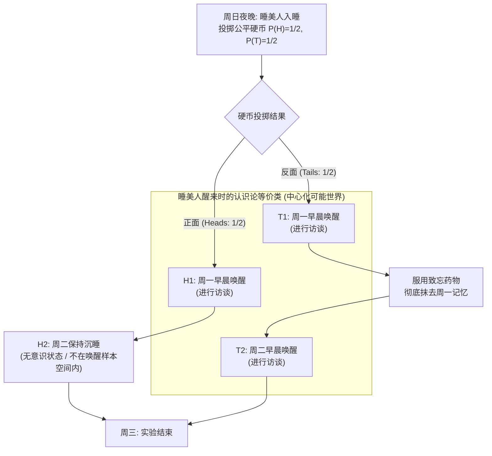
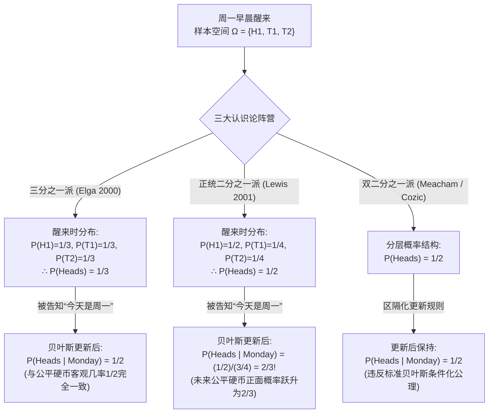

## 1. 引言：醒来瞬间的认识论裂痕

周日晚上，一位具备完美逻辑一致性与贝叶斯推理能力的理想认识主体——<strong>睡美人（Sleeping Beauty）</strong>——作为一项思想实验的受试者入睡。在入睡之前，实验人员向她完整说明了整个实验协议，她对实验规则的确切执行没有任何怀疑。

这项实验最初由哲学家<strong>阿诺德·祖博夫（Arnold Zuboff）</strong>于1990年在论文 *"One Self: The Logic of Experience"* 中构想，后由罗伯特·斯塔纳克（Robert Stalnaker）命名为“睡美人问题”，并在2000年由<strong>亚当·埃尔加（Adam Elga）</strong>发表于 *Analysis* 期刊的经典论文 *"Self-locating belief and the Sleeping Beauty problem"* 推向当代形式认识论与概率哲学的核心舞台。

### 1.1 实验协议的严格定义

1. <strong>周日夜晚（先验阶段）</strong>：睡美人服药入睡。实验人员投掷一枚完全均匀的公平硬币（正面朝上的客观概率 $P(\text{Heads}) = 1/2$，反面朝上的客观概率 $P(\text{Tails}) = 1/2$）。
2. <strong>若硬币为“正面（Heads: $H$）”</strong>：
   - 实验人员在<strong>周一早晨</strong>唤醒睡美人并进行简短访谈。
   - 随后让她再次入睡，周二全天保持无意识睡眠状态，直到周三实验结束将她唤醒（<strong>总计唤醒1次</strong>）。
3. <strong>若硬币为“反面（Tails: $T$）”</strong>：
   - 实验人员在<strong>周一早晨</strong>唤醒睡美人并进行简短访谈。
   - 访谈结束后，立即给她服用一种完美的<strong>致忘药物（Amnesia-inducing drug）</strong>，彻底抹去她关于周一醒来的全部记忆，随后让她入睡。
   - <strong>周二早晨</strong>，实验人员在完全相同的房间、光线和布置下第二次唤醒她并进行同样的访谈（<strong>总计唤醒2次</strong>），然后再让她睡到周三。
4. <strong>主观不可区分性（Subjective Indistinguishability）</strong>：
   - 房间内没有任何时钟、日历或外部线索。由于致忘药物的作用，周一早晨的醒来与周二早晨的醒来在睡美人的第一人称现象学体验中<strong>完全不可区分</strong>。

现在，周一早晨到了。睡美人醒来，实验人员走进房间问她：

> <strong>“对于此时此刻醒着的你来说，硬币当初落得‘正面（Heads）’的主观置信度（Credence / 主观概率）$P(\text{Heads})$ 应该是多少？”</strong>

面对这一简单问题，当代哲学家与概率学家分裂为两大针锋相对的阵营：

- <strong>二分之一派（Halvers：大卫·刘易斯 David Lewis 等）</strong>：在周日晚上入睡前，睡美人就已经 $100\%$ 确定自己至少会被唤醒一次。因此，周一早晨醒来这一事实<strong>没有提供任何关于客观世界的新信息（No new objective evidence）</strong>。既然没有获得关于公平硬币的新证据，根据贝叶斯理性与反映原则，她必须保持周日晚上的先验概率：<strong>$P(\text{Heads}) = 1/2$</strong>。
- <strong>三分之一派（Thirders：亚当·埃尔加 Adam Elga、克里斯托弗·希区柯克 Christopher Hitchcock 等）</strong>：睡美人醒来时可能处于三种互斥且主观不可区分的时空境遇：$(\text{正面}, \text{周一})$、$(\text{反面}, \text{周一})$、$(\text{反面}, \text{周二})$。因为反面产生的唤醒次数是正面的两倍，醒来这一自我定位事实本身就偏袒反面。如果实验重复1000次，大约会有500次正面唤醒和1000次反面唤醒（周一500次＋周二500次），在全部1500次唤醒中正面恰好占三分之一。因此，她的置信度必须是 <strong>$P(\text{Heads}) = 1/3$</strong>。

---

## 2. 信念的本体论：非中心化可能世界（De Dicto）与中心化可能世界（De Se）

为了严格重构两派的数学证明，我们必须首先区分两种命题。在经典柯尔莫哥洛夫概率论中，样本空间由<strong>非中心化可能世界（Uncentered Possible Worlds）</strong> $w \in W$ 构成——即从“无处之视角（View from Nowhere）”对宇宙完整客观历史的描述（<strong>言事信念 / *De Dicto* belief</strong>）。

然而，正如<strong>约翰·佩里（John Perry, 1979）</strong>关于“本质指示词（Essential Indexical）”的研究以及<strong>大卫·刘易斯（David Lewis, 1979）</strong>在 *"Attitudes De Dicto and De Se"* 中所证明的，即便一个全知者掌握了宇宙中所有的客观第三人称事实，他仍然可能不知道<strong>“我是谁”</strong>或<strong>“现在是什么时间”</strong>。这种包含“我（I）”、“现在（Now）”、“这里（Here）”的第一人称信念被称为<strong>自我定位信念（Self-locating / *De Se* belief）</strong>。

在数学形式化中，刘易斯引入了<strong>中心化可能世界（Centered Possible Worlds）</strong>，定义为有序三元组 $\langle w, i, t \rangle \in \mathcal{W}_c$，其中 $w$ 是客观世界，$i$ 是主体，$t$ 是时间切片。在睡美人实验中，客观世界只有两个（$w_H$ 与 $w_T$），但结合周一与周二两个时间点，共有四个中心化世界：
1. $H_1 = \langle w_H, \text{Beauty}, \text{Monday} \rangle$：硬币正面，今天是周一（<strong>清醒</strong>）。
2. $H_2 = \langle w_H, \text{Beauty}, \text{Tuesday} \rangle$：硬币正面，今天是周二（<strong>沉睡/无意识</strong>）。
3. $T_1 = \langle w_T, \text{Beauty}, \text{Monday} \rangle$：硬币反面，今天是周一（<strong>清醒</strong>）。
4. $T_2 = \langle w_T, \text{Beauty}, \text{Tuesday} \rangle$：硬币反面，今天是周二（<strong>清醒</strong>）。

当睡美人醒来时，她清楚地知道“我现在是清醒的”，从而直接排除了无意识的 $H_2$。她的清醒认识样本空间严格收敛为三个中心化可能世界：

$$\Omega_{\text{wake}} = \{ H_1, \, T_1, \, T_2 \}$$

---

## 3. “三分之一派（Thirder）”的严格数学证明：亚当·埃尔加（2000）

亚当·埃尔加（2000）在不依赖大数定律或频率主义重复的前提下，仅凭单次实验中的贝叶斯条件化与对称性原则，给出了 $P(\text{Heads}) = 1/3$ 的三步证明：

### 3.1 第一步：同一客观世界内的受限无差别原则（$P(T_1) = P(T_2)$）

假设睡美人醒来后被告知（或条件化于）硬币结果为<strong>反面</strong>，即事件 $T = T_1 \cup T_2$。在同一个客观反面世界 $w_T$ 中，周一唤醒 $T_1$ 与周二唤醒 $T_2$ <strong>两者都真实发生</strong>，且睡美人在这两个中心所拥有的主观记忆、感官证据和现象学状态完全相同。根据<strong>受限无差别原则（Restricted Principle of Indifference）</strong>，在同一客观世界内具有完全相同主观证据的两个中心必须被赋予相等的条件概率（包括刘易斯在内的所有二分之一派也完全接受这一步）：

$$P(T_1 \mid T_1 \cup T_2) = P(T_2 \mid T_1 \cup T_2) = \frac{1}{2} \implies \frac{P(T_1)}{P(T_1) + P(T_2)} = \frac{P(T_2)}{P(T_1) + P(T_2)} \implies P(T_1) = P(T_2) \quad \cdots (1)$$

### 3.2 第二步：对“今天是周一”进行条件化与投币时间平移不变性（$P(H_1) = P(T_1)$）

现在假设睡美人醒来后，实验人员告诉她：<strong>“今天是周一”</strong>（将样本空间限制在 $M = H_1 \cup T_1$）。此时她对硬币正面的条件置信度 $P(H_1 \mid H_1 \cup T_1)$ 是多少？

埃尔加指出：无论硬币是正面还是反面，周一早晨的唤醒都以概率 $1$ 必然发生；硬币结果只决定<strong>周一晚上</strong>是否服药以及<strong>周二早晨</strong>是否再次唤醒。因此，<strong>把投掷公平硬币的时间从“周日晚上”推迟到“周一晚上（周一访谈结束之后）”，整个实验的因果结构与信息结构完全不变！</strong>

如果在周一早晨访谈时硬币甚至还没有被投掷（要等到周一晚上才投掷），那么当睡美人得知“现在是周一早晨”时，根据刘易斯著名的<strong>主要原则（Principal Principle：主观置信度必须等于未来独立事件的客观物理几率）</strong>，她对今晚即将投掷的公平硬币出现正面的条件概率必须等于 $1/2$：

$$P(\text{Heads} \mid \text{Monday}) = P(H_1 \mid H_1 \cup T_1) = \frac{1}{2} \implies \frac{P(H_1)}{P(H_1) + P(T_1)} = \frac{1}{2} \implies P(H_1) = P(T_1) \quad \cdots (2)$$

### 3.3 第三步：代数综合得出 $P(\text{Heads}) = 1/3$

结合方程 (1) $P(T_1) = P(T_2)$ 与方程 (2) $P(H_1) = P(T_1)$，并利用全概率归一化条件 $P(H_1) + P(T_1) + P(T_2) = 1$：

$$P(H_1) = P(T_1) = P(T_2) = \frac{1}{3} \implies P(\text{Heads}) = P(H_1) = \frac{1}{3}, \quad P(\text{Tails}) = P(T_1) + P(T_2) = \frac{2}{3} \qquad \blacksquare$$

---

## 4. “二分之一派（Halver）”的反击：大卫·刘易斯（2001）与反映原则

2001年，<strong>大卫·刘易斯（David Lewis）</strong>发表了著名的反驳论文 *"Sleeping Beauty: reply to Elga"*，坚决主张 $P(\text{Heads}) = 1/2$。

### 4.1 缺乏新客观证据与范·弗拉森的反映原则

刘易斯指出，睡美人在周日晚上就已经 $100\%$ 知道自己会醒来。醒来时她并未获得任何关于客观世界 $W = \{w_H, w_T\}$ 的意外证据。根据<strong>巴斯·范·弗拉森（Bas van Fraassen, 1984）的反映原则（Reflection Principle）</strong>，如果理性主体在 $t_0$（周日）确知自己在未来的 $t_1$（周一醒来时）在没有经历非理性扭曲的情况下会将命题 $H$ 的概率评估为 $x$，那么她在 $t_0$ 的先验概率就必须已经是 $x$。既然周日晚上公平硬币的概率无疑是 $1/2$，醒来时的概率也必须保持 $1/2$。

因此，刘易斯接受埃尔加的第一步（$P(T_1) = P(T_2)$），但将反面的 $1/2$ 概率均分给周一和周二，得到如下分布：

$$P_{\text{Lewis}}(H_1) = \frac{1}{2}, \qquad P_{\text{Lewis}}(T_1) = \frac{1}{4}, \qquad P_{\text{Lewis}}(T_2) = \frac{1}{4}$$

### 4.2 刘易斯体系的惊人推论：得知“今天是周一”后概率跃升至 $2/3$！

如果采用刘易斯的分布，当实验人员走进房间告诉睡美人<strong>“今天是周一”</strong>（排除 $T_2$）时，根据标准贝叶斯公式，睡美人对正面的置信度将发生惊人的跃升：

$$P_{\text{Lewis}}(\text{Heads} \mid \text{Monday}) = \frac{P_{\text{Lewis}}(H_1)}{P_{\text{Lewis}}(H_1) + P_{\text{Lewis}}(T_1)} = \frac{1/2}{1/2 + 1/4} = \frac{2}{3} \> !$$

这意味着，即使公平硬币要到周一晚上才投掷，刘易斯的睡美人在周一早晨得知“今天是周一”的瞬间，竟然认为<strong>今晚即将投掷的公平硬币有 $2/3$ 的概率出现正面</strong>！刘易斯辩称，这是因为“今天是周一”提供了自我定位（*de se*）证据：在正面世界中 $100\%$ 的唤醒发生在周一，而在反面世界中只有 $50\%$ 的唤醒发生在周一，似然比 $1 / (1/2) = 2:1$ 导致后验概率变为 $2/3$。而为了同时保留醒来时 $1/2$ 和周一时 $1/2$，<strong>双二分之一派（Double-Halvers，如 Cozic 2011、Meacham 2008）</strong>则不得不放弃标准贝叶斯条件化，改用“区隔化条件化（Compartmentalized Conditionalization）”。

---

## 5. 历时荷兰赌论证（Diachronic Dutch Book）与决策论之争

2004年，<strong>克里斯托弗·希区柯克（Christopher Hitchcock）</strong>在 *"Beauty and the bets"* 中证明，二分之一派在面对庄家（Bookie）设计的两阶段赌局时会遭遇必败的<strong>历时荷兰赌（Diachronic Dutch Book）</strong>：

1. <strong>阶段一（周日晚上，$P_{\text{Sun}}(H) = 1/2$）</strong>：庄家向睡美人提供一份赌反面的公平合约：若正面（$H$）则睡美人输 $-30$ 美元，若反面（$T$）则赢 $+30$ 美元（期望收益为 $0$）。
2. <strong>阶段二（每次被唤醒时，$P_{\text{Wake}}(H) = 1/2$）</strong>：每次睡美人醒来，庄家都向她提供一份赌正面的1比1合约：若正面（$H$）则赢 $+20$ 美元，若反面（$T$）则输 $-20$ 美元。二分之一派睡美人认为该赌局完全公平（期望收益 $\frac{1}{2}(+20)+\frac{1}{2}(-20)=0$），因此在每次醒来时都会签字。由于致忘药抹去了周一的记忆，<strong>当硬币为反面时，她会在周一和周二分别签字两次！</strong>

让我们结算周三实验结束时的总账单：
- <strong>若硬币为正面（仅唤醒1次）</strong>：周日赌局 $-30$ 美元 $+$ 周一赌局 $+20$ 美元 $= \mathbf{-10\text{ 美元（必输！）}}$
- <strong>若硬币为反面（唤醒2次）</strong>：周日赌局 $+30$ 美元 $+$ 周一赌局 $-20$ 美元 $+$ 周二赌局 $-20$ 美元 $= \mathbf{-10\text{ 美元（必输！）}}$

无论硬币结果如何，二分之一派睡美人都 $100\%$ 净亏损10美元！唯一能彻底免疫历时荷兰赌的醒来置信度满足 $S(1-p) = 2Sp \implies \mathbf{p = 1/3}$。对此，二分之一派学者（如 Bradley & Leitgeb 2006、Arntzenius 2002）援引<strong>证据决策论（Evidential Decision Theory: EDT）</strong>辩护称：在存在自我复制或记忆抹除的博弈中，接受赌局这一行为本身提供了“反面世界会触发双倍赌注”的证据相关性，因此即使认识置信度为 $1/2$，EDT主体的合理投注赔率（Betting quotient）也会分离并变为 $1/3$。

---

## 6. 尼克·博斯特罗姆的“极端睡美人”与宇宙学人择原理（SSA vs. SIA）

牛津大学哲学家<strong>尼克·博斯特罗姆（Nick Bostrom, 2002, 2007）</strong>指出，睡美人问题是现代宇宙学中<strong>观测选择效应（Observation Selection Effects）</strong>与<strong>人择原理（Anthropic Principle）</strong>的精确数学模型。

在博斯特罗姆的<strong>极端睡美人（Extreme Sleeping Beauty）</strong>思想实验中，若硬币为正面则唤醒1次，若为反面则连续唤醒<strong>100万次（$N = 1,000,000$）</strong>。醒来时：
- <strong>三分之一派（推广为 $1/(N+1)$ 派）</strong>认为硬币反面的概率高达 $\frac{1,000,000}{1,000,001} \approx 99.9999\%$！
- <strong>二分之一派</strong>依然坚持 $P(\text{Heads}) = 1/2$（$50\%$）！

这两派直接对应宇宙学人择推理的两大公理：
1. <strong>自我抽样假设（Self-Sampling Assumption: SSA — 对应二分之一派）</strong>：将自己视为所在参考系中所有观测者的随机样本。SSA不会偏袒观测者总数更多的宇宙，但它会直接导出著名的<strong>末日论证（Doomsday Argument）</strong>——得知自己出生在人类历史前600亿人中（如同睡美人得知今天是周一），会令“人类即将灭绝”的后验概率暴涨1000倍！
2. <strong>自我指示假设（Self-Indication Assumption: SIA — 对应三分之一派）</strong>：存在的事实本身使我们按观测者数量 $N(H_i)$ 的正比去偏袒拥有更多观测者的宇宙假说（$P(H_i \mid \text{我存在}) \propto P(H_i) N(H_i)$）。SIA完美抵消了末日论证，但却导致了荒谬的<strong>狂妄哲学家悖论（Presumptuous Philosopher Paradox）</strong>——无需任何天文观测，仅凭“我存在”就能断定拥有最多观测者的宇宙学理论以 $99.9999\%$ 的概率为真！此外，这一结构还直接支配着<strong>埃弗雷特多世界量子力学（Many-Worlds Interpretation）</strong>中的分支权重问题与<strong>模拟假说（Simulation Argument）</strong>。

---

## 7. 三大立场与人择原理综合对比表

| 评估维度 | 三分之一派 (Thirders: Elga 2000) | 二分之一派 (Halvers: Lewis 2001) | 双二分之一派 (Double-Halvers) |
| :--- | :--- | :--- | :--- |
| <strong>醒来时的中心化概率分布</strong> | $P(H_1)=\frac{1}{3}, P(T_1)=\frac{1}{3}, P(T_2)=\frac{1}{3}$ | $P(H_1)=\frac{1}{2}, P(T_1)=\frac{1}{4}, P(T_2)=\frac{1}{4}$ | 世界层 $1/2$ 与中心层分离 |
| <strong>醒来时正面概率 $P(\text{Heads})$</strong> | <strong>$\mathbf{1/3}$</strong> | <strong>$\mathbf{1/2}$</strong> | <strong>$\mathbf{1/2}$</strong> |
| <strong>得知“今天是周一”后的 $P(\text{Heads}\mid\text{Mon})$</strong> | <strong>$\mathbf{1/2}$</strong>（符合公平硬币客观几率） | <strong>$\mathbf{2/3}$</strong>（未来公平硬币正面几率变2/3） | <strong>$\mathbf{1/2}$</strong>（需放弃标准贝叶斯条件化） |
| <strong>极端睡美人（反面唤醒 $10^6$ 次）</strong> | $P(\text{Heads}) = \frac{1}{1,000,001} \approx 0.0001\%$ | $P(\text{Heads}) = 1/2 = 50\%$ | $P(\text{Heads}) = 1/2 = 50\%$ |
| <strong>范·弗拉森反映原则</strong> | 违反（因记忆抹除导致认识非单调性） | <strong>严格遵守</strong> | <strong>严格遵守</strong> |
| <strong>希区柯克历时荷兰赌（2004）</strong> | <strong>完全免疫</strong> | <strong>CDT下必输</strong>（需靠EDT分离赔率与置信度） | 脆弱（除非分离赔率与置信度） |
| <strong>对应宇宙学人择原理与悖论</strong> | <strong>自我指示假设 (SIA)</strong> 消除末日论证，但产生<strong>狂妄哲学家悖论</strong> | <strong>自我抽样假设 (SSA)</strong> 避免狂妄哲学家，但产生<strong>末日论证</strong> | 区隔化SSA |

---

## 参考文献（References）

- Zuboff, A. (1990). "One Self: The Logic of Experience." *Inquiry*, 33(1), 39–68.
- Elga, A. (2000). "Self-locating belief and the Sleeping Beauty problem." *Analysis*, 60(2), 143–147.
- Lewis, D. (2001). "Sleeping Beauty: reply to Elga." *Analysis*, 61(3), 171–176.
- Hitchcock, C. (2004). "Beauty and the bets." *Synthese*, 139(3), 405–420.
- Bostrom, N. (2002). *Anthropic Bias: Observation Selection Effects in Science and Philosophy*. Routledge.
- Bostrom, N. (2007). "Sleeping Beauty and Colditz." *Synthese*, 157(1), 59–78.
