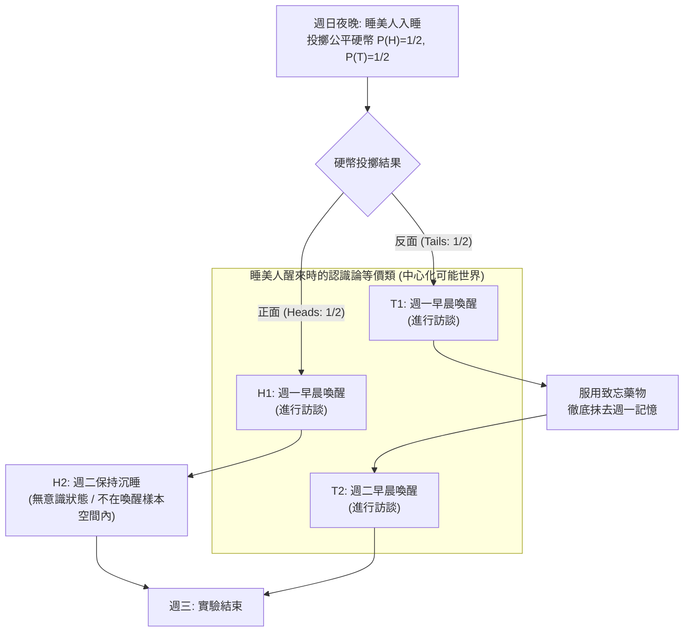
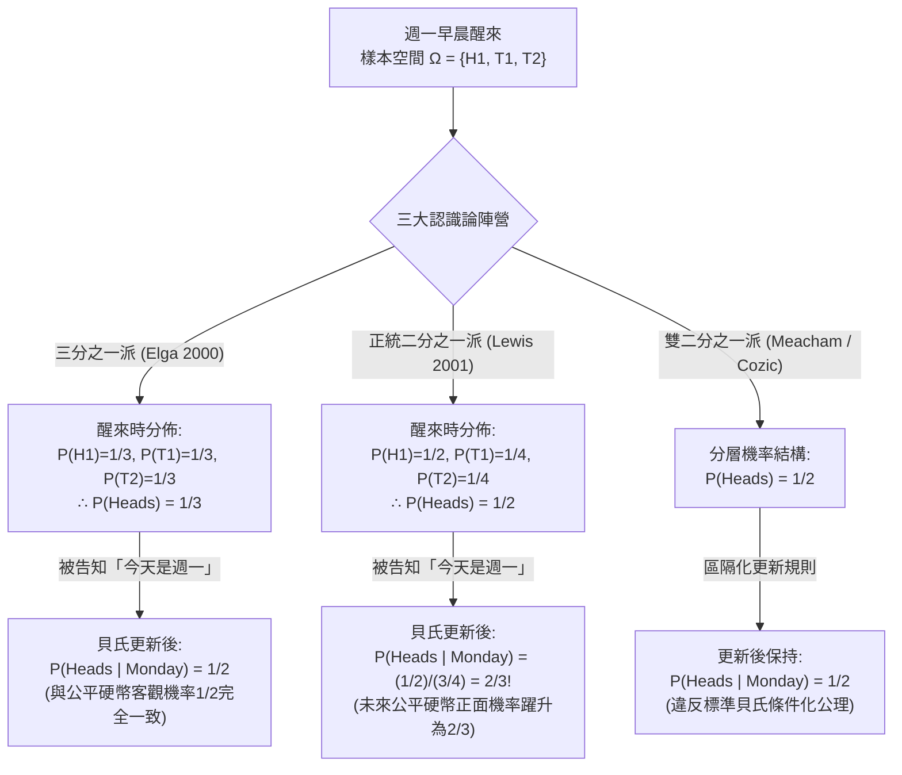

## 1. 引言：醒來瞬間的認識論裂痕

週日晚上，一位具備完美邏輯一致性與貝氏推理能力的理想認識主體——<strong>睡美人（Sleeping Beauty）</strong>——作為一項思想實驗的受試者入睡。在入睡之前，實驗人員向她完整說明了整個實驗協議，她對實驗規則的確切執行沒有任何懷疑。

這項實驗最初由哲學家<strong>阿諾德·祖博夫（Arnold Zuboff）</strong>於1990年在論文 *"One Self: The Logic of Experience"* 中構想，後由羅伯特·斯塔納克（Robert Stalnaker）命名為「睡美人問題」，並在2000年由<strong>亞當·埃爾加（Adam Elga）</strong>發表於 *Analysis* 期刊的經典論文 *"Self-locating belief and the Sleeping Beauty problem"* 推向當代形式認識論與機率哲學的核心舞台。

### 1.1 實驗協議的嚴格定義

1. <strong>週日夜晚（先驗階段）</strong>：睡美人服藥入睡。實驗人員投擲一枚完全均勻的公平硬幣（正面朝上的客觀機率 $P(\text{Heads}) = 1/2$，反面朝上的客觀機率 $P(\text{Tails}) = 1/2$）。
2. <strong>若硬幣為「正面（Heads: $H$）」</strong>：
   - 實驗人員在<strong>週一早晨</strong>喚醒睡美人並進行簡短訪談。
   - 隨後讓她再次入睡，週二全天保持無意識睡眠狀態，直到週三實驗結束將她喚醒（<strong>總計喚醒1次</strong>）。
3. <strong>若硬幣為「反面（Tails: $T$）」</strong>：
   - 實驗人員在<strong>週一早晨</strong>喚醒睡美人並進行簡短訪談。
   - 訪談結束後，立即給她服用一種完美的<strong>致忘藥物（Amnesia-inducing drug）</strong>，徹底抹去她關於週一醒來的全部記憶，隨後讓她入睡。
   - <strong>週二早晨</strong>，實驗人員在完全相同的房間、光線和佈置下第二次喚醒她並進行同樣的訪談（<strong>總計喚醒2次</strong>），然後再讓她睡到週三。
4. <strong>主觀不可區分性（Subjective Indistinguishability）</strong>：
   - 房間內沒有任何時鐘、日曆或外部線索。由於致忘藥物的作用，週一早晨的醒來與週二早晨的醒來在睡美人的第一人稱現象學體驗中<strong>完全不可區分</strong>。

現在，週一早晨到了。睡美人醒來，實驗人員走進房間問她：

> <strong>「對於此時此刻醒著的妳來說，硬幣當初落得『正面（Heads）』的主觀置信度（Credence / 主觀機率）$P(\text{Heads})$ 應該是多少？」</strong>

面對這一簡單問題，當代哲學家與機率學家分裂為兩大針鋒相對的陣營：

- <strong>二分之一派（Halvers：大衛·劉易斯 David Lewis 等）</strong>：在週日晚上入睡前，睡美人就已經 $100\%$ 確定自己至少會被喚醒一次。因此，週一早晨醒來這一事實<strong>沒有提供任何關於客觀世界的新資訊（No new objective evidence）</strong>。既然沒有獲得關於公平硬幣的新證據，根據貝氏理性與反映原則，她必須保持週日晚上的先驗機率：<strong>$P(\text{Heads}) = 1/2$</strong>。
- <strong>三分之一派（Thirders：亞當·埃爾加 Adam Elga、克里斯多福·希區考克 Christopher Hitchcock 等）</strong>：睡美人醒來時可能處於三種互斥且主觀不可區分的時空境遇：$(\text{正面}, \text{週一})$、$(\text{反面}, \text{週一})$、$(\text{反面}, \text{週二})$。因為反面產生的喚醒次數是正面的兩倍，醒來這一自我定位事實本身就偏袒反面。如果實驗重複1000次，大約會有500次正面喚醒和1000次反面喚醒（週一500次＋週二500次），在全部1500次喚醒中正面恰好佔三分之一。因此，她的置信度必須是 <strong>$P(\text{Heads}) = 1/3$</strong>。

---

## 2. 信念的本體論：非中心化可能世界（De Dicto）與中心化可能世界（De Se）

為了嚴格重構兩派的數學證明，我們必須首先區分兩種命題。在經典柯爾莫哥洛夫機率論中，樣本空間由<strong>非中心化可能世界（Uncentered Possible Worlds）</strong> $w \in W$ 構成——即從「無處之視角（View from Nowhere）」對宇宙完整客觀歷史的描述（<strong>言事信念 / *De Dicto* belief</strong>）。

然而，正如<strong>約翰·佩里（John Perry, 1979）</strong>關於「本質指示詞（Essential Indexical）」的研究以及<strong>大衛·劉易斯（David Lewis, 1979）</strong>在 *"Attitudes De Dicto and De Se"* 中所證明的，即便一個全知者掌握了宇宙中所有的客觀第三人稱事實，他仍然可能不知道<strong>「我是誰」</strong>或<strong>「現在是什麼時間」</strong>。這種包含「我（I）」、「現在（Now）」、「這裡（Here）」的第一人稱信念被稱為<strong>自我定位信念（Self-locating / *De Se* belief）</strong>。

在數學形式化中，劉易斯引入了<strong>中心化可能世界（Centered Possible Worlds）</strong>，定義為有序三元組 $\langle w, i, t \rangle \in \mathcal{W}_c$，其中 $w$ 是客觀世界，$i$ 是主體，$t$ 是時間切片。在睡美人實驗中，客觀世界只有兩個（$w_H$ 與 $w_T$），但結合週一與週二兩個時間點，共有四個中心化世界：
1. $H_1 = \langle w_H, \text{Beauty}, \text{Monday} \rangle$：硬幣正面，今天是週一（<strong>清醒</strong>）。
2. $H_2 = \langle w_H, \text{Beauty}, \text{Tuesday} \rangle$：硬幣正面，今天是週二（<strong>沉睡/無意識</strong>）。
3. $T_1 = \langle w_T, \text{Beauty}, \text{Monday} \rangle$：硬幣反面，今天是週一（<strong>清醒</strong>）。
4. $T_2 = \langle w_T, \text{Beauty}, \text{Tuesday} \rangle$：硬幣反面，今天是週二（<strong>清醒</strong>）。

當睡美人醒來時，她清楚地知道「我現在是清醒的」，從而直接排除了無意識的 $H_2$。她的清醒認識樣本空間嚴格收斂為三個中心化可能世界：

$$\Omega_{\text{wake}} = \{ H_1, \, T_1, \, T_2 \}$$

---

## 3. 「三分之一派（Thirder）」的嚴格數學證明：亞當·埃爾加（2000）

亞當·埃爾加（2000）在不依賴大數法則或頻率主義重複的前提下，僅憑單次實驗中的貝氏條件化與對稱性原則，給出了 $P(\text{Heads}) = 1/3$ 的三步證明：

### 3.1 第一步：同一客觀世界內的受限無差別原則（$P(T_1) = P(T_2)$）

假設睡美人醒來後被告知（或條件化於）硬幣結果為<strong>反面</strong>，即事件 $T = T_1 \cup T_2$。在同一個客觀反面世界 $w_T$ 中，週一喚醒 $T_1$ 與週二喚醒 $T_2$ <strong>兩者都真實發生</strong>，且睡美人在這兩個中心所擁有的主觀記憶、感官證據和現象學狀態完全相同。根據<strong>受限無差別原則（Restricted Principle of Indifference）</strong>，在同一客觀世界內具有完全相同主觀證據的兩個中心必須被賦予相等的條件機率（包括劉易斯在內的所有二分之一派也完全接受這一步）：

$$P(T_1 \mid T_1 \cup T_2) = P(T_2 \mid T_1 \cup T_2) = \frac{1}{2} \implies \frac{P(T_1)}{P(T_1) + P(T_2)} = \frac{P(T_2)}{P(T_1) + P(T_2)} \implies P(T_1) = P(T_2) \quad \cdots (1)$$

### 3.2 第二步：對「今天是週一」進行條件化與投幣時間平移不變性（$P(H_1) = P(T_1)$）

現在假設睡美人醒來後，實驗人員告訴她：<strong>「今天是週一」</strong>（將樣本空間限制在 $M = H_1 \cup T_1$）。此時她對硬幣正面的條件置信度 $P(H_1 \mid H_1 \cup T_1)$ 是多少？

埃爾加指出：無論硬幣是正面還是反面，週一早晨的喚醒都以機率 $1$ 必然發生；硬幣結果只決定<strong>週一晚上</strong>是否服藥以及<strong>週二早晨</strong>是否再次喚醒。因此，<strong>把投擲公平硬幣的時間從「週日晚上」推遲到「週一晚上（週一訪談結束之後）」，整個實驗的因果結構與資訊結構完全不變！</strong>

如果在週一早晨訪談時硬幣甚至還沒有被投擲（要等到週一晚上才投擲），那麼當睡美人得知「現在是週一早晨」時，根據劉易斯著名的<strong>主要原則（Principal Principle：主觀置信度必須等於未來獨立事件的客觀物理機率）</strong>，她對今晚即將投擲的公平硬幣出現正面的條件機率必須等於 $1/2$：

$$P(\text{Heads} \mid \text{Monday}) = P(H_1 \mid H_1 \cup T_1) = \frac{1}{2} \implies \frac{P(H_1)}{P(H_1) + P(T_1)} = \frac{1}{2} \implies P(H_1) = P(T_1) \quad \cdots (2)$$

### 3.3 第三步：代數綜合得出 $P(\text{Heads}) = 1/3$

結合方程 (1) $P(T_1) = P(T_2)$ 與方程 (2) $P(H_1) = P(T_1)$，並利用全機率歸一化條件 $P(H_1) + P(T_1) + P(T_2) = 1$：

$$P(H_1) = P(T_1) = P(T_2) = \frac{1}{3} \implies P(\text{Heads}) = P(H_1) = \frac{1}{3}, \quad P(\text{Tails}) = P(T_1) + P(T_2) = \frac{2}{3} \qquad \blacksquare$$

---

## 4. 「二分之一派（Halver）」的反擊：大衛·劉易斯（2001）與反映原則

2001年，<strong>大衛·劉易斯（David Lewis）</strong>發表了著名的反駁論文 *"Sleeping Beauty: reply to Elga"*，堅決主張 $P(\text{Heads}) = 1/2$。

### 4.1 缺乏新客觀證據與范·弗拉森的反映原則

劉易斯指出，睡美人在週日晚上就已經 $100\%$ 知道自己會醒來。醒來時她並未獲得任何關於客觀世界 $W = \{w_H, w_T\}$ 的意外證據。根據<strong>巴斯·范·弗拉森（Bas van Fraassen, 1984）的反映原則（Reflection Principle）</strong>，如果理性主體在 $t_0$（週日）確知自己在未來的 $t_1$（週一醒來時）在沒有經歷非理性扭曲的情況下會將命題 $H$ 的機率評估為 $x$，那麼她在 $t_0$ 的先驗機率就必須已經是 $x$。既然週日晚上公平硬幣的機率無疑是 $1/2$，醒來時的機率也必須保持 $1/2$。

因此，劉易斯接受埃爾加的第一步（$P(T_1) = P(T_2)$），但將反面的 $1/2$ 機率均分給週一和週二，得到如下分佈：

$$P_{\text{Lewis}}(H_1) = \frac{1}{2}, \qquad P_{\text{Lewis}}(T_1) = \frac{1}{4}, \qquad P_{\text{Lewis}}(T_2) = \frac{1}{4}$$

### 4.2 劉易斯體系的驚人推論：得知「今天是週一」後機率躍升至 $2/3$！

如果採用劉易斯的分佈，當實驗人員走進房間告訴睡美人<strong>「今天是週一」</strong>（排除 $T_2$）時，根據標準貝氏公式，睡美人對正面的置信度將發生驚人的躍升：

$$P_{\text{Lewis}}(\text{Heads} \mid \text{Monday}) = \frac{P_{\text{Lewis}}(H_1)}{P_{\text{Lewis}}(H_1) + P_{\text{Lewis}}(T_1)} = \frac{1/2}{1/2 + 1/4} = \frac{2}{3} \> !$$

這意味著，即使公平硬幣要到週一晚上才投擲，劉易斯的睡美人在週一早晨得知「今天是週一」的瞬間，竟然認為<strong>今晚即將投擲的公平硬幣有 $2/3$ 的機率出現正面</strong>！劉易斯辯稱，這是因為「今天是週一」提供了自我定位（*de se*）證據：在正面世界中 $100\%$ 的喚醒發生在週一，而在反面世界中只有 $50\%$ 的喚醒發生在週一，似然比 $1 / (1/2) = 2:1$ 導致後驗機率變為 $2/3$。而為了同時保留醒來時 $1/2$ 和週一時 $1/2$，<strong>雙二分之一派（Double-Halvers，如 Cozic 2011、Meacham 2008）</strong>則不得不放棄標準貝氏條件化，改用「區隔化條件化（Compartmentalized Conditionalization）」。

---

## 5. 歷時荷蘭賭論證（Diachronic Dutch Book）與決策論之爭

2004年，<strong>克里斯多福·希區考克（Christopher Hitchcock）</strong>在 *"Beauty and the bets"* 中證明，二分之一派在面對莊家（Bookie）設計的兩階段賭局時會遭遇必敗的<strong>歷時荷蘭賭（Diachronic Dutch Book）</strong>：

1. <strong>階段一（週日晚上，$P_{\text{Sun}}(H) = 1/2$）</strong>：莊家向睡美人提供一份賭反面的公平合約：若正面（$H$）則睡美人輸 $-30$ 美元，若反面（$T$）則贏 $+30$ 美元（期望收益為 $0$）。
2. <strong>階段二（每次被喚醒時，$P_{\text{Wake}}(H) = 1/2$）</strong>：每次睡美人醒來，莊家都向她提供一份賭正面的1比1合約：若正面（$H$）則贏 $+20$ 美元，若反面（$T$）則輸 $-20$ 美元。二分之一派睡美人認為該賭局完全公平（期望收益 $\frac{1}{2}(+20)+\frac{1}{2}(-20)=0$），因此在每次醒來時都會簽字。由於致忘藥抹去了週一的記憶，<strong>當硬幣為反面時，她會在週一和週二分別簽字兩次！</strong>

讓我們結算週三實驗結束時的總帳單：
- <strong>若硬幣為正面（僅喚醒1次）</strong>：週日賭局 $-30$ 美元 $+$ 週一賭局 $+20$ 美元 $= \mathbf{-10\text{ 美元（必輸！）}}$
- <strong>若硬幣為反面（喚醒2次）</strong>：週日賭局 $+30$ 美元 $+$ 週一賭局 $-20$ 美元 $+$ 週二賭局 $-20$ 美元 $= \mathbf{-10\text{ 美元（必輸！）}}$

無論硬幣結果如何，二分之一派睡美人都 $100\%$ 淨虧損10美元！唯一能徹底免疫歷時荷蘭賭的醒來置信度滿足 $S(1-p) = 2Sp \implies \mathbf{p = 1/3}$。對此，二分之一派學者（如 Bradley & Leitgeb 2006、Arntzenius 2002）援引<strong>證據決策論（Evidential Decision Theory: EDT）</strong>辯護稱：在存在自我複製或記憶抹除的博弈中，接受賭局這一行為本身提供了「反面世界會觸發雙倍賭注」的證據相關性，因此即使認識置信度為 $1/2$，EDT主體的合理投注賠率（Betting quotient）也會分離並變為 $1/3$。

---

## 6. 尼克·博斯特羅姆的「極端睡美人」與宇宙學人擇原理（SSA vs. SIA）

牛津大學哲學家<strong>尼克·博斯特羅姆（Nick Bostrom, 2002, 2007）</strong>指出，睡美人問題是現代宇宙學中<strong>觀測選擇效應（Observation Selection Effects）</strong>與<strong>人擇原理（Anthropic Principle）</strong>的精確數學模型。

在博斯特羅姆的<strong>極端睡美人（Extreme Sleeping Beauty）</strong>思想實驗中，若硬幣為正面則喚醒1次，若為反面則連續喚醒<strong>100萬次（$N = 1,000,000$）</strong>。醒來時：
- <strong>三分之一派（推廣為 $1/(N+1)$ 派）</strong>認為硬幣反面的機率高達 $\frac{1,000,000}{1,000,001} \approx 99.9999\%$！
- <strong>二分之一派</strong>依然堅持 $P(\text{Heads}) = 1/2$（$50\%$）！

這兩派直接對應宇宙學人擇推理的兩大公理：
1. <strong>自我抽樣假設（Self-Sampling Assumption: SSA — 對應二分之一派）</strong>：將自己視為所在參考系中所有觀測者的隨機樣本。SSA不會偏袒觀測者總數更多的宇宙，但它會直接導出著名的<strong>末日論證（Doomsday Argument）</strong>——得知自己出生在人類歷史前600億人中（如同睡美人得知今天是週一），會令「人類即將滅絕」的後驗機率暴漲1000倍！
2. <strong>自我指示假設（Self-Indication Assumption: SIA — 對應三分之一派）</strong>：存在的事實本身使我們按觀測者數量 $N(H_i)$ 的正比去偏袒擁有更多觀測者的宇宙假說（$P(H_i \mid \text{我存在}) \propto P(H_i) N(H_i)$）。SIA完美抵消了末日論證，但卻導致了荒謬的<strong>狂妄哲學家悖論（Presumptuous Philosopher Paradox）</strong>——無需任何天文觀測，僅憑「我存在」就能斷定擁有最多觀測者的宇宙學理論以 $99.9999\%$ 的機率為真！此外，這一結構還直接支配著<strong>埃弗雷特多世界量子力學（Many-Worlds Interpretation）</strong>中的分支權重問題與<strong>模擬假說（Simulation Argument）</strong>。

---

## 7. 三大立場與人擇原理綜合對比表

| 評估維度 | 三分之一派 (Thirders: Elga 2000) | 二分之一派 (Halvers: Lewis 2001) | 雙二分之一派 (Double-Halvers) |
| :--- | :--- | :--- | :--- |
| <strong>醒來時的中心化機率分佈</strong> | $P(H_1)=\frac{1}{3}, P(T_1)=\frac{1}{3}, P(T_2)=\frac{1}{3}$ | $P(H_1)=\frac{1}{2}, P(T_1)=\frac{1}{4}, P(T_2)=\frac{1}{4}$ | 世界層 $1/2$ 與中心層分離 |
| <strong>醒來時正面機率 $P(\text{Heads})$</strong> | <strong>$\mathbf{1/3}$</strong> | <strong>$\mathbf{1/2}$</strong> | <strong>$\mathbf{1/2}$</strong> |
| <strong>得知「今天是週一」後的 $P(\text{Heads}\mid\text{Mon})$</strong> | <strong>$\mathbf{1/2}$</strong>（符合公平硬幣客觀機率） | <strong>$\mathbf{2/3}$</strong>（未來公平硬幣正面機率變2/3） | <strong>$\mathbf{1/2}$</strong>（需放棄標準貝氏條件化） |
| <strong>極端睡美人（反面喚醒 $10^6$ 次）</strong> | $P(\text{Heads}) = \frac{1}{1,000,001} \approx 0.0001\%$ | $P(\text{Heads}) = 1/2 = 50\%$ | $P(\text{Heads}) = 1/2 = 50\%$ |
| <strong>范·弗拉森反映原則</strong> | 違反（因記憶抹除導致認識非單調性） | <strong>嚴格遵守</strong> | <strong>嚴格遵守</strong> |
| <strong>希區考克歷時荷蘭賭（2004）</strong> | <strong>完全免疫</strong> | <strong>CDT下必輸</strong>（需靠EDT分離賠率與置信度） | 脆弱（除非分離賠率與置信度） |
| <strong>對應宇宙學人擇原理與悖論</strong> | <strong>自我指示假設 (SIA)</strong> 消除末日論證，但產生<strong>狂妄哲學家悖論</strong> | <strong>自我抽樣假設 (SSA)</strong> 避免狂妄哲學家，但產生<strong>末日論證</strong> | 區隔化SSA |

---

## 參考文獻（References）

- Zuboff, A. (1990). "One Self: The Logic of Experience." *Inquiry*, 33(1), 39–68.
- Elga, A. (2000). "Self-locating belief and the Sleeping Beauty problem." *Analysis*, 60(2), 143–147.
- Lewis, D. (2001). "Sleeping Beauty: reply to Elga." *Analysis*, 61(3), 171–176.
- Hitchcock, C. (2004). "Beauty and the bets." *Synthese*, 139(3), 405–420.
- Bostrom, N. (2002). *Anthropic Bias: Observation Selection Effects in Science and Philosophy*. Routledge.
- Bostrom, N. (2007). "Sleeping Beauty and Colditz." *Synthese*, 157(1), 59–78.
