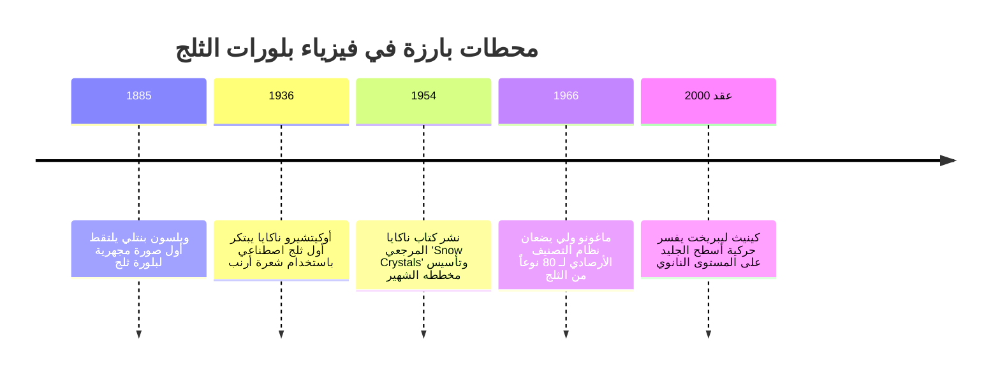
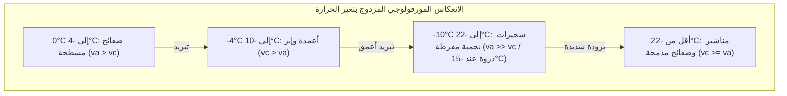

«بلورات الثلج هي رسائل مرسلة إلينا من السماء.» إن هذه المقولة الشهيرة للفيزيائي الياباني أوكيتشيرو ناكايا (1900–1962)، الذي نجح في تخليق أول بلورة ثلج اصطناعية في العالم عام 1936، ليست مجرد استعارة شاعرية، بل هي حقيقة فيزيائية بالغة الدقة: فالشكل الهندسي المعقد لرقاقة الثلج هو سجل مشفر بدقة لتاريخ درجات الحرارة والرطوبة التي مرت بها البلورة أثناء رحلة سقوطها الطويلة عبر السحب.

لا توجد ندفتا ثلج متطابقتان تماماً في الطبيعة. فمن الصفائح السداسية المسطحة، إلى الإبر الأسطوانية المجوفة، والبلورات الشجرية النجمية البديعة، تمثل مورفولوجيا الثلج أحد أعظم الأمثلة على **التشكل الذاتي للأنماط خارج التوازن الديناميكي الحراري**.



---

## 1. بلورات الجليد والأصل الجزيئي للتناظر السداسي

يعود التناظر السداسي لرقاقات الثلج إلى هندسة الروابط الهيدروجينية لجزيء الماء ($H_2O$).

تحت الضغط الجوي المعتاد، يتجمد الماء إلى **الجليد السداسي ($I_h$)**. تتخذ ذرة الأكسجين تهجيناً من نوع $sp^3$، وترتبط بروابط هيدروجينية رباعية الأوجه مع أربعة جزيئات مجاورة بزاوية $104.5^\circ$. وتترتب الجزيئات في المستوى القاعدي على شكل حلقات سداسية متصلة بهيئة الكرسي (Chair conformation).

```mermaid
classDiagram
    class FacetsIce {
        +الوجه القاعدي Basal Facet {0001}: السطحان العلوي والسفلي المتعامدان مع المحور c
        +الوجه المنشوري Prism Facet {10-10}: الأوجه الجانبية المستطيلة الستة الموازية للمحور c
        +نسبة سرعة النمو va / vc: التنافس بين النمو العرضي والطولي
        +الصفائح والبلورات الشجرية: va >> vc (هيمنة النمو الجانبي المسطح)
        +الأعمدة والإبر: vc >> va (هيمنة الاستطالة الرأسية)
    }
```

---

## 2. أوكيتشيرو ناكايا ومخطط المورفولوجيا (Nakaya Diagram)

من خلال تعليق شعرة أرنب منزوعة الدهن في غرفة حمل حراري مبردة، تحكم ناكايا بدقة في درجة الحرارة ($T$) ودرجة فرط تشبع بخار الماء ($s$)، ليرسم **مخطط ناكايا** الشهير.

| نطاق درجة الحرارة | الشكل البلوري السائد | تفوق سرعة النمو | الشكل عند فرط التشبع العالي |
| :--- | :--- | :--- | :--- |
| **$0^\circ\text{C}$ إلى $-4^\circ\text{C}$** | صفائح رقيقة (Plates) | $v_a > v_c$ | صفائح قطاعية نجمية |
| **$-4^\circ\text{C}$ إلى $-10^\circ\text{C}$** | أعمدة وإبر (Columns & Needles) | $v_c > v_a$ | مناشير مجوفة، حزم إبرية |
| **$-10^\circ\text{C}$ إلى $-22^\circ\text{C}$** | شجيرات نجمية (Dendrites) | $v_a \gg v_c$ | **بلورات شجرية فائقة الروعة (أقصى نمو عند $-15^\circ\text{C}$)** |
| **$-22^\circ\text{C}$ إلى $-35^\circ\text{C}$** | أعمدة وصفائح سميكة | $v_c \ge v_a$ | تجمعات رصاصية الشكل |



---

## 3. الحركية السطحية وتكون الأنماط التفرعية

- **الطبقة شبه السائلة (QLL)**: حتى تحت الصفر المئوي، تُغطى أسطح الجليد بغشاء مضطرب عالي السيولة بسمك نانوي، وتتغير حركية درجاته الجزيئية بين الأوجه المختلفة مع تغير درجات الحرارة.
- **عدم استقرار مولينز-سيكيركا (Mullins-Sekerka Instability)**: في حقل انتشار بخار الماء ($\nabla^2 C = 0$)، يؤدي أي نتوء دقيق عند زوايا الشكل السداسي إلى تركيز تدرج البخار ($J = -D \nabla C$)، مما يطلق نمواً انفجارياً للأذرع الستة.
- **تأثير جيبس-طومسون**: يرفع التوتر السطحي ضغط بخار الاتزان عند القمم شديدة الانحناء ($C_r \approx C_\infty (1 + \frac{2\gamma \Omega}{k_B T r})$)، كابحاً التحدب المفرط ومثبتاً نصف قطر التفرعات الجانبية.
- **لماذا تتشابه الأذرع الست؟**: نظراً لصغر حجم ندفة الثلج (بضعة مليمترات)، تكون الظروف البيئية المحيطة بها متجانسة كلياً، وتمر الأذرع الست بنفس التغيرات المناخية المتزامنة أثناء سقوطها في السحاب.
