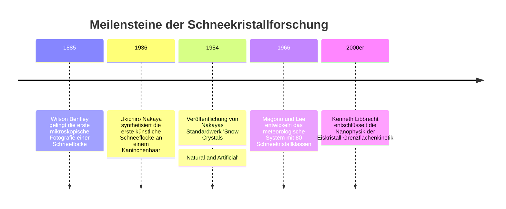
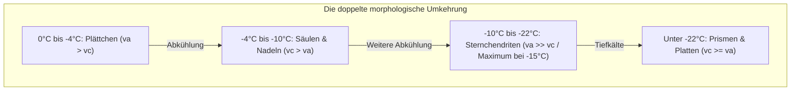
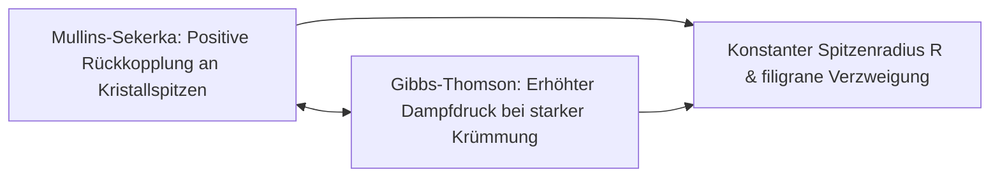

„Schneekristalle sind Briefe, die uns der Himmel schickt.“ Dieser berühmte Ausspruch des japanischen Physikers Ukichiro Nakaya (1900–1962), der 1936 die weltweit ersten künstlichen Schneekristalle im Labor züchtete, ist weit mehr als reine Poesie. Er formuliert ein fundamentales physikalisches Gesetz: Die Geometrie einer Schneeflocke ist ein präzises, thermodynamisch codiertes Protokoll jener Temperatur- und Feuchtigkeitsverhältnisse, welche das Eiskorn auf seinem Weg durch die Wolken durchquert hat.

Keine zwei Schneeflocken gleichen einander. Von einfachen hexagonalen Plättchen über hexagonale Prismen und Nadeln bis hin zu filigran verästelten, farnartigen Sternchendriten stellt die Morphologie von Schnee eines der faszinierendsten Beispiele für **selbstorganisierte Musterbildung im thermodynamischen Nichtgleichgewicht** dar.



---

## 1. Das Kristallgitter des Eises und die hexagonale Symmetrie

Die ausnahmslose Sechszähligkeit der Schneekristalle wurzelt in der Elektronenstruktur des Wassermoleküls ($H_2O$) und der Geometrie des Wasserstoffbrücken-Netzwerks.

Unter atmosphärischem Druck kristallisiert Wasser zu **hexagonalem Eis (Eis $I_h$)**. Die $sp^3$-hybridisierten Sauerstoffatome bilden mit vier Nachbarmolekülen tetraedrisch koordinierte Wasserstoffbrücken (Bindungsenergie $\sim 20\text{ kJ/mol}$, Bindungswinkel $\approx 104{,}5^\circ$). In der Basalebene schließen sich jeweils sechs Wassermoleküle zu sesselförmigen Sechserringen zusammen.

```mermaid
classDiagram
    class IceFacets {
        +Basalflächen Basal Facets {0001}: Obere und untere Sechseckflächen, senkrecht zur c-Achse
        +Prismenflächen Prism Facets {10-10}: Sechs rechteckige Seitenflächen, parallel zur c-Achse
        +Wachstumsgeschwindigkeiten va / vc: Verhältnis von Quer- zu Längswachstum
        +Plättchen & Dendriten: va >> vc (Dominantes planares Wachstum)
        +Säulen & Nadeln: vc >> va (Dominantes axiales Wachstum)
    }
```

Jede Kristallgestalt ist das Ergebnis des dynamischen Wettbewerbs zwischen der **Wachstumsgeschwindigkeit der Basalfläche ($v_c$)** und jener der **Prismenfläche ($v_a$)**.

---

## 2. Ukichiro Nakaya und das Nakaya-Diagramm

Im Kältelabor der Universität Hokkaido gelang Nakaya der Durchbruch, indem er ein entfettetes Kaninchenhaar in einer Konvektionskammer montierte. An diesem Kristallisationskeim wuchsen bei kontrollierter Temperatur ($T$) und Übersättigung ($s$) reproduzierbare Eiskristalle heran.

| Temperaturintervall | Grundform | Wachstumsdominanz | Form bei hoher Übersättigung |
| :--- | :--- | :--- | :--- |
| **$0^\circ\text{C}$ bis $-4^\circ\text{C}$** | Dünne Plättchen | $v_a > v_c$ | Sektorsternchen |
| **$-4^\circ\text{C}$ bis $-10^\circ\text{C}$** | Prismen und Nadeln | $v_c > v_a$ | Hohle Säulen, Nadelbündel |
| **$-10^\circ\text{C}$ bis $-22^\circ\text{C}$** | Dendriten und Sterne | $v_a \gg v_c$ | **Prächtige Sternchendriten (Maximum bei $-15^\circ\text{C}$)** |
| **$-22^\circ\text{C}$ bis $-35^\circ\text{C}$** | Säulen und dicke Platten | $v_c \ge v_a$ | Geschossrosetten |



Dieser zweifache Wechsel der Vorzugsachse („Plättchen $\rightarrow$ Säule $\rightarrow$ Plättchen $\rightarrow$ Säule“) bei kontinuierlicher Abkühlung galt jahrzehntelang als eines der rätselhaftesten Phänomene der Festkörperphysik.

---

## 3. Thermodynamische Grenzflächenkinetik und Musterbildung

Moderne Forschungen von Kenneth Libbrecht am Caltech zeigten, dass zwei gekoppelte Prozesse die Form bestimmen:

### 3.1 Die Quasiflüssigkeitsschicht (Quasi-Liquid Layer, QLL)
Unterhalb von $0^\circ\text{C}$ ist die Eisoberfläche von einer wenige Nanometer dicken, ungeordneten Schicht bedeckt. Die Dicke dieser Schicht und die Kinetik der molekularen Stufen variieren auf Basal- und Prismenflächen temperaturabhängig unterschiedlich, was das Verhältnis $v_a / v_c$ steuert.

### 3.2 Mullins-Sekerka-Instabilität und Gibbs-Thomson-Effekt
Im Wasserdampf-Diffusionsfeld ($\nabla^2 C = 0$) führt jede zufällige Ausbuchtung an den Ecken zu einer lokalen Konzentration des Diffusionsstroms $J = -D \nabla C$. Diese **Mullins-Sekerka-Instabilität** treibt das explosive Wachstum von sechs Hauptästen voran.



Der **Gibbs-Thomson-Effekt** bremst die Verjüngung der Spitzen ab, da die Oberflächenspannung den Gleichgewichtsdampfdruck an scharfen Kanten anhebt ($C_r \approx C_\infty (1 + \frac{2\gamma \Omega}{k_B T r})$). Das Gleichgewicht beider Effekte fixiert den Krümmungsradius und erzeugt die filigranen Verästelungen.

---

## 4. Warum wachsen alle sechs Arme symmetrisch?

Dass sechs Millimeter voneinander entfernte Kristallspitzen nahezu identische Verzweigungsmuster aufweisen, liegt an:
1. **Mikroskopischer Homogenität**: Auf der Größenskala von wenigen Millimetern herrschen überall um den Kristall exakt identische Temperatur- und Übersättigungswerte.
2. **Synchroner Fluggeschichte**: Während die Flocke durch chaotische Turbulenzen fällt, erleben alle sechs Äste zeitgleich denselben Wechsel der thermodynamischen Randbedingungen.
