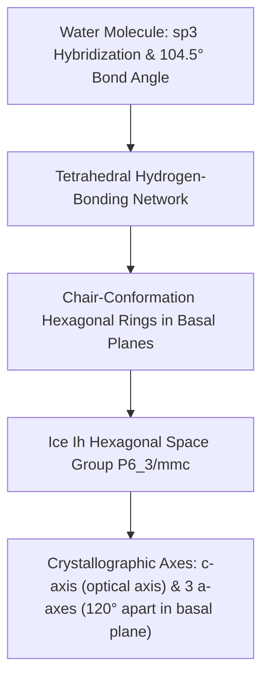
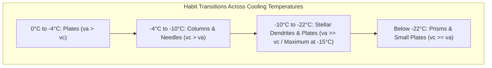
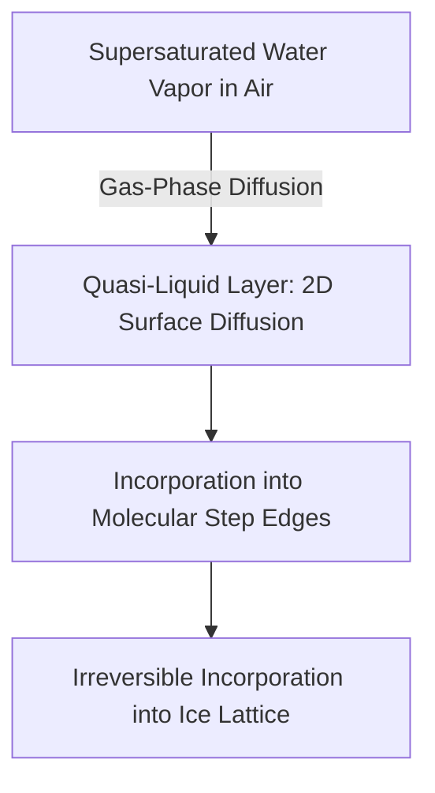
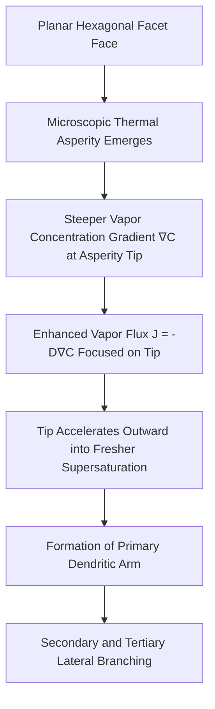
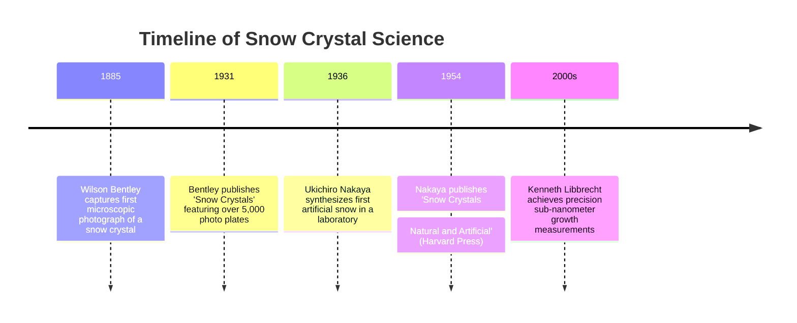
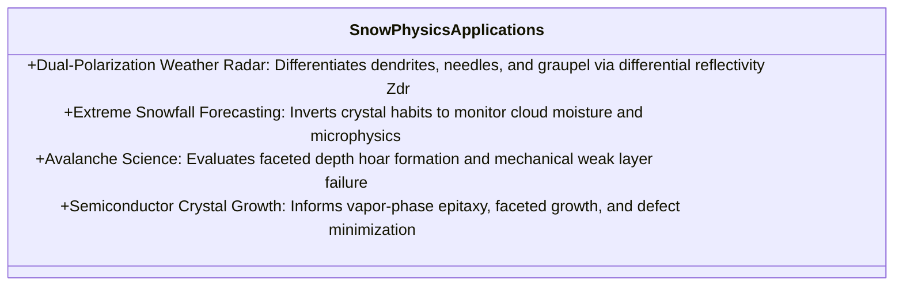

"Snow crystals are letters sent from heaven."

This immortal adage by Japanese physicist Ukichiro Nakaya (1900–1962), who created the world's first artificial snowflake in 1936, is far more than poetic prose. It expresses a profound physical reality: the intricate architecture of a falling snow crystal is a precise, mathematically encoded record of the ambient temperature and supersaturation profile of the atmosphere through which it plummeted.

No two snowflakes are identical. From planar hexagonal plates to needle-like columns, capped prisms, and sweeping, fern-like stellar dendrites, the morphological richness of snow crystals represents one of nature’s most sublime examples of **non-equilibrium pattern formation**.

How does a simple triatomic molecule ($H_2O$) generate such bewildering geometric complexity? Why does a shift of only a few degrees Celsius drive a radical metamorphosis from flat plates to slender needles, and then back to plates? And how do six independent arms, separated by macroscopic millimeters, grow into near-perfect symmetry without exchanging molecular signals?

This article provides an exhaustive, mathematically rigorous exploration of snow crystal physics: the molecular crystallography of ice $I_h$, Nakaya's landmark diagram, the thermodynamics of the quasi-liquid layer (QLL), the Mullins-Sekerka instability governing dendritic branching, and Kenneth Libbrecht's modern precision laboratory experiments.

---

## 1. Crystallography of Ice: Molecular Roots of Six-Fold Symmetry

The universal six-fold symmetry of snow crystals originates in the electronic structure of the water molecule and its hydrogen-bonding geometry.

### 1.1 The Water Molecule and Hexagonal Ice ($I_h$)
The water molecule ($H_2O$) features $sp^3$-hybridized oxygen orbitals with two covalent $O-H$ bonds and two non-bonding lone pairs directed toward the vertices of a tetrahedron. The bond angle of $104.5^\circ$ and oxygen's high electronegativity ($\chi = 3.44$) impart a powerful permanent dipole moment.

Upon freezing under ambient terrestrial pressures (1 atm), water molecules crystallize into **hexagonal ice (Ice $I_h$)**. Each oxygen atom acts as a node tetrahedrally coordinated to four neighboring oxygen atoms via hydrogen bonds (bond energy $\sim 20\text{ kJ/mol}$, $O\cdots O$ distance $\approx 2.76\text{ \AA}$).



---

### 1.2 Basal vs. Prism Facets: The Growth Rate Anisotropy

The hexagonal prism of an ice crystal is bounded by two distinct categories of singular crystallographic facet surfaces:

```mermaid
classDiagram
    class IceFacets {
        +Basal Facets {0001}: Top and bottom hexagonal caps perpendicular to c-axis
        +Prism Facets {10-10}: Six rectangular vertical side faces parallel to c-axis
        +Growth Velocity Ratio va / vc: Ratio of lateral a-axis growth to vertical c-axis growth
        +Plate-like Regime: va / vc >> 1 (Lateral expansion dominates -> Plates & Dendrites)
        +Columnar Regime: va / vc << 1 (Axial elongation dominates -> Columns & Needles)
    }
```

The morphology of every snow crystal is governed by the dynamic competition between the normal growth velocities of these two facets: the **basal growth velocity ($v_c$)** and the **prism growth velocity ($v_a$)**.

---

## 2. Ukichiro Nakaya and the Morphology Diagram

### 2.1 The Genesis of Artificial Snow (1936)
Arriving at Hokkaido Imperial University in 1932, Ukichiro Nakaya realized that field observations alone could not untangle the atmospheric parameters driving snow morphology. In an unheated laboratory, Nakaya constructed a double-walled glass convection chamber, suspending a single **degreased rabbit hair** in an ascending convective plume of supersaturated water vapor.

On March 12, 1936, Nakaya succeeded in growing the **first synthetic snow crystal in human history**. The rabbit hair provided microscopic nucleating asperities upon which water vapor desublimated into exquisite crystalline forms under strictly controlled conditions.


---

### 2.2 The Nakaya Diagram: Temperature-Driven Habit Alternation

By systematically varying temperature ($T$) and water vapor supersaturation ($\sigma$ or excess vapor density $\Delta \rho$), Nakaya mapped the crystal habits of snow across the cryosphere:

| Temperature Range | Primary Habit | Growth Velocity Ratio | High-Supersaturation Morphologies |
| :--- | :--- | :--- | :--- |
| **$0^\circ\text{C}$ to $-4^\circ\text{C}$** | Thin Plates | $v_a > v_c$ | Sector plates, simple hexagons |
| **$-4^\circ\text{C}$ to $-10^\circ\text{C}$** | Columns & Needles | $v_c > v_a$ | Hollow prisms, bundles of needles, sheaths |
| **$-10^\circ\text{C}$ to $-22^\circ\text{C}$** | Plates & Dendrites | $v_a \gg v_c$ | **Stellar dendrites, fern-like crystals (Peak growth at $-15^\circ\text{C}$)** |
| **$-22^\circ\text{C}$ to $-35^\circ\text{C}$** | Columns & Plates | $v_c \ge v_a$ | Bullet rosettes, compact prisms |



The profound enigma exposed by this diagram is the **double habit alternation**: as temperature drops, the dominant growth axis flips from $a$-axis to $c$-axis, back to $a$-axis, and back to $c$-axis. Explaining this bizarre oscillation became one of the holy grails of condensed matter physics.

---

## 3. Non-Equilibrium Thermodynamics and Morphological Instability

Modern surface physics, pioneered by Kenneth Libbrecht at Caltech, demonstrates that snow crystal morphology is governed by the nonlinear interplay of **long-range vapor diffusion** and **nanoscale surface attachment kinetics**.

### 3.1 The Quasi-Liquid Layer (QLL) and Surface Melting
Below $0^\circ\text{C}$, the surface of ice does not terminate in a rigid crystal lattice. Instead, the outermost molecular layers undergo premelting, forming a disordered, fluid-like film termed the **Quasi-Liquid Layer (QLL)**. First proposed by Michael Faraday in 1850, the QLL mediates the condensation of vapor molecules onto step edges.



The thickness of the QLL and the activation barrier for molecular nucleation differ dramatically between basal and prism facets. Temperature modulates the surface attachment coefficient ($\alpha$) of each facet independently, causing the growth velocity ratio $v_a / v_c$ to invert dynamically.

---

### 3.2 The Vapor Diffusion Field and Laplace's Equation

Vapor transport through air surrounding a growing crystal is governed by Fickian diffusion:

$$\frac{\partial C}{\partial t} = D \nabla^2 C$$

where $D \approx 2 \times 10^{-5}\text{ m}^2/\text{s}$ is the diffusion coefficient of water vapor in air. Because vapor diffusion is orders of magnitude faster than crystal boundary movement, the quasi-static approximation ($\partial C/\partial t \approx 0$) holds, reducing the system to **Laplace's equation**:

$$\nabla^2 C = 0$$

---

### 3.3 The Mullins-Sekerka Morphological Instability

At low supersaturations, facet growth is interface-limited; crystals maintain smooth hexagonal polyhedral boundaries. However, as supersaturation rises, growth enters the **diffusion-limited regime**, triggering the **Mullins-Sekerka instability**.



When a tiny bump protrudes into the surrounding diffusion field, the concentration gradient $\nabla C$ steepens around its tip. The localized diffusion flux $J = -D \nabla C$ concentrates at the protrusion, causing it to grow even faster. This **positive feedback loop** breaks the planar facet, driving explosive dendritic branch propagation outward from the six corners of the hexagon.

---

### 3.4 Gibbs-Thomson Curvature Stabilization

What prevents dendritic tips from sharpening into infinite mathematical singularities? The counter-balancing force is the **Gibbs-Thomson effect (capillarity)**. The equilibrium vapor concentration $C_r$ over a curved interface with radius $r$ is elevated due to surface energy ($\gamma$):

$$C_r = C_\infty \exp\left(\frac{2\gamma \Omega}{k_B T r}\right) \approx C_\infty \left(1 + \frac{2\gamma \Omega}{k_B T r}\right)$$

where $\Omega$ is molecular volume and $k_B$ is the Boltzmann constant. 

As a tip sharpens ($r \rightarrow 0$), its local equilibrium vapor pressure skyrockets, lowering effective supersaturation ($C - C_r$) and throttling growth. The steady-state dendritic tip radius ($R$) represents an exquisite balance between Mullins-Sekerka diffusion destabilization and Gibbs-Thomson capillary stabilization.

---

## 4. The Enigma of Six-Fold Symmetry: Why Do Arms Match?

The most iconic mystery of snow crystals is how six distinct arms, growing millimeters apart, develop near-identical branching architectures without physical communication between them.

```mermaid
flowchart TD
    Turbulence[Atmospheric Cloud Turbulence & Drift] --> Trajectory[Chaotic Trajectory T(t) and s(t)]
    Trajectory --> MicroEnv[Crystal Experience: Uniform Thermal & Humidity Bath Across mm Scale]
    MicroEnv --> SyncGrowth[Simultaneous Habit Shifts at All 6 Growing Tips]
    SyncGrowth --> MacroscopicSymmetry[Breathtaking Six-Fold Crystalline Symmetry]
```

The physical resolution rests on three principles:
1. **Dimensional Scale**: A snowflake is only 1–5 mm across. On this millimeter scale, atmospheric temperature and supersaturation are perfectly homogeneous across the crystal.
2. **Synchronized Trajectory Memory**: As the crystal tumbles through turbulent cloud layers, its ambient conditions fluctuate rapidly. When a gust plunges the crystal from $-15^\circ\text{C}$ to $-12^\circ\text{C}$, the attachment kinetics at **all six tips switch simultaneously** from dendritic sprouting to plate facet formation.
3. **Absence of Active Telecommunication**: The arms do not communicate; rather, each arm is an identical physical seismograph recording the exact same environmental flight history.

High-resolution microscopy reveals subtle microscopic differences between the arms, reflecting minute thermal fluctuations and confirming that snowflakes are organic products of chaotic physical self-organization.

---

## 5. From Bentley to Libbrecht: The Lineage of Snow Physics



- **Wilson "Snowflake" Bentley (1865–1931)**: In Jericho, Vermont, Bentley adapted a microscope to a bellows camera, capturing over 5,000 photomicrographs and popularizing the concept of snowflake individuality.
- **Ukichiro Nakaya (1900–1962)**: Transformed snowflake photography into a rigorous quantitative branch of physics and meteorology.
- **Kenneth Libbrecht (Caltech)**: Utilized precision temperature-controlled environmental chambers and interference microscopy to measure ice growth kinetics at the sub-nanometer scale, resolving the molecular mechanisms underlying Nakaya's habit transitions.

---

## 6. Meteorological Radar, Avalanche Safety, and Nanotechnology

Snow crystal physics drives critical applied technologies across modern society:



### 6.1 Dual-Polarization Radar Metrology
Modern dual-polarization weather radars broadcast polarized electromagnetic waves horizontally and vertically. Horizontally oriented planar dendrites scatter horizontal waves preferentially, producing a high differential reflectivity ($Z_{dr}$). By coupling real-time radar signatures with the Nakaya diagram, meteorologists infer the in-cloud thermal profile and forecast severe snowfall events with unprecedented fidelity.

### 6.2 Avalanche Mechanics and Depth Hoar
Within mountain snowpacks, strong geothermal temperature gradients drive intense vapor sublimation and recrystallization. This forms coarse, hollow, cup-shaped crystals known as **depth hoar**. Lacking cohesive strength, depth hoar layers act as catastrophic shear failure planes, triggering deadly slab avalanches.

---

## 7. Conclusion: The Masterpiece of Non-Equilibrium Physics

Snow crystals remind us that the most breathtaking complexity in nature emerges not from equilibrium stasis, but from the dynamic flux of open, non-equilibrium systems:

1. **Molecular Determinism**: The $104.5^\circ$ bond angle of the water molecule dictates the macroscopic six-fold symmetry of a 5 mm stellar dendrite.
2. **Atmospheric Inscription**: Every flake records a unique, non-repeating trajectory through atmospheric space and time.
3. **Balance of Chaos and Law**: Mullins-Sekerka diffusion instability and Gibbs-Thomson surface tension balance each other to craft infinite crystalline beauty.

As Ukichiro Nakaya observed, every snowflake that alights upon a winter sleeve is an ephemeral, crystalline letter from the heavens—written in the universal language of physics.
