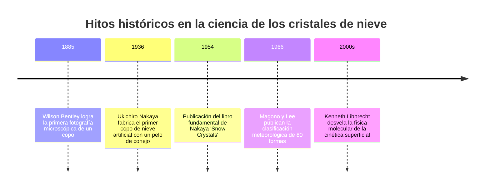
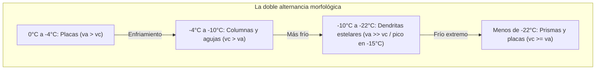
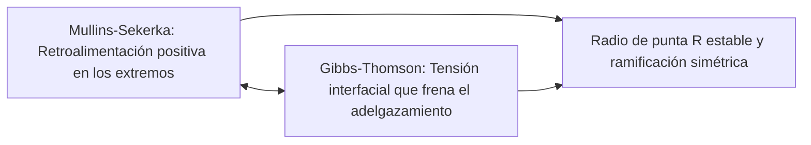

«Los cristales de nieve son cartas enviadas desde el cielo». Esta inmortal sentencia del físico japonés Ukichiro Nakaya (1900–1962), quien sintetizó en 1936 el primer cristal de nieve artificial del mundo, es una rotunda verdad científica: la intrincada arquitectura de un copo de nieve constituye el registro fiel de la trayectoria térmica y de humedad que experimentó mientras descendía por las nubes.

No existen dos copos de nieve exactamente iguales. Desde prismas planos hexagonales hasta agujas huecas y deslumbrantes dendritas estelares, la morfología de la nieve representa uno de los ejemplos más fascinantes de **formación de patrones fuera del equilibrio termodinámico**.



---

## 1. La red cristalina del hielo y el origen de la simetría hexagonal

La constante simetría de orden seis de los cristales de nieve procede directamente de la estructura del agua ($H_2O$) y sus puentes de hidrógeno.

A presión ambiental, el agua congela como **hielo hexagonal (Hielo $I_h$)**. Cada átomo de oxígeno posee hibridación $sp^3$ y se coordina tetraédricamente con otros cuatro mediante enlaces de hidrógeno (ángulo de $104{,}5^\circ$). Los anillos hexagonales en conformación silla componen el plano basal del cristal.

```mermaid
classDiagram
    class FacetasDelHielo {
        +Facetas basales {0001}: Bases superior e inferior perpendiculares al eje c
        +Facetas prismáticas {10-10}: Seis caras laterales rectangulares paralelas al eje c
        +Relación de velocidad va / vc: Competencia entre expansión lateral y axial
        +Placas y dendritas: va >> vc (Expansión lateral dominante)
        +Columnas y agujas: vc >> va (Elongación axial dominante)
    }
```

La morfología final resulta de la pugna entre la **velocidad de crecimiento basal ($v_c$)** y la **prismática ($v_a$)**.

---

## 2. Ukichiro Nakaya y el diagrama de morfología

Al suspender un pelo de conejo desengrasado en una cámara de convección con vapor saturado, Nakaya controló de forma independiente la temperatura ($T$) y la sobresaturación ($s$), creando el **diagrama de Nakaya**.

| Rango térmico | Hábito cristalino | Relación cinética | Morfología con alta sobresaturación |
| :--- | :--- | :--- | :--- |
| **$0^\circ\text{C}$ a $-4^\circ\text{C}$** | Placas delgadas | $v_a > v_c$ | Estrellas de sectores |
| **$-4^\circ\text{C}$ a $-10^\circ\text{C}$** | Columnas y agujas | $v_c > v_a$ | Prismas huecos, haces de agujas |
| **$-10^\circ\text{C}$ a $-22^\circ\text{C}$** | Dendritas estelares | $v_a \gg v_c$ | **Dendritas arborescentes (máximo a $-15^\circ\text{C}$)** |
| **$-22^\circ\text{C}$ a $-35^\circ\text{C}$** | Columnas y placas gruesas | $v_c \ge v_a$ | Rosetas de balas |



La doble inversión periódica del eje de crecimiento dominante a medida que baja la temperatura constituye uno de los misterios más elegantes de la física de la materia condensada.

---

## 3. Dinámica superficial e inestabilidad morfológica

### 3.1 La capa cuasilíquida (Quasi-Liquid Layer, QLL)
Incluso muy por debajo de $0^\circ\text{C}$, la superficie del hielo está cubierta por una película desordenada y fluida de escala nanométrica: la capa cuasilíquida. Su espesor y la movilidad de los escalones atómicos varían con la temperatura de forma distinta en cada cara cristalina, rigiendo la relación $v_a / v_c$.

### 3.2 Inestabilidad de Mullins-Sekerka y efecto Gibbs-Thomson
El campo de difusión de vapor ($\nabla^2 C = 0$) favorece el crecimiento de cualquier saliente accidental en las esquinas del hexágono debido a una mayor concentración de gradiente de vapor ($J = -D \nabla C$). Esta **inestabilidad de Mullins-Sekerka** dispara el desarrollo de los seis brazos primarios.



El **efecto Gibbs-Thomson** equilibra el proceso elevando la presión de vapor de equilibrio en superficies muy curvadas ($C_r \approx C_\infty (1 + \frac{2\gamma \Omega}{k_B T r})$), lo que estabiliza el radio del extremo y produce las regulares ramificaciones laterales.

---

## 4. ¿Por qué los seis brazos son casi idénticos?

La simetría entre brazos separados espacialmente se debe a:
1. **Homogeneidad espacial**: En una dimensión de apenas milímetros, la temperatura y la humedad que rodean al cristal son idénticas en todas sus direcciones.
2. **Historia atmosférica compartida**: Los continuos cambios turbulentos en la nube fuerzan simultáneamente idénticas transiciones de hábito en las seis puntas activas.
