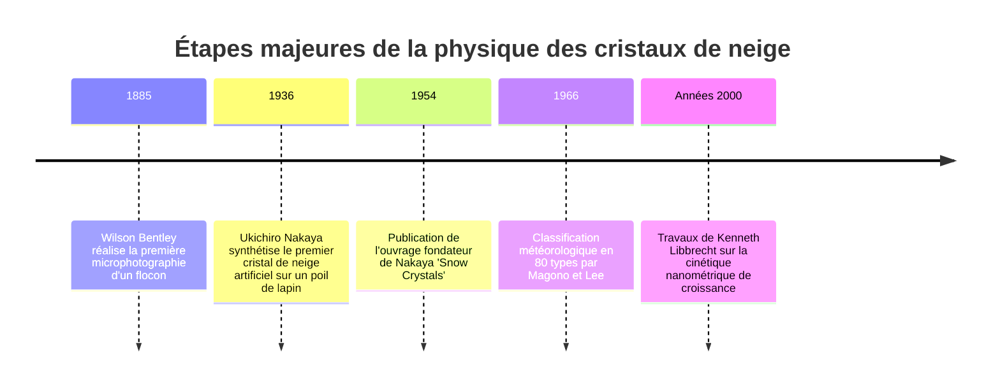
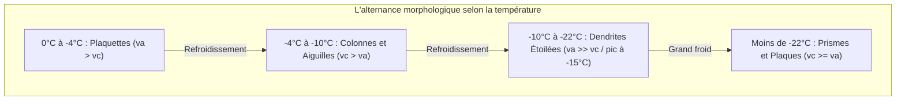
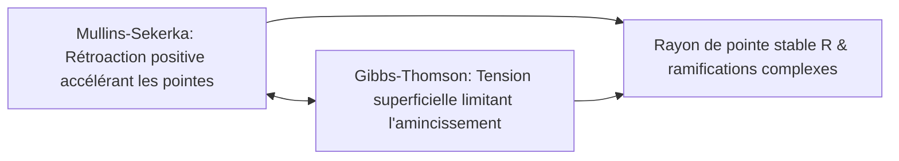

« Les cristaux de neige sont des lettres envoyées du ciel. » Cette célèbre formule du physicien japonais Ukichiro Nakaya (1900–1962), qui créa en 1936 le premier cristal de neige artificiel en laboratoire, est bien plus qu'une métaphore poétique. Elle exprime une vérité physique fondamentale : la géométrie d'un flocon de neige est le registre minutieux de l'histoire thermique et hygrométrique traversée par le cristal lors de sa chute depuis les nuages.

Il n'existe pas deux flocons identiques. Des plaquettes hexagonales aux aiguilles creuses, jusqu'aux somptueuses dendrites étoilées, les cristaux de neige incarnent l'une des expressions les plus pures de **l'auto-organisation de motifs hors équilibre thermodynamique**.



---

## 1. Cristallographie de la glace et origine de la symétrie hexagonale

L'invariable symétrie d'ordre 6 des cristaux de neige provient de la géométrie des liaisons hydrogène de la molécule d'eau ($H_2O$).

À pression ambiante, l'eau gèle sous forme de **glace hexagonale ($I_h$)**. L'atome d'oxygène à hybridation $sp^3$ forme quatre liaisons hydrogène tétraédriques avec ses voisins (angle de $104{,}5^\circ$). Les molécules s'organisent en anneaux hexagonaux en conformation chaise dans le plan de base.

```mermaid
classDiagram
    class FacettesGlace {
        +Facettes basales {0001}: Faces supérieure et inférieure perpendiculaires à l'axe c
        +Facettes prismatiques {10-10}: Six faces latérales rectangulaires parallèles à l'axe c
        +Rapport de vitesse va / vc: Compétition entre croissance transversale et longitudinale
        +Plaquettes et dendrites: va >> vc (Croissance latérale dominante)
        +Colonnes et aiguilles: vc >> va (Croissance longitudinale dominante)
    }
```

La morphologie globale dépend de la compétition entre la **vitesse de croissance basale ($v_c$)** et la **vitesse prismatique ($v_a$)**.

---

## 2. Le diagramme de morphologie de Nakaya

En suspendant un poil de lapin dégraissé dans une chambre à convection refroidie, Nakaya a fait varier rigoureusement la température ($T$) et la sursaturation de vapeur d'eau ($s$) pour établir le **diagramme de Nakaya**.

| Intervalle thermique | Forme dominante | Rapport cinétique | Morphologie à forte sursaturation |
| :--- | :--- | :--- | :--- |
| **$0^\circ\text{C}$ à $-4^\circ\text{C}$** | Plaquettes minces | $v_a > v_c$ | Étoiles à secteurs plats |
| **$-4^\circ\text{C}$ à $-10^\circ\text{C}$** | Colonnes et aiguilles | $v_c > v_a$ | Prismes creux, faisceaux d'aiguilles |
| **$-10^\circ\text{C}$ à $-22^\circ\text{C}$** | Dendrites étoilées | $v_a \gg v_c$ | **Dendrites stellaires féeriques (croissance maximale à $-15^\circ\text{C}$)** |
| **$-22^\circ\text{C}$ à $-35^\circ\text{C}$** | Colonnes et plaques épaisses | $v_c \ge v_a$ | Rosettes de balles |



Cette double inversion morphologique (« plaquette $\rightarrow$ colonne $\rightarrow$ plaquette $\rightarrow$ colonne ») est l'un des comportements les plus spectaculaires de la physique des états condensés.

---

## 3. Dynamique hors équilibre et croissance dendritique

### 3.1 La couche quasi-liquide (QLL)
Même à des températures bien inférieures à $0^\circ\text{C}$, la surface de la glace est tapissée d'un film désordonné d'épaisseur nanométrique : la couche quasi-liquide. Sa structure et l'énergie d'activation des marches cristallines varient selon les facettes, inversant le ratio $v_a / v_c$.

### 3.2 L'instabilité de Mullins-Sekerka et l'effet Gibbs-Thomson
Le champ de diffusion de vapeur d'eau obéit à l'équation de Laplace ($\nabla^2 C = 0$). Dès qu'une micro-aspérité émerge à un sommet de l'hexagone, le gradient de concentration s'y intensifie, concentrant le flux moléculaire $J = -D \nabla C$ : c'est **l'instabilité de Mullins-Sekerka** qui déclenche l'émergence des six bras.



**L'effet Gibbs-Thomson** compense cette instabilité : la surpression de vapeur liée à la courbure ($C_r \approx C_\infty (1 + \frac{2\gamma \Omega}{k_B T r})$) empêche la pointe de devenir infiniment fine et stabilise le rayon de croissance.

---

## 4. Pourquoi les six branches sont-elles identiques ?

La quasi-parfaite symétrie des six branches s'explique par :
1. **L'échelle spatiale minuscule** : À l'échelle de quelques millimètres, les conditions de température et d'humidité sont parfaitement homogènes.
2. **Une histoire atmosphérique synchronisée** : Les turbulences imposent exactement au même instant les mêmes variations environnementales aux six extrémités en croissance.
