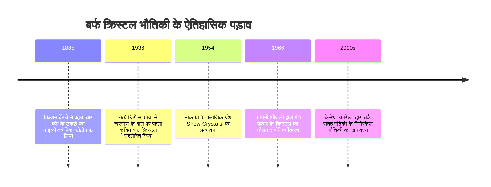

"बर्फ के क्रिस्टल स्वर्ग से भेजे गए पत्र हैं।" 1936 में प्रयोगशाला में दुनिया का पहला कृत्रिम बर्फ का क्रिस्टल बनाने वाले जापानी भौतिक विज्ञानी उकीचिरो नाकाया (1900–1962) का यह प्रसिद्ध कथन केवल काव्यात्मक नहीं है, बल्कि एक गहरा वैज्ञानिक सत्य व्यक्त करता है: बर्फ के टुकड़े की जटिल ज्यामिति उस तापमान और आर्द्रता का सटीक रिकॉर्ड है जिससे होकर वह बादलों से नीचे गिरा था।

प्रकृति में कोई भी दो हिमखंड (Snowflakes) बिल्कुल एक जैसे नहीं होते। सपाट षट्कोणीय प्लेटों से लेकर खोखले प्रिज्म, सुई के आकार के क्रिस्टल और फर्न जैसी शाखाओं वाले तारों जैसे डेंड्राइट तक, बर्फ की आकृति विज्ञान **गैर-संतुलन ऊष्मागतिकी में स्व-संगठित पैटर्न निर्माण** का सबसे उत्कृष्ट उदाहरण है।



---

## 1. बर्फ की क्रिस्टल जाली और षट्कोणीय सममिति

बर्फ के क्रिस्टल में छह-गुना सममिति जल के अणु ($H_2O$) की हाइड्रोजन-बॉन्डिंग ज्यामिति से उत्पन्न होती है।

सामान्य वायुमंडलीय दबाव पर जल **षट्कोणीय बर्फ (Ice $I_h$)** के रूप में जमता है। $sp^3$ संकरित ऑक्सीजन परमाणु चार पड़ोसी अणुओं के साथ चतुष्फलकीय रूप से $104.5^\circ$ कोण पर हाइड्रोजन बंध बनाते हैं। बेसल तल में छह अणु कुर्सी के आकार में षट्कोणीय छल्ले बनाते हैं।

```mermaid
classDiagram
    class IceFacets {
        +बेसल फलक Basal Facet {0001}: ऊपरी और निचली षट्कोणीय सतह (c-अक्ष के लंबवत)
        +प्रिज्म फलक Prism Facet {10-10}: छह आयताकार पार्श्व फलक (c-अक्ष के समानांतर)
        +वृद्धि वेग अनुपात va / vc: पार्श्व और अनुदैर्ध्य वृद्धि के बीच प्रतिस्पर्धा
        +प्लेट और डेंड्राइट: va >> vc (पार्श्व दिशा में अत्यधिक तीव्र प्रसार)
        +स्तंभ और सुई: vc >> va (अनुदैर्ध्य दिशा में अत्यधिक तीव्र विस्तार)
    }
```

---

## 2. उकीचिरो नाकाया और 'नाकाया आरेख' (Nakaya Diagram)

होक्काइडो विश्वविद्यालय की ठंडी प्रयोगशाला में खरगोश के बाल पर बर्फ उगाकर नाकाया ने तापमान ($T$) और वाष्प अतिसंतृप्ति ($s$) के प्रभाव का व्यवस्थित अध्ययन किया और **नाकाया आरेख** तैयार किया।

| तापमान सीमा | मुख्य आकृति | विकास दर अनुपात | उच्च अतिसंतृप्ति पर रूप |
| :--- | :--- | :--- | :--- |
| **$0^\circ\text{C}$ से $-4^\circ\text{C}$** | पतली प्लेटें | $v_a > v_c$ | खंडित षट्कोणीय प्लेटें |
| **$-4^\circ\text{C}$ से $-10^\circ\text{C}$** | स्तंभ और सुई | $v_c > v_a$ | खोखले प्रिज्म, सुई के गुच्छे |
| **$-10^\circ\text{C}$ से $-22^\circ\text{C}$** | तारों जैसे डेंड्राइट | $v_a \gg v_c$ | **भव्य स्टेलर डेंड्राइट ($-15^\circ\text{C}$ पर अधिकतम वृद्धि)** |
| **$-22^\circ\text{C}$ से $-35^\circ\text{C}$** | मोटे स्तंभ और प्लेटें | $v_c \ge v_a$ | बुलेट रोसेट |

```mermaid
flowchart TD
    subgraph तापमान के साथ आकृति का दोहरा उलटफेर
        T1["0°C से -4°C: प्लेटें (va > vc)"] -->|ठंडा होने पर| T2["-4°C से -10°C: स्तंभ और सुई (vc > va)"]
        T2 -->|और ठंडा होने पर| T3["-10°C से -22°C: तारों जैसे डेंड्राइट (va >> vc / -15°C पर चरम)"]
        T3 -->|अति-शीतलन| T4["-22°C से नीचे: प्रिज्म और प्लेटें (vc >= va)"]
    end
```

---

## 3. गैर-संतुलन गतिकी और शाखाओं का निर्माण

- **अर्ध-तरल परत (Quasi-Liquid Layer, QLL)**: $0^\circ\text{C}$ से बहुत नीचे भी बर्फ की सतह नैनोमीटर-मोटी अव्यवस्थित तरल परत से ढकी होती है, जो $v_a / v_c$ अनुपात को नियंत्रित करती है।
- **मुलिन्स-सेकेर्का अस्थिरता**: वाष्प विसरण क्षेत्र ($\nabla^2 C = 0$) में षट्कोण के कोनों पर निकलने वाला हल्का सा उभार अधिक वाष्प आकर्षित करता है ($J = -D \nabla C$), जिससे छह प्राथमिक भुजाएं तेजी से बढ़ती हैं।
- **गिब्स-थॉमसन प्रभाव**: अत्यधिक घुमावदार सिरों पर वाष्प दबाव बढ़ने से ($C_r \approx C_\infty (1 + \frac{2\gamma \Omega}{k_B T r})$) नोक असीमित रूप से नुकीली नहीं हो पाती और नियमित शाखाएं बनती हैं।
- **छह भुजाएं एक जैसी क्यों होती हैं?**: कुछ मिलीमीटर के छोटे पैमाने पर वातावरण पूरी तरह एक समान होता है, और बादल से गिरते समय सभी छह शाखाएं एक साथ समान पर्यावरणीय इतिहास दर्ज करती हैं।
