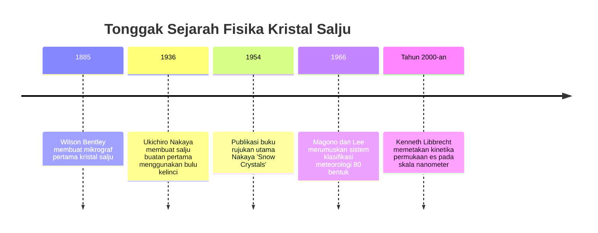
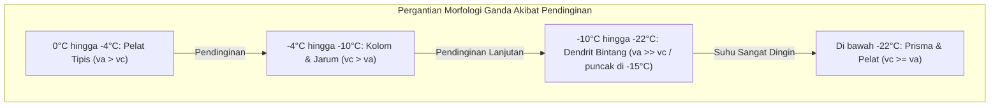

"Salju adalah surat yang dikirim dari surga." Ungkapan terkenal fisikawan Jepang Ukichiro Nakaya (1900–1962), pencipta kepingan salju buatan pertama di dunia pada tahun 1936, merupakan representasi hukum fisika yang mendalam: arsitektur geometris kepingan salju adalah rekaman termodinamika kondisi suhu dan kelembapan yang dilaluinya saat jatuh dari awan.

Tidak ada dua keping salju yang persis sama. Dari lempengan heksagonal sederhana hingga jarum berongga dan kristal dendritik bintang yang memesona, morfologi salju adalah contoh agung dari **pembentukan pola mandiri non-ekuilibrium**.



---

## 1. Kristalografi Es dan Asal-Usul Simetri Heksagonal

Simetri lipat enam pada kristal salju berakar langsung pada geometri ikatan hidrogen molekul air ($H_2O$).

Pada tekanan atmosfer, es membeku menjadi **es heksagonal (Es $I_h$)**. Atom oksigen berhibridisasi $sp^3$ berikatan hidrogen secara tetrahedral dengan empat molekul tetangganya (sudut $104{,}5^\circ$). Pada bidang basal, cincin heksagonal berbentuk kursi membentuk kisi berpori.

```mermaid
classDiagram
    class FasetKristalEs {
        +Faset Basal {0001}: Permukaan atas dan bawah tegak lurus sumbu-c
        +Faset Prisma {10-10}: Enam sisi samping persegi panjang sejajar sumbu-c
        +Rasio Kecepatan va / vc: Kompetisi pertumbuhan horizontal dan vertikal
        +Pelat dan Dendrit: va >> vc (Pertumbuhan lateral mendominasi)
        +Kolom dan Jarum: vc >> va (Pertumbuhan aksial mendominasi)
    }
```

Bentuk kristal sepenuhnya diatur oleh kompetisi antara **kecepatan pertumbuhan basal ($v_c$)** dan **kecepatan prisma ($v_a$)**.

---

## 2. Ukichiro Nakaya dan Diagram Morfologi

Menggantungkan sehelai bulu kelinci dalam ruang konveksi dingin, Nakaya mengendalikan suhu ($T$) dan supersaturasi uap ($s$) untuk menyusun **Diagram Nakaya**.

| Rentang Suhu | Bentuk Utama | Rasio Pertumbuhan | Bentuk pada Supersaturasi Tinggi |
| :--- | :--- | :--- | :--- |
| **$0^\circ\text{C}$ hingga $-4^\circ\text{C}$** | Lempengan Tipis | $v_a > v_c$ | Bintang bersektor |
| **$-4^\circ\text{C}$ hingga $-10^\circ\text{C}$** | Kolom dan Jarum | $v_c > v_a$ | Kolom berongga, bundel jarum |
| **$-10^\circ\text{C}$ hingga $-22^\circ\text{C}$** | Dendrit Bintang | $v_a \gg v_c$ | **Dendrit stellar menakjubkan (puncak di $-15^\circ\text{C}$)** |
| **$-22^\circ\text{C}$ hingga $-35^\circ\text{C}$** | Kolom dan Pelat Tebal | $v_c \ge v_a$ | Roset peluru |



---

## 3. Dinamika Antarmuka Non-Ekuilibrium dan Pertumbuhan Cabang

- **Lapisan Quasi-Cair (QLL)**: Pada suhu beku, permukaan es dilapisi lapisan cair setebal nanometer yang mobilitas molekulernya mengatur rasio $v_a / v_c$.
- **Ketidakstabilan Mullins-Sekerka**: Di medan difusi uap ($\nabla^2 C = 0$), tonjolan kecil di sudut memusatkan fluks uap ($J = -D \nabla C$), mendorong pertumbuhan pesat enam cabang utama.
- **Efek Gibbs-Thomson**: Tegangan antarmuka menaikkan tekanan uap pada ujung melengkung ($C_r \approx C_\infty (1 + \frac{2\gamma \Omega}{k_B T r})$), mencegah ujung menjadi lancip tak terhingga dan menstabilkan pola percabangan.
- **Mengapa Enam Cabang Seragam?**: Pada skala beberapa milimeter, kondisi atmosfer di sekitar kristal seragam sempurna, sehingga keenam cabang mengalami transisi kinetika secara bersamaan saat jatuh melintasi awan.
