「雪は天から送られた手紙である」――世界で初めて人工雪の結晶を作り出した物理学者、中谷宇吉郎（なかや うきちろう、1900–1962）のこのあまりにも有名な言葉は、詩的な比喩にとどまらず、厳密な自然科学の真理を突いたものでした。

冬空から舞い降りる雪の結晶（スノークリスタル）は、一つとして同じ形が存在しないと言われます。正六角形の平板、極細の針、六角柱、そして繊細なシダの葉のように幾重にも枝分かれした息をのむほど美しい星状樹枝――それらの複雑怪奇で精緻を極めた形態は、結晶が上空数千メートルの雲の中で生まれ、地上へと落下する数十分の間に通過した「温度」と「湿度（水蒸気過飽和度）」の微細な環境履歴がそのまま氷の幾何学として記録されたものなのです。

なぜ水という単純な三原子分子（$H_2O$）が、これほどまでに豊饒で対称的な自己組織化パターンを紡ぎ出すのか？ なぜ温度がわずか数度変わるだけで、板状から柱状へ、そして針状へと劇的な形態変化を起こすのか？ そして、ミリメートルも離れた六本の腕は、互いに情報を通信していないにもかかわらず、なぜ奇跡のように同期して対称な枝を生やすのか？

本稿では、氷の結晶格子（六方晶氷 $I_h$）の分子物理から、中谷宇吉郎が導き出した「中谷ダイヤグラム」、現代物理学が解明した準液体層（QLL）と界面カイネティクス、マリンズ・セッカ不安定性による樹枝形成、そしてケネス・リブレヒトらによる最先端の精密結晶成長実験まで、雪の結晶物理学の深遠な美と数学的体系を余すところなく完全解説します。

---

## 1. 氷の結晶格子と六角対称性の分子起源

雪の結晶が例外なく「六」という数字に支配されている理由は、水分子（$H_2O$）が氷へと相転移する際の**水素結合ネットワークの幾何学**にあります。

### 1.1 水分子の四面体配位と水素結合
孤立した水分子は、酸素原子の $sp^3$ 混成軌道により、2つの共有結合した水素原子と2組の非共有電子対（孤立電子対）がほぼ正四面体の頂点を向いた構造をとっています。結合角は $104.5^\circ$ であり、酸素原子の強い電気陰性度（$\chi = 3.44$）により、酸素側が負（$\delta^-$）、水素側が正（$\delta^+$）に強く分極した永久双極子モーメントを持ちます。

大気圧下で水が氷へと凝固すると、それぞれの水分子は周囲の4つの水分子と水素結合（結合エネルギー約 $20\text{ kJ/mol}$）を形成し、配位数4の開いた三次元ネットワークを構築します。この結晶構造を**六方晶氷（Ice $I_h$）**と呼びます。

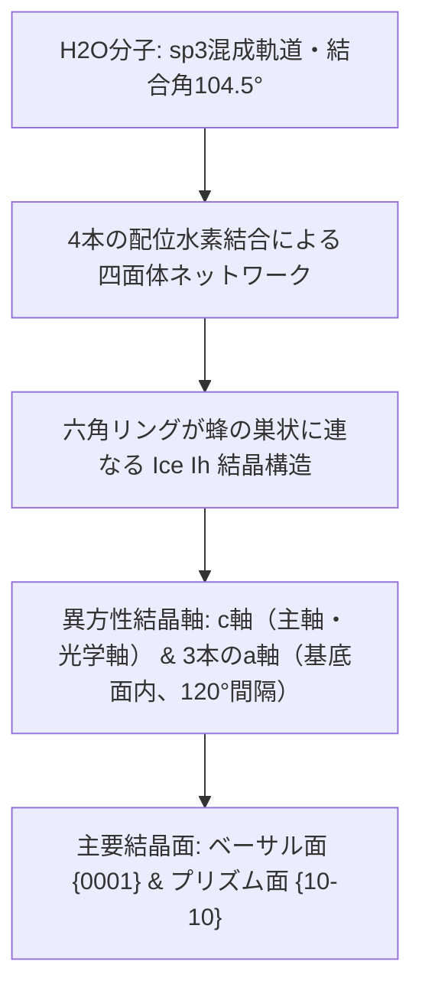

---

### 1.2 結晶軸と基本ファセット面

六方晶氷 $I_h$ の単位胞は、六角柱の形状をしています。結晶成長を支配する方向として、以下の2つの結晶軸が定義されます：

- **$c$軸（主軸・光学軸）**: 六角柱の上面と下面に垂直な軸。
- **$a$軸（$a_1, a_2, a_3$）**: $c$軸に直交し、基底面内で互いに $120^\circ$（または $60^\circ$）の間隔で交差する3本の軸。

これに対応して、巨視的な氷結晶の外形（ファセット面）には2つの主要な結晶面が現れます：

```mermaid
classDiagram
    class IceCrystalFacets {
        +ベーサル面 Basal Facet {0001}: 六角柱の上下の平らな底面（c軸に垂直）
        +プリズム面 Prism Facet {10-10}: 六角柱の側面を構成する6枚の長方形面（c軸に平行）
        +成長速度比 va / vc: a軸方向成長速度とc軸方向成長速度の比率
        +形態分岐条件1: va / vc >> 1 のとき -> 平板状・星状・樹枝状結晶（Plates & Dendrites）
        +形態分岐条件2: va / vc << 1 のとき -> 角柱状・針状結晶（Columns & Needles）
    }
```

雪の結晶のあらゆる形態的バリエーションは、突き詰めれば**「ベーサル面の成長速度（$v_c$）」と「プリズム面の成長速度（$v_a$）」のどちらが速いかという競合問題**に帰着します。

---

## 2. 中谷宇吉郎と「中谷ダイヤグラム」

### 2.1 世界初の人工雪実験（1936年）
1930年代初頭、北海道帝国大学（現・北海道大学）の教授に着任した中谷宇吉郎は、極寒の十勝岳山麓で天然雪結晶の顕微鏡撮影に没頭しました。しかし、天然の雪を観察するだけでは「なぜその形になるのか」という原因と結果の因果律を突き止めることはできません。

中谷は大学の低温実験室に手製の二重ガラス円筒実験装置を製作し、上昇する水蒸気流の中に**「脱脂した一本のウサギの毛」**を吊り下げました。毛の微小な突起が氷晶核（核生成中心）となり、そこに水蒸気が昇華凝結することで、1936年3月12日、**人類史上初となる人工雪結晶の生成**に成功したのです。


---

### 2.2 中谷ダイヤグラムの全貌と温度による形態逆転

中谷は、温度（横軸：$0^\circ\text{C} \sim -35^\circ\text{C}$）と水蒸気過飽和度（縦軸：あるいは過飽和水蒸気密度 $\Delta \rho$）を変化させながら数千回に及ぶ実験を繰り返し、雪結晶の形態分類図（**中谷ダイヤグラム**）を完成させました。

| 温度範囲 | 基本形態 | 成長異方性 | 高過飽和度での発達形態 |
| :--- | :--- | :--- | :--- |
| **$0^\circ\text{C} \sim -4^\circ\text{C}$** | 薄い板状（Thin Plates） | $v_a > v_c$ | 扇状六花、薄片 |
| **$-4^\circ\text{C} \sim -10^\circ\text{C}$** | 柱状・針状（Columns & Needles） | $v_c > v_a$ | 中空角柱、針状結晶群、鞘状 |
| **$-10^\circ\text{C} \sim -22^\circ\text{C}$** | 板状・星状・樹枝状（Plates & Dendrites） | $v_a \gg v_c$ | **華麗な星状樹枝（$-15^\circ\text{C}$ で成長速度最大）** |
| **$-22^\circ\text{C} \sim -35^\circ\text{C}$** | 再び柱状・板状（Columns & Plates） | $v_c \ge v_a$ | 砲弾集合体、小型六角板 |

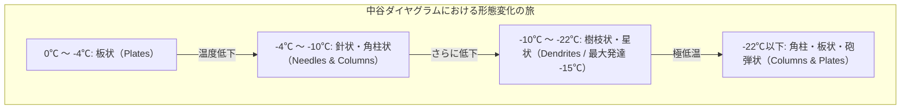

このダイヤグラムで最も物理学者たちを驚愕させたのは、**「板状 $\rightarrow$ 柱状 $\rightarrow$ 板状 $\rightarrow$ 柱状」という温度低下に伴う二重の形態逆転（Morphological Alternation）**です。なぜ単純な冷却過程において、優先成長する結晶軸がこれほどめまぐるしく入れ替わるのか？ この謎は中谷の死後数十年にわたり、固体物理学と非平衡熱力学の最難問の一つとして立ちはだかりました。

---

## 3. 非平衡結晶成長の熱力学とパターン形成メカニズム

現代物理学（特にカリフォルニア工科大学のケネス・リブレヒト教授らの研究）により、雪結晶の成長ダイナミクスは**「水蒸気拡散場（長距離物理）」**と**「結晶表面の分子カイネティクス（短距離物理）」**の非線形結合であることが解明されました。

### 3.1 準液体層（Quasi-Liquid Layer: QLL）と表面融解
氷の表面は、融点（$0^\circ\text{C}$）よりかなり低い温度（約$-30^\circ\text{C}$以上）であっても、最表面の数分子層から数十分子層が乱れ、水のように流動性を持つ薄い膜に覆われています。これを**準液体層（QLL: Quasi-Liquid Layer）**または表面融解（Surface Melting）と呼びます。マイケル・ファラデーが1850年に予言したこの現象は、現代のX線回折や原子間力顕微鏡（AFM）で直接確認されています。

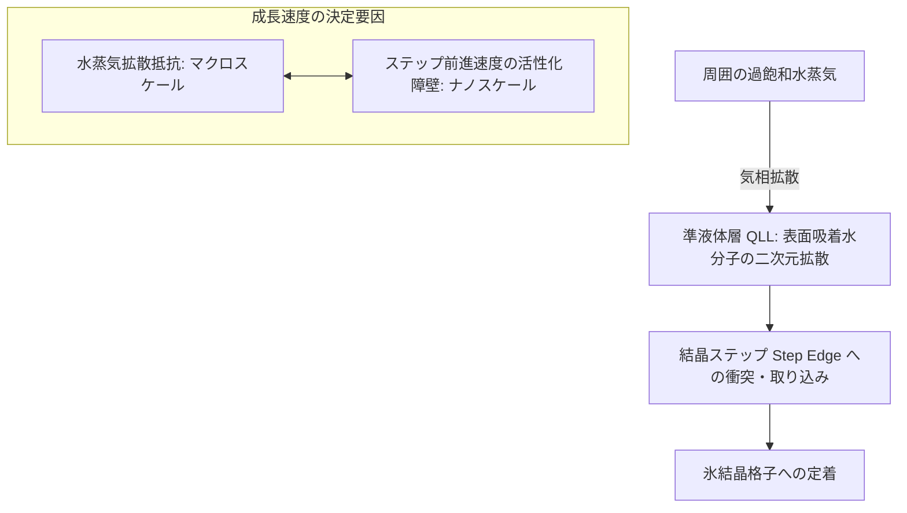

結晶表面の分子吸着・結合過程において、ベーサル面とプリズム面では水分子の配置や水素結合の配向が異なります。温度によって各面におけるQLLの厚みと、原子ステップの前進速度（表面カイネティクス係数 $\alpha$）が劇的に変化します。
- $-5^\circ\text{C}$ 付近では、ベーサル面のステップ前進速度がプリズム面を上回り、$c$軸方向に細長く伸びて**柱状・針状**になります。
- $-15^\circ\text{C}$ 付近では、プリズム面のカイネティクスが爆発的に活性化し、$a$軸方向への横方向成長が圧倒的となって**薄い巨大な樹枝状結晶**へと発達します。

---

### 3.2 拡散方程式と過飽和場

水蒸気中を結晶が成長するとき、結晶周囲の水蒸気密度 $C(\vec{r}, t)$ は拡散方程式に従います。

$$\frac{\partial C}{\partial t} = D \nabla^2 C$$

ここで $D$ は空気中の水蒸気拡散係数（約 $2 \times 10^{-5}\text{ m}^2/\text{s}$）です。雪結晶の成長速度（数 $\mu\text{m}/\text{s}$）に比べ、水蒸気の拡散速度ははるかに高速であるため、定常近似（$\partial C/\partial t \approx 0$）が極めて良好に成立し、ラプラス方程式に帰着します。

$$\nabla^2 C = 0$$

結晶表面では水蒸気が消費されて過飽和度が低下し、結晶から遠く離れた無限遠では雲の中の過飽和度 $C_\infty$ が維持されます。

---

### 3.3 マリンズ・セッカ不安定性（Mullins-Sekerka Instability）

過飽和度が低いとき、結晶は六角板や六角柱などの平坦なファセット面を保ったまま成長します。しかし、過飽和度が高くなると、結晶成長は**マリンズ・セッカ不安定性（形態不安定性）**の領域へと突入します。

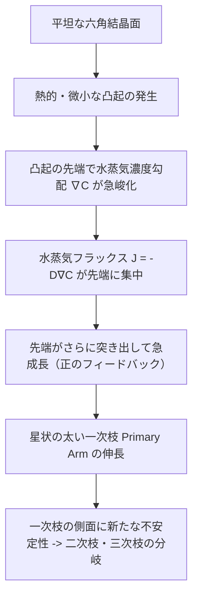

平坦な面にわずかな「突起」が生じると、その突起の先端は周囲の水蒸気拡散場の中へ突き出すため、濃度勾配 $\nabla C$ が局所的に急峻になり、より多くの水蒸気フラックス（$J = -D \nabla C$）を独占してさらに急速に成長します。この**「突き出た部分がますます突き出る」という正のフィードバック効果**によって、六角形の角から外側へ向けて6本の腕が一斉に突き出し、樹枝状結晶（デンドライト）が形成されるのです。

---

### 3.4 ギブス・トムソン効果による曲率抑制

もしマリンズ・セッカ不安定性だけが働けば、先端は無限に細く尖っていき、最終的には原子スケールまで分裂してしまうはずです。これを防ぎ、枝の太さを有限に保っているのが**ギブス・トムソン効果（曲率効果）**です。

界面の曲率半径 $r$ が小さく（尖って）なるほど、表面エネルギー $\gamma$ のペナルティにより、その表面における平衡水蒸気密度 $C_r$ が上昇します。

$$C_r = C_\infty \exp\left(\frac{2\gamma \Omega}{k_B T r}\right) \approx C_\infty \left(1 + \frac{2\gamma \Omega}{k_B T r}\right)$$

（ここで $\Omega$ は水分子1個あたりの分子容、$k_B$ はボルツマン定数）

平衡水蒸気密度が高くなるということは、過飽和度（実効推進力 $C - C_r$）が低下することを意味します。つまり、**「尖りすぎると成長が止まる」という負のフィードバック**が働きます。

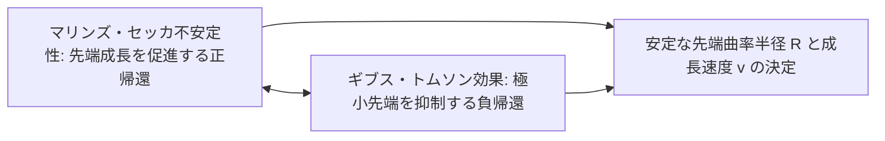

この正と負のフィードバックの絶妙な拮抗によって、デンドライトの先端は一定の曲率半径（通常数マイクロメートル）を保ちながら安定して前進し、規則正しいシダ状の側枝を形成します。

---

## 4. 「なぜ六本の腕はほぼ同じ形になるのか？」の謎

雪の結晶を見るとき、誰もが抱く最大の疑問は**「なぜ数ミリメートルも離れた6本の腕が、まるで通信し合っているかのようにほぼ同一の複雑なパターンを示すのか？」**という点です。

```mermaid
flowchart TD
    Cloud[乱流渦巻く雲の中] --> Fall[雪結晶の落下と浮遊]
    Fall --> Trajectory[カオス的な温度 T(t) と過飽和度 s(t) の履歴]
    Trajectory --> GlobalSync[結晶全体（サイズ数mm）は同一の気象環境に包まれる]
    GlobalSync --> BranchSync[6本の腕の先端が同時に同一の形態変形を記録]
    BranchSync --> Symmetry[六方対称なフラクタル的微細パターンの誕生]
```

この驚異的な対称性の理由は、以下の物理的事実によって明快に説明されます：

1. **結晶の極小性と環境の均一性**:
   雪結晶のサイズは数ミリメートル程度にすぎません。結晶全体のスケールにおいて、周囲の気温や水蒸気過飽和度は完全に均一です。
2. **落下履歴の共通性**:
   結晶が雲の中を数十分かけて舞い落ちるとき、上昇気流や乱流に揉まれて複雑な軌跡を描きます。温度が $-15^\circ\text{C}$（樹枝成長）から $-12^\circ\text{C}$（板状成長）へ変化し、さらに過飽和度が急変するような環境変化を経験すると、**6本の腕の先端すべてが全く同一の瞬間に同一の成長モード切り替えを強いられます**。
3. **腕同士の非通信性**:
   腕同士が量子力学的に共鳴しているわけでも、音波で通信しているわけでもありません。6本の腕は、それぞれ独立して「周囲の共通の環境変化」を忠実に記録しているにすぎません。

しかし、顕微鏡で極限まで拡大観察すると、6本の腕は**「完璧に同一」ではなく、微小な非対称性や枝分かれのズレが存在する**ことも分かります。これは熱揺らぎや局所的な気流の乱れによるものであり、雪結晶が人工物ではなく、カオスと秩序の境界で生み出された生きた自然の証拠なのです。

---

## 5. ウィルソン・ベントレーからケネス・リブレヒトへの系譜

雪結晶の美しさに魅せられた人類の探求は、100年以上にわたる情熱的な科学者たちのバトンによって紡がれてきました。

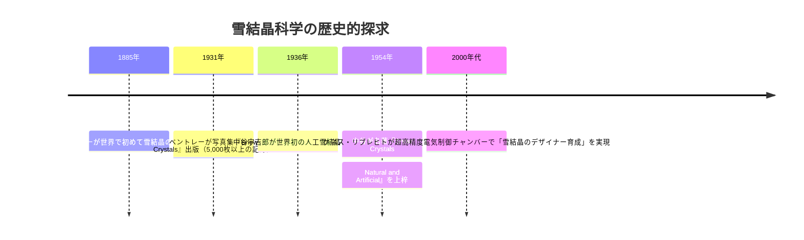

### 5.1 ウィルソン・ベントレー（"Snowflake" Bentley）
アメリカ・バーモント州の農夫であったウィルソン・ベントレー（1865–1931）は、1885年、顕微鏡に写真乾板カメラを接続し、凍える納屋の中で世界初の雪結晶顕微鏡写真を撮影しました。彼が生涯をかけて撮影した5,000枚を超える結晶写真は世界中に衝撃を与え、「二つとして同じ雪の結晶はない」という言葉を世界に定着させました。

### 5.2 ケネス・リブレヒトの現代極微物理実験
カリフォルニア工科大学の物理学教授ケネス・リブレヒトは、中谷の技術を21世紀の最先端ナノテクノロジーでアップデートしました。半導体ペルチェ素子による精密温度制御、電場印加による結晶成長制御、そして高分解能レーザー干渉計を用いて、結晶の成長速度をオングストローム（$\text{Å}$）単位でリアルタイム計測することに成功し、氷の表面拡散障壁の物理的定数を決定しました。

---

## 6. 気象学・寒冷地工学・現代科学への波及

雪の結晶物理学は、単なる美学的探求にとどまらず、現代社会のインフラと防災を支える重要な応用科学へと発展しています。

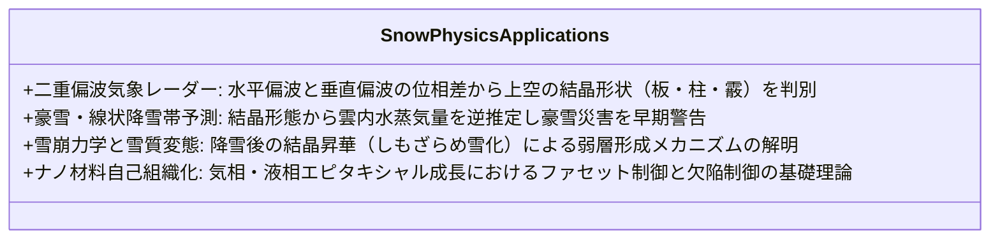

### 6.1 二重偏波気象レーダーと雪晶判別
最新の気象レーダー（XバンドMPレーダー等）は、水平偏波と垂直偏波の電波を同時に発射します。雪結晶が平たい板状であれば水平方向の反射強度が強くなり、針状や球状の霰（あられ）であれば異なる偏波間位相差（KDP）を示します。中谷ダイヤグラムの知識と組み合わせることで、**「上空の雲の中で今まさにどのような結晶が育っているか」を地上から非破壊でリアルタイムスキャンできる**ようになっています。

### 6.2 雪崩科学と弱層（Weak Layer）の形成
積雪内部では、地面からの地熱と外気温度の差により激しい温度勾配が発生します。この水蒸気勾配によって積雪粒子間で昇華凝結が起こり、脆いコップ状の**「しもざらめ雪（Depth Hoar）」**と呼ばれる粗大結晶が形成されます。これがスキー場や山岳地帯における大規模面発生雪崩（スラブ雪崩）の滑り面（弱層）となるため、雪結晶の変態熱力学は防災工学の要となっています。

---

---

## 8. 雲微物理学と雪結晶成長のダイナミクス

雪の結晶が誕生する雲の中は、単なる冷たい水蒸気の塊ではありません。そこには、氷点下になっても凍らない**「過冷却水滴（Supercooled Water Droplets）」**が無数に浮遊しています。

```mermaid
flowchart TD
    subgraph ヴェゲナー・ベルシェロン・フィンダイゼン過程
        Drop[過冷却水滴 -10℃〜-20℃] --> Evap[水滴からの急速な蒸発（水に対する飽和蒸気圧 es > 氷に対する飽和蒸気圧 ei）]
        Evap --> VaporFlux[高密度の水蒸気流の発生]
        VaporFlux --> Crystal[氷晶核 / 雪の結晶への急速な昇華凝結成長]
        Crystal --> Grow[雪結晶の爆発的成長と重力沈降]
    end
```

### 8.1 ベルシェロン・プロセス（Wegener-Bergeron-Findeisen Process）
純粋な水滴は、凍結核がない場合、$-40^\circ\text{C}$ 近くまで凍らずに液体のままで存在できます。

温度 $-10^\circ\text{C} \sim -20^\circ\text{C}$ の雲の中では、水に対する飽和水蒸気圧 $e_s(T)$ は、氷に対する飽和水蒸気圧 $e_i(T)$ よりも常に高くなります。

$$e_s(T) > e_i(T)$$

クラウジウス・クラペイロンの式より、水蒸気圧差 $\Delta e = e_s(T) - e_i(T)$ は**$-12^\circ\text{C} \sim -15^\circ\text{C}$ 付近で最大値（約 $0.27\text{ hPa}$）**に達します。
この環境下では、空気は過冷却水滴に対しては未飽和（蒸発が起きる）でありながら、氷結晶に対しては著しい過飽和状態（強い昇華凝結が起きる）となります。結果として、**過冷却水滴から蒸発した水分子が、猛烈な勢いで周囲の氷結晶へと吸い寄せられて凝結する**のです。これが中谷ダイヤグラムにおける $-15^\circ\text{C}$ での樹枝状結晶の爆発的成長を後押しする大気熱力学的原動力です。

---

## 9. 雲粒捕捉と霰（あられ）・雪片（スノーフレーク）への凝集

雪結晶が成長して重くなると、重力によって雲の中を秒速数十センチメートルから1メートル前後の終端速度（Terminal Velocity）で落下し始めます。この落下過程で、結晶はさらなる形態変化を遂げます。

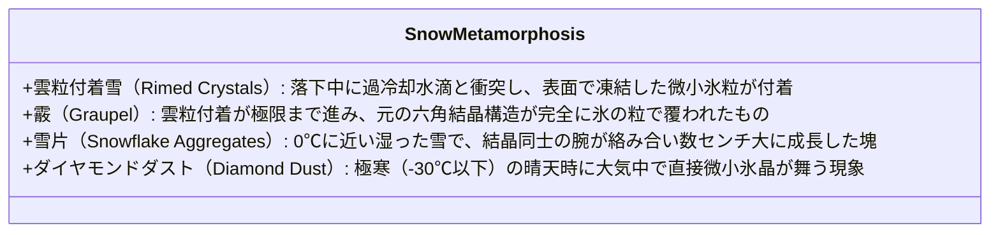

### 9.1 ライミング（Riming: 雲粒捕捉）
落下する雪結晶が過冷却水滴と衝突すると、水滴は瞬時に凍結して微小な氷の粒として結晶表面に付着します。これが**雲粒付着（ライミング）**です。雲粒付着が過度に進むと、元の幾何学的な六角形状が見えなくなり、白く丸い**霰（あられ、Graupel）**へと変化します。

### 9.2 アグリゲーション（Aggregation: 雪片の形成）
私たちが普段「ぼたん雪」と呼ぶ大きな雪のかたまりは、1個の単結晶ではなく、数千個から数万個もの雪の結晶が空中で衝突し、枝同士が複雑に絡み合ってできた**集合体（Aggregate Snowflake）**です。気温が $0^\circ\text{C}$ に近いと結晶表面の準液体層が厚くなり、結晶同士が接触した瞬間に接着剤のように凍りつくため、直径数センチメートルにおよぶ巨大な雪片へと成長します。

---

## 10. 人工造雪技術と寒冷地スキー工学

現代のウィンタースポーツ施設や冬季オリンピック会場を支える**スノーマシン（人工降雪機）**は、中谷宇吉郎の結晶成長物理学の産業的応用です。

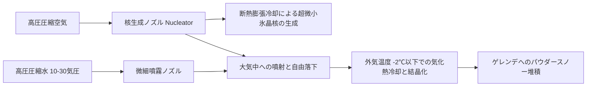

人工降雪機では、圧縮空気が大気中に噴出する際の断熱膨張（ジュール＝トムソン効果）によって局所温度が急激に低下し、水滴の一部を強制的に凍結させて「氷晶核」を作ります。そこに微小な水滴を吹きかけることで、数秒間の滞空時間の間に雪を成長させます。天然の樹枝状雪とは異なり、球状に近い締まった氷粒子となるため、踏み固めやすく融けにくいゲレンデのベース層を形成するのに最適な物性を持ちます。

---

## 11. 小林悌二による中谷ダイヤグラムの理論的精緻化と雪結晶の網羅的分類

中谷宇吉郎の弟子どもによって、雪の結晶物理学はさらなる飛躍を遂げました。特に北海道大学低温科学研究所の**小林悌二（こばやし ていじ、1925–2000）**は、水蒸気圧と氷の飽和蒸気圧比を用いた厳密な過飽和度表現を導入し、中谷ダイヤグラムの境界線を理論的に再定義した「小林ダイヤグラム」を完成させました。

```mermaid
flowchart TD
    subgraph 雪結晶の国際分類体系（80種分類）
        Basic[基本大分類: 8系統] --> Column[柱状・針状結晶群: C1-C6]
        Basic --> Plate[平板状結晶群: P1-P7]
        Basic --> Dendrite[樹枝状・星状結晶群: R1-R4]
        Basic --> ColumnPlate[柱板複合結晶群: 鼓型・砲弾型 CP1-CP4]
        Basic --> Rimed[雲粒付着雪群: R1-R4]
        Basic --> Graupel[霰・氷粒群: G1-G4]
        Basic --> Irregular[不規則形状雪群: I1-I4]
        Basic --> Germ[初期結晶・氷晶核: N1-N2]
    end
```

### 11.1 国際雪氷学会（IACS）による雪結晶分類
1951年、国際雪氷学会は中谷の業績をもとに「雪結晶の国際分類法（基本10分類）」を制定しました。その後、1966年にマゴノ・リー（Magono and Lee）により80種類におよぶ詳細な形態分類表が提案され、現代の気象観測でも世界標準として用いられています。

---

## 12. 氷の超高圧相図と宇宙の「異形の氷たち」

私たちが日常目にする六方晶氷 $I_h$ は、実は水という物質が取り得る**20種類以上におよぶ「結晶相（多形: Polymorphs）」**の、極めて低圧・温暖なごく一部の姿にすぎません。

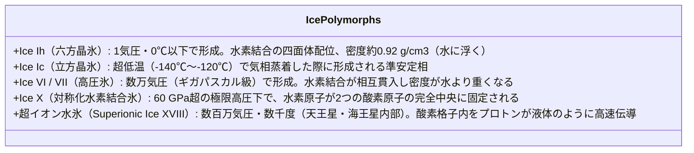

地球の地表環境では、氷が水に浮く（液体より固体の密度が低い）という極めて稀な性質を示しますが、木星の衛星ガニメデやエウロパ、天王星・海王星のような巨大氷惑星の深部では、数万から数百万気圧の高圧下で、**「水に沈む超高密度な氷」**や、金属のように電気を通す**「超イオン水氷」**が存在しています。雪の結晶の研究は、地球を飛び越えて太陽系と系外惑星の内部構造を解明する基礎物理学とも直結しているのです。

---

## 13. 空を彩る大気光学現象：雪結晶が織りなす光線追跡物理学

上空の巻雲や氷晶雲の中に漂う無数の微小な雪結晶（板状結晶や六角柱結晶）は、自然界が作り出した極小の**六角柱プリズム**として機能します。太陽光がこれらの整列した氷晶に入射し、屈折と内部反射を繰り返すことで、息をのむような大気光学現象（ハロ現象）が生み出されます。

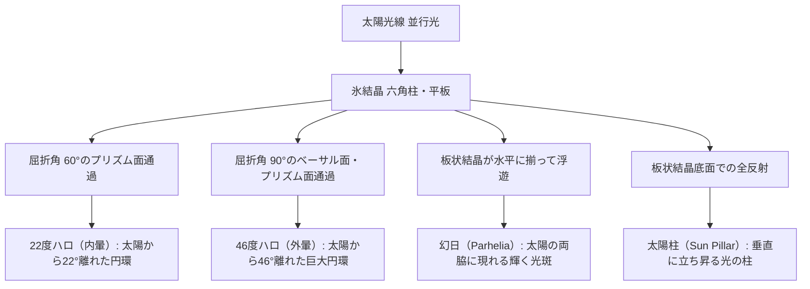

### 13.1 22度ハロ（内暈）と最小偏角
六角柱の側面のなす角は $60^\circ$ です。氷の屈折率 $n \approx 1.31$ をスネルの法則に代入して計算すると、光線が最小の偏角で通過する角度 $\theta_{\text{min}}$ は以下の式で求まります。

$$\sin\left(\frac{\theta_{\text{min}} + \alpha}{2}\right) = n \sin\left(\frac{\alpha}{2}\right)$$

プリズム角 $\alpha = 60^\circ$ を代入すると、$\theta_{\text{min}} \approx 21.84^\circ$（約22度）となり、太陽の周囲に半径22度の明るい光の輪（22度ハロ）が形成されます。

### 13.2 幻日（Sundogs）と太陽柱（Sun Pillars）
大気中を静かに落下する板状雪結晶は、空気抵抗によりベーサル面を水平に保った姿勢で安定浮遊します。この水平配向した板状結晶を太陽光が水平に通過すると、太陽の左右きっかり22度の位置に、まるで太陽が3つあるかのように輝く**「幻日（げんじつ）」**が現れます。また、朝焼けや夕焼けの光が水平な底面で鏡のように反射されると、垂直な光の柱が天に向かってそびえ立つ**「太陽柱（サンピラー）」**が現れます。これら神秘的な天体現象のすべてが、氷の六角結晶幾何学の必然の帰結なのです。

## 14. まとめ：自然界が描く非平衡パターンの究極の調和

雪の結晶は、平衡熱力学の静止した世界ではなく、**エネルギーと物質が絶え間なく散逸する「非平衡開放系」**においてのみ花開く奇跡の造形です。

1. **原子構造の反映**: ミクロな水分子の水素結合角度（$104.5^\circ$）が、マクロなミリメートルスケールの六角対称性を厳密に規定する。
2. **環境の記録媒体**: 温度と過飽和度のわずかな揺らぎが、中谷ダイヤグラムに従って結晶の成長軸を切り替え、唯一無二の形態を刻み込む。
3. **カオスと秩序の融合**: マリンズ・セッカ不安定性とギブス・トムソン効果がせめぎ合うことで、無限の多様性と幾何学的な均整が共存する。

中谷宇吉郎が看破した通り、手のひらに落ちては一瞬で消え去る雪のひとひらは、はるかな天空の物理状態を今に伝える、自然界で最も精緻で美しいメッセージなのです。
