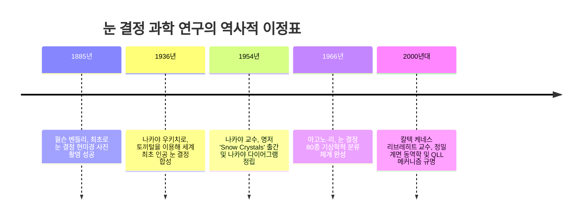
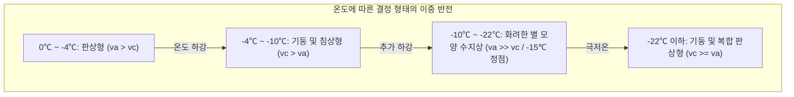

"눈은 하늘에서 보낸 편지다."

1936년 세계 최초로 인공 눈 결정을 만들어낸 일본의 물리학자 나카야 우키치로(1900–1962)의 이 유명한 명언은 시적 표현을 넘어 정밀한 자연과학적 진리를 담고 있습니다.

겨울 하늘에서 떨어지는 눈 결정(Snowflake)은 단 하나도 동일한 형태가 존재하지 않는다고 알려져 있습니다. 납작한 육각 판, 바늘 모양의 침상, 육각 기둥, 양치식물 잎처럼 아름답게 갈라진 별 모양 수지상 결정에 이르기까지, 이 정교한 형태는 눈 결정이 구름 속에서 태어나 지상으로 낙하하는 수십 분 동안 통과한 '온도'와 '수증기 과포화도'의 미세한 비행 궤적이 얼음의 기하학으로 기록된 것입니다.



---

## 1. 얼음 결정 격자와 육각 대칭성의 분자적 기원

눈 결정이 예외 없이 숫자 '6'의 대칭성을 따르는 이유는 물 분자($H_2O$)가 얼음으로 상전이할 때 형성하는 **수소결합 네트워크의 기하학적 구조**에 있습니다.

대기압 하에서 얼음은 **육방정계 얼음(Ice $I_h$)**으로 결정화됩니다. $sp^3$ 혼성궤도를 갖는 산소 원자는 주변 4개의 물 분자와 사면체 배위 수소결합을 이루며, 바닥면 내에서 육각형 고리가 의자(chair) 형태로 결합하여 벌집 모양의 격자를 구축합니다.

```mermaid
classDiagram
    class IceFacets {
        +기저면 Basal Facet {0001}: 육각기둥의 윗면과 아랫면 (c축에 수직)
        +주면 Prism Facet {10-10}: 육각기둥 측면의 6개 사각형 면 (c축에 평행)
        +성장 속도비 va / vc: a축(횡방향)과 c축(축방향) 성장 속도의 경쟁
        +판상 및 수지상: va >> vc (측면이 빠르게 성장하여 얇은 판이나 별 모양 형성)
        +기둥 및 바늘 모양: vc >> va (축방향이 빠르게 성장하여 기둥이나 침상 형성)
    }
```

결정의 거시적 외형은 **기저면 성장 속도($v_c$)와 주면 성장 속도($v_a$)의 상대적 경쟁**에 의해 결정됩니다.

---

## 2. 나카야 우키치로와 '나카야 다이어그램'

나카야 교수는 홋카이도 대학 저온실험실에서 탈지한 토끼털 한 가닥을 수증기 대류 챔버에 매달아 인공 눈 결정을 합성하고, 온도와 과포화도에 따른 결정 형태 분류표인 **나카야 다이어그램(Nakaya Diagram)**을 완성했습니다.

| 온도 구간 | 기본 형태 | 성장 우세축 | 고과포화도 발달 형태 |
| :--- | :--- | :--- | :--- |
| **$0^\circ\text{C} \sim -4^\circ\text{C}$** | 얇은 판상 (Plates) | $v_a > v_c$ | 부채꼴 육화 |
| **$-4^\circ\text{C} \sim -10^\circ\text{C}$** | 각기둥 및 바늘형 (Columns & Needles) | $v_c > v_a$ | 속 빈 기둥, 바늘 다발 |
| **$-10^\circ\text{C} \sim -22^\circ\text{C}$** | 별 모양 수지상 (Dendrites) | $v_a \gg v_c$ | **화려한 수지상 결정 ($-15^\circ\text{C}$에서 최대 속도)** |
| **$-22^\circ\text{C} \sim -35^\circ\text{C}$** | 다시 기둥 및 판상 (Columns & Plates) | $v_c \ge v_a$ | 총알 모양 군집, 두꺼운 판 |



온도가 낮아짐에 따라 '판 $\rightarrow$ 기둥 $\rightarrow$ 판 $\rightarrow$ 기둥'으로 주성장 축이 두 차례 교대 반전되는 현상은 비평형 통계물리학의 매혹적인 수수께끼입니다.

---

## 3. 비평형 계면 동역학과 수지상 패턴 형성

### 3.1 준액체층(Quasi-Liquid Layer, QLL)
영하의 온도에서도 얼음 표면 최외각 수 분자 층은 완전히 고정되지 않고 물처럼 유동성을 띠는 **준액체층(QLL)**으로 덮여 있습니다. 온도에 따라 기저면과 주면의 QLL 두께와 스텝 전진 속도가 독립적으로 변하면서 성장비 $v_a / v_c$의 반전이 일어납니다.

### 3.2 멀린스-세케르카 불안정성과 깁스-톰슨 효과
수증기 확산장에서 결정 표면에 미세한 돌기가 발생하면 돌기 끝으로 수증기 유속($J = -D \nabla C$)이 집중되어 성장이 가속되는 **멀린스-세케르카 불안정성**이 발생합니다. 반면 계면 곡률이 지나치게 커지는 것은 표면 장력에 의한 **깁스-톰슨 효과**가 억제합니다.

$$C_r \approx C_\infty \left(1 + \frac{2\gamma \Omega}{k_B T r}\right)$$

이 두 효과의 정밀한 길항 작용으로 일정한 팁 곡률을 유지하는 아름다운 수지상 가지가 형성됩니다.

---

## 4. 눈 결정의 여섯 가지는 왜 거의 동일한 형태인가?

눈 결정의 여섯 팔이 서로 정보를 주고받지 않음에도 거의 완벽한 대칭을 이루는 이유는 다음과 같습니다:
1. **극소 스케일의 환경 균일성**: 눈 결정의 크기는 수 밀리미터에 불과하여 결정 전체가 위치한 공기의 온습도 환경이 완전히 동일합니다.
2. **동일한 구름 낙하 이력**: 낙하하는 동안 난류를 만나 온도가 변할 때 여섯 가지의 끝부분이 **정확히 동일한 순간에 동일한 성장 모드 전환**을 기록합니다.
3. 여섯 가지는 독립적인 지진계처럼 동일한 하늘의 기상 환경을 각각 정직하게 기록한 결과물입니다.
---

## 5. 대기 광학 현상과 현대 기상 예측 기술

고공 권운 속에 떠다니는 미세한 육각 판상 및 기둥형 얼음 결정은 자연이 만든 정밀한 광학 프리즘 역할을 합니다. 태양광이 빙정의 프리즘 면을 통과할 때 최소 편각 22도로 굴절되어 태양 양옆에 또 하나의 태양처럼 빛나는 **'환일(Sundogs, 무리해)'** 현상이 나타나며, 밑면에서 반사될 때 수직으로 빛기둥이 솟아오르는 **'태양기둥(Sun Pillar)'**이 형성됩니다.

현대 기상학에서는 수평 및 수직 편파를 동시에 발사하는 **이중편파 기상레이더**를 활용하여 공중의 눈 결정 형태(판상, 바늘형, 싸락눈)를 실시간으로 스캔합니다. 나카야 다이어그램을 바탕으로 상공 구름 속의 수증기 과포화 상태를 역추정함으로써 대설 및 산악 눈사태 위험을 사전에 정밀하게 예보하고 있습니다.
