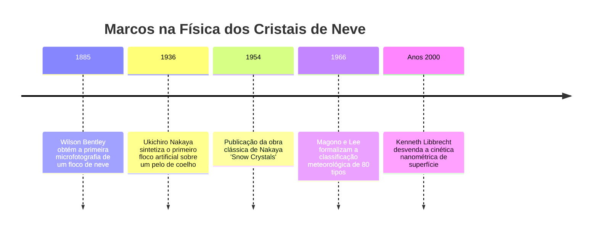
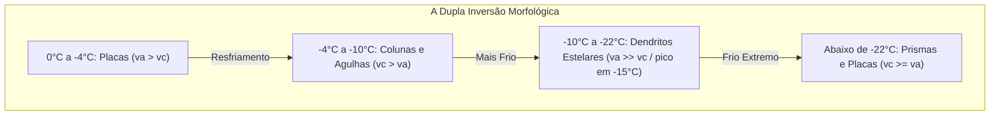

"Os cristais de neve são cartas enviadas do céu." Esta famosa máxima do físico japonês Ukichiro Nakaya (1900–1962), criador do primeiro floco de neve artificial em 1936, é uma verdade física rigorosa: a complexa arquitetura geométrica de um floco de neve é o registro codificado da temperatura e supersaturação de vapor que ele atravessou durante sua queda pelas nuvens.

Não existem dois flocos idênticos. De placas hexagonais planas a agulhas prismáticas e dendritos estelares intrincados, a morfologia da neve é um exemplo supremo de **formação de padrões fora do equilíbrio termodinâmico**.



---

## 1. Cristalografia do Gelo e a Origem da Simetria Hexagonal

A simetria de ordem 6 dos cristais de neve resulta da geometria de ligações de hidrogênio da molécula de água ($H_2O$).

À pressão atmosférica, o gelo forma a estrutura **hexagonal (Gelo $I_h$)**. O átomo de oxigênio com hibridização $sp^3$ coordena-se tetraedricamente com quatro moléculas vizinhas (ângulo de $104{,}5^\circ$). Os anéis hexagonais em conformação cadeira formam os planos basais do cristal.

```mermaid
classDiagram
    class FacetasDoGelo {
        +Facetas Basais {0001}: Superfícies planas superior e inferior, perpendiculares ao eixo c
        +Facetas Prismáticas {10-10}: Seis faces laterais retangulares, paralelas ao eixo c
        +Razão de Velocidade va / vc: Competição entre expansão lateral e axial
        +Placas e Dendritos: va >> vc (Expansão planar dominante)
        +Colunas e Agulhas: vc >> va (Crescimento axial dominante)
    }
```

A morfologia final decorre da disputa entre a **velocidade de crescimento basal ($v_c$)** e a **prismática ($v_a$)**.

---

## 2. Ukichiro Nakaya e o Diagrama de Morfologia

Suspendendo um pelo de coelho desengordurado em uma câmara de convecção resfriada, Nakaya controlou a temperatura ($T$) e a supersaturação ($s$), mapeando o clássico **Diagrama de Nakaya**.

| Intervalo Térmico | Hábito Principal | Razão de Velocidade | Morfologia em Alta Supersaturação |
| :--- | :--- | :--- | :--- |
| **$0^\circ\text{C}$ a $-4^\circ\text{C}$** | Placas Finas | $v_a > v_c$ | Estrelas de setores planos |
| **$-4^\circ\text{C}$ a $-10^\circ\text{C}$** | Colunas e Agulhas | $v_c > v_a$ | Prismas ocos, feixes de agulhas |
| **$-10^\circ\text{C}$ a $-22^\circ\text{C}$** | Dendritos Estelares | $v_a \gg v_c$ | **Dendritos ramificados (ápice em $-15^\circ\text{C}$)** |
| **$-22^\circ\text{C}$ a $-35^\circ\text{C}$** | Colunas e Placas | $v_c \ge v_a$ | Rosetas de balas |



A dupla alternância de eixos preferenciais de crescimento à medida que a temperatura cai permaneceu por décadas como um dos enigmas mais elegantes da matéria condensada.

---

## 3. Dinâmica Fora do Equilíbrio e Instabilidade Morfológica

- **Camada Quase-Líquida (QLL)**: Mesmo abaixo de $0^\circ\text{C}$, a superfície do gelo possui um filme desordenado de escala nanométrica cuja espessura e mobilidade de degraus moleculares modulam $v_a / v_c$.
- **Instabilidade de Mullins-Sekerka**: No campo de difusão de vapor ($\nabla^2 C = 0$), qualquer saliência nos vértices do hexágono concentra o fluxo de vapor ($J = -D \nabla C$), impulsionando o crescimento de seis braços ramificados.
- **Efeito Gibbs-Thomson**: A tensão superficial eleva a pressão de vapor de equilíbrio em pontas finas ($C_r \approx C_\infty (1 + \frac{2\gamma \Omega}{k_B T r})$), estabilizando o raio da ponta e moldando ramos laterais regulares.
- **Por que os seis braços são iguais?**: Na escala de milímetros, o ambiente térmico e de umidade ao redor do floco é perfeitamente uniforme, e todos os braços registram simultaneamente a mesma trajetória meteorológica na nuvem.
