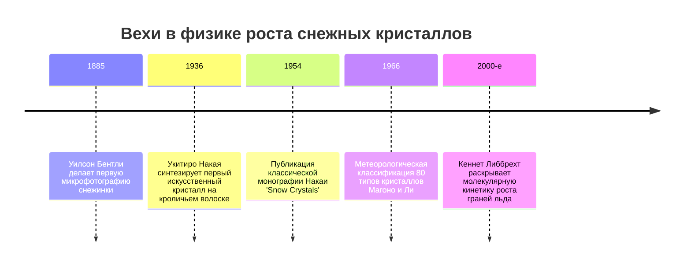
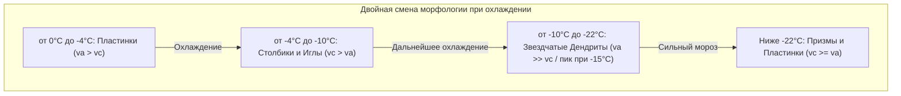

«Снег — это письмо, посланное с небес». Этот афоризм японского физика Укитиро Накаи (1900–1962), вырастившего в 1936 году первую в мире искусственную снежинку, отражает глубокую физическую реальность: архитектура снежного кристалла представляет собой зашифрованную летопись температурных условий и влажности облака, сквозь которое он падал.

Снежинки поражают бесконечным разнообразием форм: от плоских шестиугольных пластинок и тонких призм до роскошных звездчатых дендритов, иллюстрируя фундаментальные законы **самоорганизации структур в неравновесных термодинамических системах**.



---

## 1. Кристаллография льда и молекулярная природа симметрии

Шестилучевая симметрия снежинок задается геометрией водородных связей молекулы воды ($H_2O$).

При атмосферном давлении вода кристаллизуется в **гексагональный лед (Лед $I_h$)**. Атомы кислорода с $sp^3$-гибридизацией образуют тетраэдрическую сетку связей с углом $104{,}5^\circ$. В базисной плоскости молекулы формируют шестичленные кольца в конформации «кресло».

```mermaid
classDiagram
    class ГраниКристаллаЛьда {
        +Базисные грани {0001}: Верхнее и нижнее основания, перпендикулярные оси c
        +Призматические грани {10-10}: Шесть боковых граней, параллельные оси c
        +Отношение скоростей va / vc: Соотношение скоростей роста вдоль осей a и c
        +Пластинки и дендриты: va >> vc (Преобладает рост в плоскости)
        +Столбики и иглы: vc >> va (Преобладает осевой рост)
    }
```

---

## 2. Укитиро Накая и диаграмма морфологии

Подвесив обезжиренный кроличий волосок в охлаждаемой конвекционной камере, Накая исследовал зависимость формы кристаллов от температуры ($T$) и пересыщения пара ($s$), построив знаменитую **диаграмму Накаи**.

| Температурный диапазон | Преобладающая форма | Отношение скоростей | Форма при высоком пересыщении |
| :--- | :--- | :--- | :--- |
| **от $0^\circ\text{C}$ до $-4^\circ\text{C}$** | Тонкие пластинки | $v_a > v_c$ | Секторные пластинки |
| **от $-4^\circ\text{C}$ до $-10^\circ\text{C}$** | Призмы и иглы | $v_c > v_a$ | Пустые столбики, пучки игл |
| **от $-10^\circ\text{C}$ до $-22^\circ\text{C}$** | Звездчатые дендриты | $v_a \gg v_c$ | **Ветвистые дендриты (пик роста при $-15^\circ\text{C}$)** |
| **от $-22^\circ\text{C}$ до $-35^\circ\text{C}$** | Столбики и пластинки | $v_c \ge v_a$ | Пулевидные сростки |



---

## 3. Неравновесная кинетика и образование ветвей

- **Квазижидкий слой (QLL)**: Даже при температурах ниже $0^\circ\text{C}$ поверхность льда покрыта разупорядоченной пленкой толщиной в несколько молекул, кинетика ступеней которой модулирует отношение $v_a / v_c$.
- **Неустойчивость Маллинза-Секерки**: В диффузионном поле пара ($\nabla^2 C = 0$) малейший выступ на вершине шестиугольника собирает усиленный диффузионный поток ($J = -D \nabla C$), стимулируя взрывной рост главных лучей.
- **Эффект Гиббса-Томсона**: Рост поверхностной энергии на закругленных вершинах ($C_r \approx C_\infty (1 + \frac{2\gamma \Omega}{k_B T r})$) предотвращает сингулярность острия и стабилизирует радиус вершины.
- **Почему шесть лучей одинаковы?**: В масштабе миллиметров облачная среда абсолютно однородна, и все шесть лучей одновременно претерпевают идентичные изменения кинетики роста.
