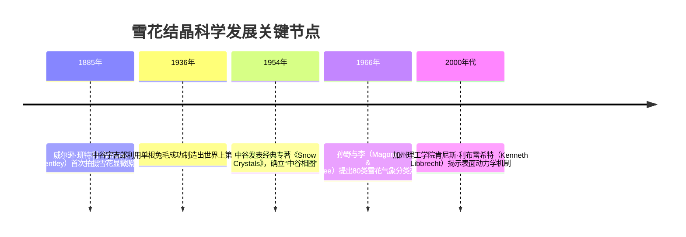
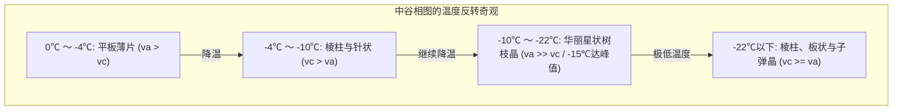

“雪是来自上天的信件。”——1936年世界上首次在实验室制造出人工雪晶的日本物理学家中谷宇吉郎（1900–1962）留下的这句名言，不仅充满诗意，更揭示了极其严谨的自然物理定律。

从冬日天空飘落的雪花形态千变万化，各不相同：从平整的六角薄板、细长的冰针、六棱柱，到如蕨类植物叶片般繁复华丽的星状树枝晶。这些令人叹为观止的几何微结构，正是雪晶在云层中经历数千米坠落旅程时，对沿途“温度”与“水汽过饱和度”微环境历史的忠实物理记录。



---

## 1. 冰晶晶格与六方对称性的分子起源

雪晶之所以严格遵循六次对称，根源在于水分子（$H_2O$）凝聚为固态时的**四面体配位与氢键网络几何学**。

在常压下，水分子结晶形成**六方晶冰（Ice $I_h$）**。氧原子的 $sp^3$ 杂化轨道与周围四个水分子形成配位氢键，键角约为 $104.5^\circ$。六个水分子在基底面内交替折叠连接为六元环“椅式”构象，构建出宏观的六方柱状晶胞。

```mermaid
classDiagram
    class IceCrystalFaces {
        +底面 Basal Facet {0001}: 六棱柱顶面与底面，垂直于c轴
        +棱面 Prism Facet {10-10}: 六棱柱侧面的6个长方形面，平行于c轴
        +生长速度比 va / vc: a轴（横向）与c轴（纵向）生长速率竞争
        +薄板与树枝状（Plates & Dendrites）: va >> vc（棱面极速向外扩展）
        +棱柱与冰针（Columns & Needles）: vc >> va（底面纵向极速伸长）
    }
```

宏观晶体的生长形态，归根结底取决于**底面生长速度（$v_c$）与棱面生长速度（$v_a$）的动态竞争**。

---

## 2. 中谷宇吉郎与“中谷相图”（Nakaya Diagram）

中谷宇吉郎在北海道大学低温实验室中，通过将一根脱脂兔毛悬挂在精确控温、控湿的上升水汽对流管中，系统测试了不同温度（$0^\circ\text{C} \sim -35^\circ\text{C}$）与过饱和水汽密度下的晶体形态，绘制了著名的**中谷相图**。

| 环境温度区间 | 优势晶形 | 轴向速度比 | 高过饱和度形态 |
| :--- | :--- | :--- | :--- |
| **$0^\circ\text{C} \sim -4^\circ\text{C}$** | 六角薄板状（Plates） | $v_a > v_c$ | 扇形薄板 |
| **$-4^\circ\text{C} \sim -10^\circ\text{C}$** | 细长棱柱与针状（Columns & Needles） | $v_c > v_a$ | 空心柱、针状集合体 |
| **$-10^\circ\text{C} \sim -22^\circ\text{C}$** | 绚丽树枝与星状（Dendrites） | $v_a \gg v_c$ | **经典星状树枝晶（在 $-15^\circ\text{C}$ 处生长最快）** |
| **$-22^\circ\text{C} \sim -35^\circ\text{C}$** | 棱柱与薄板复合物 | $v_c \ge v_a$ | 子弹状多晶、厚板 |



这种随着温度线性降低，生长轴在“板 $\rightarrow$ 柱 $\rightarrow$ 板 $\rightarrow$ 柱”之间发生**双重交替反转**的现象，是晶体物理学中最引人入胜的非平衡态难题。

---

## 3. 非平衡界面动力学与图样形成

现代物理学表明，雪花形态由**宏观水汽扩散场**与**纳米级晶体表面动力学**共同决定。

### 3.1 准液体层（Quasi-Liquid Layer, QLL）
即便在零下几十度的极寒环境中，冰晶表面最外侧数层分子仍呈现杂乱无序的高流动性薄膜，称为**准液体层（QLL）**。温度的改变直接决定了底面与棱面上QLL的厚度以及表面台阶移动速度，导致 $v_a / v_c$ 比例剧烈倒转。

### 3.2 马林斯-塞克尔卡形态不稳定性与吉布斯-汤姆逊效应
在水汽过饱和扩散场中，晶体表面由拉普拉斯方程主导（$\nabla^2 C = 0$）：


当六角平面的顶点出现微小的凸起扰动时，凸起尖端伸入更远的水汽扩散场，局域浓度梯度急剧增大，从而吸引更多水汽分子实现正反馈加速生长（**马林斯-塞克尔卡不稳定性**）。而**吉布斯-汤姆逊效应**所伴随的界面张力使得尖端不可能无限细化：

$$C_r \approx C_\infty \left(1 + \frac{2\gamma \Omega}{k_B T r}\right)$$

正负机制的精密制衡，最终形成了稳定前进而不断分叉的对称树枝晶。

---

## 4. 为什么雪花的六个分支几乎完全相同？

雪花六个分支之所以呈现惊人一致的对称性，原因在于：
1. **微环境绝对均匀**：单朵雪花尺寸仅数毫米，在此尺度上环境温度与过饱和度完全均一。
2. **相同的动力学历程**：雪花在云层中翻滚下落的数十分钟内，经历强烈的气流与温湿度振荡。六个分支的尖端在完全相同的物理时刻经历了完全相同的生长模式切换。
3. **独立同历记录仪**：分支之间并不需要量子力学或声波信号进行“信息通信”，它们只是在同一张乐谱下各自精准演奏出完全一致的旋律。
---

## 5. 大气光学奇观与现代降雪预测技术

高空卷云中大量水平漂浮的六角板状与棱柱状冰晶，构成了自然界精密的微型光学棱镜。当阳光穿过冰晶棱面发生折射时，会在太阳两侧22度处形成璀璨如副日的**“幻日（Sundogs）”**，而在底面反射时则会形成垂直贯穿天际的**“日柱（Sun Pillar）”**。

在现代气象学中，**双偏振天气雷达（Dual-polarization Radar）**利用水平与垂直电磁波的差动反射率（$Z_{dr}$），能够在上空云层中直接辨识降雪晶体的微观形态（板状、柱状还是霰粒）。结合中谷相图，气象科学家得以反推高空云层内部的水汽饱和度与上升气流强度，为城市暴雪与道路结冰提供极高精度的灾害预警。
### 5.3 宇宙冰多晶相与极端物理学
在常压地表形成的雪花只是冰的数十种多晶形态之一。在木卫二或天王星深处，存在着数万大气压下形成的密度大于液态水的超高压冰（Ice VI、Ice VII），乃至在数百万大气压和数千度高温下质子自由流动的超离子态冰（Superionic Ice）。对雪花晶体生长动力学的探索，不仅揭开了自然界雪花之美，更为我们理解宇宙冰天体提供了极为关键的理论基石。
