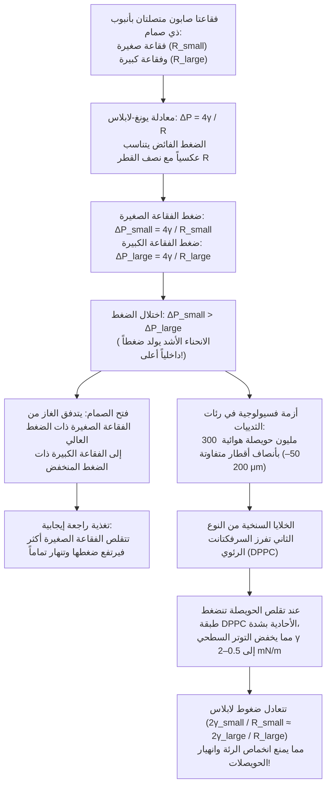
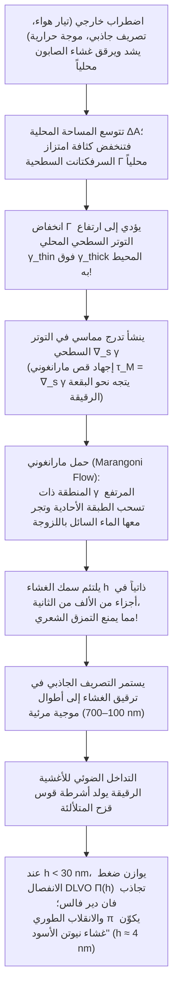

عندما تغمس حلقة في الماء والصابون وتنفخ فيها بلطف، يتمدد غشاء سائل رقيق وينفصل ليسترخي في غضون أجزاء من الألف من الثانية مكوِّناً كرة متلألئة بألوان قوس قزح تسبح في الهواء. وإذا تأملت رغوة الصابون عبر عدسة مكبرة، ستكتشف أن ما يبدو فوضى عشوائية يخضع في الحقيقة لنظام هندسي صارم لا يقبل المساومة: فجدران الأغشية السائلة لا تلتقي أبداً أربعةً أو خمسةً معاً، بل تلتقي حصرياً <strong>ثلاثةً ثلاثةً</strong> على طول قنوات سائلة تُسمى حدود بلاتو بزاوية دقيقة قدرها <strong>$120^\circ$ ($2\pi/3$)</strong>، وتلتقي هذه القنوات بدورها حصرياً <strong>أربعاً أربعاً</strong> عند الرؤوس وفق الزاوية الرباعية الأوجه الدقيقة <strong>$\arccos(-1/3) \approx 109.4712^\circ$</strong>.

لماذا تتخذ فقاعة الصابون الحرة شكلاً كروياً دائماً؟ ولماذا عندما نصل فقاعة صغيرة بأخرى كبيرة عبر أنبوب تتقلص الفقاعة <em>الصغيرة</em> وتنفخ الفقاعة <em>الكبيرة</em> على عكس البديهة — ولماذا لا يؤدي هذا عدم الاستقرار نفسه إلى انهيار 300 مليون حويصلة هوائية في رئتينا مع كل زفير؟ ولماذا تنفجر فقاعات الماء النقي أو الكحول النقي في أجزاء من الألف من الثانية بينما تمنح كمية ضئيلة من المادة الخافضة للتوتر السطحي (الصابون) الغشاء مرونةً ذاتية الالتئام؟ وكيف سقطت حدسية اللورد كلفن التي صمدت 107 أعوام حول تقسيم الفضاء ثلاثي الأبعاد بأقل مساحة سطحية عام 1994 أمام هيكل ويري-فيلان؟

في هذا المقال نجمع بين الديناميكا الحرارية، والهندسة التفاضلية، وحساب التغيرات، ونظرية القياس الهندسي،وميكانيكا الموائع البينية لكشف الفيزياء الرياضية الكاملة لفقاعات الصابون والرغوة.

---

## 1. الديناميكا الحرارية للتوتر السطحي وعدم التماثل الجزيئي

في قلب السائل (Bulk) داخل الماء، يكون كل جزيء $\text{H}_2\text{O}$ محاطاً بشكل متماثل في جميع الاتجاهات بجزيئات مجاورة ترتبط معه عبر شبكة من الروابط الهيدروجينية وقوى فان دير فالس. ولذلك تتلاشى محصلة القوى المتوسطة زمنياً، ويستقر الجزيء في حالة طاقة وضع تماسكية منخفضة (عدد التناسق $z_b \approx 12$، وطاقة التماسك $-u_0$).

أما عند <strong>السطح البيني بين السائل والبخار</strong>، فينكسر هذا التماثل بشدة؛ إذ تقل كثافة الجزيئات في الطور الغازي بنحو ثلاث رتب أسية عنها في الطور السائل. ونتيجةً لذلك، يفقد الجزيء الموجود على السطح قرابة نصف جيرانه الجاذبين ($z_s < z_b$) ويمتلك طاقة وضع فائضة. ولنقل الجزيئات من داخل السائل إلى السطح لزيادة مساحة السطح البيني $A$ بمقدار $dA$، لا بد من بذل شغل عكوس موجب ضد قوى التماسك.

يُعطى التفاضل الكلي لطاقة غيبس الحرة $G(T, P, A, \{N_i\})$ بالعلاقة:

$$dG = -S\,dT + V\,dP + \gamma\,dA + \sum_{i} \mu_i\,dN_i$$

ومنها نحصل على التعريف الديناميكي الحراري الدقيق <strong>للتوتر السطحي</strong> $\gamma$:

$$\gamma \equiv \left( \frac{\partial G}{\partial A} \right)_{T, P, N_i} = \left( \frac{\partial F}{\partial A} \right)_{T, V, N_i}$$

ويحمل التوتر السطحي معنيين فيزيائيين متكافئين:
1. <strong>الطاقة الحرة الفائضة لكل وحدة مساحة ($\text{J/m}^2$)</strong>: عند ثبات الحجم $V$، يتجه النظام تلقائياً نحو تقليل طاقته الحرة $\gamma A$ عبر تقليل مساحته السطحية $A$. وبموجب <strong>المتباينة المتساوية المحيط (Isoperimetric Inequality)</strong> في الفضاء ثلاثي الأبعاد $A^3 \ge 36\pi V^2$، فإن الكرة هي الشكل الهندسي الوحيد الذي يحقق أصغر مساحة سطحية لحجم معين.
2. <strong>قوة الشد المماسية لكل وحدة طول ($\text{N/m}$)</strong>: وفق <strong>صيغة كيركوود-باف (1949)</strong> في الميكانيكا الإحصائية، يُعبر عن $\gamma$ بتكامل عدم تماثل موتر الضغط بين المركبة العمودية $P_N$ والمركبة المماسية $P_T(z)$ عبر طبقة الانتقال البينية:
   $$\gamma = \int_{-\infty}^{+\infty} \bigl[ P_N - P_T(z) \bigr]\,dz$$

| السائل / النظام البيني (عند $20^\circ\text{C}$ مع الهواء) | التوتر السطحي $\gamma$ ($\text{mN/m}$) | التفاعل الجزيئي السائد | استقرار الأغشية الرقيقة والفقاعات |
| :--- | :---: | :--- | :--- |
| الزئبق السائل ($\text{Hg}$) | $486.5$ | رابطة فلزية | انعدام استقرار الغشاء؛ يتكور فوراً |
| الماء النقي ($\text{H}_2\text{O}$) | $72.8$ | شبكة روابط هيدروجينية + ثنائيات أقطاب | ينفجر في أجزاء من الألف من الثانية (بلا مرونة مارانغوني) |
| الإيثانول النقي ($\text{C}_2\text{H}_5\text{OH}$) | $22.3$ | روابط هيدروجينية ضعيفة + قوى تشتت | لا يكوّن غشاءً مستقراً بمفرده (ظاهرة «دموع النبيذ») |
| محلول الصابون / SDS (قرب CMC) | $25.0 \sim 35.0$ | طبقة أحادية من جزيئات مزدوجة الألفة | <strong>مستقر من دقائق إلى ساعات</strong> (تأثير غيبس-مارانغوني) |
| سرفكتانت الرئة (طبقة DPPC مضغوطة) | $0.5 \sim 2.0$ | دهون فسفورية مشبعة فائقة التراص | <strong>فائق الاستقرار</strong> (يمنع انهيار الحويصلات الرئوية) |

---

## 2. الهندسة التفاضلية للأسطح المنحنية ومعادلة يونغ-لابلاس

عندما يكون السطح البيني منحنياً، تولد قوى الشد المماسية $\gamma$ مركبة عمودية صافية تتجه نحو مركز الانحناء (الجانب المقعر)، مما يفرض قفزة في الضغط $\Delta P = P_{\text{in}} - P_{\text{out}} > 0$. ليكن $R_1, R_2$ نصفي قطر الانحناء الرئيسيين ($\kappa_1 = 1/R_1, \kappa_2 = 1/R_2$) لسطح أملس $\Sigma \subset \mathbb{R}^3$. يُعرَّف <strong>متوسط الانحناء</strong> $H$ <strong>وانحناء غاوس</strong> $K$ بالعلاقتين:

$$H \equiv \frac{\kappa_1 + \kappa_2}{2} = \frac{1}{2}\left(\frac{1}{R_1} + \frac{1}{R_2}\right), \qquad K \equiv \kappa_1 \kappa_2 = \frac{1}{R_1 R_2}$$

عند إزاحة رقعة متناهية الصغر $dA = R_1 R_2\,d\theta_1\,d\theta_2$ إزاحةً افتراضية عمودية $\delta\xi$، يكون تغير المساحة من الرتبة الأولى $\delta(dA) = dA\left(\frac{1}{R_1} + \frac{1}{R_2}\right)\delta\xi$ والحجم الممسوح $\delta(dV) = dA\,\delta\xi$. ومن شرط الاتزان الترموديناميكي $\delta F = \gamma\,\delta(dA) - \Delta P\,\delta(dV) = 0$ نشتق <strong>معادلة يونغ-لابلاس (1805–1806)</strong>:

$$\Delta P = P_{\text{in}} - P_{\text{out}} = \gamma\left(\frac{1}{R_1} + \frac{1}{R_2}\right) = 2\gamma H$$

بينما تمتلك قطرة الماء في الهواء سطحاً بينياً <strong>واحداً فقط</strong> ($\Delta P_{\text{droplet}} = 2\gamma/R$)، فإن <strong>فقاعة الصابون في الهواء</strong> عبارة عن قشرة سائلة رقيقة بسمك $h \ll R$ تمتلك <strong>سطحين بينيين (غاز-سائل)</strong> (داخلي بنصف قطر $R$ وخارجي بنصف قطر $R+h$)، ومن هنا يظهر المعامل $4$:

$$\Delta P_{\text{soap}} = (P_{\text{in}} - P_{\text{film}}) + (P_{\text{film}} - P_{\text{out}}) = \frac{2\gamma}{R} + \frac{2\gamma}{R+h} \approx \frac{4\gamma}{R}$$

---

## 3. الأسطح الدنيا ($H = 0$)، وكارثة السطح السلسلي (Catenoid)، ومسألة بلاتو

عندما يمتد غشاء صابون مفتوح عبر إطار سلكي دون حبس حجم من الهواء، يتعرض كلا وجهيه لنفس الضغط الجوي ($\Delta P = 0$). وتفرض معادلة يونغ-لابلاس عندئذٍ أن ينعدم متوسط الانحناء في كل نقطة:

$$H = \frac{1}{2}\left(\frac{1}{R_1} + \frac{1}{R_2}\right) = 0 \quad \Longleftrightarrow \quad \kappa_1 = -\kappa_2 \quad \Longrightarrow \quad K = -\kappa_1^2 \le 0$$

تُعرف الأسطح التي تحقق $H \equiv 0$ باسم <strong>الأسطح الدنيا (Minimal Surfaces)</strong>. وفي التمثيل الديكارتي $z = u(x,y)$، يؤدي تصغير دالي المساحة $A[u] = \iint \sqrt{1+u_x^2+u_y^2}\,dx\,dy$ إلى معادلة أويلر-لاغرانج التفاضلية الجزئية غير الخطية (لاغرانج، 1760):

$$\bigl(1 + u_y^2\bigr) u_{xx} - 2 u_x u_y u_{xy} + \bigl(1 + u_x^2\bigr) u_{yy} = 0$$

كل نقطة غير مستوية على غشاء الصابون المفتوح هي محلياً نقطة سرج زائدية ($K < 0$). والسطح الأدنى الدوراني الممتد بين حلقتين دائريتين متحدتي المحور بنصف قطر $R$ والمسافة بينهما $2h$ هو <strong>السطح السلسلي (الكاتينويد، Catenoid)</strong> الذي اكتشفه أويلر عام 1744:

$$r(z) = c \cosh\!\left(\frac{z}{c}\right)$$

عند إبعاد الحلقتين تدريجياً لما يتجاوز النسبة الحرجة ($\coth u_c = u_c \approx 1.19968$):

$$\left(\frac{2h}{R}\right)_{\text{crit}} = \frac{2u_c}{\cosh u_c} \approx 1.32548$$

يختفي الحل الحقيقي عبر تشعب العقدة والسرج، فينقبض عنق الغشاء الصابوني وينقطع قافزاً إلى قرصين مستويين منفصلين (<strong>حل غولدشميت غير المستمر</strong>). وقد حُلت <strong>مسألة بلاتو</strong> العامة عام 1930 على يد جيسي دوغلاس (الحائز على أول ميدالية فيلدز عام 1936) وتيبور رادو.

---

## 4. مفارقة الفقاعتين، ونضج أوستفالد، ومادة السرفكتانت الرئوية (DPPC)

إذا وصلنا فقاعة صابون صغيرة ($R_{\text{small}}$) بفقاعة كبيرة ($R_{\text{large}}$) عبر أنبوب مزود بصمام، فإنه بمجرد فتح الصمام <strong>تتقلص الفقاعة الصغيرة بسرعة وتفرغ هواءها داخل الفقاعة الكبيرة فتزداد كِبَراً</strong>! فبحسب القانون $\Delta P = 4\gamma/R$، يتناسب الضغط الداخلي عكسياً مع نصف القطر:

$$R_{\text{small}} < R_{\text{large}} \quad \Longrightarrow \quad \Delta P_{\text{small}} = \frac{4\gamma}{R_{\text{small}}} \;>\; \frac{4\gamma}{R_{\text{large}}} = \Delta P_{\text{large}}$$

وفي الرغوة الحقيقية، يؤدي انتشار الغاز عبر الأغشية السائلة من الفقاعات الصغيرة إلى الكبيرة إلى خشونة الرغوة أو <strong>نضج أوستفالد (Ostwald Ripening)</strong>. وفي عام 1952، أثبت <strong>جون فون نيومان</strong> باستخدام مبرهنة غاوس-بونيه أنه في الرغوة الجافة ثنائية الأبعاد، تتغير مساحة الخلية المضلعة ذات $n$ أضلاع وفق <strong>قانون فون نيومان</strong>:

$$\frac{dA_n}{dt} = K_0 (n - 6)$$

فالخلايا التي لها $n < 6$ أضلاع تنكمش وتختفي، والمسدسات ($n = 6$) تظل ثابتة تماماً، والخلايا التي لها $n > 6$ تنمو باستمرار (وتم تعميم القانون لثلاثة أبعاد بواسطة ماكفرسون وسرولوفيتز عام 2007).

تحتوي رئتا الإنسان على نحو <strong>300 مليون حويصلة هوائية (Alveoli)</strong> ($R \approx 50\text{–}200\,\mu\text{m}$). ولو كان التوتر السطحي $\gamma$ ثابتاً، لانهارت الحويصلات الصغيرة فوراً داخل الكبيرة (<strong>الانخماص الرئوي، Atelectasis</strong>). غير أن الخلايا السنخية من النوع الثاني تمنع ذلك بإفراز <strong>السرفكتانت الرئوي</strong> الغني بمركب <strong>ثنائي بالميتويل فوسفاتيديل كولين (DPPC)</strong>؛ فعند الزفير وتقلص الحويصلة، تنضغط طبقة DPPC غير الذائبة في الماء بشدة فينخفض $\gamma(R)$ إلى نحو $0.5\text{–}2\,\text{mN/m}$، مما يحفظ استقرار جميع الحويصلات.

---

## 5. قوانين جوزيف بلاتو (1873)، وبرهان جين تايلور (1976)، ومبرهنة الفقاعة المزدوجة

صاغ الفيزيائي البلجيكي الكفيف <strong>جوزيف بلاتو</strong> عام 1873 القوانين الهندسية لاتزان الرغوة، وبرهنتها رياضياً <strong>جين تايلور (Jean E. Taylor)</strong> عام 1976 باستخدام نظرية القياس الهندسي:

1. <strong>قانون بلاتو الأول (3 أغشية بزاوية $120^\circ$)</strong>: تلتقي أغشية الصابون حصرياً <strong>ثلاثةً ثلاثةً</strong> على طول <strong>حدود بلاتو</strong> بزوايا متساوية قدرها <strong>$120^\circ$ ($2\pi/3$)</strong> ($\sum_{i=1}^3 \hat{\mathbf{t}}_i = \mathbf{0} \implies \cos\theta = -1/2$). أما تقاطع 4 أغشية بزاوية $90^\circ$ ($L_{\text{cross}} = 4\sqrt{2} \approx 5.657$) فهو غير مستقر وينشطر فوراً إلى عقدتين ثلاثيتين بزاوية $120^\circ$ وفق شجرة شتاينر ($L_{\text{Steiner}} = 2(1+\sqrt{3}) \approx 5.464$، انتقال طوبولوجي T1).
2. <strong>قانون بلاتو الثاني (4 حواف بزاوية $109.47^\circ$)</strong>: تلتقي حدود بلاتو حصرياً <strong>أربعاً أربعاً</strong> عند الرؤوس وفق <strong>زاوية مارالدي الرباعية الأوجه</strong>:
   $$\theta_{\text{Maraldi}} = \arccos\!\left(-\frac{1}{3}\right) \approx 109.47122^\circ \quad \left(109^\circ 28' 16''\right)$$
3. <strong>مبرهنة الفقاعة المزدوجة (Hutchings, Morgan, Ritoré, Ros 2000)</strong>: عند التحام فقاعتين بنصفي قطر $R_1 > R_2$، ينحني الحاجز المشترك (Septum) نحو داخل الفقاعة الكبرى بنصف قطر انحناء $R_{\text{septum}}$ يحقق:
   $$\frac{1}{R_{\text{septum}}} = \frac{1}{R_2} - \frac{1}{R_1} \quad \Longleftrightarrow \quad R_{\text{septum}} = \frac{R_1 R_2}{R_1 - R_2}$$

---

## 6. حدسية كلفن (1887) في مواجهة هيكل ويري-فيلان (1994)

في عام 1887، طرح <strong>اللورد كلفن</strong> مسألة تقسيم الفضاء $\mathbb{R}^3$ إلى خلايا متساوية الحجم ($V=1$) بأقل مساحة سطحية. وبسبب <strong>الإحباط الهندسي</strong>، اقترح كلفن <strong>ثماني الأوجه المقطوع (ذو 14 وجهاً: 6 مربعات و8 مسدسات، خلية فورونوي لشبكة BCC)</strong> المنحني قليلاً بمساحة معيارية $A_{\text{Kelvin}} \approx 5.30628$.

وبعد 107 أعوام، نقض الفيزيائيان <strong>دينيس ويري</strong> <strong>وروبرت فيلان</strong> (كلية ترينيتي في دبلن) عام 1994 حدسية كلفن باكتشاف <strong>هيكل ويري-فيلان (Weaire-Phelan Structure)</strong> المستوحى من هيدرات الكلاثرات من النوع الأول، وتتكون خليته الأولية المكعبة من <strong>8 كثيرات أوجه متساوية الحجم من نوعين</strong>: <strong>اثنين من اثني عشري الأوجه الخماسي غير المنتظم ($5^{12}$)</strong> و<strong>ستة من أربعة عشري الأوجه ($5^{12}6^2$ ذي وجهين مسدسين و12 وجهاً خماسياً)</strong>. ولأن $88.9\%$ من الأوجه خماسية (زاويتها الداخلية $108^\circ$ قريبة جداً من $109.47^\circ$)، تنخفض المساحة بنسبة $0.34\%$ إلى $A_{\text{WP}} \approx 5.28825$، وهو الهيكل الذي شُيِّد به <strong>المركز الوطني للرياضات المائية في بكين («مكعب الماء»)</strong>.

| هيكل الرغوة الماليء للفضاء ثلاثي الأبعاد | الخلايا في الوحدة $Z$ | طوبولوجيا الأوجه (متوسط $\langle F \rangle$) | يحقق قوانين بلاتو؟ | المساحة المعيارية $A$ ($V=1$) | الفرق عن كلفن |
| :--- | :---: | :--- | :---: | :---: | :---: |
| <strong>الشبكة المكعبة البسيطة</strong> | $1$ | $6$ مربعات ($\langle F \rangle = 6.00$) | لا (غير مستقر) | $6.00000$ | $+13.07\%$ |
| <strong>اثنا عشري الأوجه المعيني (FCC)</strong> | $1$ | $12$ معيناً ($\langle F \rangle = 12.00$) | لا (رؤوس سداسية غير مستقرة) | $5.34539$ | $+0.74\%$ |
| <strong>هيكل كلفن (1887, BCC)</strong> | $1$ | $6$ مربعات + $8$ مسدسات ($\langle F \rangle = 14.00$) | <strong>نعم</strong> (مسدسات منحنية) | $5.30628$ | $0.00\%$ (المرجع) |
| <strong>هيكل ويري-فيلان (1994, A15)</strong> | $8$ ($2+6$) | $88.9\%$ خماسيات + $11.1\%$ مسدسات ($\langle F \rangle = 13.50$) | <strong>نعم</strong> (انحناء طفيف) | <strong>$5.28825$</strong> | <strong>$-0.34\%$ (الرقم القياسي)</strong> |

---

## 7. مرونة غيبس-مارانغوني، والتداخل الضوئي، وضغط الانفصال DLVO

إن انخفاض التوتر السطحي وحده لا يكفي لاستقرار الفقاعة (فالإيثانول النقي ينفجر فوراً). بل يكمن سر بقاء غشاء الصابون في <strong>مرونة غيبس-مارانغوني (Gibbs-Marangoni Elasticity)</strong>:

عندما يتمدد الغشاء ويرق محلياً، تنخفض كثافة السرفكتانت السطحية $\Gamma$ فيرتفع التوتر السطحي المحلي $\gamma_{\text{thin}}$. ويعمل <strong>إجهاد مارانغوني</strong> $\boldsymbol{\tau}_M = \nabla_s \gamma$ و<strong>معامل مرونة غيبس</strong>

$$E_G \equiv 2A\left(\frac{\partial\gamma}{\partial A}\right)_{N_s} = -2\Gamma\left(\frac{\partial\gamma}{\partial\Gamma}\right)_T > 0$$

على سحب السائل فوراً نحو المنطقة المرققة لإصلاحها (وهو نفس التأثير المسؤول عن <strong>«دموع النبيذ»</strong> على جدران الكأس). وعندما يتناقص السمك $h$ إلى نطاق الضوء المرئي، يحدث <strong>تداخل الأغشية الرقيقة</strong> ($2n_{\text{film}}h\cos\theta_t + \lambda/2 = m\lambda$). وتحت $h \ll \lambda/4 \approx 30\,\text{nm}$، يؤدي انقلاب الطور بمقدار $\pi$ عند السطح الأمامي إلى تداخل هدام لجميع الأطوال الموجية المرئية فيبدو الغشاء أسود تماماً (<strong>غشاء نيوتن الأسود</strong>، $h \approx 4\,\text{nm}$)، محمياً من الانهيار بفضل <strong>ضغط الانفصال (Disjoining Pressure) وفق نظرية DLVO</strong> $\Pi(h) = \Pi_{\text{vdW}}(h) + \Pi_{\text{el}}(h) + \Pi_{\text{sr}}(h)$.
