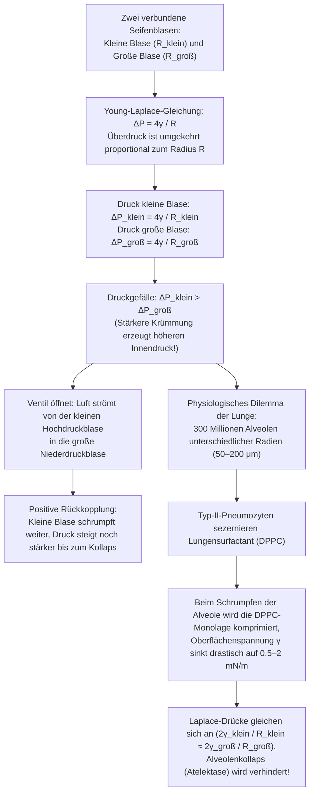
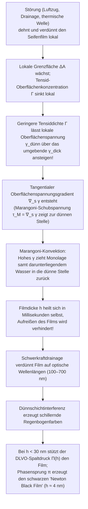

Taucht man einen Ring in Seifenlauge und bläst vorsichtig hinein, dehnt sich ein dünner Flüssigkeitsfilm aus, schnürt sich ab und entspannt sich binnen Millisekunden zu einer schillernden, perfekt kugelförmigen Seifenblase. Betrachtet man Seifenschaum (einen wässrigen Schaum) unter einer Lupe, offenbart das scheinbare Chaos eine kompromisslose geometrische Ordnung: Flüssigkeitslamellen treffen sich niemals zu viert oder fünft an einer Kante, sondern ausschließlich <strong>zu dritt</strong> unter einem exakten Winkel von <strong>$120^\circ$ ($2\pi/3$)</strong>, und diese Flüssigkeitskanten (Plateau-Ränder) treffen sich wiederum ausschließlich <strong>zu viert</strong> in Knotenpunkten unter dem exakten Tetraederwinkel von <strong>$\arccos(-1/3) \approx 109{,}4712^\circ$</strong>.

Warum nimmt eine freie Seifenblase zwingend die Kugelform an? Warum schrumpft kontraintuitiv die <em>kleinere</em> Seifenblase und bläst die <em>größere</em> auf, wenn man beide über ein Röhrchen verbindet – und warum führt genau dieser Effekt nicht dazu, dass die 300 Millionen Lungenbläschen (Alveolen) unserer Lunge bei jedem Ausatmen kollabieren? Warum zerplatzen Blasen aus reinem Wasser oder reinem Alkohol in Millisekunden, während eine Spur Tensid dem Film eine selbstheilende Elastizität verleiht? Und wie wurde Lord Kelvins 107 Jahre alte Vermutung über die flächenminimale Raumteilung in gleiche Volumina 1994 durch eine aus Clathrat-Hydraten entlehnte Struktur widerlegt?

Dieser Artikel verbindet Thermodynamik, Differentialgeometrie, Variationsrechnung, geometrische Maßtheorie und Grenzflächenhydrodynamik zu einer geschlossenen Darstellung der Physik der Seifenblasen und Schäume.

---

## 1. Thermodynamik der Oberflächenspannung und molekulare Asymmetrie

Im Inneren (Bulk) von flüssigem Wasser ist jedes $\text{H}_2\text{O}$-Molekül isotrop von Nachbarmolekülen umgeben und über Wasserstoffbrückenbindungen sowie Van-der-Waals-Kräfte (Dipol-Dipol- und London-Dispersionskräfte) gebunden. Die zeitlich gemittelte resultierende Kraft verschwindet im Inneren, und das Molekül befindet sich in einem energetisch günstigen Potentialtopf (Koordinationszahl $z_b \approx 12$, Kohäsionsenergie $-u_0$).

An der <strong>Flüssig-Gas-Grenzfläche</strong> ist diese Symmetrie jedoch gebrochen: Auf der Gasseite ist die Teilchendichte um rund drei Größenordnungen geringer als in der Flüssigkeit. Ein Oberflächenmolekül verliert daher fast die Hälfte seiner anziehenden Nachbarn ($z_s < z_b$) und besitzt eine höhere potentielle Energie. Um Moleküle aus dem Inneren an die Oberfläche zu bringen und die Grenzfläche $A$ um $dA$ zu vergrößern, muss reversible Arbeit gegen die Kohäsionskräfte geleistet werden.

Das totale Differential der freien Enthalpie (Gibbs-Energie) $G(T, P, A, \{N_i\})$ lautet:

$$dG = -S\,dT + V\,dP + \gamma\,dA + \sum_{i} \mu_i\,dN_i$$

Hieraus folgt die exakte thermodynamische Definition der <strong>Oberflächenspannung</strong> $\gamma$:

$$\gamma \equiv \left( \frac{\partial G}{\partial A} \right)_{T, P, N_i} = \left( \frac{\partial F}{\partial A} \right)_{T, V, N_i}$$

Sie besitzt zwei physikalisch äquivalente Bedeutungen:
1. <strong>Flächenspezifische freie Exzessenergie ($\text{J/m}^2$)</strong>: Ein System strebt bei konstantem Volumen $V$ dem Minimum seiner freien Energie zu und minimiert daher seine Oberfläche $A$. Nach der dreidimensionalen <strong>isoperimetrischen Ungleichung</strong> $A^3 \ge 36\pi V^2$ ist die Kugel der eindeutige Körper minimaler Oberfläche bei gegebenem Volumen.
2. <strong>Mechanische Zugspannung pro Längeneinheit ($\text{N/m}$)</strong>: Nach der statistisch-mechanischen <strong>Kirkwood-Buff-Formel (1949)</strong> ergibt sich $\gamma$ als Integral der Spannungsanisotropie zwischen Normaldruck $P_N$ und Tangentialdruck $P_T(z)$ senkrecht zur Grenzfläche:
   $$\gamma = \int_{-\infty}^{+\infty} \bigl[ P_N - P_T(z) \bigr]\,dz$$

| Flüssigkeit / Grenzflächensystem ($20^\circ\text{C}$ gegen Luft) | Oberflächenspannung $\gamma$ ($\text{mN/m}$) | Dominante Wechselwirkung | Stabilität dünner Filme & Blasen |
| :--- | :---: | :--- | :--- |
| Quecksilber ($\text{Hg}$) | $486{,}5$ | Metallische Bindung | Keine Filmstabilität; sofortige Tropfenbildung |
| Reines Wasser ($\text{H}_2\text{O}$) | $72{,}8$ | Wasserstoffbrücken-Netzwerk | Zerplatzt in Millisekunden (keine Marangoni-Elastizität) |
| Reines Ethanol ($\text{C}_2\text{H}_5\text{OH}$) | $22{,}3$ | Schwache H-Brücken + Dispersion | Kein stabiler Reinstoff-Film (erzeugt „Kirchenfenster“ im Wein) |
| Seifenlösung / SDS-Lösung (nahe CMC) | $25{,}0 \sim 35{,}0$ | Amphiphile Tensid-Monolage | <strong>Minuten bis Stunden stabil</strong> (Gibbs-Marangoni-Effekt) |
| Lungensurfactant (komprimierte DPPC-Monolage) | $0{,}5 \sim 2{,}0$ | Dicht gepackte gesättigte Phospholipide | <strong>Extrem stabil</strong> (verhindert Alveolenkollaps in der Lunge) |

---

## 2. Differentialgeometrie gekrümmter Flächen und die Young-Laplace-Gleichung

Ist eine Grenzfläche gekrümmt, erzeugen die tangentialen Zugkräfte $\gamma$ eine resultierende Normalkraft zur konkaven Innenseite hin. Seien $R_1, R_2$ die beiden orthogonalen <strong>Hauptkrümmungsradien</strong> ($\kappa_1 = 1/R_1, \kappa_2 = 1/R_2$ die Hauptkrümmungen) einer glatten Fläche $\Sigma \subset \mathbb{R}^3$. Dann sind die <strong>mittlere Krümmung</strong> $H$ und die <strong>Gaußsche Krümmung</strong> $K$ definiert durch:

$$H \equiv \frac{\kappa_1 + \kappa_2}{2} = \frac{1}{2}\left(\frac{1}{R_1} + \frac{1}{R_2}\right), \qquad K \equiv \kappa_1 \kappa_2 = \frac{1}{R_1 R_2}$$

Verschiebt man ein infinitesimales Flächenstück $dA = R_1 R_2\,d\theta_1\,d\theta_2$ virtuell um $\delta\xi$ in Normalenrichtung, ändert sich die Fläche in erster Ordnung um $\delta(dA) = dA\left(\frac{1}{R_1} + \frac{1}{R_2}\right)\delta\xi$, während das überstrichene Volumen $\delta(dV) = dA\,\delta\xi$ beträgt. Aus der Gleichgewichtsbedingung $\delta F = \gamma\,\delta(dA) - \Delta P\,\delta(dV) = 0$ folgt die <strong>Young-Laplace-Gleichung (1805/1806)</strong> für eine einzelne Grenzfläche:

$$\Delta P = P_{\text{in}} - P_{\text{out}} = \gamma\left(\frac{1}{R_1} + \frac{1}{R_2}\right) = 2\gamma H$$

Ein kugelförmiger Wassertropfen besitzt nur <strong>eine</strong> Grenzfläche ($\Delta P_{\text{Tropfen}} = 2\gamma/R$). Eine <strong>Seifenblase in Luft</strong> besteht hingegen aus einer dünnen Flüssigkeitsschale der Dicke $h \ll R$ und besitzt daher <strong>zwei Gas-Flüssig-Grenzflächen</strong> (eine innere bei $R$ und eine äußere bei $R+h$). Die Addition der beiden Drucksprünge liefert den berühmten Faktor $4$:

$$\Delta P_{\text{Seifenblase}} = (P_{\text{in}} - P_{\text{Film}}) + (P_{\text{Film}} - P_{\text{out}}) = \frac{2\gamma}{R} + \frac{2\gamma}{R+h} \approx \frac{4\gamma}{R}$$

---

## 3. Minimalflächen ($H = 0$), die Katenoid-Katastrophe und das Plateau-Problem

Spannt eine offene Seifenhaut sich über einen beliebig gebogenen Drahtrahmen, ohne ein Luftvolumen einzuschließen, herrscht auf beiden Seiten derselbe Atmosphärendruck ($\Delta P = 0$). Die Young-Laplace-Gleichung erzwingt dann in jedem Punkt das Verschwinden der mittleren Krümmung:

$$H = \frac{1}{2}\left(\frac{1}{R_1} + \frac{1}{R_2}\right) = 0 \quad \Longleftrightarrow \quad \kappa_1 = -\kappa_2 \quad \Longrightarrow \quad K = -\kappa_1^2 \le 0$$

Flächen mit $H \equiv 0$ heißen <strong>Minimalflächen</strong>. In Monge-Darstellung $z = u(x,y)$ genügt die Minimierung des Flächenfunktionals $A[u] = \iint \sqrt{1+u_x^2+u_y^2}\,dx\,dy$ der nichtlinearen elliptischen <strong>Minimalflächengleichung</strong> von Lagrange (1760):

$$\bigl(1 + u_y^2\bigr) u_{xx} - 2 u_x u_y u_{xy} + \bigl(1 + u_x^2\bigr) u_{yy} = 0$$

Jeder nicht-ebene Punkt einer offenen Seifenhaut ist lokal ein hyperbolischer Sattelpunkt ($K < 0$). Die klassische Rotationsminimalfläche zwischen zwei koaxialen Kreisringen vom Radius $R$ im Abstand $2h$ ist das 1744 von Leonhard Euler entdeckte <strong>Katenoid (Kettenfläche)</strong>:

$$r(z) = c \cosh\!\left(\frac{z}{c}\right)$$

Zieht man die Ringe auseinander, existiert eine reelle Lösung der Randbedingung $R = c\cosh(h/c)$ nur bis zum kritischen Abstand ($\coth u_c = u_c \approx 1{,}19968$):

$$\left(\frac{2h}{R}\right)_{\text{krit}} = \frac{2u_c}{\cosh u_c} \approx 1{,}32548$$

Überschreitet der Ringabstand $1{,}32548 R$, verschwindet das Katenoid in einer Sattel-Knoten-Bifurkation, schnürt sich in der Mitte ab und springt in zwei ebene Kreisscheiben (die <strong>Goldschmidt-Lösung</strong>). Die allgemeine Existenzfrage einer flächenminimierenden Fläche zu jeder geschlossenen Jordan-Kurve (<strong>Plateau-Problem</strong>) wurde 1930 unabhängig von Jesse Douglas (Fields-Medaille 1936) und Tibor Radó gelöst.

---

## 4. Das Zwei-Blasen-Paradoxon, Ostwald-Reifung und das Überleben unserer Lungenbläschen

Verbindet man eine kleine Seifenblase ($R_{\text{klein}}$) und eine große Seifenblase ($R_{\text{groß}}$) über ein Rohr mit Ventil und öffnet das Ventil, strömt die Luft nicht etwa von der großen in die kleine Blase, sondern <strong>die kleine Blase bläst die große Blase weiter auf und schrumpft selbst zusammen!</strong>

Denn nach $\Delta P = 4\gamma/R$ ist der Innendruck umso größer, je kleiner der Radius ist:

$$R_{\text{klein}} < R_{\text{groß}} \quad \Longrightarrow \quad \Delta P_{\text{klein}} = \frac{4\gamma}{R_{\text{klein}}} \;>\; \frac{4\gamma}{R_{\text{groß}}} = \Delta P_{\text{groß}}$$

In realen Schäumen diffundiert Gas ständig durch die Flüssigkeitslamellen von den kleinen Hochdruckblasen in die großen Niederdruckblasen (<strong>Ostwald-Reifung / Schaumvergröberung</strong>). Für zweidimensionale trockene Schäume bewies <strong>John von Neumann (1952)</strong> mit dem Satz von Gauß-Bonnet das exakte Wachstumsgesetz einer $n$-seitigen Blasenzelle der Fläche $A_n$:

$$\frac{dA_n}{dt} = K_0 (n - 6)$$

Zellen mit $n < 6$ Kanten schrumpfen und verschwinden, Sechsecke ($n = 6$) bleiben stationär, und Zellen mit $n > 6$ wachsen unabhängig von ihrer aktuellen Größe (die 3D-Verallgemeinerung gelang MacPherson und Srolovitz 2007).

In der menschlichen Lunge sind rund <strong>300 Millionen Alveolen</strong> ($R \approx 50\text{–}200\,\mu\text{m}$) parallel geschaltet. Wäre die Oberflächenspannung $\gamma$ konstant, würden die kleineren Alveolen sofort in die größeren entleert werden und kollabieren (<strong>Atelektase</strong>). Dass wir atmen können, verdanken wir dem von Typ-II-Alveolarzellen gebildeten <strong>Lungensurfactant</strong> mit seinem Hauptbestandteil <strong>Dipalmitoylphosphatidylcholin (DPPC)</strong>: Schrumpft eine Alveole beim Ausatmen, wird die wasserunlösliche DPPC-Monolage so dicht gepackt, dass $\gamma(R)$ auf fast null ($0{,}5\text{–}2\,\text{mN/m}$) abfällt und alle Alveolen stabil koexistieren.

---

## 5. Die Gesetze von Joseph Plateau (1873), Jean Taylors Beweis (1976) und der Doppelblasensatz

Der erblindete belgische Physiker <strong>Joseph Plateau</strong> formulierte 1873 die universellen Gleichgewichtsregeln für Schäume, die <strong>Jean E. Taylor</strong> 1976 mithilfe der geometrischen Maßtheorie streng bewies:

1. <strong>1. Plateau-Gesetz (3 Filme unter $120^\circ$)</strong>: Drei Seifenlamellen treffen sich längs eines <strong>Plateau-Randes</strong> stets unter gleichen Winkeln von <strong>$120^\circ$ ($2\pi/3$)</strong>, da das Kräftegleichgewicht $\sum_{i=1}^3 \hat{\mathbf{t}}_i = \mathbf{0}$ zwingend $\cos\theta = -1/2$ erfordert. Ein 4-fach-Kreuzungspunkt unter $90^\circ$ ($L_{\text{Kreuz}} = 4\sqrt{2} \approx 5{,}657$) ist instabil und spaltet sich sofort in zwei $120^\circ$-Dreifachpunkte eines Steiner-Baums ($L_{\text{Steiner}} = 2(1+\sqrt{3}) \approx 5{,}464$) auf (<strong>T1-Prozess</strong>).
2. <strong>2. Plateau-Gesetz (4 Kanten unter $109{,}47^\circ$)</strong>: Vier Plateau-Ränder (und sechs Lamellen) treffen sich in einem Knotenpunkt stets unter dem <strong>Tetraeder- bzw. Maraldi-Winkel</strong> ($\sum_{i=1}^4 \hat{\mathbf{e}}_i = \mathbf{0} \implies 1 + 3\cos\theta = 0$):
   $$\theta_{\text{Maraldi}} = \arccos\!\left(-\frac{1}{3}\right) \approx 109{,}47122^\circ \quad \left(109^\circ 28' 16''\right)$$
3. <strong>Doppelblasensatz (Hutchings, Morgan, Ritoré, Ros 2000)</strong>: Verschmelzen zwei Seifenblasen mit den Radien $R_1 > R_2$, wölbt sich die gemeinsame Trennwand (Septum) in die größere Blase hinein, und ihr Krümmungsradius $R_{\text{Septum}}$ erfüllt:
   $$\frac{1}{R_{\text{Septum}}} = \frac{1}{R_2} - \frac{1}{R_1} \quad \Longleftrightarrow \quad R_{\text{Septum}} = \frac{R_1 R_2}{R_1 - R_2}$$

---

## 6. Lord Kelvins Vermutung (1887) gegen die Weaire-Phelan-Struktur (1994)

1887 fragte <strong>Lord Kelvin</strong>, welche Zerlegung des dreidimensionalen Raumes $\mathbb{R}^3$ in Zellen gleichen Volumens ($V = 1$) die geringste Grenzfläche besitzt. Da reguläre Pentagondodekaeder den Raum nicht lückenlos füllen können (<strong>geometrische Frustration</strong>), schlug Kelvin das leicht gekrümmte <strong>abgestumpfte Oktaeder (Tetrakaidekaeder aus 6 Quadraten und 8 Sechsecken, BCC-Voronoi-Zelle)</strong> mit einer normierten Oberfläche von $A_{\text{Kelvin}} \approx 5{,}30628$ vor.

Nach 107 Jahren widerlegten <strong>Denis Weaire</strong> und <strong>Robert Phelan</strong> (Trinity College Dublin) 1994 Kelvins Vermutung durch die <strong>Weaire-Phelan-Struktur</strong> (inspiriert von Typ-I-Clathrathydraten), deren kubische Einheitszelle aus <strong>8 volumengleichen Polyedern zweier Typen</strong> besteht: <strong>2 unregelmäßigen Pentagondodekaedern ($5^{12}$)</strong> und <strong>6 Tetrakaidekaedern ($5^{12}6^2$ mit 2 Sechsecken und 12 Fünfecken)</strong>. Da $88{,}9\%$ aller Flächen Fünfecke sind (deren Innenwinkel von $108^\circ$ fast exakt dem Maraldi-Winkel $109{,}47^\circ$ entspricht), sinkt die Fläche um $0{,}34\%$ auf $A_{\text{WP}} \approx 5{,}28825$ – berühmt geworden durch die Architektur des <strong>Pekinger Nationalen Schwimmzentrums („Water Cube“)</strong>.

| 3D-Raumteilungs-Schaumstruktur | Zellen pro Einheitszelle $Z$ | Flächentopologie (mittlere Flächenzahl $\langle F \rangle$) | Erfüllt Plateau-Gesetze? | Normierte Oberfläche $A$ ($V=1$) | Differenz zu Kelvin |
| :--- | :---: | :--- | :---: | :---: | :---: |
| <strong>Kubisches Gitter (Würfel)</strong> | $1$ | $6$ Quadrate ($\langle F \rangle = 6{,}00$) | Nein (instabil) | $6{,}00000$ | $+13{,}07\%$ |
| <strong>Rhombendodekaeder (FCC)</strong> | $1$ | $12$ Rauten ($\langle F \rangle = 12{,}00$) | Nein (6-fach-Knoten instabil) | $5{,}34539$ | $+0{,}74\%$ |
| <strong>Kelvin-Struktur (1887, BCC)</strong> | $1$ | $6$ Vierecke + $8$ Sechsecke ($\langle F \rangle = 14{,}00$) | <strong>Ja</strong> (gekrümmte Sechsecke) | $5{,}30628$ | $0{,}00\%$ (Referenz) |
| <strong>Weaire-Phelan-Struktur (1994, A15)</strong> | $8$ ($2+6$) | $88{,}9\%$ Fünfecke + $11{,}1\%$ Sechsecke ($\langle F \rangle = 13{,}50$) | <strong>Ja</strong> (minimal gekrümmt) | <strong>$5{,}28825$</strong> | <strong>$-0{,}34\%$ (Rekord)</strong> |

---

## 7. Gibbs-Marangoni-Elastizität, Dünnschichtinterferenz und DLVO-Spaltdruck

Eine niedrige Oberflächenspannung allein stabilisiert keinen Flüssigkeitsfilm (reines Ethanol mit $\gamma = 22{,}3\,\text{mN/m}$ zerplatzt sofort). Entscheidend ist die <strong>Gibbs-Marangoni-Elastizität</strong>:

Wird ein Seifenfilm lokal gedehnt, sinkt dort die Tensidbelegungsdichte $\Gamma$, wodurch die lokale Oberflächenspannung $\gamma_{\text{dünn}}$ ansteigt. Die resultierende <strong>Marangoni-Spannung</strong> $\boldsymbol{\tau}_M = \nabla_s \gamma$ und der <strong>Gibbs-Elastizitätsmodul</strong>

$$E_G \equiv 2A\left(\frac{\partial\gamma}{\partial A}\right)_{N_s} = -2\Gamma\left(\frac{\partial\gamma}{\partial\Gamma}\right)_T > 0$$

ziehen sofort Tensid und Flüssigkeit in die verdünnte Stelle zurück (derselbe Marangoni-Effekt erzeugt die <strong>„Tränen des Weins“</strong> im Weinglas). Sinkt die Filmdicke $h$ durch Drainage in den Bereich sichtbarer Wellenlängen, entsteht durch Reflexion an Vorder- und Rückseite <strong>Dünnschichtinterferenz</strong> ($2n_{\text{Film}}h\cos\theta_t + \lambda/2 = m\lambda$). Unterhalb von $h \ll \lambda/4 \approx 30\,\text{nm}$ führt der Phasensprung von $\pi$ an der Vorderseite zu destruktiver Interferenz für alle Wellenlängen gleichzeitig: Der Film erscheint tiefschwarz (<strong>Newton Black Film</strong>, $h \approx 4\,\text{nm}$), stabilisiert durch den elektrostatischen und sterischen <strong>DLVO-Spaltdruck (Disjoining Pressure)</strong> $\Pi(h) = \Pi_{\text{vdW}}(h) + \Pi_{\text{el}}(h) + \Pi_{\text{sr}}(h)$.
