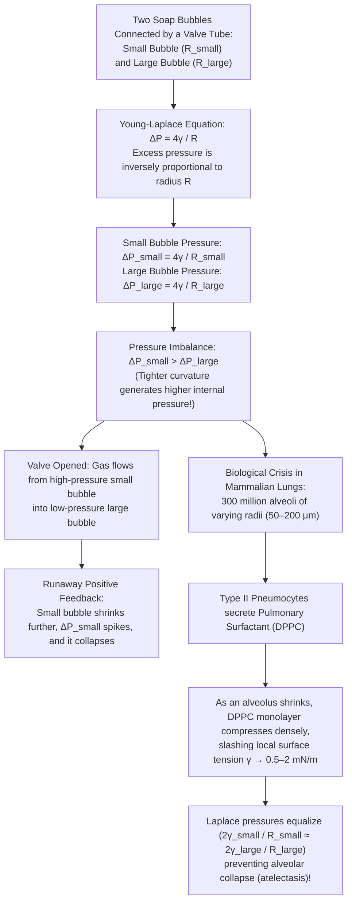
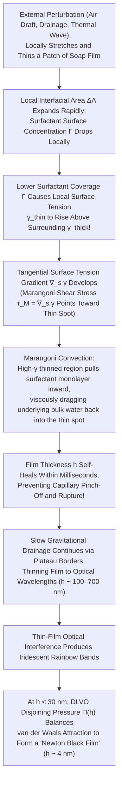

Dip a plastic wand into soapy water, blow gently, and a thin liquid sheet stretches out, pinches off, and relaxes within milliseconds into a shimmering, iridescent sphere floating through the air. Or peer closely through a magnifying lens at a bowl of soapsuds (an aqueous foam): what looks at first glance like a chaotic froth is in fact governed by an uncompromising geometric rigor. Throughout the entire foam, liquid walls never meet in fours or fives—they meet exclusively in <strong>threes</strong> along curved liquid channels at an exact dihedral angle of <strong>$120^\circ$ ($2\pi/3$)</strong>, and those channels in turn meet exclusively in <strong>fours</strong> at vertices at the exact tetrahedral angle of <strong>$\arccos(-1/3) \approx 109.4712^\circ$</strong>.

Why does a free soap bubble always adopt a spherical shape? Why does connecting a small soap bubble to a large soap bubble via a hollow tube cause the <em>small</em> bubble to shrink and inflate the <em>large</em> bubble—and why doesn't this exact same instability cause the 300 million microscopic alveoli in your lungs to collapse with every breath? Why do bubbles of pure water or pure alcohol burst in milliseconds, whereas adding a trace of surfactant grants a liquid film a self-healing elasticity that lets it survive for minutes or hours? And how did a 107-year-old conjecture by Lord Kelvin—asking for the most efficient way to partition three-dimensional space into cells of equal volume—finally fall in 1994 to a structure borrowed from clathrate hydrates?

In this article, we synthesize thermodynamics, differential geometry, the calculus of variations, geometric measure theory, and interfacial fluid mechanics to uncover the complete mathematical physics of soap bubbles and foams.

---

## 1. Thermodynamics and Statistical Mechanics of Surface Tension

### 1.1 Molecular Asymmetry at the Liquid-Vapor Interface

Inside the bulk of liquid water, each $\text{H}_2\text{O}$ molecule is surrounded isotropically by neighboring molecules, interacting via a dynamic network of hydrogen bonds and van der Waals forces (Keesom dipole-dipole interactions, Debye induction, and London dispersion forces). Because the local molecular environment is statistically isotropic in the bulk, the time-averaged intermolecular force on any interior molecule vanishes, and its mean cohesive potential energy can be written as $-u_0$ ($u_0 > 0$), corresponding to an effective bulk coordination number $z_b \approx 12$ (or $\sim 4$ tetrahedral hydrogen bonds).

A molecule residing at the <strong>liquid-vapor interface</strong> experiences a drastically broken symmetry. Below the interface lies dense liquid; above it lies vapor whose molecular number density at ambient conditions is roughly three orders of magnitude smaller ($\rho_v / \rho_l \sim 10^{-3}$). Consequently, an interfacial molecule loses nearly half of its attractive cohesive neighbors ($z_s < z_b$) and possesses an excess potential energy of order $\Delta\epsilon \approx u_0 (z_b - z_s)/(2 z_b) > 0$ relative to a molecule in the bulk.

Transporting molecules from the interior bulk to create new interfacial area $dA$ therefore requires performing reversible positive work $\delta W_{\text{rev}}$ against cohesive intermolecular forces.

### 1.2 Gibbs Free Energy and the Kirkwood-Buff Stress Tensor

For a multicomponent, two-phase thermodynamic system held at temperature $T$ and external pressure $P$ with an interfacial area $A$, the fundamental differential of the total Gibbs free energy $G(T, P, A, \{N_i\})$ is

$$dG = -S\,dT + V\,dP + \gamma\,dA + \sum_{i} \mu_i\,dN_i$$

where $\mu_i$ is the chemical potential of species $i$, and the conjugate intensive variable $\gamma$ is the <strong>surface tension</strong> (or specific interfacial free energy):

$$\gamma \equiv \left( \frac{\partial G}{\partial A} \right)_{T, P, \{N_i\}} = \left( \frac{\partial F}{\partial A} \right)_{T, V, \{N_i\}}$$

This thermodynamic identity endows $\gamma$ with two physically equivalent interpretations:

1. <strong>Free energy per unit area ($\text{J/m}^2$)</strong>: By the second law of thermodynamics, a system at constant $T$ and $V$ (or $P$) spontaneously evolves toward a minimum of its free energy. If gravity and external constraints are negligible, a fixed volume $V$ of liquid minimizes $\gamma A$ by minimizing its surface area $A$. By the classical three-dimensional <strong>isoperimetric inequality</strong>,
   $$A^3 \ge 36\pi V^2$$
   where equality holds if and only if the domain is a geometric sphere. This is the fundamental thermodynamic reason raindrops and free-floating soap bubbles are spherical.
2. <strong>Mechanical tension per unit length ($\text{N/m}$)</strong>: Consider a soap film stretched across a U-shaped wire frame of width $L$ with a movable crossbar. Pulling the crossbar by an infinitesimal distance $dx$ increases the geometric area of the frame by $L\,dx$. Because a freestanding soap film has <strong>two</strong> liquid-vapor interfaces (front and back), the total interfacial area increases by $dA = 2L\,dx$. Equating the mechanical work done by the external pulling force, $\delta W = F_{\text{ext}}\,dx$, to the free energy increase $\gamma\,dA = 2\gamma L\,dx$ yields
   $$\gamma = \frac{F_{\text{ext}}}{2L}$$
   confirming that each interface exerts a tangential contractile force of magnitude $\gamma$ per unit length along any line drawn on the surface ($\text{N/m} = \text{J/m}^2$).

From the microscopic perspective of statistical mechanics, the <strong>Kirkwood-Buff formula (1949)</strong> expresses surface tension in terms of the anisotropy of the local pressure (stress) tensor across a planar interface normal to the $z$-axis:

$$\gamma = \int_{-\infty}^{+\infty} \bigl[ P_N - P_T(z) \bigr]\,dz$$

Here $P_N(z) = P_{\text{bulk}}$ is the normal pressure component (constant across a planar interface by mechanical equilibrium $\nabla \cdot \mathbf{P} = \mathbf{0}$), while $P_T(z) = P_{xx}(z) = P_{yy}(z)$ is the tangential pressure component. Deep inside either bulk phase ($z \to \pm\infty$), the stress tensor is isotropic ($P_T = P_N$) and the integrand vanishes. Within the nanometer-thin interfacial transition zone, however, strong uncompensated attractive forces between liquid molecules generate a large negative tangential pressure ($P_T(z) \ll P_N$), i.e., a high tensile stress parallel to the surface whose integral over $z$ equals $\gamma$.

| Liquid / Interfacial System (at $20^\circ\text{C}$ against air) | Surface Tension $\gamma$ ($\text{mN/m} = 10^{-3}\,\text{N/m}$) | Dominant Intermolecular Interaction | Thin-Film & Bubble Stability |
| :--- | :---: | :--- | :--- |
| Liquid Mercury ($\text{Hg}$) | $486.5$ | Metallic bonding | Zero film stability; beads up instantaneously |
| Pure Water ($\text{H}_2\text{O}$) | $72.8$ | 3D hydrogen-bond network + dipole forces | Ruptures in milliseconds (no Marangoni elasticity) |
| Pure Ethanol ($\text{C}_2\text{H}_5\text{OH}$) | $22.3$ | Weak hydrogen bonding + dispersion forces | Cannot sustain films alone (drives "Tears of Wine") |
| Aqueous Soap / SDS Solution (near CMC) | $25.0 \sim 35.0$ | Amphiphilic surfactant monolayer | <strong>Stable for minutes to hours</strong> (Gibbs-Marangoni effect) |
| Pulmonary Surfactant (compressed DPPC monolayer) | $0.5 \sim 2.0$ | Tightly packed saturated phospholipids | <strong>Ultra-stable</strong> (prevents alveolar collapse in lungs) |

---

## 2. Differential Geometry of Curved Surfaces and the Young-Laplace Equation

When an interface is curved rather than planar, the in-plane tensile forces $\gamma$ do not cancel purely within a tangent plane; instead, they acquire a net normal component directed toward the center of curvature. Consequently, equilibrium requires a pressure jump $\Delta P = P_{\text{in}} - P_{\text{out}} > 0$ across the interface, with higher pressure on the concave side. This fundamental relationship was formulated qualitatively by Thomas Young in 1805 and derived mathematically by Pierre-Simon Laplace in 1806.

### 2.1 Principal Curvatures $\kappa_1, \kappa_2$, Mean Curvature $H$, and Gaussian Curvature $K$

Let $\Sigma \subset \mathbb{R}^3$ be a smooth orientable surface with unit normal vector field $\hat{\mathbf{n}}$ pointing from the inner (concave) side toward the outer (convex) side. At any point $p \in \Sigma$, intersecting $\Sigma$ with a normal plane containing $\hat{\mathbf{n}}$ and a unit tangent vector $\hat{\mathbf{t}}(\phi) \in T_p\Sigma$ produces a planar curve whose signed curvature at $p$ is the normal curvature $\kappa_n(\phi)$.

By Euler's theorem in differential geometry, the shape operator (Weingarten map) $S_p = -d\hat{\mathbf{n}}_p : T_p\Sigma \to T_p\Sigma$ is a self-adjoint linear operator. Its eigenvalues $\kappa_1$ and $\kappa_2$ are the maximum and minimum normal curvatures at $p$, called the <strong>principal curvatures</strong>, achieved along orthogonal eigenvectors $\hat{\mathbf{e}}_1, \hat{\mathbf{e}}_2 \in T_p\Sigma$. Their reciprocals $R_1 = 1/\kappa_1$ and $R_2 = 1/\kappa_2$ are the <strong>principal radii of curvature</strong>. The trace and determinant of the shape operator define the two fundamental extrinsic/intrinsic curvature invariants of the surface:

$$\text{Mean Curvature:} \quad H \equiv \frac{1}{2}\operatorname{Tr}(S_p) = \frac{\kappa_1 + \kappa_2}{2} = \frac{1}{2}\left(\frac{1}{R_1} + \frac{1}{R_2}\right)$$

$$\text{Gaussian Curvature:} \quad K \equiv \det(S_p) = \kappa_1 \kappa_2 = \frac{1}{R_1 R_2}$$

### 2.2 Variational Derivation of the Young-Laplace Equation

Consider an infinitesimal curvilinear rectangular patch on $\Sigma$ centered at $p$, aligned with the principal directions $\hat{\mathbf{e}}_1, \hat{\mathbf{e}}_2$, having side lengths $ds_1 = R_1\,d\theta_1$ and $ds_2 = R_2\,d\theta_2$ and initial area $dA = ds_1\,ds_2 = R_1 R_2\,d\theta_1\,d\theta_2$.

Now subject the surface patch to an infinitesimal virtual displacement $\delta\xi$ along the outward normal $\hat{\mathbf{n}}$. The principal radii of curvature increase from $R_1, R_2$ to $R_1 + \delta\xi$ and $R_2 + \delta\xi$, so the stretched arc lengths become

$$ds_1' = (R_1 + \delta\xi)\,d\theta_1 = ds_1\left(1 + \frac{\delta\xi}{R_1}\right), \qquad ds_2' = (R_2 + \delta\xi)\,d\theta_2 = ds_2\left(1 + \frac{\delta\xi}{R_2}\right)$$

Expanding the new area $dA' = ds_1'\,ds_2'$ to first order in $\delta\xi$ gives the first variation of interfacial area:

$$\delta(dA) = dA' - dA = ds_1\,ds_2\left[\left(1 + \frac{\delta\xi}{R_1}\right)\left(1 + \frac{\delta\xi}{R_2}\right) - 1\right] = dA\left(\frac{1}{R_1} + \frac{1}{R_2}\right)\delta\xi + \mathcal{O}(\delta\xi^2)$$

Meanwhile, the infinitesimal volume swept out by the normal displacement is $\delta(dV) = dA\,\delta\xi$. In thermodynamic and mechanical equilibrium, the first variation of the grand/Helmholtz potential $\delta\Omega = \gamma\,\delta(dA) - (P_{\text{in}} - P_{\text{out}})\,\delta(dV)$ must vanish for arbitrary normal displacements $\delta\xi$:

$$\delta\Omega = \left[\gamma\left(\frac{1}{R_1} + \frac{1}{R_2}\right) - \Delta P\right] dA\,\delta\xi = 0$$

This immediately yields the celebrated <strong>Young-Laplace Equation</strong> for a single fluid interface:

$$\Delta P = P_{\text{in}} - P_{\text{out}} = \gamma\left(\frac{1}{R_1} + \frac{1}{R_2}\right) = 2\gamma H$$

### 2.3 Why a Soap Bubble Has $\Delta P = 4\gamma/R$ While a Liquid Droplet Has $\Delta P = 2\gamma/R$

A critical physical distinction arises when applying the Young-Laplace equation to a liquid droplet versus a soap bubble in air:

* <strong>Liquid droplet in air (or gas bubble submerged in bulk liquid)</strong>: There is only <strong>one</strong> liquid-vapor interface separating the interior phase from the exterior phase. For a sphere of radius $R$, $R_1 = R_2 = R$, so the Laplace pressure jump is
  $$\Delta P_{\text{droplet}} = \gamma\left(\frac{1}{R} + \frac{1}{R}\right) = \frac{2\gamma}{R}$$
* <strong>Soap bubble floating in air</strong>: A soap bubble consists of an enclosed pocket of air at pressure $P_{\text{in}}$ surrounded by a thin spherical shell of soapy water of thickness $h$ (typically $10\,\text{nm} \le h \le 1\,\mu\text{m}$) at liquid pressure $P_{\text{film}}$, which is in turn surrounded by ambient air at pressure $P_{\text{out}}$. Thus, a soap bubble possesses <strong>two distinct gas-liquid interfaces</strong>: an inner interface at radius $R_{\text{in}} = R$ and an outer interface at radius $R_{\text{out}} = R + h$.

Applying the single-interface Young-Laplace equation successively across the inner and outer interfaces gives

$$P_{\text{in}} - P_{\text{film}} = \frac{2\gamma}{R}, \qquad P_{\text{film}} - P_{\text{out}} = \frac{2\gamma}{R + h}$$

Adding these two equations eliminates the intermediate liquid pressure $P_{\text{film}}$. Since the film thickness $h$ is four to five orders of magnitude smaller than the bubble radius $R$ ($h \ll R$), we obtain the exact asymptotic law for a spherical soap bubble:

$$\Delta P_{\text{soap}} = P_{\text{in}} - P_{\text{out}} = 2\gamma\left(\frac{1}{R} + \frac{1}{R+h}\right) \approx \frac{4\gamma}{R}$$

This simple equation—showing that the excess pressure inside a soap bubble is proportional to $4\gamma$ and <strong>inversely proportional to its radius $R$</strong>—leads directly to two extraordinary, counterintuitive physical phenomena: <strong>minimal surfaces</strong> ($H = 0$) and the <strong>two-bubble paradox</strong>.

---

## 3. Minimal Surfaces ($H = 0$), the Catenoid Catastrophe, and Plateau's Problem

### 3.1 Soap Films Across Open Wire Frames Must Have Zero Mean Curvature

Suppose we dip a closed, non-planar wire loop $\Gamma \subset \mathbb{R}^3$ into a soap solution and lift it out so that a single soap film spans the wire boundary without enclosing any trapped volume of air. Because both faces of this open soap film are exposed directly to the surrounding atmosphere at pressure $P_{\text{atm}}$, the pressure difference across the film vanishes identically:

$$\Delta P = P_{\text{atm}} - P_{\text{atm}} = 0$$

Substituting $\Delta P = 0$ (and neglecting the tiny hydrostatic weight of the sub-micron film) into the Young-Laplace equation $\Delta P = 4\gamma H$ forces the mean curvature $H$ to vanish at every point of the film:

$$H = \frac{\kappa_1 + \kappa_2}{2} = \frac{1}{2}\left(\frac{1}{R_1} + \frac{1}{R_2}\right) = 0 \quad \Longleftrightarrow \quad \kappa_1 = -\kappa_2 \quad (R_1 = -R_2)$$

In differential geometry, a surface satisfying $H \equiv 0$ everywhere is called a <strong>minimal surface</strong>. While a flat plane ($\kappa_1 = \kappa_2 = 0$) is a trivial minimal surface, if the boundary wire $\Gamma$ is bent out of a single plane, the soap film must curve in three dimensions. Yet to satisfy $\kappa_1 + \kappa_2 = 0$, wherever the film curves upward in one principal direction ($\kappa_1 > 0$), it must curve downward by the exact same magnitude in the orthogonal principal direction ($\kappa_2 = -\kappa_1 < 0$).

Consequently, the Gaussian curvature $K = \kappa_1 \kappa_2$ at every point of a minimal surface is non-positive:

$$K = \kappa_1 \kappa_2 = -\kappa_1^2 \le 0$$

Every non-planar point on an open soap film is locally a <strong>hyperbolic saddle point</strong>; an open soap film can never contain a dome-like elliptic point ($K > 0$).

### 3.2 The Euler-Lagrange Partial Differential Equation for Minimal Surfaces

When a surface $\Sigma$ is represented locally in Monge form as the graph of a smooth function $z = u(x, y)$ over a domain $\Omega \subset \mathbb{R}^2$, its surface area functional is given by the integral of the square root of the determinant of the first fundamental form:

$$A[u] = \iint_{\Omega} \sqrt{1 + u_x^2 + u_y^2}\,dx\,dy \qquad \left(u_x \equiv \frac{\partial u}{\partial x},\; u_y \equiv \frac{\partial u}{\partial y}\right)$$

Requiring that the first variation vanish ($\delta A[u] = 0$) for all smooth perturbations $\eta(x,y)$ vanishing on the boundary $\partial\Omega$ yields the Euler-Lagrange equation

$$\nabla \cdot \left(\frac{\nabla u}{\sqrt{1 + |\nabla u|^2}}\right) = 0$$

Expanding the divergence gives the classic nonlinear elliptic partial differential equation derived by Joseph-Louis Lagrange in 1760—the <strong>Minimal Surface Equation</strong>:

$$\bigl(1 + u_y^2\bigr) u_{xx} - 2 u_x u_y u_{xy} + \bigl(1 + u_x^2\bigr) u_{yy} = 0$$

Because the quantity on the left-hand side divided by $(1 + u_x^2 + u_y^2)^{3/2}$ is precisely $2H$, a soap film acts as an instantaneous physical analog computer: driven by molecular surface tension $\gamma$, it relaxes in milliseconds to solve Lagrange's nonlinear boundary-value problem $H = 0$.

### 3.3 The Catenoid, the Helicoid, and the Goldschmidt Discontinuous Catastrophe

The first non-trivial minimal surface discovered in history—by Leonhard Euler in 1744—is the <strong>catenoid</strong>, the surface of revolution generated by rotating a catenary curve around its directrix. Experimentally, if we form a soap film bridging two coaxial circular rings of radius $R$ located at $z = -h$ and $z = +h$, the axisymmetric surface profile $r(z)$ minimizes the area functional

$$A[r] = 2\pi \int_{-h}^{h} r(z)\sqrt{1 + \bigl(r'(z)\bigr)^2}\,dz$$

Applying the Beltrami identity from the calculus of variations ($\mathcal{L} - r' \frac{\partial\mathcal{L}}{\partial r'} = c = \text{const}$) yields the differential equation $r / \sqrt{1 + (r')^2} = c$, whose solution symmetric about $z=0$ is the catenoid:

$$r(z) = c \cosh\!\left(\frac{z}{c}\right)$$

where $c = r(0) > 0$ is the waist radius at the neck $z = 0$. Along the catenoid, the principal radius of curvature along the meridian curve is $R_1 = -c\cosh^2(z/c)$ (concave outward) while the principal radius of curvature in the azimuthal plane is $R_2 = +c\cosh^2(z/c)$ (convex outward), so $1/R_1 + 1/R_2 = 0$ holds identically at every height $z$.

What happens as we slowly pull the two coaxial rings farther apart, increasing the half-separation $h$? The neck radius $c$ is determined by the boundary condition $r(\pm h) = R$:

$$R = c \cosh\!\left(\frac{h}{c}\right) \quad \Longleftrightarrow \quad \frac{h}{R} = \frac{u}{\cosh u} \qquad \left(u \equiv \frac{h}{c}\right)$$

Differentiating $f(u) = u/\cosh u$ with respect to $u$ reveals a single maximum at $\coth u_c = u_c$ ($u_c \approx 1.19968$), corresponding to the critical aspect ratio

$$\left(\frac{h}{R}\right)_{\text{crit}} = \frac{u_c}{\cosh u_c} = \frac{1}{\sinh u_c} \approx 0.66274 \quad \Longrightarrow \quad \left(\frac{2h}{R}\right)_{\text{crit}} \approx 1.32548$$

This simple transcendental curve explains one of the most dramatic bifurcation experiments in classical physics:

* <strong>For $h/R < 0.528$</strong>: Equation $h/R = u/\cosh u$ has two solutions $u_1 < u_c < u_2$. The wide-neck catenoid ($u_1$) is a stable global minimum of area, having strictly less area than the sum of two flat disks spanning the rings individually ($A_{\text{cat}} < 2\pi R^2$). The narrow-neck catenoid ($u_2$) is an unstable saddle point.
* <strong>For $0.528 < h/R < 0.66274$</strong>: The wide-neck catenoid now has a total area slightly <em>larger</em> than two separate flat disks ($A_{\text{cat}} > 2\pi R^2$, the <strong>Goldschmidt discontinuous solution</strong> identified by Karl Friedrich Gauss's student Benjamin Goldschmidt in 1831). However, because a finite energy barrier separates the catenoid from pinching at the origin, the soap film survives as a <strong>metastable local minimum</strong>.
* <strong>At $h/R = 0.66274$ ($2h \approx 1.3255 R$)</strong>: The stable and unstable catenoid branches collide and annihilate in a <strong>saddle-node bifurcation</strong>. For $h/R > 0.66274$, no real solution $c$ exists! The soap film becomes dynamically unstable, its neck collapses inward at high speed, pinches off (often leaving behind a tiny spherical satellite bubble at the center), and snaps into the two flat Goldschmidt disks spanning the two rings.

Closely related to the catenoid is the <strong>helicoid</strong> (discovered by Jean Baptiste Meusnier in 1776), which belongs to the same isometric associate family of minimal surfaces: a cut catenoid can be bent continuously into one turn of a helicoid without stretching or compressing any area element, maintaining $H = 0$ at every intermediate stage. The general mathematical question of whether <em>every</em> Jordan curve $\Gamma \subset \mathbb{R}^3$ bounds at least one area-minimizing surface—<strong>Plateau's Problem</strong>—remained open for a century until it was solved independently in 1930 by Jesse Douglas (who minimized the Dirichlet energy functional now known as the Douglas integral and received the inaugural Fields Medal in 1936) and Tibor Radó.

---

## 4. The Two-Bubble Paradox, Ostwald Ripening, and Why Mammalian Lungs Do Not Collapse

### 4.1 The Two-Bubble Paradox: Why Small Bubbles Inflate Large Bubbles

Let us return to closed soap bubbles governed by $\Delta P = 4\gamma/R$. Imagine blowing a small soap bubble of radius $R_{\text{small}}$ on the left end of a hollow tube and a large soap bubble of radius $R_{\text{large}}$ ($R_{\text{small}} < R_{\text{large}}$) on the right end, initially isolated from each other by a closed stopcock valve in the middle of the tube.

When the stopcock is opened so air can flow freely between the two bubbles, what happens? Everyday intuition—conditioned by stretching elastic rubber balloons or by a vague expectation of symmetry—suggests that the large bubble should deflate slightly to inflate the small bubble until both bubbles reach equal size.

In reality, the exact opposite occurs: <strong>the small bubble rapidly shrinks and discharges its air into the large bubble, which grows even larger!</strong>

The Young-Laplace equation $\Delta P = 4\gamma/R$ explains why immediately. Because surface tension $\gamma$ is an intrinsic property of the liquid-vapor interface (independent of radius for a thick soap film), the internal excess pressure $\Delta P$ is <strong>inversely proportional</strong> to the bubble's radius $R$:

$$R_{\text{small}} < R_{\text{large}} \quad \Longrightarrow \quad \Delta P_{\text{small}} = \frac{4\gamma}{R_{\text{small}}} \;>\; \frac{4\gamma}{R_{\text{large}}} = \Delta P_{\text{large}}$$

A smaller bubble has more tightly curved walls ($1/R_{\text{small}} > 1/R_{\text{large}}$), so its surface tension squeezes the enclosed gas much harder. When the valve opens, air flows down the pressure gradient from the high-pressure small bubble into the low-pressure large bubble. Worse still, as the small bubble loses air, its radius $R_{\text{small}}$ decreases further, causing its internal pressure $\Delta P_{\text{small}} = 4\gamma/R_{\text{small}}$ to rise even higher! This triggers a runaway positive-feedback instability that terminates only when the small bubble collapses down to a shallow spherical cap spanning the mouth of the tube whose radius of curvature equals $R_{\text{large}}$.

### 4.2 Ostwald Ripening (Foam Coarsening) and Von Neumann's $n - 6$ Law

This exact pressure-driven transfer of gas from small bubbles to large bubbles occurs continuously inside any real foam—even without connecting tubes! Across every thin liquid film (septum) separating two adjacent bubbles, gas molecules dissolve into the liquid according to Henry's law and diffuse down the concentration/pressure gradient (Fick's law) from the higher-pressure bubble into the lower-pressure bubble. Over minutes and hours, smaller bubbles shrink and vanish while larger bubbles grow at their expense, a thermodynamic coarsening process known as <strong>Ostwald ripening</strong>.

In 1952, John von Neumann derived a remarkable exact law for the coarsening rate of a two-dimensional dry foam (a planar froth of polygonal bubbles meeting in threes at $120^\circ$). Suppose a given 2D bubble has area $A_n$ and is bounded by $n$ curved edges (i.e., it has $n$ neighboring bubbles). Because gas diffuses across each edge $i$ at a rate proportional to its length $L_i$ times the pressure difference $\Delta P_i = 2\gamma \kappa_i$, the rate of change of the bubble's area $A_n$ is proportional to the line integral of the curvature $\kappa$ around its perimeter:

$$\frac{dA_n}{dt} = -D_{\text{eff}} \sum_{i=1}^{n} \int_{e_i} \kappa(s)\,ds$$

By the <strong>Gauss-Bonnet theorem</strong> for a planar curve with $n$ vertices where the tangent vector turns discontinuously by an exterior angle of $\pi - 2\pi/3 = \pi/3$ at each $120^\circ$ Plateau junction, the total integrated curvature of the $n$ edges plus the $n$ vertex turning angles must equal $2\pi$:

$$\sum_{i=1}^{n} \int_{e_i} \kappa(s)\,ds + n\left(\frac{\pi}{3}\right) = 2\pi \quad \Longrightarrow \quad \sum_{i=1}^{n} \int_{e_i} \kappa(s)\,ds = \frac{\pi}{3}(6 - n)$$

Substituting this geometric identity into the diffusion equation yields <strong>Von Neumann's Law (1952)</strong>:

$$\frac{dA_n}{dt} = K_0 (n - 6)$$

where $K_0 = \frac{\pi}{3} D_{\text{eff}} > 0$ is a material constant. Notice the astonishing universality of this result: <strong>the growth or shrinkage rate $dA_n/dt$ of any 2D bubble is completely independent of its size $A_n$, its perimeter, or the sizes of its neighbors—it depends solely on its topological number of sides $n$!</strong>

* <strong>Bubbles with $n < 6$ sides (3-, 4-, and 5-sided polygons)</strong> have $n - 6 < 0$: their walls bow outward (convex), their internal pressure is high, and they shrink linearly in area until they vanish.
* <strong>Hexagonal bubbles ($n = 6$)</strong> have $dA_6/dt = 0$: their internal angles average $120^\circ$, their net integrated curvature is zero, and their area remains completely stationary in time.
* <strong>Bubbles with $n > 6$ sides (7-, 8-, or more-sided polygons)</strong> have $n - 6 > 0$: their walls bow inward (concave), their internal pressure is low, and they grow inexorably by consuming gas from neighbors with $n < 6$.

(For 55 years, finding the exact three-dimensional generalization of Von Neumann's law was a famous open problem in soft matter physics, until Robert MacPherson and David Srolovitz solved it in *Nature* in 2007, proving that the 3D volume growth rate $dV/dt$ of a cell is proportional to $-2\pi M(\mathcal{D}) + \frac{1}{6}\sum_i e_i(\mathcal{D})$, where $M(\mathcal{D})$ is the mean width of the domain and $\sum_i e_i(\mathcal{D})$ is the total length of its triple edges.)

### 4.3 Biological Survival: Pulmonary Surfactant (DPPC) and Human Alveoli

The two-bubble instability poses an immediate life-or-death problem for mammalian physiology. The human lungs contain approximately <strong>300 million alveoli</strong>—tiny, wet, gas-filled sacs whose radii vary from $R \approx 50\,\mu\text{m}$ to $R \approx 200\,\mu\text{m}$ and connect in parallel through the bronchial tree. Because the alveolar walls are coated with a thin aqueous lining facing the air inside the lung, each alveolus has a single air-liquid interface governed by $\Delta P = 2\gamma/R$.

If the alveolar lining fluid had a constant surface tension equal to that of pure water ($\gamma \approx 70\,\text{mN/m}$) or blood plasma ($\gamma \approx 50\,\text{mN/m}$), then at the end of exhalation ($R \approx 50\,\mu\text{m}$), the Laplace collapse pressure would be $\Delta P = 2(0.070)/(5 \times 10^{-5}) = 2800\,\text{Pa}$ ($\approx 28\,\text{cmH}_2\text{O}$), and every smaller alveolus would immediately empty its air into larger alveoli and collapse shut—a fatal condition known medically as <strong>atelectasis</strong>.

Mammalian lungs defeat the Young-Laplace instability through a remarkable biochemical feedback mechanism: <strong>Type II alveolar epithelial cells (pneumocytes)</strong> synthesize and secrete <strong>pulmonary surfactant</strong>, a lipoprotein complex whose primary surface-active component ($\sim 40\%$) is the saturated phospholipid <strong>dipalmitoylphosphatidylcholine (DPPC)</strong>.

Because DPPC possesses two straight, fully saturated 16-carbon palmitoyl chains, DPPC molecules are virtually insoluble in bulk water and remain trapped at the air-water interface as an insoluble Langmuir monolayer. When an alveolus shrinks to a smaller radius $R$ during exhalation, its surface area $A = 4\pi R^2$ contracts, compressing the fixed number of interfacial DPPC molecules into a tightly packed, two-dimensional condensed solid phase. This lateral compression drives the surface pressure $\Pi_s = \gamma_0 - \gamma$ upward so steeply that <strong>the local surface tension $\gamma(R)$ plummets from $\sim 25\,\text{mN/m}$ at full inflation down to nearly zero ($0.5 \sim 2\,\text{mN/m}$) at small radii!</strong>

Because $\gamma(R)$ decreases faster than or proportional to $R$ as the alveolus contracts, the ratio $2\gamma(R)/R$ no longer diverges at small $R$; instead, small and large alveoli equilibrate at identical pressures and coexist stably. Premature infants born before ~34 weeks of gestation whose Type II pneumocytes have not yet matured suffer from <strong>Neonatal Respiratory Distress Syndrome (NRDS)</strong>—discovered by Mary Ellen Avery in 1959 to be caused directly by pulmonary surfactant deficiency and treated today with life-saving exogenous surfactant replacement therapy (pioneered clinically by Tetsuro Fujiwara in 1980).

---

## 5. Joseph Plateau's Laws of Foam Geometry (1873), Jean Taylor's Proof, and the Double Bubble Theorem

### 5.1 Plateau's Four Laws of Equilibrium Foams

In the mid-19th century, the Belgian physicist <strong>Joseph Plateau (1801–1883)</strong>—despite having gone completely blind in the 1840s following earlier optical experiments on retinal afterimages—directed a monumental series of investigations into soap films and foams using wire polyhedra dipped into water-glycerol-soap mixtures. In his 1873 two-volume treatise *Statique expérimentale et théorique des liquides soumis aux seules forces moléculaires*, Plateau formulated the universal local geometric rules governing all soap films and foams in mechanical equilibrium:

1. <strong>Smoothness & Constant Mean Curvature</strong>: Soap films consist of smooth surfaces whose mean curvature $H = \frac{1}{2}(\kappa_1 + \kappa_2)$ is constant on every smooth face separating two given regions.
2. <strong>Plateau's First Intersection Law (3 Films at $120^\circ$)</strong>: Liquid films never meet in fours or more along an edge. They meet exclusively in <strong>threes</strong> along smooth curved liquid channels called <strong>Plateau borders</strong>, intersecting at equal dihedral angles of <strong>$120^\circ$ ($2\pi/3\,\text{rad}$)</strong>.
3. <strong>Plateau's Second Intersection Law (4 Edges at $109.47^\circ$)</strong>: Plateau borders never meet in fives, sixes, or eights at a point. They meet exclusively in <strong>fours</strong> at isolated vertices (where six film faces converge), and the angle between any pair of intersecting edges is the exact <strong>tetrahedral (Maraldi) angle</strong>:
   $$\theta_{\text{Maraldi}} = \arccos\!\left(-\frac{1}{3}\right) \approx 109.4712206^\circ \quad \left(109^\circ 28' 16''\right)$$
4. <strong>Instability of Higher-Order Singularities</strong>: Any configuration violating Laws 2 or 3 is mechanically or variationally unstable and instantaneously splits into stable 3-film edges and 4-edge vertices.

### 5.2 Vector Force Balance and Steiner Tree Instability of a 4-Film Junction

Why must films meet in threes at $120^\circ$? Consider a plane perpendicular to a Plateau border where three identical soap films meet at a junction point, pulling outward along unit tangent vectors $\hat{\mathbf{t}}_1, \hat{\mathbf{t}}_2, \hat{\mathbf{t}}_3$ with equal film tension $T_{\text{film}} = 2\gamma$. Mechanical equilibrium requires the vector sum of forces per unit length along the border to vanish:

$$\sum_{i=1}^{3} 2\gamma\,\hat{\mathbf{t}}_i = \mathbf{0} \quad \Longleftrightarrow \quad \hat{\mathbf{t}}_1 + \hat{\mathbf{t}}_2 + \hat{\mathbf{t}}_3 = \mathbf{0}$$

Writing $\hat{\mathbf{t}}_1 + \hat{\mathbf{t}}_2 = -\hat{\mathbf{t}}_3$ and taking the dot product of each side with itself using $|\hat{\mathbf{t}}_i| = 1$ gives

$$|\hat{\mathbf{t}}_1|^2 + 2\,\hat{\mathbf{t}}_1 \cdot \hat{\mathbf{t}}_2 + |\hat{\mathbf{t}}_2|^2 = |\hat{\mathbf{t}}_3|^2 \quad \Longrightarrow \quad 1 + 2\cos\theta_{12} + 1 = 1 \quad \Longrightarrow \quad \cos\theta_{12} = -\frac{1}{2}$$

Hence $\theta_{12} = \theta_{23} = \theta_{31} = 120^\circ$ is uniquely dictated by force balance.

What if four soap films meet at a single edge at $90^\circ$ angles like a "+" sign? Although $\sum_{i=1}^4 \hat{\mathbf{t}}_i = \mathbf{0}$ satisfies first-order force balance, it is an <strong>unstable saddle point</strong> of the area functional! Consider four fixed boundary points at the corners of a square of side $2$, located at $(\pm 1, \pm 1)$:

* <strong>4-way $90^\circ$ cross junction at $(0,0)$</strong>: Each diagonal segment has length $\sqrt{1^2+1^2} = \sqrt{2}$, giving a total film length of
  $$L_{\text{cross}} = 4\sqrt{2} \approx 5.65685$$
* <strong>Split configuration (Steiner tree)</strong>: If the 4-way vertex splits into two 3-way junctions at $(-x_0, 0)$ and $(+x_0, 0)$ connected by a new central film of length $2x_0$, where all meeting angles are $120^\circ$, elementary trigonometry ($1 - x_0 = \cot 60^\circ = 1/\sqrt{3}$) yields a total length of
  $$L_{\text{Steiner}} = 4\left(\frac{2}{\sqrt{3}}\right) + 2\left(1 - \frac{1}{\sqrt{3}}\right) = 2\bigl(1 + \sqrt{3}\bigr) \approx 5.46410$$

Because $\frac{dL}{dx_0}\big|_{x_0=0} = 4(\cos 45^\circ \cdot (-1)) + 2 = 2(1 - \sqrt{2}) < 0$, the total area decreases linearly to first order the moment the 4-way junction splits! There is no energy barrier whatsoever: any 4-way intersection of soap films spontaneously undergoes a topological <strong>T1 transition</strong>, splitting into two $120^\circ$ triple junctions bridged by a newly created soap film.

### 5.3 The Tetrahedral Angle $\arccos(-1/3) \approx 109.47^\circ$ and Jean Taylor's 1976 Proof

In three dimensions, when four Plateau borders meet at a vertex, symmetry and isotropic tension balance require their four unit tangent vectors $\hat{\mathbf{e}}_1, \hat{\mathbf{e}}_2, \hat{\mathbf{e}}_3, \hat{\mathbf{e}}_4 \in \mathbb{R}^3$ to satisfy $\sum_{i=1}^4 \hat{\mathbf{e}}_i = \mathbf{0}$ with equal pairwise angles $\theta$. Dotting $\hat{\mathbf{e}}_1$ into the sum yields

$$\hat{\mathbf{e}}_1 \cdot \sum_{i=1}^{4} \hat{\mathbf{e}}_i = 1 + 3\cos\theta = 0 \quad \Longrightarrow \quad \cos\theta = -\frac{1}{3} \quad \Longrightarrow \quad \theta_{\text{Maraldi}} = \arccos\!\left(-\frac{1}{3}\right) \approx 109.47122^\circ$$

This is the exact central angle of a regular tetrahedron (first measured in beeswax honeycombs by the astronomer Giacomo Filippo Maraldi in 1712, and identical to the $\text{sp}^3$ bond angle of methane $\text{CH}_4$). When a wire cube frame is dipped into soap solution, the eight films initially converging from the twelve wire edges toward the center cannot meet at an 8-edge point vertex; instead, that vertex instantaneously blows open into a tiny central curved square film bounded by four vertices and twelve edges that obey $120^\circ$ and $109.47^\circ$ everywhere.

For over a century after Plateau's 1873 book, a rigorous mathematical proof that <em>no other singularity can minimize area in $\mathbb{R}^3$</em> remained out of reach because classical calculus of variations breaks down at non-smooth junctions where surfaces branch and topology changes. Finally, in 1976, the American mathematician <strong>Jean E. Taylor</strong>—building on Frederick Almgren's <strong>Geometric Measure Theory</strong> and the theory of $(\mathbf{M}, 0, \delta)$-minimal sets (varifolds)—proved in the *Annals of Mathematics* that any area-minimizing tangent cone in $\mathbb{R}^3$ is isometric to either a flat plane, three half-planes meeting at $120^\circ$ along a line, or six planar sectors meeting along four rays at $\arccos(-1/3) \approx 109.4712^\circ$. Plateau's empirical laws became a rigorous theorem of mathematics.

### 5.4 The Double Bubble Theorem and the Curvature of the Shared Septum

When two soap bubbles of external radii $R_1$ and $R_2$ ($R_1 > R_2$) coalesce to share a common dividing wall (septum), what is the exact geometry of the resulting compound bubble?

Let $P_0$ be atmospheric pressure, $P_1$ be the pressure inside the larger bubble ($R_1$), and $P_2$ be the pressure inside the smaller bubble ($R_2$). Applying the Young-Laplace equation $\Delta P = 4\gamma/R$ across each outer spherical cap gives

$$P_1 - P_0 = \frac{4\gamma}{R_1}, \qquad P_2 - P_0 = \frac{4\gamma}{R_2}$$

Because $R_2 < R_1$, the pressure inside the smaller bubble is strictly higher than the pressure inside the larger bubble ($P_2 > P_1$). Therefore, the shared septum film separating them is pushed so that it bulges <strong>convexly into the interior of the larger bubble</strong> as a spherical cap of radius $R_{\text{septum}}$. Applying the Young-Laplace equation across this septum film (which also has two gas-liquid interfaces, one facing bubble 1 and one facing bubble 2) yields

$$P_2 - P_1 = \frac{4\gamma}{R_{\text{septum}}}$$

Subtracting $P_1 - P_0$ from $P_2 - P_0$ immediately yields the exact harmonic curvature relation for a double bubble:

$$\frac{1}{R_{\text{septum}}} = \frac{1}{R_2} - \frac{1}{R_1} \quad \Longleftrightarrow \quad R_{\text{septum}} = \frac{R_1 R_2}{R_1 - R_2}$$

Furthermore, along the circular Plateau border where the two outer spherical shells and the inner septum meet, Plateau's first law demands that the three surfaces intersect at $120^\circ$ ($2\pi/3$). If the two bubbles have equal volumes ($R_1 = R_2$), then $1/R_{\text{septum}} = 0 \implies R_{\text{septum}} = \infty$, so the dividing septum is a perfectly flat circular disk! That this standard configuration of three spherical caps meeting at $120^\circ$ is the <em>unique global area minimizer</em> enclosing any two prescribed volumes $V_1, V_2$ in $\mathbb{R}^3$—the <strong>Double Bubble Theorem</strong>—was finally proved in 2000 by Michael Hutchings, Frank Morgan, Manuel Ritoré, and Antonio Ros.

---

## 6. Lord Kelvin's Conjecture (1887) vs. the Weaire-Phelan Structure (1994)

### 6.1 Geometric Frustration in Three-Dimensional Space-Filling Foams

In 1887, William Thomson (<strong>Lord Kelvin</strong>) posed the natural infinite-bubble generalization of the isoperimetric problem:

> <strong>Kelvin's Problem (1887)</strong>: How should three-dimensional Euclidean space $\mathbb{R}^3$ be partitioned into cells of <strong>equal volume $V = 1$</strong> so as to minimize the total interfacial surface area per unit volume?

In two dimensions, the optimal equal-area partition is the regular hexagonal honeycomb: because the interior angle of a regular hexagon is exactly $120^\circ$, flat-sided hexagons tile the plane while simultaneously satisfying Plateau's laws without any curvature.

In three dimensions, however, a profound <strong>geometric frustration</strong> arises: no regular or semi-regular flat-faced polyhedron can tile $\mathbb{R}^3$ while satisfying Plateau's dihedral angle ($120^\circ$) and vertex angle ($\theta_{\text{Maraldi}} = \arccos(-1/3) \approx 109.4712^\circ$).

* If hypothetical flat-faced polygons met at $109.4712^\circ$ interior angles, a regular $p$-gon with interior angle $(1 - 2/p)\cdot 180^\circ = 109.4712^\circ$ would require $p = \frac{360^\circ}{180^\circ - 109.4712^\circ} \approx 5.1043$ sides per face. By Euler's polyhedron formula $V - E + F = 2$ with 4 edges per vertex and 3 faces per edge ($2E = 3V \implies F = 12/(6 - p)$), an ideal unstrained foam cell would have $F_{\text{ideal}} \approx 13.397$ faces—a non-integer impossibility in flat Euclidean space $\mathbb{R}^3$ (known as Coxeter's statistical honeycomb limit)!
* A <strong>regular pentagonal dodecahedron</strong> ($F = 12$ pentagons, $p = 5$, interior angle $108^\circ$, dihedral angle $\approx 116.565^\circ$) comes remarkably close to Plateau's angles, but because $3 \times 116.565^\circ = 349.7^\circ < 360^\circ$, regular dodecahedra cannot pack to fill $\mathbb{R}^3$ without leaving gaps.

### 6.2 Kelvin's Bitruncated Cubic Honeycomb (Tetrakaidecahedron)

To resolve this frustration, Lord Kelvin started from the Voronoi tessellation of a <strong>body-centered cubic (BCC)</strong> lattice, whose unit cell is a <strong>truncated octahedron (orthic tetrakaidecahedron)</strong> possessing <strong>14 faces</strong>: 6 square faces and 8 regular hexagonal faces ($F = 14$, average sides per face $\langle p \rangle = (6\times 4 + 8\times 6)/14 = 5.1429$, very close to the ideal $5.1043$!).

Every vertex of the truncated octahedron connects exactly 4 edges, matching Plateau's topology. To satisfy Plateau's angle laws exactly, Kelvin allowed the 8 hexagonal faces to curve slightly into non-planar minimal surfaces ($H = 0$, while keeping the 6 quadrilateral faces flat by symmetry) and bowed the edges slightly so that all faces meet at $120^\circ$ and all edges meet at $109.47^\circ$. For a cell of unit volume $V = 1$, this <strong>Kelvin structure</strong> achieves a cell surface area of

$$A_{\text{Kelvin}} \approx 5.30628$$

For 107 years, no equal-volume space-filling partition of $\mathbb{R}^3$ with smaller surface area was found, and <strong>Kelvin's Conjecture</strong>—that the curved truncated octahedron is the absolute minimum-area partition of 3D space—was universally assumed to be true.

### 6.3 The 1994 Breakthrough: Denis Weaire, Robert Phelan, and Clathrate Hydrates

In late 1993 (published in early 1994), physicists <strong>Denis Weaire</strong> and <strong>Robert Phelan</strong> at Trinity College Dublin shattered Kelvin's 107-year record. Their key insight was to drop the implicit assumption that all cells in the foam must be congruent (identical in shape), and instead look to crystallography—specifically the <strong>Type I clathrate hydrate structure</strong> (such as methane hydrate $\text{8CH}_4\cdot\text{46H}_2\text{O}$ and the A15 $\beta$-tungsten phase $\text{Cr}_3\text{Si}$).

Using Kenneth Brakke's finite-element software <strong>*Surface Evolver*</strong> to relax the interfaces under the constraint of equal volumes $V = 1$ and $H = \text{const}$, Weaire and Phelan constructed a cubic periodic unit cell containing <strong>8 equal-volume polyhedra of two distinct topological types</strong>:

1. <strong>Two irregular pentagonal dodecahedra ($5^{12}$, 12 faces)</strong>: polyhedra bounded entirely by 12 irregular pentagonal faces with tetrahedral $T_h$ symmetry, sitting at the corners and center $(0,0,0)$ and $(\frac{1}{2},\frac{1}{2},\frac{1}{2})$ of the cubic unit cell.
2. <strong>Six tetrakaidecahedra ($5^{12}6^2$, 14 faces)</strong>: barrel-shaped polyhedra bounded by <strong>2 opposite hexagonal faces</strong> and <strong>12 pentagonal faces</strong> arranged in two rings of six, stacked in three mutually perpendicular columns along the faces of the unit cell.

Why does the <strong>Weaire-Phelan structure</strong> beat Kelvin's tetrakaidecahedron? Look at the face statistics across the 8-cell unit cell ($2 \times 12 + 6 \times 14 = 108$ faces, or $\langle F \rangle = 13.50$ faces per cell, even closer to Coxeter's ideal $13.397$ than Kelvin's $14$!). Crucially, <strong>96 out of the 108 faces ($88.9\%$) are pentagons</strong>, and zero faces are squares! Because the interior angle of a pentagon ($108^\circ$) is already within $1.5^\circ$ of Plateau's tetrahedral angle ($109.47^\circ$), whereas Kelvin's squares ($90^\circ$) deviate by nearly $20^\circ$, the Weaire-Phelan faces and edges require far less curvature distortion to satisfy Plateau's laws.

Relaxed to mechanical equilibrium, the Weaire-Phelan structure has a normalized surface area per unit-volume cell of

$$A_{\text{WP}} \approx 5.28825 \qquad \left(\text{beating Kelvin's structure by } \Delta A / A_{\text{Kelvin}} \approx -0.34\%!\right)$$

Beyond disproving Kelvin's conjecture, the Weaire-Phelan geometry achieved architectural fame as the structural steel exoskeleton of the <strong>Beijing National Aquatics Center ("Water Cube")</strong> built for the 2008 Summer Olympics: by slicing through an inclined orientation of the Weaire-Phelan foam, engineers created a seemingly aperiodic, organic facade that is in fact built from a small number of repeating crystallographic struts with exceptional seismic resilience.

| 3D Space-Filling Foam Partition | Cells per Unit Cell $Z$ | Face Topology & Mean Faces per Cell $\langle F \rangle$ | Satisfies Plateau's Laws? | Normalized Cell Surface Area $A$ ($V=1$) | Area Difference vs. Kelvin Foam |
| :--- | :---: | :--- | :---: | :---: | :---: |
| <strong>Simple Cubic Honeycomb</strong> | $1$ | $6$ squares ($\langle F \rangle = 6.00$) | No (unstable 4-film edges & 8-edge vertices) | $6.00000$ | $+13.07\%$ |
| <strong>Rhombic Dodecahedron (FCC)</strong> | $1$ | $12$ rhombi ($\langle F \rangle = 12.00$) | No (unstable 6-edge vertices split) | $5.34539$ | $+0.74\%$ |
| <strong>Kelvin Structure (1887, BCC)</strong> | $1$ | $6$ squares + $8$ hexagons ($\langle F \rangle = 14.00$) | <strong>Yes</strong> (curved hexagonal faces) | $5.30628$ | $0.00\%$ (Baseline) |
| <strong>Weaire-Phelan Structure (1994, A15)</strong> | $8$ ($2+6$) | $88.9\%$ pentagons + $11.1\%$ hexagons ($\langle F \rangle = 13.50$) | <strong>Yes</strong> (weakly curved faces) | <strong>$5.28825$</strong> | <strong>$-0.34\%$ (Current Record)</strong> |
| <strong>Coxeter Ideal Flat-Faced Limit</strong> | — (non-Euclidean) | Ideal pentagon-like faces ($\langle F \rangle \approx 13.397$) | Cannot tile $\mathbb{R}^3$ without curvature | $5.27603$ (theoretical lower bound) | $-0.57\%$ |

---

## 7. Gibbs-Marangoni Elasticity, Thin-Film Interference, and DLVO Disjoining Pressure

### 7.1 Debunking a Common Myth: Low Surface Tension Alone Does Not Stabilize Bubbles

We now address a classic misconception in introductory physics: <em>Why do pure water bubbles pop in milliseconds while soap bubbles survive for minutes?</em>

Popular accounts often claim that "pure water has too much surface tension ($\gamma = 72.8\,\text{mN/m}$), pulling the film apart, whereas soap lowers the surface tension ($\gamma \approx 30\,\text{mN/m}$) so the film can stretch." While it is true that soap lowers $\gamma$, <strong>a low value of $\gamma$ by itself cannot stabilize a liquid film!</strong> Pure ethanol ($\gamma = 22.3\,\text{mN/m}$), pure acetone ($\gamma = 23.7\,\text{mN/m}$), and pure $n$-hexane ($\gamma = 18.4\,\text{mN/m}$) all have surface tensions substantially <em>lower</em> than soapy water, yet a bubble blown in any pure single-component organic liquid ruptures within milliseconds just like pure water.

A liquid film survives mechanical perturbations, evaporation, and thermal capillary waves only if it possesses a dynamic self-healing restoring force: <strong>Gibbs-Marangoni Elasticity</strong>.

### 7.2 Surfactant Adsorption, Marangoni Stress $\nabla_s \gamma$, and the Gibbs Elasticity Modulus $E_G$

Soap and detergent molecules are <strong>amphiphiles</strong> consisting of a hydrophilic ionic or polar headgroup attached to a hydrophobic hydrocarbon tail. Driven by the hydrophobic effect, surfactant molecules adsorb spontaneously onto the two air-water interfaces of a soap film with surface excess concentration $\Gamma$ ($\text{mol/m}^2$). According to the thermodynamic <strong>Gibbs adsorption isotherm</strong>,

$$d\gamma = -n R_g T \Gamma\,d\ln c$$

increasing the interfacial surfactant density $\Gamma$ lowers the local surface tension $\gamma(\Gamma)$, so $\left(\frac{\partial \gamma}{\partial \Gamma}\right)_T < 0$.

Now trace what happens when a local region of a soap film is suddenly stretched and thinned (from thickness $h_0$ to $h_0 - \delta h$) by air currents, gravitational drainage, or thermal fluctuations:

1. <strong>Local Surfactant Depletion</strong>: Because diffusion of new surfactant molecules from the ultra-thin bulk core takes time, rapid local stretching of the film area $A \to A + \delta A$ dilutes the adsorbed monolayer, reducing the local surface concentration $\Gamma_{\text{thin}} < \Gamma_{\text{thick}}$.
2. <strong>Local Surface Tension Spike</strong>: Because $\partial\gamma/\partial\Gamma < 0$, the depleted, thinned patch immediately develops a <strong>higher local surface tension</strong> $\gamma_{\text{thin}} > \gamma_{\text{thick}}$ than the thicker neighboring regions.
3. <strong>Restoring Marangoni Stress</strong>: A spatial gradient in surface tension along an interface generates a tangential shear stress—the <strong>Marangoni stress</strong>—directed from low-$\gamma$ (thick) regions toward high-$\gamma$ (thinned) regions:
   $$\boldsymbol{\tau}_M = \nabla_s \gamma = \left(\frac{\partial\gamma}{\partial\Gamma}\right)_T \nabla_s \Gamma$$
4. <strong>Viscous Drag & Self-Healing</strong>: As the Marangoni stress pulls the surfactant monolayer back into the thinned spot, viscous coupling drags a boundary layer of underlying bulk water along with it (<strong>Marangoni flow</strong>), thickening and healing the weak spot before van der Waals forces can pinch the film to zero thickness!

J. Willard Gibbs quantified this film stiffness by defining the <strong>Gibbs elasticity modulus $E_G$</strong> for a two-sided film of area $A$ containing a conserved number of adsorbed surfactant molecules $N_s = 2\Gamma A$ ($d\Gamma/\Gamma = -dA/A$):

$$E_G \equiv 2 A \left(\frac{\partial\gamma}{\partial A}\right)_{N_s} = -2\Gamma\left(\frac{\partial\gamma}{\partial\Gamma}\right)_T > 0$$

In a pure liquid ($\Gamma = 0$), $\gamma$ is strictly constant everywhere regardless of stretching ($\nabla_s\gamma = \mathbf{0}$, $E_G = 0$), so any local thinning proceeds unopposed to catastrophic rupture in milliseconds. (Notice that the exact same Marangoni stress $\nabla_s\gamma$ explains the famous <strong>"Tears of Wine"</strong> inside a wine glass: alcohol evaporates faster from the thin meniscus climbing the glass wall than from the bulk pool, raising the water fraction and local surface tension $\gamma$ on the wall, which continuously drags bulk wine upward against gravity until droplets form and roll back down as "tears.")

### 7.3 Iridescence, Newton Black Films, and DLVO Disjoining Pressure $\Pi(h)$

As a soap bubble ages, gravity slowly drains liquid downward through the interconnected network of Plateau borders, causing the film thickness $h$ to decrease from several micrometers at birth down to hundreds of nanometers.

When $h$ enters the visible wavelength regime ($\lambda \approx 400\text{–}700\,\text{nm}$), light rays reflected from the <strong>front air-film interface</strong> ($n_{\text{air}} = 1.00 \to n_{\text{film}} \approx 1.33$) interfere with rays reflected from the <strong>back film-air interface</strong> ($n_{\text{film}} \to n_{\text{air}}$). Crucially, reflection at the front interface (low-to-high refractive index) undergoes a hard-boundary <strong>phase shift of $\pi$ radians ($\lambda/2$ optical path equivalent)</strong>, whereas reflection at the back interface (high-to-low refractive index) undergoes <strong>zero phase shift</strong>. For viewing angle $\theta_t$ inside the film, the total optical path difference gives:

$$\text{Constructive Interference (Bright Color):} \quad 2 n_{\text{film}} h \cos\theta_t + \frac{\lambda}{2} = m\lambda \quad (m = 1, 2, 3, \dots)$$

$$\text{Destructive Interference (Dark Extinction):} \quad 2 n_{\text{film}} h \cos\theta_t = m\lambda \quad (m = 0, 1, 2, \dots)$$

As $h$ varies continuously with height, different wavelengths $\lambda$ are selectively reinforced or canceled, painting the soap film in swirling bands of magenta, cyan, and gold.

What happens at the very top of the bubble just before it bursts, when drainage thins the film to $h \ll \lambda/(4n_{\text{film}}) \approx 30\,\text{nm}$? At this sub-wavelength thickness, the geometric path difference $2n_{\text{film}} h \cos\theta_t \approx 0$ becomes negligible for <em>all</em> visible wavelengths simultaneously, leaving only the $\pi$ phase reversal between the front and back reflections! Consequently, <strong>reflected waves cancel destructively across the entire visible spectrum, and the film turns completely transparent and non-reflective—appearing jet black against a dark background</strong>.

First documented by Isaac Newton in *Opticks* (1704), these ultra-thin <strong>Black Films</strong> are stabilized against van der Waals rupture by the <strong>disjoining pressure $\Pi(h)$</strong> introduced by Boris Derjaguin within <strong>DLVO (Derjaguin-Landau-Verwey-Overbeek) theory</strong>:

$$\Pi(h) = \Pi_{\text{vdW}}(h) + \Pi_{\text{el}}(h) + \Pi_{\text{sr}}(h) = -\frac{A_H}{6\pi h^3} + \Pi_{\text{el}}(h) + \Pi_{\text{sr}}(h)$$

1. <strong>Common Black Film (CBF, $h \approx 20\text{–}30\,\text{nm}$)</strong>: Attractive London-van der Waals dispersion forces $\Pi_{\text{vdW}}(h) \propto -h^{-3}$ (with Hamaker constant $A_H \approx 3.7\times 10^{-20}\,\text{J}$) are balanced by electrostatic double-layer repulsion $\Pi_{\text{el}}(h) > 0$ between the charged surfactant headgroups on opposite faces of the film.
2. <strong>Newton Black Film (NBF, $h \approx 4\text{–}5\,\text{nm}$)</strong>: At higher ionic strength or capillary suction, the film jumps past the electrostatic barrier into a secondary minimum stabilized by ultra-short-range steric and hydration repulsion $\Pi_{\text{sr}}(h) > 0$ between two directly opposing surfactant monolayers with virtually no free bulk water left in between—a freestanding molecular bilayer just 4 nanometers thick hovering on the brink of quantum and thermal rupture.

---

## 8. Synthesis: A Grand Unification of Physics in a Drop of Soapy Water

Far from being mere child's play, a soap bubble and a cluster of foam represent a crossroads where five major pillars of theoretical and experimental science converge:

* <strong>Thermodynamics & Statistical Mechanics</strong> explain how broken molecular coordination symmetry at an interface creates surface tension $\gamma = (\partial G/\partial A)_{T,P,N} = \int [P_N - P_T(z)]\,dz$, driving droplets and bubbles into spheres via the isoperimetric inequality.
* <strong>Differential Geometry & Calculus of Variations</strong> link pressure jumps to principal curvatures via the Young-Laplace equation $\Delta P = 2\gamma H$ ($\Delta P = 4\gamma/R$ for a two-sided soap bubble) and turn open wire-frame soap films into physical solvers of the minimal surface equation $H = 0$.
* <strong>Non-Equilibrium Transport & Respiratory Physiology</strong> show how $\Delta P \propto 1/R$ drives small bubbles to empty into large bubbles (Ostwald ripening and Von Neumann's $dA_n/dt = K_0(n-6)$ law), and how mammalian lungs evolved DPPC pulmonary surfactant to dynamically slash $\gamma(R)$ during exhalation so our 300 million alveoli never collapse.
* <strong>Geometric Measure Theory & Discrete Geometry</strong> rigorously establish Joseph Plateau's $120^\circ$ triple-film and $\arccos(-1/3) \approx 109.4712^\circ$ tetrahedral-vertex laws (Jean Taylor, 1976), while revealing why the clathrate-inspired Weaire-Phelan structure ($A \approx 5.28825$) defeated Lord Kelvin's 107-year-old conjecture.
* <strong>Interfacial Fluid Mechanics & Colloid Science</strong> reveal why pure liquids burst while surfactant films self-heal via Gibbs-Marangoni elasticity $E_G = -2\Gamma(\partial\gamma/\partial\Gamma)$, culminating in thin-film interference colors and $4\,\text{nm}$ Newton black films sustained by DLVO disjoining pressure.
