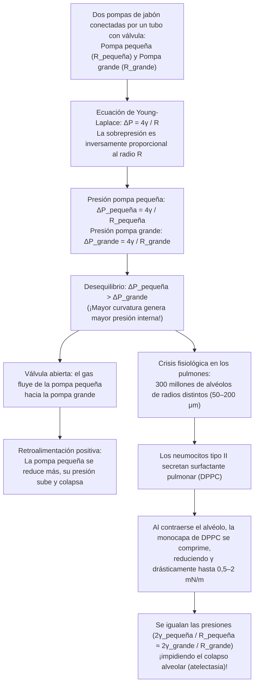
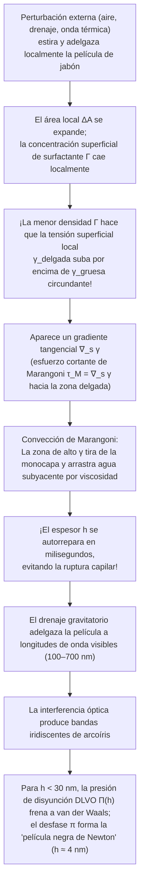

Al sumergir un aro en agua jabonosa y soplar suavemente, una delgada lámina líquida se estira, se estrangula y se relaja en milisegundos hasta formar una esfera iridiscente perfecta flotando en el aire. Si observamos con una lupa la espuma de jabón en un recipiente, descubriremos que lo que parece un caos desordenado obedece en realidad a una geometría inflexible: las paredes líquidas nunca se reúnen de cuatro en cuatro ni de cinco en cinco, sino exclusivamente <strong>de tres en tres</strong> a lo largo de canales líquidos formando ángulos exactos de <strong>$120^\circ$ ($2\pi/3$)</strong>, y dichas aristas se cruzan exclusivamente <strong>de cuatro en cuatro</strong> en los vértices bajo el ángulo tetraédrico exacto de <strong>$\arccos(-1/3) \approx 109,4712^\circ$</strong>.

¿Por qué una pompa de jabón libre es siempre esférica? ¿Por qué al conectar una pompa pequeña con una pompa grande mediante un tubo es la pompa <em>pequeña</em> la que se encoge e infla a la <em>grande</em>, y por qué esta misma inestabilidad no hace colapsar los 300 millones de alvéolos de nuestros pulmones en cada espiración? ¿Por qué las burbujas de agua pura o alcohol puro estallan en milisegundos mientras que una traza de surfactante otorga a la película una elasticidad autorreparadora? ¿Y cómo fue derrotada en 1994 la conjetura centenaria de Lord Kelvin sobre la partición óptima del espacio tridimensional gracias a la estructura de Weaire-Phelan?

En este artículo integramos la termodinámica, la geometría diferencial, el cálculo de variaciones, la teoría geométrica de la medida y la mecánica de fluidos interfacial para desvelar toda la ciencia de las pompas y las espumas.

---

## 1. Termodinámica de la tensión superficial y asimetría molecular

En el interior (seno o *bulk*) del agua líquida, cada molécula de $\text{H}_2\text{O}$ está rodeada isotrópicamente por moléculas vecinas unidas mediante puentes de hidrógeno y fuerzas de van der Waals. La fuerza neta promediada en el tiempo es nula y cada molécula se halla en un estado de baja energía potencial (número de coordinación $z_b \approx 12$, energía cohesiva $-u_0$).

En la <strong>interfaz líquido-vapor</strong>, esta simetría se rompe drásticamente: la densidad numérica de moléculas en la fase gaseosa es unas mil veces menor que en el líquido. Una molécula superficial pierde cerca de la mitad de sus vecinos atractivos ($z_s < z_b$) y posee un exceso de energía potencial. Llevar moléculas desde el interior hasta la superficie para incrementar el área interfacial en $dA$ exige realizar un trabajo reversible positivo contra las fuerzas cohesivas.

El diferencial total de la energía libre de Gibbs $G(T, P, A, \{N_i\})$ es:

$$dG = -S\,dT + V\,dP + \gamma\,dA + \sum_{i} \mu_i\,dN_i$$

de donde se obtiene la definición termodinámica exacta de la <strong>tensión superficial</strong> $\gamma$:

$$\gamma \equiv \left( \frac{\partial G}{\partial A} \right)_{T, P, N_i} = \left( \frac{\partial F}{\partial A} \right)_{T, V, N_i}$$

Esta magnitud posee dos interpretaciones físicamente equivalentes:
1. <strong>Exceso de energía libre por unidad de área ($\text{J/m}^2$)</strong>: A volumen $V$ constante, el sistema minimiza su energía libre $\gamma A$ minimizando su superficie $A$. Por la <strong>desigualdad isoperimétrica</strong> tridimensional $A^3 \ge 36\pi V^2$, la esfera es el único cuerpo que minimiza el área superficial para un volumen encerrado dado.
2. <strong>Fuerza de tracción tangencial por unidad de longitud ($\text{N/m}$)</strong>: Según la <strong>fórmula de Kirkwood-Buff (1949)</strong> de la mecánica estadística, $\gamma$ es la integral de la anisotropía entre la presión normal $P_N$ y la presión tangencial $P_T(z)$ a través de la zona interfacial:
   $$\gamma = \int_{-\infty}^{+\infty} \bigl[ P_N - P_T(z) \bigr]\,dz$$

| Sistema líquido / interfaz (a $20^\circ\text{C}$ frente al aire) | Tensión superficial $\gamma$ ($\text{mN/m}$) | Interacción intermolecular dominante | Estabilidad de películas delgadas y burbujas |
| :--- | :---: | :--- | :--- |
| Mercurio líquido ($\text{Hg}$) | $486,5$ | Enlace metálico | Nula estabilidad de película; forma gotas |
| Agua pura ($\text{H}_2\text{O}$) | $72,8$ | Red de puentes de hidrógeno + dipolos | Estalla en milisegundos (sin elasticidad Marangoni) |
| Etanol puro ($\text{C}_2\text{H}_5\text{OH}$) | $22,3$ | Puentes de H débiles + dispersión | Película inestable por sí sola («lágrimas del vino») |
| Agua jabonosa / solución SDS (cerca de CMC) | $25,0 \sim 35,0$ | Monocapa de surfactante anfifílico | <strong>Estable de minutos a horas</strong> (efecto Gibbs-Marangoni) |
| Surfactante pulmonar (monocapa DPPC comprimida) | $0,5 \sim 2,0$ | Fosfolípidos saturados ultraempaquetados | <strong>Extremadamente estable</strong> (evita el colapso alveolar) |

---

## 2. Geometría diferencial de superficies curvas y ecuación de Young-Laplace

Cuando una interfaz es curva, las fuerzas tangenciales $\gamma$ generan una componente normal neta hacia el centro de curvatura, provocando un salto de presión $\Delta P = P_{\text{int}} - P_{\text{ext}} > 0$. Sean $R_1, R_2$ los dos <strong>radios de curvatura principales</strong> ($\kappa_1 = 1/R_1, \kappa_2 = 1/R_2$) de una superficie suave $\Sigma \subset \mathbb{R}^3$. La <strong>curvatura media</strong> $H$ y la <strong>curvatura gaussiana</strong> $K$ se definen como:

$$H \equiv \frac{\kappa_1 + \kappa_2}{2} = \frac{1}{2}\left(\frac{1}{R_1} + \frac{1}{R_2}\right), \qquad K \equiv \kappa_1 \kappa_2 = \frac{1}{R_1 R_2}$$

Al aplicar un desplazamiento normal virtual $\delta\xi$ a un parche infinitesimal $dA = R_1 R_2\,d\theta_1\,d\theta_2$, la variación de área de primer orden es $\delta(dA) = dA\left(\frac{1}{R_1} + \frac{1}{R_2}\right)\delta\xi$ y el volumen barrido es $\delta(dV) = dA\,\delta\xi$. La condición de equilibrio $\delta F = \gamma\,\delta(dA) - \Delta P\,\delta(dV) = 0$ proporciona la <strong>ecuación de Young-Laplace (1805–1806)</strong>:

$$\Delta P = P_{\text{int}} - P_{\text{ext}} = \gamma\left(\frac{1}{R_1} + \frac{1}{R_2}\right) = 2\gamma H$$

Mientras que una gota de agua en el aire tiene <strong>una sola</strong> interfaz ($\Delta P_{\text{gota}} = 2\gamma/R$), una <strong>pompa de jabón en el aire</strong> es una capa líquida delgada de espesor $h \ll R$ que posee <strong>dos interfaces gas-líquido</strong> (interna en $R$ y externa en $R+h$), lo que introduce un factor $4$:

$$\Delta P_{\text{pompa}} = (P_{\text{int}} - P_{\text{película}}) + (P_{\text{película}} - P_{\text{ext}}) = \frac{2\gamma}{R} + \frac{2\gamma}{R+h} \approx \frac{4\gamma}{R}$$

---

## 3. Superficies mínimas ($H = 0$), catástrofe del catenoide y problema de Plateau

Una película de jabón abierta tendida sobre un bastidor de alambre sin encerrar aire tiene la misma presión atmosférica en ambas caras ($\Delta P = 0$). La ecuación de Young-Laplace exige entonces que su curvatura media sea idénticamente nula en todo punto:

$$H = \frac{1}{2}\left(\frac{1}{R_1} + \frac{1}{R_2}\right) = 0 \quad \Longleftrightarrow \quad \kappa_1 = -\kappa_2 \quad \Longrightarrow \quad K = -\kappa_1^2 \le 0$$

Las superficies con $H \equiv 0$ se denominan <strong>superficies mínimas</strong>. Para una gráfica $z = u(x,y)$, minimizar el funcional de área $A[u] = \iint \sqrt{1+u_x^2+u_y^2}\,dx\,dy$ conduce a la ecuación en derivadas parciales de Euler-Lagrange deducida por Lagrange en 1760:

$$\bigl(1 + u_y^2\bigr) u_{xx} - 2 u_x u_y u_{xy} + \bigl(1 + u_x^2\bigr) u_{yy} = 0$$

Todo punto no plano de una película abierta es localmente un punto de silla hiperbólico ($K < 0$). La superficie mínima de revolución tendida entre dos anillos coaxiales de radio $R$ separados por una distancia $2h$ es el <strong>catenoide</strong> (Euler, 1744):

$$r(z) = c \cosh\!\left(\frac{z}{c}\right)$$

Al separar los anillos más allá de la relación crítica ($\coth u_c = u_c \approx 1,19968$):

$$\left(\frac{2h}{R}\right)_{\text{crít}} = \frac{2u_c}{\cosh u_c} \approx 1,32548$$

la solución real desaparece mediante una bifurcación silla-nodo y el cuello de jabón se estrangula, saltando a dos discos planos separados (<strong>solución discontinua de Goldschmidt</strong>). El <strong>problema de Plateau</strong> sobre la existencia general de superficies mínimas fue resuelto en 1930 por Jesse Douglas (primera Medalla Fields en 1936) y Tibor Radó.

---

## 4. La paradoja de las dos pompas, maduración de Ostwald y el surfactante pulmonar (DPPC)

Si conectamos mediante un tubo con válvula una pompa pequeña ($R_{\text{pequeña}}$) y una pompa grande ($R_{\text{grande}}$), al abrir la válvula <strong>la pompa pequeña se encoge rápidamente e infla aún más a la pompa grande</strong>. Según $\Delta P = 4\gamma/R$, cuanto menor es el radio, mayor es la presión interna:

$$R_{\text{pequeña}} < R_{\text{grande}} \quad \Longrightarrow \quad \Delta P_{\text{pequeña}} = \frac{4\gamma}{R_{\text{pequeña}}} \;>\; \frac{4\gamma}{R_{\text{grande}}} = \Delta P_{\text{grande}}$$

En una espuma real, la difusión de gas a través de las películas desde las burbujas pequeñas (alta presión) hacia las grandes (baja presión) produce el engrosamiento o <strong>maduración de Ostwald</strong>. En 1952, <strong>John von Neumann</strong> demostró mediante el teorema de Gauss-Bonnet que en una espuma seca 2D el área $A_n$ de una celda de $n$ lados evoluciona según la <strong>ley de von Neumann</strong>:

$$\frac{dA_n}{dt} = K_0 (n - 6)$$

Las celdas con $n < 6$ lados se encogen y desaparecen, los hexágonos ($n = 6$) permanecen estacionarios y las celdas con $n > 6$ crecen (generalizado a 3D por MacPherson y Srolovitz en 2007).

En los pulmones humanos, unos <strong>300 millones de alvéolos</strong> ($R \approx 50\text{–}200\,\mu\text{m}$) están interconectados. Si la tensión superficial $\gamma$ fuera constante, los alvéolos pequeños se vaciarían en los grandes y colapsarían (<strong>atelectasia</strong>). Los neumocitos tipo II evitan esto secretando <strong>surfactante pulmonar</strong> rico en <strong>dipalmitoilfosfatidilcolina (DPPC)</strong>: al contraerse el alvéolo durante la espiración, la monocapa insoluble de DPPC se comprime tanto que $\gamma(R)$ cae hasta $0,5\text{–}2\,\text{mN/m}$, estabilizando todos los alvéolos.

---

## 5. Leyes de Joseph Plateau (1873), prueba de Jean Taylor (1976) y teorema de la doble burbuja

Formuladas en 1873 por el físico belga ciego <strong>Joseph Plateau</strong> y demostradas rigurosamente en 1976 por <strong>Jean E. Taylor</strong> mediante teoría geométrica de la medida:

1. <strong>1.ª ley de Plateau (3 películas a $120^\circ$)</strong>: Las películas de jabón se unen exclusivamente <strong>de tres en tres</strong> a lo largo de los <strong>bordes de Plateau</strong> formando ángulos iguales de <strong>$120^\circ$ ($2\pi/3$)</strong> ($\sum_{i=1}^3 \hat{\mathbf{t}}_i = \mathbf{0} \implies \cos\theta = -1/2$). Un cruce cuádruple a $90^\circ$ ($L_{\text{cruz}} = 4\sqrt{2} \approx 5,657$) es inestable y se divide instantáneamente en dos uniones triples a $120^\circ$ formando un árbol de Steiner ($L_{\text{Steiner}} = 2(1+\sqrt{3}) \approx 5,464$, transición T1).
2. <strong>2.ª ley de Plateau (4 bordes a $109,47^\circ$)</strong>: Los bordes de Plateau se cruzan exclusivamente <strong>de cuatro en cuatro</strong> en los vértices bajo el <strong>ángulo tetraédrico de Maraldi</strong>:
   $$\theta_{\text{Maraldi}} = \arccos\!\left(-\frac{1}{3}\right) \approx 109,47122^\circ \quad \left(109^\circ 28' 16''\right)$$
3. <strong>Teorema de la doble burbuja (Hutchings, Morgan, Ritoré, Ros 2000)</strong>: Cuando dos pompas de radios $R_1 > R_2$ se unen compartiendo un tabique (septum), este se curva hacia el interior de la pompa mayor con radio de curvatura $R_{\text{septum}}$:
   $$\frac{1}{R_{\text{septum}}} = \frac{1}{R_2} - \frac{1}{R_1} \quad \Longleftrightarrow \quad R_{\text{septum}} = \frac{R_1 R_2}{R_1 - R_2}$$

---

## 6. La conjetura de Kelvin (1887) frente a la estructura de Weaire-Phelan (1994)

En 1887, <strong>Lord Kelvin</strong> planteó cómo dividir el espacio $\mathbb{R}^3$ en celdas de igual volumen ($V=1$) con área interfacial mínima. Debido a la <strong>frustración geométrica</strong>, Kelvin propuso el <strong>octaedro truncado (tetracaidecaedro de 6 cuadrados y 8 hexágonos, celda de Voronoi BCC)</strong> ligeramente curvado, con área normalizada $A_{\text{Kelvin}} \approx 5,30628$.

En 1994, <strong>Denis Weaire</strong> y <strong>Robert Phelan</strong> (Trinity College Dublin) refutaron la conjetura de Kelvin tras 107 años con la <strong>estructura de Weaire-Phelan</strong> (inspirada en los clatratos hidratos tipo I), cuya celda unidad cúbica contiene <strong>8 poliedros de igual volumen de dos tipos</strong>: <strong>2 dodecaedros pentagonales irregulares ($5^{12}$)</strong> y <strong>6 tetracaidecaedros ($5^{12}6^2$ con 2 hexágonos y 12 pentágonos)</strong>. Con un $88,9\%$ de caras pentagonales (cuyo ángulo interno de $108^\circ$ casi coincide con $109,47^\circ$), el área se reduce un $0,34\%$ hasta $A_{\text{WP}} \approx 5,28825$, estructura inmortalizada en el <strong>Centro Acuático Nacional de Pekín («Cubo de Agua»)</strong>.

| Estructura de espuma 3D | Celdas por unidad $Z$ | Topología de caras ($\langle F \rangle$ medio) | ¿Cumple leyes de Plateau? | Área normalizada $A$ ($V=1$) | Diferencia vs Kelvin |
| :--- | :---: | :--- | :---: | :---: | :---: |
| <strong>Panal cúbico simple</strong> | $1$ | $6$ cuadrados ($\langle F \rangle = 6,00$) | No (inestable) | $6,00000$ | $+13,07\%$ |
| <strong>Dodecaedro rómbico (FCC)</strong> | $1$ | $12$ rombos ($\langle F \rangle = 12,00$) | No (vértices de 6 aristas inestables) | $5,34539$ | $+0,74\%$ |
| <strong>Estructura de Kelvin (1887, BCC)</strong> | $1$ | $6$ cuadrados + $8$ hexágonos ($\langle F \rangle = 14,00$) | <strong>Sí</strong> (hexágonos curvados) | $5,30628$ | $0,00\%$ (Base) |
| <strong>Estructura de Weaire-Phelan (1994, A15)</strong> | $8$ ($2+6$) | $88,9\%$ pentágonos + $11,1\%$ hexágonos ($\langle F \rangle = 13,50$) | <strong>Sí</strong> (curvatura mínima) | <strong>$5,28825$</strong> | <strong>$-0,34\%$ (Récord)</strong> |

---

## 7. Elasticidad de Gibbs-Marangoni, interferencia de película delgada y presión de disyunción DLVO

Una baja tensión superficial por sí sola no estabiliza una burbuja (el etanol puro estalla al instante). La estabilidad de las películas de jabón reside en la <strong>elasticidad de Gibbs-Marangoni</strong>:

Cuando una película se estira y adelgaza localmente, la concentración superficial de surfactante $\Gamma$ disminuye y la tensión superficial local $\gamma_{\text{delgada}}$ aumenta. El <strong>esfuerzo de Marangoni</strong> $\boldsymbol{\tau}_M = \nabla_s \gamma$ y el <strong>módulo de elasticidad de Gibbs</strong>

$$E_G \equiv 2A\left(\frac{\partial\gamma}{\partial A}\right)_{N_s} = -2\Gamma\left(\frac{\partial\gamma}{\partial\Gamma}\right)_T > 0$$

arrastran inmediatamente líquido hacia la zona adelgazada para repararla (el mismo efecto produce las <strong>«lágrimas del vino»</strong>). Al reducirse el espesor $h$ al rango visible, las reflexiones en ambas caras generan <strong>interferencia de película delgada</strong> ($2n_{\text{película}}h\cos\theta_t + \lambda/2 = m\lambda$). Por debajo de $h \ll \lambda/4 \approx 30\,\text{nm}$, el cambio de fase de $\pi$ en la cara frontal produce interferencia destructiva en todo el espectro visible y la película se vuelve negra (<strong>película negra de Newton</strong>, $h \approx 4\,\text{nm}$), sostenida por la <strong>presión de disyunción DLVO</strong> $\Pi(h) = \Pi_{\text{vdW}}(h) + \Pi_{\text{el}}(h) + \Pi_{\text{sr}}(h)$.
