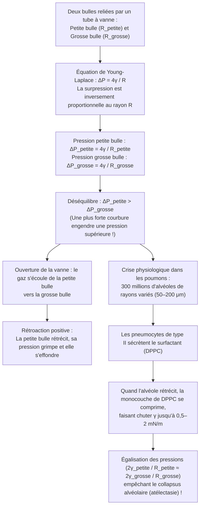
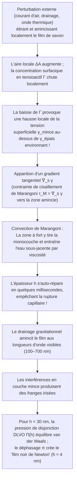

Trempez un anneau dans de l'eau savonneuse et soufflez doucement : un mince film liquide s'étire, se pince et se détend en quelques millisecondes pour former une sphère irisée parfaite flottant dans l'air. Observez ensuite une mousse de savon à la loupe : ce qui semble être un enchevêtrement aléatoire obéit en réalité à une géométrie implacable. Dans toute la mousse, les films liquides ne se rejoignent jamais par quatre ou cinq, mais exclusivement <strong>par trois</strong> le long de canaux liquides appelés bords de Plateau à un angle exact de <strong>$120^\circ$ ($2\pi/3$)</strong>, et ces bords se croisent exclusivement <strong>par quatre</strong> aux sommets selon l'angle tétraédrique exact de <strong>$\arccos(-1/3) \approx 109,4712^\circ$</strong>.

Pourquoi une bulle de savon libre est-elle toujours sphérique ? Pourquoi, lorsqu'on relie une petite bulle et une grosse bulle par un tube, est-ce la <em>petite</em> bulle qui se vide dans la <em>grosse</em> — et comment nos 300 millions d'alvéoles pulmonaires échappent-elles à cet effondrement à chaque expiration ? Pourquoi l'eau pure ou l'alcool pur ne peuvent-ils jamais former de bulles durables, alors qu'une trace de tensioactif confère au film une élasticité auto-cicatrisante ? Et comment la conjecture centenaire de Lord Kelvin sur le pavage de l'espace en cellules de même volume et d'aire minimale a-t-elle été battue en 1994 par la structure de Weaire-Phelan ?

Cet article mobilise la thermodynamique, la géométrie différentielle, le calcul des variations, la théorie géométrique de la mesure et l'hydrodynamique interfaciale pour dévoiler toute la physique des bulles et des mousses.

---

## 1. Thermodynamique de la tension superficielle et asymétrie moléculaire

Au cœur (bulk) de l'eau liquide, chaque molécule $\text{H}_2\text{O}$ est entourée de façon isotrope par ses voisines et liée par des liaisons hydrogène et des forces de van der Waals. La résultante moyenne des forces y est nulle et l'énergie potentielle cohésive est minimale (coordinence $z_b \approx 12$, énergie $-u_0$).

À l'<strong>interface liquide-vapeur</strong>, cette symétrie est brutalement rompue : la densité moléculaire de la phase gazeuse est environ mille fois plus faible que celle du liquide. Une molécule située à la surface perd près de la moitié de ses voisines attractives ($z_s < z_b$) et possède donc un excès d'énergie potentielle. Pour amener des molécules du volume vers la surface et accroître l'aire interfaciale de $dA$, il faut fournir un travail réversible positif contre les forces de cohésion.

La différentielle totale de l'enthalpie libre de Gibbs $G(T, P, A, \{N_i\})$ s'écrit :

$$dG = -S\,dT + V\,dP + \gamma\,dA + \sum_{i} \mu_i\,dN_i$$

d'où découle la définition thermodynamique rigoureuse de la <strong>tension superficielle</strong> $\gamma$ :

$$\gamma \equiv \left( \frac{\partial G}{\partial A} \right)_{T, P, N_i} = \left( \frac{\partial F}{\partial A} \right)_{T, V, N_i}$$

Elle possède deux interprétations physiques équivalentes :
1. <strong>Énergie libre en excès par unité d'aire ($\text{J/m}^2$)</strong> : À volume $V$ fixé, un système minimise son énergie libre $\gamma A$ en minimisant son aire $A$. En vertu de l'<strong>inégalité isopérimétrique</strong> tridimensionnelle $A^3 \ge 36\pi V^2$, la sphère est l'unique forme minimisant la surface pour un volume donné.
2. <strong>Force de traction tangentielle par unité de longueur ($\text{N/m}$)</strong> : Selon la <strong>formule de Kirkwood-Buff (1949)</strong> en mécanique statistique, $\gamma$ est l'intégrale de l'anisotropie du tenseur des pressions entre la composante normale $P_N$ et la composante tangentielle $P_T(z)$ à travers l'interface :
   $$\gamma = \int_{-\infty}^{+\infty} \bigl[ P_N - P_T(z) \bigr]\,dz$$

| Système liquide / interface (à $20^\circ\text{C}$ face à l'air) | Tension superficielle $\gamma$ ($\text{mN/m}$) | Interaction intermoléculaire dominante | Stabilité des films minces et bulles |
| :--- | :---: | :--- | :--- |
| Mercure liquide ($\text{Hg}$) | $486,5$ | Liaison métallique | Aucune stabilité de film ; gouttes sphériques |
| Eau pure ($\text{H}_2\text{O}$) | $72,8$ | Réseau de liaisons hydrogène + dipôles | Éclate en quelques millisecondes (élasticité nulle) |
| Éthanol pur ($\text{C}_2\text{H}_5\text{OH}$) | $22,3$ | Liaisons H faibles + dispersion | Film instable seul (provoque les « larmes du vin ») |
| Eau savonneuse / solution SDS (proche CMC) | $25,0 \sim 35,0$ | Monocouche de tensioactifs amphiphiles | <strong>Stable plusieurs minutes à heures</strong> (effet Gibbs-Marangoni) |
| Surfactant pulmonaire (DPPC comprimé) | $0,5 \sim 2,0$ | Phospholipides saturés ultra-compactés | <strong>Extrêmement stable</strong> (empêche le collapsus alvéolaire) |

---

## 2. Géométrie différentielle des surfaces courbes et équation de Young-Laplace

Lorsqu'une interface est courbe, la tension tangentielle $\gamma$ engendre une force normale nette dirigée vers le côté concave, imposant une surpression $\Delta P = P_{\text{int}} - P_{\text{ext}} > 0$. Soient $R_1, R_2$ les deux <strong>rayons de courbure principaux</strong> ($\kappa_1 = 1/R_1, \kappa_2 = 1/R_2$) d'une surface régulière $\Sigma \subset \mathbb{R}^3$. La <strong>courbure moyenne</strong> $H$ et la <strong>courbure de Gauss</strong> $K$ sont définies par :

$$H \equiv \frac{\kappa_1 + \kappa_2}{2} = \frac{1}{2}\left(\frac{1}{R_1} + \frac{1}{R_2}\right), \qquad K \equiv \kappa_1 \kappa_2 = \frac{1}{R_1 R_2}$$

Un déplacement normal virtuel $\delta\xi$ d'un élément de surface $dA = R_1 R_2\,d\theta_1\,d\theta_2$ induit une variation d'aire $\delta(dA) = dA\left(\frac{1}{R_1} + \frac{1}{R_2}\right)\delta\xi$ pour un volume balayé $\delta(dV) = dA\,\delta\xi$. La condition d'équilibre $\delta F = \gamma\,\delta(dA) - \Delta P\,\delta(dV) = 0$ conduit à l'<strong>équation de Young-Laplace (1805–1806)</strong> :

$$\Delta P = P_{\text{int}} - P_{\text{ext}} = \gamma\left(\frac{1}{R_1} + \frac{1}{R_2}\right) = 2\gamma H$$

Alors qu'une goutte d'eau ne possède qu'<strong>une seule</strong> interface ($\Delta P_{\text{goutte}} = 2\gamma/R$), une <strong>bulle de savon dans l'air</strong> est une mince coquille liquide d'épaisseur $h \ll R$ possédant <strong>deux interfaces gaz-liquide</strong> (interne de rayon $R$ et externe de rayon $R+h$), d'où le facteur $4$ :

$$\Delta P_{\text{bulle}} = (P_{\text{int}} - P_{\text{film}}) + (P_{\text{film}} - P_{\text{ext}}) = \frac{2\gamma}{R} + \frac{2\gamma}{R+h} \approx \frac{4\gamma}{R}$$

---

## 3. Surfaces minimales ($H = 0$), catastrophe de la caténoïde et problème de Plateau

Un film de savon ouvert tendu sur un cadre métallique non planaire subit la même pression atmosphérique sur ses deux faces ($\Delta P = 0$). L'équation de Young-Laplace impose alors que sa courbure moyenne soit identiquement nulle en tout point :

$$H = \frac{1}{2}\left(\frac{1}{R_1} + \frac{1}{R_2}\right) = 0 \quad \Longleftrightarrow \quad \kappa_1 = -\kappa_2 \quad \Longrightarrow \quad K = -\kappa_1^2 \le 0$$

Ces surfaces à courbure moyenne nulle sont appelées <strong>surfaces minimales</strong>. Sous forme de graphe $z = u(x,y)$, la minimisation de la fonctionnelle d'aire $A[u] = \iint \sqrt{1+u_x^2+u_y^2}\,dx\,dy$ donne l'équation aux dérivées partielles d'Euler-Lagrange établie par Lagrange en 1760 :

$$\bigl(1 + u_y^2\bigr) u_{xx} - 2 u_x u_y u_{xy} + \bigl(1 + u_x^2\bigr) u_{yy} = 0$$

Tout point non plan d'un film de savon ouvert est localement une selle hyperbolique ($K < 0$). La surface minimale de révolution tendue entre deux anneaux coaxiaux de rayon $R$ distants de $2h$ est la <strong>caténoïde</strong> découverte par Euler en 1744 :

$$r(z) = c \cosh\!\left(\frac{z}{c}\right)$$

Lorsque l'on écarte les deux anneaux au-delà du rapport critique ($\coth u_c = u_c \approx 1,19968$) :

$$\left(\frac{2h}{R}\right)_{\text{crit}} = \frac{2u_c}{\cosh u_c} \approx 1,32548$$

la solution réelle disparaît par bifurcation nœud-col : le col du film s'effondre brusquement et se rompt pour former deux disques plats séparés (<strong>solution discontinue de Goldschmidt</strong>). Le <strong>problème de Plateau</strong> (existence d'une surface minimale bordée par toute courbe de Jordan fermée) fut résolu en 1930 par Jesse Douglas (première médaille Fields en 1936) et Tibor Radó.

---

## 4. Paradoxe des deux bulles, mûrissement d'Ostwald et surfactant pulmonaire (DPPC)

Si l'on relie par un tube muni d'un robinet une petite bulle de savon ($R_{\text{petite}}$) et une grosse bulle ($R_{\text{grosse}}$), l'ouverture du robinet provoque le dégonflement rapide de la <strong>petite bulle qui gonfle la grosse bulle</strong> ! En effet, d'après $\Delta P = 4\gamma/R$, la surpression est inversement proportionnelle au rayon :

$$R_{\text{petite}} < R_{\text{grosse}} \quad \Longrightarrow \quad \Delta P_{\text{petite}} = \frac{4\gamma}{R_{\text{petite}}} \;>\; \frac{4\gamma}{R_{\text{grosse}}} = \Delta P_{\text{grosse}}$$

Au sein d'une mousse, ce transfert diffusif du gaz des petites bulles vers les grosses constitue le <strong>mûrissement d'Ostwald (coarsening)</strong>. En 1952, <strong>John von Neumann</strong> a démontré grâce au théorème de Gauss-Bonnet que dans une mousse sèche 2D, l'aire $A_n$ d'une bulle polygonale à $n$ côtés évolue selon la <strong>loi de von Neumann</strong> :

$$\frac{dA_n}{dt} = K_0 (n - 6)$$

Les bulles ayant $n < 6$ côtés rétrécissent et disparaissent, les hexagones ($n = 6$) sont stationnaires et les bulles à $n > 6$ côtés grossissent (la généralisation 3D a été établie par MacPherson et Srolovitz en 2007).

Dans les poumons humains, quelque <strong>300 millions d'alvéoles</strong> ($R \approx 50\text{–}200\,\mu\text{m}$) communiquent entre elles. Si la tension superficielle $\gamma$ du liquide alvéolaire était constante, les petites alvéoles se videraient dans les grandes (<strong>atélectasie</strong>). Les pneumocytes de type II évitent cette catastrophe en sécrétant le <strong>surfactant pulmonaire</strong>, riche en <strong>dipalmitoylphosphatidylcholine (DPPC)</strong> : lors de l'expiration, la compression de la monocouche insoluble de DPPC abaisse $\gamma(R)$ vers $0,5\text{–}2\,\text{mN/m}$, stabilisant l'ensemble des alvéoles.

---

## 5. Lois de Joseph Plateau (1873), théorème de Jean Taylor (1976) et théorème de la bulle double

Formulées expérimentalement par le physicien belge aveugle <strong>Joseph Plateau</strong> en 1873 et démontrées rigoureusement par la mathématicienne <strong>Jean E. Taylor</strong> en 1976 via la théorie géométrique de la mesure, les lois d'équilibre des mousses stipulent :

1. <strong>1re loi de Plateau (3 films à $120^\circ$)</strong> : Les films de savon se rejoignent exclusivement <strong>par trois</strong> le long des <strong>bords de Plateau</strong> à des angles égaux de <strong>$120^\circ$ ($2\pi/3$)</strong> ($\sum_{i=1}^3 \hat{\mathbf{t}}_i = \mathbf{0} \implies \cos\theta = -1/2$). Une jonction quadruple à $90^\circ$ ($L_{\text{croix}} = 4\sqrt{2} \approx 5,657$) est instable et se scinde immédiatement en deux jonctions triples à $120^\circ$ selon un arbre de Steiner ($L_{\text{Steiner}} = 2(1+\sqrt{3}) \approx 5,464$, transition T1).
2. <strong>2e loi de Plateau (4 bords à $109,47^\circ$)</strong> : Les bords de Plateau se croisent exclusivement <strong>par quatre</strong> aux sommets selon l'<strong>angle tétraédrique de Maraldi</strong> :
   $$\theta_{\text{Maraldi}} = \arccos\!\left(-\frac{1}{3}\right) \approx 109,47122^\circ \quad \left(109^\circ 28' 16''\right)$$
3. <strong>Théorème de la bulle double (Hutchings, Morgan, Ritoré, Ros 2000)</strong> : Lorsque deux bulles de rayons $R_1 > R_2$ fusionnent, la paroi séparatrice (septum) se courbe vers l'intérieur de la grande bulle avec un rayon de courbure $R_{\text{septum}}$ donné par :
   $$\frac{1}{R_{\text{septum}}} = \frac{1}{R_2} - \frac{1}{R_1} \quad \Longleftrightarrow \quad R_{\text{septum}} = \frac{R_1 R_2}{R_1 - R_2}$$

---

## 6. Conjecture de Kelvin (1887) contre structure de Weaire-Phelan (1994)

En 1887, <strong>Lord Kelvin</strong> chercha la partition de l'espace $\mathbb{R}^3$ en cellules de volume égal ($V=1$) minimisant l'aire interfaciale totale. En raison de la <strong>frustration géométrique</strong> (les dodécaèdres réguliers ne pavent pas l'espace), Kelvin proposa l'<strong>octaèdre tronqué (tétrakaidécaèdre à 6 carrés et 8 hexagones, cellule de Voronoï du réseau BCC)</strong> légèrement incurvé, d'aire normalisée $A_{\text{Kelvin}} \approx 5,30628$.

Après 107 ans de règne, les physiciens <strong>Denis Weaire</strong> et <strong>Robert Phelan</strong> (Trinity College Dublin) ont réfuté la conjecture de Kelvin en 1994 grâce à la <strong>structure de Weaire-Phelan</strong> (inspirée des clathrates hydrates de type I), dont la maille cubique réunit <strong>8 polyèdres de même volume et de deux formes</strong> : <strong>2 dodécaèdres pentagonaux irréguliers ($5^{12}$)</strong> et <strong>6 tétrakaidécaèdres ($5^{12}6^2$ à 2 hexagones et 12 pentagones)</strong>. Avec $88,9\%$ de faces pentagonales (angle interne de $108^\circ$ très proche de $109,47^\circ$), l'aire descend à $A_{\text{WP}} \approx 5,28825$ (<strong>$-0,34\%$ sous Kelvin</strong>), structure rendue célèbre par le <strong>Centre national de natation de Pékin (« Water Cube »)</strong>.

| Structure de mousse pavant l'espace 3D | Cellules par maille $Z$ | Topologie des faces ($\langle F \rangle$ moyen) | Lois de Plateau ? | Aire normalisée $A$ ($V=1$) | Écart vs Kelvin |
| :--- | :---: | :--- | :---: | :---: | :---: |
| <strong>Pavage cubique simple</strong> | $1$ | $6$ carrés ($\langle F \rangle = 6,00$) | Non (instable) | $6,00000$ | $+13,07\%$ |
| <strong>Dodécaèdre rhombique (FCC)</strong> | $1$ | $12$ losanges ($\langle F \rangle = 12,00$) | Non (sommets d'ordre 6 instables) | $5,34539$ | $+0,74\%$ |
| <strong>Structure de Kelvin (1887, BCC)</strong> | $1$ | $6$ carrés + $8$ hexagones ($\langle F \rangle = 14,00$) | <strong>Oui</strong> (hexagones incurvés) | $5,30628$ | $0,00\%$ (Réf.) |
| <strong>Structure de Weaire-Phelan (1994, A15)</strong> | $8$ ($2+6$) | $88,9\%$ pentagones + $11,1\%$ hexagones ($\langle F \rangle = 13,50$) | <strong>Oui</strong> (courbure minimale) | <strong>$5,28825$</strong> | <strong>$-0,34\%$ (Record)</strong> |

---

## 7. Élasticité de Gibbs-Marangoni, interférences et pression de disjonction DLVO

Une faible tension superficielle ne suffit pas à stabiliser une bulle (l'éthanol pur éclate instantanément). La survie d'un film de savon repose sur l'<strong>élasticité de Gibbs-Marangoni</strong> :

Lorsqu'un film s'amincit localement, la densité surfacique de tensioactif $\Gamma$ diminue et la tension superficielle locale $\gamma_{\text{mince}}$ augmente. La <strong>contrainte de Marangoni</strong> $\boldsymbol{\tau}_M = \nabla_s \gamma$ et le <strong>module d'élasticité de Gibbs</strong>

$$E_G \equiv 2A\left(\frac{\partial\gamma}{\partial A}\right)_{N_s} = -2\Gamma\left(\frac{\partial\gamma}{\partial\Gamma}\right)_T > 0$$

ramènent immédiatement du liquide vers la zone amincie (le même effet explique les <strong>« larmes du vin »</strong>). Lorsque l'épaisseur $h$ atteint les longueurs d'onde visibles, les réflexions sur les deux faces produisent des <strong>interférences en couche mince</strong> ($2n_{\text{film}}h\cos\theta_t + \lambda/2 = m\lambda$). En dessous de $h \ll \lambda/4 \approx 30\,\text{nm}$, le déphasage de $\pi$ à la réflexion avant entraîne une interférence destructive pour toutes les longueurs d'onde : le film devient noir (<strong>film noir de Newton</strong>, $h \approx 4\,\text{nm}$), maintenu par la <strong>pression de disjonction DLVO</strong> $\Pi(h) = \Pi_{\text{vdW}}(h) + \Pi_{\text{el}}(h) + \Pi_{\text{sr}}(h)$.
