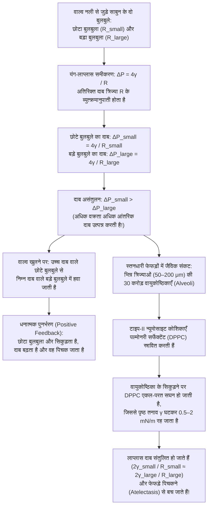
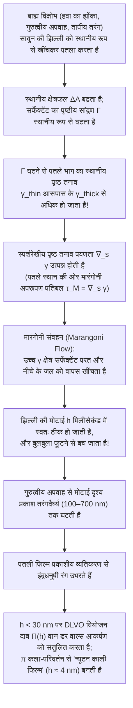

जब हम किसी छल्ले को साबुन के पानी में डुबोकर धीरे से फूंक मारते हैं, तो द्रव की एक पतली झिल्ली फैलती है और कुछ ही मिलीसेकंड में इंद्रधनुषी रंगों से चमकते हुए एक पूर्ण गोले (Sphere) के रूप में हवा में तैरने लगती है। यदि हम किसी बर्तन में बने साबुन के झाग (Foam) को आवर्धक लेंस से देखें, तो जो पहली नज़र में अनियमित प्रतीत होता है, वह वास्तव में एक कठोर ज्यामितीय नियम का पालन करता है: झाग की द्रव-दीवारें कभी भी चार या पाँच के समूह में नहीं मिलतीं—वे हमेशा <strong>तीन के समूह में</strong> सटीक <strong>$120^\circ$ ($2\pi/3$)</strong> के कोण पर मिलती हैं, और वे कोरें (Plateau borders) हमेशा <strong>चार के समूह में</strong> शीर्ष बिंदुओं पर सटीक चतुष्फलकीय कोण <strong>$\arccos(-1/3) \approx 109.4712^\circ$</strong> पर मिलती हैं।

मुक्त रूप से तैरता साबुन का बुलबुला हमेशा गोलाकार ही क्यों होता है? जब एक छोटे और एक बड़े बुलबुले को नली से जोड़ा जाता है, तो सहज ज्ञान के विपरीत <em>छोटा</em> बुलबुला ही क्यों सिकुड़ता है और <em>बड़े</em> बुलबुले को फुलाता है—और यही अस्थिरता हमारे फेफड़ों की 30 करोड़ वायुकोष्ठिकाओं (Alveoli) को हर सांस के साथ पिचकने क्यों नहीं देती? शुद्ध पानी या शुद्ध अल्कोहल के बुलबुले मिलीसेकंड में क्यों फूट जाते हैं, जबकि थोड़ा-सा सर्फेक्टेंट (साबुन) मिलाने पर झिल्ली में स्वतः-उपचार (Self-healing) की क्षमता कैसे आ जाती है? और 1887 में लॉर्ड केल्विन द्वारा प्रस्तुत "समान आयतन की कोशिकाओं से न्यूनतम क्षेत्रफल में त्रिविमीय स्थान को भरने" का 107 वर्ष पुराना अनुमान 1994 में वेयर-फेलन संरचना द्वारा कैसे तोड़ा गया?

इस लेख में हम ऊष्मागतिकी, अवकल ज्यामिति (Differential Geometry), विचरण कलन (Calculus of Variations), ज्यामितीय माप सिद्धांत और अंतरापृष्ठ तरल यांत्रिकी के माध्यम से साबुन के बुलबुलों और झाग के संपूर्ण गणितीय भौतिकी को समझेंगे।

---

## 1. पृष्ठ तनाव की ऊष्मागतिकी और आणविक असममिति

द्रव जल के भीतर (बल्क, Bulk) प्रत्येक $\text{H}_2\text{O}$ अणु चारों ओर से समान रूप से पड़ोसी अणुओं से घिरा होता है और हाइड्रोजन बंधों तथा वान डर वाल्स बलों द्वारा आकर्षित होता है। बल्क के भीतर समय-औसत परिणामी बल शून्य होता है और अणु निम्न स्थितिज ऊर्जा (समन्वय संख्या $z_b \approx 12$, ससंजक ऊर्जा $-u_0$) की स्थिर अवस्था में रहता है।

किंतु <strong>द्रव-वाष्प अंतरापृष्ठ (Liquid-Vapor Interface)</strong> पर यह सममिति टूट जाती है: गैस प्रावस्था में अणुओं का घनत्व द्रव की तुलना में लगभग एक हज़ार गुना कम होता है। इसलिए सतह पर स्थित अणु अपने लगभग आधे आकर्षक पड़ोसियों को खो देता है ($z_s < z_b$) और उसकी स्थितिज ऊर्जा अधिक होती है। अणुओं को भीतर से सतह पर लाकर अंतरापृष्ठ क्षेत्रफल $A$ में $dA$ की वृद्धि करने के लिए ससंजक बलों के विरुद्ध धनात्मक उत्क्रमणीय कार्य करना पड़ता है।

नियत ताप $T$, दाब $P$ तथा मोलों की संख्या $N_i$ पर गिब्स मुक्त ऊर्जा $G(T, P, A, \{N_i\})$ का कुल अवकलज है:

$$dG = -S\,dT + V\,dP + \gamma\,dA + \sum_{i} \mu_i\,dN_i$$

यहाँ से <strong>पृष्ठ तनाव (Surface Tension)</strong> $\gamma$ की सटीक ऊष्मागतिक परिभाषा प्राप्त होती है:

$$\gamma \equiv \left( \frac{\partial G}{\partial A} \right)_{T, P, N_i} = \left( \frac{\partial F}{\partial A} \right)_{T, V, N_i}$$

इसके दो भौतिक रूप से समतुल्य अर्थ हैं:
1. <strong>प्रति इकाई क्षेत्रफल अतिरिक्त मुक्त ऊर्जा ($\text{J/m}^2$)</strong>: नियत आयतन $V$ पर निकाय अपनी मुक्त ऊर्जा $\gamma A$ को न्यूनतम करने के लिए अपने पृष्ठीय क्षेत्रफल $A$ को न्यूनतम करता है। त्रिविमीय <strong>समपरिमाप असमिका (Isoperimetric Inequality)</strong> $A^3 \ge 36\pi V^2$ के अनुसार, दिए गए आयतन के लिए न्यूनतम पृष्ठीय क्षेत्रफल वाली एकमात्र आकृति <strong>गोला (Sphere)</strong> है।
2. <strong>प्रति इकाई लंबाई स्पर्शरेखीय तनाव बल ($\text{N/m}$)</strong>: सांख्यिकीय यांत्रिकी के <strong>कर्कवुड-बफ सूत्र (Kirkwood-Buff Formula, 1949)</strong> के अनुसार, $\gamma$ अंतरापृष्ठ परत के आर-पार अभिलंब दाब $P_N$ और स्पर्शरेखीय दाब $P_T(z)$ के अंतर का समाकलन है:
   $$\gamma = \int_{-\infty}^{+\infty} \bigl[ P_N - P_T(z) \bigr]\,dz$$

| द्रव / अंतरापृष्ठ प्रणाली ($20^\circ\text{C}$ पर वायु के सापेक्ष) | पृष्ठ तनाव $\gamma$ ($\text{mN/m}$) | प्रमुख अंतराआणविक बल | पतली झिल्ली और बुलबुले का स्थायित्व |
| :--- | :---: | :--- | :--- |
| द्रव पारा ($\text{Hg}$) | $486.5$ | धात्विक बंध | झिल्ली नहीं बनती; तुरंत गोलाकार बूंद बनती है |
| शुद्ध जल ($\text{H}_2\text{O}$) | $72.8$ | हाइड्रोजन बंध नेटवर्क + द्विध्रुव | मिलीसेकंड में फूट जाता है (मारंगोनी प्रत्यास्थता नहीं) |
| शुद्ध एथेनॉल ($\text{C}_2\text{H}_5\text{OH}$) | $22.3$ | दुर्बल H-बंध + प्रकीर्णन बल | अकेले अस्थिर झिल्ली ('वाइन के आँसू' का कारण) |
| साबुन का घोल / SDS विलयन (CMC के पास) | $25.0 \sim 35.0$ | उभयस्नेही सर्फेक्टेंट एकल-परत | <strong>मिनटों से घंटों तक स्थिर</strong> (गिब्स-मारंगोनी प्रभाव) |
| पल्मोनरी सर्फेक्टेंट (संपीड़ित DPPC परत) | $0.5 \sim 2.0$ | सघन संतृप्त फॉस्फोलिपिड पैकिंग | <strong>अत्यंत स्थिर</strong> (फेफड़ों की वायुकोष्ठिकाओं को पिचकने से बचाता है) |

---

## 2. वक्र पृष्ठों की अवकल ज्यामिति और यंग-लाप्लास समीकरण

जब कोई अंतरापृष्ठ मुड़ा हुआ (वक्र) होता है, तो स्पर्शरेखीय तनाव बल $\gamma$ वक्रता केंद्र (अवतल पक्ष) की ओर एक परिणामी अभिलंब बल उत्पन्न करता है, जिससे दाबांतर $\Delta P = P_{\text{in}} - P_{\text{out}} > 0$ पैदा होता है। यदि किसी चिकने पृष्ठ $\Sigma \subset \mathbb{R}^3$ की दो लम्बवत <strong>मुख्य वक्रता त्रिज्याएँ</strong> $R_1, R_2$ ($\kappa_1 = 1/R_1, \kappa_2 = 1/R_2$) हों, तो <strong>माध्य वक्रता (Mean Curvature)</strong> $H$ और <strong>गाउसीय वक्रता (Gaussian Curvature)</strong> $K$ इस प्रकार परिभाषित हैं:

$$H \equiv \frac{\kappa_1 + \kappa_2}{2} = \frac{1}{2}\left(\frac{1}{R_1} + \frac{1}{R_2}\right), \qquad K \equiv \kappa_1 \kappa_2 = \frac{1}{R_1 R_2}$$

एक सूक्ष्म क्षेत्रफल अल्पांश $dA = R_1 R_2\,d\theta_1\,d\theta_2$ को अभिलंब दिशा में सूक्ष्म आभासी विस्थापन $\delta\xi$ देने पर क्षेत्रफल में प्रथम-कोटि परिवर्तन $\delta(dA) = dA\left(\frac{1}{R_1} + \frac{1}{R_2}\right)\delta\xi$ और आयतन परिवर्तन $\delta(dV) = dA\,\delta\xi$ होता है। संतुलन की शर्त $\delta F = \gamma\,\delta(dA) - \Delta P\,\delta(dV) = 0$ से <strong>यंग-लाप्लास समीकरण (1805–1806)</strong> प्राप्त होता है:

$$\Delta P = P_{\text{in}} - P_{\text{out}} = \gamma\left(\frac{1}{R_1} + \frac{1}{R_2}\right) = 2\gamma H$$

हवा में मौजूद पानी की बूंद में केवल <strong>एक</strong> अंतरापृष्ठ होता है ($\Delta P_{\text{droplet}} = 2\gamma/R$), जबकि <strong>हवा में तैरते साबुन के बुलबुले</strong> में मोटाई $h \ll R$ की पतली द्रव परत के <strong>दो गैस-द्रव अंतरापृष्ठ</strong> (भीतरी त्रिज्या $R$ और बाहरी त्रिज्या $R+h$) होते हैं, जिससे गुणांक $4$ आता है:

$$\Delta P_{\text{soap}} = (P_{\text{in}} - P_{\text{film}}) + (P_{\text{film}} - P_{\text{out}}) = \frac{2\gamma}{R} + \frac{2\gamma}{R+h} \approx \frac{4\gamma}{R}$$

---

## 3. न्यूनतम पृष्ठ ($H = 0$), कैटेनॉइड संकट और पठार की समस्या (Plateau's Problem)

किसी मुड़े हुए तार के फ्रेम पर बनी खुली साबुन की फिल्म के दोनों ओर समान वायुमंडलीय दाब ($\Delta P = 0$) होता है। अतः यंग-लाप्लास समीकरण के अनुसार फिल्म के प्रत्येक बिंदु पर माध्य वक्रता शून्य होनी चाहिए:

$$H = \frac{1}{2}\left(\frac{1}{R_1} + \frac{1}{R_2}\right) = 0 \quad \Longleftrightarrow \quad \kappa_1 = -\kappa_2 \quad \Longrightarrow \quad K = -\kappa_1^2 \le 0$$

जिन पृष्ठों पर सर्वत्र $H \equiv 0$ होता है, उन्हें <strong>न्यूनतम पृष्ठ (Minimal Surfaces)</strong> कहते हैं। ग्राफ रूप $z = u(x,y)$ में क्षेत्रफल फलनक $A[u] = \iint \sqrt{1+u_x^2+u_y^2}\,dx\,dy$ का न्यूनतमकरण करने पर लाग्रांज (1760) का अरैखिक आंशिक अवकल समीकरण प्राप्त होता है:

$$\bigl(1 + u_y^2\bigr) u_{xx} - 2 u_x u_y u_{xy} + \bigl(1 + u_x^2\bigr) u_{yy} = 0$$

खुली साबुन की फिल्म का प्रत्येक गैर-समतल बिंदु स्थानीय रूप से काठी (Saddle point, $K < 0$) जैसा होता है। त्रिज्या $R$ के दो समाक्षीय छल्लों (दूरी $2h$) के बीच बनने वाला घूर्णी न्यूनतम पृष्ठ <strong>कैटेनॉइड (Catenoid, यूलर 1744)</strong> है:

$$r(z) = c \cosh\!\left(\frac{z}{c}\right)$$

जब छल्लों के बीच की दूरी क्रांतिक अनुपात ($\coth u_c = u_c \approx 1.19968$):

$$\left(\frac{2h}{R}\right)_{\text{crit}} = \frac{2u_c}{\cosh u_c} \approx 1.32548$$

से अधिक बढ़ाई जाती है, तो वास्तविक हल समाप्त हो जाता है और साबुन की फिल्म बीच से टूटकर दो समतल चकतियों (<strong>गोल्डश्मिट असतत हल</strong>) में बदल जाती है। सामान्य <strong>पठार की समस्या (Plateau's Problem)</strong> का समाधान 1930 में जेसी डगलस (1936 में प्रथम फील्ड्स मेडल विजेता) और तिबोर राडो ने किया।

---

## 4. दो बुलबुलों का विरोधाभास, ओस्टवाल्ड परिपक्वता और फेफड़ों का सर्फेक्टेंट (DPPC)

यदि एक छोटे साबुन के बुलबुले ($R_{\text{small}}$) और एक बड़े बुलबुले ($R_{\text{large}}$) को वाल्व लगी नली से जोड़कर वाल्व खोला जाए, तो <strong>छोटा बुलबुला तेजी से सिकुड़ता है और अपनी हवा बड़े बुलबुले में भरकर उसे और बड़ा कर देता है!</strong> क्योंकि $\Delta P = 4\gamma/R$ के अनुसार छोटे बुलबुले के भीतर दाब अधिक होता है:

$$R_{\text{small}} < R_{\text{large}} \quad \Longrightarrow \quad \Delta P_{\text{small}} = \frac{4\gamma}{R_{\text{small}}} \;>\; \frac{4\gamma}{R_{\text{large}}} = \Delta P_{\text{large}}$$

वास्तविक झाग में भी गैस उच्च दाब वाले छोटे बुलबुलों से बड़े बुलबुलों में विसरित होती रहती है, जिसे <strong>ओस्टवाल्ड परिपक्वता (Ostwald Ripening / Coarsening)</strong> कहते हैं। 1952 में <strong>जॉन वॉन न्यूमैन (John von Neumann)</strong> ने गाउस-बोनेट प्रमेय से सिद्ध किया कि 2D शुष्क झाग में $n$ भुजाओं वाले बुलबुले के क्षेत्रफल $A_n$ की परिवर्तन दर <strong>वॉन न्यूमैन नियम</strong> का पालन करती है:

$$\frac{dA_n}{dt} = K_0 (n - 6)$$

अर्थात् $n < 6$ भुजाओं वाले बुलबुले सिकुड़कर समाप्त हो जाते हैं, षट्भुज ($n = 6$) स्थिर रहते हैं, और $n > 6$ वाले बुलबुले बढ़ते हैं (इसका 3D सामान्यीकरण 2007 में मैकफर्सन और स्रोलोविट्ज़ ने किया)।

मानव फेफड़ों में लगभग <strong>30 करोड़ वायुकोष्ठिकाएँ (Alveoli)</strong> ($R \approx 50\text{–}200\,\mu\text{m}$) होती हैं। यदि पृष्ठ तनाव $\gamma$ नियत होता, तो छोटी वायुकोष्ठिकाएँ तुरंत बड़ी वायुकोष्ठिकाओं में खाली होकर पिचक जातीं (<strong>एटेलेक्टेसिस</strong>)। टाइप-II कोशिकाएँ <strong>डाइपामिटॉयलफॉस्फेटिडिलकोलीन (DPPC)</strong> युक्त <strong>पल्मोनरी सर्फेक्टेंट</strong> स्रावित करके इसे रोकती हैं: सांस छोड़ते समय जब वायुकोष्ठिका सिकुड़ती है, तो अघुलनशील DPPC अणु सघन होकर $\gamma(R)$ को $0.5\text{–}2\,\text{mN/m}$ तक गिरा देते हैं, जिससे सभी वायुकोष्ठिकाएँ सुरक्षित रहती हैं।

---

## 5. जोसेफ पठार के नियम (1873), जीन टेलर का प्रमाण (1976) और द्वि-बुलबुला प्रमेय

नेत्रहीन बेल्जियम भौतिक विज्ञानी <strong>जोसेफ पठार (Joseph Plateau)</strong> द्वारा 1873 में प्रतिपादित और 1976 में गणितज्ञ <strong>जीन टेलर (Jean E. Taylor)</strong> द्वारा ज्यामितीय माप सिद्धांत से सिद्ध किए गए नियम हैं:

1. <strong>पठार का प्रथम नियम (120° पर 3 झिल्लियाँ)</strong>: साबुन की झिल्लियाँ हमेशा <strong>तीन के समूह में</strong> <strong>पठार सीमाओं (Plateau Borders)</strong> के अनुदिश <strong>$120^\circ$ ($2\pi/3$)</strong> के कोण पर मिलती हैं ($\sum_{i=1}^3 \hat{\mathbf{t}}_i = \mathbf{0} \implies \cos\theta = -1/2$)। $90^\circ$ पर मिलने वाली 4 झिल्लियाँ ($L_{\text{cross}} = 4\sqrt{2} \approx 5.657$) अस्थिर होती हैं और तुरंत स्टाइनर वृक्ष ($L_{\text{Steiner}} = 2(1+\sqrt{3}) \approx 5.464$) के दो $120^\circ$ त्रिक-बिंदुओं में टूट जाती हैं (T1 संक्रमण)।
2. <strong>पठार का द्वितीय नियम (109.47° पर 4 कोरें)</strong>: पठार सीमाएँ शीर्ष बिंदुओं पर हमेशा <strong>चार के समूह में</strong> <strong>माराल्डी चतुष्फलकीय कोण</strong> पर मिलती हैं:
   $$\theta_{\text{Maraldi}} = \arccos\!\left(-\frac{1}{3}\right) \approx 109.47122^\circ \quad \left(109^\circ 28' 16''\right)$$
3. <strong>द्वि-बुलबुला प्रमेय (Double Bubble Theorem, 2000)</strong>: जब $R_1 > R_2$ त्रिज्या के दो बुलबुले जुड़ते हैं, तो उनकी साझा दीवार (Septum) बड़े बुलबुले के भीतर मुड़ती है और उसकी वक्रता त्रिज्या $R_{\text{septum}}$ होती है:
   $$\frac{1}{R_{\text{septum}}} = \frac{1}{R_2} - \frac{1}{R_1} \quad \Longleftrightarrow \quad R_{\text{septum}} = \frac{R_1 R_2}{R_1 - R_2}$$

---

## 6. लॉर्ड केल्विन का अनुमान (1887) बनाम वेयर-फेलन संरचना (1994)

1887 में <strong>लॉर्ड केल्विन</strong> ने पूछा कि त्रिविमीय आकाश $\mathbb{R}^3$ को समान आयतन ($V=1$) की कोशिकाओं में न्यूनतम पृष्ठीय क्षेत्रफल के साथ कैसे विभाजित किया जाए। <strong>ज्यामितीय कुंठा (Geometric Frustration)</strong> के कारण केल्विन ने हल्के मुड़े हुए <strong>छिन्न अष्टफलक (14 फलक: 6 वर्ग और 8 षट्भुज, BCC वोरोनोई कोशिका)</strong> का प्रस्ताव रखा, जिसका क्षेत्रफल $A_{\text{Kelvin}} \approx 5.30628$ था।

107 वर्षों बाद 1994 में <strong>डेनिस वेयर (Denis Weaire)</strong> और <strong>रॉबर्ट फेलन (Robert Phelan)</strong> ने टाइप-I क्लैथरेट हाइड्रेट से प्रेरित <strong>वेयर-फेलन संरचना (Weaire-Phelan Structure)</strong> खोजकर केल्विन के अनुमान को गलत सिद्ध कर दिया। इसकी घनीय एकक कोष्ठिका में <strong>समान आयतन के 8 बहुफलक</strong> होते हैं: <strong>2 अनियमित पंचभुजीय द्वादशफलक ($5^{12}$)</strong> और <strong>6 चतुर्दशफलक ($5^{12}6^2$: 2 षट्भुज और 12 पंचभुज)</strong>। चूँकि $88.9\%$ फलक पंचभुज हैं (जिनका आंतरिक कोण $108^\circ$, $109.47^\circ$ के अत्यंत निकट है), इसलिए क्षेत्रफल $0.34\%$ घटकर $A_{\text{WP}} \approx 5.28825$ हो जाता है—जिसका उपयोग 2008 बीजिंग ओलंपिक के <strong>"वाटर क्यूब (Water Cube)"</strong> स्टेडियम की संरचना में किया गया।

| 3D स्थान-पूरक झाग संरचना | प्रति एकक कोष्ठिका सेल $Z$ | फलक टोपोलॉजी (औसत $\langle F \rangle$) | पठार के नियम? | मानकीकृत क्षेत्रफल $A$ ($V=1$) | केल्विन से अंतर |
| :--- | :---: | :--- | :---: | :---: | :---: |
| <strong>सरल घनीय जालक (Cube)</strong> | $1$ | $6$ वर्ग ($\langle F \rangle = 6.00$) | नहीं (अस्थिर) | $6.00000$ | $+13.07\%$ |
| <strong>समचतुर्भुजीय द्वादशफलक (FCC)</strong> | $1$ | $12$ समचतुर्भुज ($\langle F \rangle = 12.00$) | नहीं (6-कोर शीर्ष अस्थिर) | $5.34539$ | $+0.74\%$ |
| <strong>केल्विन संरचना (1887, BCC)</strong> | $1$ | $6$ वर्ग + $8$ षट्भुज ($\langle F \rangle = 14.00$) | <strong>हाँ</strong> (वक्र षट्भुज) | $5.30628$ | $0.00\%$ (आधार) |
| <strong>वेयर-फेलन संरचना (1994, A15)</strong> | $8$ ($2+6$) | $88.9\%$ पंचभुज + $11.1\%$ षट्भुज ($\langle F \rangle = 13.50$) | <strong>हाँ</strong> (न्यूनतम वक्रता) | <strong>$5.28825$</strong> | <strong>$-0.34\%$ (रिकॉर्ड)</strong> |

---

## 7. गिब्स-मारंगोनी प्रत्यास्थता, पतली फिल्म व्यतिकरण और DLVO वियोजन दाब

केवल कम पृष्ठ तनाव बुलबुले को स्थिर नहीं रख सकता (शुद्ध एथेनॉल तुरंत फूट जाता है)। साबुन की झिल्ली के स्थायित्व का वास्तविक रहस्य <strong>गिब्स-मारंगोनी प्रत्यास्थता (Gibbs-Marangoni Elasticity)</strong> है:

जब झिल्ली कहीं से खिंचकर पतली होती है, तो वहाँ सर्फेक्टेंट का पृष्ठीय घनत्व $\Gamma$ घट जाता है और स्थानीय पृष्ठ तनाव $\gamma_{\text{thin}}$ बढ़ जाता है। उत्पन्न <strong>मारंगोनी प्रतिबल</strong> $\boldsymbol{\tau}_M = \nabla_s \gamma$ और <strong>गिब्स प्रत्यास्थता गुणांक</strong>

$$E_G \equiv 2A\left(\frac{\partial\gamma}{\partial A}\right)_{N_s} = -2\Gamma\left(\frac{\partial\gamma}{\partial\Gamma}\right)_T > 0$$

तुरंत चारों ओर से द्रव को पतले हिस्से की ओर खींचकर उसकी मरम्मत कर देते हैं (यही मारंगोनी प्रभाव गिलास की दीवार पर <strong>"वाइन के आँसू"</strong> उत्पन्न करता है)। जब मोटाई $h$ दृश्य प्रकाश की तरंगदैर्घ्य के बराबर होती है, तो <strong>पतली फिल्म व्यतिकरण</strong> ($2n_{\text{film}}h\cos\theta_t + \lambda/2 = m\lambda$) के कारण इंद्रधनुषी रंग दिखाई देते हैं। और फूटने से ठीक पहले जब शीर्ष पर मोटाई $h \ll \lambda/4 \approx 30\,\text{nm}$ रह जाती है, तो अग्र पृष्ठ से परावर्तन में $\pi$ कला-परिवर्तन के कारण सभी दृश्य तरंगदैर्घ्यों का विनाशी व्यतिकरण होता है और झिल्ली काली दिखाई देती है (<strong>न्यूटन ब्लैक फिल्म</strong>, $h \approx 4\,\text{nm}$), जिसे <strong>DLVO वियोजन दाब (Disjoining Pressure)</strong> $\Pi(h) = \Pi_{\text{vdW}}(h) + \Pi_{\text{el}}(h) + \Pi_{\text{sr}}(h)$ स्थिर रखता है।
