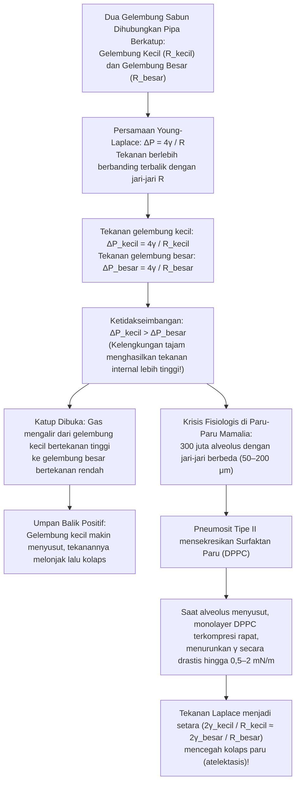
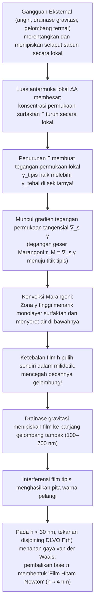

Celupkan cincin plastik ke dalam air sabun lalu tiup perlahan: selaput tipis cairan akan merentang, terlepas, dan dalam hitungan milidetik membentuk bola sempurna berwarna-warni pelangi yang melayang di udara. Atau amati busa sabun di dalam mangkuk menggunakan kaca pembesar: apa yang sekilas tampak seperti kumpulan gelembung acak ternyata tunduk pada keteraturan geometri yang mutlak. Di seluruh busa, dinding-dinding cairan tidak pernah bertemu empat atau lima sekaligus—mereka selalu bertemu <strong>bertiga</strong> di sepanjang saluran cairan (batas Plateau) dengan sudut tepat <strong>$120^\circ$ ($2\pi/3$)</strong>, dan saluran-saluran tersebut selalu bertemu <strong>berempat</strong> di titik simpul dengan sudut tetrahedral tepat <strong>$\arccos(-1/3) \approx 109,4712^\circ$</strong>.

Mengapa gelembung sabun bebas selalu berbentuk bola? Mengapa ketika gelembung kecil dan gelembung besar dihubungkan dengan pipa, justru gelembung <em>kecil</em> yang menyusut dan memompa udaranya ke dalam gelembung <em>besar</em>—dan mengapa ketidakstabilan yang sama tidak membuat 300 juta alveolus di paru-paru kita kolaps setiap kali kita mengembuskan napas? Mengapa gelembung air murni atau alkohol murni pecah dalam milidetik, sedangkan sedikit surfaktan memberi lapisan film kemampuan menyembuhkan diri sendiri? Dan bagaimana konjektur Lord Kelvin yang bertahan selama 107 tahun tentang pembagian ruang tiga dimensi dengan luas permukaan minimum akhirnya dipatahkan pada tahun 1994 oleh struktur Weaire-Phelan?

Artikel ini memadukan termodinamika, geometri diferensial, kalkulus variasi, teori ukuran geometris, dan mekanika fluida antarmuka untuk mengungkap fisika di balik gelembung sabun dan busa.

---

## 1. Termodinamika Tegangan Permukaan dan Asimetri Molekuler

Di bagian dalam (*bulk*) air cair, setiap molekul $\text{H}_2\text{O}$ dikelilingi secara isotropis oleh molekul tetangga melalui jaringan ikatan hidrogen dan gaya van der Waals. Gaya total rata-rata terhadap waktu bernilai nol dan molekul berada pada keadaan energi potensial kohesif yang rendah (bilangan koordinasi $z_b \approx 12$, energi $-u_0$).

Pada <strong>antarmuka cair-uap</strong>, simetri ini rusak secara drastis: kerapatan molekul di fase gas sekitar seribu kali lebih kecil daripada di fase cair. Molekul di permukaan kehilangan hampir separuh tetangga penariknya ($z_s < z_b$) sehingga memiliki kelebihan energi potensial. Memindahkan molekul dari bagian dalam ke permukaan untuk memperluas luas antarmuka $A$ sebesar $dA$ membutuhkan kerja reversibel positif melawan gaya kohesi.

Diferensial total energi bebas Gibbs $G(T, P, A, \{N_i\})$ adalah:

$$dG = -S\,dT + V\,dP + \gamma\,dA + \sum_{i} \mu_i\,dN_i$$

Dari sini diperoleh definisi termodinamika eksak untuk <strong>tegangan permukaan</strong> $\gamma$:

$$\gamma \equiv \left( \frac{\partial G}{\partial A} \right)_{T, P, N_i} = \left( \frac{\partial F}{\partial A} \right)_{T, V, N_i}$$

Besaran ini memiliki dua makna fisis yang setara:
1. <strong>Energi bebas berlebih per satuan luas ($\text{J/m}^2$)</strong>: Pada volume $V$ tetap, sistem meminimalkan energi bebas $\gamma A$ dengan meminimalkan luas permukaannya $A$. Berdasarkan <strong>ketaksamaan isoperimetrik</strong> tiga dimensi $A^3 \ge 36\pi V^2$, bola adalah satu-satunya bangun ruang yang memiliki luas permukaan minimum untuk volume tertentu.
2. <strong>Gaya tarik tangensial per satuan panjang ($\text{N/m}$)</strong>: Menurut <strong>rumus Kirkwood-Buff (1949)</strong> dalam mekanika statistik, $\gamma$ adalah integral anisotropi antara tekanan normal $P_N$ dan tekanan tangensial $P_T(z)$ melintasi lapisan antarmuka:
   $$\gamma = \int_{-\infty}^{+\infty} \bigl[ P_N - P_T(z) \bigr]\,dz$$

| Sistem Cairan / Antarmuka (pada $20^\circ\text{C}$ terhadap udara) | Tegangan Permukaan $\gamma$ ($\text{mN/m}$) | Interaksi Antarmolekul Dominan | Stabilitas Film Tipis & Gelembung |
| :--- | :---: | :--- | :--- |
| Merkuri Cair ($\text{Hg}$) | $486,5$ | Ikatan logam | Tidak dapat membentuk film; langsung membulat |
| Air Murni ($\text{H}_2\text{O}$) | $72,8$ | Jaringan ikatan hidrogen + dipol | Pecah dalam milidetik (tanpa elastisitas Marangoni) |
| Etanol Murni ($\text{C}_2\text{H}_5\text{OH}$) | $22,3$ | Ikatan H lemah + dispersi | Film tunggal tidak stabil (fenomena "air mata anggur") |
| Larutan Sabun / SDS (dekat CMC) | $25,0 \sim 35,0$ | Monolayer surfaktan amfifilik | <strong>Stabil beberapa menit hingga jam</strong> (efek Gibbs-Marangoni) |
| Surfaktan Paru (monolayer DPPC terkompresi) | $0,5 \sim 2,0$ | Fosfolipid jenuh berkerapatan ultra-tinggi | <strong>Sangat stabil</strong> (mencegah kolaps alveolus paru) |

---

## 2. Geometri Diferensial Permukaan Lengkung dan Persamaan Young-Laplace

Ketika suatu antarmuka melengkung, gaya tarik tangensial $\gamma$ menghasilkan resultan gaya normal menuju pusat kelengkungan (sisi cekung), sehingga menciptakan loncatan tekanan $\Delta P = P_{\text{dalam}} - P_{\text{luar}} > 0$. Misalkan $R_1, R_2$ adalah dua <strong>jari-jari kelengkungan utama</strong> ($\kappa_1 = 1/R_1, \kappa_2 = 1/R_2$) dari permukaan mulus $\Sigma \subset \mathbb{R}^3$. <strong>Kelengkungan rata-rata</strong> $H$ dan <strong>kelengkungan Gauss</strong> $K$ didefinisikan sebagai:

$$H \equiv \frac{\kappa_1 + \kappa_2}{2} = \frac{1}{2}\left(\frac{1}{R_1} + \frac{1}{R_2}\right), \qquad K \equiv \kappa_1 \kappa_2 = \frac{1}{R_1 R_2}$$

Pergeseran normal virtual $\delta\xi$ pada elemen luas $dA = R_1 R_2\,d\theta_1\,d\theta_2$ menghasilkan variasi luas orde pertama $\delta(dA) = dA\left(\frac{1}{R_1} + \frac{1}{R_2}\right)\delta\xi$ dan volume tersapu $\delta(dV) = dA\,\delta\xi$. Syarat kesetimbangan $\delta F = \gamma\,\delta(dA) - \Delta P\,\delta(dV) = 0$ menghasilkan <strong>persamaan Young-Laplace (1805–1806)</strong>:

$$\Delta P = P_{\text{dalam}} - P_{\text{luar}} = \gamma\left(\frac{1}{R_1} + \frac{1}{R_2}\right) = 2\gamma H$$

Sementara tetesan air di udara hanya memiliki <strong>satu</strong> antarmuka ($\Delta P_{\text{tetes}} = 2\gamma/R$), <strong>gelembung sabun di udara</strong> adalah cangkang cairan tipis dengan ketebalan $h \ll R$ yang memiliki <strong>dua antarmuka gas-cair</strong> (bagian dalam berjari-jari $R$ dan bagian luar berjari-jari $R+h$), sehingga menghasilkan faktor $4$:

$$\Delta P_{\text{sabun}} = (P_{\text{dalam}} - P_{\text{film}}) + (P_{\text{film}} - P_{\text{luar}}) = \frac{2\gamma}{R} + \frac{2\gamma}{R+h} \approx \frac{4\gamma}{R}$$

---

## 3. Permukaan Minimal ($H = 0$), Katastrofe Katenoid, dan Masalah Plateau

Selaput sabun terbuka yang direntangkan pada kerangka kawat tanpa mengurung udara memiliki tekanan atmosfer yang sama di kedua sisinya ($\Delta P = 0$). Persamaan Young-Laplace mengharuskan kelengkungan rata-rata bernilai nol di setiap titik:

$$H = \frac{1}{2}\left(\frac{1}{R_1} + \frac{1}{R_2}\right) = 0 \quad \Longleftrightarrow \quad \kappa_1 = -\kappa_2 \quad \Longrightarrow \quad K = -\kappa_1^2 \le 0$$

Permukaan dengan $H \equiv 0$ disebut <strong>permukaan minimal</strong>. Dalam bentuk grafik $z = u(x,y)$, meminimalkan fungsional luas $A[u] = \iint \sqrt{1+u_x^2+u_y^2}\,dx\,dy$ menghasilkan persamaan diferensial parsial Euler-Lagrange (Lagrange, 1760):

$$\bigl(1 + u_y^2\bigr) u_{xx} - 2 u_x u_y u_{xy} + \bigl(1 + u_x^2\bigr) u_{yy} = 0$$

Setiap titik tak-datar pada selaput sabun terbuka secara lokal berbentuk pelana hiperbolik ($K < 0$). Permukaan minimal putar di antara dua cincin koaksial berjari-jari $R$ yang terpisah sejauh $2h$ adalah <strong>katenoid</strong> (Euler, 1744):

$$r(z) = c \cosh\!\left(\frac{z}{c}\right)$$

Saat kedua cincin ditarik menjauh melewati rasio kritis ($\coth u_c = u_c \approx 1,19968$):

$$\left(\frac{2h}{R}\right)_{\text{kritis}} = \frac{2u_c}{\cosh u_c} \approx 1,32548$$

solusi real menghilang melalui bifurkasi pelana-simpul; leher selaput sabun putus dan melompat menjadi dua cakram datar terpisah (<strong>solusi diskontinu Goldschmidt</strong>). <strong>Masalah Plateau</strong> untuk kurva batas umum diselesaikan pada tahun 1930 oleh Jesse Douglas (peraih Medali Fields pertama tahun 1936) dan Tibor Radó.

---

## 4. Paradoks Dua Gelembung, Pematangan Ostwald, dan Surfaktan Paru (DPPC)

Jika gelembung sabun kecil ($R_{\text{kecil}}$) dan gelembung besar ($R_{\text{besar}}$) dihubungkan melalui pipa berkatup, saat katup dibuka <strong>gelembung kecil akan menyusut cepat dan meniupkan udaranya ke gelembung besar</strong>! Berdasarkan $\Delta P = 4\gamma/R$, semakin kecil jari-jari gelembung, semakin tinggi tekanan di dalamnya:

$$R_{\text{kecil}} < R_{\text{besar}} \quad \Longrightarrow \quad \Delta P_{\text{kecil}} = \frac{4\gamma}{R_{\text{kecil}}} \;>\; \frac{4\gamma}{R_{\text{besar}}} = \Delta P_{\text{besar}}$$

Di dalam busa nyata, difusi gas menembus dinding cairan dari gelembung kecil ke gelembung besar menyebabkan <strong>pematangan Ostwald (coarsening)</strong>. Pada tahun 1952, <strong>John von Neumann</strong> membuktikan lewat teorema Gauss-Bonnet bahwa dalam busa kering 2D, laju perubahan luas $A_n$ dari sel bersegi-$n$ mengikuti <strong>hukum von Neumann</strong>:

$$\frac{dA_n}{dt} = K_0 (n - 6)$$

Sel dengan $n < 6$ sisi menyusut dan lenyap, segi enam ($n = 6$) tetap stabil stasioner, dan sel dengan $n > 6$ terus membesar (generalisasi 3D dibuktikan oleh MacPherson dan Srolovitz pada tahun 2007).

Di dalam paru-paru manusia terdapat sekitar <strong>300 juta alveolus</strong> ($R \approx 50\text{–}200\,\mu\text{m}$). Jika tegangan permukaan $\gamma$ cairan pelapis alveolus bernilai konstan, alveolus kecil akan langsung mengempis ke dalam alveolus besar (<strong>atelektasis</strong>). Pneumosit tipe II mencegah hal ini dengan mensekresikan <strong>surfaktan paru</strong> yang kaya akan <strong>dipalmitoilfosfatidilkolin (DPPC)</strong>: saat alveolus mengecil ketika mengembuskan napas, lapisan tunggal DPPC yang tak larut air terkompresi rapat sehingga menurunkan $\gamma(R)$ hingga mendekati nol ($0,5\text{–}2\,\text{mN/m}$), menyeimbangkan tekanan di seluruh alveolus.

---

## 5. Hukum Joseph Plateau (1873), Bukti Jean Taylor (1976), dan Teorema Gelembung Ganda

Dirumuskan secara eksperimental oleh fisikawan Belgia <strong>Joseph Plateau</strong> pada tahun 1873 dan dibuktikan secara matematis oleh <strong>Jean E. Taylor</strong> pada tahun 1976 melalui teori ukuran geometris:

1. <strong>Hukum Pertama Plateau (3 Film pada $120^\circ$)</strong>: Selaput sabun selalu bertemu <strong>bertiga</strong> di sepanjang <strong>batas Plateau</strong> dengan sudut sama besar <strong>$120^\circ$ ($2\pi/3$)</strong> ($\sum_{i=1}^3 \hat{\mathbf{t}}_i = \mathbf{0} \implies \cos\theta = -1/2$). Persimpangan empat film pada $90^\circ$ ($L_{\text{silang}} = 4\sqrt{2} \approx 5,657$) tidak stabil dan langsung terbelah menjadi dua persimpangan tiga film $120^\circ$ membentuk pohon Steiner ($L_{\text{Steiner}} = 2(1+\sqrt{3}) \approx 5,464$, transisi T1).
2. <strong>Hukum Kedua Plateau (4 Tepi pada $109,47^\circ$)</strong>: Batas-batas Plateau selalu bertemu <strong>berempat</strong> di titik sudut dengan <strong>sudut tetrahedral Maraldi</strong>:
   $$\theta_{\text{Maraldi}} = \arccos\!\left(-\frac{1}{3}\right) \approx 109,47122^\circ \quad \left(109^\circ 28' 16''\right)$$
3. <strong>Teorema Gelembung Ganda (Hutchings, Morgan, Ritoré, Ros 2000)</strong>: Ketika dua gelembung berjari-jari $R_1 > R_2$ bergabung berbagi dinding sekat (septum), sekat tersebut melengkung ke dalam gelembung besar dengan jari-jari kelengkungan $R_{\text{septum}}$:
   $$\frac{1}{R_{\text{septum}}} = \frac{1}{R_2} - \frac{1}{R_1} \quad \Longleftrightarrow \quad R_{\text{septum}} = \frac{R_1 R_2}{R_1 - R_2}$$

---

## 6. Konjektur Kelvin (1887) vs. Struktur Weaire-Phelan (1994)

Pada tahun 1887, <strong>Lord Kelvin</strong> menanyakan cara membagi ruang $\mathbb{R}^3$ menjadi sel-sel bervolume sama ($V=1$) dengan luas permukaan minimum. Karena <strong>frustrasi geometris</strong>, Kelvin mengusulkan <strong>oktahedron terpotong (tetrakaidekahedron dengan 6 persegi dan 8 segi enam, sel Voronoi BCC)</strong> yang sedikit melengkung dengan luas ternormalisasi $A_{\text{Kelvin}} \approx 5,30628$.

Setelah bertahan 107 tahun, pada tahun 1994 <strong>Denis Weaire</strong> dan <strong>Robert Phelan</strong> (Trinity College Dublin) mematahkan konjektur Kelvin dengan <strong>struktur Weaire-Phelan</strong> (terinspirasi hidrat klatrat tipe I), yang sel satuan kubiknya terdiri atas <strong>8 polihedron bervolume sama dari dua jenis</strong>: <strong>2 dodekahedron pentagonal tak beraturan ($5^{12}$)</strong> dan <strong>6 tetrakaidekahedron ($5^{12}6^2$ dengan 2 segi enam dan 12 segi lima)</strong>. Karena $88,9\%$ sisinya adalah segi lima (sudut dalam $108^\circ$ sangat dekat dengan $109,47^\circ$), luas permukaannya turun $0,34\%$ menjadi $A_{\text{WP}} \approx 5,28825$, yang diabadikan pada arsitektur <strong>Pusat Akuatik Nasional Beijing ("Water Cube")</strong>.

| Struktur Busa Pengisi Ruang 3D | Sel per Unit $Z$ | Topologi Sisi (Rata-rata $\langle F \rangle$) | Memenuhi Hukum Plateau? | Luas Ternormalisasi $A$ ($V=1$) | Selisih vs Kelvin |
| :--- | :---: | :--- | :---: | :---: | :---: |
| <strong>Sarang Kubik Sederhana</strong> | $1$ | $6$ persegi ($\langle F \rangle = 6,00$) | Tidak (tidak stabil) | $6,00000$ | $+13,07\%$ |
| <strong>Dodekahedron Belah Ketupat (FCC)</strong> | $1$ | $12$ belah ketupat ($\langle F \rangle = 12,00$) | Tidak (simpul 6-tepi terbelah) | $5,34539$ | $+0,74\%$ |
| <strong>Struktur Kelvin (1887, BCC)</strong> | $1$ | $6$ persegi + $8$ segi enam ($\langle F \rangle = 14,00$) | <strong>Ya</strong> (segi enam melengkung) | $5,30628$ | $0,00\%$ (Basis) |
| <strong>Struktur Weaire-Phelan (1994, A15)</strong> | $8$ ($2+6$) | $88,9\%$ segi lima + $11,1\%$ segi enam ($\langle F \rangle = 13,50$) | <strong>Ya</strong> (kelengkungan minimal) | <strong>$5,28825$</strong> | <strong>$-0,34\%$ (Rekor)</strong> |

---

## 7. Elastisitas Gibbs-Marangoni, Interferensi Film Tipis, dan Tekanan Disjoining DLVO

Tegangan permukaan yang rendah saja tidak mampu menstabilkan gelembung (etanol murni langsung pecah). Ketahanan selaput sabun berasal dari <strong>elastisitas Gibbs-Marangoni</strong>:

Saat selaput sabun meregang dan menipis secara lokal, kerapatan surfaktan $\Gamma$ menurun sehingga tegangan permukaan lokal $\gamma_{\text{tipis}}$ meningkat. <strong>Tegangan Marangoni</strong> $\boldsymbol{\tau}_M = \nabla_s \gamma$ dan <strong>modulus elastisitas Gibbs</strong>

$$E_G \equiv 2A\left(\frac{\partial\gamma}{\partial A}\right)_{N_s} = -2\Gamma\left(\frac{\partial\gamma}{\partial\Gamma}\right)_T > 0$$

segera menarik cairan kembali ke bagian yang menipis (efek Marangoni yang sama menjelaskan fenomena <strong>"air mata anggur"</strong> pada dinding gelas). Saat ketebalan $h$ menyusut ke orde panjang gelombang cahaya tampak, pantulan dari permukaan depan dan belakang menghasilkan <strong>interferensi film tipis</strong> ($2n_{\text{film}}h\cos\theta_t + \lambda/2 = m\lambda$). Di bawah $h \ll \lambda/4 \approx 30\,\text{nm}$, pembalikan fase $\pi$ pada permukaan depan menyebabkan interferensi destruktif di seluruh spektrum tampak sehingga film tampak hitam pekat (<strong>film hitam Newton</strong>, $h \approx 4\,\text{nm}$), yang ditopang oleh <strong>tekanan disjoining DLVO</strong> $\Pi(h) = \Pi_{\text{vdW}}(h) + \Pi_{\text{el}}(h) + \Pi_{\text{sr}}(h)$.
