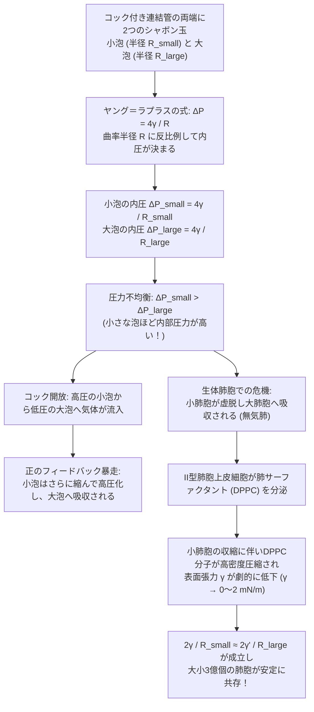
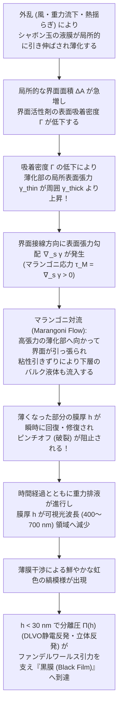

ストローの先に石鹸水をつけて息を吹き込むと、液体は瞬く間に引き伸ばされ、虹色に輝く完璧な球体となって宙を舞う。あるいは、洗面器の中で泡立てた石鹸の泡（フォーム、Foam）を虫眼鏡で覗き込むと、無数の多面体状の泡が互いの壁を押し合いながら、驚くほど厳密な幾何学的秩序――すべての壁が必ず3枚ずつ<strong>120度</strong>の角度で交わり、すべての稜線が必ず4本ずつ<strong>約109.47度</strong>の角度で一点に集まるという法則――に従っていることに気づく。

なぜシャボン玉は他のいかなる立体でもなく球体になるのか。なぜ2つのシャボン玉を管でつなぐと、直感に反して「小さな泡」がさらに縮み、「大きな泡」へと空気を送り込んでしまうのか。なぜ純粋な水ではどれほど頑張ってもシャボン玉を作ることができず、微量の界面活性剤（石鹸）を加えた途端に数分間も割れずに自律修復する薄膜が生まれるのか。そして、「同じ体積の泡で3次元空間を隙間なく埋め尽くすとき、界面の面積を最小にする形状は何か」という19世紀のケルビン卿の問いは、なぜ100年以上にわたって数学者と物理学者を悩ませ続けたのか。

本稿では、熱力学・微分幾何学・変分法・幾何学的測度論・界面流体力学の5つの視点から、シャボン玉と泡の背後に潜む数理構造を体系的に解き明かす。

---

## 1. 界面張力の熱力学と分子論的起源

### 1.1 バルク分子と界面分子の非対称性

液体の水の中では、水分子（$\text{H}_2\text{O}$）どうしが水素結合とファンデルワールス力（双極子間相互作用およびロンドン分散力）によって互いに強く引き合っている。液体の内部（バルク）に存在する分子は、上下左右あらゆる方向を同じ水分子に取り囲まれているため、周囲から受ける引力の時間平均は等方的に打ち消し合い、合力はゼロとなる。このとき、バルク分子1個あたりの凝集エネルギーを $-u_0$（$u_0 > 0$、配位数 $z_b \approx 12$ のとき各結合あたり $-u_0/z_b$）と置くことができる。

ところが、液体と気体（空気）の境界である<strong>気液界面（Liquid-Vapor Interface）</strong>に位置する分子は状況がまったく異なる。界面のすぐ下側には高密度の液体分子が存在して強い引力を及ぼすのに対し、界面の上側（気相側）には分子密度が約1000分の1しかない気体分子しか存在しない。そのため、界面にある分子は隣接する液体分子との結合手を半分近く失っており（実効配位数 $z_s < z_b$）、バルク内部の分子に比べてエネルギー的に不安定な（ポテンシャルエネルギーが約 $\Delta \epsilon \approx u_0 (z_b - z_s)/(2z_b) > 0$ だけ高い）状態に置かれている。

分子をバルク内部から界面へ引き上げるには、この凝集力に逆らって正の仕事（可逆的仕事 $\delta W$）をしなければならない。熱力学の言葉で言えば、界面の面積 $A$ を微小量 $dA$ だけ増やすことは、高エネルギー状態にある界面分子の数を増やすことと同値である。

### 1.2 ギブズの自由エネルギーと表面張力 $\gamma$ の定義

一定温度 $T$、一定圧力 $P$、および一定の物質量 $N_i$ のもとで、界面面積 $A$ を持つ多相系のギブズ自由エネルギー $G(T, P, A, \{N_i\})$ の全微分は次のように書ける。

$$dG = -S\,dT + V\,dP + \gamma\,dA + \sum_{i} \mu_i\,dN_i$$

ここで $\mu_i$ は成分 $i$ の化学ポテンシャルであり、比例係数 $\gamma$ が<strong>表面張力（Surface Tension）</strong>あるいは<strong>界面自由エネルギー密度（Interfacial Free Energy Density）</strong>である。上式から、$\gamma$ の厳密な熱力学的定義が得られる。

$$\gamma \equiv \left( \frac{\partial G}{\partial A} \right)_{T, P, N_i}$$

同様に、体積 $V$ が一定の系（ヘルムホルツ自由エネルギー $F$）においては $\gamma = (\partial F / \partial A)_{T, V, N_i}$ と定義される。この式から明らかなように、表面張力 $\gamma$ は2つの物理的に等価な次元と意味を持っている。

1. <strong>単位面積あたりの過剰自由エネルギー（$\text{J/m}^2$）</strong>：界面を $1\,\text{m}^2$ 新たに作り出すために必要な熱力学的仕事。熱力学第二法則により、等温・等圧（または等積）の孤立していない系は自由エネルギー $G$（または $F$）が最小になる状態へ向かって自発的に緩和する。したがって、<strong>体積 $V$ が与えられた液体は、他の外力が無視できる限り、表面積 $A$ を最小化する形状（すなわち球体）へと収縮する</strong>。これが等周不等式（Isoperimetric Inequality）
   $$A^3 \ge 36\pi V^2$$
   の物理的実現であり、宇宙空間の水滴や空中のシャボン玉が丸くなる第一の理由である。
2. <strong>単位長さあたりに働く面内引張力（$\text{N/m}$）</strong>：幅 $L$ のコの字型の針金枠に液膜を張り、可動辺を微小距離 $dx$ だけ引っ張って面積を $dA = 2 L\,dx$（液膜には表と裏の2つの気液界面があることに注意）だけ増やすとき、外力がなす仕事 $\delta W = F_{\text{ext}}\,dx$ は自由エネルギーの増加 $\gamma\,dA = 2\gamma L\,dx$ に等しい。よって界面1枚あたり単位長さにつき $\gamma = F_{\text{ext}} / (2L)$（単位 $\text{N/m} = \text{J/m}^2$）の張力が常に接線方向に働いている。

さらに統計力学の<strong>カークウッド＝バフの式（Kirkwood-Buff Formula, 1949）</strong>によれば、界面に垂直な座標を $z$ としたとき、界面張力 $\gamma$ は界面遷移層（厚さ数オングストローム〜数ナノメートル）における圧力テンソルの法線成分 $P_N(z) = P_0$ と接線成分 $P_T(z)$ の異方性積分として厳密に表される。

$$\gamma = \int_{-\infty}^{+\infty} \bigl[ P_N - P_T(z) \bigr]\,dz$$

バルク内部では圧力は等方的（$P_N = P_T$）で被積分関数はゼロになるが、気液界面の極薄層内では分子間引力によって強い負の接線圧力（すなわち面内の引張応力 $P_T(z) \ll P_N$）が発生しており、その空間積分こそが巨視的な表面張力 $\gamma$ の正体である。

| 液体・界面の種類（$20^\circ\text{C}$、対空気） | 表面張力 $\gamma$ ($\text{mN/m} = 10^{-3}\,\text{N/m}$) | 支配的な分子間相互作用 | 泡（薄膜）の安定性 |
| :--- | :---: | :--- | :--- |
| 水銀（$\text{Hg}$） | $486.5$ | 金属結合 | 薄膜を形成せず即座に球状液滴へ凝集 |
| 純水（$\text{H}_2\text{O}$） | $72.8$ | 水素結合ネットワーク + 双極子相互作用 | 数ミリ秒で破裂（マランゴニ弾性欠如） |
| エタノール（$\text{C}_2\text{H}_5\text{OH}$） | $22.3$ | 弱い水素結合 + 分散力 | 単成分では薄膜維持不可（ワインの涙の原因） |
| 石鹸水・SDS水溶液（CMC付近） | $25.0 \sim 35.0$ | 両親媒性分子の界面吸着層 | <strong>数分〜数時間安定</strong>（ギブズ＝マランゴニ効果） |
| 肺サーファクタント（DPPC単分子膜・圧縮時） | $0.5 \sim 2.0$ | 飽和リン脂質の超高密度パッキング | <strong>極めて安定</strong>（肺胞の虚脱を完全に防止） |

---

## 2. 曲面の微分幾何とヤング＝ラプラスの式の完全導出

界面が平面ではなく曲率を持っている場合、面内に働く表面張力 $\gamma$ は曲面の法線方向（内側）へ向かう正味の力を生み出す。そのため、曲がった界面の凹側（内側）の圧力 $P_{\text{in}}$ は、凸側（外側）の圧力 $P_{\text{out}}$ よりも必ず高くなる。この圧力差 $\Delta P = P_{\text{in}} - P_{\text{out}}$（<strong>ラプラス圧、Laplace Pressure</strong>）を曲面の主曲率と結びつける基本方程式が、1805年にトマス・ヤング（Thomas Young）が定性的に提唱し、翌1806年にピエール＝シモン・ラプラス（Pierre-Simon Laplace）が数学的に導出した<strong>ヤング＝ラプラスの式（Young-Laplace Equation）</strong>である。

### 2.1 曲面の主曲率 $\kappa_1, \kappa_2$ と平均曲率 $H$

3次元ユークリッド空間 $\mathbb{R}^3$ 内の滑らかな曲面 $\Sigma$ 上の任意の点 $p$ を考える。点 $p$ における単位法線ベクトルを $\hat{\mathbf{n}}$ とし、$\hat{\mathbf{n}}$ を含む平面（法平面）で曲面 $\Sigma$ を切断すると、切り口として平面曲線が得られる。この平面曲線の点 $p$ における符号付き曲率 $\kappa(\phi)$（曲率半径の逆数）は、法平面を $\hat{\mathbf{n}}$ の周りに角度 $\phi$ だけ回転させると連続的に変化する。

微分幾何学のオイラーの定理により、互いに直交する2つの主方向（Principal Directions）において曲率 $\kappa(\phi)$ は最大値 $\kappa_1$ と最小値 $\kappa_2$ をとる。これらを<strong>主曲率（Principal Curvatures）</strong>と呼び、対応する曲率半径 $R_1 = 1/\kappa_1$, $R_2 = 1/\kappa_2$ を<strong>主曲率半径（Principal Radii of Curvature）</strong>と呼ぶ。任意の方向 $\phi$ の法曲率は $\kappa(\phi) = \kappa_1 \cos^2\phi + \kappa_2 \sin^2\phi$ で与えられ、この2つの主曲率から曲面の局所形状を特徴づける2つの基本不変量が定義される。

$$\text{平均曲率 (Mean Curvature):} \quad H \equiv \frac{\kappa_1 + \kappa_2}{2} = \frac{1}{2}\left(\frac{1}{R_1} + \frac{1}{R_2}\right)$$

$$\text{ガウス曲率 (Gaussian Curvature):} \quad K \equiv \kappa_1 \kappa_2 = \frac{1}{R_1 R_2}$$

### 2.2 仮想仕事の原理によるヤング＝ラプラスの式の導出

点 $p$ を中心とし、2つの主曲率方向に沿った微小な長方形パッチ（辺の長さがそれぞれ $ds_1 = R_1\,d\theta_1$, $ds_2 = R_2\,d\theta_2$）を考える。この微小パッチの面積は $dA = ds_1\,ds_2 = R_1 R_2\,d\theta_1\,d\theta_2$ である。

いま、この曲面パッチを法線 $\hat{\mathbf{n}}$ の方向（外側）へ微小距離 $\delta \xi$ だけ仮想的に変位させる。変位後の曲率半径はそれぞれ $R_1 + \delta \xi$, $R_2 + \delta \xi$ へと拡大するため、新しい辺の長さは

$$ds_1' = (R_1 + \delta\xi)\,d\theta_1 = ds_1 \left(1 + \frac{\delta\xi}{R_1}\right), \qquad ds_2' = (R_2 + \delta\xi)\,d\theta_2 = ds_2 \left(1 + \frac{\delta\xi}{R_2}\right)$$

となる。したがって、変位後の面積 $dA' = ds_1'\,ds_2'$ を $\delta\xi$ の1次の微小量まで展開すると、面積の変分 $\delta(dA) = dA' - dA$ は次式で与えられる。

$$\delta(dA) = ds_1\,ds_2 \left(1 + \frac{\delta\xi}{R_1}\right)\left(1 + \frac{\delta\xi}{R_2}\right) - ds_1\,ds_2 = dA \left(\frac{1}{R_1} + \frac{1}{R_2}\right)\delta\xi + \mathcal{O}(\delta\xi^2)$$

一方、この法線変位 $\delta\xi$ によって掃かれた微小体積（内側の領域の体積増加分）は

$$\delta(dV) = dA\,\delta\xi$$

である。力学的な平衡状態においては、系の全自由エネルギーの変分 $\delta F = \gamma\,\delta(dA) - (P_{\text{in}} - P_{\text{out}})\,\delta(dV)$ が任意の仮想変位 $\delta\xi$ に対してゼロでなければならない（仮想仕事の原理）。

$$\delta F = \left[ \gamma\left(\frac{1}{R_1} + \frac{1}{R_2}\right) - \Delta P \right] dA\,\delta\xi = 0$$

これより、1枚の界面に対する<strong>ヤング＝ラプラスの式</strong>が導かれる。

$$\Delta P = P_{\text{in}} - P_{\text{out}} = \gamma \left(\frac{1}{R_1} + \frac{1}{R_2}\right) = 2\gamma H$$

### 2.3 水滴（$\Delta P = 2\gamma/R$）とシャボン玉（$\Delta P = 4\gamma/R$）の決定的な違い

ここで極めて重要な注意点が1つある。空気中に浮かぶ半径 $R$ の<strong>球状の液滴（雨粒など）</strong>や、水中に浮かぶ<strong>気泡（キャビテーション気泡や炭酸の泡）</strong>では、液体と気体を隔てる界面は<strong>1枚</strong>しか存在しない。球面ではあらゆる方向で $R_1 = R_2 = R$ であるから、液滴や水中気泡の内外圧力差は

$$\Delta P_{\text{droplet}} = \gamma \left(\frac{1}{R} + \frac{1}{R}\right) = \frac{2\gamma}{R}$$

となる。

ところが、空気中に浮かぶ<strong>シャボン玉（Soap Bubble）</strong>は、内部も気体（空気）、外部も気体（空気）であり、その間に厚さ $h$（通常 $10\,\text{nm} \sim 1\,\mu\text{m}$）の薄い石鹸水の層が挟まれた二相サンドイッチ構造をしている。すなわち、シャボン玉には<strong>内側の気液界面（半径 $R_{\text{in}} = R$）</strong>と<strong>外側の気液界面（半径 $R_{\text{out}} = R + h$）</strong>の<strong>合計2枚の気液界面</strong>が存在するのだ。

内側の空気圧を $P_{\text{in}}$、石鹸水膜内部の液圧を $P_{\text{film}}$、外気の大気圧を $P_{\text{out}}$ とすると、それぞれの界面でヤング＝ラプラスの式が成立する。

$$P_{\text{in}} - P_{\text{film}} = \frac{2\gamma}{R}, \qquad P_{\text{film}} - P_{\text{out}} = \frac{2\gamma}{R + h}$$

この2式を辺々足し合わせ、膜の厚さ $h$ がシャボン玉の半径 $R$ に比べて圧倒的に小さい（$h \ll R$）ことを用いれば、シャボン玉の内外圧力差 $\Delta P_{\text{soap}}$ が得られる。

$$\Delta P_{\text{soap}} = P_{\text{in}} - P_{\text{out}} = 2\gamma \left(\frac{1}{R} + \frac{1}{R+h}\right) \approx \frac{4\gamma}{R}$$

係数 $2$ ではなく <strong>$4$</strong> が現れるのは、表と裏の2枚の界面がともに中心へ向かって収縮しようとする張力を発揮しているためである。この $\Delta P = 4\gamma/R$ という一見シンプルな反比例の法則から、私たちの日常直感を鮮やかに裏切る2つの物理現象が導かれる。それが<strong>極小曲面（Minimal Surfaces）</strong>と<strong>2つの泡のパラドックス（Two-Bubble Paradox）</strong>である。

---

## 3. 極小曲面（$H = 0$）とプラトーの問題

### 3.1 閉じていない石鹸膜が満たす微分方程式：$H = 0$

シャボン玉のように空気を閉じ込めた閉曲面ではなく、任意の形状に曲げた針金の枠（閉曲線 $\Gamma$）を石鹸水に浸して引き上げたときに張られる<strong>開いた石鹸膜</strong>を考えよう。この石鹸膜には表側にも裏側にも同じ大気圧 $P_{\text{atm}}$ がかかっており、内外の圧力差は厳密にゼロである。

$$\Delta P = P_{\text{side 1}} - P_{\text{side 2}} = 0$$

表面張力 $\gamma > 0$ のもとでヤング＝ラプラスの式 $\Delta P = 2\gamma H$ に $\Delta P = 0$ を代入すると、重力の影響が無視できる限り、石鹸膜上のすべての点において<strong>平均曲率 $H$ が恒等的にゼロ</strong>でなければならないという驚くべき結論が得られる。

$$H = \frac{1}{2}\left(\frac{1}{R_1} + \frac{1}{R_2}\right) = 0 \quad \Longleftrightarrow \quad \kappa_1 = -\kappa_2 \quad (R_1 = -R_2)$$

微分幾何学において、すべての点で平均曲率 $H = 0$ を満たす曲面を<strong>極小曲面（Minimal Surface）</strong>と呼ぶ。平面（$\kappa_1 = \kappa_2 = 0$）は最も自明な極小曲面であるが、境界となる針金枠 $\Gamma$ が同一平面上になければ、石鹸膜は平面になることができない。そのとき石鹸膜はどうするかというと、ある方向には表側へ凸に曲がり（$\kappa_1 > 0$）、それと直交する方向には裏側へまったく同じ曲率だけ凹に曲がる（$\kappa_2 = -\kappa_1 < 0$）ことで、曲率の和 $\kappa_1 + \kappa_2$ をゼロに保つのである。

その結果、平面でない極小曲面上のすべての点では、ガウス曲率 $K$ が必ず非正（負またはゼロ）となる。

$$K = \kappa_1 \kappa_2 = -\kappa_1^2 \le 0$$

すなわち、<strong>開いた石鹸膜のあらゆる点は、局所的に馬の鞍（サドル、双曲放物面）のような形をしており、お椀のように両方向とも同じ側へ曲がった点（楕円点 $K > 0$）は1つたりとも存在し得ない</strong>。

### 3.2 面積汎関数のオイラー＝ラグランジュ方程式

なぜ $H = 0$ の曲面が「極小曲面」と呼ばれるのかを変分法で確認しておこう。曲面が直交座標系 $(x, y, z)$ においてグラフ $z = u(x, y)$ として表されるとき、領域 $\Omega \subset \mathbb{R}^2$ 上の表面積汎関数 $A[u]$ は第1基本形式から次のように書ける。

$$A[u] = \iint_{\Omega} \sqrt{1 + u_x^2 + u_y^2}\,dx\,dy \qquad \left(u_x \equiv \frac{\partial u}{\partial x},\; u_y \equiv \frac{\partial u}{\partial y}\right)$$

境界 $\partial\Omega$ 上で関数の値を固定したまま、面積 $A[u]$ の第1変分 $\delta A[u] = 0$ を計算してオイラー＝ラグランジュ方程式

$$\frac{\partial}{\partial x}\left(\frac{u_x}{\sqrt{1+u_x^2+u_y^2}}\right) + \frac{\partial}{\partial y}\left(\frac{u_y}{\sqrt{1+u_x^2+u_y^2}}\right) = 0$$

を展開すると、1760年にジョゼフ＝ルイ・ラグランジュ（Joseph-Louis Lagrange）が導出した<strong>極小曲面方程式（Minimal Surface Equation）</strong>が得られる。

$$\bigl(1 + u_y^2\bigr) u_{xx} - 2 u_x u_y u_{xy} + \bigl(1 + u_x^2\bigr) u_{yy} = 0$$

上式の左辺を $(1 + u_x^2 + u_y^2)^{3/2}$ で割った量は、まさにグラフ曲面 $z = u(x,y)$ の平均曲率の2倍 $2H = \nabla \cdot \hat{\mathbf{n}}$ に他ならない。すなわち、<strong>石鹸膜は自らの表面張力によって熱力学的自由エネルギー $\gamma A$ を最小化するアナログ計算機であり、針金枠を石鹸水から引き上げるというわずか1秒の物理過程によって、非線形偏微分方程式 $H = 0$ の境界値問題を瞬時に解いている</strong>のである。

### 3.3 懸垂面（カテノイド）の臨界崩壊とゴールドシュミットの不連続解

極小曲面の最も美しい具体例が、1744年にレオンハルト・オイラー（Leonhard Euler）によって発見された<strong>懸垂面（Catenoid、カテノイド）</strong>である。半径 $R$ の2つの同じ円形リングを、中心軸（$z$ 軸）を揃えて距離 $2h$（$z = -h$ と $z = +h$）だけ離して配置し、その間に石鹸膜を張ることを考えよう。

回転対称性から曲面のプロファイルを $r = r(z)$ と置くと、表面積汎関数は

$$A[r] = 2\pi \int_{-h}^{h} r(z)\sqrt{1 + \bigl(r'(z)\bigr)^2}\,dz$$

となる。被積分関数が $z$ を陽に含まないため、解析力学のベルトラミの恒等式（エネルギー保存則に対応する第1積分）を適用すると、ただちに懸垂線（カテナリー）を回転させた曲面が得られる。

$$r(z) = c \cosh\!\left(\frac{z}{c}\right)$$

ここで定数 $c > 0$ は $z = 0$ におけるくびれ（ネック）の最小半径である。この曲面では、子午線方向（断面曲線方向）の曲率半径 $R_1 = -c \cosh^2(z/c)$ と、回転軸方向（法線切片）の曲率半径 $R_2 = +c \cosh^2(z/c)$ がすべての $z$ において符号が逆で絶対値が完全に一致しており、$H = \frac{1}{2}(1/R_1 + 1/R_2) = 0$ が厳密に成り立っている。

ところが、2つのリングの間隔 $2h$ を少しずつ広げていくと、ある臨界距離に達した瞬間に石鹸膜のくびれが急速に細くなり、パチンとちぎれてそれぞれのリングを平らに塞ぐ<strong>2枚の円盤（Two Flat Disks）</strong>へとジャンプする！ なぜこのようなカタストロフ（相転移的崩壊）が起きるのだろうか。

境界条件 $r(\pm h) = R$ を代入すると、ネック半径 $c$ を決める超越方程式が得られる。

$$R = c \cosh\!\left(\frac{h}{c}\right) \quad \Longleftrightarrow \quad \frac{h}{R} = \frac{u}{\cosh u} \qquad \left(u \equiv \frac{h}{c}\right)$$

関数 $f(u) = u / \cosh u$ の最大値を求めるため $f'(u) = (\cosh u - u \sinh u)/\cosh^2 u = 0$ を解くと、$\coth u_c = u_c$ すなわち $u_c \approx 1.19968$ において最大値

$$\left(\frac{h}{R}\right)_{\text{crit}} = \frac{u_c}{\cosh u_c} = \frac{1}{\sinh u_c} \approx 0.66274 \quad \Longrightarrow \quad \left(\frac{2h}{R}\right)_{\text{crit}} \approx 1.32548$$

をとることがわかる。

* <strong>$h/R < 0.528$ の領域</strong>：懸垂面（太いカテノイド）の表面積 $A_{\text{cat}}$ は、2枚の円盤の面積の和 $A_{\text{disks}} = 2\pi R^2$ よりも小さく、カテノイドが大域的最小解（絶対安定状態）となる。
* <strong>$0.528 < h/R < 0.66274$ の領域</strong>：実は2枚の円盤に分かれた解（1831年にカール・フリードリヒ・ガウスの弟子ベンジャミン・ゴールドシュミットが指摘した<strong>ゴールドシュミットの不連続解</strong>）の方が面積 $2\pi R^2$ が小さくなるが、エネルギー障壁が存在するため、カテノイドは<strong>準安定状態（極小解）</strong>として生き残る。
* <strong>$h/R > 0.66274$（リング間距離 $2h > 1.32548 R$）の領域</strong>：超越方程式 $R = c \cosh(h/c)$ を満たす実数解 $c$ そのものが消滅する（サドルノード分岐）。この瞬間、石鹸膜は連続な曲面として存在し続けることが数学的に不可能となり、中心でピンチオフ（くびれ切れ）を起こして2枚の平坦な円盤へと崩壊する（その際、中心にちぎれた微小な「衛星シャボン玉」が1個取り残される様子が高速度カメラで観察される）。

なお、平面とカテノイドに次ぐ第3の古典的極小曲面である<strong>常螺旋面（Helicoid、ヘリコイド：螺旋階段の形状）</strong>は、カテノイドと局所的に等長（Isometric：膜を伸び縮みさせずに曲げ変形するだけで移り変われる同伴極小曲面族）である。そして「任意のジョルダン閉曲線 $\Gamma$ が与えられたとき、それを境界とする面積最小の曲面が常に存在するか」という19世紀以来の<strong>プラトーの問題（Plateau's Problem）</strong>は、1930年にアメリカの数学者ジェシー・ダグラス（Jesse Douglas）とハンガリーの数学者ティボール・ラドー（Tibor Radó）によって独立に肯定的に解決され、ダグラスはこの業績により1936年の第1回フィールズ賞を受賞した。

---

## 4. 2つの泡のパラドックス、オストワルド熟成、そして肺胞が潰れない理由

### 4.1 なぜ小さなシャボン玉は大きなシャボン玉に空気を奪われるのか

閉じたシャボン玉（$\Delta P = 4\gamma/R$）の世界に戻ろう。ここにコック（弁）付きの細いガラス管があり、その両端に<strong>半径 $R_{\text{small}}$ の小さなシャボン玉</strong>と、<strong>半径 $R_{\text{large}}$ の大きなシャボン玉</strong>（$R_{\text{small}} < R_{\text{large}}$）を膨らませたとする。

コックを開いて2つのシャボン玉の内部空間を連通させた瞬間、どちらからどちらへ空気が流れ、最終的にどのような状態に落ち着くだろうか。多くの人は日常のゴム風船の連想や「左右の大きさが揃った方がバランスが良さそうだ」という直感から、「大きな泡から小さな泡へ空気が流れて、2つとも同じ大きさになる」と予想する。

しかし現実は正反対である。<strong>コックを開いた瞬間、小さなシャボン玉が急速にしぼんでいき、大きなシャボン玉がさらに大きく膨らむ</strong>のだ！

理由はヤング＝ラプラスの式 $\Delta P = 4\gamma/R$ を見れば一目瞭然である。シャボン玉の内部圧力と大気圧の差 $\Delta P$ は、半径 $R$ に<strong>反比例</strong>する。したがって、曲率がきつい（半径が小さい）シャボン玉ほど、内圧が高い。

$$R_{\text{small}} < R_{\text{large}} \quad \Longrightarrow \quad \Delta P_{\text{small}} = \frac{4\gamma}{R_{\text{small}}} \;>\; \frac{4\gamma}{R_{\text{large}}} = \Delta P_{\text{large}}$$

流体（空気）は圧力が高い方から低い方へと流れる。ゆえに空気は必然的に内圧の高い小さなシャボン玉から、内圧の低い大きなシャボン玉へと流入する。しかも、小さな泡から空気が抜けて半径 $R_{\text{small}}$ がさらに小さくなると、分母が小さくなるため内圧 $\Delta P_{\text{small}} = 4\gamma/R_{\text{small}}$ はますます跳ね上がり、大きな泡との圧力差が拡大して空気の流出が加速する（正のフィードバックによる暴走的不安定性）。この過程は、小さな方のシャボン玉が完全に潰れて管の端を塞ぐ緩やかな球面キャップ（曲率半径が大きな泡の半径 $R_{\text{large}}$ と完全に一致する状態）になるまで止まらない。

### 4.2 フォームの粗大化（オストワルド熟成）とフォン・ノイマンの法則

この「小さな泡が消滅して大きな泡に食われる」現象は、コック付きの管がなくても、ビールや石鹸の泡の集合体（フォーム）の中で常に進行している。泡と泡を隔てる液膜（セプタム）には気体分子がわずかに溶解し、フィックの拡散法則（Fick's Law of Diffusion）に従って高圧側（小さな泡）から低圧側（大きな泡）へと液膜を透過して拡散していく。これをコロイド・界面科学では<strong>オストワルド熟成（Ostwald Ripening）</strong>または<strong>フォームの粗大化（Foam Coarsening）</strong>と呼ぶ。時間が経つにつれて細かいクリーミーな泡が消え、少数の巨大な泡ばかりになっていくのはこのためである。

1952年、数学者ジョン・フォン・ノイマン（John von Neumann）は、2次元平面上に敷き詰められた乾燥フォーム（液膜の厚さが無視できる多角形セルの集合）において、ある1つの泡の面積 $A_n$ が時間 $t$ とともに変化する速度について、驚くほどエレガントな厳密解を導いた。それが<strong>フォン・ノイマンの法則（Von Neumann's Law）</strong>である。

$$\frac{dA_n}{dt} = K_0 (n - 6)$$

ここで $K_0 > 0$ は気体の透過係数と表面張力によって決まる定数であり、$n$ はその泡（多角形セル）が持つ<strong>辺の数（隣接する泡の数）</strong>である。驚くべきことに、泡の成長・収縮速度 $dA_n/dt$ は、その泡の現在の大きさ（面積 $A_n$）にも具体的な形状にも一切依存せず、<strong>トポロジカルな辺の数 $n$ だけによって完全に決定される</strong>！

なぜなのか。後に詳述するプラトーの法則により、2次元フォームのすべての頂点では3つの辺が必ず $120^\circ$（$2\pi/3$）で交わる。一方、滑らかな曲線で囲まれた2次元領域の境界を一周するとき、接線ベクトルの回転角の総和はガウス＝ボネの定理（Gauss-Bonnet Theorem）により $2\pi$ である。各頂点で外角が $\pi - 2\pi/3 = \pi/3$ ずつ折れ曲がるため、$n$ 角形の泡の $n$ 本の辺の曲率 $\kappa_i$ を辺の長さ $L_i$ にわたって線積分した総和は

$$\sum_{i=1}^{n} \int_{e_i} \kappa\,ds = 2\pi - n \cdot \frac{\pi}{3} = \frac{\pi}{3}(6 - n)$$

となる。気体の透過流量は各辺の圧力差 $\Delta P_i = 2\gamma \kappa_i$ を辺の長さ全体で積分した量に比例するため、流出入の総和をとると辺の長さ $L_i$ がきれいに約分されて消え、$(n-6)$ だけが残るのである。

* <strong>$n < 6$（三角形・四角形・五角形の泡）</strong>：$n - 6 < 0$ より辺は外側へ凸に膨らんでおり（内圧が高く）、時間が経つにつれて面積 $A_n$ が一定の割合で減少して<strong>必ず消滅する</strong>。
* <strong>$n = 6$（六角形の泡）</strong>：$n - 6 = 0$ より $dA_6/dt = 0$。正六角形は内角がちょうど $120^\circ$ であるため、すべての辺が真っ直ぐ（曲率 $\kappa = 0$）になり、<strong>面積が時間変化せず完全に安定して静止する</strong>（蜂の巣構造）。
* <strong>$n > 6$（七角形・八角形以上の泡）</strong>：$n - 6 > 0$ より辺は内側へ凹んでおり（内圧が低く）、周囲の小さな泡から気体を吸い取って<strong>面積が増大し続ける</strong>。

（なお、3次元フォームにおけるフォン・ノイマンの法則の一般化は半世紀以上にわたる未解決問題であったが、2007年にロバート・マクファーソン（Robert MacPherson）とデイヴィッド・スロロヴィッツ（David Srolovitz）によって、3次元セルの体積変化率 $dV/dt$ を平均幅と各稜線の長さに結びつける<strong>マクファーソン＝スロロヴィッツの式</strong>として完全に解決された。）

### 4.3 哺乳類の肺胞が潰れない理由：肺サーファクタント（DPPC）の奇跡

ここで、ヤング＝ラプラスの式 $\Delta P = 2\gamma/R$ が私たちの生命維持に突きつける深刻なパラドックスを考えよう。人間の左右の肺の中には、ガス交換を行うための微細な袋である<strong>肺胞（Alveoli）</strong>が約<strong>3億個</strong>も存在し、互いに気道（細気管支）でつながっている。肺胞の内壁は薄い水の層で覆われており、肺胞の半径 $R$ は一様ではなく、およそ $50\,\mu\text{m}$ から $200\,\mu\text{m}$ まで大きくばらついている（さらに呼気時にはすべての肺胞が収縮する）。

もし肺胞の内壁を覆う液体が純粋な水（または表面張力 $\gamma \approx 50 \sim 70\,\text{mN/m}$ が一定の体液）であったなら何が起きるか。先ほどの2つのシャボン玉の実験とまったく同じ原理により、半径 $R$ の小さな肺胞ほどラプラス圧 $\Delta P = 2\gamma/R$ が高くなり、小さな肺胞の中の空気はすべて大きな肺胞へと吐き出され、<strong>数回の呼吸のうちに小さな肺胞がすべてペシャンコに潰れてしまう（無気肺、Atelectasis）</strong>はずである！ さらに、潰れた肺胞を吸気時に再び膨らませるには莫大な陰圧が必要となり、呼吸筋の力だけでは息を吸うことすらできなくなる。

なぜ私たちの3億個の肺胞は潰れないのか。その答えは、肺胞の壁にある<strong>II型肺胞上皮細胞（Type II Pneumocytes）</strong>が分泌する生体界面活性剤<strong>肺サーファクタント（Pulmonary Surfactant）</strong>にある。肺サーファクタントの主成分は<strong>ジパルミトイルホスファチジルコリン（DPPC）</strong>という飽和リン脂質である。

DPPC分子は親水性の頭部と2本の疎水性飽和脂肪酸鎖（パルミチン酸）を持っており、気液界面に単分子膜（ラングミュア単分子膜）を形成する。ここが極めて巧妙な点なのだが、水分子に不溶なDPPC分子の数は各肺胞内でほぼ一定であるため、<strong>小さな肺胞が収縮して表面積 $A = 4\pi R^2$ が小さくなると、界面上のDPPC分子の面密度 $\Gamma$ が急速に高まり（分子どうしがぎゅうぎゅうに圧縮され）、表面張力 $\gamma(R)$ が $25\,\text{mN/m}$ からほぼゼロ（$0.5 \sim 2\,\text{mN/m}$）近くまで劇的に低下する</strong>のである。逆に、肺胞が大きく膨らんで面積 $A$ が広がると、DPPC分子の間隔が開いて表面張力 $\gamma(R)$ は急上昇する。

すなわち、肺サーファクタントが存在することで表面張力 $\gamma$ が定数ではなく半径 $R$ の増加関数 $\gamma(R)$ となり、

$$\frac{\gamma(R_{\text{small}})}{R_{\text{small}}} \approx \frac{\gamma(R_{\text{large}})}{R_{\text{large}}}$$

が自動的に達成されて大小の肺胞間の圧力差が消滅するのだ。在胎34週未満で生まれた早産児において、II型肺胞上皮細胞が未成熟で肺サーファクタントが十分に作られないために肺胞が虚脱し呼吸困難に陥る病態が<strong>新生児呼吸窮迫症候群（NRDS: Neonatal Respiratory Distress Syndrome）</strong>であり、1959年にメアリー・エレン・エイヴリー（Mary Ellen Avery）がその原因を表面張力の欠如として突き止め、後に岩手医科大学の藤原哲郎教授らがウシ肺抽出人工サーファクタント補充療法（1980年）を確立したことで、世界中の何十万人もの新生児の命が救われるようになった。シャボン玉の物理学は、文字通り私たちの毎秒の呼吸を支えているのである。

---

## 5. プラトーの法則と109.47度の正四面体角、そして二重泡定理

### 5.1 ジョゼフ・プラトーの実験と4つの経験則（1873年）

19世紀ベルギーの物理学者ジョゼフ・プラトー（Joseph Plateau, 1801–1883）は、若い頃に太陽を25秒間直視する視覚実験を行った後遺症で42歳にして完全に失明した。しかし彼は視力を失った後も、家族や助手たちの目を借りながら針金枠とグリセリン入り石鹸水を用いた膨大な実験を指揮し続け、1873年に全2巻の大著『実験的および理論的手法による、重力のみを免れた液体の静力学と動力学（*Statique expérimentale et théorique des liquides soumis aux seules forces moléculaires*）』を出版した。

この中でプラトーは、石鹸の泡（フォーム）の幾何学的構造がいかに複雑に見えようとも、局所的には例外なく次の<strong>プラトーの法則（Plateau's Laws）</strong>に従うことを明らかにした。

1. <strong>滑らかさの法則</strong>：泡を構成する各々の石鹸膜（面）は、局所的に滑らかな一定平均曲率（CMC: Constant Mean Curvature）曲面である。
2. <strong>第1交差則（3枚の膜と120度）</strong>：石鹸膜どうしが交わってできる稜線（<strong>プラトー境界、Plateau Border</strong>）には、必ず<strong>ちょうど3枚の石鹸膜</strong>が集まり、それらは互いに<strong>$120^\circ$（$2\pi/3\,\text{rad}$）</strong>の等しい角度で交わる。
3. <strong>第2交差則（4本の稜線と109.47度）</strong>：プラトー境界（稜線）どうしが交わる頂点には、必ず<strong>ちょうど4本の稜線</strong>（したがって6枚の石鹸膜）が集まり、任意の2本の稜線がなす角度は正四面体の中心から各頂点を見込む角度（<strong>マラルディ角 / 正四面体角 $\theta_{\text{Maraldi}}$</strong>）に等しい。
   $$\theta_{\text{Maraldi}} = \arccos\!\left(-\frac{1}{3}\right) \approx 109.47122^\circ \quad \left(109^\circ 28' 16''\right)$$
4. <strong>これら以外のいかなる交差構造も不安定であり、瞬時に分裂して上記2・3の構造へと再編成される。</strong>

プラトー自身はこれを実験的法則として提示したが、なぜ自然界の泡が例外なくこの角度と本数を選ぶのか、力学と変分幾何学から証明しよう。

### 5.2 なぜ3枚の膜は120度で交わり、4枚の交差は分裂するのか

まず、プラトー境界（稜線）に垂直な2次元断面を考える。この断面において、1点のジャンクションから3枚の同じ石鹸膜が単位接線ベクトル $\hat{\mathbf{t}}_1, \hat{\mathbf{t}}_2, \hat{\mathbf{t}}_3$ の方向へ伸びているとする。各石鹸膜はすべて同じ表面張力 $2\gamma$（表裏2面分）でジャンクションを外側へ引っ張っているため、ジャンクションが静止して力学的に釣り合うための必要十分条件は、張力ベクトルの和がゼロになることである。

$$\sum_{i=1}^{3} 2\gamma\,\hat{\mathbf{t}}_i = \mathbf{0} \quad \Longleftrightarrow \quad \hat{\mathbf{t}}_1 + \hat{\mathbf{t}}_2 + \hat{\mathbf{t}}_3 = \mathbf{0}$$

上式を $\hat{\mathbf{t}}_1 + \hat{\mathbf{t}}_2 = -\hat{\mathbf{t}}_3$ と変形し、両辺の自分自身との内積（長さの2乗）をとると、$|\hat{\mathbf{t}}_i| = 1$ より

$$|\hat{\mathbf{t}}_1|^2 + 2\,\hat{\mathbf{t}}_1 \cdot \hat{\mathbf{t}}_2 + |\hat{\mathbf{t}}_2|^2 = |\hat{\mathbf{t}}_3|^2 \quad \Longrightarrow \quad 1 + 2\cos\theta_{12} + 1 = 1 \quad \Longrightarrow \quad \cos\theta_{12} = -\frac{1}{2}$$

したがって $\theta_{12} = \theta_{23} = \theta_{31} = 120^\circ$（$2\pi/3$）が一意に導かれる！

では、なぜ<strong>4枚の石鹸膜が1つの稜線で十字型（$90^\circ$ ずつ）に交わる状態</strong>は存在できないのだろうか。力の釣り合いだけを見れば、4方向に $90^\circ$ ずつ引っ張る十字型ジャンクションでも合力 $\sum_{i=1}^4 \hat{\mathbf{t}}_i = \mathbf{0}$ はゼロになる。しかし、それはエネルギー（表面積）の<strong>鞍点（不安定平衡点）</strong>であり、極小点ではないのである！

これを確認するために、1辺の長さが $2$ の正方形の4つの頂点 $(\pm 1, \pm 1)$ を結ぶ最短ネットワーク（<strong>シュタイナー木問題、Steiner Tree Problem</strong>）を計算してみよう。

* <strong>十字型（4枚の膜が原点 $(0,0)$ で $90^\circ$ に交わる場合）</strong>：各頂点から原点までの距離は $\sqrt{1^2+1^2} = \sqrt{2}$ なので、4枚の膜の全長は
  $$L_{\text{cross}} = 4\sqrt{2} \approx 5.65685$$
* <strong>分裂型（4重交差が2つの三重点 $( -x_0, 0 )$, $( +x_0, 0 )$ に分裂し、間に長さ $2x_0$ の新しい第5の膜が生まれる場合）</strong>：三重点で $120^\circ$（半角 $60^\circ$）をなすとき、幾何学的に $1 - x_0 = 1 \cdot \cot 60^\circ = 1/\sqrt{3}$ となるため、4本の斜辺の和と中央の膜の長さ $2x_0$ を足した全長 $L_{\text{Steiner}}$ は
  $$L_{\text{Steiner}} = 4 \cdot \frac{2}{\sqrt{3}} + 2\left(1 - \frac{1}{\sqrt{3}}\right) = 2\bigl(1 + \sqrt{3}\bigr) \approx 5.46410$$

明らかに $L_{\text{Steiner}} < L_{\text{cross}}$（約 $3.4\%$ の面積減少）である！ したがって、たとえ意図的に4枚の石鹸膜を1本の線で交差させたとしても、熱揺らぎによる無限小の摂動が加わった瞬間に、<strong>4重の稜線は自発的に2本の3重稜線（$120^\circ$）へと分裂し、その間に新しい石鹸膜が自動的に引き出される（T1トポロジー変換）</strong>。

### 5.3 頂点における109.47度（マラルディ角）のベクトル証明とジーン・テイラーの定理

同様に、3次元空間内でプラトー境界（稜線）が集まる頂点を考える。3枚の膜が交わる稜線が1点に集まるには、最低でも4つの泡（3次元領域）が1点で接する必要があるため、最低4本の稜線が頂点に集まる。対称性と張力の釣り合いから、この4本の稜線の単位方向ベクトル $\hat{\mathbf{e}}_1, \hat{\mathbf{e}}_2, \hat{\mathbf{e}}_3, \hat{\mathbf{e}}_4$ は、原点を中心とする正四面体の4つの頂点へ向かうベクトルとなる。任意の2本のなす角を $\theta$ とすると、$\sum_{i=1}^4 \hat{\mathbf{e}}_i = \mathbf{0}$ の両辺と $\hat{\mathbf{e}}_1$ の内積をとることにより、

$$\hat{\mathbf{e}}_1 \cdot (\hat{\mathbf{e}}_1 + \hat{\mathbf{e}}_2 + \hat{\mathbf{e}}_3 + \hat{\mathbf{e}}_4) = 1 + 3\cos\theta = 0 \quad \Longrightarrow \quad \cos\theta = -\frac{1}{3}$$

$$\therefore\quad \theta_{\text{Maraldi}} = \arccos\!\left(-\frac{1}{3}\right) \approx 109.4712206^\circ$$

が得られる（この角度は1712年に蜂の巣の底面の菱形角度を精密測定した天文学者ジャコモ・フィリッポ・マラルディにちなんでマラルディ角と呼ばれ、同時に有機化学におけるメタン分子 $\text{CH}_4$ の $\text{sp}^3$ 混成軌道の結合角と完全に同一である）。もし立方体の枠を石鹸水に浸して、8本の稜線が1つの頂点に集まるような状況を作ろうとしても、その8重頂点は不安定であり、直ちに分裂して立方体の中心に小さな正方形の石鹸膜（4つの頂点と12本の稜線がすべて $120^\circ$ と $109.47^\circ$ を満たす構造）を作り出す。

プラトーが実験的に発見してから実に<strong>103年後</strong>の1976年、アメリカの数学者<strong>ジーン・テイラー（Jean E. Taylor）</strong>は、フレッド・アルムグレン（Fred Almgren）が創始した<strong>幾何学的測度論（Geometric Measure Theory）</strong>における $(\mathbf{M}, 0, \delta)$-極小集合の理論を駆使し、3次元空間内で面積を局所最小化する特異点集合（極小錐、Minimal Cones）を完全に分類することに成功した。彼女の論文（*The structure of singularities in soap-bubble-like and soap-film-like minimal surfaces*, Annals of Mathematics, 1976）によって、プラトーの法則が近似や経験則ではなく、<strong>数学的な絶対定理</strong>であることがついに厳密に証明されたのである。

### 5.4 二重泡定理（Double Bubble Theorem）と隔壁の曲率半径の式

では、2つのシャボン玉が合体して1つの共有壁（隔壁、Septum）で仕切られた<strong>「二重シャボン玉（Double Bubble）」</strong>を作るとき、その隔壁の曲率半径 $R_{\text{septum}}$ はどうなるだろうか。

大きい方の泡の外殻の曲率半径を $R_1$、小さい方の泡の外殻の曲率半径を $R_2$（$R_1 > R_2$）とし、それぞれの内部圧力を $P_1, P_2$、外気圧を $P_0$ とする。各々の外殻にヤング＝ラプラスの式を適用すると、

$$P_1 - P_0 = \frac{4\gamma}{R_1}, \qquad P_2 - P_0 = \frac{4\gamma}{R_2}$$

である。小さい泡の方が内圧が高いため（$P_2 > P_1$）、2つの泡を仕切る隔壁（これも表と裏の気体と接する1枚の石鹸膜であり、実効張力は外殻と同じ $2\gamma$）は、必ず<strong>圧力の高い小さな泡の側から、圧力の低い大きな泡の内部へと向かって凸に膨らむ球面の一部</strong>となる！

この隔壁の両側の圧力差は $P_2 - P_1$ であるから、隔壁の曲率半径 $R_{\text{septum}}$ に対してヤング＝ラプラスの式を立てると、

$$P_2 - P_1 = \frac{4\gamma}{R_{\text{septum}}}$$

が成り立つ。これに上2式を代入して $P_2 - P_1 = (P_2 - P_0) - (P_1 - P_0)$ を計算すれば、二重シャボン玉の調和関係式が鮮やかに導かれる。

$$\frac{1}{R_{\text{septum}}} = \frac{1}{R_2} - \frac{1}{R_1} \quad \Longleftrightarrow \quad R_{\text{septum}} = \frac{R_1 R_2}{R_1 - R_2}$$

* <strong>2つの泡がまったく同じ大きさ（$R_1 = R_2$）のとき</strong>：$1/R_{\text{septum}} = 0 \implies R_{\text{septum}} = \infty$ となり、<strong>共有される隔壁は完全に真っ平らな平面（円盤）</strong>になる。その周囲の三重接合円では、2つの球殻と中央の平面円盤が $120^\circ$ ずつで交わる。
* <strong>大小の泡（$R_1 > R_2$）のとき</strong>：三重接合円において、3枚の球面（半径 $R_1, R_2, R_{\text{septum}}$）の法線ベクトルもまた互いになす角 $60^\circ$（接線のなす角 $120^\circ$）で交わるため、球の中心間距離に余弦定理を適用してもまったく同じ $\frac{1}{R_{\text{septum}}} = \frac{1}{R_2} - \frac{1}{R_1}$ が幾何学的に導かれる。

なお、「与えられた2つの体積 $V_1, V_2$ を囲み、かつ互いを仕切る曲面の総面積を大域的に最小化する形状は、この $120^\circ$ で交わる3枚の球面片からなる標準的二重シャボン玉（Standard Double Bubble）以外に存在しない」という<strong>二重泡予想（Double Bubble Conjecture）</strong>は、1つの泡の等周問題よりもはるかに難しく、実に2000年になってマイケル・ハッチングス（Michael Hutchings）、フランク・モーガン（Frank Morgan）、マヌエル・リトレ（Manuel Ritoré）、アントニオ・ロス（Antonio Ros）の4人の数学者によって初めて完全証明された（*Annals of Mathematics*, 2002）。

---

## 6. ケルビン予想（1887年）とウィア＝パラン構造（1994年）の107年戦争

### 6.1 3次元空間を最小面積で等体積分割する問題

泡の数を1個、2個から無限個へと増やし、液体の割合を極限まで減らした理想的な<strong>乾燥フォーム（Dry Foam）</strong>を考えよう。1887年、イギリスの物理学者ウィリアム・トムソン（後の<strong>ケルビン卿、Lord Kelvin</strong>）は、当時信じられていた光の媒質「エーテル」の微細構造モデルを探究する中で、次の根本的な幾何学問題を提起した。

> <strong>ケルビンの問題（Kelvin's Problem, 1887）</strong>：
> 3次元ユークリッド空間 $\mathbb{R}^3$ を、すべて<strong>同じ体積 $V = 1$ を持つセル（泡）</strong>によって隙間なく分割（空間充填、Tessellation / Honeycomb）するとき、単位体積あたりの界面の総面積を最小にする形状は何か？

もし問題が2次元平面であれば、答えは古代から知られていた<strong>正六角形のハニカム構造（蜂の巣）</strong>である（ちなみに2次元の「ハニカム予想」ですら、曲線辺を許容した場合の厳密な数学的証明は1999年のトーマス・ヘイルズ（Thomas Hales）まで待たなければならなかった）。正六角形は内角がすべて $120^\circ$ であるため、直線の辺だけで平面を隙間なく埋め尽くしながら、同時にプラトーの第1法則（3辺が $120^\circ$ で交わる）を無歪みで完全に満たすことができる。

ところが3次元空間では、<strong>「平面の多角形だけで構成され、空間を隙間なく埋め尽くし、かつプラトーの法則（二面角 $120^\circ$、頂点角 $109.47^\circ$）を完全に満たす正多面体や半正多面体」は幾何学的に存在しない（幾何学的フラストレーション、Geometric Frustration）</strong>のである！

* 例えば<strong>立方体（Cube）</strong>は3次元空間を隙間なく充填できるが、面が4枚ずつ $90^\circ$ で交わり、頂点に8本の辺が集まるためプラトーの法則に真っ向から違反し、表面積も非常に大きい。
* <strong>菱形十二面体（Rhombic Dodecahedron）</strong>も空間充填多面体であり、すべての二面角がちょうど $120^\circ$ であるという素晴らしい性質を持つが、頂点に4本の辺が集まる箇所と6本の辺が集まる箇所が混在しており、6本集まる頂点がプラトーの第2法則に違反して不安定になる。
* 一方、<strong>正十二面体（Regular Pentagonal Dodecahedron）</strong>はすべての面が正五角形（内角 $108^\circ$ はマラルディ角 $109.47^\circ$ に極めて近い！）であり、二面角も $\arccos(-1/\sqrt{5}) \approx 116.565^\circ$ と $120^\circ$ に非常に近いが、二面角が $360^\circ / 3 = 120^\circ$ よりわずかに小さいため、3個集めても $3 \times 116.565^\circ = 349.7^\circ < 360^\circ$ となって隙間が空き、<strong>3次元ユークリッド空間を充填することができない</strong>。

### 6.2 ケルビンの切頂八面体（十四面体）と107年間の君臨

このジレンマに対し、ケルビン卿が1887年に提案した解答が、体心立方格子（BCC）のボロノイ領域である<strong>切頂八面体（Truncated Octahedron / Tetrakaidecahedron、ケルビン十四面体）</strong>をベースにした泡構造であった。

切頂八面体は、<strong>6枚の正方形の面</strong>と<strong>8枚の正六角形の面</strong>の計<strong>14面</strong>からなる空間充填多面体（アルキメデスの立体）であり、すべての頂点にちょうど4本の稜線が集まるため、トポロジー的にはプラトーの法則と完全に整合する。ただし平坦なままでは正方形と六角形の間の二面角が $\arccos(-1/\sqrt{3}) \approx 125.26^\circ$、六角形どうしの二面角が $\arccos(-1/3) \approx 109.47^\circ$ となって $120^\circ$ からずれているため、ケルビンは<strong>6枚の四角形面は平面のまま保ちつつ、8枚の六角形面をわずかに鞍型（極小曲面、$H=0$）に湾曲させ、稜線もわずかに曲げる</strong>ことで、すべての交差角を厳密に $120^\circ$ と $109.47^\circ$ に一致させた（<strong>ケルビン構造、Kelvin Foam</strong>）。

体積 $V = 1$ で規格化したとき、完全な球体1個の表面積は $(36\pi)^{1/3} \approx 4.83598$ であり、ケルビン構造のセル1個あたりの表面積 $A_{\text{Kelvin}}$ は

$$A_{\text{Kelvin}} \approx 5.30628$$

（界面は隣接する2つの泡で共有されるため、単位体積あたりの膜面積はその半分の約 $2.65314$）となる。ケルビン以降、実に<strong>107年間</strong>にわたって、このケルビン十四面体よりも表面積が小さい等体積空間充填構造は1つも見つからず、「ケルビン構造こそが3次元空間の最小面積分割である」という<strong>ケルビン予想（Kelvin's Conjecture）</strong>は正しいものと広く信じられていた。

### 6.3 クラスレート水和物からの逆転劇：ウィア＝パラン構造（1994年）

その107年の定説を1994年に覆したのが、アイルランド・トリニティ・カレッジ・ダブリンの物理学者<strong>デニス・ウィア（Denis Weaire）</strong>と、その大学院生だった<strong>ロバート・パラン（Robert Phelan）</strong>である。

彼らが着目したのは、「すべての泡が同じ形（合同）でなければならない」という暗黙の思い込みを捨て、<strong>「体積はすべて同じ $V=1$ だが、形の異なる2種類の多面体を組み合わせる」</strong>という結晶化学のアイディアであった。実は自然界のメタンハイドレートなどの<strong>I型クラスレート水和物（Type I Clathrate Hydrate）</strong>や $\beta$-タングステン（A15相、$\text{Cr}_3\text{Si}$ 型結晶構造）では、水分子や原子のケージ（籠）がまさにそのような複合空間充填構造をとっていたのである。

ウィアとパランは、アメリカの数学者ケネス・ブラッケ（Kenneth Brakke）が開発した界面面積最小化シミュレータ <strong>*Surface Evolver*</strong> を用いて数値緩和計算を行い、次の8個の等体積セルを立方晶の単位胞（Unit Cell）とする新しいフォーム構造――<strong>ウィア＝パラン構造（Weaire-Phelan Structure）</strong>――を発見した（*Philosophical Magazine Letters*, 1994）。

1. <strong>変形五角十二面体（Irregular Pentagonal Dodecahedron, $5^{12}$）× 2個</strong>：すべて五角形の12枚の面からなる多面体（正十二面体を少し歪ませた形状、点群 $T_h$ 対称性）。
2. <strong>十四面体（Tetrakaidecahedron, $5^{12}6^2$）× 6個</strong>：上下に向かい合う<strong>2枚の六角形面</strong>と、側面を取り囲む<strong>12枚の五角形面</strong>の計14面からなる樽型の多面体（ケルビン十四面体には4角形と6角形しかなかったのに対し、こちらは5角形が主役！）。

なぜこれがケルビン構造に勝てたのか。理由は<strong>「五角形の内角（$108^\circ$）が、プラトーの頂点角（$109.47^\circ$）に極めて近いから」</strong>である！ ケルビン構造では四角形（内角 $90^\circ$）と六角形（内角 $120^\circ$）を使っていたため、頂点角を $109.47^\circ$ に合わせるために稜線と面を大きく湾曲させる必要があり、その湾曲の分だけ表面積をロスしていた。これに対し、ウィア＝パラン構造は全108枚の面のうち実に<strong>約89%（96枚）が五角形</strong>で構成されているため、面や稜線をほとんど曲げなくてもプラトーの法則を自然に満たすことができるのだ。

数値計算の結果、体積 $V=1$ あたりのウィア＝パラン構造の表面積 $A_{\text{WP}}$ は

$$A_{\text{WP}} \approx 5.28825 \qquad \left(\text{ケルビン構造比 } -0.34\% \text{ の面積削減！}\right)$$

となり、ケルビン予想は107年目にして明確な反例によって否定されたのである。このウィア＝パラン構造は、2008年北京オリンピックの水泳会場となった<strong>北京国家水泳センター（通称「ウォーターキューブ / 水立方」）</strong>の鉄骨フレームとETFEフィルム膜の建築デザインにそのまま採用され、力学的強度と空間効率に優れた巨大建築として世界を驚かせた。また2011年には、ガブリエラ・ガルシア＝モレノ（G.E. Schröder-Turk et al.）らの実験により、適切な容器の壁面境界条件を与えれば、実際の均一サイズの石鹸泡が自発的にウィア＝パラン構造へと結晶化することも実証された。なお、「ウィア＝パラン構造が真の最小解か、それともさらに面積の小さい未知の構造が存在するか」は、現在も未解決の数学問題として残されている。

| 3次元空間充填フォーム構造 | 単位胞内のセル数 $Z$ | 構成面の多角形内訳（1セル平均面数 $\langle F \rangle$） | プラトーの法則の充足 | 規格化表面積 $A$ ($V=1$) | ケルビン構造との面積比 |
| :--- | :---: | :--- | :---: | :---: | :---: |
| <strong>単純立方格子（Cube）</strong> | $1$ | 四角形 $\times 6$（$\langle F \rangle = 6.00$） | 不適（不安定で即分裂） | $6.00000$ | $+13.07\%$ |
| <strong>菱形十二面体（FCC Voronoi）</strong> | $1$ | 四角形（菱形）$\times 12$（$\langle F \rangle = 12.00$） | 不適（6重頂点が分裂） | $5.34539$ | $+0.74\%$ |
| <strong>ケルビン構造（1887, BCC）</strong> | $1$ | 四角形 $\times 6$ + 六角形 $\times 8$（$\langle F \rangle = 14.00$） | <strong>完全充足</strong>（湾曲面） | $5.30628$ | $0.00\%$（基準） |
| <strong>ウィア＝パラン構造（1994, A15）</strong> | $8$ ($2+6$) | 五角形 $89\%$ + 六角形 $11\%$（$\langle F \rangle = 13.50$） | <strong>完全充足</strong>（微小湾曲） | <strong>$5.28825$</strong> | <strong>$-0.34\%$（最小記録）</strong> |
| <strong>理想平坦面極限（Coxeter Limit）</strong> | —（非充填） | 仮想的実数面数 $\langle F \rangle \approx 13.397$ | ユークリッド空間充填不可 | $5.27603$（理論下限目安） | $-0.57\%$ |

---

## 7. なぜ純水の泡は一瞬で割れ、石鹸の泡は割れないのか：ギブズ＝マランゴニ弾性と分離圧

### 7.1 「表面張力が下がるから割れない」という通説の誤り

最後に、最も身近でありながら誤解されがちな物理問題に答えよう。<strong>なぜ水道水（純水）をストローで吹いても泡は数ミリ秒でパチンと割れてしまうのに、石鹸や食器用洗剤（界面活性剤）を混ぜると数分間も割れないシャボン玉が作れるのだろうか？</strong>

一般向けの解説書ではよく「水の表面張力は強すぎるため、石鹸を入れて表面張力を弱めることで膜が伸びやすくなり割れなくなる」と説明される。確かに純水の表面張力（$\gamma \approx 72.8\,\text{mN/m}$）は石鹸水（$\gamma \approx 25 \sim 30\,\text{mN/m}$）より高い。<strong>しかし、「表面張力が低いから割れない」というのは物理的に誤りである。</strong>

その証拠に、純粋なエタノール（$\gamma \approx 22.3\,\text{mN/m}$）やヘキサン（$\gamma \approx 18.4\,\text{mN/m}$）、ジエチルエーテル（$\gamma \approx 17.0\,\text{mN/m}$）の表面張力は石鹸水よりもさらに低いが、これらの純粋な有機溶媒でシャボン玉を作ろうとしても、純水とまったく同じように数ミリ秒で破裂してしまい、安定な薄膜を作ることは絶対にできない。

単成分の純液体では決して薄膜が維持できず、界面活性剤を含む多成分溶液でのみ安定な薄膜が生まれる真の理由は、表面張力の「絶対値の低さ」ではなく、膜が引き伸ばされたときに表面張力が場所によって動的に変化して復元力を生み出す<strong>ギブズ＝マランゴニ弾性（Gibbs-Marangoni Elasticity）</strong>にある。

### 7.2 ギブズの吸着等温式とマランゴニ対流による自律修復メカニズム

石鹸の分子（例えばドデシル硫酸ナトリウム SDS や脂肪酸ナトリウム）は、親水基（イオン頭部）と疎水基（炭化水素鎖の尾部）を併せ持つ<strong>両親媒性分子（Amphiphilic Molecule）</strong>である。水溶液中で疎水基は水分子の水素結合ネットワークから弾き出される（疎水性効果）ため、石鹸分子は気液界面に自発的に集まり、疎水基を空気側へ向け、親水基を水側へ向けた単分子吸着層を形成する。

界面単位面積あたりの界面活性剤の過剰吸着量（表面過剰濃度）を $\Gamma$（単位 $\text{mol/m}^2$）、バルク溶液中の濃度を $c$ とすると、熱力学的な<strong>ギブズの吸着等温式（Gibbs Adsorption Isotherm）</strong>により、表面張力 $\gamma$ の変化は次式で与えられる。

$$d\gamma = -n R_g T \Gamma\,d\ln c$$

（ここで $R_g$ は気体定数、$n$ はイオン解離係数）。吸着量 $\Gamma$ が増えるほど、水分子どうしの露出が減るため表面張力 $\gamma(\Gamma)$ は単調に低下する（$\partial \gamma / \partial \Gamma < 0$）。

いま、重力による液体の流下や風、熱揺らぎ、蒸発などの外乱によって、シャボン玉の膜の一部が局所的に引き伸ばされ、膜厚 $h$ が薄くなったとしよう。この瞬間に何が起きるかを追跡すると、自然界の驚くべき自律制御システムが見えてくる。

1. 膜のある領域が引き伸ばされて局所的な表面積 $A$ が $A + \delta A$ に広がると、バルクからの新しい石鹸分子の拡散供給がすぐには追いつかないため、その引き伸ばされた部分の<strong>界面活性剤の面密度 $\Gamma$ が一時的に薄くなる（$\Gamma_{\text{thin}} < \Gamma_{\text{thick}}$）</strong>。
2. 面密度 $\Gamma$ が下がると、その部分では水分子が再び表面に露出するため、<strong>薄くなった部分の局所的な表面張力 $\gamma_{\text{thin}}$ が、周囲の厚い部分の表面張力 $\gamma_{\text{thick}}$ よりも高くなる（$\gamma_{\text{thin}} > \gamma_{\text{thick}}$）</strong>。
3. 界面に沿って表面張力の空間勾配 $\nabla_s \gamma$ が生じると、流体力学の境界条件により、界面には表面張力の低い（厚い）領域から表面張力の高い（薄い）領域へ向かう接線方向のせん断応力――<strong>マランゴニ応力（Marangoni Stress）</strong>――が働く。
   $$\boldsymbol{\tau}_{\text{Marangoni}} = \nabla_s \gamma = \frac{\partial \gamma}{\partial \Gamma} \nabla_s \Gamma$$
4. このマランゴニ応力が界面の分子を薄くなった傷口へと引き戻し、さらに液体の粘性によって界面直下のバルクの水分子も一緒に引きずり込まれる（<strong>マランゴニ対流、Marangoni Convection</strong>）。その結果、薄くなった部分に周囲から石鹸水が自動的に補充され、膜厚 $h$ が元通りに修復される！

この「引き伸ばされると表面張力が上がって引き戻す」という薄膜の弾性的性質を定量化したものが、ウィラード・ギブズ（J. Willard Gibbs）が定義した<strong>ギブズ弾性率（Gibbs Elasticity Modulus）</strong>$E_G$ である。表裏2面を持つ面積 $A$ の液膜において、界面活性剤の吸着総量 $N_s = 2\Gamma A$ が保存される時間スケールでは、

$$E_G \equiv 2 A \left(\frac{\partial \gamma}{\partial A}\right)_{N_s} = -2 \Gamma \left(\frac{\partial \gamma}{\partial \Gamma}\right)_T > 0$$

となる。純水や純エタノールでは界面活性剤が存在しない（$\Gamma = 0$）ため、どれほど膜が引き伸ばされても表面張力 $\gamma$ は場所によらず完全に一定（$\nabla_s \gamma = \mathbf{0}, \; E_G = 0$）であり、一度薄くなった場所を修復する力が一切働かず、ファンデルワールス引力によって数ミリ秒でちぎれてしまう。逆に石鹸水でも濃度が高すぎてミセルが大量に存在する状態では、バルクから界面への分子補充が一瞬で起きて $\Gamma$ の勾配が消えてしまうため、かえってマランゴニ弾性が弱まることがある（適度な界面活性剤濃度とグリセリンなどの増粘剤の組み合わせが最強のシャボン玉を作る理由がここにある）。

なお、グラスに注いだワインの壁面で液体がひとりでにせり上がり、涙のように滴り落ちる<strong>「ワインの涙（Tears of Wine）」</strong>もまったく同じマランゴニ効果による現象である。グラスの壁面を濡らす薄い液膜では、水よりも揮発性の高いエタノールが優先的に蒸発してアルコール濃度が下がるため、表面張力が純水の値（$72.8\,\text{mN/m}$）に近づいて高くなり、表面張力の低いバルクのワイン（エタノール濃度が高く $\gamma$ が低い）を重力に逆らって壁面の上へと引っ張り上げるのである。

### 7.3 薄膜干渉の虹色、ニュートン黒膜、そして分離圧（Disjoining Pressure）

ギブズ＝マランゴニ弾性によって守られたシャボン玉も、永遠にそのままではいられない。重力によって膜内部の液体がプラトー境界を通ってゆっくりと下へ流れ落ちていく（<strong>重力排液、Gravitational Drainage</strong>）ため、シャボン玉の頂上付近から膜厚 $h$ が徐々に薄くなっていく。

膜厚 $h$ が可視光の波長（$\lambda \approx 400 \sim 700\,\text{nm}$）と同程度の数百ナノメートルに達すると、膜の<strong>おもて面（空気 $\to$ 石鹸水、屈折率 $n_{\text{air}} = 1.00 \to n_{\text{film}} \approx 1.33$）で反射する光</strong>と、<strong>うら面（石鹸水 $\to$ 空気、$n_{\text{film}} \to n_{\text{air}}$）で反射する光</strong>の間で<strong>薄膜干渉（Thin-Film Interference）</strong>が起こる。

ここで光学的に決定的なポイントがある。おもて面での反射は「屈折率の小さい媒質から大きい媒質への境界（固定端反射）」であるため、光の位相が $\pi$（半波長 $\lambda/2$ 分）だけ反転する。一方、うら面での反射は「屈折率の大きい媒質から小さい媒質への境界（自由端反射）」であるため、位相の反転は起きない。したがって、入射角 $\theta_i$（膜内の屈折角 $\theta_t$）に対する強め合いの干渉条件（明線）と弱め合いの干渉条件（暗線）は次式で与えられる。

$$\text{強め合い (Constructive):} \quad 2 n_{\text{film}} h \cos\theta_t + \frac{\lambda}{2} = m\lambda \quad (m = 1, 2, 3, \dots)$$

$$\text{弱め合い (Destructive):} \quad 2 n_{\text{film}} h \cos\theta_t = m\lambda \quad (m = 0, 1, 2, \dots)$$

膜厚 $h$ に応じて特定の波長 $\lambda$ の光が強め合い、他の波長が打ち消し合うため、シャボン玉の表面には等厚線に沿った鮮やかなマゼンタ・シアン・イエローの干渉縞（構造色）が浮かび上がる。

さらに排液が進み、シャボン玉の頂上付近の膜厚 $h$ が $h \ll \lambda / (4 n_{\text{film}}) \approx 30\,\text{nm}$ まで薄くなると何が起きるか。光路差 $2 n_{\text{film}} h \cos\theta_t$ がすべての可視光波長 $\lambda$ に対してほぼゼロになるため、おもて面での位相 $\pi$ 反転だけが残って、<strong>すべての波長の光が弱め合って完全に反射光を失い、膜が真っ黒（透明）に見えるようになる</strong>！ 1704年にアイザック・ニュートンが著書『光学（*Opticks*）』で詳細に記録したこの極限の薄膜状態を<strong>黒膜（Black Film）</strong>と呼ぶ。

膜厚 $h$ が数十ナノメートル以下になると、もはや表と裏の2つの界面は独立ではなくなり、界面間に直接的な分子間力が働くようになる。ソ連の物理化学者ボリス・デルヤギン（Boris Derjaguin）が導入した<strong>分離圧（Disjoining Pressure）$\Pi(h)$</strong> は、薄膜の2つの界面が互いに押し広げようとする（あるいは引き寄せようとする）単位面積あたりの過剰圧力であり、<strong>DLVO理論（Derjaguin-Landau-Verwey-Overbeek Theory）</strong>によって3つの成分の和として記述される。

$$\Pi(h) = \Pi_{\text{vdW}}(h) + \Pi_{\text{el}}(h) + \Pi_{\text{sr}}(h)$$

1. <strong>ファンデルワールス引力項 $\Pi_{\text{vdW}}(h) = -\frac{A_H}{6\pi h^3} < 0$</strong>（$A_H \approx 3.7 \times 10^{-20}\,\text{J}$ はハマカー定数）：常に膜をさらに薄くして引き裂こうとする負の圧力。
2. <strong>静電二重層反発項 $\Pi_{\text{el}}(h) > 0$</strong>：表と裏の界面に並んだイオン性界面活性剤の帯電頭部と対イオンの拡散電気二重層が重なり合うことで生じる強い静電反発力。これにより膜厚 $h \approx 20 \sim 30\,\text{nm}$ で $\Pi(h)$ が第1の安定平衡点に達した状態を<strong>共通黒膜（Common Black Film, CBF）</strong>と呼ぶ。
3. <strong>短距離立体反発・水和力項 $\Pi_{\text{sr}}(h) > 0$</strong>：塩濃度が高い場合などに静電反発を乗り越えてさらに水分が抜け、表と裏の界面活性剤分子の尾部が直接向き合う厚さ $h \approx 4 \sim 5\,\text{nm}$（分子わずか2個分の二分子膜構造！）で強力に反発して安定化した極限状態を<strong>ニュートン黒膜（Newton Black Film, NBF）</strong>と呼ぶ。

シャボン玉が割れる直前、そのてっぺんにぽっかりと黒い斑点（ニュートン黒膜）が現れるのは、膜がまさに分子2層分の厚さ（約 $4\,\text{nm}$）という物質の極限状態でファンデルワールス崩壊に必死に抗っている姿なのである。

---

## 8. まとめ：シャボン玉に凝縮された物理学の大統一

たかが石鹸水と空気で作られた子どもの遊び道具に見えるシャボン玉と泡の背後には、驚くほど深く豊かな数理科学の体系が息づいている。

* <strong>熱力学と統計力学</strong>が、バルクと界面の分子間力の非対称性から表面張力 $\gamma = (\partial G/\partial A)_{T,P,N}$ を生み出し、等周不等式に従ってシャボン玉を球体へと導く。
* <strong>微分幾何学と変分法</strong>が、主曲率とラプラス圧を $\Delta P = 2\gamma H$（シャボン玉では $\Delta P = 4\gamma/R$）で結びつけ、圧力差のない開いた石鹸膜を平均曲率ゼロの極小曲面（$H=0$、カテノイドやヘリコイド）へと形作る。
* <strong>非平衡輸送現象と生理学</strong>が、$\Delta P = 4\gamma/R$ の反比例性から「小さな泡が大きな泡に呑み込まれる」オストワルド熟成とフォン・ノイマンの法則 $dA_n/dt = K_0(n-6)$ を引き起こし、その同じ物理的危機を乗り越えるために哺乳類の肺がDPPCサーファクタントを進化させたことを教えてくれる。
* <strong>幾何学的測度論と離散幾何学</strong>が、プラトーの $120^\circ$ と $109.47^\circ$（$\arccos(-1/3)$）の法則を絶対定理として証明し、107年間信じられたケルビン予想を覆すウィア＝パラン構造（$A \approx 5.28825$）を発掘した。
* そして<strong>界面流体力学とコロイド科学（DLVO理論）</strong>が、ギブズ＝マランゴニ弾性 $E_G = -2\Gamma(\partial\gamma/\partial\Gamma)$ による薄膜の自己修復、薄膜干渉の虹色、そして厚さ $4\,\text{nm}$ のニュートン黒膜における分離圧 $\Pi(h)$ の攻防を解き明かす。

次に洗面所で手を洗うとき、あるいは風に舞うシャボン玉を見かけたとき、その薄い虹色の膜のなかに、オイラー、ラグランジュ、ヤング、ラプラス、プラトー、ギブズ、ケルビン、フォン・ノイマンといった科学史の巨人たちが挑み続けた数理の結晶が輝いていることを思い出してほしい。
