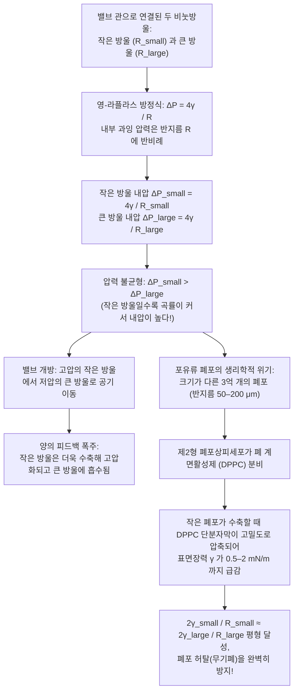
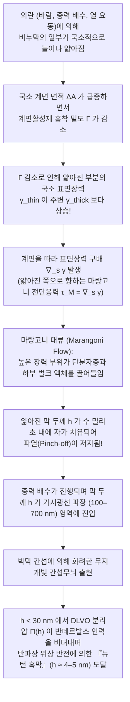

빨대 끝에 비눗물을 묻혀 가볍게 숨을 불어넣으면, 얇은 액체 막이 순식간에 늘어나면서 무지개빛으로 반짝이는 완벽한 구체(Sphere)가 되어 허공을 떠다닌다. 또한 세면대에 가득 일어난 비누 거품(폼, Foam)을 돋보기로 자세히 들여다보면, 무질서해 보이는 다면체 거품들이 놀라울 정도로 엄격한 기하학적 질서를 따르고 있음을 발견할 수 있다. 거품의 모든 벽(액막)은 반드시 <strong>3장씩 모여 정확히 120도</strong>의 각도로 만나며, 그렇게 만들어진 모서리(능선)들은 반드시 <strong>4개씩 모여 약 109.47도</strong>의 정사면체 각도로 한 꼭짓점에서 만난다.

왜 공중에 떠 있는 비눗방울은 다른 어떤 입체도 아닌 구형이 되는 것일까? 크기가 다른 두 비눗방울을 대롱으로 연결하면 왜 직관과 반대로 <strong>작은 비눗방울이 더 쪼그라들면서 큰 비눗방울로 공기를 불어넣는 것일까</strong>? 왜 순수한 물이나 알코올로 만든 거품은 수 밀리초 만에 터져버리는데, 계면활성제(비누)를 소량 섞으면 수 분 동안이나 터지지 않고 스스로 상처를 복구하는 얇은 막이 만들어질까? 그리고 1887년 켈빈 경(Lord Kelvin)이 제시한 "동일한 부피의 방들로 3차원 공간을 빈틈없이 채울 때 표면적을 최소화하는 구조는 무엇인가"라는 난제는 어떻게 107년 동안이나 인류를 속여 왔을까?

본 글에서는 열역학, 미분기하학, 변분법, 기하학적 측도론, 그리고 계면 유체역학의 다섯 가지 관점에서 비눗방울과 거품 속에 숨겨진 수리물리학의 정수를 체계적으로 파헤친다.

---

## 1. 표면장력의 열역학적 기원과 분자 비대칭성

액체 상태의 물 내부(벌크, Bulk)에 있는 물 분자($\text{H}_2\text{O}$)는 사방에서 동일한 물 분자들에 둘러싸여 수소결합 네트워크와 반데르발스 힘(쌍극자 간 상호작용 및 런던 분산력)으로 강하게 끌어당겨진다. 벌크 분자가 받는 인력의 시간 평균은 모든 방향에서 등방적으로 상쇄되어 알짜힘이 0이 되며, 낮은 퍼텐셜 에너지 상태(배위수 $z_b \approx 12$, 응집 에너지 $-u_0$)에 놓인다.

그러나 액체와 기체가 만나는 <strong>기-액 계면(Liquid-Vapor Interface)</strong>에 위치한 분자는 전혀 다른 환경에 처한다. 계면 아래쪽에는 고밀도의 액체 분자들이 강하게 잡아당기는 반면, 위쪽 기체상에는 분자 밀도가 약 1000분의 1에 불과한 공기 분자만 존재한다. 이로 인해 계면 분자는 인접한 액체 분자와의 결합 중 절반 가까이를 잃어버려(유효 배위수 $z_s < z_b$) 벌크 분자보다 에너지가 높은 불안정한 상태가 된다. 따라서 내부의 분자를 표면으로 끌어올려 계면 면적 $A$를 $dA$만큼 넓히려면 응집력에 맞서 양(+)의 가역적 일 $\delta W$를 해주어야 한다.

일정한 온도 $T$, 압력 $P$, 물질량 $N_i$ 조건에서 계면 면적 $A$를 포함하는 다상계의 깁스 자유 에너지 $G$의 전미분은 다음과 같다.

$$dG = -S\,dT + V\,dP + \gamma\,dA + \sum_{i} \mu_i\,dN_i$$

여기서 정의되는 비례 계수 $\gamma$가 바로 <strong>표면장력(Surface Tension)</strong> 혹은 <strong>계면 자유 에너지 밀도</strong>이다.

$$\gamma \equiv \left( \frac{\partial G}{\partial A} \right)_{T, P, N_i} = \left( \frac{\partial F}{\partial A} \right)_{T, V, N_i}$$

표면장력 $\gamma$는 물리적으로 동등한 두 가지 차원과 의미를 지닌다.
1. <strong>단위 면적당 과잉 자유 에너지($\text{J/m}^2$)</strong>: 열역학 제2법칙에 의해 등온·등적(또는 등압) 계는 자유 에너지가 최소가 되는 평형 상태로 자발적으로 이완한다. 주어진 부피 $V$의 액체나 기포는 중력 등 외력을 무시할 때 표면 에너지 $\gamma A$를 최소화하기 위해 필연적으로 표면적 $A$가 최소인 기하학적 형태, 즉 <strong>구체(Sphere)</strong>로 수축한다(3차원 등주 부등식 $A^3 \ge 36\pi V^2$).
2. <strong>단위 길이당 작용하는 면내 인장력($\text{N/m}$)</strong>: 통계역학의 <strong>커크우드-버프 공식(Kirkwood-Buff Formula, 1949)</strong>에 따르면, 표면장력은 계면 수직 방향 좌표 $z$에 걸쳐 법선 압력 $P_N$과 접선 압력 $P_T(z)$의 비등방성을 적분한 값과 정확히 일치한다.
   $$\gamma = \int_{-\infty}^{+\infty} \bigl[ P_N - P_T(z) \bigr]\,dz$$

| 액체 및 계면 종류 ($20^\circ\text{C}$, 공기 접촉) | 표면장력 $\gamma$ ($\text{mN/m}$) | 지배적인 분자간 상호작용 | 박막 및 거품 안정성 |
| :--- | :---: | :--- | :--- |
| 액체 수은 ($\text{Hg}$) | $486.5$ | 금속 결합 | 박막 형성 불가, 즉각 구형 액적으로 응집 |
| 순수한 물 ($\text{H}_2\text{O}$) | $72.8$ | 수소결합 네트워크 + 쌍극자 힘 | 수 밀리초 내 파열 (마랑고니 탄성 부재) |
| 순수 에탄올 ($\text{C}_2\text{H}_5\text{OH}$) | $22.3$ | 약한 수소결합 + 분산력 | 단일 성분 박막 유지 불가 ('와인의 눈물' 유발) |
| 비눗물 / SDS 수용액 (CMC 부근) | $25.0 \sim 35.0$ | 양친매성 계면활성제 단분자층 | <strong>수 분~수 시간 안정</strong> (깁스-마랑고니 효과) |
| 폐 계면활성제 (압축된 DPPC 단분자막) | $0.5 \sim 2.0$ | 포화 인지질의 초고밀도 패킹 | <strong>극도로 안정</strong> (포유류 폐포의 허탈 완벽 방지) |

---

## 2. 곡면의 미분기하학과 영-라플라스 방정식(Young-Laplace Equation)

### 2.1 주곡률 $\kappa_1, \kappa_2$와 가상 일의 원리에 의한 유도

계면이 평면이 아니라 휘어져 있을 때, 면내 방향으로 작용하는 표면장력 $\gamma$는 곡률 중심(오목한 안쪽)을 향하는 법선 방향의 알짜힘을 만들어낸다. 따라서 곡면 안쪽 압력 $P_{\text{in}}$은 바깥쪽 압력 $P_{\text{out}}$보다 반드시 높아진다. 매끄러운 곡면 $\Sigma \subset \mathbb{R}^3$ 위의 한 점에서 서로 직교하는 두 주곡률 반경을 $R_1, R_2$(주곡률 $\kappa_1 = 1/R_1, \kappa_2 = 1/R_2$)라 하면, <strong>평균곡률(Mean Curvature)</strong> $H$와 <strong>가우스 곡률(Gaussian Curvature)</strong> $K$는 다음과 같이 정의된다.

$$H \equiv \frac{\kappa_1 + \kappa_2}{2} = \frac{1}{2}\left(\frac{1}{R_1} + \frac{1}{R_2}\right), \qquad K \equiv \kappa_1 \kappa_2 = \frac{1}{R_1 R_2}$$

주곡률 방향을 따라 미소 직사각형 패치 $dA = ds_1\,ds_2 = R_1 R_2\,d\theta_1\,d\theta_2$를 잡고 바깥쪽 법선 방향으로 미소 변위 $\delta\xi$만큼 가상 이동시키면, 곡률 반경이 $R_1+\delta\xi, R_2+\delta\xi$로 늘어나면서 면적의 1차 변분은

$$\delta(dA) = dA\left(\frac{1}{R_1} + \frac{1}{R_2}\right)\delta\xi$$

가 되며, 휩쓸고 지나간 미소 부피는 $\delta(dV) = dA\,\delta\xi$이다. 역학적 평형 조건 $\delta F = \gamma\,\delta(dA) - \Delta P\,\delta(dV) = 0$으로부터 1805~1806년에 확립된 단일 계면의 <strong>영-라플라스 방정식(Young-Laplace Equation)</strong>이 도출된다.

$$\Delta P = P_{\text{in}} - P_{\text{out}} = \gamma\left(\frac{1}{R_1} + \frac{1}{R_2}\right) = 2\gamma H$$

### 2.2 물방울($\Delta P = 2\gamma/R$)과 비눗방울($\Delta P = 4\gamma/R$)의 결정적 차이

공기 중의 빗방울(액적)이나 물속의 기포는 기체와 액체를 가르는 계면이 <strong>단 1장</strong>뿐이므로($R_1 = R_2 = R$), 라플라스 압력차는 $\Delta P_{\text{droplet}} = \frac{2\gamma}{R}$이다.

반면 공기 중에 떠 있는 <strong>비눗방울(Soap Bubble)</strong>은 안쪽도 공기이고 바깥쪽도 공기이며, 그 사이에 두께 $h \ll R$인 얇은 비눗물 껍질이 끼어 있는 구조다. 즉, 비눗방울에는 <strong>안쪽 기-액 계면(반지름 $R$)과 바깥쪽 기-액 계면(반지름 $R+h$)의 총 2장의 계면</strong>이 존재한다! 두 계면에서 각각 영-라플라스 방정식을 세워 더하면,

$$\Delta P_{\text{soap}} = (P_{\text{in}} - P_{\text{film}}) + (P_{\text{film}} - P_{\text{out}}) = \frac{2\gamma}{R} + \frac{2\gamma}{R+h} \approx \frac{4\gamma}{R}$$

비눗방울의 내부 과잉 압력이 반지름 $R$에 반비례한다는 이 간결한 식 $\Delta P = 4\gamma/R$로부터, 우리의 상식을 뒤집는 두 가지 매혹적인 물리 현상인 <strong>극소곡면($H=0$)</strong>과 <strong>두 비눗방울의 역설</strong>이 탄생한다.

---

## 3. 극소곡면($H = 0$), 현수면(Catenoid) 붕괴와 플라토의 문제

공기를 가두지 않은 열린 철사 프레임에 비누막을 펼치면, 막의 앞면과 뒷면 모두 동일한 대기압 $P_{\text{atm}}$을 받으므로 압력차 $\Delta P = 0$이다. 이를 영-라플라스 방정식 $\Delta P = 4\gamma H$에 대입하면 비누막 위의 모든 점에서 <strong>평균곡률 $H$가 항등적으로 0</strong>이어야 한다.

$$H = \frac{1}{2}\left(\frac{1}{R_1} + \frac{1}{R_2}\right) = 0 \quad \Longleftrightarrow \quad \kappa_1 = -\kappa_2$$

모든 점에서 평균곡률이 $H = 0$인 곡면을 미분기하학에서 <strong>극소곡면(Minimal Surface)</strong>이라 부른다. 직교좌표계에서 그래프 $z = u(x,y)$로 표현할 때 면적 범함수 $A[u] = \iint \sqrt{1+u_x^2+u_y^2}\,dx\,dy$를 최소화하는 오일러-라그랑주 방정식은 라그랑주가 1760년에 유도한 비선형 타원 편미분방정식이다.

$$\bigl(1 + u_y^2\bigr) u_{xx} - 2 u_x u_y u_{xy} + \bigl(1 + u_x^2\bigr) u_{yy} = 0$$

평면이 아닌 극소곡면의 모든 점은 한 방향으로는 볼록($\kappa_1 > 0$)하고 직교 방향으로는 같은 크기만큼 오목($\kappa_2 = -\kappa_1 < 0$)하므로, 가우스 곡률이 항상 음수($K = -\kappa_1^2 \le 0$)인 말안장(Saddle) 모양을 띤다. 가장 대표적인 회전 극소곡면은 1744년 오일러가 발견한 <strong>현수면(Catenoid, 카테노이드)</strong>으로, 반지름 $R$인 두 동축 원형 고리(간격 $2h$) 사이에 형성되는 비누막의 단면 방정식은 다음과 같다.

$$r(z) = c \cosh\!\left(\frac{z}{c}\right)$$

두 고리의 간격 $2h$를 서서히 넓혀가면, 경계조건 $R = c\cosh(h/c)$가 실근 $c$를 가질 수 있는 최대 임계 간격($\coth u_c = u_c,\; u_c \approx 1.19968$)인

$$\left(\frac{2h}{R}\right)_{\text{crit}} = \frac{2u_c}{\cosh u_c} \approx 1.32548$$

을 넘어서는 순간 안장-마디 분기(Saddle-Node Bifurcation)가 일어나면서 연속적인 현수면 해가 소멸한다! 그 즉시 비누막의 잘록한 목 부분이 빛의 속도로 수축하여 끊어지고, 양쪽 고리를 각각 평평하게 덮는 두 장의 원판(<strong>골드슈미트 불연속 해, Goldschmidt Solution</strong>)으로 전이한다. 한편 임의의 닫힌 조르당 곡선 경계에 대해 넓이를 최소화하는 극소곡면이 항상 존재하는가라는 <strong>플라토의 문제(Plateau's Problem)</strong>는 1930년 제시 더글러스(Jesse Douglas, 1936년 제1회 필즈상 수상)와 티보르 라도(Tibor Radó)에 의해 해결되었다.

---

## 4. 두 비눗방울의 역설, 오스트발트 숙성, 그리고 폐포가 찌그러지지 않는 이유

### 4.1 왜 작은 비눗방울이 큰 비눗방울을 부풀리는가?

콕(밸브)이 달린 가느다란 관 양 끝에 <strong>반지름 $R_{\text{small}}$인 작은 비눗방울</strong>과 <strong>반지름 $R_{\text{large}}$인 큰 비눗방울</strong>($R_{\text{small}} < R_{\text{large}}$)을 매달고 밸브를 열면 어떻게 될까?

대부분의 사람은 큰 방울에서 작은 방울로 공기가 이동해 두 방울의 크기가 같아질 것이라 예상하지만, 실제로는 <strong>작은 비눗방울이 급격히 오그라들면서 큰 비눗방울 속으로 공기를 밀어 넣어 큰 방울이 더욱 커진다!</strong>

영-라플라스 방정식 $\Delta P = 4\gamma/R$에 의해 곡률 반경이 작은 방울일수록 내부 압력이 더 높기 때문이다.

$$R_{\text{small}} < R_{\text{large}} \quad \Longrightarrow \quad \Delta P_{\text{small}} = \frac{4\gamma}{R_{\text{small}}} \;>\; \frac{4\gamma}{R_{\text{large}}} = \Delta P_{\text{large}}$$

공기는 고압인 작은 방울에서 저압인 큰 방울로 흐르며, 작은 방울이 작아질수록 분모 $R_{\text{small}}$이 줄어들어 압력차가 더욱 벌어지는 폭주적 양(+)의 피드백이 발생한다.

### 4.2 거품의 조대화(오스트발트 숙성)와 폰 노이만의 $n - 6$ 법칙

실제 거품(폼) 내부에서도 작은 기포의 높은 압력 때문에 기체 분자가 액막을 투과해 큰 기포로 확산하는 <strong>오스트발트 숙성(Ostwald Ripening / Foam Coarsening)</strong>이 끊임없이 일어난다. 1952년 수학자 <strong>존 폰 노이만(John von Neumann)</strong>은 가우스-보네 정리를 이용해 2차원 건조 거품에서 $n$개의 변을 가진 다각형 기포의 면적 $A_n$ 변화율이 기포의 크기나 모양과 무관하게 오직 변의 개수 $n$만으로 결정된다는 <strong>폰 노이만의 법칙</strong>을 증명했다.

$$\frac{dA_n}{dt} = K_0 (n - 6)$$

즉, 변의 수가 $n < 6$인 삼각형·사각형·오각형 기포는 일정한 속도로 줄어들어 소멸하고, $n = 6$인 정육각형 기포는 정지 상태를 유지하며, $n > 6$인 기포만 계속해서 성장한다(3차원 일반화는 2007년 MacPherson과 Srolovitz가 해결했다).

### 4.3 인간의 허파꽈리(폐포)가 찌그러지지 않는 이유: 폐 계면활성제(DPPC)

인간의 폐 속에는 반지름이 $50\,\mu\text{m}$에서 $200\,\mu\text{m}$까지 다양한 약 <strong>3억 개의 폐포(Alveoli)</strong>가 기관지로 연결되어 있다. 만약 폐포 내벽을 덮은 액체의 표면장력 $\gamma$가 일정하다면, $\Delta P = 2\gamma/R$에 의해 작은 폐포들은 날숨 때마다 큰 폐포로 공기를 모두 빼앗기고 찌그러지는 <strong>무기폐(Atelectasis)</strong>에 빠져 질식하게 된다.

이를 막아주는 생명의 물질이 바로 <strong>제2형 폐포상피세포</strong>가 분비하는 <strong>폐 계면활성제(Pulmonary Surfactant)</strong>의 주성분인 포화 인지질 <strong>디팔미토일포스파티딜콜린(DPPC)</strong>이다. 물에 녹지 않는 DPPC 단분자막은 작은 폐포가 수축하여 표면적 $A = 4\pi R^2$이 좁아질 때 분자들이 빽빽하게 압축되면서 표면장력 $\gamma(R)$을 $25\,\text{mN/m}$에서 <strong>거의 0에 가까운 $0.5 \sim 2\,\text{mN/m}$까지 격감</strong>시킨다! 덕분에 작은 폐포와 큰 폐포 사이의 압력차가 사라져 3억 개의 폐포가 안정적으로 공존할 수 있다. 미숙아에게 발생하는 <strong>신생아 호흡곤란증후군(NRDS)</strong>은 바로 이 계면활성제 부족 때문이며, 인공 폐 계면활성제 투여 요법으로 수많은 생명을 구하고 있다.

---

## 5. 플라토의 법칙, 109.47도 마랄디 각, 그리고 이중 거품 정리

1873년 벨기에의 물리학자 <strong>조제프 플라토(Joseph Plateau)</strong>가 실험으로 발견하고, 1976년 미국의 수학자 <strong>진 테일러(Jean E. Taylor)</strong>가 기하학적 측도론(Geometric Measure Theory)으로 엄밀히 증명한 거품의 국소 기하학 법칙은 다음과 같다.

1. <strong>제1교차 법칙(3장의 막과 120도)</strong>: 비누막들은 오직 <strong>3장씩만</strong> 모여 <strong>플라토 경계(Plateau Border)</strong>라는 능선을 이루며, 서로 정확히 <strong>$120^\circ$($2\pi/3$)</strong>로 만난다($\sum_{i=1}^3 \hat{\mathbf{t}}_i = \mathbf{0} \implies \cos\theta = -1/2$). 만약 4장의 막이 $90^\circ$ 십자형으로 만나면 총 길이 $4\sqrt{2} \approx 5.657$이 두 개의 $120^\circ$ 삼중점으로 갈라진 슈타이너 트리(Steiner Tree) 길이 $2(1+\sqrt{3}) \approx 5.464$보다 길기 때문에 즉각 분열한다(<strong>T1 위상 전이</strong>).
2. <strong>제2교차 법칙(4개의 능선과 109.47도)</strong>: 플라토 경계들은 오직 <strong>4개씩만</strong> 한 꼭짓점에 모이며, 두 능선이 이루는 각도는 정사면체의 중심각인 <strong>마랄디 각(Maraldi Angle / 정사면체 각)</strong>과 정확히 같다.
   $$\theta_{\text{Maraldi}} = \arccos\!\left(-\frac{1}{3}\right) \approx 109.47122^\circ \quad \left(109^\circ 28' 16''\right)$$
3. <strong>이중 거품 정리(Double Bubble Theorem, 2000년 증명)</strong>: 반지름 $R_1$과 $R_2$($R_1 > R_2$)인 두 비눗방울이 합쳐져 공유 격벽(Septum)을 형성할 때, 격벽은 압력이 낮은 큰 방울 쪽으로 볼록하게 휘어지며 그 곡률 반경 $R_{\text{septum}}$은 다음 조화 관계식을 만족한다.
   $$\frac{1}{R_{\text{septum}}} = \frac{1}{R_2} - \frac{1}{R_1} \quad \Longleftrightarrow \quad R_{\text{septum}} = \frac{R_1 R_2}{R_1 - R_2}$$

---

## 6. 켈빈 추측(1887) 대 위어-펠란 구조(1994)의 107년 전쟁

1887년 <strong>켈빈 경(Lord Kelvin)</strong>은 "부피가 $V=1$로 모두 같은 거품 세포들로 3차원 공간을 빈틈없이 분할할 때, 단위 부피당 계면 면적을 최소화하는 구조는 무엇인가?"라는 문제를 제기했다. 3차원 유클리드 공간에서는 평면 다각형만으로 플라토의 각도 법칙($120^\circ$와 $109.47^\circ$)을 만족하며 공간을 채울 수 없는 <strong>기하학적 좌절(Geometric Frustration)</strong>이 존재한다. 켈빈은 체심입방격자(BCC)의 보로노이 다면체인 <strong>깎은 정팔면체(14면체: 사각형 6개 + 육각형 8개)</strong>의 육각형 면을 살짝 휘게 만든 <strong>켈빈 구조</strong>($A_{\text{Kelvin}} \approx 5.30628$)를 제안했고, 이는 107년간 최소 면적 해로 믿어졌다.

그러나 1994년 트리니티 칼리지 더블린의 물리학자 <strong>데니스 위어(Denis Weaire)</strong>와 <strong>로버트 펠란(Robert Phelan)</strong>은 제1형 클라스레이트 수화물(메탄 하이드레이트 등) 결정 구조에서 영감을 얻어, 두 종류의 등부피 다면체 8개(<strong>변형 오각십이면체 $5^{12}$ 2개 + 육각형 2개와 오각형 12개로 이루어진 십사면체 $5^{12}6^2$ 6개</strong>)를 결합한 <strong>위어-펠란 구조(Weaire-Phelan Structure)</strong>를 발견했다! 전체 면의 $88.9\%$가 내각이 $108^\circ$(마랄디 각 $109.47^\circ$에 매우 근접)인 오각형으로 이루어져 있어 면의 곡률 왜곡을 극적으로 줄였으며, 표면적을 $A_{\text{WP}} \approx 5.28825$로 낮추어 <strong>켈빈 구조보다 면적을 $0.34\%$ 절감</strong>하며 107년 묵은 켈빈 추측을 반증했다. 이 구조는 2008년 베이징 올림픽 수영 경기장인 <strong>'워터큐브(Water Cube)'</strong>의 철골 설계에 그대로 적용되었다.

| 3차원 공간 채움 거품 구조 | 단위포 내 셀 수 $Z$ | 다각형 면 구성 (셀당 평균 면 수 $\langle F \rangle$) | 플라토 법칙 충족 | 정규화 표면적 $A$ ($V=1$) | 켈빈 구조 대비 면적 차이 |
| :--- | :---: | :--- | :---: | :---: | :---: |
| <strong>단순 입방 격자 (Cube)</strong> | $1$ | 사각형 $6$개 ($\langle F \rangle = 6.00$) | 불충족 (즉각 분열) | $6.00000$ | $+13.07\%$ |
| <strong>마름모 십이면체 (FCC)</strong> | $1$ | 마름모 $12$개 ($\langle F \rangle = 12.00$) | 불충족 (6중 꼭짓점 분열) | $5.34539$ | $+0.74\%$ |
| <strong>켈빈 구조 (1887, BCC)</strong> | $1$ | 사각형 $6$개 + 육각형 $8$개 ($\langle F \rangle = 14.00$) | <strong>충족</strong> (육각형 면 만곡) | $5.30628$ | $0.00\%$ (기준) |
| <strong>위어-펠란 구조 (1994, A15)</strong> | $8$ ($2+6$) | 오각형 $88.9\%$ + 육각형 $11.1\%$ ($\langle F \rangle = 13.50$) | <strong>충족</strong> (최소 곡률 왜곡) | <strong>$5.28825$</strong> | <strong>$-0.34\%$ (최소 기록)</strong> |

---

## 7. 깁스-마랑고니 탄성, 박막 간섭, 그리고 DLVO 분리압

순수한 물이나 순수한 에탄올($\gamma = 22.3\,\text{mN/m}$)은 표면장력이 낮아도 비눗방울을 만들 수 없다. 비눗방울이 터지지 않는 진짜 이유는 <strong>깁스-마랑고니 탄성(Gibbs-Marangoni Elasticity)</strong>에 의한 자가 치유 메커니즘 덕분이다.

비누막의 특정 부위가 외란으로 늘어나 얇아지면, 그 부위의 계면활성제 표면 과잉 농도 $\Gamma$가 순간적으로 희석되어 국소 표면장력 $\gamma_{\text{thin}}$이 주변보다 높아진다. 이때 발생하는 <strong>마랑고니 응력</strong> $\boldsymbol{\tau}_M = \nabla_s \gamma$와 <strong>깁스 탄성 계수</strong>

$$E_G \equiv 2A\left(\frac{\partial\gamma}{\partial A}\right)_{N_s} = -2\Gamma\left(\frac{\partial\gamma}{\partial\Gamma}\right)_T > 0$$

가 주변의 두꺼운 영역으로부터 계면활성제와 물을 즉각 끌어당겨 얇아진 상처를 복구한다(와인잔 벽을 타고 눈물처럼 흘러내리는 <strong>'와인의 눈물'</strong> 현상 역시 알코올 증발로 인한 마랑고니 응력이 와인을 위로 끌어올리기 때문에 발생한다).

이후 중력에 의해 액체가 빠져나가 막 두께 $h$가 가시광선 파장 수준으로 얇아지면 앞뒷면 반사광의 <strong>박막 간섭</strong>($2n_{\text{film}}h\cos\theta_t + \lambda/2 = m\lambda$)으로 무지개빛이 나타나며, 터지기 직전 꼭대기 두께가 $h \ll \lambda/4 \approx 30\,\text{nm}$ 이하로 얇아지면 앞면 반사의 $\pi$ 위상 반전 때문에 모든 파장의 빛이 상쇄 간섭을 일으켜 검게 보이는 <strong>흑막(Black Film)</strong>이 된다. 이 극한의 얇은 막은 <strong>DLVO 분리압(Disjoining Pressure)</strong> $\Pi(h) = \Pi_{\text{vdW}}(h) + \Pi_{\text{el}}(h) + \Pi_{\text{sr}}(h)$의 정전기적·입체적 반발력에 의해 분자 두 겹 두께($h \approx 4\,\text{nm}$)인 <strong>뉴턴 흑막(Newton Black Film)</strong> 상태로 마지막까지 버텨낸다.
