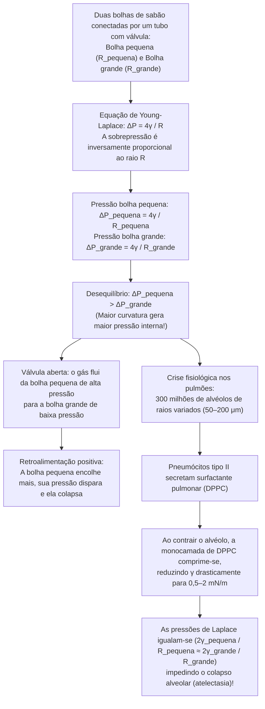
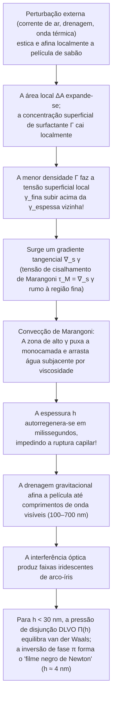

Ao mergulhar um aro em água com sabão e soprar suavemente, uma fina película líquida estica-se, destaca-se e relaxa em milissegundos numa esfera iridescente perfeita flutuando no ar. Se observarmos a espuma de sabão com uma lupa, veremos que o aparente caos obedece a uma ordem geométrica rigorosa: as películas líquidas nunca se encontram de quatro ou cinco, mas exclusivamente <strong>de três em três</strong> ao longo de canais líquidos formando ângulos exatos de <strong>$120^\circ$ ($2\pi/3$)</strong>, e essas arestas cruzam-se exclusivamente <strong>de quatro em quatro</strong> nos vértices segundo o ângulo tetraédrico exato de <strong>$\arccos(-1/3) \approx 109,4712^\circ$</strong>.

Por que uma bolha de sabão livre é sempre esférica? Por que, ao conectar uma bolha pequena a uma bolha grande por um tubo, é a bolha <em>pequena</em> que encolhe e infla a <em>grande</em> — e como os 300 milhões de alvéolos dos nossos pulmões escapam desse colapso a cada expiração? Por que bolhas de água pura ou álcool puro estouram em milissegundos, enquanto um traço de surfactante confere à película uma elasticidade autorregenerativa? E como a conjectura centenária de Lord Kelvin sobre a partição do espaço tridimensional em células de mesmo volume e área mínima foi superada em 1994 pela estrutura de Weaire-Phelan?

Neste artigo, unimos termodinâmica, geometria diferencial, cálculo variacional, teoria geométrica da medida e mecânica dos fluidos interfacial para desvendar a física das bolhas e espumas.

---

## 1. Termodinâmica da tensão superficial e assimetria molecular

No interior (*bulk*) da água líquida, cada molécula de $\text{H}_2\text{O}$ é cercada isotropicamente por moléculas vizinhas ligadas por pontes de hidrogênio e forças de van der Waals. A força resultante média é nula e a molécula encontra-se num estado de baixa energia potencial (número de coordenação $z_b \approx 12$, energia coesiva $-u_0$).

Na <strong>interface líquido-vapor</strong>, essa simetria é quebrada: a densidade molecular na fase gasosa é cerca de mil vezes menor que no líquido. Uma molécula na superfície perde quase metade das suas vizinhas atrativas ($z_s < z_b$) e possui um excesso de energia potencial. Trazer moléculas do interior para a superfície para aumentar a área interfacial em $dA$ exige realizar trabalho reversível positivo contra as forças de coesão.

A diferencial total da energia livre de Gibbs $G(T, P, A, \{N_i\})$ é:

$$dG = -S\,dT + V\,dP + \gamma\,dA + \sum_{i} \mu_i\,dN_i$$

de onde decorre a definição termodinâmica exata da <strong>tensão superficial</strong> $\gamma$:

$$\gamma \equiv \left( \frac{\partial G}{\partial A} \right)_{T, P, N_i} = \left( \frac{\partial F}{\partial A} \right)_{T, V, N_i}$$

Ela possui duas interpretações fisicamente equivalentes:
1. <strong>Excesso de energia livre por unidade de área ($\text{J/m}^2$)</strong>: A volume $V$ constante, um sistema minimiza sua energia livre $\gamma A$ minimizando sua área superficial $A$. Pela <strong>desigualdade isoperimétrica</strong> tridimensional $A^3 \ge 36\pi V^2$, a esfera é o único sólido que minimiza a área para um dado volume.
2. <strong>Força de tração tangencial por unidade de comprimento ($\text{N/m}$)</strong>: Pela <strong>fórmula de Kirkwood-Buff (1949)</strong> da mecânica estatística, $\gamma$ é a integral da anisotropia entre a pressão normal $P_N$ e a pressão tangencial $P_T(z)$ através da camada interfacial:
   $$\gamma = \int_{-\infty}^{+\infty} \bigl[ P_N - P_T(z) \bigr]\,dz$$

| Sistema líquido / interface (a $20^\circ\text{C}$ com o ar) | Tensão superficial $\gamma$ ($\text{mN/m}$) | Interação intermolecular dominante | Estabilidade de películas finas e bolhas |
| :--- | :---: | :--- | :--- |
| Mercúrio líquido ($\text{Hg}$) | $486,5$ | Ligação metálica | Estabilidade nula; forma gotas esféricas |
| Água pura ($\text{H}_2\text{O}$) | $72,8$ | Rede de pontes de hidrogênio + dipolos | Estoura em milissegundos (sem elasticidade Marangoni) |
| Etanol puro ($\text{C}_2\text{H}_5\text{OH}$) | $22,3$ | Pontes de H fracas + dispersão | Película instável sozinha («lágrimas do vinho») |
| Água com sabão / solução SDS (próximo à CMC) | $25,0 \sim 35,0$ | Monocamada de surfactante anfifílico | <strong>Estável por minutos a horas</strong> (efeito Gibbs-Marangoni) |
| Surfactante pulmonar (monocamada DPPC comprimida) | $0,5 \sim 2,0$ | Fosfolipídios saturados ultracompactados | <strong>Extremamente estável</strong> (impede o colapso alveolar) |

---

## 2. Geometria diferencial de superfícies curvas e equação de Young-Laplace

Quando uma interface é curva, a tensão tangencial $\gamma$ gera uma força normal líquida apontando para o lado côncavo, exigindo um salto de pressão $\Delta P = P_{\text{int}} - P_{\text{ext}} > 0$. Sejam $R_1, R_2$ os dois <strong>raios de curvatura principais</strong> ($\kappa_1 = 1/R_1, \kappa_2 = 1/R_2$) de uma superfície suave $\Sigma \subset \mathbb{R}^3$. A <strong>curvatura média</strong> $H$ e a <strong>curvatura gaussiana</strong> $K$ são definidas por:

$$H \equiv \frac{\kappa_1 + \kappa_2}{2} = \frac{1}{2}\left(\frac{1}{R_1} + \frac{1}{R_2}\right), \qquad K \equiv \kappa_1 \kappa_2 = \frac{1}{R_1 R_2}$$

Um deslocamento normal virtual $\delta\xi$ de um elemento de área $dA = R_1 R_2\,d\theta_1\,d\theta_2$ produz uma variação de área $\delta(dA) = dA\left(\frac{1}{R_1} + \frac{1}{R_2}\right)\delta\xi$ e um volume varrido $\delta(dV) = dA\,\delta\xi$. O equilíbrio termodinâmico $\delta F = \gamma\,\delta(dA) - \Delta P\,\delta(dV) = 0$ fornece a <strong>equação de Young-Laplace (1805–1806)</strong>:

$$\Delta P = P_{\text{int}} - P_{\text{ext}} = \gamma\left(\frac{1}{R_1} + \frac{1}{R_2}\right) = 2\gamma H$$

Enquanto uma gota de água possui apenas <strong>uma</strong> interface ($\Delta P_{\text{gota}} = 2\gamma/R$), uma <strong>bolha de sabão no ar</strong> é uma fina casca líquida de espessura $h \ll R$ dotada de <strong>duas interfaces gás-líquido</strong> (interna de raio $R$ e externa de raio $R+h$), resultando no fator $4$:

$$\Delta P_{\text{bolha}} = (P_{\text{int}} - P_{\text{película}}) + (P_{\text{película}} - P_{\text{ext}}) = \frac{2\gamma}{R} + \frac{2\gamma}{R+h} \approx \frac{4\gamma}{R}$$

---

## 3. Superfícies mínimas ($H = 0$), catástrofe do catenoide e problema de Plateau

Uma película de sabão aberta esticada num arame sem aprisionar ar está sujeita à mesma pressão atmosférica em ambos os lados ($\Delta P = 0$). A equação de Young-Laplace impõe que sua curvatura média seja identicamente nula em todos os pontos:

$$H = \frac{1}{2}\left(\frac{1}{R_1} + \frac{1}{R_2}\right) = 0 \quad \Longleftrightarrow \quad \kappa_1 = -\kappa_2 \quad \Longrightarrow \quad K = -\kappa_1^2 \le 0$$

Superfícies com $H \equiv 0$ são chamadas de <strong>superfícies mínimas</strong>. Na forma $z = u(x,y)$, minimizar o funcional de área $A[u] = \iint \sqrt{1+u_x^2+u_y^2}\,dx\,dy$ leva à equação diferencial parcial de Euler-Lagrange obtida por Lagrange em 1760:

$$\bigl(1 + u_y^2\bigr) u_{xx} - 2 u_x u_y u_{xy} + \bigl(1 + u_x^2\bigr) u_{yy} = 0$$

Todo ponto não plano de uma película aberta é localmente um ponto de sela hiperbólico ($K < 0$). A superfície mínima de revolução entre dois anéis coaxiais de raio $R$ separados por $2h$ é o <strong>catenoide</strong> (Euler, 1744):

$$r(z) = c \cosh\!\left(\frac{z}{c}\right)$$

Ao afastar os anéis além da razão crítica ($\coth u_c = u_c \approx 1,19968$):

$$\left(\frac{2h}{R}\right)_{\text{crít}} = \frac{2u_c}{\cosh u_c} \approx 1,32548$$

a solução real desaparece numa bifurcação sela-nó e o pescoço da película rompe-se em dois discos planos (<strong>solução descontínua de Goldschmidt</strong>). O <strong>problema de Plateau</strong> foi resolvido em 1930 por Jesse Douglas (primeira Medalha Fields em 1936) e Tibor Radó.

---

## 4. O paradoxo das duas bolhas, amadurecimento de Ostwald e surfactante pulmonar (DPPC)

Conectando uma bolha pequena ($R_{\text{pequena}}$) e uma bolha grande ($R_{\text{grande}}$) por um tubo com válvula, ao abrir a válvula <strong>a bolha pequena encolhe rapidamente e infla ainda mais a bolha grande</strong>! Pela lei $\Delta P = 4\gamma/R$, quanto menor o raio, maior a pressão interna:

$$R_{\text{pequena}} < R_{\text{grande}} \quad \Longrightarrow \quad \Delta P_{\text{pequena}} = \frac{4\gamma}{R_{\text{pequena}}} \;>\; \frac{4\gamma}{R_{\text{grande}}} = \Delta P_{\text{grande}}$$

Em espumas reais, a difusão de gás das bolhas pequenas para as grandes através das películas causa o <strong>amadurecimento de Ostwald (coarsening)</strong>. Em 1952, <strong>John von Neumann</strong> provou via teorema de Gauss-Bonnet que, numa espuma seca 2D, a área $A_n$ de uma bolha de $n$ lados evolui segundo a <strong>lei de von Neumann</strong>:

$$\frac{dA_n}{dt} = K_0 (n - 6)$$

Bolhas com $n < 6$ lados encolhem e somem, hexágonos ($n = 6$) permanecem estacionários e bolhas com $n > 6$ crescem (generalizado para 3D por MacPherson e Srolovitz em 2007).

Nos pulmões humanos, cerca de <strong>300 milhões de alvéolos</strong> ($R \approx 50\text{–}200\,\mu\text{m}$) comunicam-se entre si. Se a tensão superficial $\gamma$ fosse constante, os alvéolos menores esvaziariam nos maiores e colapsariam (<strong>atelectasia</strong>). Os pneumócitos tipo II impedem isso secretando o <strong>surfactante pulmonar</strong> rico em <strong>dipalmitoilfosfatidilcolina (DPPC)</strong>: na expiração, a compressão da monocamada insolúvel de DPPC derruba $\gamma(R)$ para $0,5\text{–}2\,\text{mN/m}$, estabilizando todos os alvéolos.

---

## 5. Leis de Joseph Plateau (1873), prova de Jean Taylor (1976) e teorema da bolha dupla

Formuladas em 1873 pelo físico belga <strong>Joseph Plateau</strong> e provadas rigorosamente em 1976 por <strong>Jean E. Taylor</strong> via teoria geométrica da medida:

1. <strong>1.ª lei de Plateau (3 películas a $120^\circ$)</strong>: As películas de sabão encontram-se exclusivamente <strong>de três em três</strong> ao longo das <strong>bordas de Plateau</strong> em ângulos iguais de <strong>$120^\circ$ ($2\pi/3$)</strong> ($\sum_{i=1}^3 \hat{\mathbf{t}}_i = \mathbf{0} \implies \cos\theta = -1/2$). Uma junção quádrupla a $90^\circ$ ($L_{\text{cruz}} = 4\sqrt{2} \approx 5,657$) é instável e divide-se instantaneamente em duas junções triplas a $120^\circ$ numa árvore de Steiner ($L_{\text{Steiner}} = 2(1+\sqrt{3}) \approx 5,464$, transição T1).
2. <strong>2.ª lei de Plateau (4 bordas a $109,47^\circ$)</strong>: As bordas de Plateau encontram-se exclusivamente <strong>de quatro em quatro</strong> nos vértices segundo o <strong>ângulo tetraédrico de Maraldi</strong>:
   $$\theta_{\text{Maraldi}} = \arccos\!\left(-\frac{1}{3}\right) \approx 109,47122^\circ \quad \left(109^\circ 28' 16''\right)$$
3. <strong>Teorema da bolha dupla (Hutchings, Morgan, Ritoré, Ros 2000)</strong>: Quando duas bolhas de raios $R_1 > R_2$ coalescem partilhando um septo, este curva-se para dentro da bolha maior com raio de curvatura $R_{\text{septo}}$:
   $$\frac{1}{R_{\text{septo}}} = \frac{1}{R_2} - \frac{1}{R_1} \quad \Longleftrightarrow \quad R_{\text{septo}} = \frac{R_1 R_2}{R_1 - R_2}$$

---

## 6. A conjectura de Kelvin (1887) contra a estrutura de Weaire-Phelan (1994)

Em 1887, <strong>Lord Kelvin</strong> perguntou como particionar o espaço $\mathbb{R}^3$ em células de igual volume ($V=1$) minimizando a área interfacial. Devido à <strong>frustração geométrica</strong>, Kelvin propôs o <strong>octaedro truncado (tetracaidecaedro de 6 quadrados e 8 hexágonos, célula de Voronoi BCC)</strong> levemente curvado, com área normalizada $A_{\text{Kelvin}} \approx 5,30628$.

Em 1994, <strong>Denis Weaire</strong> e <strong>Robert Phelan</strong> (Trinity College Dublin) derrubaram a conjectura de Kelvin após 107 anos com a <strong>estrutura de Weaire-Phelan</strong> (inspirada nos clatratos hidratos tipo I), cuja célula unitária cúbica reúne <strong>8 poliedros de mesmo volume de dois tipos</strong>: <strong>2 dodecaedros pentagonais irregulares ($5^{12}$)</strong> e <strong>6 tetracaidecaedros ($5^{12}6^2$ com 2 hexágonos e 12 pentágonos)</strong>. Com $88,9\%$ de faces pentagonais (ângulo interno de $108^\circ$ próximo a $109,47^\circ$), a área cai $0,34\%$ para $A_{\text{WP}} \approx 5,28825$, estrutura consagrada no <strong>Centro Aquático Nacional de Pequim («Cubo d'Água»)</strong>.

| Estrutura de espuma 3D | Células por unidade $Z$ | Topologia das faces ($\langle F \rangle$ médio) | Cumpre leis de Plateau? | Área normalizada $A$ ($V=1$) | Diferença vs Kelvin |
| :--- | :---: | :--- | :---: | :---: | :---: |
| <strong>Favo cúbico simples</strong> | $1$ | $6$ quadrados ($\langle F \rangle = 6,00$) | Não (instável) | $6,00000$ | $+13,07\%$ |
| <strong>Dodecaedro rômbico (FCC)</strong> | $1$ | $12$ losangos ($\langle F \rangle = 12,00$) | Não (vértices de 6 arestas instáveis) | $5,34539$ | $+0,74\%$ |
| <strong>Estrutura de Kelvin (1887, BCC)</strong> | $1$ | $6$ quadrados + $8$ hexágonos ($\langle F \rangle = 14,00$) | <strong>Sim</strong> (hexágonos curvados) | $5,30628$ | $0,00\%$ (Base) |
| <strong>Estrutura de Weaire-Phelan (1994, A15)</strong> | $8$ ($2+6$) | $88,9\%$ pentágonos + $11,1\%$ hexágonos ($\langle F \rangle = 13,50$) | <strong>Sim</strong> (curvatura mínima) | <strong>$5,28825$</strong> | <strong>$-0,34\%$ (Recorde)</strong> |

---

## 7. Elasticidade de Gibbs-Marangoni, interferência em película fina e pressão de disjunção DLVO

Uma baixa tensão superficial isolada não estabiliza uma bolha (o etanol puro estoura instantaneamente). A estabilidade das películas de sabão decorre da <strong>elasticidade de Gibbs-Marangoni</strong>:

Quando uma película afina localmente, a concentração superficial de surfactante $\Gamma$ diminui e a tensão superficial local $\gamma_{\text{fina}}$ aumenta. A <strong>tensão de Marangoni</strong> $\boldsymbol{\tau}_M = \nabla_s \gamma$ e o <strong>módulo de elasticidade de Gibbs</strong>

$$E_G \equiv 2A\left(\frac{\partial\gamma}{\partial A}\right)_{N_s} = -2\Gamma\left(\frac{\partial\gamma}{\partial\Gamma}\right)_T > 0$$

puxam líquido de volta para a região afinada (o mesmo efeito produz as <strong>«lágrimas do vinho»</strong>). Quando a espessura $h$ atinge o espectro visível, ocorre <strong>interferência em película fina</strong> ($2n_{\text{película}}h\cos\theta_t + \lambda/2 = m\lambda$). Abaixo de $h \ll \lambda/4 \approx 30\,\text{nm}$, o salto de fase de $\pi$ na reflexão frontal gera interferência destrutiva em todo o espectro visível e a película torna-se negra (<strong>filme negro de Newton</strong>, $h \approx 4\,\text{nm}$), sustentada pela <strong>pressão de disjunção DLVO</strong> $\Pi(h) = \Pi_{\text{vdW}}(h) + \Pi_{\text{el}}(h) + \Pi_{\text{sr}}(h)$.
