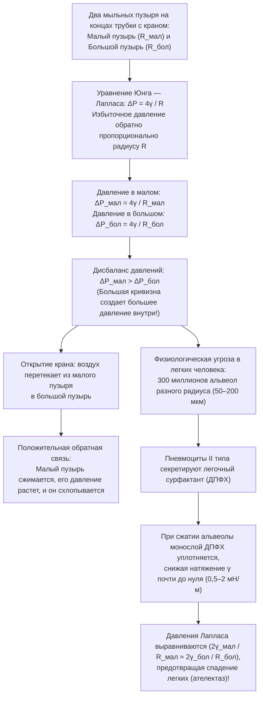
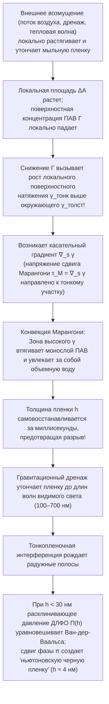

Опустите колечко в мыльный раствор и слегка подуйте: тонкая жидкая пленка растянется, сомкнется и за считанные миллисекунды превратится в переливающуюся всеми цветами радуги идеальную сферу. А если взглянуть через лупу на густую мыльную пену (водную пену), то кажущийся хаос обнаружит безупречный геометрический порядок: жидкие перегородки никогда не сходятся по четыре или по пять — они встречаются исключительно <strong>по три</strong> вдоль жидких каналов (границ Плато) под точным углом <strong>$120^\circ$ ($2\pi/3$)</strong>, а сами эти каналы сходятся в узлах исключительно <strong>по четыре</strong> под точным тетраэдрическим углом <strong>$\arccos(-1/3) \approx 109{,}4712^\circ$</strong>.

Почему свободный мыльный пузырь всегда принимает форму сферы? Почему при соединении маленького и большого мыльных пузырей трубкой именно <em>маленький</em> пузырь сдувается и накачивает <em>большой</em> — и почему эта же самая неустойчивость не заставляет 300 миллионов альвеол в наших легких схлопываться при каждом выдохе? Почему пузыри из чистой воды или чистого спирта лопаются за миллисекунды, тогда как следы поверхностно-активного вещества (ПАВ) наделяют пленку способностью к самозалечиванию? И как столетняя гипотеза лорда Кельвина о разбиении трехмерного пространства на ячейки равного объема с минимальной площадью поверхности была опровергнута в 1994 году структурой Уэйра — Фелана?

В этой статье мы объединим термодинамику, дифференциальную геометрию, вариационное исчисление, геометрическую теорию меры и гидродинамику межфазных границ, чтобы раскрыть математическую физику мыльных пузырей и пен.

---

## 1. Термодинамика поверхностного натяжения и молекулярная асимметрия

Внутри объема (bulk) жидкой воды каждая молекула $\text{H}_2\text{O}$ изотропно окружена соседними молекулами и связана с ними сеткой водородных связей и силами Ван-дер-Ваальса. Средняя по времени равнодействующая сила в объеме равна нулю, и молекула находится в глубокой потенциальной яме (координационное число $z_b \approx 12$, энергия когезии $-u_0$).

На <strong>границе раздела жидкость — пар</strong> эта симметрия резко нарушается: плотность молекул в газовой фазе примерно на три порядка ниже, чем в жидкости. Поверхностная молекула теряет около половины притягивающих соседей ($z_s < z_b$) и обладает избыточной потенциальной энергией. Чтобы перенести молекулы из объема на поверхность и увеличить площадь границы раздела $A$ на величину $dA$, необходимо совершить положительную обратимую работу против сил когезии.

Полный дифференциал энергии Гиббса $G(T, P, A, \{N_i\})$ имеет вид:

$$dG = -S\,dT + V\,dP + \gamma\,dA + \sum_{i} \mu_i\,dN_i$$

Отсюда следует строгое термодинамическое определение <strong>поверхностного натяжения</strong> $\gamma$:

$$\gamma \equiv \left( \frac{\partial G}{\partial A} \right)_{T, P, N_i} = \left( \frac{\partial F}{\partial A} \right)_{T, V, N_i}$$

Эта величина имеет две физически эквивалентные трактовки:
1. <strong>Избыточная свободная энергия на единицу площади ($\text{Дж/м}^2$)</strong>: При фиксированном объеме $V$ система стремится к минимуму свободной энергии $\gamma A$, минимизируя площадь поверхности $A$. Согласно трехмерному <strong>изопериметрическому неравенству</strong> $A^3 \ge 36\pi V^2$, единственным телом с минимальной площадью поверхности при заданном объеме является сфера.
2. <strong>Касательная сила натяжения на единицу длины ($\text{Н/м}$)</strong>: Согласно <strong>формуле Кирквуда — Баффа (1949)</strong> в статистической механике, $\gamma$ выражается через интеграл анизотропии тензора давления — разности нормального давления $P_N$ и тангенциального давления $P_T(z)$ поперек межфазного слоя:
   $$\gamma = \int_{-\infty}^{+\infty} \bigl[ P_N - P_T(z) \bigr]\,dz$$

| Жидкость / межфазная система (при $20^\circ\text{C}$ с воздухом) | Поверхностное натяжение $\gamma$ ($\text{мН/м}$) | Доминирующее взаимодействие | Устойчивость тонких пленок и пузырей |
| :--- | :---: | :--- | :--- |
| Жидкая ртуть ($\text{Hg}$) | $486{,}5$ | Металлическая связь | Пленки не образуются; мгновенно собирается в капли |
| Чистая вода ($\text{H}_2\text{O}$) | $72{,}8$ | Сетка водородных связей + диполи | Лопается за миллисекунды (нет упругости Марангони) |
| Чистый этанол ($\text{C}_2\text{H}_5\text{OH}$) | $22{,}3$ | Слабые Н-связи + дисперсионные силы | Однокомпонентная пленка неустойчива («слезы вина») |
| Мыльный раствор / раствор ДСН (вблизи ККМ) | $25{,}0 \sim 35{,}0$ | Монослой амфифильного ПАВ | <strong>Стабильна от минут до часов</strong> (эффект Гиббса — Марангони) |
| Легочный сурфактант (сжатый монослой ДПФХ) | $0{,}5 \sim 2{,}0$ | Плотно упакованные насыщенные фосфолипиды | <strong>Сверхстабильна</strong> (предотвращает спадение альвеол) |

---

## 2. Дифференциальная геометрия кривых поверхностей и уравнение Юнга — Лапласа

Когда граница раздела искривлена, касательные силы натяжения $\gamma$ создают результирующую нормальную силу, направленную в сторону вогнутости, что вызывает скачок давления $\Delta P = P_{\text{вн}} - P_{\text{нар}} > 0$. Пусть $R_1, R_2$ — два ортогональных <strong>главных радиуса кривизны</strong> ($\kappa_1 = 1/R_1, \kappa_2 = 1/R_2$ — главные кривизны) гладкой поверхности $\Sigma \subset \mathbb{R}^3$. Тогда <strong>средняя кривизна</strong> $H$ и <strong>гауссова кривизна</strong> $K$ определяются как:

$$H \equiv \frac{\kappa_1 + \kappa_2}{2} = \frac{1}{2}\left(\frac{1}{R_1} + \frac{1}{R_2}\right), \qquad K \equiv \kappa_1 \kappa_2 = \frac{1}{R_1 R_2}$$

При бесконечно малом виртуальном смещении $\delta\xi$ вдоль нормали элементарного участка $dA = R_1 R_2\,d\theta_1\,d\theta_2$ приращение площади в первом порядке равно $\delta(dA) = dA\left(\frac{1}{R_1} + \frac{1}{R_2}\right)\delta\xi$, а заметаемый объем равен $\delta(dV) = dA\,\delta\xi$. Из условия равновесия $\delta F = \gamma\,\delta(dA) - \Delta P\,\delta(dV) = 0$ получаем <strong>уравнение Юнга — Лапласа (1805–1806)</strong>:

$$\Delta P = P_{\text{вн}} - P_{\text{нар}} = \gamma\left(\frac{1}{R_1} + \frac{1}{R_2}\right) = 2\gamma H$$

В то время как капля воды имеет <strong>только одну</strong> границу раздела ($\Delta P_{\text{капля}} = 2\gamma/R$), <strong>мыльный пузырь в воздухе</strong> представляет собой тонкую жидкую оболочку толщиной $h \ll R$ и имеет <strong>две границы раздела газ — жидкость</strong> (внутреннюю радиуса $R$ и внешнюю радиуса $R+h$), откуда возникает множитель $4$:

$$\Delta P_{\text{пузырь}} = (P_{\text{вн}} - P_{\text{пленка}}) + (P_{\text{пленка}} - P_{\text{нар}}) = \frac{2\gamma}{R} + \frac{2\gamma}{R+h} \approx \frac{4\gamma}{R}$$

---

## 3. Минимальные поверхности ($H = 0$), катастрофа катеноида и проблема Плато

Открытая мыльная пленка, натянутая на проволочный контур без замкнутого объема воздуха, испытывает одинаковое атмосферное давление с обеих сторон ($\Delta P = 0$). Уравнение Юнга — Лапласа требует, чтобы ее средняя кривизна тождественно обращалась в нуль в каждой точке:

$$H = \frac{1}{2}\left(\frac{1}{R_1} + \frac{1}{R_2}\right) = 0 \quad \Longleftrightarrow \quad \kappa_1 = -\kappa_2 \quad \Longrightarrow \quad K = -\kappa_1^2 \le 0$$

Поверхности с $H \equiv 0$ называются <strong>минимальными поверхностями</strong>. Для графика функции $z = u(x,y)$ минимизация функционала площади $A[u] = \iint \sqrt{1+u_x^2+u_y^2}\,dx\,dy$ дает нелинейное уравнение Эйлера — Лагранжа (Лагранж, 1760):

$$\bigl(1 + u_y^2\bigr) u_{xx} - 2 u_x u_y u_{xy} + \bigl(1 + u_x^2\bigr) u_{yy} = 0$$

Любая неплоская точка открытой мыльной пленки локально является гиперболическим седлом ($K < 0$). Классическая минимальная поверхность вращения, натянутая между двумя соосными кольцами радиуса $R$ на расстоянии $2h$, — это открытый Эйлером в 1744 году <strong>катеноид</strong>:

$$r(z) = c \cosh\!\left(\frac{z}{c}\right)$$

При раздвижении колец свыше критического отношения ($\coth u_c = u_c \approx 1{,}19968$):

$$\left(\frac{2h}{R}\right)_{\text{крит}} = \frac{2u_c}{\cosh u_c} \approx 1{,}32548$$

вещественное решение исчезает в результате седло-узловой бифуркации, шейка катеноида стремительно схлопывается и пленка распадается на два плоских диска (<strong>разрывное решение Гольдшмидта</strong>). Общая <strong>проблема Плато</strong> была решена в 1930 году Джесси Дугласом (первая Филдсовская премия 1936 года) и Тибором Радо.

---

## 4. Парадокс двух пузырей, созревание Оствальда и легочный сурфактант (ДПФХ)

Если соединить трубкой с краном маленький мыльный пузырь ($R_{\text{мал}}$) и большой пузырь ($R_{\text{бол}}$), то при открытии крана <strong>маленький пузырь быстро сдуется, перекачав свой воздух в большой пузырь</strong>! Ведь согласно $\Delta P = 4\gamma/R$ давление внутри пузыря обратно пропорционально его радиусу:

$$R_{\text{мал}} < R_{\text{бол}} \quad \Longrightarrow \quad \Delta P_{\text{мал}} = \frac{4\gamma}{R_{\text{мал}}} \;>\; \frac{4\gamma}{R_{\text{бол}}} = \Delta P_{\text{бол}}$$

В реальной пене диффузия газа сквозь жидкие перегородки из маленьких пузырьков в большие вызывает укрупнение пены — <strong>оствальдовское созревание</strong>. В 1952 году <strong>Джон фон Нейман</strong> с помощью теоремы Гаусса — Бонне доказал, что в двумерной сухой пене площадь $A_n$ ячейки с $n$ сторонами меняется по <strong>закону фон Неймана</strong>:

$$\frac{dA_n}{dt} = K_0 (n - 6)$$

Ячейки с числом сторон $n < 6$ сжимаются и исчезают, шестиугольники ($n = 6$) стабильны, а ячейки с $n > 6$ растут (трехмерное обобщение получили Макферсон и Сроловиц в 2007 году).

В легких человека около <strong>300 миллионов альвеол</strong> ($R \approx 50\text{–}200\,\text{мкм}$) соединены бронхиолами. Если бы поверхностное натяжение $\gamma$ было постоянным, мелкие альвеолы мгновенно опорожнялись бы в крупные (<strong>ателектаз</strong>). Пневмоциты II типа предотвращают это, выделяя <strong>легочный сурфактант</strong> на основе <strong>дипальмитоилфосфатидилхолина (ДПФХ / DPPC)</strong>: при выдохе нерастворимый монослой ДПФХ сжимается так плотно, что $\gamma(R)$ падает до $0{,}5\text{–}2\,\text{мН/м}$, уравнивая давление во всех альвеолах.

---

## 5. Законы Жозефа Плато (1873), доказательство Джин Тейлор (1976) и теорема о двойном пузыре

Сформулированные в 1873 году ослепшим бельгийским физиком <strong>Жозефом Плато</strong> и строго доказанные в 1976 году <strong>Джин Тейлор (Jean E. Taylor)</strong> методами геометрической теории меры:

1. <strong>1-й закон Плато (3 пленки под углом $120^\circ$)</strong>: Мыльные пленки сходятся исключительно <strong>по три</strong> вдоль <strong>границ Плато</strong> под равными углами <strong>$120^\circ$ ($2\pi/3$)</strong> ($\sum_{i=1}^3 \hat{\mathbf{t}}_i = \mathbf{0} \implies \cos\theta = -1/2$). Четырехкратное пересечение под углом $90^\circ$ ($L_{\text{крест}} = 4\sqrt{2} \approx 5{,}657$) неустойчиво и мгновенно расщепляется на два тройных узла по $120^\circ$ дерева Штейнера ($L_{\text{Штейнер}} = 2(1+\sqrt{3}) \approx 5{,}464$, T1-переход).
2. <strong>2-й закон Плато (4 ребра под углом $109{,}47^\circ$)</strong>: Границы Плато сходятся в вершинах исключительно <strong>по четыре</strong> под <strong>тетраэдрическим углом Маральди</strong>:
   $$\theta_{\text{Maraldi}} = \arccos\!\left(-\frac{1}{3}\right) \approx 109{,}47122^\circ \quad \left(109^\circ 28' 16''\right)$$
3. <strong>Теорема о двойном пузыре (Hutchings, Morgan, Ritoré, Ros 2000)</strong>: Когда два пузыря радиусов $R_1 > R_2$ сливаются, общая перегородка (септа) выгибается внутрь большего пузыря с радиусом кривизны $R_{\text{септа}}$:
   $$\frac{1}{R_{\text{септа}}} = \frac{1}{R_2} - \frac{1}{R_1} \quad \Longleftrightarrow \quad R_{\text{септа}} = \frac{R_1 R_2}{R_1 - R_2}$$

---

## 6. Гипотеза Кельвина (1887) против структуры Уэйра — Фелана (1994)

В 1887 году <strong>лорд Кельвин</strong> поставил задачу о разбиении пространства $\mathbb{R}^3$ на ячейки равного объема ($V=1$) с минимальной площадью границ. Из-за <strong>геометрической фрустрации</strong> Кельвин предложил слегка искривленный <strong>усеченный октаэдр (14-гранник из 6 квадратов и 8 шестиугольников, ячейка Вороного ОЦК-решетки)</strong> с нормированной площадью $A_{\text{Kelvin}} \approx 5{,}30628$.

Спустя 107 лет, в 1994 году, физики <strong>Денис Уэйр</strong> и <strong>Роберт Фелан</strong> (Тринити-колледж, Дублин) опровергли гипотезу Кельвина, открыв <strong>структуру Уэйра — Фелана</strong> (вдохновленную клатратными гидратами I типа), кубическая элементарная ячейка которой состоит из <strong>8 равновеликих многогранников двух типов</strong>: <strong>2 неправильных пентагондодекаэдров ($5^{12}$)</strong> и <strong>6 тетракайдекаэдров ($5^{12}6^2$ с 2 шестиугольниками и 12 пятиугольниками)</strong>. Поскольку $88{,}9\%$ граней являются пятиугольниками (внутренний угол $108^\circ$ близок к $109{,}47^\circ$), площадь сокращается на $0{,}34\%$ до $A_{\text{WP}} \approx 5{,}28825$, что легло в основу архитектуры <strong>Пекинского национального плавательного комплекса («Водяной куб»)</strong>.

| 3D-структура пены, заполняющая пространство | Ячеек в элем. ячейке $Z$ | Топология граней (среднее $\langle F \rangle$) | Законы Плато? | Нормированная площадь $A$ ($V=1$) | Разница с Кельвином |
| :--- | :---: | :--- | :---: | :---: | :---: |
| <strong>Простая кубическая решетка</strong> | $1$ | $6$ квадратов ($\langle F \rangle = 6{,}00$) | Нет (неустойчива) | $6{,}00000$ | $+13{,}07\%$ |
| <strong>Ромбододекаэдр (ГЦК)</strong> | $1$ | $12$ ромбов ($\langle F \rangle = 12{,}00$) | Нет (6-лучевые вершины распадаются) | $5{,}34539$ | $+0{,}74\%$ |
| <strong>Структура Кельвина (1887, ОЦК)</strong> | $1$ | $6$ квадратов + $8$ шестиугольников ($\langle F \rangle = 14{,}00$) | <strong>Да</strong> (изогнутые шестиугольники) | $5{,}30628$ | $0{,}00\%$ (База) |
| <strong>Структура Уэйра — Фелана (1994, A15)</strong> | $8$ ($2+6$) | $88{,}9\%$ пятиугольников + $11{,}1\%$ шестиугольников ($\langle F \rangle = 13{,}50$) | <strong>Да</strong> (минимальная кривизна) | <strong>$5{,}28825$</strong> | <strong>$-0{,}34\%$ (Рекорд)</strong> |

---

## 7. Упругость Гиббса — Марангони, тонкопленочная интерференция и расклинивающее давление ДЛФО

Низкое поверхностное натяжение само по себе не стабилизирует пузырь (чистый этанол лопается мгновенно). Секрет живучести мыльной пленки — <strong>упругость Гиббса — Марангони</strong>:

При локальном растяжении пленки поверхностная концентрация ПАВ $\Gamma$ падает, а локальное натяжение $\gamma_{\text{тонк}}$ возрастает. Возникающее <strong>напряжение Марангони</strong> $\boldsymbol{\tau}_M = \nabla_s \gamma$ и <strong>модуль упругости Гиббса</strong>

$$E_G \equiv 2A\left(\frac{\partial\gamma}{\partial A}\right)_{N_s} = -2\Gamma\left(\frac{\partial\gamma}{\partial\Gamma}\right)_T > 0$$

немедленно подтягивают жидкость обратно в утонченную зону (тот же эффект объясняет <strong>«слезы вина»</strong> на стенках бокала). Когда толщина $h$ уменьшается до оптических длин волн, возникает <strong>тонкопленочная интерференция</strong> ($2n_{\text{пленка}}h\cos\theta_t + \lambda/2 = m\lambda$). При $h \ll \lambda/4 \approx 30\,\text{нм}$ потеря полуволны ($\pi$) при отражении от передней границы вызывает деструктивную интерференцию для всего видимого спектра: пленка становится черной (<strong>ньютоновская черная пленка</strong>, $h \approx 4\,\text{нм}$), удерживаемая от разрыва <strong>расклинивающим давлением Дерягина (ДЛФО / DLVO)</strong> $\Pi(h) = \Pi_{\text{vdW}}(h) + \Pi_{\text{el}}(h) + \Pi_{\text{sr}}(h)$.
