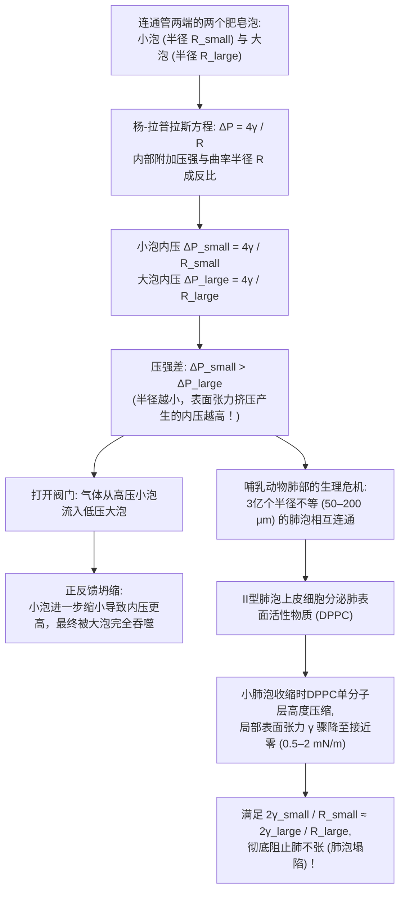
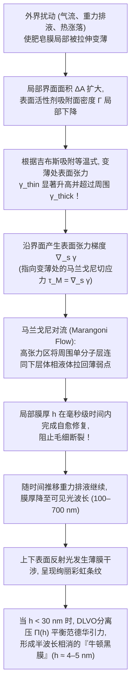

当我们将吸管浸入肥皂水并轻轻吹气时，液膜瞬间延展并收缩成一个闪烁着彩虹光泽的完美球体。如果我们用放大镜观察盆中密集的肥皂泡沫（Foam），会发现看似杂乱无章的多面体气泡实际上遵循着极为严苛的几何铁律：所有的液膜壁总是<strong>两两以120度角三片相交</strong>于一条液态棱边，而所有的棱边又总是<strong>四条一组以约109.47度的正四面体角汇交</strong>于一点。

为什么孤立的肥皂泡必然是球体？为什么用细管连通一大一小两个肥皂泡时，反而是<strong>小气泡收缩并将空气注入大气泡</strong>？为什么纯净水吹出的气泡在几毫秒内就会破裂，而加入微量表面活性剂后液膜却能依靠自愈弹性维持数分钟之久？1887年开尔文勋爵提出的“等体积泡沫如何以最小总面积填满三维空间”的世纪难题，又是如何在107年后被受水合物晶体启发的新结构所击败的？

本文将从热力学、微分几何、变分法、几何测度论与界面流体力学五个维度，系统揭示肥皂泡与泡沫背后的物理与数学原理。

---

## 1. 表面张力的热力学起源与分子不对称性

在液态水内部（体相，Bulk），每个水分子（$\text{H}_2\text{O}$）都被周围对称分布的邻近水分子包围，通过氢键网络与范德华力（偶极-偶极相互作用与伦敦色散力）相互吸引。体相分子所受的平均合力为零，处于势能较低的稳定态（设配位数为 $z_b \approx 12$，单分子内聚能为 $-u_0$）。

然而，位于<strong>气-液界面（Liquid-Vapor Interface）</strong>上的水分子却处于高度不对称的力学环境中：界面下方是高密度的液相分子，而界面上方则是分子数密度低约三个数量级的气相空气。由于缺失了一半左右的吸引邻居（有效配位数 $z_s < z_b$），界面分子具有比体相分子更高的势能。将分子从体相内部拉到表面以创造新的界面面积 $dA$，外界必须克服内聚力做正功。

在恒温 $T$、恒压 $P$ 及恒定组分物质的量 $N_i$ 下，多相系统的吉布斯自由能 $G$ 全微分为：

$$dG = -S\,dT + V\,dP + \gamma\,dA + \sum_{i} \mu_i\,dN_i$$

由此得到<strong>表面张力（Surface Tension）</strong> $\gamma$ 的严格热力学定义：

$$\gamma \equiv \left( \frac{\partial G}{\partial A} \right)_{T, P, N_i} = \left( \frac{\partial F}{\partial A} \right)_{T, V, N_i}$$

表面张力 $\gamma$ 同时具有两种等价的物理意义：
1. <strong>单位面积的界面过剩自由能（$\text{J/m}^2$）</strong>：根据热力学第二定律，恒温恒容系统自发趋向自由能极小态。对于给定体积 $V$ 的液滴或气泡，只要重力可忽略，系统必然通过最小化表面积 $A$ 来使表面自由能 $\gamma A$ 最小。由三维<strong>等周不等式（Isoperimetric Inequality）</strong> $A^3 \ge 36\pi V^2$ 可知，唯一使表面积最小的几何体正是<strong>球体</strong>。
2. <strong>单位长度上的切向收缩力（$\text{N/m}$）</strong>：根据统计力学的<strong>柯克伍德-巴夫公式（Kirkwood-Buff Formula, 1949）</strong>，表面张力源于界面过渡层内法向压力 $P_N$ 与切向压力 $P_T(z)$ 的各向异性积分：
   $$\gamma = \int_{-\infty}^{+\infty} \bigl[ P_N - P_T(z) \bigr]\,dz$$

| 液体/界面体系（$20^\circ\text{C}$，对空气） | 表面张力 $\gamma$ ($\text{mN/m}$) | 主导分子间相互作用 | 薄膜与气泡稳定性 |
| :--- | :---: | :--- | :--- |
| 液态汞（$\text{Hg}$） | $486.5$ | 金属键 | 无法成膜，瞬间收缩为球滴 |
| 纯水（$\text{H}_2\text{O}$） | $72.8$ | 氢键网络 + 偶极作用 | 数毫秒内破裂（无马兰戈尼弹性） |
| 纯乙醇（$\text{C}_2\text{H}_5\text{OH}$） | $22.3$ | 弱氢键 + 色散力 | 单组分无法维持液膜（引发“酒泪”现象） |
| 肥皂水 / SDS水溶液（CMC附近） | $25.0 \sim 35.0$ | 两亲分子界面单分子层 | <strong>稳定维持数分钟至数小时</strong>（吉布斯-马兰戈尼效应） |
| 肺表面活性物质（压缩态DPPC单分子层） | $0.5 \sim 2.0$ | 饱和磷脂超高密度堆积 | <strong>极度稳定</strong>（防止哺乳动物肺泡塌陷） |

---

## 2. 曲面微分几何与杨-拉普拉斯方程（Young-Laplace Equation）

### 2.1 主曲率、平均曲率与虚功原理推导

当界面弯曲时，面内的切向张力 $\gamma$ 会在法线方向产生指向曲率中心的合力，导致凹侧（内侧）压力 $P_{\text{in}}$ 必然高于凸侧（外侧）压力 $P_{\text{out}}$。设光滑曲面 $\Sigma \subset \mathbb{R}^3$ 在任意点处的两个正交主曲率半径为 $R_1, R_2$（主曲率 $\kappa_1 = 1/R_1, \kappa_2 = 1/R_2$），则曲面的<strong>平均曲率（Mean Curvature）</strong> $H$ 与<strong>高斯曲率（Gaussian Curvature）</strong> $K$ 分别为：

$$H \equiv \frac{\kappa_1 + \kappa_2}{2} = \frac{1}{2}\left(\frac{1}{R_1} + \frac{1}{R_2}\right), \qquad K \equiv \kappa_1 \kappa_2 = \frac{1}{R_1 R_2}$$

考虑主曲率方向上的微元矩形面片 $dA = ds_1\,ds_2 = R_1 R_2\,d\theta_1\,d\theta_2$。若令该面片沿法向向外做微小虚位移 $\delta\xi$，其曲率半径变为 $R_1 + \delta\xi$ 与 $R_2 + \delta\xi$，面积的一阶变分为：

$$\delta(dA) = dA\left(\frac{1}{R_1} + \frac{1}{R_2}\right)\delta\xi$$

扫过的体积微元为 $\delta(dV) = dA\,\delta\xi$。由热力学平衡条件 $\delta F = \gamma\,\delta(dA) - \Delta P\,\delta(dV) = 0$，立得1805—1806年建立的<strong>杨-拉普拉斯方程（Young-Laplace Equation）</strong>：

$$\Delta P = P_{\text{in}} - P_{\text{out}} = \gamma\left(\frac{1}{R_1} + \frac{1}{R_2}\right) = 2\gamma H$$

### 2.2 液滴（$\Delta P = 2\gamma/R$）与肥皂泡（$\Delta P = 4\gamma/R$）的2倍因子之差

对于半径为 $R$ 的球形雨滴或水下气泡，气-液界面只有<strong>1层</strong>（$R_1 = R_2 = R$），因此附加压力为 $\Delta P_{\text{droplet}} = \frac{2\gamma}{R}$。

然而，悬浮在空气中的<strong>肥皂泡</strong>是由一层极薄的肥皂水膜（厚度 $h \ll R$）包裹空气构成的，它同时拥有<strong>内表面（半径 $R$）和外表面（半径 $R+h$）两层气-液界面</strong>！对内外两层界面分别应用杨-拉普拉斯方程并相加：

$$\Delta P_{\text{soap}} = (P_{\text{in}} - P_{\text{film}}) + (P_{\text{film}} - P_{\text{out}}) = \frac{2\gamma}{R} + \frac{2\gamma}{R+h} \approx \frac{4\gamma}{R}$$

正是这个反比于半径 $R$ 的关系式 $\Delta P = 4\gamma/R$，直接引出了两个著名的反直觉物理现象：<strong>极小曲面（$H=0$）</strong>与<strong>双泡连通悖论</strong>。

---

## 3. 极小曲面（$H = 0$）、悬链面灾变与普拉托问题

如果我们将一个不封闭的金属丝框架浸入肥皂水后取出，框架上会张起一片两侧均暴露在大气中的开放肥皂膜。由于膜两侧气压完全相等（$\Delta P = 0$），杨-拉普拉斯方程 $\Delta P = 4\gamma H = 0$ 要求肥皂膜在每一点处的<strong>平均曲率恒等于零</strong>：

$$H = \frac{1}{2}\left(\frac{1}{R_1} + \frac{1}{R_2}\right) = 0 \quad \Longleftrightarrow \quad \kappa_1 = -\kappa_2$$

这种处处满足 $H = 0$ 的曲面在微分几何中称为<strong>极小曲面（Minimal Surface）</strong>。若曲面表示为函数图像 $z = u(x,y)$，最小化面积泛函 $A[u] = \iint \sqrt{1 + u_x^2 + u_y^2}\,dx\,dy$ 的欧拉-拉格朗日方程正是拉格朗日于1760年导出的非线性椭圆偏微分方程：

$$\bigl(1 + u_y^2\bigr) u_{xx} - 2 u_x u_y u_{xy} + \bigl(1 + u_x^2\bigr) u_{yy} = 0$$

除平面外，极小曲面上每一点的主曲率必然一正一负，因而高斯曲率处处非正（$K = -\kappa_1^2 \le 0$），局部呈现马鞍面形状。最经典的非平凡极小曲面是欧拉于1744年发现的<strong>悬链面（Catenoid）</strong>：

$$r(z) = c \cosh\!\left(\frac{z}{c}\right)$$

以及与其局部等距同构的<strong>正螺旋面（Helicoid）</strong>。当用两个半径为 $R$、间距为 $2h$ 的同轴圆环张起悬链面肥皂膜并逐渐拉开圆环时，超越方程 $R = c\cosh(h/c)$ 仅在 $\coth u_c = u_c$（$u_c \approx 1.19968$）即临界间距比

$$\left(\frac{2h}{R}\right)_{\text{crit}} = \frac{2u_c}{\cosh u_c} \approx 1.32548$$

以内存在实数解。一旦圆环间距超过 $1.32548 R$，悬链面解发生鞍结分岔而消失，肥皂膜瞬间向中心坍缩断裂，跳变为分别覆盖两个圆环的两片平面圆盘（<strong>戈德施密特不连续解，Goldschmidt Solution</strong>）。而关于任意闭曲线是否必能张起极小曲面的<strong>普拉托问题（Plateau's Problem）</strong>，最终由杰西·道格拉斯（Jesse Douglas）与蒂博尔·拉多（Tibor Radó）于1930年独立解决，道格拉斯也因此荣膺1936年首届菲尔兹奖。

---

## 4. 双泡连通悖论、奥斯特瓦尔德熟化与哺乳动物肺泡的生存机制

### 4.1 为什么小肥皂泡会把空气吹进大肥皂泡？

将半径为 $R_{\text{small}}$ 的小肥皂泡与半径为 $R_{\text{large}}$ 的大肥皂泡分别吹在带有阀门的细管两端。打开阀门连通的一刹那，气流方向如何？

直觉往往认为大气泡会缩小、小气泡会变大直到两者体积相等。但物理事实恰恰相反：<strong>小气泡迅速萎缩，把空气源源不断地压入大气泡中，使大气泡变得更大！</strong>

原因直接来自 $\Delta P = 4\gamma/R$：半径越小，曲率越大，附加拉普拉斯压力越高：

$$R_{\text{small}} < R_{\text{large}} \quad \Longrightarrow \quad \Delta P_{\text{small}} = \frac{4\gamma}{R_{\text{small}}} \;>\; \frac{4\gamma}{R_{\text{large}}} = \Delta P_{\text{large}}$$

高压的小气泡必然向低压的大气泡排气；且随着小气泡半径进一步减小，其内部压力反而进一步飙升，形成正反馈失稳，直到小气泡完全坍缩为管口处曲率半径等于 $R_{\text{large}}$ 的球冠为止。

### 4.2 泡沫粗化（奥斯特瓦尔德熟化）与冯·诺依曼 $n - 6$ 定律

在真实的泡沫中，无需连通管，气体分子就会溶解于液膜并从高压小泡向低压大泡扩散，导致小泡逐渐消失、大泡不断吞并扩张，这一过程称为<strong>奥斯特瓦尔德熟化（Ostwald Ripening / Foam Coarsening）</strong>。1952年，数学家<strong>约翰·冯·诺依曼（John von Neumann）</strong>利用高斯-博内定理证明，二维干泡沫中任意一个具有 $n$ 条边的多边形气泡，其面积 $A_n$ 随时间的演化率严格满足<strong>冯·诺依曼定律</strong>：

$$\frac{dA_n}{dt} = K_0 (n - 6)$$

气泡的膨胀或收缩速度竟然与气泡当前的大小无关，而纯粹由其拓扑边数 $n$ 决定：边数 $n < 6$ 的气泡（三角形、四边形、五边形）必然线性缩小直至消失；$n = 6$ 的正六边形气泡曲率为零，面积保持绝对稳定；而 $n > 6$ 的气泡则不断扩张（三维情形的推广最终由 MacPherson 与 Srolovitz 于2007年解决）。

### 4.3 肺表面活性物质（DPPC）：防止3亿个肺泡塌陷的生命防线

人类双肺包含约<strong>3亿个肺泡（Alveoli）</strong>，半径在 $50\,\mu\text{m}$ 至 $200\,\mu\text{m}$ 之间变化。如果肺泡内壁液体的表面张力 $\gamma$ 是常数，根据 $\Delta P = 2\gamma/R$，小肺泡在呼气末期会瞬间将空气排入大肺泡并彻底塌陷（<strong>肺不张，Atelectasis</strong>）。

幸运的是，肺泡壁上的<strong>II型肺泡上皮细胞</strong>会分泌以<strong>二棕榈酰磷脂酰胆碱（DPPC）</strong>为主的<strong>肺表面活性物质（Pulmonary Surfactant）</strong>。由于DPPC不溶于水，当小肺泡在呼气时收缩、表面积 $A = 4\pi R^2$ 减小时，界面上的DPPC分子被紧密压缩成二维固态膜，使局部表面张力 $\gamma(R)$ 从 $25\,\text{mN/m}$ 剧降至接近零（$0.5 \sim 2\,\text{mN/m}$）！这使得 $\gamma(R)/R$ 在不同大小肺泡间保持平衡，完美消除了拉普拉斯吞噬效应。早产儿因缺乏该物质而引发的<strong>新生儿呼吸窘迫综合征（NRDS）</strong>，正是通过外源性表面活性物质替代疗法得以挽救。

---

## 5. 普拉托定律、109.47度马拉尔迪角与双泡定理

1873年，失明多年的比利时物理学家<strong>约瑟夫·普拉托（Joseph Plateau）</strong>总结出泡沫在力学平衡下的普遍几何法则，并在103年后的1976年由美国数学家<strong>让·泰勒（Jean E. Taylor）</strong>运用几何测度论（Geometric Measure Theory）给出了严格的数学证明：

1. <strong>三膜120度相交定律</strong>：泡沫中的液膜永远只以<strong>3片一组</strong>沿称为<strong>普拉托边界（Plateau Border）</strong>的液态棱线相交，且夹角严格等于 <strong>$120^\circ$（$2\pi/3$）</strong>。这是因为三片等张力液膜的单位切向量平衡条件 $\hat{\mathbf{t}}_1 + \hat{\mathbf{t}}_2 + \hat{\mathbf{t}}_3 = \mathbf{0}$ 唯一要求 $\cos\theta = -1/2$。若4片液膜以 $90^\circ$ 十字相交，其总长度 $4\sqrt{2} \approx 5.657$ 大于分裂成两个 $120^\circ$ 三重点后的施泰纳树（Steiner Tree）长度 $2(1+\sqrt{3}) \approx 5.464$，因此十字交线会瞬间发生 <strong>T1拓扑转变</strong>分裂为两个三重点。
2. <strong>四棱109.47度相交定律</strong>：普拉托边界永远只以<strong>4条一组</strong>（汇集6片液膜）相交于一个顶点，任意两条棱线之间的夹角严格等于正四面体中心角（<strong>马拉尔迪角，Maraldi Angle</strong>）：
   $$\theta_{\text{Maraldi}} = \arccos\!\left(-\frac{1}{3}\right) \approx 109.47122^\circ \quad \left(109^\circ 28' 16''\right)$$
3. <strong>双泡定理（Double Bubble Theorem，Hutchings, Morgan, Ritoré, Ros 2000年证明）</strong>：当两个半径分别为 $R_1$ 和 $R_2$（$R_1 > R_2$）的肥皂泡合并共享一面隔膜（Septum）时，隔膜向低压的大泡内部凸出，其曲率半径 $R_{\text{septum}}$ 满足调和关系：
   $$\frac{1}{R_{\text{septum}}} = \frac{1}{R_2} - \frac{1}{R_1} \quad \Longleftrightarrow \quad R_{\text{septum}} = \frac{R_1 R_2}{R_1 - R_2}$$
   当两泡等大（$R_1 = R_2$）时，$R_{\text{septum}} = \infty$，隔膜为完全平坦的圆盘。

---

## 6. 开尔文猜想（1887）与威耳-费兰结构（1994）的百年对决

1887年，<strong>开尔文勋爵（Lord Kelvin）</strong>提出了著名的空间等体积划分问题：<strong>如何用体积均为 $V=1$ 的等体积泡室填满整个三维欧氏空间 $\mathbb{R}^3$，并使单位体积的界面总面积最小？</strong>

由于三维空间存在<strong>几何阻挫（Geometric Frustration）</strong>——正十二面体的五边形内角（$108^\circ$）与二面角（$116.565^\circ$）虽然最接近普拉托定律，却无法无隙填满三维空间——开尔文提出了基于体心立方（BCC）维格纳-赛茨原胞的<strong>截角八面体（十四面体，由6个正方形和8个六边形组成）</strong>，通过将六边形面微弯成极小曲面以满足普拉托定律，得到归一化单胞表面积 $A_{\text{Kelvin}} \approx 5.30628$。这一<strong>开尔文猜想</strong>统治了整整107年。

直到1994年，都柏林圣三一学院的物理学家<strong>丹尼斯·威耳（Denis Weaire）</strong>与<strong>罗伯特·费兰（Robert Phelan）</strong>受甲烷水合物等<strong>I型笼形水合物（Type I Clathrate Hydrate）</strong>晶体结构的启发，利用 *Surface Evolver* 发现了一种包含8个等体积多面体的新型立方周期单元——<strong>威耳-费兰结构（Weaire-Phelan Structure）</strong>：
* <strong>2个变形五角十二面体（$5^{12}$，12个五边形面）</strong>；
* <strong>6个十四面体（$5^{12}6^2$，2个六边形面与12个五边形面）</strong>。

由于威耳-费兰结构中高达 $88.9\%$ 的面都是内角接近 $109.47^\circ$ 的五边形，曲面所需的弯曲畸变远小于开尔文结构，其归一化表面积降至 $A_{\text{WP}} \approx 5.28825$，<strong>比开尔文结构减小了 $0.34\%$</strong>，一举推翻了百年开尔文猜想！2008年北京奥运会国家游泳中心<strong>“水立方（Water Cube）”</strong>的钢结构外骨骼正是直接采用了威耳-费兰泡沫结构。

| 三维空间填充泡沫结构 | 单胞内泡室数 $Z$ | 多边形面构成（平均面数 $\langle F \rangle$） | 是否满足普拉托定律 | 归一化表面积 $A$ ($V=1$) | 相对开尔文结构面积差 |
| :--- | :---: | :--- | :---: | :---: | :---: |
| <strong>简单立方蜂窝（Cube）</strong> | $1$ | $6$ 个正方形（$\langle F \rangle = 6.00$） | 否（不稳定，瞬间分裂） | $6.00000$ | $+13.07\%$ |
| <strong>菱形十二面体（FCC）</strong> | $1$ | $12$ 个菱形（$\langle F \rangle = 12.00$） | 否（6棱顶点分裂） | $5.34539$ | $+0.74\%$ |
| <strong>开尔文结构（1887, BCC）</strong> | $1$ | $6$ 四边形 + $8$ 六边形（$\langle F \rangle = 14.00$） | <strong>是</strong>（六边形微弯） | $5.30628$ | $0.00\%$（基准） |
| <strong>威耳-费兰结构（1994, A15）</strong> | $8$ ($2+6$) | $88.9\%$ 五边形 + $11.1\%$ 六边形（$\langle F \rangle = 13.50$） | <strong>是</strong>（极小弯曲畸变） | <strong>$5.28825$</strong> | <strong>$-0.34\%$（最优选）</strong> |

---

## 7. 吉布斯-马兰戈尼弹性、薄膜干涉与DLVO分离压

为什么纯水或纯酒精（$\gamma = 22.3\,\text{mN/m}$）的气泡在几毫秒内就会破裂，而肥皂泡却能持久存在？<strong>“因为肥皂降低了表面张力所以气泡不破”是一个流传极广的误区</strong>。真正赋予肥皂膜自愈能力的是<strong>吉布斯-马兰戈尼弹性（Gibbs-Marangoni Elasticity）</strong>。

当肥皂膜局部被拉伸变薄时，该处的表面活性剂过剩面密度 $\Gamma$ 瞬间降低，导致局部表面张力 $\gamma_{\text{thin}}$ 升高。由此产生的表面张力梯度（<strong>马兰戈尼应力</strong> $\boldsymbol{\tau}_M = \nabla_s \gamma$）以及<strong>吉布斯弹性模量</strong>

$$E_G \equiv 2A\left(\frac{\partial\gamma}{\partial A}\right)_{N_s} = -2\Gamma\left(\frac{\partial\gamma}{\partial\Gamma}\right)_T > 0$$

会立即将周围低张力区的表面活性剂及粘附的体相水拉回变薄区域完成自愈（这与酒杯壁上因酒精蒸发产生表面张力梯度而向上爬升的<strong>“酒泪 / Tears of Wine”</strong>完全同源）。

随着重力排液进行，当膜厚 $h$ 减薄至可见光波长量级时，前后界面反射光遵循干涉条件 $2n_{\text{film}}h\cos\theta_t + \lambda/2 = m\lambda$ 产生绚丽的彩虹条纹。而在破裂前的最后阶段，肥皂泡顶部膜厚降至 $h \ll \lambda/4 \approx 30\,\text{nm}$，光程差趋近于零，前表面的 $\pi$ 半波损失导致所有可见光完全相消干涉，薄膜呈现全黑的<strong>黑膜（Black Film）</strong>状态，依靠<strong>DLVO分离压（Disjoining Pressure）</strong> $\Pi(h) = \Pi_{\text{vdW}}(h) + \Pi_{\text{el}}(h) + \Pi_{\text{sr}}(h)$ 维持在仅约 $4\,\text{nm}$（双分子层厚度）的<strong>牛顿黑膜（Newton Black Film）</strong>极限态。
