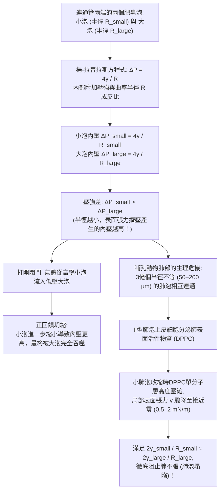
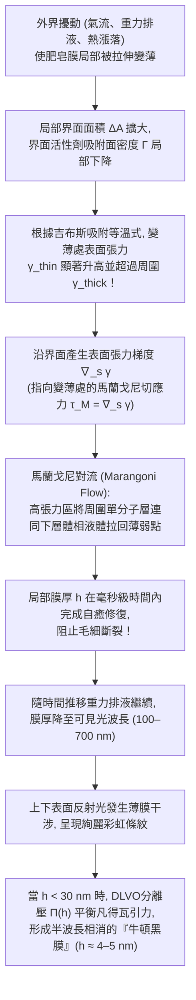

當我們將吸管浸入肥皂水並輕輕吹氣時，液膜瞬間延展並收縮成一個閃爍著彩虹光澤的完美球體。如果我們用放大鏡觀察盆中密集的肥皂泡沫（Foam），會發現看似雜亂無章的多面體氣泡實際上遵循著極為嚴苛的幾何鐵律：所有的液膜壁總是<strong>兩兩以120度角三片相交</strong>於一條液態稜邊，而所有的稜邊又總是<strong>四條一組以約109.47度的正四面體角匯交</strong>於一點。

為什麼孤立的肥皂泡必然是球體？為什麼用細管連通一大一小兩個肥皂泡時，反而是<strong>小氣泡收縮並將空氣注入大氣泡</strong>？為什麼純淨水吹出的氣泡在幾毫秒內就會破裂，而加入微量界面活性劑後液膜卻能依靠自癒彈性維持數分鐘之久？1887年克耳文勳爵（Lord Kelvin）提出的「等體積泡沫如何以最小總面積填滿三維空間」的世紀難題，又是如何在107年後被受水合物晶體啟發的新結構所擊敗的？

本文將從熱力學、微分幾何、變分法、幾何測度論與界面流體力學五個維度，系統揭示肥皂泡與泡沫背後的物理與數學原理。

---

## 1. 表面張力的熱力學起源與分子不對稱性

在液態水內部（體相，Bulk），每個水分子（$\text{H}_2\text{O}$）都被周圍對稱分布的鄰近水分子包圍，透過氫鍵網路與凡得瓦力（偶極-偶極交互作用與倫敦色散力）相互吸引。體相分子所受的平均合力為零，處於位能較低的穩定態（設配位數為 $z_b \approx 12$，單分子內聚能為 $-u_0$）。

然而，位於<strong>氣-液界面（Liquid-Vapor Interface）</strong>上的水分子卻處於高度不對稱的力學環境中：界面下方是高密度的液相分子，而界面上方則是分子數密度低約三個數量級的氣相空氣。由於缺失了一半左右的吸引鄰居（有效配位數 $z_s < z_b$），界面分子具有比體相分子更高的位能。將分子從體相內部拉到表面以創造新的界面面積 $dA$，外界必須克服內聚力做正功。

在恆溫 $T$、恆壓 $P$ 及恆定組分物質的量 $N_i$ 下，多相系統的吉布斯自由能 $G$ 全微分為：

$$dG = -S\,dT + V\,dP + \gamma\,dA + \sum_{i} \mu_i\,dN_i$$

由此得到<strong>表面張力（Surface Tension）</strong> $\gamma$ 的嚴格熱力學定義：

$$\gamma \equiv \left( \frac{\partial G}{\partial A} \right)_{T, P, N_i} = \left( \frac{\partial F}{\partial A} \right)_{T, V, N_i}$$

表面張力 $\gamma$ 同時具有兩種等價的物理意義：
1. <strong>單位面積的界面過剩自由能（$\text{J/m}^2$）</strong>：根據熱力學第二定律，恆溫恆容系統自發趨向自由能極小態。對於給定體積 $V$ 的液滴或氣泡，只要重力可忽略，系統必然透過最小化表面積 $A$ 來使表面自由能 $\gamma A$ 最小。由三維<strong>等周不等式（Isoperimetric Inequality）</strong> $A^3 \ge 36\pi V^2$ 可知，唯一使表面積最小的幾何體正是<strong>球體</strong>。
2. <strong>單位長度上的切向收縮力（$\text{N/m}$）</strong>：根據統計力學的<strong>柯克伍德-巴夫公式（Kirkwood-Buff Formula, 1949）</strong>，表面張力源於界面過渡層內法向壓力 $P_N$ 與切向壓力 $P_T(z)$ 的各向異性積分：
   $$\gamma = \int_{-\infty}^{+\infty} \bigl[ P_N - P_T(z) \bigr]\,dz$$

| 液體/界面體系（$20^\circ\text{C}$，對空氣） | 表面張力 $\gamma$ ($\text{mN/m}$) | 主導分子間交互作用 | 薄膜與氣泡穩定性 |
| :--- | :---: | :--- | :--- |
| 液態汞（$\text{Hg}$） | $486.5$ | 金屬鍵 | 無法成膜，瞬間收縮為球滴 |
| 純水（$\text{H}_2\text{O}$） | $72.8$ | 氫鍵網路 + 偶極作用 | 數毫秒內破裂（無馬蘭戈尼彈性） |
| 純乙醇（$\text{C}_2\text{H}_5\text{OH}$） | $22.3$ | 弱氫鍵 + 色散力 | 單組分無法維持液膜（引發「酒淚」現象） |
| 肥皂水 / SDS水溶液（CMC附近） | $25.0 \sim 35.0$ | 兩親分子界面單分子層 | <strong>穩定維持數分鐘至數小時</strong>（吉布斯-馬蘭戈尼效應） |
| 肺表面活性物質（壓縮態DPPC單分子層） | $0.5 \sim 2.0$ | 飽和磷脂超高密度堆積 | <strong>極度穩定</strong>（防止哺乳動物肺泡塌陷） |

---

## 2. 曲面微分幾何與楊-拉普拉斯方程式（Young-Laplace Equation）

### 2.1 主曲率、平均曲率與虛功原理推導

當界面彎曲時，面內的切向張力 $\gamma$ 會在法線方向產生指向曲率中心的合力，導致凹側（內側）壓力 $P_{\text{in}}$ 必然高於凸側（外側）壓力 $P_{\text{out}}$。設光滑曲面 $\Sigma \subset \mathbb{R}^3$ 在任意點處的兩個正交主曲率半徑為 $R_1, R_2$（主曲率 $\kappa_1 = 1/R_1, \kappa_2 = 1/R_2$），則曲面的<strong>平均曲率（Mean Curvature）</strong> $H$ 與<strong>高斯曲率（Gaussian Curvature）</strong> $K$ 分別為：

$$H \equiv \frac{\kappa_1 + \kappa_2}{2} = \frac{1}{2}\left(\frac{1}{R_1} + \frac{1}{R_2}\right), \qquad K \equiv \kappa_1 \kappa_2 = \frac{1}{R_1 R_2}$$

考慮主曲率方向上的微元矩形面片 $dA = ds_1\,ds_2 = R_1 R_2\,d\theta_1\,d\theta_2$。若令該面片沿法向向外做微小虛位移 $\delta\xi$，其曲率半徑變為 $R_1 + \delta\xi$ 與 $R_2 + \delta\xi$，面積的一階變分為：

$$\delta(dA) = dA\left(\frac{1}{R_1} + \frac{1}{R_2}\right)\delta\xi$$

掃過的體積微元為 $\delta(dV) = dA\,\delta\xi$。由熱力學平衡條件 $\delta F = \gamma\,\delta(dA) - \Delta P\,\delta(dV) = 0$，立得1805—1806年建立的<strong>楊-拉普拉斯方程式（Young-Laplace Equation）</strong>：

$$\Delta P = P_{\text{in}} - P_{\text{out}} = \gamma\left(\frac{1}{R_1} + \frac{1}{R_2}\right) = 2\gamma H$$

### 2.2 液滴（$\Delta P = 2\gamma/R$）與肥皂泡（$\Delta P = 4\gamma/R$）的2倍因子之差

對於半徑為 $R$ 的球形雨滴或水下氣泡，氣-液界面只有<strong>1層</strong>（$R_1 = R_2 = R$），因此附加壓力為 $\Delta P_{\text{droplet}} = \frac{2\gamma}{R}$。

然而，懸浮在空氣中的<strong>肥皂泡</strong>是由一層極薄的肥皂水膜（厚度 $h \ll R$）包裹空氣構成的，它同時擁有<strong>內表面（半徑 $R$）和外表面（半徑 $R+h$）兩層氣-液界面</strong>！對內外兩層界面分別應用楊-拉普拉斯方程式並相加：

$$\Delta P_{\text{soap}} = (P_{\text{in}} - P_{\text{film}}) + (P_{\text{film}} - P_{\text{out}}) = \frac{2\gamma}{R} + \frac{2\gamma}{R+h} \approx \frac{4\gamma}{R}$$

正是這個反比於半徑 $R$ 的關係式 $\Delta P = 4\gamma/R$，直接引出了兩個著名的反直覺物理現象：<strong>極小曲面（$H=0$）</strong>與<strong>雙泡連通悖論</strong>。

---

## 3. 極小曲面（$H = 0$）、懸鏈面災變與普拉托問題

如果我們將一個不封閉的金屬絲框架浸入肥皂水後取出，框架上會張起一片兩側均暴露在大氣中的開放肥皂膜。由於膜兩側氣壓完全相等（$\Delta P = 0$），楊-拉普拉斯方程式 $\Delta P = 4\gamma H = 0$ 要求肥皂膜在每一點處的<strong>平均曲率恆等於零</strong>：

$$H = \frac{1}{2}\left(\frac{1}{R_1} + \frac{1}{R_2}\right) = 0 \quad \Longleftrightarrow \quad \kappa_1 = -\kappa_2$$

這種處處滿足 $H = 0$ 的曲面在微分幾何中稱為<strong>極小曲面（Minimal Surface）</strong>。若曲面表示為函數圖像 $z = u(x,y)$，最小化面積泛函 $A[u] = \iint \sqrt{1 + u_x^2 + u_y^2}\,dx\,dy$ 的歐拉-拉格朗日方程式正是拉格朗日於1760年導出的非線性橢圓偏微分方程式：

$$\bigl(1 + u_y^2\bigr) u_{xx} - 2 u_x u_y u_{xy} + \bigl(1 + u_x^2\bigr) u_{yy} = 0$$

除平面外，極小曲面上每一點的主曲率必然一正一負，因而高斯曲率處處非正（$K = -\kappa_1^2 \le 0$），局部呈現馬鞍面形狀。最經典的非平凡極小曲面是歐拉於1744年發現的<strong>懸鏈面（Catenoid）</strong>：

$$r(z) = c \cosh\!\left(\frac{z}{c}\right)$$

以及與其局部等距同構的<strong>正螺旋面（Helicoid）</strong>。當用兩個半徑為 $R$、間距為 $2h$ 的同軸圓環張起懸鏈面肥皂膜並逐漸拉開圓環時，超越方程式 $R = c\cosh(h/c)$ 僅在 $\coth u_c = u_c$（$u_c \approx 1.19968$）即臨界間距比

$$\left(\frac{2h}{R}\right)_{\text{crit}} = \frac{2u_c}{\cosh u_c} \approx 1.32548$$

以內存在實數解。一旦圓環間距超過 $1.32548 R$，懸鏈面解發生鞍結分岔而消失，肥皂膜瞬間向中心坍縮斷裂，跳變為分別覆蓋兩個圓環的兩片平面圓盤（<strong>戈德施密特不連續解，Goldschmidt Solution</strong>）。而關於任意閉曲線是否必能張起極小曲面的<strong>普拉托問題（Plateau's Problem）</strong>，最終由傑西·道格拉斯（Jesse Douglas）與蒂博爾·拉多（Tibor Radó）於1930年獨立解決，道格拉斯也因此榮膺1936年首屆費爾茲獎。

---

## 4. 雙泡連通悖論、奧斯特瓦爾德熟化與哺乳動物肺泡的生存機制

### 4.1 為什麼小肥皂泡會把空氣吹進大肥皂泡？

將半徑為 $R_{\text{small}}$ 的小肥皂泡與半徑為 $R_{\text{large}}$ 的大肥皂泡分別吹在帶有閥門的細管兩端。打開閥門連通的一剎那，氣流方向如何？

直覺往往認為大氣泡會縮小、小氣泡會變大直到兩者體積相等。但物理事實恰恰相反：<strong>小氣泡迅速萎縮，把空氣源源不斷地壓入大氣泡中，使大氣泡變得更大！</strong>

原因直接來自 $\Delta P = 4\gamma/R$：半徑越小，曲率越大，附加拉普拉斯壓力越高：

$$R_{\text{small}} < R_{\text{large}} \quad \Longrightarrow \quad \Delta P_{\text{small}} = \frac{4\gamma}{R_{\text{small}}} \;>\; \frac{4\gamma}{R_{\text{large}}} = \Delta P_{\text{large}}$$

高壓的小氣泡必然向低壓的大氣泡排氣；且隨著小氣泡半徑進一步減小，其內部壓力反而進一步飆升，形成正回饋失穩，直到小氣泡完全坍縮為管口處曲率半徑等於 $R_{\text{large}}$ 的球冠為止。

### 4.2 泡沫粗化（奧斯特瓦爾德熟化）與馮·諾伊曼 $n - 6$ 定律

在真實的泡沫中，無需連通管，氣體分子就會溶解於液膜並從高壓小泡向低壓大泡擴散，導致小泡逐漸消失、大泡不斷吞併擴張，這一過程稱為<strong>奧斯特瓦爾德熟化（Ostwald Ripening / Foam Coarsening）</strong>。1952年，數學家<strong>約翰·馮·諾伊曼（John von Neumann）</strong>利用高斯-博內定理證明，二維乾泡沫中任意一個具有 $n$ 條邊的多邊形氣泡，其面積 $A_n$ 隨時間的演化率嚴格滿足<strong>馮·諾伊曼定律</strong>：

$$\frac{dA_n}{dt} = K_0 (n - 6)$$

氣泡的膨脹或收縮速度竟然與氣泡當前的大小無關，而純粹由其拓撲邊數 $n$ 決定：邊數 $n < 6$ 的氣泡（三角形、四邊形、五邊形）必然線性縮小直至消失；$n = 6$ 的正六邊形氣泡曲率為零，面積保持絕對穩定；而 $n > 6$ 的氣泡則不斷擴張（三維情形的推廣最終由 MacPherson 與 Srolovitz 於2007年解決）。

### 4.3 肺表面活性物質（DPPC）：防止3億個肺泡塌陷的生命防線

人類雙肺包含約<strong>3億個肺泡（Alveoli）</strong>，半徑在 $50\,\mu\text{m}$ 至 $200\,\mu\text{m}$ 之間變化。如果肺泡內壁液體的表面張力 $\gamma$ 是常數，根據 $\Delta P = 2\gamma/R$，小肺泡在呼氣末期會瞬間將空氣排入大肺泡並徹底塌陷（<strong>肺不張，Atelectasis</strong>）。

幸運的是，肺泡壁上的<strong>II型肺泡上皮細胞</strong>會分泌以<strong>二棕櫚醯磷脂醯膽鹼（DPPC）</strong>為主的<strong>肺表面活性物質（Pulmonary Surfactant）</strong>。由於DPPC不溶於水，當小肺泡在呼氣時收縮、表面積 $A = 4\pi R^2$ 減小時，界面上的DPPC分子被緊密壓縮成二維固態膜，使局部表面張力 $\gamma(R)$ 從 $25\,\text{mN/m}$ 劇降至接近零（$0.5 \sim 2\,\text{mN/m}$）！這使得 $\gamma(R)/R$ 在不同大小肺泡間保持平衡，完美消除了拉普拉斯吞噬效應。早產兒因缺乏該物質而引發的<strong>新生兒呼吸窘迫症候群（NRDS）</strong>，正是透過外源性表面活性物質替代療法得以挽救。

---

## 5. 普拉托定律、109.47度馬拉爾迪角與雙泡定理

1873年，失明多年的比利時物理學家<strong>約瑟夫·普拉托（Joseph Plateau）</strong>總結出泡沫在力學平衡下的普遍幾何法則，並在103年後的1976年由美國數學家<strong>讓·泰勒（Jean E. Taylor）</strong>運用幾何測度論（Geometric Measure Theory）給出了嚴格的數學證明：

1. <strong>三膜120度相交定律</strong>：泡沫中的液膜永遠只以<strong>3片一組</strong>沿稱為<strong>普拉托邊界（Plateau Border）</strong>的液態稜線相交，且夾角嚴格等於 <strong>$120^\circ$（$2\pi/3$）</strong>。這是因為三片等張力液膜的單位切向量平衡條件 $\hat{\mathbf{t}}_1 + \hat{\mathbf{t}}_2 + \hat{\mathbf{t}}_3 = \mathbf{0}$ 唯一要求 $\cos\theta = -1/2$。若4片液膜以 $90^\circ$ 十字相交，其總長度 $4\sqrt{2} \approx 5.657$ 大於分裂成兩個 $120^\circ$ 三重點後的施泰納樹（Steiner Tree）長度 $2(1+\sqrt{3}) \approx 5.464$，因此十字交線會瞬間發生 <strong>T1拓撲轉變</strong>分裂為兩個三重點。
2. <strong>四稜109.47度相交定律</strong>：普拉托邊界永遠只以<strong>4條一組</strong>（匯集6片液膜）相交於一個頂點，任意兩條稜線之間的夾角嚴格等於正四面體中心角（<strong>馬拉爾迪角，Maraldi Angle</strong>）：
   $$\theta_{\text{Maraldi}} = \arccos\!\left(-\frac{1}{3}\right) \approx 109.47122^\circ \quad \left(109^\circ 28' 16''\right)$$
3. <strong>雙泡定理（Double Bubble Theorem，Hutchings, Morgan, Ritoré, Ros 2000年證明）</strong>：當兩個半徑分別為 $R_1$ 和 $R_2$（$R_1 > R_2$）的肥皂泡合併共享一面隔膜（Septum）時，隔膜向低壓的大泡內部凸出，其曲率半徑 $R_{\text{septum}}$ 滿足調和關係：
   $$\frac{1}{R_{\text{septum}}} = \frac{1}{R_2} - \frac{1}{R_1} \quad \Longleftrightarrow \quad R_{\text{septum}} = \frac{R_1 R_2}{R_1 - R_2}$$
   當兩泡等大（$R_1 = R_2$）時，$R_{\text{septum}} = \infty$，隔膜為完全平坦的圓盤。

---

## 6. 克耳文猜想（1887）與威耳-費蘭結構（1994）的百年對決

1887年，<strong>克耳文勳爵（Lord Kelvin）</strong>提出了著名的空間等體積劃分問題：<strong>如何用體積均為 $V=1$ 的等體積泡室填滿整個三維歐氏空間 $\mathbb{R}^3$，並使單位體積的界面總面積最小？</strong>

由於三維空間存在<strong>幾何阻挫（Geometric Frustration）</strong>——正十二面體的五邊形內角（$108^\circ$）與二面角（$116.565^\circ$）雖然最接近普拉托定律，卻無法無隙填滿三維空間——克耳文提出了基於體心立方（BCC）維格納-賽茨原胞的<strong>截角八面體（十四面體，由6個正方形和8個六邊形組成）</strong>，透過將六邊形面微彎成極小曲面以滿足普拉托定律，得到歸一化單胞表面積 $A_{\text{Kelvin}} \approx 5.30628$。這一<strong>克耳文猜想</strong>統治了整整107年。

直到1994年，都柏林聖三一學院的物理學家<strong>丹尼斯·威耳（Denis Weaire）</strong>與<strong>羅伯特·費蘭（Robert Phelan）</strong>受甲烷水合物等<strong>I型籠形水合物（Type I Clathrate Hydrate）</strong>晶體結構的啟發，利用 *Surface Evolver* 發現了一種包含8個等體積多面體的新型立方週期單元——<strong>威耳-費蘭結構（Weaire-Phelan Structure）</strong>：
* <strong>2個變形五角十二面體（$5^{12}$，12個五邊形面）</strong>；
* <strong>6個十四面體（$5^{12}6^2$，2個六邊形面與12個五邊形面）</strong>。

由於威耳-費蘭結構中高達 $88.9\%$ 的面都是內角接近 $109.47^\circ$ 的五邊形，曲面所需的彎曲畸變遠小於克耳文結構，其歸一化表面積降至 $A_{\text{WP}} \approx 5.28825$，<strong>比克耳文結構減小了 $0.34\%$</strong>，一舉推翻了百年克耳文猜想！2008年北京奧運會國家游泳中心<strong>「水立方（Water Cube）」</strong>的鋼結構外骨骼正是直接採用了威耳-費蘭泡沫結構。

| 三維空間填充泡沫結構 | 單胞內泡室數 $Z$ | 多邊形面構成（平均面數 $\langle F \rangle$） | 是否滿足普拉托定律 | 歸一化表面積 $A$ ($V=1$) | 相對克耳文結構面積差 |
| :--- | :---: | :--- | :---: | :---: | :---: |
| <strong>簡單立方蜂窩（Cube）</strong> | $1$ | $6$ 個正方形（$\langle F \rangle = 6.00$） | 否（不穩定，瞬間分裂） | $6.00000$ | $+13.07\%$ |
| <strong>菱形十二面體（FCC）</strong> | $1$ | $12$ 個菱形（$\langle F \rangle = 12.00$） | 否（6稜頂點分裂） | $5.34539$ | $+0.74\%$ |
| <strong>克耳文結構（1887, BCC）</strong> | $1$ | $6$ 四邊形 + $8$ 六邊形（$\langle F \rangle = 14.00$） | <strong>是</strong>（六邊形微彎） | $5.30628$ | $0.00\%$（基準） |
| <strong>威耳-費蘭結構（1994, A15）</strong> | $8$ ($2+6$) | $88.9\%$ 五邊形 + $11.1\%$ 六邊形（$\langle F \rangle = 13.50$） | <strong>是</strong>（極小彎曲畸變） | <strong>$5.28825$</strong> | <strong>$-0.34\%$（最優選）</strong> |

---

## 7. 吉布斯-馬蘭戈尼彈性、薄膜干涉與DLVO分離壓

為什麼純水或純酒精（$\gamma = 22.3\,\text{mN/m}$）的氣泡在幾毫秒內就會破裂，而肥皂泡卻能持久存在？<strong>「因為肥皂降低了表面張力所以氣泡不破」是一個流傳極廣的誤區</strong>。真正賦予肥皂膜自癒能力的是<strong>吉布斯-馬蘭戈尼彈性（Gibbs-Marangoni Elasticity）</strong>。

當肥皂膜局部被拉伸變薄時，該處的界面活性劑過剩面密度 $\Gamma$ 瞬間降低，導致局部表面張力 $\gamma_{\text{thin}}$ 升高。由此產生的表面張力梯度（<strong>馬蘭戈尼應力</strong> $\boldsymbol{\tau}_M = \nabla_s \gamma$）以及<strong>吉布斯彈性模量</strong>

$$E_G \equiv 2A\left(\frac{\partial\gamma}{\partial A}\right)_{N_s} = -2\Gamma\left(\frac{\partial\gamma}{\partial\Gamma}\right)_T > 0$$

會立即將周圍低張力區的界面活性劑及黏附的體相水拉回變薄區域完成自癒（這與酒杯壁上因酒精蒸發產生表面張力梯度而向上爬升的<strong>「酒淚 / Tears of Wine」</strong>完全同源）。

隨著重力排液進行，當膜厚 $h$ 減薄至可見光波長量級時，前後界面反射光遵循干涉條件 $2n_{\text{film}}h\cos\theta_t + \lambda/2 = m\lambda$ 產生絢麗的彩虹條紋。而在破裂前的最後階段，肥皂泡頂部膜厚降至 $h \ll \lambda/4 \approx 30\,\text{nm}$，光程差趨近於零，前表面的 $\pi$ 半波損失導致所有可見光完全相消干涉，薄膜呈現全黑的<strong>黑膜（Black Film）</strong>狀態，依靠<strong>DLVO分離壓（Disjoining Pressure）</strong> $\Pi(h) = \Pi_{\text{vdW}}(h) + \Pi_{\text{el}}(h) + \Pi_{\text{sr}}(h)$ 維持在僅約 $4\,\text{nm}$（雙分子層厚度）的<strong>牛頓黑膜（Newton Black Film）</strong>極限態。
