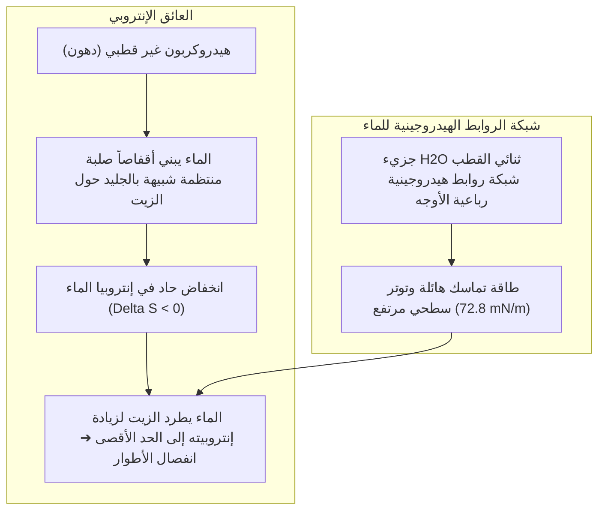
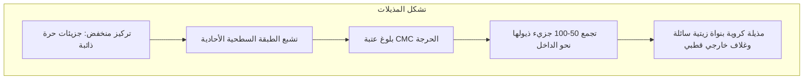

يقف الماء النقي عاجزاً تماماً أمام طبق ملطخ بالدهون المجمدة أو ثوب متشبع بإفرازات العرق والزيوت، حيث تتجمع قطرات الماء وتتدحرج بعيداً تاركة البقع الزيتية ملتصقة بألياف النسيج.

ولكن بمجرد إضافة بضع قطرات من سائل الصابون، تنطلق معجزة فيزيائية كيميائية: يستحلب الماء والزيت المتنافران على الفور إلى سائل حليبي، وتنكمش طبقة الزيت متكورة إلى قطرات كروية متناهية الصغر لتنجرف بسهولة مع تيار الشطف.

منذ ألواح بابل الطينية عام 2500 قبل الميلاد التي سجلت غلي شحوم الحيوانات برماد الخشب لإنتاج أول صابون، كانت هذه التقنية أعظم منقذ لحياة البشرية من الأوبئة متفوقة على المضادات الحيوية.

ومن منظور الفيزياء الجزيئية:
"لماذا يرفض الماء والزيت الامتزاج أصلاً؟"
"ما هي الحيلة الجزيئية التي يستخدمها الصابون للتوفيق بينهما؟"
"هل الرغوة الكثيفة هي التي تنظف الأوساخ أم أنها مجرد وهم حسي؟"
"ولماذا يفشل الصابون التقليدي في المياه العسرة الكلسية؟"

إن التنظيف ليس مجرد فرك ميكانيكي، بل هو <strong>«سيمفونية فيزيائية غروية تحكمها طاقة التنافر الكارهة للماء، والانخفاض الحاد في التوتر السطحي وفق معادلة جيبس، والتنظيم الذاتي التلقائي للمذيلات، وقوى التنافر الكهروستاتيكية للطبقة المزدوجة.»</strong>

---

## 1. ديناميكا التأثير الكاره للماء

لا يوجد تنافر نشط بين الزيت والماء؛ فهناك قوى تشتت فان دير فالس جاذبة بينهما. ويحدث الانفصال لأن <strong>الروابط الهيدروجينية بين جزيئات الماء قوية للغاية لدرجة أنها تطرد الجزيئات الهيدروكربونية غير القطبية بالقوة</strong>.

تبلغ طاقة كل رابطة هيدروجينية حوالي $20\text{ kJ/mol}$. ولكي تحيط جزيئات الماء بالزيت، تضطر إلى تنظيم نفسها في أقفاص بلورية محكمة، مما يفقدها عشوائيتها وحريتها الحركية ($\Delta S < 0$). ولتقليل الطاقة الحرة ($\Delta G = \Delta H - T\Delta S$)، يطرد الماء الزيت نهائياً نحو طور منفصل.

---

## 2. بنية خافض التوتر السطحي ومعادلة جيبس

يمتلك خافض التوتر السطحي (Surfactant) طبيعة <strong>مزدوجة الألفة (Amphiphilic)</strong>:
- <strong>رأس محب للماء (Hydrophilic Head)</strong>: مجموعة قطبية أو متأينة ($-\text{COO}^-$, $-\text{SO}_3^-$) تذوب بقوة في الماء.
- <strong>ذيل كاره للماء (Hydrophobic Tail)</strong>: سلسلة هيدروكربونية دهنية أليفاتية ($C_{12} \sim C_{18}$).

تتجمع الجزيئات تلقائياً عند السطح البيني للماء والهواء لتخفض التوتر السطحي من <strong>$72.8\text{ mN/m}$ إلى ما بين $25 \sim 30\text{ mN/m}$</strong>، مما يتيح للماء اختراق مسام الأقمشة الرقيقة.

---

## 3. التركيز الحرج لتشكل المذيلات (CMC)

عند تشبع السطح، تتجمع الجزيئات الزائدة تلقائياً عند تجاوز <strong>التركيز الحرج لتشكل المذيلات (CMC)</strong> لتشكل كرات نانوية تدعى <strong>المذيلات (Micelles)</strong> بقطر 3 إلى 5 نانومتر:

تبتلع النواة الهيدروكربونية السائلة للمذيلة جزيئات الدهون العالقة وتحبسها بداخلها (الذوبان الغروي).

---

## 4. آلية تكور الزيت (Rolling-up)

بتعديل التوترات البينية، ترتفع زاوية تلامس بقعة الزيت من $0^\circ$ إلى ما يقارب $180^\circ$ (معادلة يونغ).
<strong>تتكور طبقة الزيت إلى قطرات كروية (Rolling-up)</strong>، مما يقلص مساحة التصاقها بالنسيج بأكثر من 90 %. ويفصل تيار الماء القطرات، بينما تحبسها المذيلات، وتمنع <strong>جهود زيتا الكهربائية السالبة ($\zeta \approx -40\text{ mV}$)</strong> إعادة ترسب الأوساخ على القماش.

---

## 5. مشكلة الماء العسر والزيوليت

يرسب الصابون التقليدي مع أيونات الكالسيوم في الماء العسر مشكلاً <strong>أملاحاً كلسية غير قابلة للذوبان (رغوة الصابون الكلسية)</strong>:
$$2\text{C}_{17}\text{H}_{35}\text{COO}^- + \text{Ca}^{2+} \longrightarrow (\text{C}_{17}\text{H}_{35}\text{COO})_2\text{Ca} \downarrow$$
وتتضمن المنظفات الحديثة <strong>الزيوليت 4A</strong>، وهو مبادل أيوني يحبس الكالسيوم وييسر الماء فوراً.

---

## 6. الإنزيمات الحيوية وتأثير مارانجوني

- <strong>الإنزيمات المنظفة</strong>: تفكك البروتياز بقع الدم؛ وتحلل الليباز الشحوم؛ بينما <strong>تقص السليولاز</strong> الألياف المجهرية المتضررة من القطن لتحرير الأوساخ العالقة وإعادة الإشراق للألوان.
- <strong>تأثير مارانجوني</strong>: يعالج الغشاء الفقاعي نفسه تلقائياً عند ترققه عبر تدفق السائل بفعل تدرج التوتر السطحي، مما يساعد على تعويم الأوساخ نحو السطح.

---

## 7. خاتمة

إن الصابون تجسيد بارع لكيمياء الغرويات التي استثمرت قوانين الديناميكا الحرارية لبناء أعظم درع صحي حمى الوجود البشري عبر العصور.
