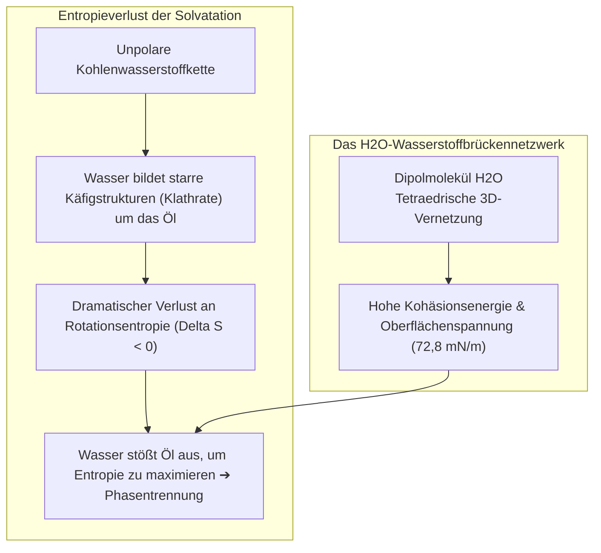

Ein Teller voller erstarrtem Bratfett oder ein mit Schmutz und Hauttalg verkrustetes Kleidungsstück widersteht reinem Wasser völlig. Das Wasser perlt ab, während die fettige Verunreinigung fest an den Fasern haftet.

Wenige Tropfen Spülmittel oder Seifenschaum genügen jedoch, um das Wunder zu vollbringen: Das feindliche Gemenge aus Wasser und Öl emulgiert milchig weiß, die Fettschicht rollt sich zu winzigen Kügelchen zusammen und wird mühelos fortgespült.

Seit den Babyloniern vor 4.500 Jahren ist Seife eine der wirkungsvollsten Technologien der Menschheit. Epidemiologisch hat die Etablierung des Händewaschens mit Seife mehr Leben gerettet als alle Antibiotika zusammen.

Doch physikalisch stellt sich die Frage:
"Warum mischen sich Wasser und Öl eigentlich nicht?"
"Mit welchem molekularen Trick überwindet die Seife diesen Widerstand?"
"Reinigt der Schaum tatsächlich die Wäsche, oder ist er eine Illusion?"
"Warum versagt Seife in kalkhaltigem hartem Wasser völlig?"

Waschen ist kein simples mechanisches Scheuern. Es ist <strong>„ein thermodynamisches Zusammenspiel aus entropiegetriebenem hydrophobem Effekt, drastischer Reduktion der Grenzflächenspannung, supramolekularer Selbstorganisation von Mizellen und elektrostatischen Doppelschichtkräften.“</strong>

---

## 1. Die Thermodynamik des hydrophoben Effekts

Wasser und Öl stoßen sich nicht aktiv ab; zwischen Alkanmolekülen und Wasser wirken durchaus Van-der-Waals-Kräfte. Die Phasentrennung geschieht, weil <strong>die Wasserstoffbrückenbindungen zwischen den Wassermolekülen derart energiereich sind, dass unpolare Moleküle rabiat verdrängt werden</strong>.

Jede Wasserstoffbrücke besitzt ca. $20\text{ kJ/mol}$. Um ein unpolares Ölmolekül herum müssen sich Wassermoleküle in starren eisähnlichen Klathrat-Käfigen anordnen. Dieser Entropieverlust ($\Delta S < 0$) treibt die freie Enthalpie $\Delta G > 0$ nach oben. Um die Entropie zu maximieren, scheidet das Wasser die Ölphase vollständig ab.

---

## 2. Die Architektur der Tenside: Amphiphile Vermittler

Tenside besitzen eine doppelte Natur:
- <strong>Hydrophiler Kopf</strong>: Polare oder geladene Gruppe ($-\text{COO}^-$, $-\text{SO}_3^-$), hochgradig wasserlöslich.
- <strong>Hydrophober Schwanz</strong>: Unpolare aliphatische Kohlenwasserstoffkette ($C_{12} \sim C_{18}$).

### Gibbs-Adsorptionsisotherme und Grenzflächenspannung
Tenside reichern sich spontan an der Phasenboundary Luft/Wasser an, wobei die Köpfe ins Wasser und die Schwänze nach außen ragen. Sie schwächen die Brückenbindung des Wassers drastisch und senken die Oberflächenspannung von <strong>$72,8\text{ mN/m}$ auf $25 \sim 30\text{ mN/m}$</strong>. Die Waschlauge kann nun in feinste Textilporen vordringen.

---

## 3. Die Kritische Mizellbildungskonzentration (CMC)

Ist die Oberfläche gesättigt, organisieren sich Tenside ab der <strong>CMC (Critical Micelle Concentration)</strong> zu sphärischen <strong>Mizellen</strong> (3 bis 5 nm Durchmesser):

Im Inneren der Mizelle entsteht ein flüssiger Kohlenwasserstoffkern. Ab der CMC steigt das <strong>Fettlösevermögen (Solubilisation)</strong> der Waschlauge linear an.

---

## 4. Der Waschprozess: Das Rolling-up-Phänomen

Durch die Adsorption der Tenside an den Grenzflächen Faser/Wasser und Öl/Wasser ändert sich der Benetzungswinkel $\theta$ nach der Youngschen Gleichung von $0^\circ$ auf nahezu $180^\circ$.
Der flache Ölfilm <strong>rollt sich zu kugelförmigen Tröpfchen zusammen (Rolling-up-Effekt)</strong>, wodurch die Kontaktfläche zur Faser um über 90 % schrumpft. Strömungsscherkräfte reißen die Tropfen ab, Mizellen nehmen das Fett auf, und negative <strong>Zeta-Potentiale ($\zeta \approx -40\text{ mV}$)</strong> verhindern elektrostatisch die Wiederanlagerung.

---

## 5. Hartes Wasser und Zeolith-Builder

Traditionelle Seife (Natriumstearat) fällt in hartem, calciumhaltigem Wasser als unlösliche <strong>Kalkseife</strong> aus:
$$2\text{C}_{17}\text{H}_{35}\text{COO}^- + \text{Ca}^{2+} \longrightarrow (\text{C}_{17}\text{H}_{35}\text{COO})_2\text{Ca} \downarrow$$
Moderne Waschmittel enthalten <strong>Zeolith A</strong>, das Calciumionen im Kristallgitter bindet und das Wasser sekundenschnell enthärtet.

---

## 6. Enzyme und der Marangoni-Schaumeffekt

- <strong>Bio-Enzyme</strong>: Proteasen zersetzen Eiweiß; Lipasen spalten Fette; und <strong>Cellulasen</strong> rasieren gezielt mikroskopisch abstehende Baumwollfibrillen ab, um festsitzende Pigmente freizusetzen und vergraute Wäsche wieder erstrahlen zu lassen.
- <strong>Marangoni-Effekt</strong>: Dehnt sich ein Schaumbläschen lokal aus, sinkt die Tensidkonzentration, die Oberflächenspannung steigt sprunghaft an, und Flüssigkeit strömt zur Reparatur zurück. Schaum reinigt nicht primär, schützt aber empfindliche Textilien und transportiert Schmutz an die Oberfläche.

---

## 7. Fazit

Tenside sind die Meister der Grenzfläche, die mit den Gesetzen der molekularen Thermodynamik die Brücke zwischen den verfeindeten Welten von Wasser und Öl schlagen.
