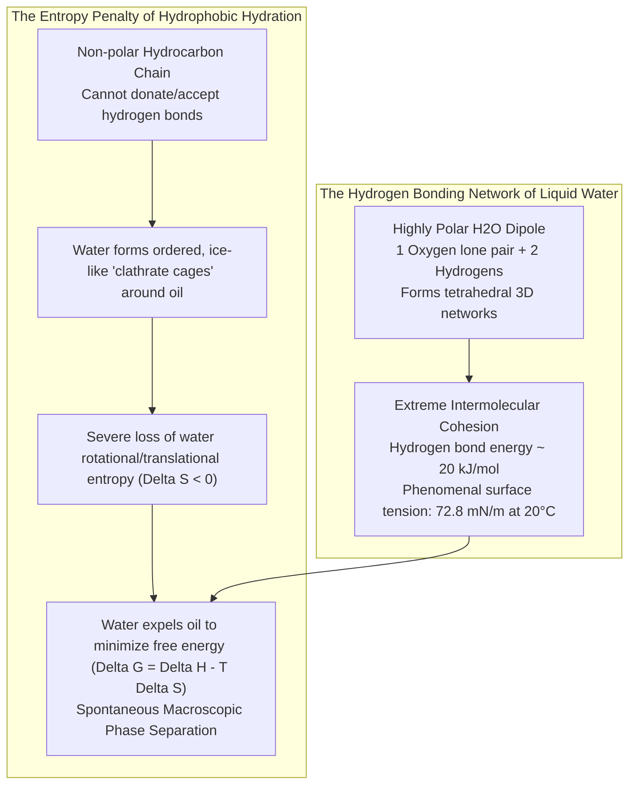
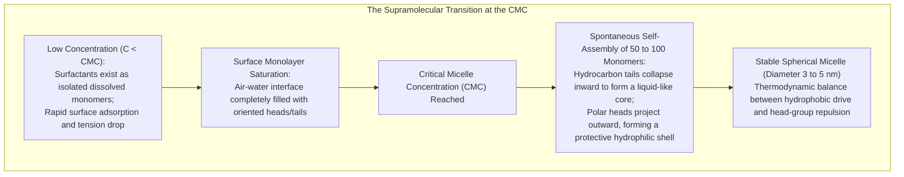
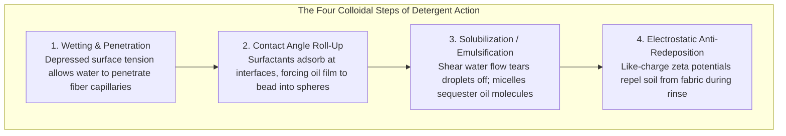
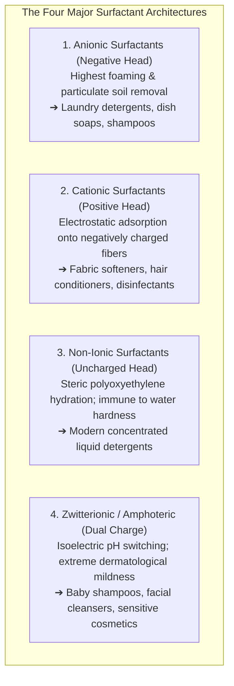
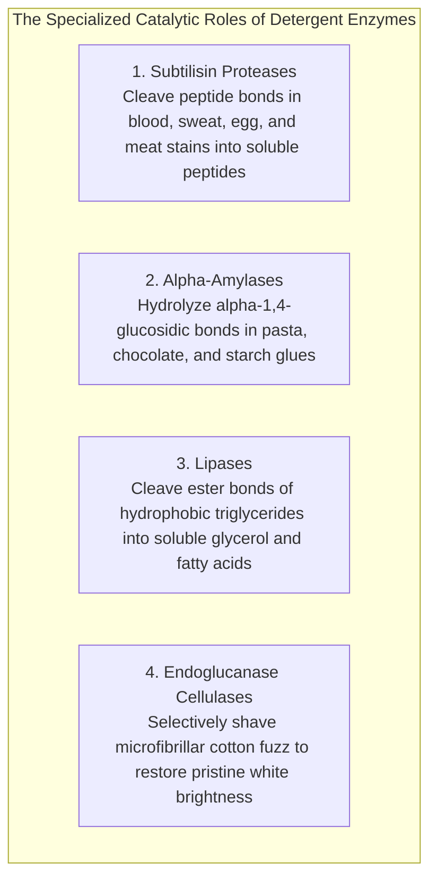
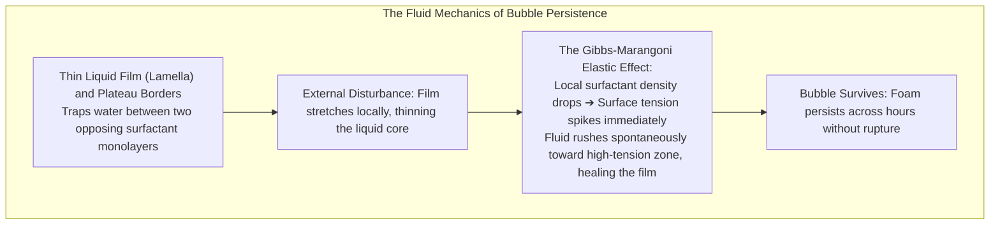
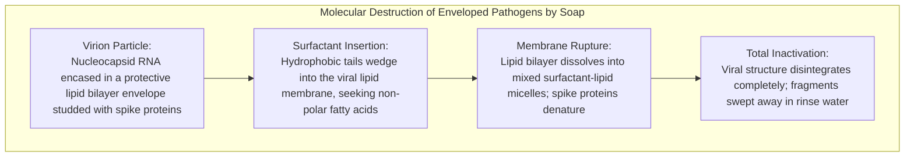

A porcelain plate coated in solidified animal fat or an apron deeply stained with motor oil and sebum defies all attempts at water washing. Water beads up, rolls harmlessly over the greasy film, and leaves the hydrophobic grime firmly anchored to the substrate.

Yet, introduce merely a few drops of dishwashing liquid or a lather of traditional soap, and a macroscopic miracle unfolds. The mutually antagonistic worlds of water and oil instantaneously emulsify into a milky, turbid suspension. The stubborn grease film rolls up into microscopic beads, detaches from the solid surface, and is effortlessly swept away in the rinse stream, leaving the plate squeaky clean.

From the ancient Babylonian cuneiform tablets dating back to 2500 BCE—recording the boiling of animal fats with alkaline wood ash—to modern automated laundry detergents packed with genetically engineered enzymes, soap represents one of humanity's earliest and most transformative chemical technologies. Epidemiologists widely recognize that the simple act of routine handwashing with soap has saved vastly more human lives than penicillin, vaccination, and modern surgical intervention combined.

Yet, viewed through the lens of fundamental molecular thermodynamics:
"Why do water and oil refuse to mix in the first place?"
"What physical and thermodynamic mechanism allows a surfactant to force these two immiscible phases into mutual harmony?"
"Does the thick, billowing foam in a washing machine actually perform any cleaning, or is it an aesthetic illusion?"
"And why does soap completely lose its lather and leave greasy grey residues in regions with limestone-filtered hard water?"

Detergency is emphatically not the mechanical abrasive scrubbing of dirt from a surface. It is <strong>"an exquisite thermodynamic and colloidal choreography governed by entropy-driven hydrophobic exclusion, drastic interfacial tension reduction, the spontaneous self-assembly of supramolecular micelles, contact angle rolling-up kinetics, and electrostatic double-layer repulsion."</strong>

This comprehensive treatise dissects the science of detergency: from the molecular origins of the hydrophobic effect and Gibbs adsorption isotherms to Critical Micelle Concentrations (CMC), rolling-up mechanics, hard-water precipitation reactions, the synthetic evolution of anionic, cationic, non-ionic, and zwitterionic surfactants, enzyme-catalyzed macromolecular degradation, and the fluid dynamics of foam stability via the Marangoni effect.

---

## 1. The Myth of "Water Hates Oil": The True Physics of Hydrophobic Exclusion

Popular culture often asserts that "water and oil repel each other." From the perspective of quantum chemistry and intermolecular physics, this statement is <strong>factually incorrect</strong>.

Hydrocarbon oil molecules and water molecules actually exert mutual attractive forces via short-range London dispersion interactions. If an isolated water molecule is placed next to an isolated methane molecule in a vacuum, they experience a net attractive potential.

The reason water and oil phase-separate spontaneously is not that oil repels water, but that <strong>water molecules attract one another with such ferocious energetic intensity that non-polar oil molecules are forcefully excluded from the aqueous network.</strong>



### 1.1 The Thermodynamic Hydrophobic Effect
A single water molecule ($\text{H}_2\text{O}$) possesses a large permanent dipole moment ($\approx 1.85\text{ Debye}$). Because oxygen is far more electronegative than hydrogen, the electron density is polarized toward the oxygen atom, leaving partial negative charges on oxygen and partial positive charges on hydrogen. In bulk water, each molecule participates in up to four directional <strong>hydrogen bonds</strong> ($\approx 20\text{ kJ/mol}$ each), creating a fluctuating, dynamic three-dimensional lattice. This extraordinary cohesion gives water its abnormally high boiling point and its colossal surface tension of <strong>$72.8\text{ mN/m}$ at $20^\circ\text{C}$</strong> (exceeded among liquids only by liquid metals like mercury).

When an oil molecule (such as a long-chain triglyceride or alkane) is introduced into water, it cannot engage in hydrogen bonding. To accommodate this non-polar intruder, surrounding water molecules must reorganize, orienting their unfulfilled hydrogen bonds tangentially around the solute. This forms a rigid, highly ordered, ice-like solvation shell termed a <strong>clathrate cage</strong>.

While the enthalpy change ($\Delta H$) of this solvation may be modest, the ordering of water molecules imposes a catastrophic penalty on the system's configurational entropy ($\Delta S < 0$). According to the second law of thermodynamics:

$$\Delta G = \Delta H - T\Delta S$$

Because the $-T\Delta S$ term is strongly positive at room temperature, the total Gibbs free energy of mixing is positive ($\Delta G > 0$), rendering dissolution thermodynamically non-spontaneous.
To minimize the total interfacial surface area of these entropically costly clathrate cages, water molecules squeeze the non-polar oil molecules together, expelling them into a distinct, separate oil phase. This entropy-driven exclusion is the <strong>Hydrophobic Effect</strong>.

---

## 2. Molecular Architecture of Surfactants: The Amphiphilic Mediator

To reconcile these two incompatible thermodynamic realms, chemists deploy <strong>Surfactants (Surface Active Agents)</strong>. The defining characteristic of every surfactant molecule is its <strong>amphiphilic</strong> (or amphipathic) structural duality:

```
Schematic Architecture of a Surfactant Monomer:

        Hydrophilic "Head" (Polar / Water-Loving)
              ┌─────────┐
              │    ●    │ ── Ionic group (-COO-, -SO4-, -N+(CH3)3) or polyoxyethylene
              └─────────┘
                   │
                   │
                   │ ─── Hydrophobic "Tail" (Non-Polar / Lipophilic)
                   │     Long aliphatic hydrocarbon chain (typically C12 to C18)
                   │
```

1. <strong>Hydrophilic Polar Head</strong>: Highly soluble in water via electrostatic charge hydration or dense hydrogen bonding networks. Typical examples include carboxylates ($-\text{COO}^-$), sulfates ($-\text{OSO}_3^-$), sulfonates ($-\text{SO}_3^-$), or polyethylene glycol oligomers.
2. <strong>Hydrophobic Non-Polar Tail</strong>: An extended aliphatic hydrocarbon chain (typically 12 to 18 carbon atoms in length, such as dodecyl or stearyl moieties) that matches the non-polar character of oils, fats, and greases.

### 2.1 The Gibbs Adsorption Isotherm and Interfacial Tension Depletion
When added to pure water at low concentrations, surfactant monomers find themselves in an energetically hostile environment. Their hydrophobic hydrocarbon tails disrupt the surrounding water lattice, inducing an entropic penalty.

Consequently, surfactant molecules spontaneously migrate (adsorb) to the phase boundaries of the solution—primarily the liquid-air surface and the container walls. They orient themselves strictly: immersing their hydrophilic polar heads into the bulk water while projecting their oily hydrocarbon tails outward into the gaseous air or onto solid interfaces.

As surfactants pack tightly across the surface, they displace water molecules from the surface layer. The intense intermolecular hydrogen bonding pulling water molecules downward into the bulk is physically interrupted. As a result, the surface tension of the water plummets from <strong>$72.8\text{ mN/m}$ to below $25 \sim 30\text{ mN/m}$</strong>.

This behavior is mathematically quantified by the <strong>Gibbs Adsorption Isotherm</strong>:

$$\Gamma = -\frac{1}{RT} \left( \frac{d\gamma}{d \ln a} \right) \approx -\frac{C}{RT} \left( \frac{d\gamma}{dC} \right)$$

where:
- $\Gamma$ = Surface excess concentration (moles of surfactant adsorbed per unit area)
- $\gamma$ = Surface tension of the liquid
- $C$ = Bulk surfactant solute concentration
- $R$ = Universal gas constant; $T$ = Absolute temperature

Because the slope $d\gamma/dC$ is strongly negative, the surface excess $\Gamma$ is positive: surfactants relentlessly crowd the interface until the surface is completely saturated with a closely packed, vertically oriented <strong>monomolecular monolayer</strong>.

---

## 3. The Thermodynamics of Micellization: The Critical Micelle Concentration (CMC)

Once the liquid-air interface and container boundaries become entirely saturated with surfactant monomers, a thermodynamic crisis occurs. The bulk aqueous solution can no longer dissolve additional non-polar hydrocarbon tails without incurring prohibitive entropic penalties.

At this precise concentration threshold, nature triggers a spontaneous supramolecular self-assembly: <strong>Micellization</strong>.



The concentration at which micelle formation initiates is defined as the <strong>Critical Micelle Concentration (CMC)</strong>.
Inside a classical spherical micelle:
- 50 to 100 surfactant monomers cluster into a nanoscale sphere measuring $3 \sim 5\text{ nanometers}$ in diameter.
- The interior <strong>core</strong> consists of an entirely non-polar, dry, liquid-like droplet of intertwined hydrocarbon tails, completely shielded from contact with water.
- The exterior <strong>corona</strong> consists of hydrated polar heads exposed to bulk water, screening the oily core and stabilizing the aggregate through steric or electrostatic repulsion.

```
Macroscopic Physical Properties as a Function of Surfactant Concentration:
  Property Value
   ^
   |  Surface Tension (gamma)
   |  ──────┐
   |         \
   |          \___________ Constant minimum (approx. 28 mN/m)
   |
   |                                 / Osmotic Pressure
   |                     ___________/
   |                    /
   |  Solubilization   /
   |  Capacity (Detergency)
   |  ─────────────────┴────────────────────────> Surfactant Concentration (C)
                      CMC (Critical Micelle Concentration)
```

As illustrated in the classic physical property spectrum above:
- <strong>Below the CMC</strong>: Surface tension drops precipitously, but detergent cleaning efficacy is virtually nil because there are no micelles to solubilize bulk grease.
- <strong>Above the CMC</strong>: Surface tension reaches an asymptotic floor and ceases to decrease. Any additional surfactant introduced into the water contributes solely to the generation of new micelles. Consequently, <strong>the capacity of the bath to dissolve and extract oily grime surges linearly with concentration above the CMC</strong>.

---

## 4. The Four Pillars of the Washing Cycle: How Soil is Eradicated

When an oily, greasy stain adheres to textile fibers, removing it requires a sequence of four discrete physical and colloidal events: <strong>Wetting, Rolling-up, Solubilization/Emulsification, and Anti-redeposition</strong>.



### 4.1 Contact Angle Inversion: The "Rolling-Up" Mechanism
In dry air or pure water, a droplet of liquid sebum or vegetable oil spreads flat across a solid fabric substrate, exhibiting a small contact angle ($\theta \approx 0^\circ$). The oil film adheres through widespread van der Waals forces.

When surfactant solution surrounds this system, surfactant monomers simultaneously adsorb onto three distinct interfaces:
1. The <strong>Water-Oil</strong> interface, reducing $\gamma_{\text{WO}}$.
2. The <strong>Water-Solid (Fabric)</strong> interface, reducing $\gamma_{\text{WS}}$.
3. The <strong>Oil-Solid</strong> interface, where surfactant tails penetrate the periphery of the contact line.

The thermodynamic equilibrium of the three-phase contact line is governed by Young's relation adapted for a liquid-liquid-solid system:

$$\cos \theta_{\text{oil}} = \frac{\gamma_{\text{WS}} - \gamma_{\text{OS}}}{\gamma_{\text{WO}}}$$

Because surfactant adsorption drastically slashes the solid-water tension $\gamma_{\text{WS}}$ and water-oil tension $\gamma_{\text{WO}}$, the thermodynamic balance forces the contact angle $\theta_{\text{oil}}$ to increase violently from $0^\circ \rightarrow 90^\circ \rightarrow 180^\circ$.

Under this energetic driving force, <strong>the flat oil slick physically recoils, contracting and beading up into a spherical droplet</strong>. Its microscopic contact area with the solid fiber contracts by more than 95%. In this detached "rolled-up" state, the droplet is held to the substrate only by a precarious microscopic neck, easily sheared off by the mild mechanical agitation of the washing machine's agitator or tumbling drum.

### 4.2 Solubilization and Microemulsification
Once the sheared oil droplet detaches into the bulk wash liquor, it is instantly engulfed by surrounding surfactant micelles.
Individual triglyceride or fatty acid molecules dissolve directly into the liquid hydrocarbon cores of the micelles—a process called <strong>Solubilization</strong>. Larger oil droplets are stabilized by a dense surface shell of surfactant monomers, creating a kinetically stable oil-in-water (O/W) emulsion that prevents droplets from coalescing back into a continuous oil layer.

### 4.3 Zeta Potential ($\zeta$) and the Prevention of Soil Redeposition
A critical failure mode in laundry science is <strong>soil redeposition</strong>: particulate dirt (clay, soot, carbon black) and emulsified oil droplets settling back onto clean fabric during the rinse cycle, causing progressive graying of white garments.

Modern detergents prevent redeposition via <strong>Electrostatic and Steric Double-Layer Repulsion</strong>.
Anionic surfactants coat both the suspended soil particles and the cotton fibers with a dense brush of negative charges ($-\text{SO}_3^-$ or $-\text{COO}^-$). This establishes a high negative <strong>Zeta Potential ($\zeta \approx -30\text{ to } -60\text{ mV}$)</strong> on all surfaces. According to DLVO colloidal theory, when a soil particle approaches a fiber, their overlapping electrostatic double layers generate a repulsive Coulombic energy barrier ($V_R$), keeping the grime suspended in the wash liquor until it is drained.

---

## 5. The Hard Water Conundrum: Scum Chemistry and Zeolite Builders

Traditional soaps—manufactured by saponifying natural triglycerides with sodium hydroxide ($\text{NaOH}$)—are essentially <strong>sodium salts of long-chain fatty acids</strong> (predominantly sodium stearate $\text{C}_{17}\text{H}_{35}\text{COONa}$ and sodium oleate). While environmentally benign and non-toxic, traditional soap suffers from a catastrophic Achilles' heel: <strong>Hard Water</strong>.

```mermaid
flowchart TD
    subgraph HardWaterPrecipitation ["The Chemical Deactivation of Soap in Hard Water"]
        SolubleSoap["Soluble Soap Monomers<br>2 C17H35COO- + 2 Na+"]
        HardWaterIons["Hard Water Mineral Ions<br>Dissolved Ca2+ and Mg2+ cations"]
        InsolubleScum["Insoluble Calcium Stearate (Soap Scum)<br>(C17H35COO)2Ca ↓ Insoluble Sticky Precipitate"]
        
        SolubleSoap + HardWaterIons --> InsolubleScum
    end
```

### 5.1 The Formation of Metal Soaps (Scum)
In geological regions underlain by chalk, limestone, or dolomite (prevalent across Europe, the American Midwest, and continental Asia), groundwater dissolves significant concentrations of divalent alkaline earth cations: <strong>Calcium ($\text{Ca}^{2+}$)</strong> and <strong>Magnesium ($\text{Mg}^{2+}$)</strong>.

When standard soap is dissolved in hard water, the divalent $\text{Ca}^{2+}$ ions exhibit a thermodynamic affinity for carboxylate anions ($-\text{COO}^-$) that far exceeds that of univalent $\text{Na}^+$ ions. Two fatty acid chains coordinate stoichiometrically with each calcium cation, neutralizing its charge and precipitating an insoluble, waxy, curdy solid known as <strong>Calcium Stearate (Soap Scum)</strong>:

$$2\text{C}_{17}\text{H}_{35}\text{COO}^- (\text{aq}) + \text{Ca}^{2+} (\text{aq}) \longrightarrow (\text{C}_{17}\text{H}_{35}\text{COO})_2\text{Ca} (\text{s}) \downarrow$$

Until every single $\text{Ca}^{2+}$ and $\text{Mg}^{2+}$ ion in the wash water is fully precipitated, <strong>traditional soap cannot form micelles, cannot lower surface tension, and cannot produce a lather</strong>.
Worse, the precipitated scum is a sticky, hydrophobic paste that deposits onto clothing fibers (causing stiffness and rancid odors) and coats bathtub walls with stubborn lime rings.

### 5.2 The Synthetic Revolution: Sulfonates and Zeolite Builders
To circumvent this limitation, 20th-century chemical industry introduced two radical innovations:
1. <strong>Synthetic Alkylbenzene Sulfonates (LAS)</strong>: Surfactants bearing a sulfonate group ($-\text{SO}_3^-$) instead of a carboxylate ($-\text{COO}^-$). Calcium alkylbenzene sulfonates remain highly water-soluble, functioning unhindered in hard water.
2. <strong>Inorganic Builders (Zeolite A)</strong>: Powdered laundry detergents incorporate up to 30% by weight of <strong>Zeolite A (synthetic aluminosilicate)</strong> and sodium citrate. Zeolite A possesses an open, cage-like crystal lattice with pore apertures calibrated to approximately $4.2\text{ Angstroms}$. As water enters the machine, the zeolite lattice traps $\text{Ca}^{2+}$ ions, exchanging them for benign $\text{Na}^+$ ions:
$$\text{Zeolite-Na}_2 + \text{Ca}^{2+} \rightleftharpoons \text{Zeolite-Ca} + 2\text{Na}^+$$
By sequestering hard minerals within seconds, builders artificially soften the wash water in-situ, clearing the stage for surfactants to operate at peak thermodynamic efficiency.

---

## 6. The Taxonomy of Modern Surfactants

Industrial detergency deploys four distinct classes of surfactants, categorized by the electrical charge of their hydrophilic head groups:



### 6.1 Anionic Surfactants
- <strong>Dominant Chemistries</strong>: Linear Alkylbenzene Sulfonates (LAS), Sodium Lauryl Ether Sulfate (SLES), Alcohol Ethoxy Sulfates (AES).
- <strong>Properties</strong>: Dissociate in water to yield an amphiphilic anion and a metal counterion ($\text{Na}^+$). They generate voluminous, stable foams and excel at lifting particulate soils, clays, and heavy grease. They constitute the primary workhorse of global laundry and dishwashing products.

### 6.2 Cationic Surfactants
- <strong>Dominant Chemistries</strong>: Dialkyldimethylammonium chloride, Esterquats (quaternary ammonium salts).
- <strong>Properties</strong>: Bear a permanent positive charge on a central nitrogen atom. Because natural fabrics (cotton, wool) and human hair develop a negative surface charge in water, cationic surfactants adsorb electrostatically onto fibers, orienting their oily hydrocarbon tails outward. This creates a lubricated, hydrophobic monolayer that neutralizes static cling and imparts silky tactile softness. Consequently, cationics are <strong>never used as cleaning detergents, but as fabric softeners and hair conditioners</strong>. Furthermore, their positive charge disrupts bacterial membranes, serving as potent biocides.

### 6.3 Non-Ionic Surfactants
- <strong>Dominant Chemistries</strong>: Alcohol Ethoxylates (AEO), Alkyl Polyglucosides (APG).
- <strong>Properties</strong>: Do not ionize in aqueous solution. Hydrophilicity is conferred by long, uncharged polyoxyethylene chains ($-\text{(CH}_2\text{CH}_2\text{O)}_n\text{H}$) that form extensive hydrogen bonds with water molecules. Because they carry zero net charge, they are completely immune to precipitation by hard water cations ($\text{Ca}^{2+}, \text{Mg}^{2+}$) and dissolve oily sebum at room temperature far more efficiently than anionics. They form the backbone of modern <strong>compact, low-foam, concentrated liquid detergents</strong>.

### 6.4 Amphoteric (Zwitterionic) Surfactants
- <strong>Dominant Chemistries</strong>: Cocamidopropyl betaine (CAPB), alkyl amine oxides.
- <strong>Properties</strong>: Possess both a basic cationic center (quaternary nitrogen) and an acidic anionic center (carboxylate or sulfonate) within the identical molecule. Their net charge shifts dynamically with solution pH. They exhibit exceptional dermatological compatibility, dramatically attenuating the skin-irritation potential of harsher anionic surfactants in baby formulas and premium body washes.

---

## 7. Bio-Catalytic Washing: The Multi-Enzyme Revolution

Surfactants excel at displacing low-molecular-weight oils through interfacial tension reduction. However, when complex biopolymers—such as denatured egg albumin, blood hemoglobin, starch gravies, or cocoa—dry onto textile fibers, they cross-link into insoluble, glue-like crusts that resist surfactant penetration.

To eliminate these stubborn biological stains without resorting to boiling water or corrosive caustic soda, modern detergents incorporate genetically optimized <strong>Enzymes</strong>.



### The Ingenious Mechanism of Cellulase: Shaving Cotton Fibers
Among all cleaning enzymes, <strong>Cellulase</strong> operates via a mechanism of exceptional elegance. Cellulase does not attack the stain directly; <strong>it attacks the cotton fabric itself</strong>.

Cotton fibers consist of crystalline cellulose polymers. Over cycles of wear and washing, mechanical abrasion shears the outer surface of cotton yarns, generating millions of microscopic, frayed fuzz hairs called <strong>microfibrils</strong>. These disordered microfibrils trap particulate soot, clay, and oxidized sebum in their tangles, casting a permanent grayish-yellow haze over the garment.

Detergent cellulases are calibrated endoglucanases engineered to digest only disordered, amorphous cellulose while leaving the load-bearing crystalline core of the yarn untouched. The enzyme functions as a molecular razor: <strong>it cleanly snips off the dirty, frayed microfibrils, liberating the trapped soil into the wash water</strong>. By restoring the smooth, flat optical surface of the cotton fibers, light reflects specularly once more, causing faded colors to regain their original vibrancy and white garments to appear brilliantly renewed.

---

## 8. Foam Dynamics and the Marangoni Effect: Is Lather Truly Necessary?

In the consumer mind, an immovable psychological association exists between rich, dense foam and superior cleaning efficacy. Yet in interfacial physical chemistry, the verdict is unambiguous: <strong>Foam contributes virtually nothing to the primary thermodynamic removal of grease and dirt.</strong>

In industrial tunnel washers, high-speed commercial dishwashers, and modern front-loading drum washing machines, excessive foam is an operational hazard: it cushions the mechanical drop of garments, dampens fluid shearing forces, and can trigger pump cavitation. Consequently, industrial detergents are deliberately engineered with <strong>polydimethylsiloxane (silicone) antifoaming agents</strong> that suppress bubble formation entirely.



### 8.1 The Gibbs-Marangoni Self-Healing Membrane
Why does soapy water form billowing foam that endures for hours, while pure water cannot maintain a bubble for a single second?
The stability of a foam bubble is sustained by the <strong>Gibbs-Marangoni Effect</strong>.

A foam bubble consists of a thin aqueous liquid core bounded on both sides by surfactant monolayers (a <strong>lamella</strong>). When mechanical vibrations or gravity pull water downward, the lamella stretches locally, threatening to rupture.
At the point of stretching, the surface area expands faster than surfactant can diffuse from the bulk, causing the local surfactant concentration ($\Gamma$) to drop instantaneously.

According to the Gibbs equation, this drop in surfactant density causes the local surface tension ($\gamma$) to spike sharply. Fluid dynamics dictates that liquid always flows spontaneously from regions of low surface tension toward regions of high surface tension.
Consequently, <strong>water and surfactant from the surrounding, thicker regions of the bubble rush back into the stretched zone, pulling liquid with them and actively restoring the film thickness</strong>. This Marangoni surface elasticity acts as a self-healing kinetic barrier, preserving bubbles against premature drainage.

### 8.2 The Pragmatic Utility of Foam
While foam does not clean at the molecular scale, it serves three valuable physical functions:
1. <strong>Particulate Flotation (Froth Flotation)</strong>: The colossal interfacial area of foam bubbles traps suspended insoluble carbon and clay particles, floating them upward to the water surface and preventing them from settling back onto submerged fabrics.
2. <strong>Vertical Surface Cling</strong>: In oven cleaners and bathroom degreasers, thick foam clings to vertical tiles and range hoods, preventing the chemical solution from draining away and buying vital residence time for surfactants and alkalis to dissolve heavy grease.
3. <strong>Mechanical Damping</strong>: In shaving creams and facial foams, dense lather functions as a protective viscoelastic cushion, distributing razor blade pressure and minimizing friction against the epidermal stratum corneum.

---

## 9. Thermal Phase Boundaries: The Krafft Temperature and Cloud Point

Temperature dictates the phase behavior of surfactants in aqueous solution, defining precise thermodynamic boundaries for cleaning performance.

### 9.1 The Krafft Temperature ($T_k$) of Ionic Surfactants
For any ionic surfactant, the solubility in water remains extremely low until a critical temperature is reached, beyond which solubility suddenly shoots upward almost vertically. This threshold is the <strong>Krafft Temperature ($T_k$)</strong>.

Below $T_k$, the surfactant exists as a crystalline solid precipitate or hydrated crystal; its monomer solubility is lower than its Critical Micelle Concentration. Therefore, <strong>below the Krafft temperature, micelles cannot form, and the detergent exhibits near-zero cleaning or foaming action</strong>. Once the wash water is warmed past $T_k$, the solubility curve intersects the CMC curve, unleashing a torrent of micelles and instantaneous cleaning power. This explains why washing greasy dishes in icy winter tap water is frustratingly futile.

### 9.2 The Cloud Point ($T_c$) of Non-Ionic Surfactants
Non-ionic polyoxyethylene surfactants display the exact reverse thermal behavior. Because they dissolve via hydrogen bonding between ether oxygens and water, elevating the temperature increases thermal agitation, breaking these hydrogen bonds and dehydrating the polar heads.

At a specific threshold called the <strong>Cloud Point ($T_c$)</strong>, the surfactant dehydrates so extensively that it loses solubility, precipitating out of solution as macroscopic droplets that turn the liquid cloudy.
Fascinatingly, <strong>in the narrow temperature window immediately preceding the Cloud Point</strong>, the surfactant reaches a state of optimal interfacial balance—achieving ultra-low interfacial tensions ($\gamma < 10^{-3}\text{ mN/m}$) that enable near-instantaneous solubilization of heavy industrial oils.

---

## 10. The Molecular Biocide: How Soap Obliterates Enveloped Viruses

During the global COVID-19 pandemic, global health authorities unanimously advocated a deceptively humble intervention as humanity's primary line of defense: <strong>washing hands thoroughly with ordinary soap and water for 20 seconds</strong>.

Why does simple soap inactivate viruses like SARS-CoV-2 and Influenza with an efficacy rivaling medical-grade disinfectants?



Coronaviruses, Influenza, HIV, and Ebola are <strong>enveloped viruses</strong>. Their infectious genetic material (RNA) is protected inside a self-assembled <strong>lipid bilayer membrane</strong> derived from the host cell, studded with glycoprotein spikes that latch onto human cellular receptors (such as ACE2).

When hands are lathered with soap:
1. <strong>Membrane Penetration</strong>: The hydrophobic tails of surfactant monomers, driven by the hydrophobic effect, aggressively wedge themselves into the viral lipid bilayer, mimicking natural membrane lipids.
2. <strong>Structural Dissolution</strong>: As surfactant concentration surpasses the membrane disruption threshold, the lipid envelope dissolves into mixed lipid-surfactant micelles.
3. <strong>Protein Inactivation</strong>: Stripped of its structural membrane, the viral core ruptures. The surfactant denatures the spike proteins, permanently abolishing their ability to bind human cells.
4. <strong>Physical Removal</strong>: The running tap water rinses the harmless molecular debris off the skin surface and down the drain.

Unlike antibiotics—which bacteria can evade through evolutionary resistance—soap operates via <strong>uncompromising physical-chemical membrane disruption</strong>, an evolutionary trap that enveloped viruses cannot bypass without abandoning their biological lipid structure entirely.

---

## 11. Conclusion: The Masterwork of the Invisible Mediator

Between the authoritarian polarity of water and the stubborn non-polar solitude of oil, surfactants stand as the supreme peacemakers of the material world.

From the animal fats of ancient Babylon to modern bio-engineered enzymes, detergent chemistry reflects humanity's deep intellectual mastery of nature's fundamental physical forces.

Whenever we lather soap in our hands, amidst the shimmering iridescence of microscopic foam, we are witnessing the silent, triumphant spectacle of interfacial thermodynamics: trillions of molecular mediators coordinating van der Waals forces, manipulating hydrogen bonds, and marshaling entropy to cleanse, protect, and sustain modern human civilization.
