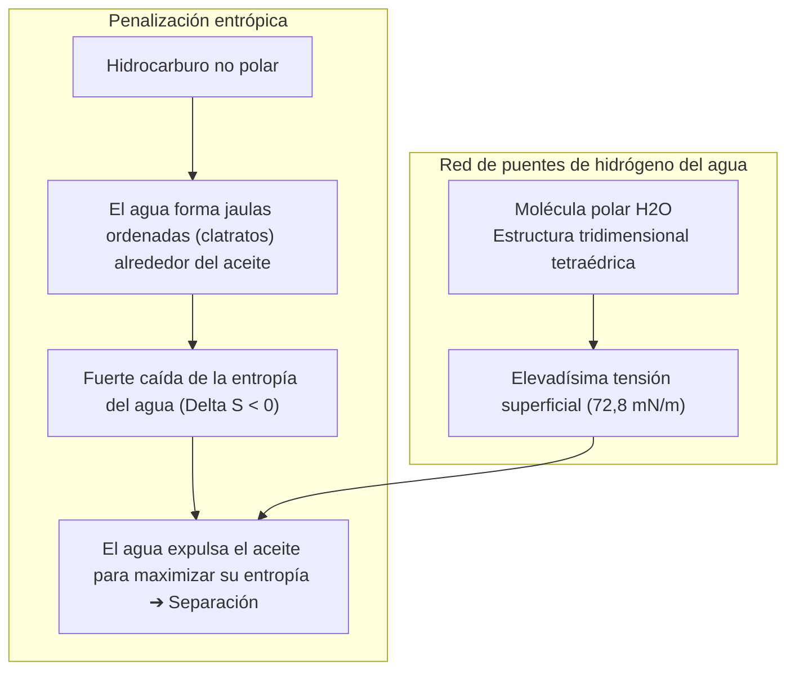
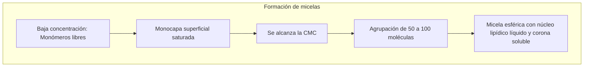

Un plato cubierto de grasa animal endurecida o una prenda manchada de sebo y barro resiste cualquier lavado con agua pura. El agua resbala en gotas esféricas sin disolver la película grasosa adherida al sustrato.

Sin embargo, basta aplicar unas gotas de jabón para desencadenar una asombrosa transformación: el agua y el aceite se emulsionan en un líquido blanquecino, la grasa se enrolla en microgotas esféricas y se desprende sin esfuerzo con el agua de enjuague.

Desde las tablillas babilónicas de arcilla del año 2500 a. C. hasta los detergentes enzimáticos contemporáneos, el jabón ha salvado más vidas humanas mediante el lavado de manos que todos los antibióticos juntos.

Desde la fisicoquímica molecular nos preguntamos:
"¿Por qué el agua y el aceite se niegan a mezclarse?"
"¿Qué truco molecular utiliza el jabón para mediar entre ambos?"
"¿Cumple la espuma una función limpiadora real o es un espejismo estético?"
"¿Por qué el jabón tradicional falla en aguas duras calcáreas?"

La limpieza es <strong>«una coreografía termodinámica gobernada por la exclusión hidrofóbica entrópica, la reducción drástica de la tensión interfacial, el autoensamblaje de micelas y la repulsión electrostática de doble capa.»</strong>

---

## 1. El mito de la repulsión: Termodinámica del efecto hidrofóbico

El agua y el aceite no se repelen activamente; entre ellos existen fuerzas atractivas de Van der Waals. La separación de fases ocurre porque <strong>los enlaces de hidrógeno entre moléculas de agua son tan intensos que las moléculas no polares de grasa son expulsadas</strong>.

Cada puente de hidrógeno aporta unos $20\text{ kJ/mol}$. Para rodear una molécula no polar, el agua forma jaulas de clatrato rígidas que reducen la entropía del sistema ($\Delta S < 0$). Para minimizar la energía libre ($\Delta G = \Delta H - T\Delta S$), el agua expulsa las grasas hacia una fase separada.

---

## 2. Anatomía del tensioactivo e Isoterma de Gibbs

Los tensioactivos poseen una naturaleza <strong>anfifílica</strong>:
- <strong>Cabeza hidrofílica</strong>: Grupo polar o cargado ($-\text{COO}^-$, $-\text{SO}_3^-$), soluble en agua.
- <strong>Cola hidrofóbica</strong>: Cadena alifática no polar ($C_{12} \sim C_{18}$).

Se orientan en la superficie reduciendo la tensión superficial del agua de <strong>$72,8\text{ mN/m}$ a $25 \sim 30\text{ mN/m}$</strong>, permitiendo que penetre en los capilares del tejido.

---

## 3. Concentración Micelar Crítica (CMC) y autoensamblaje

Al saturarse la superficie, los tensioactivos se asocian a partir de la <strong>CMC (Concentración Micelar Crítica)</strong> formando <strong>micelas</strong> esféricas de 3 a 5 nm:

El núcleo interno de hidrocarburo de las micelas disuelve y transporta las grasas insolubles.

---

## 4. Dinámica de lavado y mecanismo de enrollamiento (Rolling-up)

Al adsorberse los tensioactivos en las interfaces, el ángulo de contacto de la grasa pasa de $0^\circ$ a $180^\circ$ (ecuación de Young).
La grasa se <strong>enrolla en esferas (rolling-up)</strong>, reduciendo drásticamente su contacto con el sustrato. El flujo de agua desprende las gotas, las micelas las encapsulan y los <strong>potenciales zeta negativos ($\zeta \approx -40\text{ mV}$)</strong> repelen la suciedad para que no vuelva a depositarse.

---

## 5. El problema del agua dura y las zeolitas

El jabón tradicional precipita con el calcio en agua dura formando <strong>sales insolubles (escoria de jabón)</strong>:
$$2\text{C}_{17}\text{H}_{35}\text{COO}^- + \text{Ca}^{2+} \longrightarrow (\text{C}_{17}\text{H}_{35}\text{COO})_2\text{Ca} \downarrow$$
Los detergentes modernos añaden <strong>zeolita 4A</strong>, un intercambiador iónico que secuestra el calcio y ablanda el agua al instante.

---

## 6. Enzimas y el efecto Marangoni de la espuma

- <strong>Enzimas bio-activas</strong>: Las proteasas descomponen proteínas; las lipasas degradan grasas; y las <strong>celulasas</strong> afeitan las microfibrillas dañadas del algodón para liberar suciedad atrapada y renovar los colores.
- <strong>Efecto Marangoni</strong>: La espuma se autorrepara cuando una burbuja se adelgaza, restaurando el líquido por gradiente de tensión superficial. Ayuda a suspender y flotar la suciedad hacia la superficie.

---

## 7. Conclusión

El jabón es una cumbre de la fisicoquímica coloidal que pone las fuerzas termodinámicas al servicio de la higiene y la salud de la humanidad.
