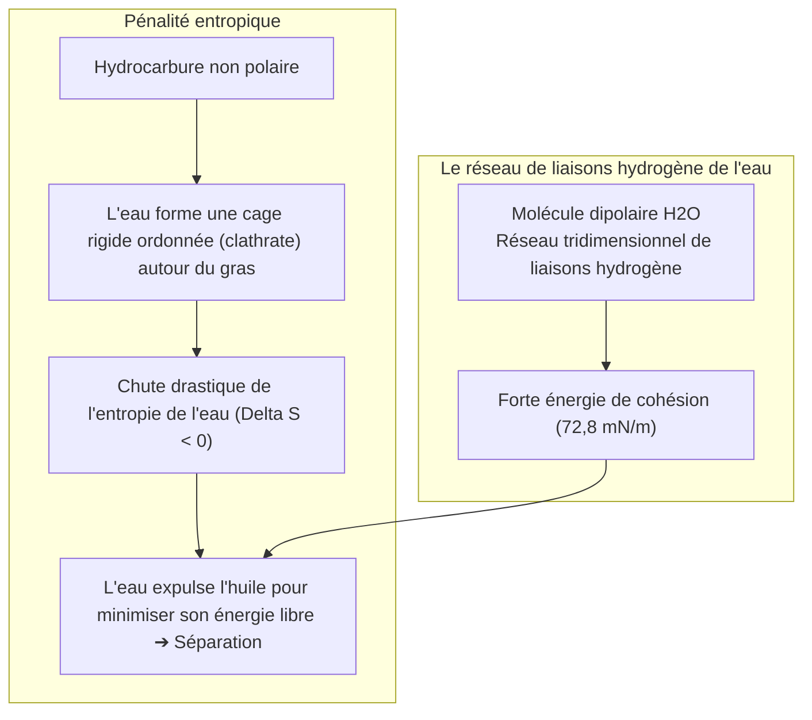
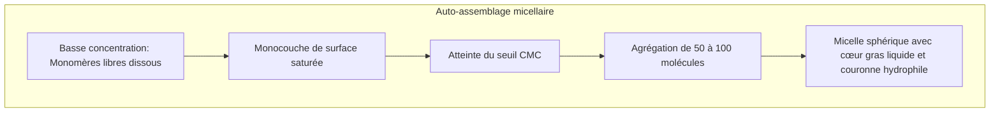

Une assiette couverte de graisse figée ou un vêtement souillé de sébum défie tout rinçage à l'eau pure. L'eau perle et glisse, laissant la tache huileuse solidement amarrée au textile.

Pourtant, quelques gouttes de savon suffisent pour opérer une métamorphose : l'eau et l'huile s'émulsionnent instantanément, le film gras s'enroule en gouttelettes sphériques et s'évacue dans l'eau de rinçage.

Des tablettes cunéiformes babyloniennes de 2500 av. J.-C. jusqu'aux poudres modernes enrichies en enzymes bio-ingénierées, le savon est l'un des piliers majeurs de l'hygiène humaine, ayant sauvé plus de vies que l'ensemble des antibiotiques.

Mais d'un point de vue physico-chimique :
« Pourquoi l'eau et l'huile refusent-elles de se mélanger ? »
« Par quel stratagème moléculaire le savon agit-il comme médiateur ? »
« La mousse abondante lave-t-elle véritablement le linge ? »
« Pourquoi le savon traditionnel est-il inefficace en eau calcaire ? »

Le nettoyage n'est pas un frottement abrasif : c'est <strong>« un équilibre thermodynamique subtil gouverné par l'exclusion hydrophobe entropique, la chute de tension superficielle de Gibbs, l'auto-assemblage supramoléculaire des micelles et les répulsions électrostatiques de double couche. »</strong>

---

## 1. La thermodynamique de l'effet hydrophobe

L'eau et l'huile ne se repoussent pas activement. La séparation de phase découle du fait que <strong>les molécules d'eau sont unies par des liaisons hydrogène si puissantes que les hydrocarbures non polaires en sont violemment exclus</strong>.

Chaque liaison hydrogène dégage environ $20\text{ kJ/mol}$. Pour entourer une molécule d'huile, l'eau s'organise en cages ordonnées, subissant une pénalité entropique majeure ($\Delta S < 0$). L'eau expulse alors l'huile pour recouvrer sa liberté conformationnelle.

---

## 2. Structure des tensioactifs et isotherme de Gibbs

Le tensioactif réconcilie ces phases grâce à sa structure <strong>amphiphile</strong> :
- <strong>Tête hydrophile</strong> : Polaire ou ionisée ($-\text{COO}^-$, $-\text{SO}_3^-$), soluble dans l'eau.
- <strong>Queue hydrophobe</strong> : Chaîne hydrocarbonée aliphatique ($C_{12} \sim C_{18}$).

À la surface de l'eau, les tensioactifs forment un film monomoléculaire qui abaisse la tension superficielle de <strong>$72,8\text{ mN/m}$ à $25 \sim 30\text{ mN/m}$</strong>, permettant au liquide d'infiltrer les micro-fibres textiles.

---

## 3. Concentration micellaire critique (CMC) et auto-assemblage

Lorsque la surface est saturée, les monomères s'assemblent spontanément au-delà de la <strong>CMC (Concentration Micellaire Critique)</strong> pour former des <strong>micelles</strong> sphériques (3 à 5 nm) :

Le cœur liquide des micelles piège et solubilise les molécules lipidiques insolubles.

---

## 4. Le mécanisme de décollement (Rolling-up)

En abaissant les tensions interfaciales eau-fibre et eau-huile, le tensioactif fait passer l'angle de contact de l'huile de $0^\circ$ à près de $180^\circ$ (équation de Young).
Le film gras se rétracte et <strong>s'enroule en gouttelettes sphériques (rolling-up)</strong>. L'agitation mécanique décroche les gouttes, les micelles les séquestrent, et le <strong>potentiel zêta négatif ($\zeta \approx -40\text{ mV}$)</strong> repousse électrostatiquement la saleté pour empêcher sa redéposition.

---

## 5. L'obstacle de l'eau dure et les zéolites

Le savon réagit avec le calcium des eaux dures pour former des <strong>savons métalliques insolubles (crasse de savon)</strong> :
$$2\text{C}_{17}\text{H}_{35}\text{COO}^- + \text{Ca}^{2+} \longrightarrow (\text{C}_{17}\text{H}_{35}\text{COO})_2\text{Ca} \downarrow$$
Les détergents modernes intègrent de la <strong>zéolite 4A</strong>, un échangeur d'ions qui piège le calcium et adoucit l'eau instantanément.

---

## 6. Enzymes et effet Marangoni de la mousse

- <strong>Enzymes bio-actives</strong> : Les protéases dissolvent le sang ; les lipases décomposent les graisses ; les <strong>cellulases</strong> rasent les microfibrilles usées du coton pour libérer les suies et raviver les couleurs.
- <strong>Effet Marangoni</strong> : La mousse s'auto-répare lorsque le film s'amincit, la tension superficielle locale augmentant pour rappeler du liquide. La mousse sert à faire flotter les suies et à amortir les chocs mécaniques.

---

## 7. Conclusion

Le savon est un chef-d'œuvre de la physico-chimie des colloïdes, manipulant l'entropie pour unir l'eau et l'huile au service de l'hygiène humaine.
